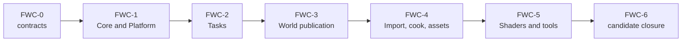

# First Release Implementation Plan

**Status:** release implementation orchestrator; ordered work, not implementation evidence or release approval

Start with [current progress](../../../Strategy/Roadmap.md#release-progress) for delivered work and missing checks. [Roadmap](../../../Strategy/Roadmap.md#where-we-are-and-what-is-next) selects the next task; this page supplies its phase brief.

[First Release Acceptance](../../../Acceptance/FirstRelease.md#release-gates) owns release verdicts. Feature-local Architecture checks and [candidate reports](../../../Acceptance/FeatureCompletionReports.md) own feature proof.

Choose the section for your current task: [release phases](#release-tasks), [Game/Editor/Launcher/package](#product-and-delivery), [paths/tasks/world/cook/shaders](#foundation-world-and-content), or [feature owners](#complete-feature-routing).

## Release Tasks

### `FR-00` — Scope And Discovery

**Goal:** approve one reviewable release scope of included, experimental, excluded, and removed behavior. Preserve the already accepted `PTD-00` development discovery; do not restart it or treat it as accepted release-map oracle evidence.

**Current handoff:** the owner approved all [six scope decisions](../../../Acceptance/FirstRelease.md#approval-and-next-work): three shipped products, seven selected maps, Launcher entry, user/display-selected resolution, approved defaults with chromatic aberration/vignette On, and no user support service. The laptop retains a fixed recorded 30 FPS acceptance benchmark. No product-choice answer remains pending; exact rights receipts and package/helper/configuration/content-store closure still block FR-00. Accepted PTD-00 development discovery is preserved.

**Non-goals:** implementation, optimistic scoring, adding target-only features, or treating the present reference path as an unbiased oracle.

**Failure modes:** unclassified selector; Architecture target mistaken for release scope; missing redistribution decision; `PTD-00` output incomplete; later work starts despite a blocked discovery gate.

**Phase exit criteria:** `REL-00` criteria are mapped to checks; every reachable option has a product classification; the release package contents are named; `PTD-00` records `PASS` or a blocking/re-scope decision.

### `FR-01` — Identity, Rights, And Baseline

**Goal:** make source, dependencies, assets, licenses, version identity, the initial build/cook/Game baseline, and approved fresh-checkout gate automation reproducible enough to start package work.

**Non-goals:** broad feature fixes, performance tuning, or publication.

**Failure modes:** mutable dependency; unidentified asset; dirty/generated state hidden; author-machine-only prerequisite; runtime result recorded without exact revision/configuration.

**Phase exit criteria:** `REL-01` and `REL-02` candidate records pass or name blockers; one baseline path has exact commands, versions, hashes, outputs, and cleanup.

### `FR-02` — Package Spine

**Goal:** complete `FCR-PROD-05` as one build → cook → stage → verify → package authority.

**Non-goals:** an installer, binary SDK, silent best-effort staging, or distributing authoring tools by accident.

**Failure modes:** source-tree mutation; stale stage contents; undeclared dependency; absolute/user path; manifest/archive mismatch; partial archive after failure; package works only with repository state.

**Phase exit criteria:** [Product phase `PD-3`](#pd-3--package-and-installation) passes and `REL-03` has clean-machine runtime evidence for the exact archive.

### `FR-03` — Feature Closure

**Goal:** close every included FCR family against its Architecture-owned contract in dependency order.

**Non-goals:** averaging readiness, accepting source presence, restoring superseded designs, or adding excluded capabilities.

**Failure modes:** orphan FCR; missing feature-local criterion; backend/mode/content gap; silent fallback; stale evidence reused after a change; feature passes but packaged route fails.

**Phase exit criteria:** all 49 primary owners in [Complete Feature Routing](#complete-feature-routing) have a candidate-bound result and `REL-04` passes.

### `FR-04` — Release Maps

**Goal:** turn the frozen `ReleaseMapSet` into representative correctness, artifact, and product-journey evidence.

**Non-goals:** choosing flattering viewpoints, using one screenshot as correctness proof, or adding map-specific renderer hacks.

**Failure modes:** missing workload coverage; reference/candidate mismatch; debug/exposure state omitted; warmed-only capture; cherry-picked output; map fix bypasses asset/renderer owner.

**Phase exit criteria:** every applicable `MAP-*` and specialist case has exact candidate identity, settings, references, artifacts, verdict, and invalidation triggers; `REL-05` passes.

### `FR-05` — Performance, Stability, And Native Proof

**Goal:** prove declared budgets, failure/recovery behavior, soaks, and native D3D12/Vulkan correctness for the same candidate.

**Non-goals:** installing an internal profiler product, presenting average FPS alone, or ignoring unsupported matrices.

**Failure modes:** observer changes result; no cold/steady distinction; validation warning dismissed; device loss called recovered; memory high-water omitted; backend divergence hidden.

**Phase exit criteria:** `REL-06`/`REL-07` pass with causal measurements, native diagnostics, controlled failure evidence, and exact candidate identity.

### `FR-06` — Candidate Freeze And Independent Adoption

**Goal:** freeze one byte-identical candidate and prove both runtime-consumer and source-adopter journeys by non-authors.

**Non-goals:** fixing the candidate in place, giving undocumented assistance, or counting the author as independent adoption.

**Failure modes:** hash drift; cached prerequisite; admin/environment dependency; private path; support instructions fail; issue causes an untracked rebuild.

**Phase exit criteria:** `REL-08` and `REL-09` pass; any fix creates a new candidate and invalidates affected evidence.

**Pre-release prerequisite:** obtain the deferred Windows publisher certificate, sign/timestamp and verify the final bytes before freezing this candidate. Enrollment is scheduled here by the release owner (2026-10-11), not as an FR-01 prerequisite. Unsigned development archives may exercise FR-02 packaging; they cannot satisfy this signed consumer/adoption gate. See the [roadmap task](../../../Strategy/Roadmap.md#where-we-are-and-what-is-next).

### `FR-07` — Publish And Verify

**Goal:** publish exactly the approved candidate and verify its public identity, downloads, documentation, and truthful no-support/self-service entry points.

**Non-goals:** last-minute feature work or replacing an approved artifact after publication.

**Failure modes:** tag/archive mismatch; wrong hashes; missing notices; unavailable download; public docs describe excluded behavior; public instructions invent a support service or omit self-service recovery.

**Phase exit criteria:** `REL-10` passes against downloaded artifacts, not local staging outputs.

### `FR-08` — Stabilize And Close

**Goal:** perform finite maintainer release review, disposition known candidate defects and close the release. No ongoing user support or response window is offered.

**Non-goals:** feature expansion, invisible archive replacement, or declaring success because no telemetry was collected.

**Failure modes:** known critical blocker omitted; replacement lacks provenance; defect cannot be reproduced; public bytes differ without a new version; false support promise.

**Phase exit criteria:** `REL-11` passes with a bounded release-review ledger, any required replacement/withdrawal records, no unresolved release blocker and a final accepted release report.

## Global Stop Conditions

Stop the current iteration when any of these is true:

- the required Architecture behavior or `AC/FM/CHK` is missing, contradictory, or no longer matches source;
- the change needs a product, rights, support, compatibility, or architecture decision outside its authority;
- an implementation would create a second mutable owner, semantic path, selector truth, or evidence truth;
- a required check is unavailable, inconclusive, or bound to a different candidate;
- the only route to passing is a silent fallback, map-specific workaround, compatibility layer, broad mutex, retry loop, or suppressed native diagnostic;
- the Reference Path Tracer work would cross from `PTD-00` discovery into implementation before the gate passes;
- the active candidate, package manifest, release map set, provider version, backend, or configuration changes without evidence invalidation.

## Explicitly Unscheduled Capabilities

The first release does not automatically schedule geometry-cache animation, neural graphics, volumetric lighting, frame generation, native Linux, a binary SDK, an installer, a full CI/regression product beyond the approved deterministic release gates, or an internal performance-dashboard product. Linux is excluded from the roadmap. The other Architecture dossiers retain their negative/target contracts. Deferred decals, color grading, chromatic aberration, and HDR10 output are explicitly scheduled release blockers through `FCR-REN-23` through `FCR-REN-26`; their acceptance remains open until the required implementation and evidence pass. Admit any other capability only by changing scope, adding/updating its FCR and feature-local acceptance, re-evaluating dependencies and risks, and invalidating affected release evidence.
## Phase Card Contract

Follow [Change Lifecycle](../../../Engineering/Workflow/ChangeLifecycle.md) and the owning feature checks. Inspect current source, preserve supported behavior, extend existing owners, delete replaced paths and record exact results. An unavailable check remains blocked. Phase briefs do not authorize scope expansion or broad builds unrelated to the affected claim.

## Complete Feature Routing

Every current `FCR-*` family has exactly one primary execution owner:

| Plan | Primary families | Count |
| --- | --- | ---: |
| [Product And Delivery](#product-and-delivery) | `FCR-PROD-01`–`06` | 6 |
| [Foundation, World, And Content](#foundation-world-and-content) | `FCR-CORE-01`, `FCR-PLAT-01`, `FCR-TASK-01`, `FCR-WORLD-01`–`03`, `FCR-CONT-01`–`03`, `FCR-SHDR-01`, `FCR-TOOL-01` | 11 |
| [RHI And GPU Execution](../../Modules/Engine/RHI/FirstReleasePlan.md) | `FCR-RHI-01`–`06` | 6 |
| [Renderer: Frame And Scene](../../Modules/Engine/Renderer/FirstRelease/FrameAndScene.md) | `FCR-REN-01`–`03` | 3 |
| [Renderer: Geometry And Ray Tracing](../../Modules/Engine/Renderer/FirstRelease/GeometryAndRayTracing.md) | `FCR-REN-04`, `05`, `12`, `17`, `21`, `23` | 6 |
| [Renderer: Lighting](../../Modules/Engine/Renderer/FirstRelease/Lighting.md) | `FCR-REN-06`–`08` | 3 |
| [Renderer: Display And Reconstruction](../../Modules/Engine/Renderer/FirstRelease/DisplayAndReconstruction.md) | `FCR-REN-09`, `10`, `14`, `15`, `18`, `22`, `24`–`26` | 9 |
| [Renderer: Runtime And Diagnostics](../../Modules/Engine/Renderer/FirstRelease/RuntimeAndDiagnostics.md) | `FCR-REN-11`, `13`, `16`, `19`, `20` | 5 |
| **Total** | **all current families** | **49** |

Cross-plan references are dependencies, not duplicate ownership. If the FCR registry changes, update this table and exactly one child owner in the same change.

### Feature Work-Package Registry

This is the exact one-to-one execution assignment. The phase owns implementation order; the linked Architecture owner still owns behavior and acceptance.

Expand feature work-package registry

| FCR | Primary phase | FCR | Primary phase |
| --- | --- | --- | --- |
| `FCR-PROD-01` | [`PD-1`](#pd-1--game-and-editor-product-shells) | `FCR-PROD-02` | [`PD-2`](#pd-2--source-build-cook-and-launcher) |
| `FCR-PROD-03` | [`PD-2`](#pd-2--source-build-cook-and-launcher) | `FCR-PROD-04` | [`PD-1`](#pd-1--game-and-editor-product-shells) |
| `FCR-PROD-05` | [`PD-3`](#pd-3--package-and-installation) | `FCR-PROD-06` | [`PD-4`](#pd-4--support-incident-response-and-product-closure) |
| `FCR-CORE-01` | [`FWC-1`](#fwc-1--core-and-windows-platform) | `FCR-PLAT-01` | [`FWC-1`](#fwc-1--core-and-windows-platform) |
| `FCR-TASK-01` | [`FWC-2`](#fwc-2--task-runtime-and-cancellation) | `FCR-WORLD-01` | [`FWC-3`](#fwc-3--level-world-and-render-publication) |
| `FCR-WORLD-02` | [`FWC-3`](#fwc-3--level-world-and-render-publication) | `FCR-WORLD-03` | [`FWC-3`](#fwc-3--level-world-and-render-publication) |
| `FCR-CONT-01` | [`FWC-4`](#fwc-4--import-cook-and-engine-assets) | `FCR-CONT-02` | [`FWC-4`](#fwc-4--import-cook-and-engine-assets) |
| `FCR-CONT-03` | [`FWC-4`](#fwc-4--import-cook-and-engine-assets) | `FCR-SHDR-01` | [`FWC-5`](#fwc-5--shader-route-and-shared-tool-output) |
| `FCR-TOOL-01` | [`FWC-5`](#fwc-5--shader-route-and-shared-tool-output) | `FCR-RHI-01` | [`RHI-1`](../../Modules/Engine/RHI/FirstReleasePlan.md#rhi-1--device-resources-descriptors-and-lifetime) |
| `FCR-RHI-02` | [`RHI-2`](../../Modules/Engine/RHI/FirstReleasePlan.md#rhi-2--command-recording-synchronization-resize-and-present) | `FCR-RHI-03` | [`RHI-3`](../../Modules/Engine/RHI/FirstReleasePlan.md#rhi-3--paired-backend-lowering) |
| `FCR-RHI-04` | [`RHI-4`](../../Modules/Engine/RHI/FirstReleasePlan.md#rhi-4--ray-tracing-and-acceleration-structure-execution) | `FCR-RHI-05` | [`RHI-5`](../../Modules/Engine/RHI/FirstReleasePlan.md#rhi-5--diagnostics-capture-device-loss-and-recovery) |
| `FCR-RHI-06` | [`RHI-5`](../../Modules/Engine/RHI/FirstReleasePlan.md#rhi-5--diagnostics-capture-device-loss-and-recovery) | `FCR-REN-01` | [`FS-1`](../../Modules/Engine/Renderer/FirstRelease/FrameAndScene.md#fs-1--frame-admission-and-coordination) |
| `FCR-REN-02` | [`FS-2`](../../Modules/Engine/Renderer/FirstRelease/FrameAndScene.md#fs-2--scene-view-and-gpu-scene-preparation) | `FCR-REN-03` | [`FS-3`](../../Modules/Engine/Renderer/FirstRelease/FrameAndScene.md#fs-3--frame-graph-compile-and-execution) |
| `FCR-REN-04` | [`GR-2`](../../Modules/Engine/Renderer/FirstRelease/GeometryAndRayTracing.md#gr-2--visibility-draw-preparation-and-raster-gbuffer) | `FCR-REN-05` | [`GR-4`](../../Modules/Engine/Renderer/FirstRelease/GeometryAndRayTracing.md#gr-4--ray-traced-gbuffer) |
| `FCR-REN-06` | [`LGT-1`](../../Modules/Engine/Renderer/FirstRelease/Lighting.md#lgt-1--direct-lighting) | `FCR-REN-07` | [`LGT-2`](../../Modules/Engine/Renderer/FirstRelease/Lighting.md#lgt-2--indirect-lighting) |
| `FCR-REN-08` | [`LGT-3`](../../Modules/Engine/Renderer/FirstRelease/Lighting.md#lgt-3--preserve-discovery-and-close-the-required-reference), then the accepted [staged `PTD-01` plan](../../Modules/Engine/Renderer/Features/Lighting/ReferencePathTracer/Plan.md) | `FCR-REN-09` | [`DSP-2`](../../Modules/Engine/Renderer/FirstRelease/DisplayAndReconstruction.md#dsp-2--exposure) |
| `FCR-REN-10` | [`DSP-3`](../../Modules/Engine/Renderer/FirstRelease/DisplayAndReconstruction.md#dsp-3--image-reconstruction-and-provider-integration) | `FCR-REN-11` | [`RD-3`](../../Modules/Engine/Renderer/FirstRelease/RuntimeAndDiagnostics.md#rd-3--debug-views-diagnostics-products-and-capture) |
| `FCR-REN-12` | [`GR-3`](../../Modules/Engine/Renderer/FirstRelease/GeometryAndRayTracing.md#gr-3--renderer-tlas-policy-and-publication) | `FCR-REN-13` | [`RD-4`](../../Modules/Engine/Renderer/FirstRelease/RuntimeAndDiagnostics.md#rd-4--ui-and-viewport-composition) |
| `FCR-REN-14` | [`DSP-4`](../../Modules/Engine/Renderer/FirstRelease/DisplayAndReconstruction.md#dsp-4--tone-mapping-encoding-and-presentation) | `FCR-REN-15` | [`DSP-4`](../../Modules/Engine/Renderer/FirstRelease/DisplayAndReconstruction.md#dsp-4--tone-mapping-encoding-and-presentation) |
| `FCR-REN-16` | [`RD-1`](../../Modules/Engine/Renderer/FirstRelease/RuntimeAndDiagnostics.md#rd-1--pipeline-materialization-and-typed-binding) | `FCR-REN-17` | [`GR-1`](../../Modules/Engine/Renderer/FirstRelease/GeometryAndRayTracing.md#gr-1--mesh-and-texture-residency) |
| `FCR-REN-18` | [`DSP-1`](../../Modules/Engine/Renderer/FirstRelease/DisplayAndReconstruction.md#dsp-1--temporal-sampling-history-resolution-and-aa-truth) | `FCR-REN-19` | [`RD-2`](../../Modules/Engine/Renderer/FirstRelease/RuntimeAndDiagnostics.md#rd-2--settings-state-and-persistence) |
| `FCR-REN-20` | [`RD-5`](../../Modules/Engine/Renderer/FirstRelease/RuntimeAndDiagnostics.md#rd-5--latency-coordination) | `FCR-REN-21` | [`GR-2`](../../Modules/Engine/Renderer/FirstRelease/GeometryAndRayTracing.md#gr-2--visibility-draw-preparation-and-raster-gbuffer) |
| `FCR-REN-22` | [`DSP-1`](../../Modules/Engine/Renderer/FirstRelease/DisplayAndReconstruction.md#dsp-1--temporal-sampling-history-resolution-and-aa-truth) | `FCR-REN-23` | [`GR-5`](../../Modules/Engine/Renderer/FirstRelease/GeometryAndRayTracing.md#gr-5--deferred-gbuffer-decals) |
| `FCR-REN-24` | [`DSP-5`](../../Modules/Engine/Renderer/FirstRelease/DisplayAndReconstruction.md#dsp-5--color-grading) | `FCR-REN-25` | [`DSP-6`](../../Modules/Engine/Renderer/FirstRelease/DisplayAndReconstruction.md#dsp-6--chromatic-aberration-and-vignette) |
| `FCR-REN-26` | [`DSP-7`](../../Modules/Engine/Renderer/FirstRelease/DisplayAndReconstruction.md#dsp-7--hdr10-display-output) | — | — |

## Product And Delivery

Deliver Sparkle Launcher, Sparkle Editor and Sparkle Game with user-selected release content, a reproducible source build and self-service recovery.

### Product Work

[Current progress](../../../Strategy/Roadmap.md#release-progress) separates implemented work from missing acceptance checks. Do not use the phase order below as a claim that earlier source work is absent.

**Next:** qualify [reviewed package inputs](../../Modules/BuildAndPackaging/PackagingAndInstallation.md#reviewed-package-inputs), then continue [PD-3](#pd-3--package-and-installation) to produce the exact archive. Complete missing PD-1/PD-2 checks in their existing owners; PD-4's native package checks wait for that archive. Admission blockers remain stops, not waivers.

### `PD-1` — Game And Editor Product Shells

**Goal:** close `FCR-PROD-01` and the required shipped Editor family `FCR-PROD-04` so the first run, controls, settings, level selection, failure, reset, and exit are intentional.

**Non-goals:** turning Showcase into a general sample browser framework, adding a general Editor framework, or hiding engine failures behind generic dialogs.

**Required work:**

- preserve `GameApplication` as game host and extend the current Showcase entry/product path rather than adding a second launcher;
- make the expected Launcher -> Editor/Game entry, selected-map activation, loading state, controls/help, settings/reset/quit and unsupported-state messaging discoverable; use user/display-selected resolution and approved chromatic aberration/vignette On defaults; keep benchmark resolution separate;
- ensure level failure cannot silently become successful `Empty` content and settings resolve requested versus active state truthfully;
- keep Editor layering explicit; prove its required shipped journey and keep Editor dependencies isolated from the Game component;
- use representative fresh-user, standard-user, resize/DPI, missing/corrupt content, unsupported-provider, and shutdown routes from the owned contracts.

**Failure modes to control:** blank first frame; trapped mouse/focus; stale settings; load failure shown as success; editor-only service required by Game; quit leaves work or files in flight; fallback is active but hidden.

**Phase exit criteria:** the feature-local checks for `FCR-PROD-01` and the selected `FCR-PROD-04` scope pass on the exact configuration; all three products are represented truthfully and Game imports no Editor/authoring dependency; results are filed in candidate FCR reports.

### `PD-2` — Source Build, Cook, And Launcher

**Goal:** close `FCR-PROD-02` and `FCR-PROD-03` with one documented underlying operation model usable directly and through the required shipped Launcher for the seven release maps.

**Non-goals:** making launcher UI the only automation API, duplicating build/cook logic in GUI code, or accepting warmed author-machine state.

**Required work:**

- pin public prerequisites and dependency identities; define supported profiles, outputs, cleanup, and source compatibility statement;
- add a fresh-checkout automation entry for the approved deterministic build/static/package gates; it invokes owner checks and reports failed, timed-out, cancelled, skipped, unavailable, and missing-artifact states without reinterpretation;
- keep sync/configure/build/cook/run/clean as typed operations with one execution authority and truthful process result;
- make Launcher discovery, readiness, progress, cancellation, error detail, retry/restart and concurrent-action exclusion explicit; qualify Empty, each of the seven maps and a selected subset with exact sync/helper closure, marking other choices development or unavailable;
- prove cold and warm build/cook paths plus missing tool, bad path, canceled operation, failed child, locked output, stale cook, and Unicode/path quoting behavior;
- ensure direct command and launcher invoke equivalent underlying semantics and artifacts.

**Failure modes to control:** false-success summary; launcher PID mistaken for launched runtime; partial cook published; cancel leaves child processes; clean deletes unowned files; prerequisite is fetched mutably; GUI command differs from documented CLI.

**Phase exit criteria:** independent source-adopter rehearsal produces the named runtime through documented prerequisites; launcher classification is enforced; direct and GUI routes agree; exact logs/artifacts and negative results are in the FCR reports.

### `PD-3` — Package And Installation

**Goal:** implement the missing `FCR-PROD-05` owner and pass `REL-03` with a manifest-owned three-product portable Windows x64 bundle and verified user-selected content store.

**Non-goals:** an installer, registry integration, a binary SDK, package self-modification, or bundling developer tools/source/debug files without explicit admission.

**Required work:**

- select one existing build/delivery owner for build → cook → stage → verify → package; do not put packaging policy in renderer or application code;
- add explicit install/stage membership, component/allowlist policy, package-relative discovery, per-user writable state, manifests, notices/SBOM, provenance, hashes, and symbols handling;
- make staging fresh and transactional; reject stale, missing, extra, absolute, unlicensed, or incompatible products;
- create the archive from an immutable verified stage, then verify archive contents against `manifests/sparkle-package-manifest.json`;
- freeze exact Launcher/Editor/Game release configurations, executable names, helper closure and content-store/workspace paths; prove extract/start/selective-sync/offline-run/remove with no source checkout, undeclared toolchain, admin rights, environment override or author cache. CMake's [install rules](https://cmake.org/cmake/help/latest/command/install.html) are a mechanics reference, not an instruction to expose internal targets.

**Failure modes to control:** stage accumulates leftovers; runtime writes beside executable; package relies on current directory; missing redistributable/provider DLL; manifest mismatch; source/private path leak; archive emitted after verification failure.

**Phase exit criteria:** the Architecture-owned `FCR-PROD-05` criteria and `REL-03` pass for the exact archive; a clean standard-user machine route is retained; stage/package failure leaves no publishable partial artifact.

### `PD-4` — Support, Incident Response, And Product Closure

**Goal:** close the amended `FCR-PROD-06`: self-service onboarding, local diagnostics, known-issue review and immutable replacement, with no user support service.

**Non-goals:** silent telemetry, collecting private state by default, promising perpetual compatibility, or calling documentation an operated process.

**Required work:**

- publish truthful no-support and known-issue/self-service instructions; define local diagnostic privacy, retention, symbols and finite release-review ownership;
- connect process crash/hang and GPU/device diagnostics to a bounded user-visible collection/export route without leaking paths or content;
- define immutable patch identity, applicability, rollback/withdrawal/advisory, and evidence invalidation;
- rehearse one crash, one hang/timeout if supported, one GPU/device diagnostic route, one critical-defect review, and one replacement/withdraw decision;
- reconcile all six product FCR reports against the same candidate and package identity. Unreal's [crash-reporting architecture](https://dev.epicgames.com/documentation/en-us/unreal-engine/crash-reporting-in-unreal-engine) is a responsibility reference only; no Epic service is assumed.

**Failure modes to control:** report loses candidate identity; consent bypass; private paths or content escape; symbols cannot match build; unsupported recovery promised; patch replaces public bytes under same version; public policy invents an intake or response promise.

**Phase exit criteria:** all three self-service journeys and local-diagnostic routes were exercised; no service deadline is advertised; failures preserve consent and identity; patch policy is reproducible; all six FCR reports have explicit candidate-bound verdicts and residual limitations.

### Plan Completion

This plan is complete only when all six product FCRs have Architecture-owned contracts, exact candidate reports, and no unresolved blocker for their admitted scope. The release is not complete until the mother plan's remaining map, native, adoption, publication, and stabilization gates pass.

### Reference And Ownership

Exact owners, source snapshots and related contracts

**Responsibility:** sequence the first-release product journeys, source/Launcher workflows, three-product archive and self-service diagnostics

**Orchestrator:** [First Release Implementation Plan](README.md)

**Architecture owners:** [Projects/Showcase](../../Modules/Projects/Showcase/README.md), [Application](../../Modules/Engine/Application/README.md), [Editor](../../Modules/Engine/Editor/README.md), [Launcher](../../Modules/Tools/Launcher/README.md), and [Build And Packaging](../../Modules/BuildAndPackaging/README.md)

## Foundation, World And Content

Make paths, tasks, worlds, content and shaders dependable enough for the selected release.

### Foundation Work

| What to do | Working route |
| --- | --- |
| First action | [FWC-0 contract review](#fwc-0--reconcile-feature-contracts-and-boundaries): identify which producer/consumer promise lacks a decidable check before changing its code. |
| Result to reach | Each of the 11 families has one owner, a supported matrix and exact failure/check routes; then repair only the selected dependency. |
| Start / stop | Follow release admission and the local dependency chain. A proven blocker may be repaired through its own authorized route; do not start a broad foundation rewrite. |

### `FWC-0` — Reconcile Feature Contracts And Boundaries

**Goal:** make the 11 foundation families independently decidable and trace their real production edges before edits.

**Non-goals:** a new foundation framework, copying Renderer criteria into GameFramework, or inferring completeness from file presence.

**Required work:**

- trace every family from public producer through mutable owner, publication boundary, consumer, shutdown, and package membership;
- add/refine feature-local `AC/FM/CHK` in the owning Architecture pages where the release promise is not already binary;
- define supported path/Unicode/platform, task worker counts, level/content set, import formats, shader backends, CLI output, and package matrices;
- name copy/lifetime budgets for world-to-render and cook publication, plus which derived outputs are disposable;
- record absent/excluded behavior, especially native Linux, uncooked runtime loading, undeclared import extensions, and internal shader redesign not required by a failing criterion.

**Failure modes to control:** broad module criterion cannot be tested; producer and consumer use different identity; derived cache becomes source truth; shutdown ownership is absent; Windows-only promise is hidden.

**Phase exit criteria:** each family has an owner, end-to-end trace, matrix, binary criteria, controlled failures, mapped checks, current-state verdict, and stop decisions.

### `FWC-1` — Core And Windows Platform

**Goal:** close `FCR-CORE-01` and `FCR-PLAT-01` for standard-user Windows x64 operation and safe platform failure.

**Non-goals:** native Linux implementation, broad utility rewrites, or platform policy leaking into higher modules.

**Required work:**

- reconcile path roots, filesystem operations, logging/diagnostics, configuration, strings/Unicode, errors, and package/per-user locations;
- reconcile Win32 window/input/focus/capture, DPI/monitor changes, resize/minimize/restore, timing, handles, and shutdown;
- use typed error identity at the lowest owner and keep bounded diagnostics useful to product support;
- reject path escape, overlength/invalid input, read-only package mutation, unsupported environment, and invalid window/input transitions safely;
- preserve the explicit native-Linux negative boundary and avoid portable-looking APIs that are not supported.

**Failure modes to control:** current-directory dependence; user path truncation; config corruption destroys last good state; input remains captured after focus loss; zero-size resize reaches Renderer; handle leak; log growth is unbounded.

**Phase exit criteria:** the defined path/Unicode/config/window/input/DPI/focus/resize/shutdown matrices pass; package stays immutable; native Linux remains truthfully unavailable; candidate reports carry exact environment/results.

### `FWC-2` — Task Runtime And Cancellation

**Goal:** close `FCR-TASK-01` with one deterministic-enough task contract across serial and `1/2/N` worker modes.

**Non-goals:** replacing domain schedulers with one generic graph, forcing parallelism where serial wins, or adding unmeasured lock-free machinery.

**Required work:**

- identify executor, scope/event, queue, nested work, waiting, cancellation, exception/failure, destruction, and shutdown owners;
- define input/output identity, serial reference behavior, deterministic ordering requirements, exclusive writable ranges, and publication policy per consumer;
- bound queues/workers, prevent oversubscription/deadlock, and make work-in-flight shutdown settle or fail explicitly;
- preserve consumer-specific orchestration while reusing the shared execution mechanism;
- measure scheduling overhead, queue pressure, throughput, latency, and serial crossover causally.

**Failure modes to control:** nested wait deadlock; task escapes owner lifetime; canceled work publishes partially; exception disappears; queue grows unbounded; shutdown hangs; more workers regress without visibility.

**Phase exit criteria:** all owned task criteria pass for serial/1/2/N and pressure/failure/shutdown matrices; consumer parity is demonstrated; performance conclusions include raw measurements and crossover.

### `FWC-3` — Level, World, And Render Publication

**Goal:** close `FCR-WORLD-01`, `02`, and `03` from catalog selection through deterministic activation and immutable render submission.

**Non-goals:** Renderer querying ECS state, a second scene database, or accepting `Empty` as silent recovery from a requested level failure.

**Required work:**

- make level identity, load graph, cancellation, transactional activation, switch/reload, old-world retirement, and failure UI explicit;
- keep world state GameFramework-owned and publish structural deltas, dynamic data, resource tables, and view input through one immutable boundary;
- reconcile stable/generation identity for entity, geometry, material, light, camera, animation, and sky data across deletion/reuse/reload;
- prove coordinate/units, transforms, camera controls, static/skinned/morph animation, material variants, four light kinds, bounds/history, and invalid-data policy;
- measure extraction copies/cost, memory high-water, ordering, and in-flight safety.

**Failure modes to control:** stale entity generation; new level partially visible; canceled load activates; delete/reuse aliases old GPU data; malformed asset becomes valid default silently; animation bounds/history lag; extraction races consumer.

**Phase exit criteria:** lifecycle, semantic, identity, cancellation, reload, concurrency, and cost checks pass for the admitted map/content set; Renderer consumes only published frame data; reports for all three families agree on candidate identity.

### `FWC-4` — Import, Cook, And Engine Assets

**Goal:** close `FCR-CONT-01`, `02`, and `03` with deterministic, provenance-preserving, transactional source-to-package products.

**Non-goals:** runtime source import, retaining arbitrary author files in the runtime package, or treating cooked output as irreplaceable source truth.

**Required work:**

- inventory accepted glTF/GLB/FBX inputs, external/embedded dependencies, provenance, coordinate/tangent/material/alpha/animation semantics, and rejection limits;
- keep import normalization, cook planning, product serialization, manifest publication, and runtime loading as explicit owned stages;
- make cook publication atomic and reject stale/incompatible/incomplete dependencies; bound parallel jobs, memory, path traversal, and oversized/malformed input;
- establish release allowlists and per-file license/provenance for engine assets, semantic defaults, fixtures, shaders/includes, and sky assets;
- prove deterministic semantic identity and clean regeneration without requiring byte identity where tools legitimately differ.

**Failure modes to control:** path escape; missing external texture; malformed/oversized asset consumes unbounded resources; partial cook replaces good generation; stale schema accepted; default texture has wrong meaning; undeclared fixture/package dependency.

**Phase exit criteria:** supported inputs produce complete package-relative products; negative inputs fail without partial publication; manifests and rights are complete; clean regeneration and runtime consumption pass for the frozen content set.

### `FWC-5` — Shader Route And Shared Tool Output

**Goal:** close `FCR-SHDR-01` and `FCR-TOOL-01` from registration through cooked code/reflection to runtime pipeline consumers, with truthful script-readable tool behavior.

**Non-goals:** executing the entire [Shader System target plan](../ShaderSystem/Plan.md) merely because it exists, preserving legacy shader layouts, or adding a second diagnostic schema.

**Required work:**

- reconcile registrations, build membership, job planning, include/dependency identity, DXIL/SPIR-V compile/reflection, code-library publication, runtime consumption, replacement, and retirement;
- require every selected job/parameter/domain to be represented and reject ABI/reflection mismatch before use;
- make compiler/cook replacement transactional; keep last good generation only where Architecture explicitly owns that safe state, never as a silent compatibility route;
- unify message severity, stdout/stderr, process result, progress, summary, fields, path quoting/redaction, and cancellation across every ToolConsoleSupport consumer;
- invoke a phase of the existing Shader System plan only when a failing release criterion requires that architecture; otherwise close the current route with minimal change.

**Failure modes to control:** registered shader not built; stale include identity; DXIL/SPIR-V divergence; corrupt library accepted; in-flight generation freed; tool exits zero on failure; progress floods output; private path leaks.

**Phase exit criteria:** admitted shader matrix compiles, reflects, publishes, materializes, replaces/fails safely, and packages on both backends; every tool consumer obeys the shared output/exit contract; exact reports are candidate-bound.

### `FWC-6` — Foundation Candidate Closure

**Goal:** reconcile all 11 families on the same package candidate and prove their cross-boundary invariants.

**Non-goals:** using an integration smoke to replace feature checks or changing code while preserving old evidence.

**Required work:** run the package-relative source/content/world/render journey, verify candidate hashes and evidence coverage, close all missing negative checks, and inspect for duplicate owners, stale paths, unbounded work, undeclared package inputs, or invalidated results.

**Failure modes to control:** individually passing components disagree on identity; author cache masks dependency; candidate changed after a report; unavailable check marked pass; one backend consumes a different cooked/shader generation.

**Phase exit criteria:** every foundation FCR has a complete candidate report with criteria/failures/checks, limitations, invalidation triggers, and a `PASS`, `BLOCKED`, `EXCLUDED`, or `SUPERSEDED` decision.

### Foundation: Reference And Ownership

Exact owners, source snapshots and related contracts

**Responsibility:** sequence closure of the CPU/platform substrate and the world, content, shader, and tool paths consumed by the release

**Orchestrator:** [First Release Implementation Plan](README.md)

**Primary Architecture route:** [Engine modules](../../Modules/Engine/README.md), [Tools](../../Modules/Tools/README.md), [Shader System](../ShaderSystem/README.md), and [Multithreaded Engine](../MultithreadedEngine.md)

### Outcome And Dependency Chain

Close the CPU/platform substrate, task execution, world lifecycle/publication, source-to-cooked content path, shader path, and shared tool contract that the package and Renderer consume.

| Phase | Primary families | Current state |
| --- | --- | --- |
| `FWC-0` | all 11 | source routes are described; several module-level release contracts require criterion-level reconciliation |
| `FWC-1` | `FCR-CORE-01`, `FCR-PLAT-01` | broad integrated source, no candidate matrix |
| `FWC-2` | `FCR-TASK-01` | shared executor is integrated, pressure/failure/performance proof absent |
| `FWC-3` | `FCR-WORLD-01`–`03` | cooked world and render publication exist, lifecycle/semantic proof absent |
| `FWC-4` | `FCR-CONT-01`–`03` | import/cook/assets exist, deterministic/package/failure proof absent |
| `FWC-5` | `FCR-SHDR-01`, `FCR-TOOL-01` | shader/tool routes exist, parity/ABI/transactional and CLI-contract proof absent |
| `FWC-6` | all 11 | candidate reports absent |

The phases follow the [common phase contract](README.md#phase-card-contract). Reference systems supply questions, not goals: Unreal's [Tasks](https://dev.epicgames.com/documentation/unreal-engine/tasks-systems-in-unreal-engine?lang=en-US), [Asset Management](https://dev.epicgames.com/documentation/unreal-engine/asset-management-in-unreal-engine), [asynchronous loading](https://dev.epicgames.com/documentation/unreal-engine/asynchronous-asset-loading-in-unreal-engine?lang=en-US), and [Derived Data Cache](https://dev.epicgames.com/documentation/en-us/unreal-engine/using-derived-data-cache-in-unreal-engine) clarify dependency, identity, async-lifetime, and disposable-derived-data concerns. Sparkle keeps its existing owners and contracts.
