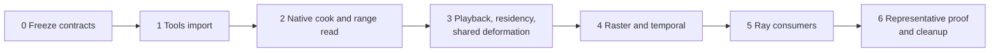

# Geometry Cache Animation Delivery Plan

[Docs](../../../README.md) / [Up](GeometryCacheAnimationDesign.md)

Stages: [Phase 0](#phase-0---freeze-source-authoring-and-evidence-contracts) / [Phase 1](#phase-1---tools-only-alembic-import) / [Phase 2](#phase-2---native-cook-codec-and-range-reader) / [Phase 3](#phase-3---playback-residency-and-shared-deformation-foundation) / [Phase 4](#phase-4---rasterized-gbuffer-and-temporal-acceptance) / [Phase 5](#phase-5---ray-traced-gbuffer-reflections-and-gi) / [Phase 6](#phase-6---modern-sponza-knight-acceptance-preparation-and-cleanup).

**Status:** implementation plan; not proof of implementation or acceptance

**Scope:** staged delivery of geometry-cache import, cooking, playback, residency, shared deformation, ray integration, and validation

**Architecture authority:** [Geometry Cache Animation Pipeline](GeometryCacheAnimationDesign.md)

**Feature acceptance:** [Geometry Cache Animation — Acceptance](Acceptance.md)

**Related current readiness:** **0/100 — target only.** No geometry-cache import, cook, playback, shared deformation, or raster/ray consumer route was found; this plan adds no implementation credit. See [Current Feature Readiness](../../../Acceptance/CurrentReadiness.md#explicit-missing-or-not-yet-admitted-capabilities).

This plan owns delivery order, dependencies, and phase exit sequence. It does not redefine the architecture, own the final acceptance criteria, or prove that any phase is complete.

## Delivery At A Glance



The order follows the cheapest trustworthy oracle: normalized source samples must be provable before compression, seek, playback, GPU deformation, or visual output can be believed. Each phase leaves one usable lower layer but does not advertise later capability. A static pose, full-file memory expansion, or separate raster/ray deformation is a failed exit rather than a temporary feature claim.

## Staged Delivery

Each phase is independently reviewable. A later phase starts only after the preceding exit gate is recorded. No phase may advertise animation from a frozen pose or a static fallback. Temporary reference code is deleted in the phase that replaces it.

### Phase 0 - Freeze source, authoring, and evidence contracts

- inventory every Alembic track, sample time, topology count, face set, material name, attribute scope, visibility sample, transform, bound, unit/axis cue, and archive time range for the Knight and a tiny licensed fixture;
- freeze the source-description syntax and extension, exact material binding rule, coordinate override rule, stable render-vertex expansion, generated normal/tangent policy, playback defaults, and source-root safety rules;
- freeze constant-topology support and source-located rejection messages for every excluded schema;
- define the imported and current cooked schema, clean-break regeneration policy, asset identity, maximum counts/bytes, checksum policy, and range-read validation;
- select fixed raster/ray cameras, playback intervals, loop/seek cases, motion-vector inspection, profiler fields, and accepted memory/frame budgets before implementation;
- record the measured reference output for at least two Knight samples independently of Sparkle.

Exit: contracts and fixtures are reviewed, archive facts are recorded, budgets are named, and there is no runtime feature claim.

<details>
<summary>Copy implementation prompt</summary>

```text
Execute only Phase 0 from Docs/Architecture/CrossModule/GeometryCacheAnimation/ImplementationPlan.md#phase-0---freeze-source-authoring-and-evidence-contracts.
Task: Freeze source, authoring, and evidence contracts. Complete only its remaining work using the stage requirements and owning checks.
Check prerequisites; reuse completed work and follow repository conventions. Record exact candidate/configuration, commands and exit results. Stop on unresolved contracts or unavailable required checks.
```

</details>

### Phase 1 - Tools-only Alembic import

- add one pinned Alembic dependency to the content-pipeline build only, with license and reproducible dependency configuration;
- extend the existing source-discovery/importer registry rather than adding an AssetCooker special case;
- parse the source description, Alembic archive, and optional ordinary material-library source;
- produce `ImportedGeometryCache` tracks in canonical Sparkle space/metres with exact material bindings;
- reject unstable topology, vertex identity, batches, unsupported primitives, invalid sample times, non-finite attributes, and unsafe dependent paths;
- add deterministic importer tests for coordinates, time, attributes, face sets, multi-track input, and negative cases.

Exit: the tiny fixture and Knight source import deterministically into the canonical model; no cooked/runtime support is claimed; Alembic symbols are absent from Engine, Renderer, and game binaries.

<details>
<summary>Copy implementation prompt</summary>

```text
Execute only Phase 1 from Docs/Architecture/CrossModule/GeometryCacheAnimation/ImplementationPlan.md#phase-1---tools-only-alembic-import.
Task: Tools-only Alembic import. Complete only its remaining work using the stage requirements and owning checks.
Check prerequisites; reuse completed work and follow repository conventions. Record exact candidate/configuration, commands and exit results. Stop on unresolved contracts or unavailable required checks.
```

</details>

### Phase 2 - Native cook, codec, and range reader

- add the native geometry-cache asset, manifest reference, path helper, cooker output, and atomic generation staging;
- keep static topology/UV/material sections once and write independently decodable time chunks;
- measure candidate chunk durations and one production codec on the fixture and Knight, then retain one selected implementation;
- validate header/directory arithmetic, decompression bounds, checksums, truncated/corrupt data, deterministic output hashes, and source recook invalidation;
- make scene loading retain only validated metadata/directory state while bulk samples remain range-readable;
- publish ordinary material assets through the existing material cooker and prove every face-set mapping.

Exit: cook/read/seek/decode tests reproduce source samples within the frozen numeric tolerance; compressed size, peak cook memory, range-read bytes, and decode time meet the Phase 0 budgets; no runtime draw is claimed.

<details>
<summary>Copy implementation prompt</summary>

```text
Execute only Phase 2 from Docs/Architecture/CrossModule/GeometryCacheAnimation/ImplementationPlan.md#phase-2---native-cook-codec-and-range-reader.
Task: Native cook, codec, and range reader. Complete only its remaining work using the stage requirements and owning checks.
Check prerequisites; reuse completed work and follow repository conventions. Record exact candidate/configuration, commands and exit results. Stop on unresolved contracts or unavailable required checks.
```

</details>

### Phase 3 - Playback, residency, and shared deformation foundation

- add geometry-cache asset/resource handles, scene-manifest records, instance construction, playback component, system ordering, and compact extraction requests;
- extend the existing render-object classification and lifecycle with geometry-cache topology plus a cache handle;
- add bounded look-ahead range requests through `SparkleTasks`, `AssetResidency`, scene cancellation, and submission-safe retirement;
- extend `RenderDeformationPreparation` with cache sample resolution and discontinuity history;
- allocate the shared deformed-geometry pool and add one frame-graph compute producer before ray-scene/GBuffer consumers;
- test pause, play rate, loop wrap, seek, unload/reload, cancellation, starvation, zero-content omission, and current/previous output on a compute-readback fixture.

Exit: deterministic GPU readback matches the CPU sample oracle on D3D12 and Vulkan; bounds/visibility and history resets are correct; memory remains bounded during long playback and random seeks; rendering is not yet accepted.

<details>
<summary>Copy implementation prompt</summary>

```text
Execute only Phase 3 from Docs/Architecture/CrossModule/GeometryCacheAnimation/ImplementationPlan.md#phase-3---playback-residency-and-shared-deformation-foundation.
Task: Playback, residency, and shared deformation foundation. Complete only its remaining work using the stage requirements and owning checks.
Check prerequisites; reuse completed work and follow repository conventions. Record exact candidate/configuration, commands and exit results. Stop on unresolved contracts or unavailable required checks.
```

</details>

### Phase 4 - Rasterized GBuffer and temporal acceptance

- add the geometry-cache range to existing draw and GPU-scene payloads without changing static/skeletal behavior;
- make the GBuffer vertex path fetch shared current/previous positions, normals, and tangents while retaining static UV/index/material data;
- include current sample bounds in culling and batching without creating a geometry-cache draw list when the ordinary mesh batching contract can be extended;
- validate opaque and alpha-tested material sections, normal mapping, motion vectors, pause, loop, seek, camera motion, and object motion;
- compare fixed sample times against the independent source reference and capture D3D12/Vulkan image parity;
- measure streaming, decode, upload, deformation-dispatch, raster, frame-time, and CPU/GPU memory high-water.

Exit: the fixture and Knight visibly deform at correct scale, placement, material slots, and time in rasterized GBuffer on both backends; motion/discontinuity tests pass; no static or first-frame fallback is active.

<details>
<summary>Copy implementation prompt</summary>

```text
Execute only Phase 4 from Docs/Architecture/CrossModule/GeometryCacheAnimation/ImplementationPlan.md#phase-4---rasterized-gbuffer-and-temporal-acceptance.
Task: Rasterized GBuffer and temporal acceptance. Complete only its remaining work using the stage requirements and owning checks.
Check prerequisites; reuse completed work and follow repository conventions. Record exact candidate/configuration, commands and exit results. Stop on unresolved contracts or unavailable required checks.
```

</details>

### Phase 5 - Ray-traced GBuffer, reflections, and GI

- add generic RHI bottom-level build/update flags and modes with D3D12/Vulkan contract tests;
- bind each geometry-cache BLAS to the shared current deformed range and immutable topology indices;
- update continuous fixed-topology playback and rebuild on asset/discontinuity boundaries;
- make the central ray-hit attribute path fetch the same current deformed normal/tangent/position data used by raster;
- validate ray-traced primary GBuffer, off-screen reflection visibility, indirect/GI material response, the Reference Path Tracer, shadows, loop, and seek;
- record BLAS full/update time, scratch/resident bytes, TLAS cost, ray-hit cost, and raster-versus-ray image comparisons.

Exit: raster and ray-primary surfaces agree within the recorded tolerance; the animated Knight appears correctly in reflections and GI on D3D12 and Vulkan; measured BLAS cost meets the Phase 0 budget. A backend that fails remains unsupported explicitly rather than receiving a static substitution.

<details>
<summary>Copy implementation prompt</summary>

```text
Execute only Phase 5 from Docs/Architecture/CrossModule/GeometryCacheAnimation/ImplementationPlan.md#phase-5---ray-traced-gbuffer-reflections-and-gi.
Task: Ray-traced GBuffer, reflections, and GI. Complete only its remaining work using the stage requirements and owning checks.
Check prerequisites; reuse completed work and follow repository conventions. Record exact candidate/configuration, commands and exit results. Stop on unresolved contracts or unavailable required checks.
```

</details>

### Phase 6 - Modern Sponza Knight acceptance preparation and cleanup

- switch only `ModernSponzaKnight.level` from the static FBX source to the reviewed geometry-cache source description;
- preserve the general FBX unit-normalization fix for other FBX content; add no knight-only scale, transform, clip, or material condition;
- run the map acceptance sequence from the [Graphics Workloads](../../../Acceptance/GraphicsWorkloads.md), including raster/ray cameras, visible motion, loop stability, streaming pressure, unload/reload, and backend parity;
- remove temporary import dumps, reference decoders, duplicate structs, abandoned codec experiments, stale static-animation claims, and any unused compatibility branches;
- reconcile the capability snapshot and architecture with proven behavior, record the acceptance result in its owning contract/report, and retire this plan when no active delivery consumer remains.

Exit: the candidate is ready for judgment under [Geometry Cache Animation — Acceptance](Acceptance.md), with one tools source path, one cooked asset contract, one runtime playback state, one streamed residency owner, and one shared deformed-geometry product. Unavailable or failed checks remain recorded.

Only after this exit should the paused deferred-decal implementation proceed.

<details>
<summary>Copy implementation prompt</summary>

```text
Execute only Phase 6 from Docs/Architecture/CrossModule/GeometryCacheAnimation/ImplementationPlan.md#phase-6---modern-sponza-knight-acceptance-preparation-and-cleanup.
Task: Modern Sponza Knight acceptance preparation and cleanup. Complete only its remaining work using the stage requirements and owning checks.
Check prerequisites; reuse completed work and follow repository conventions. Record exact candidate/configuration, commands and exit results. Stop on unresolved contracts or unavailable required checks.
```

</details>
