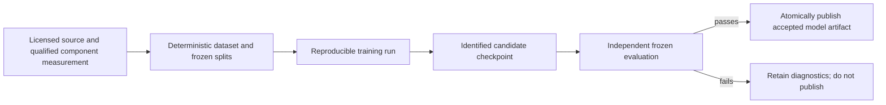

# Neural Graphics Architecture

[Docs](../../../README.md) / [Up](../README.md) / [Implementation](ImplementationPlan.md)

Sections: [Neural Graphics Training And Evaluation](#neural-graphics-training-and-evaluation) / [Model To Kernel And Runtime Inference](#model-to-kernel-and-runtime-inference) / [Neural Graphics Acceptance](#neural-graphics-acceptance).

**Status:** target cross-module feature family; current vendor reconstruction inference is not an owned neural-graphics implementation

**Owner:** cross-module contract spanning future model/tool ownership, Assets publication, Renderer integration, RHI execution, Showcase workloads, and Build/Packaging delivery

**Snapshot:** 2026-09-07; Engine, Tools, Projects, CMake, and root build membership were searched for owned training, dataset, model-lowering, and neural-runtime paths with no match; source evidence `S` only

**Strategy sources:** [`PGE-03`, `PGE-04`, `PGE-11`, `PGE-12`](../../../Strategy/Requirements.md), [Executive Summary](../../../Strategy/ExecutiveSummary.md), [Gap Assessment](../../../Strategy/Assessments/GapAssessment.md), and [Graphics Workloads](../../../Acceptance/GraphicsWorkloads.md)

**Current readiness:** **0/100** — target only; no owned dataset/training, model publication, lowering, generated kernel, or runtime inference feature was found. See [Current Feature Readiness](../../../Acceptance/CurrentReadiness.md#explicit-missing-or-not-yet-admitted-capabilities).

## At A Glance

| Layer | Current state | Required owned result |
| --- | --- | --- |
| problem and dataset | Not found | one bounded graphics problem, licensed/provenanced data, immutable splits, and a classical/reference target |
| model and training | Not found | owned operator/model, reproducible recipe, checkpoints, metrics, and accepted artifact |
| evaluation | Not found | independent quality, temporal, robustness, cost, and distribution-shift comparison |
| fixed export/kernel | Not found | fixed tensor/operator/layout contract, checked artifact and kernel identity, bounded precision/layout profiles and GPU numerical equivalence |
| Renderer/RHI runtime | Not found | typed inputs/output/history, capability selection, classical fallback, dispatch, synchronization, and retirement |
| product delivery | Not found | manifested model/kernel/runtime bytes, licenses, compatibility, clean-machine result, and support boundary |

```mermaid
flowchart LR
    Problem[Bounded graphics problem and oracle] --> Data[Provenanced dataset and frozen splits]
    Data --> Train[Owned model and reproducible training]
    Train --> Evaluate[Independent quality and cost evaluation]
    Evaluate --> Lower[Export, legalize, optimize, and generate/select kernels]
    Lower --> Runtime[Renderer/RHI typed inference with classical fallback]
    Runtime --> Package[Manifested product artifact]
    Package --> Workload[Bistro/San Miguel evidence]
```

Existing NVIDIA reconstruction providers enter at an external runtime-inference boundary only. They are valuable integrations, but they do not satisfy any owned data, training, model, lowering, kernel, or evaluation row above.

## Capability Identity

| ID family | Capability | Current state |
| --- | --- | --- |
| `NG-TRAIN-*` | dataset/provenance, owned model/operator, and reproducible training | Not found |
| `NG-EVAL-*` | independent quality, temporal, robustness, and cost evaluation | Not found |
| `NG-LOWER-*` | fixed tensor export/operator validation and measured layout/precision choices; no arbitrary graph IR | Not found |
| `NG-KERNEL-*` | backend kernel generation or selection and numerical validation | Not found |
| `NG-RUNTIME-*` | owned Renderer/RHI inference, fallback, lifetime, and packaged product route | Not found |

## Feature Family

| Dossier | Owns | Current state |
| --- | --- | --- |
| [Discovery](Discovery.md) | ratify the concrete denoising proposal, close source/reference/environment/rights and numeric qualifications | Open decision gate |
| [Semantics](Semantics.md) | component target, eleven input channels, fixed CNN, tensor/training math and proposed numerical/value budgets | Target proposal; not a result |
| [Execution Architecture](ExecutionArchitecture.md) | necessary component producer, fixed export, typed three-pass runtime, lifecycle/fallback and ownership | Target proposal; not implemented |
| [Research](Research.md) | primary-source neural/numerical/profiling precedent and the local topology choice's limits | Inspected research |
| [Plan](ImplementationPlan.md) | remaining gate-based stages and ready-to-use prompts | Conditional target work |
| [Training And Evaluation](#neural-graphics-training-and-evaluation) | problem definition, dataset/provenance, reference target, model/operator, training, evaluation, reproducible artifact | Not found |
| [Model To Kernel And Runtime Inference](#model-to-kernel-and-runtime-inference) | export/lowering, kernel selection/optimization, runtime ABI, scheduling, fallback, profiling, delivery | Not found |
| [Acceptance](#neural-graphics-acceptance) | binary feature criteria, failures, checks, and evidence boundary | Contract only |

The current NVIDIA DLSS Super Resolution and Ray Reconstruction providers are documented under [Image Reconstruction And Upscaling](../../Modules/Engine/Renderer/Features/PostProcessing/ReconstructionAndGeneration/ReconstructionAndGenerationDesign.md#image-reconstruction-and-upscaling). They are external vendor inference integrations. They do not satisfy owned dataset, training, model, compiler/lowering, kernel, or evaluation claims.

## Intended Vertical Slice

The selected strategic slice is one diffuse-indirect denoiser. [Semantics](Semantics.md) proposes the concrete eleven-channel, three-layer residual CNN and training/numerical/value rules; [Execution Architecture](ExecutionArchitecture.md) defines the necessary qualified component producer and one runtime. [Discovery](Discovery.md) ratifies nine explicit cells rather than choosing an unspecified model while coding. [Plan](ImplementationPlan.md) supplies bounded remaining stages and prompts. Production still waits for `REL-11` and `M3`; the proposal changes no absence/readiness claim. [Feature Delivery Catalog](../../../Strategy/FeatureDeliveryCatalog.md) routes `PGD-06..08` and reviewer outputs.

Frozen representative scene data and independently qualified diffuse-indirect reference component -> deterministic dataset builder -> owned model/operator and training recipe -> immutable current artifact -> fixed export and GPU-kernel plan -> Renderer feature contract and classical fallback -> RHI resources/dispatch/synchronization -> packaged artifact -> Bistro/San Miguel quality, latency, memory, and failure evidence. Beauty radiance or an external vendor denoiser cannot substitute for the component target or owned model.

No arrow in this route is implemented merely because this target dossier exists. The feature remains absent until source/build membership and a reachable product consumer prove otherwise.

## Ownership Rules

- Training data and evaluation artifacts have one immutable identity/provenance owner; runtime code does not silently generate or mutate them.
- Model/operator semantics are independent of backend kernels. Backend lowering may specialize execution without forking the feature definition or oracle.
- Renderer owns requested/active feature selection, inputs, output/history identity, fallback, and user-facing diagnostics. RHI owns neutral GPU mechanisms and backend lowering.
- Build/Packaging owns immutable model/kernel delivery and redistribution. Showcase owns only representative workload selection, not feature truth.
- Classical and neural paths share one observable output contract so quality/performance comparisons are meaningful.

## Design Decisions And Tradeoffs

| Decision | Benefit | Cost or constraint |
| --- | --- | --- |
| Start from one bounded user-visible problem | Success and non-goals can be measured | Does not create a generic ML platform |
| Keep model semantics separate from backend kernels | One oracle can validate several optimized implementations | Export/lowering ABI and numerical drift become explicit contracts |
| Require a classical fallback with one output contract | Quality, latency, memory, and failure comparisons are meaningful | Both paths must remain maintained and semantically aligned |
| Publish one current immutable model/kernel generation | Reproduction and completion-safe replacement remain possible | Account for actual old/new in-flight overlap; no internal format migration or compatibility reader |

## Neural Graphics Training And Evaluation

**Status:** target capability dossier; no owned training or evaluation implementation was found

The selected diffuse-indirect slice now has proposed [signal, fixed CNN, training recipe and numerical/value gates](Semantics.md). [NG-D0](Discovery.md) must ratify them against actual environment, rights and oracle inputs. [Plan](ImplementationPlan.md) NG-S1 first qualifies the necessary component producer, then data; NG-S2 trains only after that proof. Proposed tolerances are not accepted results.

**Scope:** define the absent data, training, evaluation, reproducibility, quality, failure, and model-publication capability boundary

**Owner:** one offline Tools-owned builder/training/export route and existing asset publication; Renderer consumes the accepted artifact

**Snapshot:** 2026-09-07; the live non-documentation source/build tree was searched for owned training/data/model paths; source evidence `S` only

**Current readiness:** **0/100** — target only; no production dataset, training, evaluation, or accepted model-publication path was found. See [Current Feature Readiness](../../../Acceptance/CurrentReadiness.md#explicit-missing-or-not-yet-admitted-capabilities).

### Neural Graphics Training And Evaluation: At A Glance

| Contract | Required answer | Failure if omitted |
| --- | --- | --- |
| problem | exact user-visible signal, inputs, output/color domain, valid range, scenes/hardware, and non-goals | model metrics cannot be tied to a product outcome |
| data | source/license/provenance, scene/camera/frame identity, generator revision, hashes, and immutable splits | leakage or unlicensed output invalidates evaluation |
| training | fixed model/operator, preprocessing, seeds, precision, loss/optimizer, checkpoints and bounded profile controls | results cannot be reproduced or attributed |
| evaluation | frozen numerical/image/sequence, temporal, robustness, and cost comparisons against classical/reference routes | a faster or prettier cherry-picked output can pass without an oracle |
| publication | immutable artifact schema, normalization, weights, metrics, provenance, compatibility, and generation | partial/corrupt work can replace the last accepted model |

Use original capture/model manifests and a single bounded offline consumer. The runtime result must trace to data, training and artifact identity; that obligation does not require a dataset service, experiment platform or second provenance schema.

### Problem And Output Contract

The selected product is spatial reconstruction of albedo-modulated scene-linear diffuse-indirect RGB before composition. Eleven inputs feed the fixed `11→16→16→3` residual CNN; direct/specular, exposure, recurrent history, sampling guidance and compression are outside this slice. [Semantics](Semantics.md) owns the transforms, padding, loss/splits, conformance and product gates. [Execution Architecture](ExecutionArchitecture.md) owns the producer/runtime joins. Ratify these exact proposals rather than selecting a different problem while coding. A training win without a useful integrated result cannot pass.

### Data, State, Lifetime, And Reproducibility

- Every training/evaluation sample records source/license, scene/camera/frame identity, generator/reference revision, parameters, split membership, and content hash.
- Train/validation/test splits prevent scene/camera/frame leakage and keep the final test set immutable.
- Preprocessing, seeds, precision, loss, optimizer/schedule, checkpoints and evaluation commands are immutable identified inputs. Do not add augmentation or search infrastructure outside the ratified recipe.
- The published artifact contains model/operator schema, weights, input/output normalization, compatibility identity, metrics, and provenance. Partial or failed publication cannot replace the last accepted generation.
- Dataset volume, preprocessing/training wall time, CPU/GPU memory high-water, checkpoint size, and evaluation cost are bounded and reported.

### Quality And Failure Boundary

Evaluation includes numerical metrics appropriate to the chosen signal, frozen image/sequence comparisons, temporal behavior, distribution shifts, adversarial/degenerate inputs, NaN/Inf handling, and a quality-performance-memory frontier against the classical baseline. Vendor inference output cannot serve as the only oracle for an owned model.

Corrupt, incompatible, unlicensed, provenance-incomplete, non-finite, or unexpectedly shaped data/artifacts fail before publication. Training interruption and resource exhaustion retain diagnosable partial state but never publish it as accepted.

### Current Classification

`NG-TRAIN-01` dataset/provenance pipeline, `NG-TRAIN-02` owned model/operator, `NG-TRAIN-03` reproducible training, and `NG-EVAL-01` independent evaluation are **Not found**. The two Showcase conversion scripts and NVIDIA runtime providers are not substitutes.

Acceptance is owned by [Neural Graphics Acceptance](#neural-graphics-acceptance); executable work must also follow the [Capability Evidence Plan](../../Modules/CapabilityEvidencePlan.md).

## Model To Kernel And Runtime Inference

**Status:** target capability dossier; no owned model lowering, generated kernel, or neural runtime was found

[NG-D0 discovery](Discovery.md) must freeze the selected tensor/operator/ABI/lifetime and capability cells. [Plan](ImplementationPlan.md) Stages 3–6 deliver fixed FP32 conformance, runtime, optional measured optimization and adoption; the plan does not create an implemented path.

**Scope:** fixed weight/bias export, three FP32 operators, existing ShaderSystem cook, one Renderer-private runtime and completion-safe delivery; no arbitrary graph compiler

**Owner:** one offline fixed exporter plus existing Assets, ShaderSystem, Renderer, RHI and Build/Packaging owners

**Snapshot:** 2026-09-07; the live non-documentation source/build tree was searched for owned model export/lowering/kernel/inference-runtime paths; source evidence `S` only

**Current readiness:** **0/100** — target only; no model lowering, generated kernel, runtime activation, or packaged neural product was found. See [Current Feature Readiness](../../../Acceptance/CurrentReadiness.md#explicit-missing-or-not-yet-admitted-capabilities).

### Model To Kernel And Runtime Inference: At A Glance

| Stage | Owned decision | Required observable |
| --- | --- | --- |
| fixed export | accepted tensors/biases become one checked immutable artifact | exact OIHW order/count, normalization, model/semantic hashes and current contract |
| measured optimization | unsupported topology rejects; only a demonstrated precision/layout/fusion hypothesis is tested | explicit decision, float64/PyTorch/GPU conformance and full-product controls |
| kernel production | three typed FP32 compute operators through the existing shader cook | code/hash, workgroup/layout, two-buffer workspace and actual source/native join |
| runtime activation | Renderer resolves requested/active neural or classical path | reason, inputs/output/history identity, and one complete generation |
| GPU execution | RHI materializes resources/pipeline/dispatch/barriers | attributable timing, memory, queue, and completion tokens |
| delivery | Build/Packaging manifests model/kernel/runtime bytes and licenses | clean product readiness or explicit unavailable state |

The target is not “compile a model somehow.” It is a reversible, inspectable chain in which every optimization can be compared numerically and every game artifact can be tied to the accepted model.

### Capability Boundary

This dossier owns the boundary from one accepted model/operator artifact to executable GPU work in the product. It is distinct from ordinary hand-written graphics shaders and from integrating a vendor provider. A credible model-to-kernel claim requires observable lowering decisions, validated numerical equivalence, hardware-aware optimization, one runtime ABI, and a product consumer.

### Intended Route

Ratified fixed model -> checked weight/bias artifact -> three typed FP32 operators -> existing ShaderSystem/Assets publication -> immutable runtime generation -> Renderer raw diffuse and RR-independent guides -> RHI dispatch/barriers -> bounded validity/publication and classical fallback -> all-queue retirement. Profile a justified optimization only after that baseline is correct.

### Contracts

- The artifact identity includes source model and semantic hash, current fixed tensor contract, target/backend/capability, precision/layout, kernel/code hash and binding ABI. Replace all producers/consumers together; no internal version negotiation or legacy reader.
- Unsupported operators, dynamic shapes, precision loss, capability mismatch, compilation failure, and validation mismatch fail before activation. Automatic fallback is allowed only when the requested/active distinction and reason are visible.
- Renderer owns semantic inputs/output and classical fallback. The lowering owner chooses legal kernels. RHI exposes mechanisms and capability truth without neural-policy vocabulary.
- Runtime scheduling declares resources, dependencies, queues, history, scratch/workspace, synchronization, and in-flight generation lifetime. Replacement retires only after every consuming queue completes.
- Evidence separates translation time, cold/warm materialization, CPU submission, GPU latency/throughput, memory/workspace, artifact size, and output quality.

### Model To Kernel And Runtime Inference: Design Decisions And Tradeoffs

| Decision | Benefit | Cost or risk |
| --- | --- | --- |
| One fixed tensor/export contract | Shapes/order/normalization and drift are reviewable | Exact count/hash checks; unsupported topology rejects instead of growing an operator IR |
| Specialize kernels below stable model semantics | Hardware performance can improve without forking the feature oracle | Precision/layout/fusion can introduce numerical drift |
| Use typed Renderer inputs and output | Neural and classical paths remain comparable | Dynamic shapes and ad hoc tensors are deliberately constrained |
| Retire model/kernel generations by GPU completion | Reload cannot use freed artifacts or workspace | In-flight generations retain model/kernel/scratch memory |

### Model To Kernel And Runtime Inference: Current Classification

`NG-LOWER-01` fixed model export, `NG-LOWER-02` fixed operator checking/measured optimization, `NG-KERNEL-01` kernel production, `NG-RUNTIME-01` owned inference and `NG-RUNTIME-02` packaged consumer are **Not found** in the recorded snapshot. These IDs require the selected fixed path; they do not request an arbitrary graph IR, legalization framework or second compiler. Existing shader delivery alone does not prove model productization.

The `CASE-04` Model-to-Shader and `WL-06` runtime-inference workloads in [Graphics Workloads](../../../Acceptance/GraphicsWorkloads.md) are acceptance gates for this future route, not evidence it exists. See [Neural Graphics Acceptance](#neural-graphics-acceptance).

## Neural Graphics Acceptance

**Status:** feature-local target acceptance contract; no criterion has a candidate result

**Scope:** define the binary criteria, controlled failures, checks, and completion boundary for a future owned neural-graphics feature

**Owner:** Neural Graphics feature family; [First Release](../../../Acceptance/FirstRelease.md) owns release disposition and [Feature Completion Reports](../../../Acceptance/FeatureCompletionReports.md) owns candidate results

**Current readiness:** **0/100** — this is a future proof contract; neither the training/evaluation nor runtime inference feature exists. See [Current Feature Readiness](../../../Acceptance/CurrentReadiness.md#explicit-missing-or-not-yet-admitted-capabilities).

### Neural Graphics Acceptance: At A Glance

This contract answers one decision: can Sparkle claim an **owned**, reproducible neural-graphics feature rather than an external inference integration or research artifact?

| Gate | Passing evidence must join |
| --- | --- |
| semantic value | bounded user problem, output contract, classical/reference comparison, and supported matrix |
| ownership and reproducibility | licensed dataset, frozen splits, model/operator, training recipe, evaluation, and immutable artifact identity |
| compiler/runtime integrity | inspectable lowering/kernel decisions, numerical equivalence, typed Renderer/RHI execution, fallback, and lifetime |
| product quality and cost | frozen workload quality/temporal/robustness plus CPU/GPU/memory/artifact/package results |
| failure and delivery | corrupt/unsupported/non-finite/reload/shutdown cases plus manifested licenses/hashes and documented reproduction |

Every gate is conjunctive. High image quality cannot compensate for unlicensed data, fast kernels cannot compensate for numerical mismatch, and a clean fallback does not prove the requested neural path.

### Binary Criteria

[NG-D0 discovery](Discovery.md) must freeze numeric conformance/quality tolerances, reference domain/uncertainty, split identity, repeat/sample/observer rules, latency/memory bounds and exact supported tuples before candidate results. This contract does not let implementation choose those values retrospectively. [Plan](ImplementationPlan.md) maps the remaining stages to the existing criteria and checks below; it creates no candidate verdict.

| ID | Criterion |
| --- | --- |
| `AC-NG-01` | One bounded user-visible graphics problem, tensor/data contract, output domain, supported matrix, classical fallback, and non-goals are frozen. |
| `AC-NG-02` | Licensed/provenanced train/validation/test data, leakage controls, deterministic generation/preprocessing, and immutable test identity are complete. |
| `AC-NG-03` | Owned model/operator, training recipe, seeds/configuration, checkpoints, metrics, and independent reference comparisons reproduce within declared tolerance. |
| `AC-NG-04` | Model export/lowering, operator/kernel decisions, precision/layout, binding ABI, artifact identity, and validation are inspectable and deterministic. |
| `AC-NG-05` | Renderer/RHI execution declares every resource, dependency, synchronization, capability, generation, history, fallback, and retirement boundary. |
| `AC-NG-06` | Frozen Bistro/San Miguel or approved replacement workloads meet every required raw/log/FLIP/temporal rule and report CPU/GPU tails, workspace/artifact size and classical comparison; separate bounded batch/precision/layout observations retain their actual scope. Missing metrics cannot be replaced by a favorable aggregate. |
| `AC-NG-07` | Missing/corrupt/incompatible artifact, unsupported hardware/backend/operator, allocation/compile/dispatch failure, non-finite output, reload, and shutdown remain honest and bounded. |
| `AC-NG-08` | Package manifests account for model/kernel/runtime bytes, licenses, hashes, compatibility, and source/debug erasure; the author or agent can reproduce the supported result. |
| `AC-NG-09` | The necessary diffuse-indirect target producer is derived and qualified independently: exact path/lobe/domain, camera/pixel population, committed prefix and uncertainty; isolated controls detect direct/specular leakage, wrong density/weight and stale component identity. Beauty or subtraction of unrelated noisy products cannot pass. |

### Controlled Failures

| ID | Fault and required outcome |
| --- | --- |
| `FM-NG-01` | Component estimator/domain/uncertainty or dataset provenance/license/split integrity fails -> dataset/training/evaluation publication is blocked; beauty cannot substitute for the target. |
| `FM-NG-02` | Model schema/operator/shape/precision is unsupported -> lowering fails with exact identity and no stale replacement. |
| `FM-NG-03` | Kernel compilation, validation, capability, allocation, or dispatch fails -> requested/active state reports failure or declared classical fallback. |
| `FM-NG-04` | Output is non-finite, outside semantic bounds, temporally unstable, or below the frozen quality threshold -> candidate fails regardless of speed. |
| `FM-NG-05` | Runtime/model/kernel generations mismatch or retire early -> execution is rejected and the previous accepted generation remains valid. |
| `FM-NG-06` | Required artifact/license/hash is absent from the package -> verification and startup fail before presenting false support. |

### Checks

| ID | Covers | Smallest required check |
| --- | --- | --- |
| `CHK-NG-01` | `AC-NG-01..03/09`, `FM-NG-01` | Qualify the component producer with isolated/negative controls before dataset publication; rebuild bounded data/model twice, then compare splits, artifacts, metrics, provenance and reference uncertainty. |
| `CHK-NG-02` | `AC-NG-04..05`, `FM-NG-02..03`, `FM-NG-05` | Reverse-trace one model to kernels and GPU commands, validate numerical equivalence, then inject schema/capability/compile/allocation/generation failures. |
| `CHK-NG-03` | `AC-NG-06..07`, `FM-NG-04` | Run the frozen quality/temporal/performance/memory matrix against the classical fallback and perturb fault-sensitive inputs. |
| `CHK-NG-04` | `AC-NG-08`, `FM-NG-06` | Verify package manifest/licenses/hashes and repeat the supported and missing-artifact journeys from clean bytes. |

Documentation and source inspection establish scope only. No `AC-NG-*`, `FM-NG-*`, or `CHK-NG-*` result is passed here. The deferred [`NG-E01..04`](../../Modules/CapabilityEvidencePlan.md#neural-graphics-evidence) sequence owns the central proof destinations after roadmap admission.
