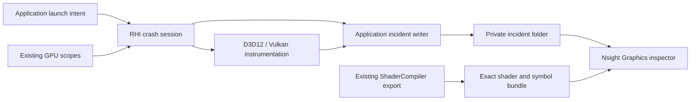

# GPU Crash Debugging Design

[Docs](../../../../README.md) / [Up](../PerformanceDiagnosticsDesign.md) / [Research and comparisons](Research.md) / [Delivery status](../../../../Strategy/Roadmap.md#release-progress)

**Status:** implemented and qualified for the recorded Windows x64 NVIDIA candidate. The completed GCD plan is retired; product work continues in [PD-1](../../FirstRelease/ProductImplementationPlan.md#pd-1--game-and-editor-product-shells).

**Qualified:** 2026-10-20, `2bab6c366cf0d8e73ab1bd71d2059f43fc755763` plus the retained candidate patch; RTX 5070 Ti Laptop, driver 610.47. Exact inputs, commands, PE/PDB/shader identities and limits belong to `ITER-GCD-04-06` under `artifacts/validation/releases/0.1.0/`. Earlier records retain their original identities.

## What It Does

An opt-in GPU crash debugging launch mode for Editor and Game on Windows x64. After a GPU fault, keep a local NVIDIA `.nv-gpudmp`, breadcrumbs and matching shader debug artifacts. Open them in Nsight Graphics to inspect the implicated GPU work and, where mapping exists, its shader source. D3D12 DRED remains a complementary observation.

Direct startup and the canonical Launcher select Off or Aftermath in source. The child owns input qualification, native readiness and incident publication. The retained candidate qualifies the resulting workflow.

Use matched product, shader and symbol receipts for Modern Sponza investigation through the [product plan](../../FirstRelease/ProductImplementationPlan.md). Its GPU-dependent product checks remain open.

Ordinary development remains unchanged: no SDK requirement, extra recording state or dump writer when compiled out. No telemetry, recovery system, embedded dump viewer, per-draw logging, TDR registry changes or new profiling framework. A CPU kill is not a GPU dump test. A breadcrumb identifies observed progress, not necessarily the faulty instruction.

## Implementation Owners

| Owner | Responsibility |
| --- | --- |
| [RHI diagnostics](../../../Modules/Engine/RHI/Features/DiagnosticsAndCapture/DiagnosticsAndCaptureDesign.md) | Private Aftermath session, D3D12 contexts/DRED and Vulkan diagnostics/checkpoints are implemented. The existing D3D12 diagnostics owner receives its pre-device DRED instance; no second DRED collector. Native scope is recorded in the candidate reports. |
| `RendererExternalRuntime`, `RhiDeviceLaunch` | Session initialization precedes Streamline. Coordinator/native teardown precedes Streamline shutdown and collection disable. |
| `ScopedGpuEvent`, `RenderCommandList::BeginDiagnosticScope/EndDiagnosticScope` | Both backends lower Begin/End scopes. D3D12 copies queue/context/recording facts; Vulkan retains immutable semantic tokens. Binding invalidation does not reset recording identity. |
| `FrameExecutionDiagnostics`, `FrameGraphExecutionDiagnostics`, `PassExecutionDiagnostics` | Neutral baseline-scope admission works independently of PIX, timing, detailed verbosity and validation. |
| [Shader system](../../ShaderSystem/ShaderSystemDesign.md), `DxcShaderBackend`, `SlangShaderBackend`, `ShaderDebugArtifactWriter` | Source now exports final code, PDBs/embedded debug data, captured sources and file receipts through the cook transaction. Optimized DXIL/full PDB and Slang SPIR-V/source correlation have native evidence for the retained candidate. |
| `ApplicationTaskRuntime`, `ProductUserStatePaths::CrashesRoot`, `ExportDiagnostics.ps1`, `IncidentIdentity.ps1` | One prepared BlockingIo dispatch writes bounded private incidents. Task runtime outlives native teardown and the sink. Application and Launcher join child/product/cook identities and connects inspection plus category-consented export. |
| [External capture](../ExternalCapture/ExternalCaptureDesign.md) | Reuse optional PIX attachment/handoff in a separate session. Do not turn its frame-capture adapter into a crash handler. |

Local tools found: Nsight Graphics **2026.3.1**, bundled Aftermath SDK **2026.3.26197.2318** with x64 runtime **2.27.0.0**, and PIX **2603.25**. The laptop has an RTX 5070 Ti Laptop GPU and driver **610.47**. Availability and integration receipts are retained with the candidate. File hashes and the initial worktree snapshot stay in ignored validation output, not another documentation ledger.

The earlier Modern Sponza device-loss evidence does not establish its shader root cause. CPU dispatch correlation suggested ReSTIR indirect spatial work; that remains an inference. Existing archives and diagnostic fixtures retain their original identities.

## Reference Decisions

The [research](Research.md) compares pinned NVIDIA samples/NVRHI, AMD RGD/AGS/FidelityFX Breadcrumbs, Epic's published engine contracts and engineering presentations. Its [mechanism comparison](Research.md#mechanism-comparison) records pros/cons; its [decision crosswalk](Research.md#decision-crosswalk) maps findings to design checks. This design owns the selected behavior; candidate reports own qualification.

Keep backend-private instrumentation and exact symbols; reject sample frame-age eviction, callback-time decoding and global shader-directory scanning. AMD informs semantics without introducing an AMD dependency. Epic informs engine ownership without importing a custom breadcrumb subsystem, symbol service or reporting infrastructure.

## Supported Modes And First Use

| Build / launch | Contract |
| --- | --- |
| Ordinary build, crash debugging absent | No NVIDIA SDK dependency, imports, marker table, callback state or writer. Preserve the existing frame path and Binaries layout. |
| Explicit diagnostic variant, mode Off | No collection session. SDK presence does not enable collection or modify global driver settings. |
| Diagnostic variant, Aftermath, NVIDIA D3D12/Vulkan | Required target: GPU dump, pass breadcrumbs, resource tracking and shader debug data. Automatic CPU call-stack capture stays off. Check inspectable inputs before devices; per-device SDK initialization must succeed before Ready. |
| Non-NVIDIA or missing Vulkan extensions | Aftermath unavailable. Existing DRED can still be used on D3D12, explicitly identified as DRED only. Never advertise an NVIDIA dump capability. |
| PIX frame capture | Separate launch through the existing capture owner. Aftermath plus any active frame-capture provider is rejected before device creation until a combination has its own qualification. Installed PIX is optional; absence does not block Aftermath. |

Use `SPARKLE_WITH_GPU_CRASH_DEBUGGING`, **off by default**, and the explicit `SPARKLE_AFTERMATH_SDK_ROOT`. [Workspace features](../../../../../CMake/SparkleWorkspaceFeatures.cmake) validates Windows x64, the `gpu-crash` variant and the SDK receipt. Threaded collection/source checks cover all four admitted profiles; serial checks cover DevelopmentEditor on both APIs. No mutable download or author `Program Files` discovery. Optional source filters override CMake globs. The existing CMake artifact owner stages the pinned runtime/notices under `Engine/Binaries/Aftermath/<profile>`. Application derives that exact path from its project Binaries layout; RHI requires an absolute path, validates its receipt before and after loading, and checks exports before devices. No PATH/CWD search or mandatory SDK import in mode Off. ShaderCompiler stays SDK-independent.

Keep existing Development/Shipping Editor/Game profiles; place this variant under `build/variants/gpu-crash` with `SPARKLE_ARTIFACT_VARIANT=gpu-crash` and outputs under `artifacts/gpu-crash`, using the existing artifact contract. The standalone Launcher keeps its canonical build entry: its current contract rejects artifact variants. Its product-root discovery launches diagnostic Editor/Game binaries. Ordinary Shipping packages exclude the SDK, raw dumps and private symbols. Any distributed diagnostic variant needs explicit membership/notices in the existing package owner.

The startup option is `--gpu-crash-debugging off|aftermath`, default `off`; Launcher exposes the same **GPU crash debugging: Off / NVIDIA Aftermath** choice. Reject unknown or duplicate values. It is not a rendering setting and cannot be switched on after device creation. Launcher preflight shows the selected API, matching symbol bundle and output location; it must not claim collection is active until the child confirms native readiness. Failed selection explains the missing requirement instead of starting an ordinary session under an Aftermath label.

The generic output-path owner accepts an explicit artifact variant; each compiled Core selects its build variant, while canonical Launcher explicitly selects `gpu-crash` products. No environment override or second Launcher is introduced.

Use one child-owned `incident.json` for readiness and final artifact state, atomically replacing it at each transition. Bind a fresh session ID to the expected child PID, product/executable hash, configuration/API and cook/bundle identity; PID or filename alone cannot confirm readiness. Launcher supplies the expected session ID through the existing typed request; direct launch creates it locally. Readers reject stale, malformed or other-session snapshots. The private manifest and directory name are not authentication against a malicious local user.

States are **Preparing → Ready → Collecting → Collected / Partial / Timed out**; failed input preparation records **Unavailable** in its reserved slot where writable. Later startup failures retain their last/Partial snapshot plus a failed process result; a missing manifest cannot establish readiness. Off creates no session. Ready requires native initialization and required input receipts, not a request checkbox or inspector availability. After failure, Launcher reads the exact child-owned path on its existing BlockingIo executor and shows the state on explicit refresh, plus **Open incident folder**. A child that exited before a terminal snapshot is incomplete. Source-mapping qualification is separate and initially unverified; collection alone cannot claim it. **Verify and open inspector** rechecks incident/bundle/CPU-symbol receipts, launches only an explicitly configured executable, and displays manual dump/search-path setup. It passes no undocumented inspector arguments; missing tools preserve manual access. Direct launch produces the same files and terminal failure exit without Launcher remaining alive. No automatic download, installation or upload.

## Frozen Inputs And API Boundaries

[GpuCrashInputs.json](../../../../../CMake/Dependencies/GpuCrashInputs.json) owns SHA-256/file receipts: Aftermath `2026.3.26197.2318` (API `0x21b`, x64 DLL `2.27.0.0`), DXC and SPIRV-Tools from Vulkan SDK `1.4.350.0`, and Slang `2026.8-gcd4-loop-locations` with the qualified [source patch](../../../../../CMake/Dependencies/Patches/SlangLoopSourceLocations.patch) and pinned SDK support files. Headers, libraries, runtime/support files, standard modules and notices are covered; proprietary payloads remain local. The [existing compiler owner](../../../../../Tools/Shaders/ShaderCompiler/CMakeLists.txt) restricts discovery to the verified host roots, rejects mixed cached discovery and extra Slang module versions, and registers the receipt and listed files as CMake reconfiguration dependencies. Ordinary builds acquire no Aftermath input. File receipts establish identity, not compiler output or DLL dependency/native compatibility.

| Boundary | Frozen requirement |
| --- | --- |
| Process startup | Reserve the sink before callbacks; enable collection and DRED before `RendererExternalRuntime` calls `InitializeSharedStreamlineRuntime`, including any interposer device. DX12 per-device initialization follows native device creation and precedes shader/command creation. |
| Supported device / rejection | NVIDIA Turing or newer; R515+ is the minimum for the required shader-error flag, not native qualification of every newer driver. Also require successful SDK initialization and Vulkan features where applicable. Reject unsupported adapter/driver/API, NvAPI incompatibility, user ForceOff and active capture/interception errors; never change the user override or retry silently without a required feature. |
| D3D12 policy | Markers `0x1`, resource tracking `0x2`, shader debug info `0x8`, shader errors `0x10`; automatic call stacks off. Pre-device DRED and per-device SDK initialization remain separate steps. |
| Vulkan policy | Require `VK_NV_device_diagnostic_checkpoints` and `VK_NV_device_diagnostics_config`; query/enable `VkPhysicalDeviceDiagnosticsConfigFeaturesNV::diagnosticsConfig`. Chain `VkDeviceDiagnosticsConfigCreateInfoNV` into actual device creation before the interposer can create it. Require resource tracking, shader debug info and shader-error reporting; automatic checkpoints off. Collect queue/stage checkpoint data on loss before device destruction. |
| Callback ABI | All registered callbacks are free-threaded. Leave DeferDebugInfoCallbacks off. Copy borrowed dump/debug bytes before returning; marker resolution calls its functor on that same callback thread before return, outside dictionary locks. Release every context handle; never infer callback cessation from Disable. |
| Compiler API | DXC `IDxcCompiler3::Compile` consumes `-Zi` and the existing optimization option; retain full PDB output without slim-symbol substitution. Slang `CompilerOptionName::DebugInformation` uses `SLANG_DEBUG_INFO_LEVEL_STANDARD` (`2`) with `EmitSpirvDirectly=1`, preserving Optimization. The retained candidate verifies emitted code/source mapping on both backends. |
| Final shader bytes | SPIR-V output from either backend passes through `SpirVBindingNormalizer::Normalize` before `CompiledShader`; DXIL keeps its compiler-result bytes. Export **after** normalization: StageCompiler -> CookedStageBuild -> ShaderDebugArtifactWriter/ShaderArtifactPublication -> CookedShaderLibrary -> native PSO/DXIL library or VulkanShaderModule. Hash and retain that final blob; raw compiler output can differ. Existing FNV code keys are not SHA-256 or NVIDIA identifiers. |

## Architecture And Lifetimes



| Responsibility | Owner and boundary |
| --- | --- |
| Orchestration | Application owns launch intent, per-user artifact sink and lifetime. `RendererExternalRuntime` forwards the intent at its existing pre-Streamline/device composition point; SDK machinery stays below RHI. Launcher passes intent and presents results. |
| Native collection | One RHI-private `Diagnostics/GpuCrash` session; cohesive D3D12/Vulkan helpers under their backend diagnostics folders. Extend existing failure capability/composition. SDK types and native handles remain private. |
| Recording instrumentation | Existing command-list diagnostic scopes lower to markers. Backend owners supply available queue/recording/frame facts, with their provenance; unknown joins remain unknown. No Aftermath branches in `FramePipeline`, passes, materials or Game. |
| Shader identity | Existing ShaderCompiler debug export owns exact code, compile identity and symbol lookup metadata. RHI records native shader identifiers; it does not depend on ShaderCompiler or Renderer. The external inspector performs analysis. |
| Artifact policy | One Application-private `Diagnostics/GpuCrash` sink owns quotas, files and publication. Application prepares one Tasks-owned dispatch on BlockingIo before enabling callbacks. Notifications coalesce; the slot has no worker while idle. No private thread/runtime, callback-side Launch or permanent worker. Failed preparation rejects startup. |

Start collection before **any** native device, including interposer-created devices. Configure D3D12 DRED settings before device creation, then initialize per-device Aftermath and command-list contexts at their native owners. Vulkan admits the required NV extensions and device diagnostics configuration before `vkCreateDevice`. Enable resource tracking, shader debug information, explicit pass markers and supported shader-error reporting. The latter deliberately exposes errors normal driver behavior may ignore; record that policy with the diagnostic candidate rather than claiming identical fault behavior. Automatic CPU call stacks/checkpoints stay off. Reject unsupported API/driver/Streamline combinations; never disable a renderer feature to manufacture tooling success.

Use immediate shader-debug callbacks: leave `DeferDebugInfoCallbacks` disabled and move `.nvdbg` bytes through the bounded writer while shaders are prepared. This trades disk work for avoiding a hidden deferred SDK cache. Application limits do not cap driver/SDK tracking memory; measure those costs separately. Reserve a fresh private session slot and initial safe identity before enabling collection. Refuse startup if reservation/publication fails. Normal exit removes only its owned unused partial session; a fault retains it. Cleanup must not traverse reparse points, other sessions or exported files. Do not gather command-line text or scene state in callbacks.

On the first native device-loss observation, stop further submissions and collect once **before** entering Core's fatal path, which immediately aborts without unwinding. Extend existing native failure owners at submit/present/fence boundaries; do not install a global fatal-hook chain or route unrelated API errors through GPU collection. Preserve the original failure code and nonzero exit. Do not poll an invalid fence as normal completion, retry a lost device or wait for GPU idle.

Failure finalization runs at the existing **host** submit/present/fence boundary: Application in serial rendering or `RenderCoordinator`'s dedicated render thread. After SDK Finished and callback-borrow settlement, request sink finalization and Close its prepared dispatch; the host polls thread-safe publication/execution state within the same loss budget before Fatal. Do not call owner-affine TaskExecution::WaitFor or TaskScope::JoinFor from the render thread, depend on an Application tick, or make a recording/task worker wait. Normal shutdown still joins on the Application scope owner. A fatal exit does not unwind owners; incomplete collection retains them until process termination. Serial and threaded validation must exercise this host route.

SDK callbacks may be concurrent and asynchronous. Copy SDK-owned bytes once into bounded owned storage, enqueue and return; no borrowed pointer crosses threads. C callback boundaries contain allocation errors and all C++ exceptions, mark incompleteness without recursive diagnostics, and never call Fatal, decode or synchronously write files. No Renderer reentry, frame-lock acquisition, task wait or callback-to-main-thread dependency. Synchronize queue admission and active-callback accounting. After copying/enqueueing bytes, call the prepared dispatch's Notify; a false result marks incomplete publication. Never call ordinary Launch/Submit from callbacks or weaken their scope/worker guards. The [Tasks contract](../../MultithreadedEngine.md#prepared-task-dispatch) owns allocation-free notification, fair scheduling, rerun/close races and terminal settlement. Application owns only the bounded payload queue and a bounded write batch per invocation; callback storage does not depend on render-thread progress.

D3D12 uses copied marker payloads carrying semantic scope plus available frame/recording identity. Vulkan uses opaque tokens for immutable semantic scope/parent/Begin-or-End entries, interned once and retained for the process lifetime after opt-in. Repeated frames reuse the same meaning, never a token whose meaning changes. Use collision-safe IDs, not name hashes as identities. No frame-age eviction or reclaimed command-list addresses. Registration and callback lookup are synchronized; invoke SDK functions and the resolve functor outside dictionary locks, with the resolve functor called on its callback thread before returning.

Lower both existing Begin and End scope hooks. CPU scope exit does not prove GPU completion. Retain raw native queue/stage observations, scope hierarchy and available command-context joins. Vulkan's repeated semantic token alone cannot identify a unique frame or recording; report that join unavailable, keeping the CPU observation frame separately labeled. Do not manufacture a total GPU order from CPU timestamps or ambiguous stages. Native progress narrows the search; it does not prove the faulty instruction. Labels identify engine work, not asset paths or user content.

Active crash debugging requires baseline pass scopes even when timing, detailed markers, PIX events and validation layers are off. Extend the existing neutral diagnostic-scope admission owner to express that minimum; Renderer consumes the requirement without knowing the vendor. Keep verbosity policy there and delete replaced scattered checks. Do not mutate a rendering CVar or add a second marker setting. Dynamic frame/recording values stay outside Vulkan's semantic dictionary key.

Extend existing backend resource naming, not Renderer resource management. After D3D12 resource creation/name changes, use the pinned SDK's `GFSDK_Aftermath_DX12_UpdateResourceInfo`; retain native Vulkan names and available driver facts. Keep VA/type/lifetime candidates when supplied, including ambiguity from aliases/reuse. Driver 610.47 cannot promise the richer R615 resource timeline or embedded `.nvdbg` behavior. Missing names, truncated DRED lists and absent page-fault data remain explicit. No parallel allocation journal or custom GPU breadcrumb buffer is added.

The debug-mode bounds below are application-owned design limits, not measured throughput claims or caps on SDK/driver memory. Changing a limit requires updating this contract and requalifying affected behavior.

| Resource | Bound / exhaustion behavior |
| --- | --- |
| Loss finalization | 10 s cooperative budget from first native loss, including writer finalization; never reset it. Bound application polling/waits and publish Partial/Timed out where possible. SDK/OS calls and blocked disk I/O cannot be forcibly preempted by this budget. Uncertain quiescence retains state/DLL until terminal process exit, never unsafe normal teardown. |
| Callback buffers | At most 256 outstanding payloads and 256 MiB aggregate, including in-flight writes; reserve capacity before copying, release it after consumption. Reject excess and mark incomplete. No unbounded task count or allocation. |
| Marker dictionary | 65,536 immutable semantic entries, payload at most 128 bytes. Reuse meanings across frames; retain entries until process exit; never reuse a session in the same process. If full, report incomplete new-scope coverage; never recycle an identity or leave overflow looking like the preceding scope. |
| Local retention | At most 4 incident slots of 1 GiB each per product user-state root, including a reserved active slot. Each slot admits at most 65,536 file receipts including its manifest; metadata counts toward the byte limit. Preflight requires a free slot. Never delete user-retained/exported files; explicit removal frees a slot. Shader bundles have separate user-managed retention. |

Normal shutdown stops recording and uses healthy-device retirement, then releases Aftermath command contexts before destroying their native command lists. Retire backend and Streamline-owned devices before disabling collection; the anchor, sink and DLL remain alive throughout. The pinned header does **not** promise that Disable joins callbacks or permits immediate DLL unload: retain the bounded RHI callback anchor, immutable token storage, pinned callback module and loaded DLL until process exit, even after normal quit. No in-process reload or second session is admitted. Seal sink admission and settle admitted borrows, then request the final drain. The writer closes its prepared dispatch after accepted payloads and the terminal manifest attempt; Application joins the child scope before destroying storage or cancelling its task runtime. Late callbacks cannot borrow the sink. This proves sink lifetime, not global SDK quiescence. On loss, SDK Finished, sink settlement and durable publication are separate obligations. A failed drain retains captured owners until terminal process exit. Device loss skips healthy-device GPU waits.

No in-process code can guarantee a hard exit from an unreturning driver/SDK/OS call. Controlled native validation arms an external local test supervisor before fault submission, with a 30 s deadline independent of submit returning or loss callbacks; forced termination is incomplete/blocked collection, not a passing shutdown. This is validation containment, not a shipped watchdog or recovery service.

## Shader And Incident Identity

Keep optimization, entry points, permutations and rendering features unchanged. The diagnostic cook adds debug information through the existing compiler owners: full DXC `-Zi` PDBs for DXIL; full direct Slang SPIR-V debug data corresponding to `-g2` for Vulkan. Set the actual Slang compiler API option, not just its diagnostic argument list. Preserve the same active code blob alongside source/debug data; a requested export failure fails that cook before complete publication. Do not recook through another compiler, reduce optimization or accept disassembly as source correlation. The retained matrix verifies optimized code/source mapping; changed compiler, device or driver inputs require qualification.

Each private symbol bundle joins source revision plus dirty-patch hash, build/profile/API, compiler binary hash and arguments, shader type/entry/permutation, transitive source hashes, actual code SHA-256 and the native lookup identifiers. Retain DXC debug names/PDBs, full SPIR-V debug data, NVIDIA `.nvdbg` identifiers and CPU PE/PDB identity distinctly. A debug-enabled variant is its own candidate; it is identical to public shader bytes only if hashes establish that fact.

**Implemented export component:** `ShaderCompiler cook --debug-artifacts <private-dir>` requests full debug data without changing optimization. `--debug-info` uses the workspace shader-symbol root. Each cook creates a fresh directory and returns its exact `shader-export.json` path. The writer verifies code against the staged runtime library, retains the preprocessing snapshots and records SHA-256 for every exported file, both cooked archives, the tool executable and loaded compiler modules. Its final manifest joins the existing map/library publication transaction; failure leaves no completed export for that cook. Compiler lookup keys remain distinct from code hashes. Uncaptured compiler source dependencies fail export. Partial directories may remain for manual cleanup.

The cook plan identifies `registered-catalog` versus `compiled-selection` coverage. Only the former is admitted for crash startup; matching every active API/permutation still requires file and code checks. The export is not a complete GPU incident bundle. Native preparation and session assembly bind it to the source revision/dirty patch, product/profile/API, executable/CPU symbols and driver identifiers. These joins are not inferred from filenames or directory scans; native/NVIDIA/CPU-PDB fields remain unavailable in the compiler receipt. Emitted debug information and native mapping are qualified only for the retained matrix.

Native hooks hash the exact DXIL/SPIR-V submitted to creation and retain available driver hashes/debug names. `.nvdbg` uses its own SDK identifier; it is not the code SHA or compiler lookup key. Raw decoded shader IDs are also distinct: use `GFSDK_Aftermath_GetShaderHashForShaderInfo` for the binary-hash join. Vulkan's native debug name stays unavailable without a qualified full/stripped SPIR-V pair; supplying the same unstripped blob as both would invent that qualification. Application assembles the session receipt; the retained native checks prove the inspector join. The initial CPU receipt matches the executable PE/PDB; it does not claim every shared module has CPU source coverage.

An incident contains `incident.json`, the raw `.nv-gpudmp` if produced, relevant `.nvdbg` and available DRED/checkpoint facts. Join it to the exact bundle, executable/SDK hashes, adapter, driver, watched API and original native failure. Distinguish reported workload, GPU queue/frame facts and CPU observation context; watching a graphics API does not prove the fault originated in a graphics shader. Record file sizes and hashes. Use owner-generated safe filenames, never raw SDK strings as paths. Identical repeated IDs may coalesce; the same ID with different bytes marks Partial and must not overwrite the first artifact.

Write into the reserved `.partial` slot; publish file contents before atomically replacing the same manifest with its final state. Collected requires SDK Finished, closed sink admission, all admitted sink borrows and writes settled and file flush/close/hash verification. It is not a guarantee against later storage failure. SDK Finished alone cannot publish success. Missing, truncated, over-budget or unwriteable required files leave Partial/Timed out; if even the final manifest cannot be written, Launcher reports incomplete from the last valid snapshot and child exit, never guesses success. A completed incident is immutable; late data or failed finalization cannot silently modify it. Never delete a faulted partial slot while callbacks/writes may still use it. Unused-session cleanup stops on a failed file deletion before removing its ownership marker; a locked manifest retains its last snapshot and owner for explicit removal.

The inspector workflow is: verify bundle/incident receipts; open the dump with search paths restricted to that bundle's shader binaries, NVIDIA debug information and source/debug paths; use CPU symbols only for host stacks; inspect faulted/active warps and breadcrumbs. Do not depend on an undocumented inspector CLI. A wrong bundle must fail the identity check; it cannot be accepted because ambient tool caches found some other symbols. Isolate search paths/caches for mismatch tests. A controlled known fault must resolve to its predeclared shader/function/source range; ordinary crashes can legitimately have no attributable source line.

## Launch And Inspection Route

Use these routes with a newly frozen candidate; earlier evidence applies only while its code, inputs and configuration still match.

1. Build the selected diagnostic product and ShaderCompiler through `build/variants/gpu-crash`, using the frozen SDK root and the existing CMake owner's `<target>GpuCrashReceipt` targets (for example `ShowcaseEditorGpuCrashReceipt` and `ShaderCompilerGpuCrashReceipt`). The existing artifact owner snapshots the source inventory before building and rejects a change during that build. The dependent receipt target runs after a successful product build, including an up-to-date build; preparation invalidates the previous startup receipt. Its directory-only generator expression avoids a reverse target dependency under [CMake CMP0112](https://cmake.org/cmake/help/latest/policy/CMP0112.html). `gpu-crash-product.json` binds product/profile, executable/runtime hashes and a PE/PDB GUID/age match. The artifact owner retains that receipt and exact PDB beneath the target's existing symbol directory, keyed by candidate hashes; startup and incident inspection use that immutable path. A later build invalidates only the current startup receipt. Symbol snapshots have user-managed retention, separate from the four incident slots. `dirtyPatchSha256` hashes UTF-8 `git diff --no-ext-diff --no-textconv --binary HEAD`; `sourceInputsSha256` additionally binds untracked bytes and deletions through the shared source-inventory owner. A receipt alone is not build or native proof.
2. Run the existing diagnostic ShaderCompiler cook with `--debug-artifacts <private-root>`. It verifies its source snapshot and captured transitive sources, then returns `SPARKLE_SHADER_EXPORT "<exact shader-export.json>"`. Pass that path directly; no latest-folder search. Startup requires the complete active API/permutation/debug/source closure, even though general exports may cover a compiled selection.
3. In Launcher's GPU crash controls, select Aftermath and paste that receipt path. Keep GPU Capture at None. Choose the matching Development/Shipping Editor/Game profile and API. Quick Start admits prepared diagnostic inputs and does not generate a canonical build/cook in their place. Direct startup uses the same child path:

   ```powershell
   & '<diagnostic-product.exe>' --graphics-api d3d12 --gpu-crash-debugging aftermath --shader-export '<absolute shader-export.json>'
   ```

   Launcher shell uses `--run levels.run --level <catalog-id> --product editor|game` with those same options. It creates a fresh expected session UUID; direct startup creates its own. Unknown/duplicate mode or input options reject; ordinary products reject Aftermath.
4. The child reserves its bounded slot, verifies its product/PDB/compiler/bundle/cooked-archive identities, and holds read leases on both cooked shader archives until native teardown and writer settlement. Diagnostic recook requires quit, cook and relaunch; ordinary sessions are unaffected. Windows [file-sharing rules](https://learn.microsoft.com/en-us/windows/win32/api/fileapi/nf-fileapi-createfilew) supply these leases. Unicode/quoted startup arguments use the existing process owner and [Windows argument decoding](https://learn.microsoft.com/en-us/windows/win32/api/shellapi/nf-shellapi-commandlinetoargvw).
5. Readiness requires the existing parent channel **and** one verified snapshot of this child's durable Ready manifest, session UUID, PID, executable hash, profile/API and export hash. Validate before transferring process ownership. Stale/other-child files reject. If that matched child enters collection before handoff, release it to finish its original terminal path, report failed handoff and retain its incident; never label Partial as Ready or terminate collection just to reject startup.
6. After a fault, refresh collection state, open the folder, or configure an inspector and choose Verify and open inspector. [OpenGpuCrash.ps1](../../../../../CMake/Diagnostics/OpenGpuCrash.ps1) rechecks exact receipts and provides explicit dump, `.nvdbg`, shader/source and CPU-symbol paths. Restrict inspector searches/caches to that candidate. Each incident keeps source mapping unqualified until its exact external inspection establishes a match.

The diagnostic build receipt is private. Compiler export metadata retains only relative membership and build identities. The private session has explicit absolute locators for its external bundle and CPU symbols; the default shareable projection removes those locators, child PID, logs and native payload contents. A receipt is identity evidence, not authentication against a malicious local user.

## Privacy And Export

Raw vendor dumps and full symbols can contain private paths, source and resource metadata. Keep them local under `CrashesRoot`; no automatic telemetry, copying into packages or public attachments. The existing diagnostic export defaults to sanitized incident metadata. Including raw dumps, `.nvdbg`, source or symbols requires explicit file-category consent and a privacy warning; do not claim binary redaction. Paths in shareable metadata are relative or redacted. [ExportDiagnostics.ps1](../../../../../CMake/Packaging/ExportDiagnostics.ps1) accepts `-GpuCrashManifestPath <incident.json>` through the existing preview/consent boundary. Default output is sanitized metadata. `-IncludeGpuDump`, `-IncludeNvdbg`, `-IncludeSource` and `-IncludeSymbols` select categories; full symbols also require Source consent because they can embed source. Repeat the exact preview digest with `-Consent -PreviewSha256 <digest> -OutputDirectory <existing-directory>`. Selected file hashes enter that digest; copies are verified in a fresh partial directory and the metadata is published last. No copy occurs without matching preview consent. The source-only helper is not admitted to an ordinary public package. Existing no-support policy remains unchanged.

## Acceptance And Controlled Failures

These local criteria refine `FCR-RHI-05`, `FCR-RHI-06`, `FCR-SHDR-01` and `FCR-PROD-06`; they do not create new global FCRs. Results belong in their candidate reports, with `REL-07` native evidence and `REL-03` only when qualifying a diagnostic package. Use `PASS`, `BLOCKED`, `EXCLUDED` or `SUPERSEDED` there; docs do not increase readiness.

| Criterion | Failure to expose | Required check / oracle |
| --- | --- | --- |
| `AC-GCD-01` Startup and mode truth | `FM-GCD-01`: late initialization, absent SDK/lane, unsupported GPU/extensions, stale readiness or conflicting capturer falsely accepted | `CHK-GCD-01`: pre-device order trace including DRED; missing/wrong SDK, missing BlockingIo lane and conflict reject before devices. Old/cross-child manifests cannot confirm Ready; Off stays inactive. |
| `AC-GCD-02` Native dumps on both APIs | `FM-GCD-02`: labels/logs mistaken for dump collection or missing fault data treated as a diagnosis | `CHK-GCD-02`: separate controlled D3D12 and Vulkan GPU faults produce hashed `.nv-gpudmp` files the inspector opens. CPU kill, absent page-fault data and external/unknown fault origin cannot manufacture a local shader diagnosis. |
| `AC-GCD-03` Exact source correlation | `FM-GCD-03`: stale or wrong compiler/permutation/symbol bundle gives a plausible location | `CHK-GCD-03`: actual exported/loaded code agrees; known compute/ray-tracing faults resolve through exact optimized DXIL and Slang SPIR-V to a predeclared shader/function/source range. Swapped bundle, changed shader and missing `.nvdbg` cannot claim the required match. CPU PDBs are not GPU symbols. |
| `AC-GCD-04` Stable breadcrumbs | `FM-GCD-04`: reset/reused storage, parallel queues, repeated tokens or table exhaustion misattributes work | `CHK-GCD-04`: nested Begin/End and delayed parallel-queue observations match known scopes across reset and late callbacks. Replay unchanged scopes for 10,000 fixture recording cycles: dictionary occupancy must stay fixed after warm-up. Exhaustion, unavailable frame joins, missing names and aliased resource facts remain truthful. |
| `AC-GCD-05` Bounded terminal failure | `FM-GCD-05`: repeated collection, wait-idle hang, callback exception/UAF or premature abort | `CHK-GCD-05`: delayed/concurrent callbacks, drain-reschedule races, allocation failure, repeated loss and budget expiry preserve ownership. Real loss verifies collection before abort and native callback ordering. External supervisor detects blocked native calls; forced termination cannot pass cooperative finalization. |
| `AC-GCD-06` Local publication and consent | `FM-GCD-06`: disk-full/locked/truncated outputs reported complete, stale/colliding data accepted or sensitive files exported silently | `CHK-GCD-06`: byte/count/quota/denied-write/partial-write and ID-collision fixtures cannot publish Collected. Finished before drain stays pending. Unicode paths, atomic snapshots, cleanup boundaries and consent work; final-publication failure never becomes success. |
| `AC-GCD-07` Thin integration | `FM-GCD-07`: ordinary builds depend on SDK, crash scopes require unrelated tooling, or optional tooling changes feature behavior | `CHK-GCD-07`: SDK-absent build/import/admission checks; baseline breadcrumbs with timing/detailed markers/PIX events/validation off; three normal launches per profile/API; matched off/on cost observations; separate PIX smoke when installed. No feature/optimization reduction or extra worker runtime. |

**Qualified candidate:** `ITER-GCD-04-06` ([gate report](../../../../../artifacts/validation/gpu-crash-debugging/20261019-gcd-4/mapping-source-review/gate-report.json), [cleanup and handoff](../../../../../artifacts/validation/gpu-crash-debugging/20261019-gcd-4/mapping-source-review/handoff-gate.json)). The four Development/Shipping Editor/Game profiles pass 18 native checks, 32 normal journeys and four SDK-free builds on D3D12/Vulkan. This qualifies the tooling candidate; release maps and the product archive retain their own checks.

Use non-sensitive, disposable fault fixtures. Retain recipes/patches and module/shader hashes privately; remove injection source, shaders and executables before handoff. Recheck final production module identity after removal and repeat affected checks if it changes. No permanent crash menu, fault switch or source-controlled dump archive.

**Compiler input:** the [Slang patch](../../../../../CMake/Dependencies/Patches/SlangLoopSourceLocations.patch) preserves authored locations on generated loop-control blocks; the [input owner](../../../../../CMake/Dependencies/GpuCrashInputs.json) pins the rebuilt core, version header, patch and license. Twenty-four compiler controls preserve optimized instructions and no-debug bytes. The repaired serial Vulkan dump resolves `OutputEncoding.hlsl:23` within the unchanged lines 20 through 29 oracle. Original failed and earlier successful records keep their exact identities; private recipes, SDK archives and artifacts remain linked from the gate report.

**Limits:** other vendors, Debug profiles and combined capture sessions are excluded. NVIDIA formatter 2026.3.1 needs ASCII working/output paths; Sparkle's Unicode/space-path launches are covered by the candidate report. Windows PowerShell 5.1 exports need a short destination; excessive path length can leave a marked `.partial` while preserving the incident. Separate PIX capture opened/saved; its child exit was not independently observed. Unknown frame/page-fault facts stay unknown.

## Integration Boundaries

Keep collection in private RHI backends, shader export in ShaderCompiler and publication in one Application writer. The table defines the allowed integration hooks; prepared dispatch is the single Tasks extension. Revise this contract before adding a boundary or scattering feature conditions through orchestration.

| Integration boundary | Owner and contract | AC / FM / CHK-GCD |
| --- | --- | --- |
| Dependency and membership | Workspace features, compiler CMake and RHI/Application globs; pinned roots and explicit optional exclusion | 01 / 01 / 01; 07 / 07 / 07 |
| Startup and lifetime | ApplicationTaskRuntime and RendererExternalRuntime before Streamline; sink outlives native teardown | 01 / 01 / 01; 05 / 05 / 05 |
| Files and processes | Core owns bounded text reads, durable publication, Unicode arguments, artifact variants and a pre-handoff readiness decision. Application/Launcher retain input and incident policy. Failed collection handoff can release the child without claiming Ready. | 06 / 06 / 06 |
| Prepared dispatch | TaskExecutor, scope admission/settlement and lane scheduling implement the [dispatch contract](../../MultithreadedEngine.md#prepared-task-dispatch); no callback-side Launch or worker wait loop | 05 / 05 / 05; 07 / 07 / 07 |
| Native loss and instrumentation | Existing RenderFailureDiagnostics, backend diagnostics/scopes/names; private GpuCrash helpers, DRED before devices | 02 / 02 / 02; 04 / 04 / 04; 05 / 05 / 05 |
| Scope admission | FrameExecutionDiagnostics/PassExecutionDiagnostics; baseline scopes independent of PIX/timing/validation | 04 / 04 / 04; 07 / 07 / 07 |
| Exact shader export | DXC/Slang, ShaderDebugArtifactWriter and publication; same final normalized bytes, one export authority. Existing Editor artifact browser requires the completed receipt; removing that guard exposes failed cooks. Browser results are not native candidate selection. | 03 / 03 / 03 |
| Launch, results and consent | Application startup/preflight and sink; typed Launcher request/discovery/result, existing BlockingIo executor, feature-local UI composition and inspection helper; existing consent exporter. Canonical Launcher stays SDK-free. Recipe/file copies cross immutable process/task/artifact boundaries only. | 01 / 01 / 01; 06 / 06 / 06; 07 / 07 / 07 |
| Package and capture | Existing package owner excludes private artifacts; PIX remains a separate launch | 06 / 06 / 06; 07 / 07 / 07 |

Numbers in each ledger column refer to the existing `AC-GCD`, `FM-GCD` and `CHK-GCD` identities, not new checks. The retained source review and executable/native evidence cover these collection and launch hooks.

Reuse existing identities and scopes; replace overlapping collection/export paths in the same change. No duplicate shader registry, operation executor, settings store, capture selector, crash-handler chain or new Core vendor service. The only required copies cross SDK callback ownership and immutable artifact publication boundaries.

Changed compiler, SDK, device or driver inputs require affected native requalification. Unsupported mapping, unsafe callback/device lifetime or unavailable required checks block that qualification. Tooling delivery does not close the product or release plan.
