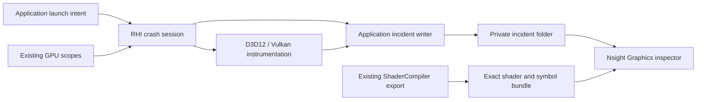

# GPU Crash Debugging Design

[Docs](../../../../README.md) / [Up](../PerformanceDiagnosticsDesign.md) / [Research and comparisons](Research.md) / [Implementation stages](ImplementationPlan.md)

**Status:** proposed contract; planning only. `GCD-0` qualifies the inputs before implementation. No Aftermath collector or matched native dump has been delivered.

**Inspected:** 2026-10-17, `343d9e4fe112f10e5b05a46c45532b8a8a061d62` plus the retained worktree changes.

## What We Are Building

An opt-in GPU crash debugging launch mode for Editor and Game on Windows x64. After a GPU fault, keep a local NVIDIA `.nv-gpudmp`, breadcrumbs and matching shader debug artifacts. Open them in Nsight Graphics to inspect the implicated GPU work and, where mapping exists, its shader source. D3D12 DRED remains a complementary observation.

**Pause Modern Sponza hang investigation until this tooling passes `GCD-4`.** Then resume the [product plan](../../FirstRelease/ProductImplementationPlan.md). The tooling is a prerequisite to its remaining GPU-dependent checks; it does not close them.

Ordinary development remains unchanged: no SDK requirement, extra recording state or dump writer when compiled out. No telemetry, recovery system, embedded dump viewer, per-draw logging, TDR registry changes or new profiling framework. A CPU kill is not a GPU dump test. A breadcrumb identifies observed progress, not necessarily the faulty instruction.

## Current Route And Gaps

| Inspected owner | Reuse / missing work |
| --- | --- |
| [RHI diagnostics](../../../Modules/Engine/RHI/Features/DiagnosticsAndCapture/DiagnosticsAndCaptureDesign.md) | Reuse `RenderFailureDiagnostics`, backend device-loss boundaries and validation-gated D3D12 DRED collection. Diagnostic Shipping needs explicit admission of that route. No Aftermath SDK integration or Vulkan NV checkpoints were found. |
| `RendererExternalRuntime`, `RhiDeviceLaunch` | Existing pre-device composition and Streamline ordering. Extend that composition once; no second startup service. |
| `ScopedGpuEvent`, `RenderCommandList::BeginDiagnosticScope/EndDiagnosticScope` | Existing semantic scope path. Lower it to crash markers inside backends; debug labels alone are not crash breadcrumbs. |
| `FrameExecutionDiagnostics`, `FrameGraphExecutionDiagnostics`, `PassExecutionDiagnostics` | Existing capability/verbosity admission must admit baseline pass scopes for crash mode. D3D12's current scope implementation is PIX-event gated; Aftermath must work independently of it. |
| [Shader system](../../ShaderSystem/ShaderSystemDesign.md), `DxcShaderBackend`, `SlangShaderBackend`, `ShaderDebugArtifactWriter` | DXC saves available PDBs; debug artifacts include identities and source text. Exact active DXIL/SPIR-V export and Slang source correlation are not qualified. |
| `ApplicationTaskRuntime`, `ProductUserStatePaths::CrashesRoot`, `ExportDiagnostics.ps1`, `IncidentIdentity.ps1` | Reuse the existing task executor/BlockingIo lane, per-user storage, incident identity and export consent. Task runtime starts before Renderer and outlives it; no dedicated writer thread. Opaque vendor dumps are not sanitized text. |
| [External capture](../ExternalCapture/ExternalCaptureDesign.md) | Reuse optional PIX attachment/handoff in a separate session. Do not turn its frame-capture adapter into a crash handler. |

Local tools found: Nsight Graphics **2026.3.1**, bundled Aftermath SDK **2026.3.26197.2318** with x64 runtime **2.27.0.0**, and PIX **2603.25**. The laptop has an RTX 5070 Ti Laptop GPU and driver **610.47**. These are availability observations, not integration proof. File hashes and the initial worktree snapshot stay in ignored validation output, not another documentation ledger.

The retained device-loss evidence does not establish a shader root cause. CPU dispatch correlation suggested ReSTIR indirect spatial work; that remains an inference. Existing archives and diagnostic fixtures retain their original identities.

## Reference Decisions

The [research](Research.md) compares pinned NVIDIA samples/NVRHI, AMD RGD/AGS/FidelityFX Breadcrumbs, Epic's published engine contracts and engineering presentations. Its [mechanism comparison](Research.md#mechanism-comparison) records pros/cons; its [decision crosswalk](Research.md#decision-crosswalk) maps transfers to stages/checks. This design owns the selected behavior. `GCD-0` verifies SDK/compiler compatibility; research does not pass that gate.

Keep backend-private instrumentation and exact symbols; reject sample frame-age eviction, callback-time decoding and global shader-directory scanning. AMD informs semantics without introducing an AMD dependency. Epic informs engine ownership without importing a custom breadcrumb subsystem, symbol service or reporting infrastructure.

## Supported Modes And First Use

| Build / launch | Contract |
| --- | --- |
| Ordinary build, crash debugging absent | No NVIDIA SDK dependency, imports, marker table, callback state or writer. Preserve the existing frame path and Binaries layout. |
| Explicit diagnostic variant, mode Off | No collection session. SDK presence does not enable collection or modify global driver settings. |
| Diagnostic variant, Aftermath, NVIDIA D3D12/Vulkan | Required target: GPU dump, pass breadcrumbs, resource tracking and shader debug data. Automatic CPU call-stack capture stays off. Missing requirements reject this requested mode before device creation. |
| Non-NVIDIA or missing Vulkan extensions | Aftermath unavailable. Existing DRED can still be used on D3D12, explicitly identified as DRED only. Never advertise an NVIDIA dump capability. |
| PIX frame capture | Separate launch through the existing capture owner. Aftermath plus any active frame-capture provider is rejected before device creation until a combination has its own qualification. Installed PIX is optional; absence does not block Aftermath. |

Use the proposed CMake switch `SPARKLE_WITH_GPU_CRASH_DEBUGGING`, **off by default**, and an RHI-private dependency with an explicit SDK root validated against the pinned receipt. No mutable download or author `Program Files` discovery. Explicit optional source membership must override CMake globs. Load the exact admitted SDK DLL from the product's Engine/Binaries location only when Aftermath is requested; validate its receipt and required exports before devices. No PATH/CWD search or mandatory SDK import in mode Off. ShaderCompiler stays SDK-independent.

Keep existing Development/Shipping Editor/Game profiles; place this variant under `build/variants/gpu-crash` with `SPARKLE_ARTIFACT_VARIANT=gpu-crash` and outputs under `artifacts/gpu-crash`, using the existing artifact contract. The standalone Launcher keeps its canonical build entry: its current contract rejects artifact variants. Extend its existing product-root discovery to launch diagnostic Editor/Game binaries; do not add a second Launcher. Ordinary Shipping packages exclude the SDK, raw dumps and private symbols. Any distributed diagnostic variant needs explicit membership/notices in the existing package owner.

The proposed startup option is `--gpu-crash-debugging off|aftermath`, default `off`; Launcher exposes the same **GPU crash debugging: Off / NVIDIA Aftermath** choice. Reject unknown or duplicate values. It is not a rendering setting and cannot be switched on after device creation. Launcher preflight shows the selected API, matching symbol bundle and output location; it must not claim collection is active until the child confirms native readiness. Failed selection explains the missing requirement instead of starting an ordinary session under an Aftermath label.

Use one child-owned `incident.json` for readiness and final artifact state, atomically replacing it at each transition. Bind a fresh session ID to the expected child PID, product/executable hash, configuration/API and cook/bundle identity; PID or filename alone cannot confirm readiness. Launcher supplies the expected session ID through the existing typed request; direct launch creates it locally. Readers reject stale, malformed or other-session snapshots. The private manifest and directory name are not authentication against a malicious local user.

States are **Preparing → Ready → Collecting → Collected / Partial / Timed out**; rejected startup records **Unavailable** where writable, otherwise the typed launch failure explains that no manifest exists. Off creates no session. Ready requires native initialization and required input receipts, not a request checkbox or inspector availability. After failure, Launcher shows the final state, incident identity and **Open folder**. Source-mapping qualification is separate and initially unverified; collection alone cannot claim it. **Open dump** uses an explicitly configured inspector; absent association preserves manual access. Direct launch produces the same files and terminal failure exit without Launcher remaining alive. No automatic download, installation or upload.

## Architecture And Lifetimes

| Responsibility | Owner and boundary |
| --- | --- |
| Orchestration | Application owns launch intent, per-user artifact sink and lifetime. `RendererExternalRuntime` forwards the intent at its existing pre-Streamline/device composition point; SDK machinery stays below RHI. Launcher passes intent and presents results. |
| Native collection | One RHI-private `Diagnostics/GpuCrash` session; cohesive D3D12/Vulkan helpers under their backend diagnostics folders. Extend existing failure capability/composition. SDK types and native handles remain private. |
| Recording instrumentation | Existing command-list diagnostic scopes lower to markers. Backend owners supply available queue/recording/frame facts, with their provenance; unknown joins remain unknown. No Aftermath branches in `FramePipeline`, passes, materials or Game. |
| Shader identity | Existing ShaderCompiler debug export owns exact code, compile identity and symbol lookup metadata. RHI records native shader identifiers; it does not depend on ShaderCompiler or Renderer. The external inspector performs analysis. |
| Artifact policy | One Application-private sink owns quotas, files and publication. Use the existing SparkleTasks BlockingIo lane and a session task scope; at most one coalesced asynchronous drain task, no dedicated thread/runtime or permanently occupied worker. Callback storage does not depend on the render thread. Missing asynchronous lane rejects requested mode before devices. |

Start collection before **any** native device, including interposer-created devices. Configure D3D12 DRED settings before device creation, then initialize per-device Aftermath and command-list contexts at their native owners. Vulkan admits the required NV extensions and device diagnostics configuration before `vkCreateDevice`. Enable resource tracking, shader debug information, explicit pass markers and supported shader-error reporting. The latter deliberately exposes errors normal driver behavior may ignore; record that policy with the diagnostic candidate rather than claiming identical fault behavior. Automatic CPU call stacks/checkpoints stay off. Reject unsupported API/driver/Streamline combinations; never disable a renderer feature to manufacture tooling success.

Use immediate shader-debug callbacks: leave `DeferDebugInfoCallbacks` disabled and move `.nvdbg` bytes through the bounded writer while shaders are prepared. This trades disk work for avoiding a hidden deferred SDK cache. Application limits do not cap driver/SDK tracking memory; measure those costs separately. Reserve a fresh private session slot and initial safe identity before enabling collection. Refuse startup if reservation/publication fails. Normal exit removes only its owned unused partial session; a fault retains it. Cleanup must not traverse reparse points, other sessions or exported files. Do not gather command-line text or scene state in callbacks.

On the first native device-loss observation, stop further submissions and collect once **before** entering Core's fatal path, which immediately aborts without unwinding. Extend existing native failure owners at submit/present/fence boundaries; do not install a global fatal-hook chain or route unrelated API errors through GPU collection. Preserve the original failure code and nonzero exit. Do not poll an invalid fence as normal completion, retry a lost device or wait for GPU idle.

SDK callbacks may be concurrent and asynchronous. Copy SDK-owned bytes once into bounded owned storage, enqueue and return; no borrowed pointer crosses threads. C callback boundaries contain allocation errors and all C++ exceptions, mark incompleteness without recursive diagnostics, and never call Fatal, decode or synchronously write files. No Renderer reentry, frame-lock acquisition, task wait or callback-to-main-thread dependency. Synchronize queue admission and active-callback accounting; schedule at most one drain task using the existing asynchronous task API, not a host-boundary blocking submit. A task must not wait for other tasks. Clear/reschedule the drain state atomically with queue admission so a callback cannot strand its payload during task completion.

D3D12 uses copied marker payloads carrying semantic scope plus available frame/recording identity. Vulkan uses opaque tokens for immutable semantic scope/parent/Begin-or-End entries, interned once and retained until SDK shutdown and callback quiescence. Repeated frames reuse the same meaning, never a token whose meaning changes. Use collision-safe IDs, not name hashes as identities. No frame-age eviction or reclaimed command-list addresses. Registration and callback lookup are synchronized; invoke SDK functions and the resolve functor outside dictionary locks, with the resolve functor called on its callback thread before returning.

Lower both existing Begin and End scope hooks. CPU scope exit does not prove GPU completion. Retain raw native queue/stage observations, scope hierarchy and available command-context joins. Vulkan's repeated semantic token alone cannot identify a unique frame or recording; report that join unavailable, keeping the CPU observation frame separately labeled. Do not manufacture a total GPU order from CPU timestamps or ambiguous stages. Native progress narrows the search; it does not prove the faulty instruction. Labels identify engine work, not asset paths or user content.

Active crash debugging requires baseline pass scopes even when timing, detailed markers, PIX events and validation layers are off. Extend the existing neutral diagnostic-scope admission owner to express that minimum; Renderer consumes the requirement without knowing the vendor. Keep verbosity policy there and delete replaced scattered checks. Do not mutate a rendering CVar or add a second marker setting. Dynamic frame/recording values stay outside Vulkan's semantic dictionary key.

Extend existing backend resource naming, not Renderer resource management. After D3D12 resource creation/name changes, use the pinned SDK's `GFSDK_Aftermath_DX12_UpdateResourceInfo`; retain native Vulkan names and available driver facts. Keep VA/type/lifetime candidates when supplied, including ambiguity from aliases/reuse. Driver 610.47 cannot promise the richer R615 resource timeline or embedded `.nvdbg` behavior. Missing names, truncated DRED lists and absent page-fault data remain explicit. No parallel allocation journal or custom GPU breadcrumb buffer is added.

The initial debug-mode bounds below are design limits, not measured throughput claims. `GCD-0` must confirm SDK compatibility; changing a limit requires updating this contract before implementation.

| Resource | Bound / exhaustion behavior |
| --- | --- |
| Loss finalization | 10 s cooperative budget from first native loss, including writer finalization; never reset it. Bound application polling/waits and publish Partial/Timed out where possible. SDK/OS calls and blocked disk I/O cannot be forcibly preempted by this budget. Uncertain quiescence retains state/DLL until terminal process exit, never unsafe normal teardown. |
| Callback buffers | At most 256 outstanding payloads and 256 MiB aggregate, including in-flight writes; reserve capacity before copying, release it after consumption. Reject excess and mark incomplete. No unbounded task count or allocation. |
| Marker dictionary | 65,536 immutable semantic entries, payload at most 128 bytes. Reuse meanings across frames; retire entries only with session quiescence. If full, report incomplete new-scope coverage; never recycle an identity or leave overflow looking like the preceding scope. |
| Local retention | At most 4 incident slots of 1 GiB each per product user-state root, including a reserved active slot. Preflight requires a free slot. Never delete user-retained/exported files; explicit removal frees a slot. Shader bundles have separate user-managed retention. |

Normal shutdown stops new recording and uses existing healthy-device retirement. Release SDK command contexts while their native objects remain valid; keep callback storage/sink alive through SDK disable and proven callback quiescence. Close admission, drain the session task scope before destroying its sink or Application task runtime, and unload the SDK last. `GCD-0` must verify SDK-specific context/device/disable ordering rather than infer safety from destructors. Do not cancel the shared task runtime before admitted writes settle. Device loss skips healthy-device GPU waits. If quiescence fails, retain the live graph until terminal process exit; a manifest timeout does not make it safe to free callback state.

No in-process code can guarantee a hard exit from an unreturning driver/SDK/OS call. `GCD-4` arms an external local test supervisor before fault submission, with a 30 s deadline independent of submit returning or loss callbacks; forced termination is incomplete/blocked collection, not a passing shutdown. This is validation containment, not a shipped watchdog or recovery service.

## Shader And Incident Identity

Keep optimization, entry points, permutations and rendering features unchanged. The diagnostic cook adds debug information through the existing compiler owners: full DXC `-Zi` PDBs for DXIL; full direct Slang SPIR-V debug data corresponding to `-g2` for Vulkan. Set the actual Slang compiler API option, not just its diagnostic argument list. Preserve the same active code blob alongside source/debug data; a requested export failure fails that cook before complete publication. Do not recook through another compiler, reduce optimization or accept disassembly as source correlation. Inspection can establish the intended source path; emitted debug data and native mapping remain unqualified until `GCD-4`.

Each private symbol bundle joins source revision plus dirty-patch hash, build/profile/API, compiler binary hash and arguments, shader type/entry/permutation, transitive source hashes, actual code SHA-256 and the native lookup identifiers. Retain DXC debug names/PDBs, full SPIR-V debug data, NVIDIA `.nvdbg` identifiers and CPU PE/PDB identity distinctly. A debug-enabled variant is its own candidate; it is identical to public shader bytes only if hashes establish that fact.

An incident contains `incident.json`, the raw `.nv-gpudmp` if produced, relevant `.nvdbg` and available DRED/checkpoint facts. Join it to the exact bundle, executable/SDK hashes, adapter, driver, watched API and original native failure. Distinguish reported workload, GPU queue/frame facts and CPU observation context; watching a graphics API does not prove the fault originated in a graphics shader. Record file sizes and hashes. Use owner-generated safe filenames, never raw SDK strings as paths. Identical repeated IDs may coalesce; the same ID with different bytes marks Partial and must not overwrite the first artifact.

Write into the reserved `.partial` slot; publish file contents before atomically replacing the same manifest with its final state. Collected requires SDK completion, callback quiescence, closed admission, all admitted writes settled and file flush/close/hash verification. It is not a guarantee against later storage failure. SDK Finished alone cannot publish success. Missing, truncated, over-budget or unwriteable required files leave Partial/Timed out; if even the final manifest cannot be written, Launcher reports incomplete from the last valid snapshot and child exit, never guesses success. A completed incident is immutable; late data or failed finalization cannot silently modify it. Never delete a faulted partial slot while callbacks/writes may still use it.

The inspector workflow is: verify bundle/incident receipts; open the dump with search paths restricted to that bundle's shader binaries, NVIDIA debug information and source/debug paths; use CPU symbols only for host stacks; inspect faulted/active warps and breadcrumbs. Do not depend on an undocumented inspector CLI. A wrong bundle must fail the identity check; it cannot be accepted because ambient tool caches found some other symbols. Isolate search paths/caches for mismatch tests. `GCD-4` requires a known fault to resolve to its predeclared shader/function/source range; ordinary crashes can legitimately have no attributable source line.

## Privacy And Export

Raw vendor dumps and full symbols can contain private paths, source and resource metadata. Keep them local under `CrashesRoot`; no automatic telemetry, copying into packages or public attachments. The existing diagnostic export defaults to sanitized incident metadata. Including raw dumps, `.nvdbg`, source or symbols requires explicit file-category consent and a privacy warning; do not claim binary redaction. Paths in shareable metadata are relative or redacted. Existing no-support policy remains unchanged.

## Acceptance And Controlled Failures

These local criteria refine `FCR-RHI-05`, `FCR-RHI-06`, `FCR-SHDR-01` and `FCR-PROD-06`; they do not create new global FCRs. Results belong in their candidate reports, with `REL-07` native evidence and `REL-03` only when qualifying a diagnostic package. Use `PASS`, `BLOCKED`, `EXCLUDED` or `SUPERSEDED` there; docs do not increase readiness.

| Criterion | Failure to expose | Required check / oracle |
| --- | --- | --- |
| `AC-GCD-01` Startup and mode truth | `FM-GCD-01`: late initialization, absent SDK/lane, unsupported GPU/extensions, stale readiness or conflicting capturer falsely accepted | `CHK-GCD-01`: pre-device order trace including DRED; missing/wrong SDK, missing BlockingIo lane and conflict reject before devices. Old/cross-child manifests cannot confirm Ready; Off stays inactive. |
| `AC-GCD-02` Native dumps on both APIs | `FM-GCD-02`: labels/logs mistaken for dump collection or missing fault data treated as a diagnosis | `CHK-GCD-02`: separate controlled D3D12 and Vulkan GPU faults produce hashed `.nv-gpudmp` files the inspector opens. CPU kill, absent page-fault data and external/unknown fault origin cannot manufacture a local shader diagnosis. |
| `AC-GCD-03` Exact source correlation | `FM-GCD-03`: stale or wrong compiler/permutation/symbol bundle gives a plausible location | `CHK-GCD-03`: actual exported/loaded code agrees; known compute/ray-tracing faults resolve through exact optimized DXIL and Slang SPIR-V to a predeclared shader/function/source range. Swapped bundle, changed shader and missing `.nvdbg` cannot claim the required match. CPU PDBs are not GPU symbols. |
| `AC-GCD-04` Stable breadcrumbs | `FM-GCD-04`: reset/reused storage, parallel queues, repeated tokens or table exhaustion misattributes work | `CHK-GCD-04`: nested Begin/End and delayed parallel-queue observations match known scopes across reset and late callbacks. Replay unchanged scopes for 10,000 fixture recording cycles: dictionary occupancy must stay fixed after warm-up. Exhaustion, unavailable frame joins, missing names and aliased resource facts remain truthful. |
| `AC-GCD-05` Bounded terminal failure | `FM-GCD-05`: repeated collection, wait-idle hang, callback exception/UAF or premature abort | `CHK-GCD-05`: delayed/concurrent callbacks, drain-reschedule races, allocation failure, repeated loss and budget expiry preserve ownership. Real loss verifies collection before abort and native callback ordering. External supervisor detects blocked native calls; forced termination cannot pass cooperative finalization. |
| `AC-GCD-06` Local publication and consent | `FM-GCD-06`: disk-full/locked/truncated outputs reported complete, stale/colliding data accepted or sensitive files exported silently | `CHK-GCD-06`: byte/count/quota/denied-write/partial-write and ID-collision fixtures cannot publish Collected. Finished before drain stays pending. Unicode paths, atomic snapshots, cleanup boundaries and consent work; final-publication failure never becomes success. |
| `AC-GCD-07` Thin integration | `FM-GCD-07`: ordinary builds depend on SDK, crash scopes require unrelated tooling, or optional tooling changes feature behavior | `CHK-GCD-07`: SDK-absent build/import/admission checks; baseline breadcrumbs with timing/detailed markers/PIX events/validation off; three normal launches per profile/API; matched off/on cost observations; separate PIX smoke when installed. No feature/optimization reduction or extra worker runtime. |

The required native matrix covers Development/Shipping Editor/Game on both APIs, with compute and ray-tracing faults in each cell; the [plan](ImplementationPlan.md#gcd-4--prove-native-crash-debugging) defines execution order. GCD-0–3 have static source-review exits and no product builds; all executable/native checks run in GCD-4. Passing an intermediate source gate is not an AC pass.

Use non-sensitive, disposable fault fixtures. Retain recipes/patches and module/shader hashes privately; remove injection source, shaders and executables before handoff. Recheck final production module identity after removal and repeat affected checks if it changes. No permanent crash menu, fault switch or source-controlled dump archive.

## Change Budget And Stop Rules

Keep feature implementation in the RHI/private backend envelope, the existing ShaderCompiler export owner and one Application incident writer. External hooks are limited to: CMake dependency/membership; Application launch and existing Renderer device composition; existing failure boundary; existing neutral diagnostic-scope admission and command-list lowering; backend resource creation/naming; shader export; Launcher selection/result; diagnostic export; optional package admission. Ledger each hook with its criterion/check. Expand this list only by revising the design, not by scattering feature conditions through orchestration.

Reuse existing identities and scopes; replace overlapping collection/export paths in the same change. No duplicate shader registry, operation executor, settings store, capture selector, crash-handler chain or new Core vendor service. The only required copies cross SDK callback ownership and immutable artifact publication boundaries.

Stop the affected stage on mutable inputs, unsupported source mapping, unsafe callback/device lifetime, contradictory SDK behavior or unavailable required native checks. Preserve unrelated release work. Once all tooling criteria pass, resume the existing hang investigation with a matched dump; do not call the product or release plan complete from tooling delivery.
