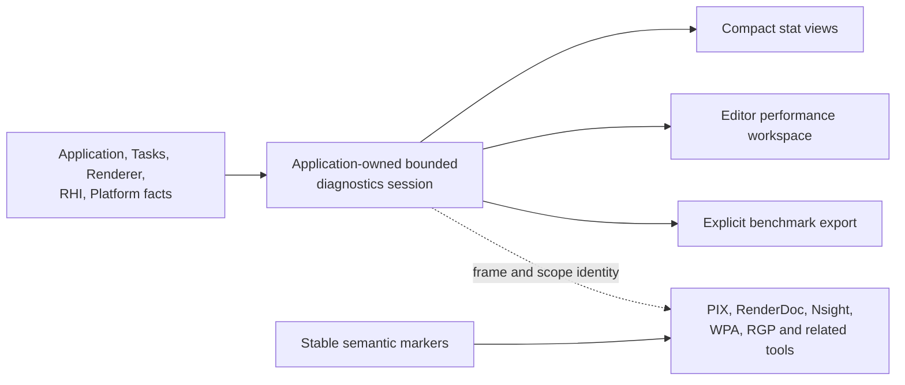
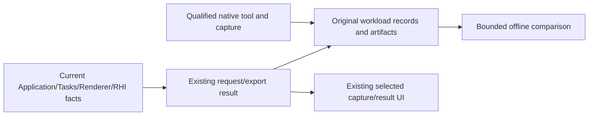

# Performance Diagnostics Architecture

[Docs](../../../README.md) / [Up](VisualDesign.md) / [Implementation](ImplementationPlan.md)

**Status:** feature dossier; target architecture, not proof of current implementation

**Last source reconciliation:** 2026-09-29 against the working tree based on committed revision `d1d26dbb`; the capture-specific paths named below were inspected, while unrelated local Renderer changes are outside this reconciliation

**Capture-only reconciliation:** 2026-10-10 against working-tree source at `34b6d8a7a34283fb4bf568be13307c741ca1bedd`; [current implementation and remaining acceptance](ExternalCapture/ExternalCaptureDesign.md). Other current-state observations retain their preceding date.

**Scope:** editor and game frame timing, CPU owner/thread attribution, GPU queue/pass timing, process RAM, GPU memory, bounded live presentation, attached external frame capture, external-profiler correlation, authoring isolation, and Shipping erasure

**Current readiness:** **20/100** - instrumentation foundations and an implemented Editor external-capture route exist; the joined internal diagnostics product, benchmark export and aggregate acceptance remain open. See [Current Feature Readiness](../../../Acceptance/CurrentReadiness.md#explicit-missing-or-not-yet-admitted-capabilities).

## Read This Page

- **Choose the activity:** [At a glance](#at-a-glance) distinguishes the existing external-capture route from the internal target product.
- **Understand measurement:** [Vocabulary](#measurement-vocabulary), [ownership and flow](#system-ownership-and-data-flow), then [cost budget](#collection-modes-and-cost-budget).
- **Design a user operation:** [Workspace](#diagnostics-product-information-architecture), [stat views](#sparkle-stat-views-and-commands) or [GPU visualizer](#on-demand-gpu-visualizer).
- **Review correctness:** [Shipping erasure](#intent-first-instrumentation-and-shipping-erasure), [handoff](#external-profiler-handoff-contract) and [failures](#failure-and-edge-cases).

## At A Glance

| Current source surface | Target product | Deliberate boundary |
| --- | --- | --- |
| host frame clock, thread names, task ETW events, GPU markers/timestamps, allocator facts, memory polling, and editor FPS text | one bounded orientation model shared by DevelopmentGame and Editor, focused GPU capture, reproducible benchmark export, and external-profiler handoff | not an in-engine universal trace viewer, allocation tracker, hardware-counter oracle, or Shipping dependency |

Current capture source implements one startup provider selection in Launcher/direct CLI, early RHI bootstrap, typed nonblocking requests and a capture icon overlay on the viewport surface. PIX and Nsight Graphics lower D3D12; RenderDoc lowers D3D12 and Vulkan. `RendererExternalRuntime` composes immutable `RhiDeviceLaunch` before Streamline/device creation; the RHI authority owns the native lease and result. The ordinary `ViewportToolbar` retains camera/view-mode/Show/FPS controls. Game, Nsight Vulkan and full lifecycle/matrix/Shipping/adoption acceptance remain open; see [External Capture](ExternalCapture/ExternalCaptureDesign.md). Internal diagnostics below remain a target product.



The internal layer is a compass: it identifies the likely limiting domain and the next useful investigation. External tools and controlled experiments establish cause. The target is not yet implemented or accepted.

## Dossier Route

| Concern | Owner |
| --- | --- |
| target diagnostic semantics and system shape | this page; external capture delegates to [External Capture](ExternalCapture/ExternalCaptureDesign.md) |
| dated current-source capability and gaps | [Capability](Capability.md) |
| feature-local evidence, failures, checks, and completion | [Acceptance](Acceptance.md) |
| delivery order and phase exits | [Performance Diagnostics Delivery Plan](ImplementationPlan.md) |
| GPU crash dumps, breadcrumbs and exact shader/source correlation | [Design and qualified candidate](GpuCrashDebugging/GpuCrashDebuggingDesign.md#acceptance-and-controlled-failures), [research](GpuCrashDebugging/Research.md); separate from frame capture |
| external product precedent and rejected UX options | [Diagnostics Product And UX Research](ProductAndUxResearch.md) |
| target layouts, interaction, and failure-state mockups | [Visual Design And Tool Wireframes](VisualDesign.md) |
| promotion gate for historical automation or a separate tool | [Performance Dashboard Idea](DashboardIdea.md) |

## Purpose And Authority Boundary

[Graphics Workload Studies](WorkloadStudies/WorkloadStudiesDesign.md) defines the selected offline comparison/incident consumer and its bounded plan. It reuses the workload schema, live serialization and external tooling owners below; it adds no parallel collector/export/history design and does not imply internal diagnostics are implemented.

This document owns the target system design for answering four questions:

1. Is the observed frame limited by host/game/editor CPU work, render CPU work, GPU work, presentation, or an unresolved interaction?
2. What are Sparkle's explicitly owned threads and task lanes doing?
3. How much process RAM and GPU memory is used, allocated, budgeted, resident, or awaiting retirement?
4. Which external capture should be taken next to establish cause?

It does not claim that the target is implemented, set performance targets for a particular scene, or replace a profiler.

- Current implementation truth remains in code and executable configuration.
- [Validation, Performance, and Evidence](../../../Engineering/Verification/ValidationAndEvidence.md) owns measurement and claim rules.
- [Tasks Engineering](../../../Engineering/Modules/Tasks.md) owns thread, task, wait, and publication rules.
- [Renderer Engineering](../../../Engineering/Modules/Renderer.md) owns graphics profiling semantics; [RHI Engineering](../../../Engineering/Modules/RHI.md) owns backend and hardware-specific evidence rules.
- [Editor Engineering](../../../Engineering/Modules/Editor.md) owns editor presentation and cross-thread UI products; [Tools Engineering](../../../Engineering/Modules/Tools.md) owns tool execution and publication.
- [J. Multithreaded Engine Architecture](../MultithreadedEngine.md) owns the target concurrency topology and frame concurrency lifecycle.
- [Renderer and RHI Architecture Boundary](../../Decisions/RendererRhiBoundary.md) owns renderer, frame-graph, and RHI authority.
- [I. Acceptance Workloads](../../../Acceptance/GraphicsWorkloads.md) owns `MAP-00`, scene routes, warm-up/sample policy, and portfolio gates.
- [A. Principal Graphics Engineering Requirements](../../../Strategy/Requirements.md) owns the `PGE-05`, `PGE-06`, `PGE-10`, and reviewer-evidence meaning advanced by this system.
- [Diagnostics Product And UX Research](ProductAndUxResearch.md) records the Epic/NVIDIA/AMD product study and rejected UX options behind the selected presentation; it is research, not implementation authority.
- [External Performance Profiler Runbook](../../../Engineering/Verification/ExternalProfiling.md) owns version-sensitive tool capabilities, capture preparation, marker interoperability, and operational playbooks; it does not define Sparkle metrics or prove a benchmark claim.
- [Performance Diagnostics Delivery Plan](ImplementationPlan.md) owns ordered, feature-selectable implementation packages and phase exits; it does not redefine this architecture or the adjacent feature acceptance contract.
- [Performance Diagnostics Capability Inventory](Capability.md) owns the dated current-source snapshot and reconciliation gaps.
- The adjacent [Performance Diagnostics — Acceptance](Acceptance.md) contract owns feature-local workload evidence requirements, baseline experiments, reviewer artifacts, and verification gates.

Application composes the selected cross-domain request/result and actual runtime serialization boundary. A live session/join/stat-selection owner is conditional on an admitted consumer; it is not required to use existing native tools or original workload records. The acceptance workload owns the benchmark schema, route, destination/name, sample policy, analysis, and claim. Editor owns its viewport menu/window presentation. DevelopmentGame owns a compact presenter through its existing game console/UI packet path. Each engine domain remains the authority for its own measurements. These concrete product consumers justify compact stat views; they do not justify a general task browser, allocation explorer, or trace-viewer product.

## Adversarial Review Standard

This proposal was re-reviewed on 2026-08-16 with every statement treated as untrusted. A claim survives only at the following strength:

| Claim kind | Required support |
| --- | --- |
| Current Sparkle behavior | Current code or executable configuration, with a dated source reconciliation. |
| D3D12/Vulkan/OS semantics | Current primary API specification or platform documentation. |
| External-product capability | Current primary manual/release material, revalidated by the profiler runbook and then smoke-tested on the installed environment. |
| Local architecture choice | A named repository goal/consumer, explicit ownership, bounded cost/failure behavior, and a rejected simpler alternative. |
| Numeric capacity or overhead threshold | An initial sizing or acceptance hypothesis until `sizeof`, overflow, observer-cost, and workload evidence calibrate it. It is not labeled Epic, NVIDIA, AMD, or industry best practice. |
| Performance conclusion | Comparable raw runs, uncertainty and practical effect, a discriminating capture/experiment, and the evidence rules owned by the workload and standards. |

The goals survive this review: a bounded first-party orientation layer, one focused marker capture, reproducible evidence, and strong external-profiler handoff directly support `MAP-00` and `PGE-05`/`06`/`10`/`13`. The review rejects a broad in-engine trace platform, universal hardware claims from timestamp scopes, and treating the provisional capacities below as proven constants.

## Executive Decision

The four layers below describe conditional diagnostic depth. The [delivery plan](ImplementationPlan.md#delivery-at-a-glance) selects existing external capture and needed workload evidence; internal overlays, the workspace, live history and GPU visualizer are unselected. Do not construct these layers in sequence merely because the design describes them. A separately admitted consumer must justify each additional producer and presenter after existing tools prove insufficient.

The conditional layers are:

| Layer | Answers | Product shape |
| --- | --- | --- |
| Live orientation | Which domain is consuming the frame budget right now? Is memory growing or under pressure? | Composable `Stat` overlays in Editor and DevelopmentGame, plus one bounded Editor performance window. |
| Focused GPU frame analysis | Which marked queue/pass region consumes a selected GPU frame, inclusively and exclusively? | An on-demand, frozen GPU captured-frame mode inside the Performance workspace, built from frame-graph-owned scopes. |
| Reproducible measurement | What are the distributions and high-water marks for a declared run? | An explicit `MAP-00`/benchmark session with a manifest and raw samples. No default report files. |
| Causal investigation | Why is a CPU stage, GPU pass, wait, allocation path, or queue expensive? | PIX, RenderDoc, Nsight Graphics, Windows Performance Recorder/Analyzer, and hardware-appropriate vendor tools using Sparkle's stable names and markers. |

The live layer is a compass, not a verdict. It must expose validity, frame identity, configuration, and likely limiting domain without pretending that utilization, FPS, summed scope time, or a single captured frame proves cause.

The table is not a requirement to deliver the whole ladder. Selected external-capture work remains PIX, Nsight Graphics, then RenderDoc through the [child plan](ExternalCapture/ImplementationPlan.md). Completing capture does not select an internal session, stats, histories, queries, workspace or `ProfileGpu`. If later admitted, those packages preserve the semantics, bounds, zero authoring tax and Shipping erasure below.

## Unreal Stat-System Precedent And Sparkle Adaptation

The earlier study explored compact stats, a fixed group catalog and a GPU visualizer. Sparkle retains only the transferable questions: units and validity, physical versus logical ownership, shared pass/marker identity, bounded observer cost and a useful next native-tool action. It does not adopt a stat catalog, workspace or query product by precedent.

Current external capture keeps one startup selection and targeted viewport request; its [experience owner](ExternalCapture/UserExperience.md) defines the delivered controls. Future internal presentation requires its own consumer/value decision rather than the earlier Tier-A/B/C rollout.

## Goals And Non-Goals

### Goals

- Produce trustworthy native capture and candidate-bound release/workload measurements through existing owners.
- Keep units, frame/range/configuration identity, validity, provenance, timing and memory meanings exact across APIs.
- Add only a demonstrated missing fact and its actual consumer, with bounded cost and failure behavior.
- Preserve normal rendering topology, zero feature-author registration tax and applicable Shipping erasure.
- Reuse qualified tools and original evidence; delete duplicate collectors, state or presentation with a replacement.

### Non-Goals

- A home-grown sampling profiler, flame graph, GPU counter suite, allocation call-stack recorder, or trace viewer.
- A second task runtime, task history browser, per-subsystem thread pool, or diagnostics event bus.
- A generic public stat-registration framework or unrestricted module-defined overlays.
- A replacement for RenderDoc/PIX resource inspection, pipeline-state debugging, shader ISA/counters, or vendor hardware analysis.
- Per-entity, per-resource, per-draw, or arbitrary string instrumentation in the live path.
- Requiring content authors or ordinary feature code to register stat rows, manage profiler sessions, allocate diagnostic records, maintain counters/history, select collectors, or understand backend capture APIs.
- Inferring GPU milliseconds from GPU utilization.
- Calling a sum of overlapping/nested GPU scopes "GPU frame time."
- Calling aggregate CPU usage "game-thread cost."
- Treating Editor gameplay execution as a separate OS game thread when it is not one.
- Always-on detailed GPU timestamps or default disk reports in normal product runs.
- A runtime Shipping toggle that leaves optional profiling code, strings, query pools, branches, dependencies, commands, panels, or provider binaries in the product.
- Optimizing Sponza before a reproducible baseline identifies its limiting path.

## Measurement Vocabulary

Every visible metric must have one owner, unit, interval, correlation identity, validity state, and sampling mode. A blank or `N/A` value is correct when the engine cannot establish the measurement.

### Clock And Identity Rules

`FrameId` remains the shared logical correlation identity. Diagnostics may add a benchmark `RunId`, sample-window identity, OS thread ID, queue type, and `RhiSubmissionToken`, but none becomes a second frame authority. A join by `FrameId` proves that producers describe the same logical frame; it does not prove causality, a common clock, one submission, or a one-to-one presentation. `PresentId`, input identity, and submission/dependency identity remain separate where required.

CPU clocks use one monotonic source. GPU durations use backend timestamp periods. CPU and GPU absolute timestamps are not placed on one time axis unless the backend provides and the implementation validates clock calibration. Backend contracts are explicit:

- D3D12 timestamps are bottom-of-pipe samples. Frequency and support are queried per command queue; direct and compute support timestamps, while copy support is capability-gated.
- Vulkan timestamp records include the selected pipeline stage, queue-family `timestampValidBits`, device `timestampPeriod`, and the wrap decision used by the resolver. A Vulkan timestamp can occur at the requested stage or a logically later stage and is not silently treated as a D3D12 bottom-of-pipe sample.
- Queue dependencies and submission tokens are retained even when clocks are not calibrated. They prove ordering constraints, not elapsed overlap on a unified axis.

The initial product keeps CPU-relative and per-queue GPU-relative axes. A later calibrated view is admitted only when every participating domain has a current calibration, its uncertainty is below a declared purpose-specific threshold, and the calibration age is within a declared interval. D3D12 uses `ID3D12CommandQueue::GetClockCalibration`; Vulkan uses calibrated timestamps, records maximum deviation, rejects excessive deviation, and recalibrates rather than extrapolating indefinitely. Until those gates pass:

- CPU phases correlate to `FrameId` and use CPU-relative time;
- GPU scopes correlate to `FrameId` and use per-queue GPU-relative time;
- submit-to-GPU and input-to-present latency remain unavailable rather than estimated;
- multiple GPU queue spans remain separate unless calibrated overlap is proven.

### Timestamp And Measurement Provenance

Every timing or counter field carries one provenance value independent of validity:

| Provenance | Meaning and comparison rule |
| --- | --- |
| `NativeLiveTimestamp` | Timestamp recorded while the declared workload executed normally. Eligible for live and benchmark comparison when observer mode matches. |
| `ReplayTimestamp` | Timestamp measured during capture replay. Useful inside that replay; never silently compared with native benchmark timing. |
| `SampledHardwareMetric` | Statistical hardware/PMC/counter sample with architecture, interval, multiplexing, and sampling limitations attached. |
| `SystemTraceDerived` | Value derived from scheduler, presentation, API, or other system-trace events under a named derivation. |
| `Estimated` | Model-derived orientation only. The model and error bound are visible; it cannot satisfy a native timing or latency evidence gate. |
| `Unavailable` | No defensible source exists for the field in this capability/configuration. Validity carries the typed reason. |

The configuration banner, tooltips, raw schema, and comparison logic preserve provenance. A capture import may attach native, replay, sampled, and system-derived fields to one evidence case, but it may not coerce them into one homogeneous population.

### Required Top-Level Definitions

| Display name | Definition | Includes | Excludes / caution |
| --- | --- | --- | --- |
| Frame interval | Unscaled application begin-to-begin wall duration for the host frame. | Active host work, blocking/backpressure, presentation effects that delay the next begin, and scheduling delay. | Not "CPU execution time"; one thread may sleep for much of it. |
| Host phase wall | Non-overlapping instrumented wall duration on EditorThread or GameThread for that `FrameId`. | Input/host, editor, gameplay, extraction, UI packet build, render enqueue, and waits inside those phases. | Not sampled CPU execution time; does not include worker execution and shows uninstrumented time separately. |
| Gameplay wall | Caller duration around world edit application and game-system execution. | Caller waits for the system DAG to settle. | Do not add task-worker CPU duration to it; that double counts parallel work. |
| Render CPU wall | Render owner duration from consuming a frame packet through render-frame retirement. | Renderer preparation, frame graph, recording coordination, submission, present, and classified waits. | In serial mode it runs on the host thread and must be labeled `Inline`, not RenderThread. |
| Render queue wait | Time the producer blocks for a reusable frame slot or the render consumer waits for input. | Backpressure or starvation at the bounded frame queue. | A symptom; inspect the downstream/upstream critical path before assigning cause. |
| Worker occupancy | Task-body wall duration and ready-to-start delay by named `SparkleTasks` lane for the selected interval. | FrameCritical, Background, and BlockingIo task work. | Not OS CPU running time. Lane is policy, not subsystem ownership; run/ready/wait causality belongs in ETW/PIX. |
| GPU graphics span | Earliest begin to latest end of the outer valid graphics-queue frame scope for one `FrameId`. | Queue execution enclosed by the frame scope. | Does not include CPU queueing, present scan-out, or work outside the scope. |
| GPU scope inclusive | End timestamp minus begin timestamp for one valid scope instance on one queue. | Marked commands plus every valid nested child interval and any queue gap inside the scope. | Not shader-only active time; nested inclusive values are not additive. |
| GPU scope exclusive (uncovered) | Inclusive duration minus the interval union covered by valid direct children on the same queue. | Commands, waits/bubbles, and unmarked work inside the parent but outside child scopes. | Not shader self time or hardware-unit attribution; unavailable when hierarchy/containment is invalid. User-facing views keep `uncovered` adjacent to `exclusive`. |
| GPU queue unaccounted | Synthetic queue-root inclusive duration minus the interval union of valid top-level recorded scopes. | Queue time not covered by a timed top-level marker. | A coverage signal, not automatically waste or idle time. |
| Process working set | Current physical pages resident for the process. | Shared and private resident pages as reported by the OS. | Not ownership and not total committed memory. |
| Process private commit | Private committed virtual memory charged to the process. | Private committed pages, resident or paged out. | Not the same as current physical RAM. |
| GPU tracked used | Sum of live resource/allocation payload bytes tracked by Sparkle's GPU allocator. | Engine-owned tracked allocations. | Not driver allocations and not necessarily resident. |
| GPU allocator blocks | Bytes reserved in allocator blocks/heaps. | Internal fragmentation and unused capacity within blocks. | Not identical to resource payload or adapter usage. |
| Local API usage / budget | Backend/API report for the D3D12 local segment or Vulkan device-local heap groups. | Process-estimated usage and mutable budget in the scope declared by the backend snapshot. | "Local" is not universally dedicated VRAM, especially on UMA/host-visible designs; never combine it with non-local heaps and call the sum VRAM. |
| Retirement backlog | Bytes whose logical owner released them but whose GPU completion token has not retired them. | Deferred/delayed destruction tracked by the backend. | `N/A` when the backend cannot report it. |

### Validity States

Every domain result carries one of these states:

| State | Meaning |
| --- | --- |
| `Pending` | Frame exists but a delayed GPU or publication result is not available yet. |
| `Valid` | Source, unit, interval, and `FrameId` are known. |
| `Unavailable` | Backend, platform, build, or mode cannot provide the metric. |
| `Disabled` | The capability exists but the selected diagnostics mode does not collect it. |
| `Stale` | The last valid sample is older than its declared polling interval. |
| `Invalid` | Correlation, nesting, timestamp resolution, or sample completeness failed; exclude it from aggregation. |

The UI shows the state, sample age, and typed reason. Capability reporting is `capability + reason + relevant limits`, not a boolean. It never substitutes zero for missing data.

### Sample Population And Cohort Contract

Each single-metric row uses its own field-valid population: all samples in the selected interval whose field is `Valid` and whose provenance/mode matches the view. Cross-domain comparisons, within-run paired deltas, and the live bottleneck classifier instead use the intersection of `FrameId` values for which every required field is valid and comparable. They never compare independently filtered CPU and GPU percentiles as if they described the same frames.

Every aggregate publishes:

- population kind: `FieldValid`, `CommonCorrelated`, or a named benchmark population;
- valid sample count, original interval count, elapsed span, sample generation, and mode/provenance;
- pending, disabled, stale, invalid, discontinuity, capacity-loss, and other excluded counts by reason;
- the selected interval/range identity and any minimum population requirement.

`UnitGraph` renders an invalid field as a gap for that field. A multi-domain hint is `WarmingUp` until its minimum common cohort exists and `Unknown` when correlation, provenance, or validity cannot support comparison.

## Current And Target Execution Topology

With threaded rendering and pipeline depth 1, work may overlap as follows:

```text
wall time  -------------------------------------------------------------->

Sparkle.EditorThread   Frame 102: host + gameplay + extract + UI + enqueue
Sparkle.RenderThread            Frame 101: prepare + graph + record + submit
Task.FrameCritical.*                 F101 recording/system tasks
GPU.Graphics                              Frame 100 pass execution
Present                                           Frame 100 presentation

correlation              FrameId, never visual column position
```

Comparing Editor frame 102 directly with GPU frame 100 as if they were the same logical frame can produce a false diagnosis. The aggregator joins results by `FrameId` and allows older records to be completed when delayed GPU timestamps resolve.

### Explicit Sparkle Thread Roles

| Thread role | Exists when | Current responsibility | Required presentation |
| --- | --- | --- | --- |
| `Sparkle.EditorThread` | Editor product | Window/input host, editor operations, gameplay update/extraction, ImGui model/build, render packet production. | One physical lane with logical phase colors; never relabel gameplay as a separate OS thread. |
| `Sparkle.GameThread` | Game product | Window/input host, gameplay update/extraction, runtime UI/console, render packet production. | One physical lane with the same gameplay phase vocabulary. |
| `Sparkle.RenderThread` | `r.ThreadedRenderer=true` | Renderer/RHI mutable ownership, frame graph, recording coordination, submission, present. | Selected completed `FrameId` stage breakdown, classified waits, and queue latency. |
| `Sparkle.Task.FrameCritical.N` | Parallel task runtime has workers | Dependency-ready game-system, render-preparation, or command-recording tasks. | Occupied %, ready delay, task count, and longest stable task label for the selected interval; detailed spans in ETW. |
| `Sparkle.Task.Background.N` | Parallel task runtime has workers | Bounded asset preparation and editor/tool background CPU work. | Occupied %, ready delay, task count, and longest stable task label for the selected interval. |
| `Sparkle.Task.BlockingIo.N` | Parallel task runtime has workers | Bounded blocking file/process operations. | Occupied %, task count, and longest stable task label for the selected interval; OS traces distinguish running from blocked. |
| `Sparkle.ToolMain` | Standalone tools | Tool orchestration. | Outside the editor frame panel; available in external CPU traces and tool-specific evidence. |

Driver, OS, SDK, and profiler threads are not Sparkle-owned. External tools may show them by their provider names or as unlabeled external threads; Sparkle does not rename them or attribute their CPU time to an engine subsystem without call-stack evidence.

If `task.SerialExecution=true`, no task-worker lanes are invented; task work is attributed to the caller thread with task scopes still available in a trace. If `r.ThreadedRenderer=false`, render phases appear nested on EditorThread/GameThread and RenderThread is `Unavailable`.

### Stable Logical CPU Phase Vocabulary

The initial live taxonomy is deliberately small and orchestration-shaped:

```text
Application.Frame
|-- Application.BeginFrame
|   |-- Platform.Events
|   `-- Level.CommitPending
|-- Editor.Operations                    [Editor only]
|-- Gameplay.Frame
|   |-- Gameplay.ApplyEdits
|   |-- Gameplay.Systems
|   `-- Gameplay.ExtractRenderInput
|-- Editor.BuildUi                       [Editor only]
|-- Renderer.Enqueue
|   `-- Renderer.FrameQueueBackpressure
`-- Application.Unattributed

Renderer.Frame
|-- Renderer.ConsumeInput
|-- Renderer.BeginFrame
|-- Renderer.SetupFrame
|-- Renderer.PrepareFrame
|-- Renderer.FrameGraph.Setup
|-- Renderer.FrameGraph.Compile
|-- Renderer.CommandRecording
|-- Renderer.Submit
|-- Renderer.Present
|-- Renderer.Wait
`-- Renderer.Unattributed
```

These labels describe ownership and work. They do not mirror every function. A new top-level phase requires a distinct diagnostic question and current consumer. Dynamic entity names, resource paths, pointer values, and per-frame formatted labels are forbidden in this taxonomy.

Task names retain their existing bounded `TaskName`. A task trace also carries lane, graph-run generation, task index, lane worker index, outcome, and, when the submitting domain has one, `FrameId` plus a fixed owner category such as `Gameplay`, `Renderer`, `Editor`, or `Asset`.

### GPU Scope Vocabulary

GPU markers remain frame-graph/pass owned:

```text
Renderer.Frame                         [FrameId is record metadata]
|-- Queue.Graphics
|   |-- Renderer.FrameGraph/<StablePassName>
|   `-- Renderer.PresentUi
|-- Queue.Compute
`-- Queue.Copy
```

- Pass names come from compiled frame-graph diagnostic names. The same stable `ScopeToken` resolves both the visualizer name and the backend marker display path; a UI-only naming hierarchy is forbidden.
- `FrameId` is scope-record metadata or a capture bookmark where the tool supports it; it is not a per-frame formatted pass label.
- Queue is explicit metadata, not encoded only in display text.
- Detailed internal scopes are capture-time diagnostics and are disabled in the basic live mode.
- Owned draw/dispatch counts and marker-only annotations may accompany a timed scope. Per-draw timing, resource contents/state, shader analysis, and hardware attribution belong in PIX, RenderDoc, Nsight, or RGP.
- The engine preserves a top-level queue span even when detailed pass timings are disabled.

One private backend adapter fans each semantic scope out to Sparkle timing and supported native markers. The portable marker contract is:

- a generated or `constexpr` registry owns `ScopeToken`, stable display path, and backend-safe static string storage; build tests reject token/hash collisions and duplicate paths;
- aggregation identity never includes `FrameId`, pointer values, transient graph indices, resource paths, or per-frame formatted text;
- duration scopes are balanced RAII objects and remain inside one CPU task and one command-list/command-buffer recording lifetime; task-local and command-recording-local stacks prevent cross-thread or cross-command-buffer push/pop pairs;
- duration regions, point annotations, and resource/object names are distinct operations. A backend/tool may support only a subset without changing semantic scope identity;
- D3D12 PIX marker strings use the static/aligned storage required by the selected PIX event runtime path; Vulkan uses `VK_EXT_debug_utils` when available. Tool/version-specific fallbacks and limitations belong to the [profiler runbook](../../../Engineering/Verification/ExternalProfiling.md#marker-interoperability-contract).

## System Ownership And Data Flow



The selected path joins original identity and meaning; it does not require a runtime joined history or Performance workspace. A missing fact first belongs to the producer that performs the real work. Introduce cross-domain stored state only when a separately admitted consumer cannot use existing results or views.

### Owners

| Owner | Current/selected responsibility | Additional state is not implied |
| --- | --- | --- |
| Core | Existing clock/process/path primitives and truthful boundary errors. | No new trace service or generic diagnostic registry. |
| Application | Product launch/capture intent, lifetime and actual request/export orchestration. | A live join/session/stat demand owner only if its consumer is admitted. |
| Tasks | Existing task/worker identity and ETW execution facts. | No task browser, second runtime or diagnostic task graph. |
| Renderer | Current frame/view/pass, product and measurement facts; semantic marker identity. | No UI polling or diagnostics-only scene scan. |
| RHI/backends | Native timing/memory/capture/diagnostic facts and completion-safe native lowering. | No workload/schema/UI policy or universal hardware-counter platform. |
| Editor | Existing controls emit typed intent and display immutable request/results. | No separate timing/capture authority or automatic Performance workspace. |
| Workload/Tools | Experiment input/schema/destination and bounded offline analysis of original records. | No second sampler, runtime exporter, database, runner service or dashboard. |

### Target Responsibility Placement

For a newly admitted fact or consumer, extend its existing owner and name the real publication/lifetime boundary before adding a holder. Reuse the concrete homes in [External Capture execution architecture](ExternalCapture/ExecutionArchitecture.md) for current provider work. Do not precreate Application session/history classes, view-model families or module-wide source partitions from the former target file map. The data/access and cost examples below constrain only structures the selected consumer actually needs.

### Publication Rules

- Producers write owner-local frame builders; there is no global mutable timer registry.
- Cross-domain transport uses bounded typed domain mailboxes selected by the Application session; there is no generic diagnostics event bus or unbounded MPSC trace stream.
- Completed results are immutable and keyed by `FrameId`.
- GPU results may complete an older pending frame after its frame-in-flight slot retires by publishing a new immutable model generation. Published objects are never mutated in place.
- The Application join never blocks EditorThread/GameThread waiting for RenderThread or GPU data.
- Each presenter reads a published model no more than once per UI frame and never synchronously requests a renderer snapshot.
- Editor menu actions and `Stat` console commands submit the same typed group-selection request; they do not parse or invoke one another's presentation path.
- Each viewport provider icon submits one typed external-capture request carrying the provider ID and a stable viewport/present-target token. Editor never passes an `HWND`, native device, queue, swapchain, or vendor callback across the boundary.
- External capture requests are serialized with `ProfileGpu` and any other exclusive instrumentation mode. The owner rejects `Busy` or `Conflict` before arming; it never lets two capture layers race for the same frame.
- Enabling or disabling a group starts a new sample-window generation at an owner commit boundary. Late results from the previous demand set cannot populate a newly enabled view.
- A dropped or overwritten result increments a bounded loss counter and invalidates the affected aggregate; it does not grow a queue.
- Reset starts a new sample-window generation. Results from the previous generation cannot enter new aggregates.
- Shutdown stops publication, settles producers, drains or invalidates pending joins, then destroys the session.
- Capture state and every asynchronous producer settle each request/generation exactly once. Generation checks reject late completion after reset, clear, replacement, shutdown, or device loss.

### Diagnostics Data/Access Inventory

| Product | Producer / mutation point | Consumers | Frequency and expected cardinality | Publication, lifetime, and overflow |
| --- | --- | --- | --- | --- |
| Host frame builder | EditorThread or GameThread at fixed Application scopes | Application join; CPU trace sink | One builder for the current `FrameId`; fixed phase columns | Owner-local until end-frame publish, then immutable; missing phase closes as invalid rather than escaping the frame epoch. |
| Renderer frame result | RenderThread/inline render owner; delayed GPU resolver completes GPU fields | Application join; external marker correlation | At most the configured frame-pipeline capacity plus delayed retirements | Fixed mailbox capacity; oldest unconsumed result is rejected with a loss counter rather than blocking or growing. |
| Joined frame ring | Application joins by `FrameId` and sample generation | Live performance model; explicit benchmark exporter | 1,024 fixed summaries | Overwrites oldest live-only summary; a benchmark consumer streams accepted samples and marks any loss invalid. |
| GPU scope plan | Frame-graph compile assigns stable scope tokens, parents, queues, submission order, and exclusive per-chunk record/query slices | Command recorders and delayed resolver | At most 256 scope instances and 512 timestamps for one detailed frame across queues | Immutable for the frame epoch; each task writes only its preassigned slice and merge order ignores completion order. |
| Detailed GPU ring | Renderer resolves stable pass tokens and durations | Editor GPU detail view; explicit benchmark exporter | Eight frames, at most 256 scope records per frame across queues | Fixed storage; overflow invalidates detailed data for that frame, increments one loss counter, and preserves the independent top-level queue span where valid. |
| Frozen GPU profile | Renderer validates and derives one resolved detailed frame | Application publication; Editor Performance/GPU captured-frame view; DevelopmentGame compact result | One armed request and one retained frozen capture | Capture request has generation/id; replacement or clear releases the prior result after presenter publication. No UI pointer crosses the boundary. |
| Attached external frame capture | Selected RHI private adapter at the confirmed scene/present boundary | Neutral selected-provider observation; Editor overlay; native artifact handoff | One immutable startup selection and one active request/native lease | RHI owns identity, deadlines and terminal publication; Renderer validates scene generation. Native quiescence controls lease release. No capture bytes enter the diagnostics history. |
| Memory ring | Application samples process memory; Renderer/RHI publishes GPU memory | Editor memory view; benchmark exporter | 256 samples at default 1 Hz | Overwrites oldest live sample; each sample owns fixed categories and explicit age/validity. |
| Active stat selection | Application applies typed requests from Editor or DevelopmentGame presenter | Collection-mode resolver and presenters | At most four compact groups plus one fixed Editor Performance view | Replaced at an owner commit; mode changes advance sample generation and never mutate producer authority. |
| Live performance model | Application derives a read-only projection after joining | Editor panels and DevelopmentGame stat presenter | One latest immutable model plus fixed plotted windows | Replaced atomically/by owner publication; presenters retain no producer pointers or mutable spans. |
| Evidence stream | Application session serializes accepted joined summaries | Workload-owned artifact package | Exactly the declared bounded benchmark request | Fixed-size staging/chunk buffer; write failure stops the run, preserves prior accepted evidence, and reports the incomplete artifact. |

The numeric capacities in this inventory are initial sizing hypotheses chosen to make storage and failure behavior concrete. They are not vendor recommendations or permanent API constants. Before a slice freezes them, its implementation record must publish exact record sizes, query-pool distribution, normal and stress occupancy/loss, Empty/Sponza observer cost, and the consumer task that needs the retained history. The result may reduce, increase, or delete a capacity while preserving boundedness and explicit overflow. In particular, the 1,024 joined frames, 120-frame display window, eight detailed frames, 256 scopes/512 timestamp slots, 256 memory samples, four overlays, 16 compact rows, 4 MiB cap, and percentage overhead budgets all remain calibration inputs until that record is accepted.

Hot records contain scalar fields, fixed arrays, stable label tokens, and typed identities only. They do not own strings, vectors, callbacks, service pointers, locks, or editor objects. Detailed records resolve tokens to display names outside collection. The storage budget is governed by:

```text
joined summary bytes
  = joined-frame capacity * fixed summary size
  + detailed-frame capacity * detailed-scope capacity * fixed scope-record size
  + memory-sample capacity * fixed memory-sample size
  + producer mailbox capacity * fixed result size
  + fixed export staging bytes
```

Metric and view descriptors are private fixed `constexpr` tables owned by Application; modules do not register rows dynamically. The implementation record must publish exact `sizeof` values and test the candidate 4 MiB live-history cap before freezing it. Changing frame-pipeline depth or worker count does not multiply live diagnostic storage implicitly; any per-worker producer scratch is separately fixed and included in that proof.

## Intent-First Instrumentation And Shipping Erasure

The diagnostics product observes production work; production work does not become a diagnostics program. Gameplay, content, scene systems, render passes, frame-graph declarations, allocators, and platform/backend mechanisms continue to express their real intent. Diagnostic collection attaches at the smallest existing owner boundary that already knows the required fact, derives demand automatically from user intent, and publishes away from the work path.

```text
real product intent -> existing owner performs/commits/submits work
                               |
                 owner-local static diagnostic seam
                               |
             bounded collector/result only in eligible builds
                               |
                Application join -> immutable consumers

Shipping: real product intent -> existing owner performs/commits/submits work
          diagnostic seam, collectors, strings, UI, and providers absent
```

### Zero authoring-tax contract

Adding or editing a level, material, mesh, entity, gameplay system, ordinary task, shader, render-pass instance, resource, or draw/dispatch must not require a stat registration, diagnostics descriptor, UI row, sample-history change, memory counter, profiler mode, capacity choice, export field, vendor call, or capture configuration. The content pipeline and runtime must work identically when the performance-diagnostics product is not built.

Collection follows this order:

1. derive identity, cardinality, bytes, queue, lifetime, and state from facts the production owner already needs to execute correctly;
2. sample the existing owner at a natural build/commit/submit/retire boundary without a second scan;
3. instrument a fixed orchestration boundary owned by Application, Tasks, Renderer, frame graph, allocator, or RHI when elapsed time is the missing fact;
4. add one static semantic token/RAII scope only when the boundary cannot be derived and the user-facing investigation needs it;
5. leave finer detail to ETW, PIX, RenderDoc, Nsight, RGP/RMV/RGA, WPA, or another native profiler instead of annotating ordinary code.

The allowed local annotation is deliberately small: a compile-time `ScopeToken` or point marker at a real owner boundary, with no dynamic string formatting, start/stop pairing across functions, manual nesting/depth, counter storage, collector lookup, provider branch, or UI knowledge. Frame-graph pass markers are generated from the compiled plan and stable pass catalog rather than repeated inside each pass body. Task timing comes from the existing task executor. Queue/submission timing comes from Renderer/RHI ownership. Memory facts come from the OS and existing allocators. High-level systems do not poll or push diagnostic samples.

Code that performs real work must not contain mode checks such as `if (diagnosticsEnabled)`, per-feature diagnostic state, a diagnostics callback, or parallel “instrumented” algorithms. Eligible-build composition and the owner-local diagnostic adapter decide whether a fixed fact is collected. The normal algorithm, ownership, task graph, command-recording topology, resource lifetime, and result stay the same.

### Separation of operational facts and diagnostic projections

| Production owner retains because execution needs it | Diagnostic-only projection in eligible builds |
| --- | --- |
| `FrameId`, generation, stable object/pass/task identity, queue type, submit/retirement tokens | Sample-window generation, joined history, percentiles, validity/loss summaries, row models. |
| Task graph/execution/lane ownership and begin/end operation boundaries | ETW emission and bounded lane-duration aggregates. |
| Frame-graph plan, pass ordering/dependencies, recording chunks, submission batches | Static marker tokens, timestamp-query plan, detailed scope records, inclusive/exclusive derivation. |
| Allocator used/allocated blocks, heap/segment classification, budget facts needed by memory policy | Slow memory sampling, sampled high-water values, history, formatting, evidence fields. |
| Renderer/Application phase calls and queue/present operations | Monotonic timing samples, bottleneck hint, live/benchmark aggregation. |
| Backend/device/swapchain ownership and normal process configuration | External-provider detection/bootstrap/capture state and artifact handoff. |

Diagnostic projections are one-way immutable consumers. They do not feed scheduling, culling, allocation, rendering, gameplay, asset selection, or content behavior. If a proposed metric requires a second mutable representation, per-object instrumentation, or a scan that the production operation does not need, reject it or make it an explicit capture-only external-tool question.

### Build and Shipping contract

Build eligibility is not a runtime collection mode:

| Build profile | Performance-diagnostics eligibility |
| --- | --- |
| `DebugEditor`, `DebugGame` | Eligible for correctness/debugging, with observer cost never used as representative performance evidence. |
| `DevelopmentEditor`, `DevelopmentGame` | Canonical profiling-capable builds: optimized, symbol-bearing, diagnostics compiled in, runtime default `Off`, and explicit intent enables bounded collection/capture. |
| `ShippingEditor`, `ShippingGame` | Stripped by default: optional performance diagnostics are not compiled, linked, registered, staged, or exposed. There is no runtime path to enable them. |

Use the existing build-profile authority and `SPARKLE_BUILD_SHIPPING` eligibility at one build/composition boundary. Do not add one switch per metric, view, provider, or module. If implementation needs one derived compile-time capability for readability, define it once from the canonical profile in build configuration and consume it only at diagnostics composition or owner-local static seams.

Shipping retains only facts and checks required for product correctness or an independently owned shipping policy, such as `FrameId`, allocator bookkeeping used by allocation policy, GPU retirement tokens, capability selection, bounded error handling, and ordinary gameplay/render results. Their existence is not justification to retain performance histories or presentation.

Shipping excludes all selected performance-diagnostics-only behavior and payload:

- Application diagnostics session, demand resolver, joins, histories, aggregators, benchmark serializer, and diagnostic process-memory sampling;
- `Stat` performance registration, compact overlays, Performance workspace/models, viewport profiler icons, help/strings, and diagnostic assets;
- diagnostic-only CPU timers, task-event emission, GPU timestamp-query planning/resolution, detailed scope records, marker/object-name fanout, token display dictionaries, and query/readback capacity;
- performance-memory poll/history/presentation beyond allocator facts required by the real memory policy;
- `ProfileGpu`, evidence requests, external capture launch parsing/bootstrap/adapters/state/artifact handoff, vendor capture SDK/import libraries, DLLs/layers, and package dependencies;
- diagnostic tasks, queues, callbacks, files, logs, commands, CVars, runtime branches, and fallback/no-op service objects retained only to support those features.

An empty runtime branch is not Shipping erasure. The optimized Shipping artifact must contain no optional diagnostic call, branch, registration, symbol, marker/display string, storage, thread/task, query pool, provider import, or staged binary. Static token annotations in owner code must compile to no instructions and must not retain their names. Prefer excluding diagnostic implementation sources/dependencies by target configuration; use an empty inline seam only where a sparse owner annotation is unavoidable and prove it disappears in optimized output.

External marker/capture capability belongs in optimized Development builds. A future product requirement for opt-in field telemetry, crash diagnostics, or profiling in a distributed build is a separate architecture and privacy/security/overhead decision; it does not silently weaken this Shipping contract.

### Authoring-isolation and erasure acceptance

- A representative new level/content variation and a representative new frame-graph pass build and run without adding or editing a diagnostics registration, UI model, history, export schema, or provider path. At most one static semantic token is accepted for a genuinely new owner boundary.
- Repository checks reject diagnostics includes, mode branches, dynamic labels, manual counters, provider calls, or sample publication from content/gameplay/pass bodies outside the narrow allowlist of owner-local static seams.
- Debug/Development tests prove diagnostics demand is derived from `Quick Check`, `Investigate *`, selected stats, capture, or benchmark intent; content and feature code never selects a collector.
- `ShippingEditor` and `ShippingGame` configure and build without optional profiler SDKs/tools installed. Package manifests/import tables contain no PIX/RenderDoc/Nsight diagnostic dependency or diagnostic asset.
- Symbol, string, link-map, object/disassembly, and package audits prove the optional sessions, commands, UI, histories, queries, marker names, providers, and call sites are absent. A source `#if` or runtime `Off` claim alone is insufficient.
- Empty and Sponza Shipping runs, followed by the supported-map smoke roster where affected, allocate no diagnostic storage, create no diagnostic tasks/query pools/files, expose no diagnostic UI/command/launch option, and preserve output/behavior.
- For a diagnostics-only package, compare affected optimized Shipping hot functions and package size with the pre-package control. Unexpected code/data/import or a measurable regression blocks acceptance. When the package also contains a necessary base refactor, isolate and explain that refactor's Shipping delta rather than attributing it to stripped diagnostics.
- Development `Off` remains a measured low-overhead control, but it is never cited as proof of Shipping erasure. Development `LiveBasic`/capture and fully stripped Shipping are separate artifacts with separate claims.

## Collection Modes And Cost Budget

| Mode | Intended use | CPU scopes | GPU scopes | Memory | Disk |
| --- | --- | --- | --- | --- | --- |
| `Off` | Default/control inside a profiling-capable Debug/Development build; not a Shipping-erasure claim. | No diagnostic timing or live aggregation; independently owned thread naming follows its build policy. | No timestamp collection; marker fanout follows the eligible-build policy. | Product-required memory policy only; no diagnostic sampling/history. | None. |
| `LiveBasic` | Editor orientation | Fixed top-level host/render phases and bounded lane aggregates. | One top-level span per active queue; no detailed internal scopes. | Process sample at 1 Hz; RHI sample at its bounded cadence. | None. |
| `LiveDetailed` | Short interactive diagnosis | Top-level plus selected fixed subphases. | Frame-graph pass scopes and selected fixed detailed scopes. | Same cadence; optional high-water reset. | None. |
| `GpuProfileCapture` | One focused GPU frame investigation | Only configuration/bookmark CPU markers required for correlation. | One armed eligible frame with the full bounded stable GPU scope plan; frozen after delayed resolution. | Captured as configuration context only. | None unless attached to an explicit evidence export. |
| `Benchmark` | `MAP-00` and declared routes | Exact raw per-frame summary for the bounded sample request. | Valid top-level and per-pass values required by the workload. | Current and high-water values over the run. | Explicit manifest, raw timing, and summary artifacts only. |
| `ExternalCapture` | PIX/RenderDoc/Nsight/WPA/RGP | Stable trace markers and symbols; live UI may be hidden. | Stable backend markers; internal timestamp collection may be disabled to avoid observer overlap. | Tool-specific capture plus a matching manifest bookmark. | Native profiler artifact by explicit user action. |

Shipping is deliberately absent from this mode table. It is a compile/link/package eligibility decision, not another runtime enum value. A stripped Shipping binary cannot transition from `Off` to a diagnostic mode because the collectors and product surfaces do not exist.

Instrumentation acceptance budgets for the first implementation are hypotheses to test, not claims that these exact values are universally imperceptible:

- zero per-frame heap allocations in `LiveBasic` after initialization;
- at most 4 MiB total bounded live-history storage with a documented exact layout;
- less than 1% change in CPU frame p50 and less than 2% change in CPU frame p95 between `Off` and `LiveBasic` on both Empty and Sponza, using identical valid runs;
- less than 1% or 0.1 ms, whichever is larger, change in GPU p95 from the top-level timestamp pair;
- measured and reported overhead for `LiveDetailed` and `Benchmark`; results from different modes are never compared silently.
- measured and reported CPU/GPU disturbance for `GpuProfileCapture`, including whether normal parallel command recording remained enabled.

The CPU percentage target is evaluated together with a predeclared absolute noise floor measured on Empty; a near-zero baseline must not turn timer noise into an apparent percentage failure or pass. The implementation record owns the exact absolute threshold and measurement procedure before acceptance.

If a target cannot be met, the expensive collector becomes explicit capture-only. Diagnostics do not receive a hidden exception from the performance standard.

## Bounded Data Model

### Joined Frame Summary

The initial live-ring candidate stores at most 1,024 joined frame summaries. A summary contains fixed fields, not variable vectors:

- `FrameId`, sample generation, product mode, renderer mode, pipeline depth;
- begin/end CPU timestamps and frame interval;
- host phase durations and host unattributed duration;
- render phase durations, queue wait/backpressure, and render unattributed duration;
- task-lane occupied/count/ready-delay aggregates;
- per-queue top-level GPU span plus validity;
- presentation mode/wait classification;
- render/output/client extents, backend, render path, validation state;
- counts needed to compare work: frame-graph passes, draws, dispatches, submitted batches, visible/render instances, and upload bytes where already owned;
- diagnostics loss/invalid counters.

The initial detailed-ring candidate retains eight fixed slots with at most 256 scope records per frame across all queues. `LiveDetailed` uses all eight as a rolling ring. `GpuProfileCapture` pins one slot for the latest frozen result and leaves seven rolling slots; a later accepted capture replaces that pinned slot. Overflow invalidates only that frame's detailed view and preserves an independently valid top-level queue span. The benchmark writer streams a declared bounded run to its explicit artifact rather than retaining an unbounded in-memory history.

### Memory History

Memory is slow-changing relative to frame scopes. The initial candidate ring stores at most 256 samples at a default 1 Hz cadence:

- current process working set and private commit;
- OS-reported process-lifetime peak working set/private commit where the platform exposes them, labeled as process-lifetime values;
- Sparkle session sampled high-water and benchmark-run sampled high-water for working set/private commit, each with sample identity and cadence;
- engine-tracked GPU used bytes and allocator block bytes;
- device-local API usage and budget;
- non-local/shared API usage and budget;
- transient bytes and retirement backlog;
- fixed GPU categories: texture, mesh, ray tracing, transient, upload, readback, constant buffer, other;
- sampled `FrameId`, monotonic timestamp, backend, validity, and source scope.

The target RHI memory contract must stop using a combined local plus non-local `TotalBudgetBytes` as the UI's "VRAM budget." The primary vocabulary is local/non-local segment or heap, process estimated API usage/budget, engine-tracked allocation bytes, and allocator block bytes. "VRAM" is allowed only as a compact presentation alias when the adapter memory architecture and backend scope make it defensible; UMA, host-visible/device-local, and shared-memory systems retain the precise terms. API budgets are mutable implementation estimates that may change because of system activity.

`Stat Reset` resets only Sparkle session sampled high-water and its generation. It cannot reset OS process-lifetime peaks. A benchmark run owns a separate sampled high-water so an earlier editor/load spike cannot be presented as the run peak. All sampled high-water values expose cadence and may miss peaks shorter than that cadence.

### Aggregation Rules

- The initial live-window candidate is the newest 120 joined `FrameId` summaries in the current generation. Each headline shows latest valid, p50, and p95 from all field-valid entries inside that fixed interval and displays the full population metadata defined above. Cross-domain rows derive a common-correlated cohort over the identical interval.
- Benchmark windows use the acceptance workload's current readiness, warm-up, sample-count, and run-count policy and record the resolved values in the manifest. The workload-owned analysis computes per-run p50/p95/p99/worst as primary results, a clearly secondary combined view, run-to-run variation, its declared correlation-aware uncertainty method, and regression verdict from raw integer samples; these do not require more live UI columns.
- Invalid, pending, stale, and disabled values do not enter a percentile.
- The initial percentile algorithm is nearest-rank over durations in integer nanoseconds; conversion/rounding happens only for presentation.
- Worst frame and declared tail events are preserved with `FrameId`; a percentile is never reconstructed from displayed rounded values. Worst values are directly comparable only when sample counts are equal or the count sensitivity is explicitly modeled.
- High-water marks reset only on explicit session reset/start and record the `FrameId` at which they occurred.
- Nested CPU or GPU scopes are not summed into a parent. Parent wall duration and child contribution are displayed separately.
- Cross-thread task durations are not added to host/render wall time. Busy worker time and wall critical path are different views.

## Bottleneck Classification

The live UI may show a `Likely` hint only when all required signals are valid, provenance-compatible, and present in the same sufficiently sized common-correlated `FrameId` cohort. It shows `WarmingUp` until that cohort reaches its declared minimum and `Unknown` when correlation or capability fails. It must also show the strongest supporting signals. `Confirmed` is reserved for a completed causal experiment/capture outside the live classifier.

| Hint | Required correlated observations | Next evidence |
| --- | --- | --- |
| `Likely GPU-limited` | A valid queue span is at/over budget, non-wait host/render phases are below it, presentation throttle does not explain it, and known submission/dependency/backpressure evidence connects that queue to downstream frame completion. A graphics-only span cannot classify the frame when unresolved async compute/copy or presentation dependencies could control completion. | PIX Timing/GPU Capture on D3D12; Nsight Graphics or RGP GPU trace; RenderDoc for state/work inspection. |
| `Likely render-CPU-limited` | One non-wait render phase or render CPU wall is at/over budget, the GPU span is lower, and host/game work is not the critical path. | WPA/PIX Timing with symbols; inspect frame setup/compile/record/submit call stacks. |
| `Likely host/game/editor-limited` | A non-wait host/game/editor phase is at/over budget, render/GPU spans are lower, and frame-queue backpressure is not dominant. | WPA CPU sampled plus precise scheduling; compare DevelopmentGame and DevelopmentEditor. |
| `Likely present-limited` | Present/throttle wait dominates and the recorded VSync/frame-latency policy explains the interval. | PIX Timing or WPA/DWM/GPUView evidence with presentation configuration. |
| `Likely task scheduling-limited` | Ready delay, caller join, worker imbalance, or oversubscription is material to the critical path. | WPA with `SparkleTasks` ETW dependency/begin/end events and CPU scheduling. |
| `Likely memory-pressure/churn` | Local budget pressure, allocation growth, retirement backlog, upload/eviction activity, or process private commit rises with hitches. | PIX memory/timing capture, allocator records, vendor memory tool, and a controlled load/unload route. |
| `Unknown` | Required values are missing, disagree, belong to different frames, or do not isolate the limiting resource. | Fix validity/correlation or take a wider CPU/GPU system trace. |

CPU utilization alone is never sufficient for a CPU-limited hint. GPU utilization alone is never sufficient for a GPU-limited hint. A blocked producer can have low CPU utilization while the frame is GPU-limited; a GPU can show high utilization while an earlier CPU stage still controls latency.

## Diagnostics Product Information Architecture

The current consumer is a rendering investigation, release check or capture request. Existing native tools and current timing/memory producers supply its facts. Add a missing field at its actual owner and use one existing capture/export/presentation route; no shared history or workspace is a prerequisite merely because domains differ.

### Product Surfaces And Depth Boundary

| Selected question | Current/default route | Requires separate admission |
| --- | --- | --- |
| Inspect a native frame, shader or resource | Existing external-capture action and provider-native artifact. | Additional provider, native feature tuple or integration depth. |
| Qualify frame rate, memory or an optimization | Frozen workload inputs, existing measurements/native tools and the bounded offline consumer. | A new metric producer only when existing facts cannot answer the question. |
| Investigate a crash/device failure | Qualified GCD/native diagnostics with matching symbols and receipts. | Automatic recovery, upload service or crash/hang collection not already available. |
| Repeatedly inspect a missing live fact | First test the question with existing logs/captures. | One bounded stat/presenter after value, owner and observer-cost admission. |

A current asset inspector remains an asset inspector. It does not need to merge into a Performance workspace. New consumers do not create duplicate capture, timing, memory, selection or serialization authorities.

### Attached External Frame Capture

The [External Capture dossier](ExternalCapture/ExternalCaptureDesign.md) owns the source-backed external-capture package, in priority order PIX, Nsight, RenderDoc, then specialist tools. Its [Research](ExternalCapture/Research.md) adds Unreal, Unity and tagged Godot/vendor evidence; its [Discovery](ExternalCapture/Discovery.md) closes installed SDK and target/lifecycle gates. The [engine absorption scan](ExternalCapture/Research.md#engine-absorption-scan--2026-10-07) and [engine evolution contract](ExternalCapture/ExecutionArchitecture.md#engine-evolution-contract) require existing-consumer startup/admission/publication improvements before PIX, then actual provider-locality proof. Internal `ProfileGpu` remains a separate timestamp product and is not a dependency of external capture.

#### Launch And Provider Selection

Use the [launch/capability semantics](ExternalCapture/Semantics.md#launch-and-capability-rules) and [bootstrap architecture](ExternalCapture/ExecutionArchitecture.md). One immutable provider selection reaches early RHI bootstrap through `RendererExternalRuntime`. Native APIs stay private; unknown injected combinations reject before load. Marker-only runtime availability does not mean Ready. Provider priority controls delivery order, never silent runtime selection.

#### Viewport Icon And Interaction

The [External Capture UX](ExternalCapture/UserExperience.md) owns first use and the context action; [Visual Design](VisualDesign.md#current-capture-experience) illustrates placement. A scene viewport resolves to its containing native present surface; it is not assumed to own a swapchain. Native captures can contain other work, and actual frame/interval certainty is explicit. Editor layout/presentation emits typed intent over the existing control route and owns no capture state.

#### State And Publication

The [capture protocol](ExternalCapture/Semantics.md#state-cancellation-and-exclusivity) distinguishes capability, request terminal state and native quiescence. One controller owns the request/lease and target; backend-private adapters observe native completion. A timeout cannot release an unsafe native lease. Results are immutable read-state projections; artifacts remain native and confirmed finalization or native handoff is required. The [external acceptance/check contract](ExternalCapture/ExternalCaptureDesign.md#acceptance-and-check-contract) defines the corresponding negative controls.

### Visual, Validity, And Accessibility Rules

Use units, actual frame/range identity, validity/age/loss and requested/active configuration. Milliseconds lead for durations; counts, ratios and bytes keep their own units and denominators. Invalid or missing data is not zero. Labels and errors remain understandable without color; a presenter observes immutable results and issues typed intent without synchronous native polling.

No fixed Overview/CPU/GPU/Memory layout, Inspector, hitch navigator or universal selection model is selected. [Visual research](VisualDesign.md) retains illustrative alternatives, not screen requirements. [Workload Studies](WorkloadStudies/ImplementationPlan.md) owns the selected offline comparison consumer.

## Sparkle Stat Views And Commands

No Stat group catalog, overlay set or Stat command implementation is selected. The prior Tier-A minimum and Tier-B/C workspace/visualizer ladder are retired; MAP-00, WL-04 and case evidence do not require those UIs.

If a separately admitted live question needs a presenter, use the existing console/UI route and the smallest typed request. Select its actual fact/producer, unit, validity, immutable result, bounded lifetime and observer budget. Do not implement all Fps/Unit/Threads/Gpu/Memory groups, reserve enum values or create registries first. Add state only with its real consumer and delete a replaced presenter in the same slice.

The earlier bounded-history and Basic-mode cost values remain conditional measurement hypotheses for a consumer that selects that mode; they are not reasons to allocate a session or history. Current FPS text is not silently relabeled as qualified engine timing.

## On-Demand GPU Visualizer

ProfileGpu and an internal marker-query visualizer are unselected. Native captures are the default. A future proposal must first show a recurring question that existing tools cannot answer economically, compare the simpler option, and freeze the actual scope, query capacity, observer cost and native lifetime.

The reusable correctness constraints below remain a target contract if that proposal is admitted. They do not require implementing a hierarchy, query plan, record format or presenter now. A future accepted slice supplies its own request/state/finalization and consumer decisions; no production placeholder is retained.

### Scope Identity And Fixed Record

Each frame-graph compile produces a bounded immutable GPU scope plan. The plan retains the current token/display mapping and exact candidate provenance; it introduces no internal schema version or compatibility decoder. The hot record uses capture-local indices for contiguous addressing and stable tokens for identity:

```text
GpuProfileScopeRecord
  ScopeToken                 stable semantic aggregation identity
  ParentScopeIndex           capture-local parent, never durable identity
  QueueType                  Graphics / Compute / Copy
  SourceKind                 QueueRoot / Batch / RecordingChunk / FrameGraphPass / PassDetail
  SubmissionBatchIndex       capture metadata
  RecordingChunkIndex        capture metadata
  LocalSequence              deterministic order inside the exclusive chunk slice
  BeginTicks / EndTicks      native queue timestamps
  InclusiveTicks             derived after validation
  ExclusiveTicks             derived after direct-child interval union
  DrawCount / DispatchCount  counts already produced inside this exact scope
  Validity                   explicit state/reason
```

Display names live in one bounded capture dictionary keyed by `ScopeToken`; hot records do not own strings. The identity policy is:

- synthetic queue roots use fixed tokens;
- structural batch/chunk instances use fixed kind plus capture-local submission metadata;
- frame-graph passes use a stable semantic pass token and retain pass index only as selected-frame metadata;
- pass-internal scopes use an owner-declared stable child token;
- repeated instances share an aggregation token but retain distinct capture-local instance indices and call ordinals;
- a runtime label that cannot resolve to a bounded stable token before recording appears under a fixed `Other` token or is marker-only; it does not create an unbounded dictionary entry.

The token registry is generated or compile-time declared from owner-local definitions. Its verification rejects collisions, missing paths and transient identity components. Captures preserve the exact candidate and immutable token/display mapping; regenerate disposable Sparkle records when representation changes rather than decode obsolete internal versions.

The current `FrameGraph/<Kind>/<Index>/<PassName>` event label remains useful for external navigation, but the numeric pass index is not the cross-frame aggregation identity because graph composition can change it.

### Preserving Parallel Command Recording

The accepted target must not reproduce the current hidden behavior where GPU timing disables parallel frame-graph recording.

```text
compiled FrameGraphPlan
        |
        v
bounded GpuScopePlan partitioned by (queue, batch, recording chunk)
        |
        +--> preassigned query pairs + exclusive record slice --> recording task 0
        +--> preassigned query pairs + exclusive record slice --> recording task 1
        `--> preassigned query pairs + exclusive record slice --> recording task N
                                                                  |
task join / normal submission order -------------------------------+
        |
        v
deterministic merge by (queue, batch, chunk, local sequence)
        |
GPU completion / frame-slot retirement
        |
        v
resolve ticks -> validate tree -> derive inclusive/exclusive -> publish
```

- Query pairs and fixed record ranges are assigned before recording tasks start.
- Each task writes only its chunk-owned slice and maintains a chunk-local parent stack. No task pushes into a shared vector or uses completion order as hierarchy.
- Parent indices are made explicit during deterministic merge; display depth is derived from the validated parent chain rather than treated as identity.
- Query allocation/reset occurs at its RHI owner before parallel recording. Recording tasks only write their preassigned query commands through their exclusive `RhiCommandRecordingLease`.
- The selected frame preserves the normal renderer mode, pipeline depth, recording policy, task worker policy, submission batches, and queue dependencies.
- If a backend cannot safely preserve that topology, representative `ProfileGpu` is `Unavailable` for that backend until fixed. An explicitly labeled serial/reference diagnostic may exist for debugging, but cannot be silently compared with normal runs.

The initial 256-scope candidate requires at most 512 timestamp slots across all queues for the detailed frame. The implementation still checks backend-specific per-queue capacity before arming because scope distribution, synthetic roots, and unavailable queue timestamp support matter more than the aggregate number.

### Inclusive And Exclusive Calculation

Calculations operate in integer ticks; milliseconds and percentages are presentation conversions.

For every valid scope instance `s` on one queue:

```text
inclusiveTicks(s) = unwrappedEndTicks(s) - unwrappedBeginTicks(s)

childCoverageTicks(s)
  = length of the interval union of valid direct-child intervals clipped to s

exclusiveTicks(s) = inclusiveTicks(s) - childCoverageTicks(s)
```

The resolver performs these steps per queue:

1. Validate timestamp support, period, valid-bit range, capture generation, and `FrameId`.
2. Unwrap native ticks relative to that queue's outer begin timestamp. Reject a span whose ordering cannot be proven across wrap.
3. Validate every explicit parent index: same capture, same queue, no cycle, and child interval contained by parent interval.
4. Sort direct-child intervals by begin tick and compute their union. Significant sibling overlap or child escape invalidates the affected subtree rather than producing negative exclusive time.
5. Derive inclusive/exclusive ticks, then convert using that query's timestamp period.
6. Create one synthetic root per active queue from the earliest valid begin to latest valid end. Root exclusive is labeled `Unaccounted`, not `Idle` or `Waste`.

For a valid leaf, exclusive equals inclusive. For a parent, a large inclusive value with small exclusive value means marked children explain most of the interval. A large exclusive value means the parent contains substantial unmarked commands, waits/bubbles, or work; it does not prove the shader body itself is expensive.

Graphics, compute, and copy produce independent trees. Sparkle does not subtract a compute child from a graphics parent, sum queue roots, or align queue-relative timelines on one axis without validated cross-queue clock calibration. Submission dependencies may be listed as metadata without inventing calibrated overlap.

## Editor Presentation

Existing Editor capture controls use the [external-capture experience](ExternalCapture/UserExperience.md). Keep startup selection, viewport target and request/result state with their current owners; do not add a Performance menu or workspace as a prerequisite.

For any separately selected live fact, prefer one existing presentation location. Preserve immutable result/frame identity, explicit unavailability, keyboard/scale/error basics and no collection from UI. The [mockups](VisualDesign.md) are alternatives to reevaluate only if a real consumer warrants them.

## External Profiler Handoff Contract

Sparkle's built-in diagnostics orient the investigation and preserve stable identities; external tools own OS scheduling, call stacks, API/resource state, hardware counters, shader/ISA analysis, allocation maps, BVH inspection, and crash artifacts. The version-sensitive [External Performance Profiler Runbook](../../../Engineering/Verification/ExternalProfiling.md) owns the question-to-tool map, current capability record, capture preparation, detailed playbooks, and operational tradeoffs.

Every external investigation must:

1. start from a fixed route, representative configuration, readiness signal, and falsifiable hypothesis;
2. carry stable thread, queue, pass, frame/range, shader, resource, and build identities as applicable;
3. distinguish native live timestamps, replay timestamps, sampled hardware metrics, system-trace-derived values, and estimates;
4. record tool/version, driver/runtime/SDK, hardware, OS, observer mode/cost, validation state, lost data, and unsupported capabilities;
5. identify the critical path rather than equating the busiest unit or largest duration with causality;
6. label topology-changing diagnostic controls `NonRepresentative` and keep them out of final benchmark claims; and
7. link the narrow native capture and selected evidence into the workload-owned manifest.

For attached frame-capture providers, every viewport icon is only a trigger and state projection. It does not assert that replay is correct, that timings are representative, that coexisting capture layers are compatible, or that the capture belongs in an accepted evidence package. The architecture deliberately does not assert that a named tool/version supports the current adapter, API feature, marker encoding, operating system, or another active provider. Revalidate the runbook before every external capture.

## Failure And Edge Cases

- Minimized or invalid-size frames do not enter render/GPU aggregates.
- Loading frames remain visible but are tagged `Loading/Unsettled` and excluded from warm benchmark windows.
- Resize, render-path/provider change, shader reload, history reset, and capture frames are tagged discontinuities.
- A device-lost or failed timestamp resolution invalidates the frame and preserves the failure context; it never reports zero milliseconds.
- A scope plan or timestamp requirement beyond fixed capacity rejects the profile request or invalidates detailed data with one bounded loss; the target product path never reaches the current fatal query-exhaustion behavior.
- Timestamp wrap uses the backend valid-bit contract; cross-queue subtraction is forbidden without calibration.
- An invalid parent, parent cycle, child outside parent, significant sibling overlap, or queue mismatch invalidates the affected GPU subtree and its exclusive values. The independent top-level queue result remains usable where valid.
- Draw, dispatch, resource, and barrier annotations without owned timestamp pairs remain marker-only. The visualizer never invents duration for them.
- A second `ProfileGpu` while one is armed/resolving returns `Busy`; cancellation, shutdown, device loss, clear, and late completion settle one capture ID exactly once.
- Unsupported provider combinations, provider/backend mismatch, conflicting injected layers, or a second active external request are explicit typed failures. Combined provider selections are valid input, but no provider or viewport is selected by hidden precedence.
- A requested external provider that is absent or unsupported remains visibly unavailable. If initialization cannot roll back cleanly before device creation, the launch fails rather than continuing with partially installed hooks.
- A viewport external capture targets the next valid present for the clicked viewport. Minimize, zero extent, resize, timeout, shutdown, and device loss settle the request once and never redirect capture to another Editor window.
- Provider artifact finalization is asynchronous and bounded. Missing artifact-path reporting remains a completed native-UI handoff, not an invented Sparkle path; callback overflow or late completion is a visible failure.
- A capture that changes parallel command-recording policy is visibly `NonRepresentative` and cannot satisfy the representative profile acceptance path.
- Queue overlap means per-queue spans are displayed in parallel; they are not summed.
- VSync, frame-latency throttling, occlusion, remote desktop, capture/replay, validation, and power/thermal changes are recorded in the manifest.
- Memory budget changes caused by other processes are retained as observed API budget changes, not attributed to Sparkle allocations.
- A synchronous diagnostics request from EditorThread to RenderThread is forbidden in the live frame path.

## Decisions And Rejected Alternatives

| Decision | Selected | Rejected |
| --- | --- | --- |
| Product shape | Bounded live orientation + one focused frozen GPU marker capture + explicit evidence session + external tools. | General in-engine profiler/trace viewer. |
| Evidence statistics | Workload-owned raw samples, p50/p95/p99/worst, uncertainty, thresholds, and native capture links. | Expanding the live overlay into a benchmark/report application or treating a screenshot as the result. |
| Sample populations | Field-valid populations for one metric; common-correlated `FrameId` intersection for paired/cross-domain claims, with full exclusion metadata. | Comparing independently filtered percentiles or hiding missing frames. |
| Benchmark inference | Per-run primary results, combined secondary view, practical absolute/relative band, correlation-aware uncertainty, and `Inconclusive`. | Treating 3x300 as automatically definitive, pooling away run identity, p-value-only decisions, or unequal-`N` worst comparisons. |
| Cross-domain owner | Application session joins immutable domain results. | Global Core profiler singleton or Editor reaching into renderer/RHI state. |
| Instrumentation placement | Automatic collection at existing Application/Tasks/Renderer/frame-graph/RHI/allocator owner boundaries, with sparse compile-time semantic tokens only where intent cannot be derived. | Stat registrations, mode branches, manual counters/history, dynamic labels, provider calls, or sample publication in content/gameplay/pass bodies. |
| Shipping eligibility | Debug/Development are profiling-capable; Shipping excludes optional performance collectors, presentation, export, marker/timestamp payload, external providers, strings, dependencies, and call sites at compile/link/package time. | Treating runtime `Off`, an empty service object, disabled CVar, or an unclicked UI as zero Shipping cost. |
| Frontend entry | `Quick Check`, `Investigate CPU/GPU/Memory`, and contextual `Capture Evidence` over automatically derived collection demand. | Leading with twelve stat groups, collection modes, query/counter setup, or a wall of equal toolbar actions. |
| Progressive disclosure | Glance -> one selected workspace view -> explicit evidence -> contextual expert details/external tool, preserving one selection. | Showing hashes, manifests, raw events, complete configuration, and specialized controls on every screen or making users re-enter identity. |
| Stat interaction | One fixed `Stat` command family; the Editor menu uses typed task presets and `Customize Stats...` reaches the same raw group requests. | A second console, command-string-driven UI, twelve equal first-level menu choices, or arbitrary module registration. |
| Stat composition | At most four compact groups sharing one demand-derived collection mode. | Duplicate collectors per overlay or every group displayed simultaneously. |
| Editor gameplay labeling | Logical `Gameplay.*` phases on `Sparkle.EditorThread`. | Invented editor-side `GameThread`. |
| CPU detail | Fixed orchestration scopes live; ETW/PIX call stacks for detail. | Per-function timers and an unbounded task history panel. |
| GPU frame value | Per-queue outer span with valid `FrameId`; detailed passes on demand. | Sum of pass timers or GPU utilization converted to milliseconds. |
| Timestamp provenance | Native/replay/sampled/system-derived/estimated provenance remains explicit and comparison-gated. | Mixing replay timings with native benchmark samples or hiding an estimate behind milliseconds. |
| Queue timelines | Separate queue-relative clocks plus dependency edges first; capability-gated calibrated axis only within a deviation/age contract. | Aligning or subtracting queue/CPU clocks by assumption. |
| GPU profile interaction | One typed `ProfileGpu` request and one retained immutable capture, separate from live stat demand. | Always-running full trees, silent capture replacement, blocking for GPU completion, or default capture files. |
| GPU hierarchy | Stable scope token + explicit capture-local parent; inclusive from ticks and exclusive from direct-child interval union per queue. | Completion-order/depth reconstruction, nested-duration sums, or cross-queue subtraction. |
| GPU capture topology | Preassigned per-chunk query/record slices preserve normal parallel recording and submission topology. | Silently serializing command recording to simplify profiling. |
| Attached external frame capture | One immutable provider selection before graphics creation; one scene-surface overlay and globally exclusive request/native lease. | Multiple provider selections, unsafe injected combinations, late injection, hidden fallback, native handles in Editor or arbitrary first-window capture. |
| External capture delivery | PIX D3D12 and RenderDoc D3D12/Vulkan are the first supported targets; Nsight Graphics Capture is planned behind an explicit experimental gate while its SDK remains beta. | Calling all three providers equivalent, treating `nsight-graphics` as Nsight Systems/GPU Trace, or making a beta vendor SDK a mandatory engine dependency. |
| Memory | Working/private RAM and tracked/block/local/non-local/retirement GPU facts. | One ambiguous "RAM" and one combined "VRAM" number. |
| Memory peaks | OS process-lifetime peaks, Sparkle session sampled high-water, and benchmark-run sampled high-water remain distinct. | Claiming `Stat Reset` resets OS peaks or calling a sampled peak exact. |
| Publication | Delayed nonblocking join by `FrameId`. | Waiting for RenderThread/GPU so the newest UI row is complete. |
| Labels | Stable bounded ownership/pass vocabulary and bounded capture dictionary. | Dynamic resource/entity/path strings or runtime string interning in timing scopes. |
| Marker transport | Versioned generated/compile-time token registry with private backend fanout, balanced recording-local duration scopes, separate points and object names. | Vendor calls in feature code, cross-command-buffer scope stacks, or transient strings as aggregation identity. |
| Files | Explicit workload-owned export. | Default per-run JSON/CSV/report emission. |
| Hitch capture | Bounded in-memory hitch selection followed by an explicit `ProfileGpu`, external capture, or export action. | Automatic hitch-triggered disk/native captures before a measured bounded trigger, retention, privacy, and observer-cost contract exists. |
| Vendor counters | Native external capture first; a vendor SDK only as a later optional study adapter with a named consumer. | Making Nsight Perf SDK or another vendor runtime a core diagnostics dependency before workload proof. |
| External capture build | Fully optimized profiling build retaining symbols, shader debug/source packages, names, markers, and exact hashes. | A debug/validation build presented as representative or a profile switch that silently enables detailed internal collectors/serial recording. |
| Input-to-display | Remain `NotInstrumented` until the input/simulation/present/display identity chain and capability-specific observer path exist. | Estimating displayed latency from frame time or `Present` return. |
| Optimization start | Fixed, comparable DevelopmentGame/Editor and backend baselines. | Optimizing from the approximately 6 FPS screenshot alone. |

## Measurement Semantic References

Version-sensitive profiler sources and the current capability matrix live in the [External Performance Profiler Runbook](../../../Engineering/Verification/ExternalProfiling.md#source-and-version-reconciliation). The stable API sources behind this architecture's timing, memory, and presentation semantics are:

- [D3D12 timing, queue frequency, bottom-of-pipe meaning, and calibration](https://learn.microsoft.com/en-us/windows/win32/direct3d12/timing)
- [`ID3D12CommandQueue::GetClockCalibration`](https://learn.microsoft.com/en-us/windows/win32/api/d3d12/nf-d3d12-id3d12commandqueue-getclockcalibration)
- [Vulkan timestamp query semantics](https://docs.vulkan.org/spec/latest/chapters/queries.html#queries-timestamps)
- [Vulkan calibrated timestamps and maximum deviation](https://docs.vulkan.org/refpages/latest/refpages/source/vkGetCalibratedTimestampsKHR.html)
- [`VK_EXT_memory_budget` estimated heap usage and mutable budget](https://docs.vulkan.org/refpages/latest/refpages/source/VK_EXT_memory_budget.html)
- [DXGI per-process local/non-local video-memory usage and budget](https://learn.microsoft.com/en-us/windows/win32/api/dxgi1_4/nf-dxgi1_4-idxgiadapter3-queryvideomemoryinfo)
- [Vulkan Memory Allocator statistics scope](https://gpuopen-librariesandsdks.github.io/VulkanMemoryAllocator/html/statistics.html)
- [Vulkan present-timing stages, time domains, and bounded result queue](https://docs.vulkan.org/features/latest/features/proposals/VK_EXT_present_timing.html)
- [Windows process memory counters](https://learn.microsoft.com/en-us/windows/win32/api/psapi/ns-psapi-process_memory_counters_ex2)
- [Kalibera and Jones: quantifying performance changes with effect-size confidence intervals](https://arxiv.org/abs/2007.10899)
- [NIST/SEMATECH e-Handbook: randomness and autocorrelation diagnostics](https://www.itl.nist.gov/div898/handbook/eda/section3/eda35d.htm)

These sources explain external API or statistical semantics. They do not define Sparkle ownership, metric naming, collection cost, the correct independent unit for a workload, or evidence acceptance.
