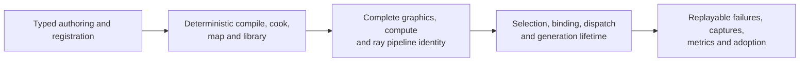

# Shader System — Acceptance

[Docs](../../../README.md) / [Up](ShaderSystemDesign.md) / [Implementation](ImplementationPlan.md)

**Status:** feature-local acceptance contract; not proof that the shader-system migration has passed

**Scope:** final feature criteria, required evidence, controlled failure expectations, and completion handoff for the unified shader, graphics-pipeline, and ray-tracing system

**Architecture authority:** [Shader System Architecture](ShaderSystemDesign.md)

**Delivery authority:** [Shader System Delivery Plan](ImplementationPlan.md)

**Evidence semantics:** [Validation And Evidence](../../../Engineering/Verification/ValidationAndEvidence.md)

**Candidate results:** [Feature Completion Reports](../../../Acceptance/FeatureCompletionReports.md)

This contract defines what the completed feature must prove. The delivery plan may sequence phase exits, but it does not redefine these final criteria or record a release verdict.

**Current readiness:** **50/100** — source implementation and integration exist; this contract contains no candidate verification or delivery result. See [Current Feature Readiness](../../../Acceptance/CurrentReadiness.md#foundation-world-content-shaders-and-tools).

## Acceptance At A Glance

Every arrow is part of the feature. “The shader compiles” does not prove deterministic dependency selection, reflected layout parity, cooked availability, complete pipeline identity, recording-time freedom from creation, safe reload/retirement, or dual ray-execution behavior. The final gate therefore requires both positive paths and deliberately broken authoring, binding, package, capability, and generation cases.

## Evidence Contract

The [Strategy Coverage crosswalk](../StrategyCoverage.md) owns portfolio-wide requirement status. The [Shader Compilation Capability Inventory](../../Modules/Tools/ShaderCompiler/ShaderCompilerCapabilities.md), [Renderer Shader Programs catalog](../../Modules/Engine/Renderer/Features/ShaderRuntime/ShaderProgramCatalog.md), and [Shader System Delivery Plan](ImplementationPlan.md) own current source claims and delivery reconciliation. The [Shader System Migration Baseline](MigrationBaseline.md) preserves the former pre-migration inventory. This contract keeps only the shader-system evidence requirements below.

### Required Evidence Pack

Implementation is not accepted merely when the new API compiles. The completed shader lifecycle must produce one navigable evidence pack for a pinned engine commit and workload:

1. an authoring trace from the concrete shader class and nested `Parameters` to virtual source, entry, parameter signature, compile-input hash, code hash, global-shader-map record, runtime shader reference, pipeline identity, and GPU event, plus a graphics draw trace from pass state/attachments/mesh-material facts to the complete key and native object;
2. optimized DXIL and SPIR-V artifacts for representative graphics stages and compute shaders, with reflection/layout comparison and readable compiler diagnostics;
3. one deliberately broken binding contract and one deliberately broken compile/include, both rejected with portable source locations and replayable failure bundles;
4. repeated cook results for serial, 1, 2, and N workers, including selected/compiled job counts, wall/CPU time, peak memory, cancellation, in-operation deduplication, and identical-output checks;
5. cold and warm D3D12/Vulkan pipeline results, including exact requested variant counts, attachment/state parity, graph-time creation, generation reuse, first-use frame impact, and proof that recording performs no loading or creation;
6. paired PIX and RenderDoc captures for the same representative scene and settings, plus Nsight or RGA shader analysis where the finding requires source/IL/ISA counters;
7. exact engine commit, global-shader-map/library hash, compiler backend and version, target, optimization/debug policy, GPU, driver, API, scene, camera, resolution, warm-up, capture frame, and run count;
8. editor adoption evidence: edit, changed-dependency selection, successful reload, failed replacement rollback, direct error navigation, one-job replay, and GPU-safe old-generation retirement;
9. a clean build/cook/run from documented commands and a recorded issue or minimal reproducer created by a second adopter; reuse the release source-adopter exercise when it actually covers this shader route, rather than require another documented journey per report;
10. the available historical baseline and current authored-string, registration, parameter, forwarding-pass, job/code/byte and cost observations needed for a specific simplification claim; do not recreate deleted architecture or add a reporting system to recover missing historical numbers;
11. an inspectable support matrix proving backend/target/stage/shader-type/feature/policy status and a consumer report distinguishing registered, cooked, runtime-valid, selected, and captured shaders, supported alternates, and mandatory failures;
12. runtime-generation and lazy-materialization lifetime evidence, including state-object/pipeline, SBT layout/index/update/memory, trace dispatch, alternate selection, mandatory-product failure, reload, and paired capture evidence, plus only compression/eviction metrics that actually exist.

Existing native tools and current measurement producers supply captures. The [performance diagnostics architecture](../PerformanceDiagnostics/PerformanceDiagnosticsDesign.md) owns shared metric semantics; its unselected internal session, workspace and visualizer are not shader acceptance prerequisites. This document owns the shader-specific identities and joins that make those captures traceable. Evidence records belong under the repository's evidence path selected by the acceptance workload; they must not be embedded here as claims that age with hardware, drivers, or compiler versions.

## Controlled Failures And Key Checks

| Failure ID | Injected condition | Required safe result | Check |
| --- | --- | --- | --- |
| `FM-SHS-01` | duplicate, late, missing, absolute, escaping, or colliding shader/source declarations | catalog or cook rejects both identities before publication; no basename fallback or partial catalog survives | `CHK-SHS-01` |
| `FM-SHS-02` | compile, include, reflection, parameter-layout, policy, or stage defect | one source-located replayable error is retained and the previous accepted generation remains active | `CHK-SHS-02`, `CHK-SHS-03` |
| `FM-SHS-03` | corrupt, truncated, wrong-target, wrong-layout, or missing map/library record | load or activation rejects the complete generation before lookup or native creation | `CHK-SHS-03` |
| `FM-SHS-04` | unsupported AS provider, RT stage, pipeline/table layout, or mandatory effect route | capability preflight rejects the request before graph construction; no fabricated product or silent fallback is published | `CHK-SHS-05` |
| `FM-SHS-05` | cancellation, stale completion, failed reload, device recreation, or delayed GPU completion | publication stays atomic and replaced generations retire only after every submission token completes | `CHK-SHS-04` |
| `FM-SHS-06` | D3D12/Vulkan descriptor, pipeline, SBT, traversal, or output divergence | paired validation identifies the exact shader/code/pipeline/table identity and blocks parity claims | `CHK-SHS-05`, `CHK-SHS-06` |

| Check ID | Claim-falsifying action | Primary coverage |
| --- | --- | --- |
| `CHK-SHS-01` | inventory declarations, owners, build membership, generated artifacts, old names, aliases, duplicate schemas, and compatibility paths | authoring identity and clean break |
| `CHK-SHS-02` | run representative and deliberately broken DXIL/SPIR-V compile/include/policy cases with replay bundles | compiler contract and diagnostics |
| `CHK-SHS-03` | mutate parameter layouts and map/library records, then prove structural validation and transactional rejection | ABI, cook, load, and lookup |
| `CHK-SHS-04` | exercise repeated cook, 1/2/N work, cancellation, Apply Changed, failed replacement, delayed completion, reload, and device recreation | publication, concurrency, and lifetime |
| `CHK-SHS-05` | force supported and unsupported raster, compute, inline-query, native RT, AS-provider, pipeline, and SBT paths on both APIs | capability truth and backend lowering |
| `CHK-SHS-06` | retain paired captures, disassembly/provenance joins, output comparisons, cold/warm timing, memory high-water, and observer configuration | executable parity, traceability, and performance |

## Native Conformance And Comparison Oracles

These are enduring checks for the retained shader/RHI contract. They do not authorize a production conformance mode, committed test fixtures, additional rendering features, or an automatic device-recovery product. Use existing routes or disposable probes and preserve the actual supported matrix. Independent source/backend oracles remain necessary even when two paths share code.

### Same-Frame GBuffer Comparison

The oracle is fixed before images are collected. It runs on D3D12 and Vulkan with identical source revision, cooked generation, scene, camera matrices/jitter/history, render extent, TLAS, instance/geometry/material buffers, texture table, and output formats. It includes sky-only miss pixels, front-facing and back-facing opaque triangles, near-plane/TMin boundary cases on either side of `0.001`, non-square and non-multiple-of-eight extents, indexed geometry, rigid motion, skinned deformation, and morph deformation. The shared Surface extension adds alpha/cutout and shadow consumers of the shared Surface hit contract without weakening these comparisons.

| Compared field | Frozen comparison |
| --- | --- |
| hit/miss, instance id, primitive id, face/cull result, resolution bounds and untouched guard texels | exact integer/identity equality; any out-of-bounds write fails |
| miss BaseColor, Normal, Material, Emissive, Subsurface, DeviceZ, MotionVector | exact stored-value equality to the shared `GBufferPacking::PackSky*` values and zero motion |
| BaseColor, Material, Subsurface (`R8G8B8A8_UNorm`) | each stored channel differs by at most one 8-bit code value (`1/255`) |
| Normal (`R16G16B16A16_Float`) | decoded unit-vector angular error at most `0.1` degree; alpha is exactly zero |
| Emissive (`R16G16B16A16_Float`) | per-channel absolute error at most `0.002 * max(1, abs(reference))`; alpha is exactly zero |
| DeviceZ (`R32_Float`) | absolute error at most `1e-5`; sky is exactly zero |
| MotionVector (`R16G16_Float`) | per-component absolute error at most `0.02` viewport pixel; invalid-history and miss cases are exactly zero |

A fault-sensitive check temporarily perturbs one shared hit-store result and proves both frontends fail the oracle in the same field; it then restores the source and reruns. Independent temporary perturbations bypass the shared store from each frontend and must be detected, proving the oracle does not pass merely because both paths miss or compare an untouched target. The validation slice removes every perturbation and temporary comparison resource before handoff.

### Ray Stage And Graphics-Key Controls

The all-six-stage RT conformance route must use one registered ray-generation class with global parameters, at least one miss and callable record, one triangle group with closest-hit and any-hit, and one procedural group with closest-hit, any-hit, and intersection. The same logical composition, record indices, bounded local POD, dispatch dimensions, and exact sentinels run on D3D12 and Vulkan. Independent invalid cases must reject duplicate/missing/wrong-stage exports, illegal triangle/procedural groups, root-layout mismatch, local size/signature mismatch, malformed record bytes, payload/attribute/recursion excess, unsupported compiler/backend target, overflow/misalignment/out-of-range table regions, illegal queue, stale pipeline/table generation, and a dispatch whose exact pipeline was not bound. Each oracle must demonstrably reach its intended owner rather than failing earlier for an unrelated reason.

Run graphics-key perturbation and corruption checks that independently vary generation, each shader code hash, binding-layout signature, every blend/color-write, raster, depth/stencil, topology, vertex-input, color/depth format, attachment count, and sample fact; prove each pipeline-affecting mutation changes equality/hash and exact materialization, while labels, viewport/scissor, attachment actions/access, streams, and draw arguments do not. Force a hash collision, missing pre-materialized key, stale generation, incompatible attachment access/sample, unsupported backend mapping, solid/two-sided/wireframe request set, repeated compatible draws, and reload with delayed queue completion.

### Current Contract And Deletion Floor

Check the current replacement/deletion floor: zero definitions/uses of every phase-owned package/program/pass-wrapper/duplicate-parameter/old-prefix/old-path/compatibility symbol; caller-authored complete graphics-state bag, repeated attachment signature, eager variant bundle, incomplete graphics key, and recording-time pipeline creation; compiler-only RT package/rejection path; ambiguous RT capability/mode; device-address/descriptor/no-query shadow duplication; shader-visible TLAS address/access mode; graph/native bypass; duplicate map/pipeline/table/scene/effect-plan authority; and permutation/precache/preload scaffold.

### Verification Coverage

| Layer | Required verification |
| --- | --- |
| authoring and parameters | one typed class/schema authority; explicit SRV/UAV/AS/attachment vocabulary; direct compute/graphics use; typed RT exports/groups; duplicate/missing/illegal relationships; no forwarding schema |
| source and compilation | virtual source identity; dependency closure; portable input hash; compile-every-selected-input; in-operation fan-out; cancellation; DXIL/SPIR-V stage capability truth |
| map and code library | deterministic catalog/map/library; code/hash/layout/export/group integrity; transactional publication; zero package reader/writer/identity compatibility |
| neutral RHI | independent AS/inline/pipeline capabilities; one semantic AS binding; immutable descriptors; checked SBT arithmetic; queue/resource/state legality; opaque generations; no native leakage |
| backend GPU | exact classic/partitioned AS descriptor layout/write; D3D12 state objects/identifiers/tables/dispatch; Vulkan RT pipelines/group handles/device-address tables/dispatch; all stage sentinels; clean native validation |
| frame graph/runtime | typed compute/draw/trace; declared resources/transitions/dependencies/culling; pre-execute materialization; exact generation capture; stale rejection; submission-token retirement |
| renderer scene/SBT | one classic/partitioned logical contribution plan; instance/geometry/ray-type formula; bounds; dirty generation; table bytes/update; no material duplication |
| effect selection/parity | one automatic engine-wide resolver; exactly one frontend per dual effect; same-frame GBuffer/shadow/migrated-effect parity; algorithm/API separation; supported alternates/history; mandatory-product failure |
| tooling/provenance | one `Apply Changed` operation; source-located failure; shader/effect-to-code/map/pipeline/table/graph/capture trace; bounded semantic frontend; no artifact scan or backend control |
| lifetime/failure | invalid replacement rollback; several frames in flight; reload/device recreation; table/pipeline generation match; no device-idle shortcut; previous accepted generation preserved |
| performance/evidence | fixed provenance; p50/p95/p99 CPU/GPU; compiler/map/pipeline/table/TLAS/BLAS/memory/bytes; cold/warm separation; paired captures; both wins and regressions |

## Completion Criteria

The unified shader, graphics-pipeline, and ray-tracing migration is accepted only when:

- `AC-SHS-01` — every delivery implementation record maps each criterion to a claim-falsifying check and exact evidence, every deferred executable claim is discharged before completion, and the final scoped [Code Review](../../../Engineering/Workflow/CodeReview.md) verdict is `PASS` with no P0-P2 finding;
- `AC-SHS-02` — a one-to-one compute author writes one `GlobalShader<Shader>` class with nested `Parameters`, one `IMPLEMENT_GLOBAL_SHADER` declaration, parameter assignments, and `Dispatch<Shader>`; there is no package, program alias, pass-registration macro, duplicate pass schema, forwarding pass class, layout string, or pipeline string;
- `AC-SHS-03` — `AllocParameters<Shader>()` and shader reflection/binding consume the same `Shader::Parameters` metadata and every shader-visible field has one declaration;
- `AC-SHS-04` — graph input/output access derives from typed parameter fields and pass recording sees only declared resources;
- `AC-SHS-05` — texture/buffer shader views use only explicit `CreateSRV` / `CreateUAV`, scene AS uses only `CreateAccelerationStructureBinding`, raster/depth outputs use neutral attachment bindings, and no generic `Read`, neutral `CreateRTV`, or neutral `CreateDSV` authoring alias remains;
- `AC-SHS-06` — graphics names concrete stage shader types, narrow granular pass render state, and real prepared draw work without a universal shader-program or caller-authored complete pipeline-state abstraction;
- `AC-SHS-07` — graph attachments are the sole author-facing target/depth compatibility and action authority; prepared mesh/material work owns vertex input, topology, fill/cull, streams, and draw arguments; the existing runtime owner assembles one complete immutable graphics key/descriptor and materializes only exact requested variants before recording;
- `AC-SHS-08` — shaderless and true multi-stage/graph-only operations use narrow envelopes without copying shader-visible fields;
- `AC-SHS-09` — every registered source/include has a canonical virtual path and portable diagnostic identity; same-basename paths cannot collide or shadow silently;
- `AC-SHS-10` — catalog freeze rejects duplicate/late declarations with both source locations;
- `AC-SHS-11` — the catalog/map contains exactly one variant per `(ShaderTypeId, Target)` and no permutation/precache/preload scaffolding;
- `AC-SHS-12` — classic/partitioned TLAS and native descriptor/address storage never multiply shader classes, HLSL roots, parameter schemas, map records, or graph call sites; one semantic AS parameter is lowered and validated by private RHI;
- `AC-SHS-13` — `ShaderCompileInputHash` changes for every compiler-affecting input, survives checkout relocation, and excludes package/pass/presentation text;
- `AC-SHS-14` — identical compile requests deduplicate only within one active operation, repeated cooks compile again, cancellation settles, and no partial publication appears;
- `AC-SHS-15` — `GlobalShaderMap` is the sole typed logical lookup and every map entry references a validated `ShaderCodeHash` in `CookedShaderLibrary`;
- `AC-SHS-16` — runtime lookup never derives source basenames, package IDs, or cooked paths and no `.sparkshader` reader/writer remains;
- `AC-SHS-17` — `RenderPassRuntimeCache` is the sole active/replacement/retired generation and materialized layout/graphics/compute/RT-pipeline/shader-table owner; creation occurs before recording, not in Execute;
- `AC-SHS-18` — changed includes select every dependent shader type and no unrelated shader when dependency data is valid;
- `AC-SHS-19` — Shader Tools presents one `Apply Changed` intent, one operation state, automatic validated activation, source navigation, and contextual shader/effect-to-map/pipeline/table/capture details without artifact scans, package mechanics, or native backend controls;
- `AC-SHS-20` — compile/validation failure reports one source-located root cause and preserves the previous accepted generation;
- `AC-SHS-21` — every supported raster, compute, and RT shader cooks and validates for the required DXIL/SPIR-V targets; unsupported language/backend/target combinations remain honestly classified;
- `AC-SHS-22` — all six RT shader stages traverse class, compile job, map, library, typed composition, native D3D12/Vulkan pipeline, shader table, typed graph trace, capture, reload, and retirement in focused evidence, and any temporary conformance harness is absent from the handoff diff;
- `AC-SHS-23` — acceleration-structure, inline-query, and RT-pipeline capabilities are independent and full pipeline readiness becomes true only when the complete backend/graph/runtime path is ready;
- `AC-SHS-24` — native identifiers and group handles remain backend-private and every table region/index/alignment/bounds check is tied to the exact pipeline generation;
- `AC-SHS-25` — ray-traced GBuffer and shadow visibility pass same-frame inline/pipeline parity, shared Surface alpha/material semantics, instance/geometry indexing, and classic/partitioned TLAS mapping on both APIs; rasterized GBuffer remains an explicit algorithm and missing shadow production fails before graph construction;
- `AC-SHS-26` — every ray-query effect is classified, every migrated effect schedules exactly one frontend from one immutable whole-frame plan, strict requests preflight atomically, automatic choices are inspectable, and temporal/history ownership is not duplicated;
- `AC-SHS-27` — D3D12/Vulkan runtime/capture evidence covers raster, compute/inline query, RT conformance, migrated effects, presentation/debug, explicit supported alternates, mandatory-product failures, reload/device recreation, and resolves a captured shader/code/pipeline/table identity to the exact class, source closure, compile request, map entry, code record, logical table record, and symbols;
- `AC-SHS-28` — delayed GPU completion proves old map/library/layout/pipeline/table generations retire only after all queue submissions complete;
- `AC-SHS-29` — the [current deletion floor](#current-contract-and-deletion-floor) is clean across runtime, tools, build membership, generated/cooked artifacts, frontend models, diagnostics, and current documentation; no alias, adapter, compatibility overload/reader, dual writer, fallback to the replaced contract, copied schema, parallel registry/cache/generation, or renamed legacy owner remains;
- `AC-SHS-30` — no migration logging, report generator, cache browser, submitted test scaffold, god owner/folder/function, one-method forwarding wrapper, duplicated policy, or excessive diagnostics remains;
- `AC-SHS-31` — the [required evidence pack](#required-evidence-pack) is complete or each unavailable claim is explicitly blocked with provenance.

## Completion Definition

The Shader System migration is complete only when `AC-SHS-01` through `AC-SHS-31` pass, every applicable `FM-SHS-*` is deliberately exercised through its named `CHK-SHS-*`, the required evidence pack is retained, and the release-level candidate report records the exact verdict and limitations. A completed delivery plan, source-consistency checkpoint, or unavailable backend is not a substitute.
