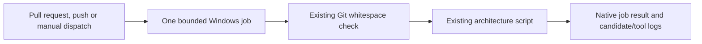

# Build And Packaging Capability Inventory

[Docs](../../../README.md) / [Up](../ModuleInventory.md)

**Status:** capability snapshot; current build-system inventory, not a successful-build or release-package record

**Snapshot:** 2026-09-08 at committed `master` revision `ffe60e3a`; root/module CMake, profile/artifact contracts, dependency fetches, project discovery, tool/product membership, and install/test/CI searches inspected; evidence `S` only

**Scope:** build profiles, toolchains, options, dependency acquisition, targets, artifact layout, runtime staging, project discovery, checks, automation, tests, installation, and packaging

**Owner:** root/module `CMakeLists.txt` and `CMake/`; Launcher is the user-facing workspace orchestrator

**Evidence and disposition:** [Capability Evidence Plan](../CapabilityEvidencePlan.md) and [First Release Acceptance Contract](../../../Acceptance/FirstRelease.md)

**Current readiness:** **25/100** across build-to-release delivery — historical score; build/package and bounded CI routes now exist, while final package/adoption proof is open. This documentation pass does not rescore the module. See [Current Feature Readiness](../../../Acceptance/CurrentReadiness.md#product-build-and-delivery).

**Identity amendment (2026-10-10):** [SparkleProductIdentity.cmake](../../../../CMake/SparkleProductIdentity.cmake) owns version `0.1.0`, publisher and copyright; root and standalone Launcher CMake entry points share it. Existing project-product and Launcher owners attach Windows version resources with public names Sparkle Editor, Sparkle Game and Sparkle Launcher. This adds executable identity, not a package/signing owner. [Current FR-01 report](../../../Acceptance/FirstRelease.md#current-fr-01-blockers) records validation and remaining blockers.

**Release inputs:** [First Release Inputs](PackagingAndInstallation.md#release-inputs) names product profiles, helper admission, acquisition-only Sponza/source-export boundaries, notices/SBOM, signing inputs and threat controls. Candidate results remain in Acceptance.

**Package owner (2026-10-11):** [CMake/Packaging](../../../../CMake/Packaging/Package.ps1) now owns the reviewed-input build/cook/stage/verify/archive route. [Packaging And Installation](PackagingAndInstallation.md#current-package-entry) describes current checks and remaining admission/runtime gaps. Historical Not found entries below retain their snapshot; source presence does not pass PD-3 or REL-03.

**Public development setup (2026-10-11):** the [root README](../../../../README.md) uses the standalone Launcher entry; [Contributing](../../../../CONTRIBUTING.md) routes public review. A [bounded source workflow](#automation) is prepared; historical absence-of-CI rows below predate it. Hosted/build/GPU acceptance remains unproved.

**Baseline owner checks:** after Launcher generates the canonical workspace, run `powershell -NoProfile -File CMake/RunBaselineChecks.ps1 -Configuration ShippingEditor`. [RunBaselineChecks.ps1](../../../../CMake/RunBaselineChecks.ps1) records revision/dirty state and sequential results for `architecture_boundary_check`, `code_style_check` and `ShaderCompilerCliValidation`. Failed, timed-out, cancelled, skipped, unavailable or missing-artifact results prevent a pass. It adds no check semantics and does not certify fresh checkout, asset rights, full cook or runtime. Candidate/environment/artifact binding remains with the [acceptance report](../../../Acceptance/FirstRelease.md#current-fr-01-blockers).

Use [build/profile rules](#build-contract), [generated-output layout](#canonical-generated-output-layout), [automation](#automation), or [packaging and diagnostics](PackagingAndInstallation.md).

## At A Glance

| Outcome | Current state | What is still missing |
| --- | --- | --- |
| configure and build developer profiles | six Editor/Game profiles, modular targets, dependency/toolchain options, and development artifact layout exist | a clean reproducible build result is not retained by this snapshot |
| prepare runnable development products | declared runtime support is copied beside Launcher/Showcase targets | development staging still depends on workspace conventions |
| inspect architecture/style | custom boundary and code-style targets exist | no general automated regression runner or CI gate |
| stage and distribute a release | CMake/Packaging source route; exact bytes unqualified | reviewed payloads, Launcher installed journey, symbols/signing and clean-machine proof |
| self-service and finite release review | local export/review/replacement routes exist; no user support service | exact-archive onboarding, consent/privacy, review and replacement evidence |

```mermaid
flowchart LR
    Source[Frozen source and dependency identities] --> Configure[Configure profile, toolchain, and features]
    Configure --> Build[Build engine, tools, and product targets]
    Build --> Dev[Publish development artifacts]
    Dev --> Stage[Fresh allowlisted stage and manifest]
    Stage --> Package[Verify and create unsigned internal archive]
    Package -. qualification pending .-> Consumer[Clean standard-user rehearsal]
```



The current build graph is useful engineering infrastructure, not yet a product-delivery system. The dossiers below separate those outcomes so a successful local executable cannot be mistaken for a distributable, supportable release.

## Capability Dossiers

| Surface | Owner and current boundary |
| --- | --- |
| Build graph, profiles, dependencies, development artifacts | This inventory |
| Public stage, package, signing, installation, and clean-machine operation | [Packaging And Installation](PackagingAndInstallation.md) |
| Continuous integration, automated regression, and retained results | [Continuous Integration And Regression](#automation) |
| Self-service recovery, local export/privacy, finite review and immutable replacement/withdrawal; no support service | [Adoption Support And Incident Response](PackagingAndInstallation.md#local-diagnostics-and-release-review) |

## Build Contract

| ID | Capability | State | Exact current coverage and limit | Evidence |
| --- | --- | --- | --- | --- |
| `BUILD-001` | CMake baseline | Implemented path | CMake 3.20+, C/C++, C++20 required, compile commands exported. Current owned platform/backend sources make Windows the effective target. | `S` |
| `BUILD-002` | Six profiles | Implemented path | DebugEditor, DebugGame, DevelopmentEditor, DevelopmentGame, ShippingEditor, ShippingGame; DevelopmentEditor is default. State and target macros are emitted globally. | `S` |
| `BUILD-003` | Profile optimization/debug policy | Implemented path | MSVC Debug `/Od /Ob0 /Zi /RTC1`; Development and Shipping `/O2 /Ob2 /Zi /DNDEBUG` plus full separate PDB/link optimization. Shipping symbol retention amended by PD-4. Clang-family Debug `-O0 -g`, Development `-O2 -g`, Shipping `-O3`. | `S` |
| `BUILD-004` | Compiler routes | Partial | CMake has MSVC and Clang/GNU flag branches; Launcher explicitly models MSVC and clang-cl on Windows. No current Linux/macOS platform product path exists. | `S` |
| `BUILD-005` | Static/shared engine modules | Implemented path | `SPARKLE_BUILD_SHARED` selects static default or engine DLLs; product targets copy declared runtime DLL owners beside executables in shared mode. | `S` |
| `BUILD-006` | Optional tool/features | Implemented path | Content pipeline ON, shader compiler ON, KTX support OFF, NVIDIA Streamline ON by default; strict warnings and sanitizer instrumentation are opt-in. RHI owns D3D12/Vulkan/NVAPI switches. | `S` |
| `BUILD-007` | Project discovery | Implemented path | Direct children of `Projects` with `.sparkle-project` are added; TemplateProject is skipped; editor/game target convention is supported. Showcase is the only current marked product. | `S` |
| `BUILD-008` | Target layering | Implemented path | Separate Core, Tasks, Platform, RHI common/backends/facade, Renderer, GameFramework, Editor, game/editor Application, Launcher core/GUI, import/cook/shader tools, and Showcase products. | `S` |
| `BUILD-009` | Host-tool exclusion | Implemented path | Launcher and cook/shader tool targets are excluded from default Game-profile builds; runtime Application source membership excludes editor/import/cook paths. | `S` |
| `BUILD-010` | Dependency acquisition | Capability-gated | FetchContent owns commit-pinned ImGui, spdlog, Font Awesome, NVAPI/Streamline, cgltf, MikkTSpace, stb, tinyexr, zlib, Assimp, Compressonator, optional KTX, and SPIRV-Reflect; DXC/Slang/Vulkan/Qt discovery has separate host/SDK routes. | `S` |
| `BUILD-011` | Selective dependency sync | Implemented path | `SPARKLE_SYNC_SOURCE_DEPENDENCY` configures one cache and returns before workspace generation, enabling Launcher dependency repair. | `S` |

## Artifact And Delivery Surface

### Canonical Generated-Output Layout

CMake's artifact contract owns the generated layout; Core projects it into paths used by Launcher and products. Generated CMake,
Visual Studio, Ninja, dependency, and intermediate files belong only in
`build/`; developers should not search that private tree for runnable products.
The products intended for direct use are published by owner and profile under
`artifacts/`:

```text
<repository>/
|-- build/                                   canonical private build-system state
|   |-- _deps/                              shared fetched-source cache
|   |-- _dependency-sync/<Dependency>/      selective-sync CMake state
|   |-- private/
|   |   `-- tools/<Tool>/<Profile>/         tool scratch state
|   `-- variants/<name>/                    isolated, temporary validation trees
`-- artifacts/
    |-- dev/
    |   |-- Engine/Binaries/<Module>/<Profile>/ shared engine DLLs, when enabled
    |   |-- Tools/<Tool>/Binaries/<Profile>/ tools, including SparkleLauncher
    |   |-- Projects/<Project>/
    |   |   |-- Binaries/<Profile>/          Editor or Game executable and DLLs
    |   |   `-- Cooked/                      project-owned cooked content
    |   `-- libraries/<Owner>/<Profile>/     import and development libraries
    |-- diagnostics/                         generated diagnostic artifacts
    `-- symbols/                             debug symbols, separated by owner
```

Launcher settings, activity, and operation logs are user-local state under
`%LOCALAPPDATA%/SparkleEngine/LauncherState/<repository-id>/`; they are not
build products. Editor and development-game mutable state is isolated per
repository and product under
`%LOCALAPPDATA%/SparkleEngine/Development/<repository-id>/<Product>/`; packaged
`v0.1` runtime state uses `%LOCALAPPDATA%/SparkleEngine/<Product>/v0.1/`.
`Settings/`, `Logs/`, `Captures/`, `Crashes/`, and `Cache/` are the only typed
children of those product roots. Source defaults remain immutable.

The directory layout is an explicit code contract rather than a convention
that callers reproduce. Engine and product code includes
`Core/Public/Paths/ProductUserStatePaths.h` and requests the complete
`ProductUserStatePaths` value; only its private implementation may choose the
OS root, package version, development repository key, or typed child names.
Workspace producers and consumers include
`Core/Public/Paths/WorkspaceOutputPaths.h` for build, dependency, artifact,
product, tool, cooked, diagnostic, library, and symbol locations.
Launcher-owned settings, activity, and operation logs use the separate private
`LauncherStatePaths` contract inside `SparkleLauncherCore`. Consumers select a
named field or owner-specific method from those values. They must not append
`build`, `_deps`, `artifacts`, `Settings`, `Logs`, or similar root segments to
reconstruct an ownership rule at the call site.

Orchestrators resolve each contract once for the plan or operation stage and
pass the resulting semantic path to the implementation that reads, writes, or
removes it. A receiver may append only a leaf that it owns, such as a settings
filename or one diagnostic record. When binary, library, and symbol locations
describe one target, the receiver consumes one `WorkspaceTargetOutputPaths`
value; it does not independently rebuild those correlated trees. Mechanics
that need only a destination receive that destination, not a repository root
plus enough policy to rediscover it.

This rule also applies across tool and validation modules. Asset-cook planning
resolves its cooked destination, tool executables, and private scratch root
once; cooking stages consume those concrete paths. Shader validation asks the
CMake artifact contract for the representative project's cooked directory
instead of spelling the artifact tree in a validation script. Workspace clean
preview and execution consume one typed action list, including the exact path
preserved inside a partially cleaned directory, so displayed and destructive
targets cannot drift through parallel scope switches.

The same boundary applies to build configuration. Target files call the
owner-specific `sparkle_configure_project_artifacts`,
`sparkle_configure_launcher_artifacts`,
`sparkle_configure_development_tool_artifacts`, or
`sparkle_configure_runtime_support_artifacts` entry point. The internal target
property writer is not a feature API; only the artifact-contract module may
compose runtime, import-library, and symbol roots.

The public headers expose stable location intent and returned paths. The
private implementations own hashing, normalization, platform state discovery,
release-version placement, and the concrete directory grammar. Core's
`WorkspaceUserStatePaths` contract gives product and launcher state the same
normalized, path-safe repository identity without exposing the hash or OS
lookup as public APIs. A layout change therefore updates one resolver and its
CMake/output contract,
then migrates all consumers in the same clean break; parallel path helpers,
compatibility aliases, and fallback directory grammars are not permitted.

SparkleLauncher configures ordinary work in the canonical `build/` tree.
Selective source-dependency sync configures only its exact
`build/_dependency-sync/<Dependency>/` tree and exits before product
targets; tool scratch uses `build/private/tools/<Tool>/<Profile>/`. The root
CMake contract rejects every other private build-tree spelling, fixes the
shared FetchContent cache at `build/_deps`, and rejects legacy repository-local `Saved/`,
`imgui.ini`, project-local build/cook/log/UI-state paths, and root `build-*`
trees. Repository-root `logs/` is unignored and produces a configure warning
only so a launcher built before the logging cutover can bootstrap its
replacement; Launcher cleanup removes that one transition path. These checks
prevent direct CMake, IDE, script, and runtime paths from silently recreating
the cluttered layout.

A necessary alternate configure must use `build/variants/<name>` and pass a
distinct validated `-DSPARKLE_ARTIFACT_VARIANT=<name>`. Its products then
publish beneath `artifacts/<name>/` instead of overwriting canonical launcher
products. Remove the temporary variant tree and artifact namespace after its
validation task. Do not introduce environment overrides, presets, scripts, or
manual commands that create another build or artifact root.

The Launcher is also an independently buildable product, not an accidental
mode of the full engine graph. Configuring the Launcher-owned
`Tools/Launcher` CMake entry point into
`build/private/tools/SparkleLauncher/` composes only Core, Tasks, Launcher,
and its declared `spdlog` and icon-asset dependency closure. Configuring the
repository root remains the one full workspace entry point; neither entry
point accepts a mode flag that changes its responsibility. Both consume the
same build-profile, artifact, host-tool, feature, and dependency mechanisms.
The deployed Launcher embeds its
icon font, carries its Qt runtime and visual assets, and discovers repository
context from `--root`, the working directory, or executable ancestry; it does
not carry a build-machine absolute path. Mutating shell operations and the GUI
run from per-user shadow generations so the deployed bundle remains unlocked
for self-update.

The `launcher.build.self` operation consumes this Launcher-owned entry point
directly. It always refreshes that small graph before its focused incremental
build and does not read or rewrite the full-workspace freshness stamp. Full
workspace SDK readiness remains a separate capability gate. Because this
operation replaces the loaded Launcher artifact, its operation definition
declares that effect and shell invocation releases the calling artifact after
starting the per-user shadow; progress and completion are read from the
operation log rather than a parent process that would keep the target locked.

Launcher keeps MSBuild file tracking enabled so unchanged inputs retain their
compiled outputs. `CMake/Packaging/Package.ps1` owns release assembly; see
[Packaging And Installation](PackagingAndInstallation.md) for its manifest,
archive and qualification boundaries. Signing belongs to final publication.

| ID | Capability | State | Exact current coverage and limit | Evidence |
| --- | --- | --- | --- | --- |
| `BUILD-012` | Development artifact contract | Implemented path | Runnable outputs go to `artifacts/dev`: launcher, tools, projects, runtime-support, libraries; diagnostics and symbols have separate roots; optional validated artifact variant namespaces alternate build trees. | `S` |
| `BUILD-012A` | Mutable-state isolation | Implemented path | Logs, settings, captures, ImGui layout, crashes, and caches resolve beneath typed per-user roots; engine defaults remain read-only. CMake rejects known legacy generated paths in the source tree, and ignored-path policy no longer hides them. | `S` |
| `BUILD-013` | Product layout | Implemented path | Showcase Editor/Game emit to `artifacts/dev/Projects/Showcase/Binaries/<Profile>`; Windows manifest is attached; project working directory is set for VS debugging. | `S` |
| `BUILD-014` | Runtime support staging | Implemented path | Shared Sparkle DLL owners and enabled NVIDIA Streamline DLLs copy beside project products; editor products stage their icon font; Launcher declares Core and Tasks runtime ownership, embeds its icon font, runs `windeployqt`, and copies visual resources. Existing development artifacts must be rebuilt to receive a changed bundle. | `S` |
| `BUILD-014A` | Launcher product graph | Implemented path | The Launcher-owned top-level CMake entry point composes only Core, Tasks, Launcher, and its declared source dependencies in `build/private/tools/SparkleLauncher/`; the repository root independently owns the full workspace graph. Runtime repository discovery contains no build-machine path. | `S` |
| `BUILD-015` | Tool bundles | Implemented path | Tool executables/libraries/symbols have target-owned locations and declared runtime DLL ownership; Launcher preflights required support files/directories before cooking. | `S` |
| `BUILD-016` | Architecture check | Implemented path | `architecture_boundary_check` runs the repository CMake boundary script; required after Renderer/RHI boundary changes. | `S` |
| `BUILD-017` | Code-style targets | Implemented path | `code_style_check` and `code_style_format` route through PowerShell and require clang-format/clang-tidy 22.1.3 policy. | `S` |
| `BUILD-018` | Install/stage/package | Not found | No CMake `install(...)`, CPack, package manifest generator, archive/installer, signing, or clean-machine staged product target was found. Development artifact copying is not release packaging. | `S` |
| `BUILD-019` | Automated tests | Not found | No `enable_testing()` or `add_test()` occurs in current CMake. Existing validation is custom checks/manual evidence, not CTest coverage. | `S` |
| `BUILD-020` | CI | Not found | No tracked `.github` workflow or other inspected CI configuration exists. | `S` |
| `BUILD-021` | Root onboarding | Partial | Root has `LICENSE.txt`, AGENTS routing, and deep Docs, but no root `README.md` in this snapshot. Clean-user entry remains incomplete. | `S` |

## `FCR-PROD-02` Source-Adopter Contract

This section owns the build-side source-adopter verdict. [Adoption](PackagingAndInstallation.md#local-diagnostics-and-release-review) owns public recovery/support after a failure; [First Release](../../../Acceptance/FirstRelease.md#frozen-platform-and-toolchain-prerequisites) owns the frozen prerequisite values.

**Proof allocation:** PD-2 qualifies the immutable source candidate and source-operation failures; PD-3 qualifies packaged dependency closure. Documented author/agent rehearsal is sufficient; cold/warm, exact-source and no hidden-cache checks remain required. [Product delivery progress](../../../Acceptance/FeatureCompletionReports.md#product-delivery-progress) records the retained partial results.

| ID | Binary acceptance criterion | Proof phase |
| --- | --- | --- |
| `AC-PROD02-01` | From the reviewed immutable source candidate and root `README.md` (public tag/archive retrieval is verified in FR-07), the author or agent can identify the exact supported toolchain, network/cache/disk effects, unstable source API/no-binary-SDK boundary, and one minimal `ShippingGame` runtime route before running commands. | PD-2 immutable source rehearsal; FR-07 public retrieval |
| `AC-PROD02-02` | On the supported source machine with empty dependency/build/cook caches, the documented commands sync immutable inputs, configure, build `ShowcaseGame` and required cook tools, cook the included products, and launch the requested example within the frozen source budget. Every step has an attributable exit and artifact identity. | PD-2 cold source route and adopter |
| `AC-PROD02-03` | The same source/revision/toolchain replays from the declared warm cache without network, produces logically identical manifests/products, and does not depend on an author path, private cache, environment-only selection, or repository dirt. | PD-2 warm offline replay |
| `AC-PROD02-04` | Launcher, Editor and Game are required release products; exact helper/provider membership is separately classified. Source-build prerequisites are public and pinned; packaged selection/sync/launch needs no undeclared toolchain. Omitting an optional development surface removes its prerequisite or rejects it before work with one actionable reason. | PD-2 source prerequisites; PD-3 installed closure |
| `AC-PROD02-05` | Clean/reset operations enumerate and require confirmation for owned generated roots, preserve tracked/untracked source and user-declared preserved paths, and report missing/locked/partial deletion as failure. | PD-2 owned cleanup/faults |

| ID | Cause/injection, safe result, and affected criterion |
| --- | --- |
| `FM-PROD02-01` | Remove or downgrade CMake, Git, MSVC/Windows SDK, Qt, Vulkan SDK/DXC/Slang, or a selected optional tool. Configure/preflight must identify the exact missing/unsupported prerequisite and exit nonzero; a skipped action or missing artifact cannot be summarized as success (`AC-PROD02-01`, `AC-PROD02-02`, `AC-PROD02-04`). |
| `FM-PROD02-02` | Block network with an empty cache, corrupt a dependency checkout/archive, or replace a locked revision. Cold acquisition fails without partial acceptance; warm replay either uses verified cache or says network is required (`AC-PROD02-02`, `AC-PROD02-03`). |
| `FM-PROD02-03` | Run from a Unicode/spaced clone and remove all `SPARKLE_*` path overrides. Any private path, author cache, or environment-only requirement fails the source route (`AC-PROD02-02`, `AC-PROD02-03`). |
| `FM-PROD02-04` | The full three-product source route requires Qt 6.11.1, enforced by Launcher CMake. Omit it: configure must name the missing prerequisite. Packaged products need their declared Qt runtime closure, not the Qt SDK; qualify that separate route in PD-3. |
| `FM-PROD02-05` | Place sentinels and preserved paths beside every clean target, inject a locked file, and cancel. Any source/sentinel removal or false-success aggregate fails `AC-PROD02-05`. |
| `FM-PROD02-06` | Inspect public wording and delivered files for SDK/install/ABI claims. Any binary SDK implication without installed headers/libraries/samples/version policy fails `AC-PROD02-01` and must be removed, not softened. |

| Check | Claims falsified | Smallest route and fixed oracle |
| --- | --- | --- |
| `CHK-PROD02-01` | `AC-PROD02-01`, `AC-PROD02-04`; `FM-PROD02-04`, `FM-PROD02-06` | Static audit of root onboarding, CMake option/subdirectory/target membership, public headers, archive disposition, and exact configure prerequisites. Every advertised optional product must be omittable and no SDK claim may exist. |
| `CHK-PROD02-02` | `AC-PROD02-02`, `AC-PROD02-03`; `FM-PROD02-01`–`03` | Two isolated clones on the supported source toolchain: empty-cache online cold route followed by network-blocked warm replay, with one missing-tool and one corrupt-input injection. Compare commands, exits, manifests/hashes, paths, created files, duration, and final active map. |
| `CHK-PROD02-03` | `AC-PROD02-05`; `FM-PROD02-05` | Dry-run/preview then confirmed clean against a disposable clone containing source/sentinel/preserved/locked fixtures. Only enumerated generated roots may change, and any incomplete deletion must be a failed result. |

Every source-adopter criterion/failure maps to a check. No configure, build, cook, clean, or launch was run in this documentation pass, so `FCR-PROD-02` remains `Blocked`.

## Vertical Build-To-Product Trace

CMake selects profile/options -> dependency owner resolves/fetches host and source requirements -> engine/tool/project targets are added -> profile target builds into private build tree while declared artifacts publish to `artifacts/dev` -> runtime DLL/vendor/Qt support is copied to target-owned directories -> Launcher checks freshness/readiness and launches from the project workspace. The existing [package owner](PackagingAndInstallation.md#current-package-entry) continues into fresh staging, verification and an unsigned internal archive; final installed/adoption proof remains open.

## Explicit Non-Capabilities And Risks

- The manifest-owned unsigned package and minimal repository-check workflow exist. Final public signing/rights, exact-archive and hosted-check evidence remain separate open results; no installer or general automated test service is selected.
- As of `ITER-REL-01-03` (2026-10-10), declared Git refs use full commit hashes; Compressonator also validates cached revision, cleanliness and required paths. Cache overrides, archives, host SDKs and clean acquisition still require qualification. [Current FR-01 report](../../../Acceptance/FirstRelease.md#current-fr-01-blockers) owns the results.
- Sanitizer options exist but the current Windows/MSVC product route does not make all sanitizer modes usable.
- Development artifact staging can still rely on repository/project roots and does not prove redistributable clean-machine execution.
- This inventory did not configure or build any target; current build health remains unknown in this pass.

## Automation

**Scope:** the current minimal repository-check workflow and the boundary for any separately admitted automation extension

**Owner:** repository build/verification automation, with checks implemented by their owning modules

**Current readiness:** **0/100** for the broader, unselected automation target. Minimal workflow source exists; no hosted result or release-grade automation proof is claimed. See [Current Feature Readiness](../../../Acceptance/CurrentReadiness.md#explicit-missing-or-not-yet-admitted-capabilities).

**Source verified:** 2026-10-24 at `9bf955414bfe98fbb9062f3563a9654f42e64e1e` against [repository-checks.yml](../../../../.github/workflows/repository-checks.yml). This is a source observation, not a hosted execution result.

### Automation: At A Glance

| Capability | Current state | Target behavior |
| --- | --- | --- |
| automation entry point | PR, master/main push and manual workflow | qualify this existing route before extending it |
| check selection | two existing owner checks: whitespace and architecture boundaries | add only a missing admitted claim; no full build/cook/test ladder by default |
| execution matrix | one hosted Windows job with timeout and superseded-run cancellation | extra profile/backend jobs require their own consumer and cost decision |
| aggregation | native job/step exits; hosted behavior unproved here | preserve failures; no separate aggregation service is selected |
| retained evidence | source requests revision/status/tool logs; no hosted artifacts inspected | qualify attributable native logs; add an artifact only for a selected proof consumer |



Each module owns its assertion. The workflow invokes it and preserves its exit; it does not create another check registry, runner or proof authority.

### Capability Identity

| ID | Capability | Current state |
| --- | --- | --- |
| `CI-01` | Clean reproducible automation entry point | Partial: workflow source; hosted/toolchain result unproved |
| `CI-02` | Change- and release-claim-driven check selection | Partial: two fixed source checks; no release-matrix selector |
| `CI-03` | Isolated matrix execution, cancellation, and honest aggregation | Partial: bounded job/cancellation source; no wider matrix result |
| `CI-04` | Attributable machine-readable results and retained artifacts | Partial: requested candidate/tool logs; no hosted evidence qualified |

### Capability Boundary

The selected work is qualification of the existing small workflow. An additional automated check must name its release consumer, current owner assertion, bounded cost and defect-detecting result before admission. Reuse direct commands and native CI job/log behavior. No general scheduler, fixture service, report platform, full GPU farm or automatic all-map cook is selected. If a workflow replacement is admitted, delete the old invocation/policy in the same slice rather than retaining parallel runners.

### Contract

- Inputs: exact revision, dirty-state policy, toolchain/profile/backend matrix, dependency lock state, changed ownership boundaries, selected checks, workload identity, machine/driver identity, and secrets policy.
- Outputs: machine-readable check results, logs, diagnostics, manifests, captures/metrics when required, retention links, flaky/inconclusive classification, and one terminal job result.
- Each module owns its assertions and fixtures. Automation owns selection, isolation, scheduling, timeout/cancellation, artifact retention, and aggregation; it must not reinterpret a failing owner check as success.
- Parallel jobs must use isolated build/artifact/user-state roots and bounded concurrency. Cancellation settles child processes and publishes an incomplete result rather than a pass.

### Current State And Missing Surface

[repository-checks.yml](../../../../.github/workflows/repository-checks.yml) invokes the existing architecture script and Git whitespace checks. It uses a commit-pinned checkout action, read-only token, no persisted credentials, a hosted Windows runner, a 15-minute timeout and superseded-run cancellation. It acquires no content/signing prerequisites and schedules no engine build or GPU work. The runner image is mutable, so this source does not establish a deterministic build. No hosted run, branch-protection result or automated release baseline was verified in this documentation pass. Broader targets below apply only when their corresponding automation is admitted; they do not authorize its implementation.

### Acceptance Handoff

- `AC-CI-01`: a clean revision can run the documented baseline without private machine state and produces attributable retained results.
- `AC-CI-02`: required profile/backend/module matrices are explicit; skipped, unavailable, flaky, timed-out, and inconclusive checks cannot appear as passed.
- `AC-CI-03`: changed ownership boundaries select architecture/link/style checks, and release candidates select their frozen build/runtime/native/package gates.
- `AC-CI-04`: concurrency, cancellation, failure propagation, artifact retention, credential redaction, and result expiry are bounded and observable.
- `FM-CI-01`: dependency/toolchain acquisition is mutable or unavailable; the job stops with an acquisition failure.
- `FM-CI-02`: a child check crashes, hangs, or is cancelled; the aggregate remains failed or inconclusive and retains diagnostics.
- `FM-CI-03`: a required matrix leg or artifact is missing; the candidate is incomplete.
- `CHK-CI-01`: run the baseline from clean bytes twice and compare selected work, outcomes, manifests, and retained-artifact identity.
- `CHK-CI-02`: inject failing, timed-out, cancelled, unavailable, and missing-artifact cases and verify terminal aggregation.

No automated result is claimed here. [`BUILD-E04`](../CapabilityEvidencePlan.md#product-workflow-and-delivery-evidence) is the central evidence destination; check design follows [Validation And Evidence](../../../Engineering/Verification/ValidationAndEvidence.md).
