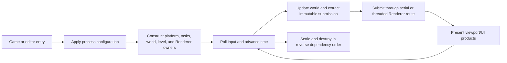

# Application Capability Inventory

[Docs](../../../../README.md) / [Up](../README.md)

**Status:** capability snapshot; current, but not release approval or executable evidence

**Snapshot:** 2026-09-08 at committed `master` revision `ffe60e3a`; `Engine/Application` game/editor hosts, command-line/configuration, task ownership, console, shader-recook, CMake split, and shutdown inspected; evidence `S` only

**Scope:** process entry, Game loop, host composition, input/world/render sequencing, threaded-render selection, editor composition, shader reload, capture coordination, startup/shutdown

**Owner:** `Engine/Application` / `SparkleApplication` and `SparkleApplicationEditor`

**Editor host boundary, 2026-11-01:** Settings receives a restart action from Application. The host invokes Core's current-process relaunch and requests window closure only after launch succeeds; failure reports a console record and keeps the host open. Shader/reload/capture results cross `UI::AppendConsoleOutput` rather than exposing Editor's console controller. Capture operations return status values; viewport-output composition chooses console presentation. These ownership changes do not establish interactive restart, capture or GPU acceptance.

**Evidence and disposition:** [Capability Evidence Plan](../../CapabilityEvidencePlan.md) and [First Release Acceptance Contract](../../../../Acceptance/FirstRelease.md)

**Current readiness:** **45/100** — game/editor host integration exists in source; candidate lifecycle, failure, performance, package, and adoption evidence is absent. See [Current Feature Readiness](../../../../Acceptance/CurrentReadiness.md#product-build-and-delivery).

## At A Glance

| Responsibility | Current route | Important limit |
| --- | --- | --- |
| product composition | separate game and editor hosts share one application lifecycle | editor-only code is build-separated, but final package isolation remains unproved |
| frame loop | input -> window -> time -> level/world simulation -> render submission -> Renderer | shutdown, minimize, and failure behavior need executable evidence |
| render execution | serial or dedicated render-thread coordination; pipeline depth 0..2 under frames-in-flight bound | equivalence, backpressure, and long-run settlement unproved |
| developer interaction | command-line CVars, editor operations, shader reload, viewport capture | malformed command-line assignments are currently ignored by the adapter |
| ownership | Application constructs and destroys platform, tasks, world, level, Renderer, and UI hosts in explicit order | it coordinates modules but must not become their implementation authority |

Graphics launch policy now belongs to the private [ApplicationGraphicsLaunch](../../../../../Engine/Application/Private/ApplicationGraphicsLaunch.cpp) owner: build default, then `SPARKLE_RHI_BACKEND`, then the first recognized `--renderer`/`--rhi`/`--graphics-api` selection. GameApplication resolves once before Renderer construction and passes the API explicitly; RHI owns value/default/compiled-backend mechanics. Invalid or compiled-out selections stop before graphics initialization. The [Stage 0A record](../../../CrossModule/PerformanceDiagnostics/ExternalCapture/Discovery.md#stage-0a-implementation-handoff--2026-10-07) owns the scoped launch/event checks and remaining Shipping D3D12 runtime limitation; this update does not change the inventory's release readiness.

The module is a composition root. Its quality depends on preserving the boundaries below rather than absorbing world, rendering, tool, or editor policy into the host loop.

The Editor frame now acquires products and presentation texture once through Renderer.GetViewportPresentation and projects that bounded observation to UI. GameApplication no longer forwards an independent products getter. [Stage 0C publication handoff](../../../CrossModule/PerformanceDiagnostics/ExternalCapture/Discovery.md#stage-0c-implementation-handoff---2026-10-08) records serial/threaded runtime controls and retained evidence limits.

## Product Split

| ID | Capability | State | Exact current coverage and limit | Evidence |
| --- | --- | --- | --- | --- |
| `APP-001` | Shared application lifecycle | Implemented path | `Application::Run` drives virtual Initialize/Tick/Shutdown; process configuration applies registered CVars from command line before host creation. | `S` |
| `APP-002` | Cooked game host | Implemented path | `GameApplication` composes Timer, Window, InputSystem, Tasks, GameWorld, LevelSession, Renderer and camera input, without a Game UI host. It links no source importer or cooker. | `S` |
| `APP-003` | Editor host | Implemented path | `EditorApplication` embeds the game host with UI render packets enabled, then adds editor UI, operations, shader reload, and viewport capture coordination. | `S` |
| `APP-004` | Build-time editor erasure | Implemented path | `SparkleApplication` excludes editor, capture, and editor-operation sources; `SparkleApplicationEditor` owns them and privately links `SparkleEditor`. Game products link only the game target. Package inspection is still required. | `S` |

## Game Loop And Ownership

| ID | Capability | State | Exact current coverage and limit | Evidence |
| --- | --- | --- | --- | --- |
| `APP-005` | Frame pump | Implemented path | Input begin -> window poll -> deferred input -> timer tick -> close/minimize decision -> pending level change -> simulation begin/update/end -> render submission -> render. Minimized/zero-size windows wait for an event and skip rendering. | `S` |
| `APP-006` | Task ownership | Implemented path | Application owns the executor and root Application scope and passes them to GameWorld, level loads, Renderer asset work, editor/tool operations. Shutdown destroys consumers before task runtime. | `S` |
| `APP-007` | Renderer execution selection | Capability-gated | `r.ThreadedRenderer` selects threaded Renderer ownership when options allow it; otherwise serial. `r.RenderPipelineDepth` accepts 0..2 and must remain below `r.MaximumFramesInFlight`, otherwise startup fatals. | `S` |
| `APP-008` | Camera input bridge | Implemented path | Keyboard/mouse input becomes a `CameraInputIntent`; Game applies it to the active world camera. Editor supplies its viewport camera as view-only override without mutating world camera each frame. | `S` |
| `APP-009` | Viewport request/products | Implemented path | Host forwards viewport extent/mode/exposure requests and returns Renderer products for ImGui presentation. Game uses the native rendering window without UI packets. | `S` |
| `APP-010` | Ordered shutdown | Implemented path | Renderer -> LevelSession -> input collector -> GameWorld -> Tasks -> Input -> Window -> Timer are released in an explicit order. Repeated/device-loss shutdown remains unrun. | `S` |

## Configuration And Tools

| ID | Capability | State | Exact current coverage and limit | Evidence |
| --- | --- | --- | --- | --- |
| `APP-011` | Command-line CVar assignment | Implemented path | `--cvar=name=value`, `--cvar name=value`, and `--set-cvar name=value` are case-insensitive switches. Unknown names, malformed assignments, and failed parses are silently ignored by this adapter. | `S` |
| `APP-012` | Game console | Removed / excluded | The Game-only overlay and its flags/build hooks are deleted. Editor keeps its own console and UI; Core CVar/console primitives with remaining consumers are unchanged. | `S` |
| `APP-013` | Reload existing shaders | Implemented path | Editor toolbar/console requests `Renderer::ReloadShaders` on the existing runtime files. The renderer validates replacement map/library/ABI and retains the accepted generation on failure. Compilation and source watching are absent; use Launcher Cook first. | `S` |
| `APP-014` | Editor operation lifetime | Implemented path | One document task scope supplies shared cancellation and settlement. Viewport capture and Reference artifact publication own their typed slots, task bodies and results; there is no central operation dispatcher or serialization policy. | `S` |
| `APP-015` | Viewport capture | Implemented path | Editor capture coordinator turns a UI request into Renderer capture work and reports completion/failure through the editor host. File correctness and UX evidence remain open. | `S` |
| `APP-016` | Rendering-settings persistence | Implemented path | Application owns startup restore and workspace INI writes for the Renderer-owned settings value; Editor owns the interaction model and Renderer owns capture/apply plus rendering consumers. Writes use Core atomic publication into the per-user settings path. Malformed files are rejected before applying their assignments; Editor exposes save failures. Clean-machine and concurrent-write qualification remain open. | `S` |

## Vertical Game Trace

Project `main` calls the editor or game launch function -> command-line CVars are applied -> host constructs native/application/world/render owners -> `LevelSession` begins startup activation -> each ready frame advances world systems and extracts one frame submission -> Renderer returns viewport/UI products -> close request exits Tick -> explicit shutdown unwinds owners in dependency order.

## Render-Only Game

Current source follows the [presentation decision](../../../../Acceptance/FirstRelease.md#consumer-effort-and-game-presentation): Game owns rendering, camera/window/input, level/frame lifetime and shutdown. The Game-only UI host, console, flags and ImGui linkage are deleted. `GameApplicationOptions::WindowTitle` supplies the product title independently of UI. No dormant Game UI adapter remains.

Editor enables existing UI render packets and retains its own ImGui context/input, settings, editing and Reference operations through `SparkleApplicationEditor`. [Bounded source checks](../../../../../artifacts/validation/release-owner-slim-20261101/completion.json) do not substitute for the affected Game/Editor runtime cells retained in [FR-06](../../../CrossModule/FirstRelease/ImplementationPlan.md#prebuilt-delivery-simplification).

## Product Contract Boundary

Application is the host contributor, not a second product-journey authority. [`FCR-PROD-01`](../../Projects/Showcase/ShowcaseCapabilities.md#fcr-prod-01-game-consumer-contract) owns the consumer AC/FM/CHK and [`FCR-PROD-04`](../Editor/EditorCapabilities.md#fcr-prod-04-editor-contract) owns the Editor AC/FM/CHK. Application must make those results possible through one shared lifecycle while preserving these source-backed facts:

- Game and Editor share `EngineRenderingSettingsPersistence`. Defaults resolve to `Config/DefaultEngine.ini` under the discovered root and pass the same file-presence/typed-parser checks everywhere; per-user settings remain the overlay. Runtime does not compare defaults against a package hash.
- `RunGameApplication()` supplies the rendering window, camera input and native close. Launcher supplies scene/API selection and launch feedback; Game has no ImGui menu, overlay or console. Non-Shipping command-line CVar authoring remains a separate existing facility.
- `RunEditorApplication()` is the single interactive Editor product entry. It layers `SparkleApplicationEditor` over the game host and supplies Editor UI. Editor-only capture/operation sources are excluded from `SparkleApplication` membership.
- Editor operation slots return the task outcome with the owned result. Capture and reference-artifact owners handle cancellation and failure before accepting that result; workers never access UI. Viewport capture reports admission, readback and write results through the existing Editor console.
- Editor requests shader compilation through `EditorShaderCompileAction`, declared in `EditorShaderCompileAction.h`, with an explicit symbol-export choice. Its Application-private `EditorShaderCompileOperation` reuses `EditorOperationSlot` for background execution and cancellation; only success requests Renderer reload. Showcase binds the Launcher implementation. Engine never resolves tool paths, constructs compiler arguments, scans source changes or parses completion receipts. Explicit Reload remains available; status and failures use the existing panel/console.
- Renderer creation polls host events after external-runtime preparation and before device/coordinator creation. A close returns no Renderer; Game and Editor skip UI/service startup and retire prepared owners. Published Renderers always contain their coordinator. Further close requests are observed in `BeginFrame()`; shutdown retains dependency order. Launch entries show caught exceptions and return `1`; render-thread startup exceptions preserve their diagnostic. Fatal engine failures retain their termination route. Failed levels do not signal successful activation. [Candidate lifecycle proof](../../../../Acceptance/FeatureCompletionReports.md#product-delivery-progress) remains separate from clean-machine acceptance.
- host initialization currently creates the window, tasks/world/level, and Renderer before any consumer prerequisite screen. Unsupported OS/CPU/GPU/content must be rejected at the earliest owning boundary rather than appearing as an Application success.

## Explicit Non-Capabilities And Risks

- No service mode, headless executable, multi-window host, suspend/resume lifecycle, crash recovery, telemetry upload, or platform abstraction beyond Windows was found.
- The CVar command-line adapter does not surface invalid/unknown assignments, so a typo can look accepted.
- Build/Cook policy and compiler execution live in Launcher and standalone tools. Editor may request the existing operation through its injected action; Game has no compilation action.
- Source-level editor erasure is implemented, but final binary/import/file inspection has not proved a clean ShippingGame package.
