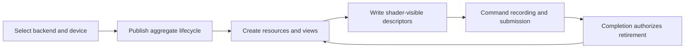
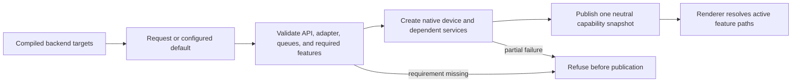
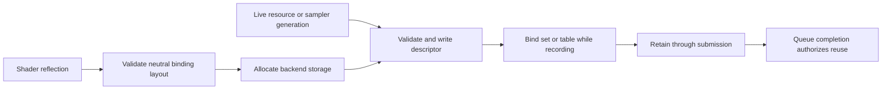

# RHI Device And Resources

[Docs](../../../../../../README.md) / [Up](../RHIFeatureGuide.md)

Sections: [Backend Selection and Device Capabilities](#backend-selection-and-device-capabilities) / [Descriptor Binding](#descriptor-binding) / [Device Lifecycle And Failure Recovery](#device-lifecycle-and-failure-recovery) / [Resource Lifetime and Memory](#resource-lifetime-and-memory).

**Status:** RHI feature-family guide

**Scope:** route device creation and aggregate lifetime, neutral capability truth, resource memory, formats, and descriptor binding

This family answers whether a GPU service exists, what it can truthfully report, which objects are safe to expose, and how long their native storage remains valid.

**Current readiness:** **48/100** family projection — device/resource/descriptor source paths are broad; lifecycle/failure, pressure, native, and delivery proof remains open. See [Current Feature Readiness](../../../../../../Acceptance/CurrentReadiness.md#rhi-and-gpu-execution).

## At A Glance

| Stage | Owning contract | Result handed forward |
| --- | --- | --- |
| choose and create | backend selection and capabilities | one complete device aggregate plus neutral capability truth |
| remain valid or terminate | device lifecycle and recovery | active, resizing, settling, destroyed, or terminal-loss state |
| allocate and transfer | resource lifetime and memory | typed resources/views with explicit state and completion lifetime |
| make shader-visible | descriptor binding | ABI-compatible binding sets/tables retained through submission |



The family deliberately separates semantic capability truth from object mechanics. This prevents “the API supports it” from being confused with “this selected device, resource description, descriptor layout, and lifetime make it usable.”

## Choose By Problem

| Document | Open it for |
| --- | --- |
| [Backend Selection And Device Capabilities](#backend-selection-and-device-capabilities) | compiled/requested backend selection, device/queue creation, capability truth, and partial-create rejection |
| [Device Lifecycle And Failure Recovery](#device-lifecycle-and-failure-recovery) | aggregate publication, owner-thread lifetime, settlement, swapchain recovery boundary, device loss, and explicit non-recovery |
| [Resource Lifetime And Memory](#resource-lifetime-and-memory) | formats, allocation, views, upload/readback, aliasing, budgets, pressure, and GPU-safe retirement |
| [Descriptor Binding](#descriptor-binding) | layout/set/table identity, allocation, writes, arrays, capacity, recording lifetime, and backend lowering |

The parent [RHI Feature Dossiers](../RHIFeatureGuide.md) index owns capability routing. Each child retains its own D3D12/Vulkan and feature-local proof contract.

## Shared Risks

- Partial device construction must never leak a usable facade.
- Capability records, resource/view descriptions, and shader-visible layouts must describe the same selected device generation.
- CPU ownership is insufficient for destruction; every queue consumer must complete first.
- Backend implementation symmetry does not establish adapter coverage, memory-pressure behavior, or descriptor-capacity parity.

## Backend Selection and Device Capabilities

**Status:** current feature dossier; source-backed, not build, device, parity, or release evidence

**Verified:** 2026-09-06 at committed `master` revision `8414b5dc`

**Scope:** `RHI-BACK-*` and `RHI-DEV-*`; compiled backend availability, request/default selection, adapter/device bootstrap, queue topology, and neutral capability reporting

**Current readiness:** **50/100** — both backend selection/device source routes and neutral capability publication exist; build/device/native-query/parity/failure evidence does not. See [Current Feature Readiness](../../../../../../Acceptance/CurrentReadiness.md#rhi-and-gpu-execution).

### Backend Selection and Device Capabilities: At A Glance

| Reader question | Current answer |
| --- | --- |
| What selects the backend? | Build membership defines what can exist; startup request/default policy chooses exactly one compiled D3D12 or Vulkan route. |
| What does success produce? | One complete device-service aggregate and one immutable capability snapshot derived from the selected native adapter/device. |
| What can Renderer rely on? | Neutral queue, format, descriptor, ray-tracing, presentation, and provider-capability fields—not the backend or vendor name. |
| What happens when requirements are missing? | Selection or creation fails before publishing usable services; it must not silently substitute another backend. |
| What remains unknown? | Real adapter coverage, native-query correlation, backend parity, partial-create cleanup, and release-supported hardware. |

### Selection And Publication Flow

The important boundary is between a *requested API* and a *published capability set*. Feature policy begins only after publication.



This design makes feature decisions portable and inspectable. Its cost is that the capability record becomes startup-critical: an omitted or optimistic field can activate an invalid path on every higher-level consumer.

### Feature Promise

A valid request selects one compiled backend, creates one device/adapter topology, and reports capabilities from that active device. Unavailable backends and unsupported requirements fail before Renderer schedules work; backend names are never a substitute for capability queries.

### Ownership And Current Boundary

- `RhiBackendSelection` owns parsing and availability; `RenderDeviceServices` owns the neutral service facade and active capability snapshot.
- CMake owns whether D3D12 and Vulkan targets exist and which backend is the default. Runtime cannot activate a backend omitted from the build.
- Private `VulkanDeviceExtensions` owns extension enumeration shared by device bootstrap and ray-tracing feature queries; neither caller keeps a second implementation.
- D3D12 requests feature level 12_1; Vulkan selection requires Vulkan 1.3, scalar block layout and formatless storage-image reads/writes, then scores eligible physical devices. Scalar block layout is queried and enabled through Vulkan 1.2 features before services are published; supported/enabled facts appear in bootstrap diagnostics. This is the native legality requirement for the shared DirectX-layout shader buffer ABI, not Renderer lighting policy or a vendor exception. Missing support rejects the device rather than selecting a second record layout.

**Buffer-ABI reconciliation, 2026-10-05:** the selected Debug Views Stage-5 secondary-hit oracle exposed uploaded C++ hit-vertex/material strides `64/360` versus default DXC SPIR-V strides `80/368`. The [ShaderCompiler](../../../../Tools/ShaderCompiler/ShaderCompilerCapabilities.md) now selects DirectX buffer layout and keys that target policy into cook identity. Complete SPIR-V regeneration and candidate-bound native replay are required; successful fresh-environment frames did not exercise the bad secondary-hit records. This bounded repair does not establish the full RHI capability/hardware matrix.
- The capability record owns API identity, shader target, queue kinds/independence, descriptor indexing, ray tracing, presentation, format/use support, and optional external-feature readiness.
- Renderer may select policy from neutral fields only. Adapter/vendor-specific branches remain backend/private or provider-owned.

### Design Decisions And Tradeoffs

| Decision | Benefit | Cost or risk |
| --- | --- | --- |
| Compile backends as separate targets | Missing SDKs and unsupported platforms fail at configuration/build time | A runtime request cannot recover a backend omitted from the build |
| Select one backend for one process/device aggregate | Ownership and native lifetime stay unambiguous | Cross-backend comparison requires separate runs and evidence |
| Publish capability facts instead of backend-name policy | Renderer features can gate on what the device actually exposes | Capability discovery and reporting must be exhaustively validated |
| Reject unmet requirements before publication | No half-created RHI leaks into Renderer startup | Startup failure is intentionally strict and needs clear diagnostics |

### Acceptance Criteria

- `AC-RHI-BACK-01` — every compiled/default/requested combination either creates exactly the requested backend or rejects it with the unavailable prerequisite; no different backend silently activates.
- `AC-RHI-BACK-02` — capability and queue reports match the selected native device and remain stable for its lifetime across both backends.
- `AC-RHI-BACK-03` — missing SDK, API version, feature, queue, adapter, or device creation fails before partial RHI publication and names the rejecting boundary.
- `AC-RHI-BACK-04` — Renderer decisions use neutral capability fields, while optional vendor/provider capability is reported separately from core backend support.

### Controlled Failures And Checks

| Failure | Safe result | Check |
| --- | --- | --- |
| `FM-RHI-BACK-01` unavailable or uncompiled backend requested | device services remain unpublished; exact availability error is returned | `CHK-RHI-BACK-01` configure/build/runtime selection matrix |
| `FM-RHI-BACK-02` required adapter feature or queue missing | candidate adapter is rejected without partially active services | `CHK-RHI-BACK-02` capability/queue fault matrix |
| `FM-RHI-BACK-03` capability report differs from native query | startup validation fails and no Renderer feature consumes the false claim | `CHK-RHI-BACK-02` native query correlation on named adapters |

Check coverage: `CHK-RHI-BACK-01` covers `AC-RHI-BACK-01`, `AC-RHI-BACK-03`, and `FM-RHI-BACK-01`; `CHK-RHI-BACK-02` covers `AC-RHI-BACK-02` through `AC-RHI-BACK-04`, `FM-RHI-BACK-02`, and `FM-RHI-BACK-03`.

Definition of done: both backend target shapes, runtime selection/failure cases, native capability correlation, and candidate evidence pass; source inspection establishes none of those results.

### Primary Source Routes

- `Engine/RHI/CMakeLists.txt`
- `Engine/RHI/Public/Core`, `Engine/RHI/Public/Device`, and `Engine/RHI/Public/Commands/RhiQueueCapabilities.h`
- `Engine/RHI/Private/Device`, `Engine/RHI/Private/D3D12/Device`, and `Engine/RHI/Private/Vulkan/Device`

## Descriptor Binding

**Status:** current feature dossier; source-backed, not binding correctness, capacity, or backend-parity evidence

**Verified:** general dossier snapshot 2026-09-06 at committed `master` revision `8414b5dc`; recording-pool capacity route re-inspected 2026-10-05 at dirty `410d05ef`

**Scope:** `RHI-BIND-*`; descriptor layouts, handles, allocation, resource/sampler writes, binding sets/tables, arrays, indexing capabilities, recording lifetime, and bounded Renderer material-table consumption

**Current readiness:** **50/100** — neutral and backend descriptor source routes exist; capacity, invalid-use, lifetime, native-validation, parity, and pressure evidence does not. See [Current Feature Readiness](../../../../../../Acceptance/CurrentReadiness.md#rhi-and-gpu-execution).

### Descriptor Binding: At A Glance

| Concern | Current contract | Important limit |
| --- | --- | --- |
| ABI | Reflected shader bindings and the neutral layout must agree before a set/table is usable | A registered shader or allocated descriptor alone is not ABI compatibility |
| Writes | Resource, view, sampler, type, index, and array count are validated together | Missing, stale, mismatched, and out-of-range writes must reject before recording |
| Arrays/indexing | Fixed arrays and capability-gated non-uniform indexing are represented | This is not an unbounded, engine-wide bindless model |
| Lifetime | Recording and submission retain every referenced descriptor and resource | CPU handle destruction cannot authorize native-slot reuse in flight |
| Backends | D3D12 heaps/tables and Vulkan pools/sets lower one neutral contract | Capacity and semantic parity remain unproved |

### Binding Lifecycle



The shader ABI, resource generation, descriptor allocation, and recording lifetime meet here. Treating any one of them as sufficient creates the classic failure where a syntactically valid slot points at the wrong object or is recycled before the GPU finishes.

### Descriptor Binding: Feature Promise

A complete neutral binding layout plus type-correct writes becomes backend descriptor state that matches shader reflection and remains valid through every recording/submission consumer. Fixed arrays and capability-gated non-uniform indexing are explicit; they do not imply an unbounded engine-wide bindless model.

### Ownership And Boundary

- RHI owns layout/set/table mechanics, handle validity, descriptor allocation/write rules, array counts, native heaps/pools, and device capability reporting.
- Shader reflection and pipeline validation define the expected ABI; Renderer owns which semantic resources occupy the bindings.
- D3D12 heaps/tables and Vulkan pools/sets are backend lowerings of the neutral contract. Recording-local allocations cannot escape their completion lifetime.
- The current Renderer material table is fixed-capacity and ray-path-specific; raster materials remain bindful. Exact reachability stays in the Renderer dossier and inventory.

### Descriptor Binding: Design Decisions And Tradeoffs

| Decision | Benefit | Cost or risk |
| --- | --- | --- |
| Keep semantic resource choice in Renderer | RHI remains reusable and does not learn material meaning | Higher layers must maintain exact reflected binding identity |
| Validate through one neutral layout | Backend behavior can be compared against one contract | Native APIs expose different pool/heap pressure and update restrictions |
| Make indexed binding capability-gated | Unsupported devices never enter a path they cannot execute | Feature availability varies by adapter and needs requested-versus-active reporting |
| Retain descriptors by GPU completion | Prevents stale native references | Delayed work can retain heap/pool capacity and must remain bounded |

### Descriptor Binding: Acceptance Criteria

#### Vulkan Recording-Pool Capacity

`VulkanBindingLayoutCompiler` derives each set's per-descriptor-type demand from the final deduplicated native layout bindings, including immutable samplers. `VulkanBindingLayout` retains that immutable allocation metadata; the recording binding owner passes a borrowed span to `VulkanRecordingDescriptorPool`. Renderer shader names, material limits and scene policy do not enter the pool.

A recording pool checks each page's remaining descriptors and 256-set capacity before native allocation, then grows by another page when needed. The page limit is not a recording-wide draw limit. Pages are sized for actual set demand and reset only after submission retirement. Unused pages may be replaced for larger layouts; used pages remain live. Vulkan leases do not expose a fixed contiguous descriptor-page capacity: their native pools can grow during recording. Unexpected native creation/allocation/reset failures are fatal.

This repairs the case where one material-array set required over 4,096 sampled-image descriptors but the old recording pool declared only 1,024. Per-type capacity is independent of `maxSets`; see [Vulkan allocation requirements](https://docs.vulkan.org/refpages/latest/refpages/source/vkAllocateDescriptorSets.html). The existing baseline capacities remain floors, not promises that every layout fits one page. Multiple pages and layout-derived metadata have declared memory and allocation cost; retained-page reuse is not a measured performance improvement.

The earlier aggregate-cap rejection check is superseded. Retained native checks allocated 1,025 sets across five pages, reset and repeated; those results keep their original candidate identity. Later source refinements and the broader churn, in-flight and pressure matrix need their own evidence. Candidate results stay in ignored validation artifacts.

- `AC-RHI-BIND-01` — layouts and writes preserve binding index, type, array count, visibility, resource/view/sampler identity, and shader-reflection compatibility on both backends.
- `AC-RHI-BIND-02` — invalid, missing, mismatched, stale, duplicate, or out-of-range writes reject before draw/dispatch.
- `AC-RHI-BIND-03` — descriptor heap/pool/table lifetime extends through the last recording/submission consumer and is reclaimed without premature reuse.
- `AC-RHI-BIND-04` — indexed/partially-bound arrays activate only when their exact device capabilities and capacity requirements are satisfied; requested-versus-active state is observable.
- `AC-RHI-BIND-05` — exact capacity and capacity-plus-one cases are deterministic; no path advertises runtime-sized bindless support.

### Descriptor Binding: Controlled Failures And Checks

| Failure | Safe result | Check |
| --- | --- | --- |
| `FM-RHI-BIND-01` layout/write/reflection mismatch | reject before pipeline use and identify binding/type | `CHK-RHI-BIND-01` generated valid/invalid ABI matrix |
| `FM-RHI-BIND-02` stale descriptor or destroyed resource | handle/generation validation rejects; prior native slot is not reused in flight | `CHK-RHI-BIND-02` churn and retirement stress |
| `FM-RHI-BIND-03` missing indexing feature or capacity overflow | feature remains inactive or request fails explicitly | `CHK-RHI-BIND-03` capability/capacity matrix |

Check coverage: `CHK-RHI-BIND-01` covers `AC-RHI-BIND-01`, `AC-RHI-BIND-02`, and `FM-RHI-BIND-01`; `CHK-RHI-BIND-02` covers `AC-RHI-BIND-03` and `FM-RHI-BIND-02`; `CHK-RHI-BIND-03` covers `AC-RHI-BIND-04`, `AC-RHI-BIND-05`, and `FM-RHI-BIND-03`.

Definition of done: shader-to-layout validation, descriptor churn/lifetime, exact bounds, material sampling, native validation, and both-backend evidence pass.

### Descriptor Binding: Primary Source Routes

- `Engine/RHI/Public/Bindings` and `Engine/RHI/Public/Descriptors`
- `Engine/RHI/Private/Bindings`, `Private/Descriptors`, and backend `Descriptors` folders
- [Pipeline and Shader Contracts](../PipelineAndExecution/PipelineAndExecutionDesign.md#pipeline-and-shader-contracts) and [Renderer Geometry, Materials, and GBuffer](../../../Renderer/Features/GeometryAndResources/GeometryMaterialsAndGBuffer.md)

## Device Lifecycle And Failure Recovery

**Status:** current feature dossier; source-backed, not device-run, fault-injection, recovery, or release evidence

**Verified:** 2026-09-07 at committed `master` revision `c28b33bd`

**Scope:** `RHI-LIFE-01` through `RHI-LIFE-06`; service composition, owner-thread access, publication, steady-state frame use, swapchain recovery, shutdown settlement, device loss, diagnostics, and the explicit absence of in-process device recreation

**Current readiness:** **45/100** — aggregate creation, resize settlement, shutdown, and terminal device-loss boundaries exist in source; fault-injection, leak, post-loss, and recovery evidence does not. See [Current Feature Readiness](../../../../../../Acceptance/CurrentReadiness.md#rhi-and-gpu-execution).

### Feature Promise And Non-Promise

A successful RHI creation request publishes one complete backend service composition to its owner thread. Its device, queues, presentation, resources, descriptors, pipelines, diagnostics, interop, capture, and UI services remain valid through frame execution and settle before reverse-order destruction.

The current implementation **does not promise in-process recovery from a removed/lost GPU device**. Swapchain resize/out-of-date handling and orderly shutdown are recoverable lifecycle transitions; D3D12 device removal and Vulkan `VK_ERROR_DEVICE_LOST` are diagnostic/fatal boundaries in the inspected path. Crash evidence is not a replacement device.

### Why This Is An Independent Contract

Backend selection answers *which* device may be created. Commands answer how work is recorded/submitted. Presentation answers how one swapchain is acquired and rebuilt. None owns the aggregate lifetime of every service or the transition from partial construction to published/active/settled/destroyed. Without this contract, a successful resize can be misreported as device recovery and a DRED or Vulkan error string can be misreported as a usable post-loss state.

### Current State Machine

```text
Unpublished
  -> validate request, compiled backend, window/config and interposer hooks
  -> construct backend device and dependent services
  -> Published / Owner-thread active
       -> Begin / record / submit / present frames
       -> Resize drain -> rebuild swapchain-dependent state -> Active
       -> Shutdown requested -> settle queues and recording views -> Settled
  -> destroy dependents before native device -> Destroyed

Any required creation failure -> no published services / fatal boundary
Device removed or VK_ERROR_DEVICE_LOST -> diagnostics + fatal boundary
                                      -> no current Recreating/Recovered state
```

`RenderDeviceServicesState` owns the concrete service object and enforces a `Threading::OwnerThread`. The public facade is non-copyable and non-movable, so the active composition has one stable aggregate owner. Backend constructors build the native device and the services that depend on it; destructors release those dependents before the native device.

### Lifecycle Matrix

| Transition | D3D12 current behavior | Vulkan current behavior | Required boundary |
| --- | --- | --- | --- |
| selection/create | create requested compiled backend, device, swapchain/presentation and service aggregate | create requested compiled backend, Vulkan 1.3 device, swapchain/presentation and service aggregate | failure before aggregate publication; no alternate backend silently activates |
| steady frame | begin, acquire/use back buffer, record/submit, present, advance frame slot | begin/acquire, record/submit, present, advance frame slot | owner-thread/frame identity and command contracts remain authoritative |
| resize/out-of-date | drain presentation work then resize swapchain | drain graphics/presentation work, recreate swapchain and dependent views; acquire may retry the resize case | this is presentation-resource recovery, not device recreation |
| orderly settle | wait RHI idle and clear allocator recording read view | clear acquire state, wait device idle, and settle owned services | no new frame work after settlement begins; queued users complete or fail explicitly |
| device loss | DRED/device-removed reason can be recorded | `VK_ERROR_DEVICE_LOST` is named by result handling | no inspected transition rebuilds device, services, graph resources, providers, or UI bindings |
| destruction | release dependent services/queues/presentation before device owner | release dependent services/queues/presentation before device owner | no service or native handle survives aggregate destruction |

### Publication, Concurrency, And Lifetime Rules

- Creation must be atomic at the public boundary: callers either receive a complete `RenderDeviceServices` composition or no usable facade.
- All direct service use belongs to the recorded owner thread. Renderer may prepare work elsewhere, but it reaches native services through the owned recording/submission contracts.
- A frame cannot span device generations because the current system has no device-generation/recreation model. If recovery is later implemented, device generation must enter resources, pipelines, descriptors, provider interop, viewport products, UI texture handles, captures, and graph/history invalidation.
- `SettleForShutdown` is a one-way coordination boundary, not a general-purpose per-frame wait. It must not fabricate queue completion after submission/device failure.
- Presentation resize may replace swapchain images/views after a drain while leaving the device aggregate active. Consumers must not retain old back-buffer identity.

### Failure And Observability Contract

| Failure class | Current safe claim | Evidence that must be retained |
| --- | --- | --- |
| invalid/uncompiled backend, invalid window/config, unsupported interposer path | creation rejects/fails before published use | requested backend/config, compiled target set, exact rejecting boundary |
| partial native or dependent-service creation | no complete public composition is returned | failing native call/service name and cleanup/leak record |
| swapchain out-of-date/minimize/resize | bounded drain/recreate/refusal path; device remains the same | old/new extent, image generation, acquire/present result, queue tokens |
| submission/wait/idle failure | no false completion or safe-retirement claim | queue, token, native result, last known frame and diagnostic markers |
| D3D12 removal | DRED/device-removed diagnostics where enabled; process path remains terminal | removed reason, breadcrumbs/page-fault data when available, adapter/driver/build identity |
| Vulkan device loss | named Vulkan result and diagnostic context; process path remains terminal | `VkResult`, queue/operation/frame context, validation messages, adapter/driver/build identity |

### Device Lifecycle And Failure Recovery: Acceptance Criteria

- `AC-RHI-LIFE-01` — every valid creation publishes exactly one complete backend service aggregate on its owner thread; every invalid or injected partial-create case publishes none and releases all completed subobjects.
- `AC-RHI-LIFE-02` — service initialization and reverse destruction order preserve dependencies on both backends with no use-before-publication, use-after-destroy, live native object, or interop callback after shutdown starts.
- `AC-RHI-LIFE-03` — steady frame operations and shutdown settlement obey one legal lifecycle; new work is refused after settlement begins, all real completion is observed, and shutdown reaches a declared bound without fabricated tokens.
- `AC-RHI-LIFE-04` — resize/minimize/out-of-date transitions replace only swapchain-dependent identity after the required drain, invalidate all consumers of old images/views, and resume or remain paused without being reported as device recovery.
- `AC-RHI-LIFE-05` — injected D3D12 removal and Vulkan device loss produce attributable backend diagnostics and a terminal current-state result; no caller continues using the invalid facade or reports recovery.
- `AC-RHI-LIFE-06` — any future recovery proposal remains unimplemented until it owns device generation, aggregate recreation, producer/consumer invalidation, provider/native-handle rebinding, retained-work policy, failure bounds, and both-backend evidence.

### Controlled Failure Modes And Checks

| Failure ID | Injection or cause | Required safe behavior | Detecting check |
| --- | --- | --- | --- |
| `FM-RHI-LIFE-01` | fail each construction stage or request an unavailable backend | no facade publication; already-created dependents release in valid order | `CHK-RHI-LIFE-01` |
| `FM-RHI-LIFE-02` | wrong-thread service use or work admitted while settling | owner/lifecycle guard rejects before native work | `CHK-RHI-LIFE-02` |
| `FM-RHI-LIFE-03` | resize/out-of-date/minimize during in-flight presentation | drain and replace only dependent identity; no stale view/back buffer is reused | `CHK-RHI-LIFE-03` |
| `FM-RHI-LIFE-04` | queue wait/idle never completes or returns native failure | no false completion; bounded failure record identifies queue/token/operation | `CHK-RHI-LIFE-02`, `CHK-RHI-LIFE-04` |
| `FM-RHI-LIFE-05` | D3D12 removal or Vulkan device loss | capture available diagnostics, stop using the aggregate, and terminate/refuse according to current policy | `CHK-RHI-LIFE-04` |
| `FM-RHI-LIFE-06` | code or docs imply automatic device recovery | source/capability audit fails until a real recreation owner and evidence exist | `CHK-RHI-LIFE-05` |

| Check | Cheapest claim-falsifying exercise | Covers |
| --- | --- | --- |
| `CHK-RHI-LIFE-01` | backend construction fault matrix with live-object/allocation cleanup inspection at every stage | `AC-RHI-LIFE-01`, `AC-RHI-LIFE-02`; `FM-RHI-LIFE-01` |
| `CHK-RHI-LIFE-02` | owner-thread/lifecycle state exercise around ordinary frame work, queued controls, settlement, repeated shutdown, and forced wait failure | `AC-RHI-LIFE-02`, `AC-RHI-LIFE-03`; `FM-RHI-LIFE-02`, `FM-RHI-LIFE-04` |
| `CHK-RHI-LIFE-03` | repeated resize/minimize/out-of-date loop with in-flight frames, generation-qualified back-buffer/view assertions, and validation | `AC-RHI-LIFE-04`; `FM-RHI-LIFE-03` |
| `CHK-RHI-LIFE-04` | backend-specific device-loss injection capturing DRED or Vulkan result/validation context and observing all post-loss callers | `AC-RHI-LIFE-05`; `FM-RHI-LIFE-04`, `FM-RHI-LIFE-05` |
| `CHK-RHI-LIFE-05` | enumerate lifecycle states, recovery APIs, device generations, and every native-handle consumer; assert no current route claims recreation | `AC-RHI-LIFE-06`; `FM-RHI-LIFE-06` |

This contract is **defined but unproved**. Normal construction and shutdown do not prove partial-failure cleanup, bounded settlement, device-loss diagnostics, or recovery.

Primary evidence destination: `RHI-E16` in the [Capability Evidence Plan](../../../../CapabilityEvidencePlan.md#rhi-evidence).

### Device Lifecycle And Failure Recovery: Primary Source Routes

- [`RenderDeviceServices.h`](../../../../../../../Engine/RHI/Public/Device/RenderDeviceServices.h) and common `Engine/RHI/Private/Device`
- `Engine/RHI/Private/D3D12/Device/D3D12RenderDeviceServices.cpp` and `Engine/RHI/Private/Vulkan/Device/VulkanRenderDeviceServices.cpp`
- D3D12/Vulkan command queues, swapchains, allocators, diagnostics, interop, and UI services whose lifetime is aggregated by the device service
- [Backend Selection and Device Capabilities](#backend-selection-and-device-capabilities), [Command Submission and Synchronization](../PipelineAndExecution/PipelineAndExecutionDesign.md#command-submission-and-synchronization), [Presentation](../PresentationAndInterop/PresentationAndInteropDesign.md#presentation), and [Diagnostics](../DiagnosticsAndCapture/DiagnosticsAndCaptureDesign.md#diagnostics)

## Resource Lifetime and Memory

**Status:** current feature dossier; source-backed, not resource-correctness, pressure, or performance evidence

**Verified:** 2026-09-06 at committed `master` revision `8414b5dc`

**Scope:** `RHI-RES-*` and `RHI-FMT-*`; resource/view descriptions, formats, samplers, upload/readback, allocation, transient aliasing, memory diagnostics, recording use, and reclamation

**Current readiness:** **50/100** — resource/allocation/use/retirement source paths are broad; pressure, aliasing, delayed-completion, format/use, leak, and backend evidence does not. See [Current Feature Readiness](../../../../../../Acceptance/CurrentReadiness.md#rhi-and-gpu-execution).

### Resource Lifetime and Memory: Feature Promise

A valid neutral resource description becomes backend storage with explicit format, usage, state, allocation, and view identity. CPU ownership changes never reclaim storage while a recorded or submitted queue consumer can still reference it.

### Cohesive Lifetime Contract

- Textures, buffers, views, samplers, uploads, readbacks, transient blocks, and aliased placements share one allocation/use/retirement invariant; this is why they form one dossier.
- Neutral format traits and use validation precede native creation. `R32_UInt` has four-byte texels, color-attachment and storage-image vocabulary, native D3D12/Vulkan mappings, and capability reporting. Vulkan attachment clear chooses the integer clear representation from the descriptor recording snapshot; this source contract does not prove native format/use support on a particular adapter. The public texture contract currently covers 2D/cube shapes, not a general 3D texture product.
- D3D12MA and VMA own backend allocation mechanics; RHI handles and memory diagnostics preserve neutral identity and categories.
- Upload/readback staging and recording-resource tables extend lifetime through recording and submission. Completion tokens, not C++ scope exit, authorize reuse/destruction.
- Transient aliasing requires non-overlapping compiled lifetimes plus explicit alias/state barriers supplied through the command contract.

### Object And Identity Model

| Layer | Current owner | Identity/lifetime rule |
| --- | --- | --- |
| neutral description | `RhiTextureResourceDesc`, `RhiBufferResourceDesc`, view and sampler descriptions | complete creation intent must be validated before native allocation; a description is not storage |
| resource handle/object | RHI texture/buffer/sampler interfaces and backend implementation | stable neutral identity owns or references the native resource/allocation; a valid-looking handle cannot wrap failed creation |
| view | SRV/UAV/RTV/DSV description plus backend descriptor/view object | view format/range/use must be compatible with the referenced resource and cannot extend its lifetime illegally |
| recording use | command recording resource/upload tables | keeps every referenced object and temporary allocation alive through command-list ownership |
| submitted use | queue submission/completion token | GPU completion, not local scope or command-list close, authorizes retirement/reuse |
| transient placement | frame-graph lifetime/alias plan lowered through RHI block and placed-resource contracts | two logical resources may share storage only with disjoint execution lifetimes and required alias/state barriers |

Generation belongs to the higher-level asset, graph, provider, or viewport product when semantic replacement matters. The RHI owns native object lifetime; it does not infer that two same-shaped resources represent the same scene or history generation.

### Resource Description Coverage

| Resource family | Current neutral description | Current explicit boundary |
| --- | --- | --- |
| texture | width, height, format, mip levels, array size, sample count, 2D/cube dimension, initial state, optional optimized clear, RT/DS/UAV uses | no public 3D texture kind found; format vocabulary does not prove every usage/sample combination |
| buffer | byte size, stride, generic/vertex/index/structured role, initial state, UAV and ray-tracing-input uses | size/stride/use/alignment boundaries need backend-correlated proof |
| views | texture/buffer SRV and UAV; texture RTV and DSV | subresource/range/format compatibility and descriptor lifetime require validation on both backends |
| sampler | point/linear min-mag-mip, wrap/clamp/mirror, anisotropy x1 through x16 | capability/quality at every combination is unproved; sampler state is separate from texture lifetime |
| samples | public sample-count vocabulary 1, 2, 4, and 8 where descriptor validation admits it | Renderer currently does not establish an end-to-end multisample attachment/resolve feature; see its resolution/sampling dossier |

### Transfer And Readback Trace

```text
CPU bytes + destination description/subresource
  -> validate extent, format, row/slice layout and bounds
  -> reserve upload storage
  -> record copy and required state transitions
  -> submit with resource/upload lifetime retention
  -> completion token releases staging ownership

GPU resource + requested readback region
  -> validate readable use/format/layout
  -> record transition and copy to staging
  -> submit and poll completion
  -> decode row pitch/channel semantics into the declared result
  -> release staging after result transfer or terminal failure
```

Synchronous-looking helper calls do not waive queue completion. Texture capture owns the product/result state machine; this dossier owns whether staging and referenced GPU storage remain valid long enough.

### Allocation, State, And Retirement Matrix

| Axis | Persistent | Transient | Upload/readback staging |
| --- | --- | --- | --- |
| allocation owner | D3D12MA/VMA-backed resource service | transient block/placed-resource materialization from Renderer graph plan | upload/readback service and recording/submission lifetime tables |
| state owner | caller/Renderer declares use; RHI executes explicit transitions | graph compiler derives versions/barriers; RHI validates/records | copy transitions surround transfer and restore/hand off declared state |
| aliasing | no implicit alias between independently allocated resources | allowed only for non-overlapping compiled lifetimes with alias barrier | ring/suballocation reuse only after the owning submission completes |
| pressure | budget/allocation diagnostics expose observed state; global degradation policy is not owned here | graph placement may reduce peak memory; savings are unproved | reservation failure must not publish a completed upload/readback |
| retirement | last queue consumer token | graph execution retirement token(s) | transfer completion plus result ownership |

### Capacity, Failure, And Non-Claims

- The 23-format vocabulary and per-adapter support query define candidates; they do not prove sampled/storage/RT/DS/copy/filtering support for every format.
- D3D12MA/VMA presence proves allocator integration, not graceful oversubscription, eviction, priority, defragmentation, or equal memory behavior.
- Renderer mesh/texture residency budgets are higher-level cache policy. RHI memory budgets and allocation observations do not choose which scene asset to evict.
- Transient alias capability does not prove the frame graph chose a legal or beneficial placement.
- Readback/capture support does not prove color space, channel interpretation, row pitch, or asynchronous failure UX.
- Public multisample vocabulary does not prove Renderer MSAA, an MSAA resolve, or anti-aliasing quality.

### Resource Lifetime and Memory: Acceptance Criteria

- `AC-RHI-RES-01` — every supported format/use combination creates, uploads, transitions, reads, and decodes with the documented byte/channel semantics on both backends; unsupported combinations reject before native work.
- `AC-RHI-RES-02` — buffers, textures, views, and samplers preserve complete neutral identity and do not outlive or alias their backing allocation illegally.
- `AC-RHI-RES-03` — upload/readback row pitch, extent, subresource, state, and completion behavior remain correct for boundary sizes and in-flight frames.
- `AC-RHI-RES-04` — transient placements alias only when lifetimes do not overlap and execute the required alias/state barriers.
- `AC-RHI-RES-05` — allocation budgets, categories, pressure, failure, and reclamation are observable and bounded; failed allocation never publishes a valid-looking resource.
- `AC-RHI-RES-06` — every admitted texture/buffer/view/sampler description preserves the complete neutral identity through native creation; every incompatible dimension/format/subresource/usage/sample/alignment combination rejects before publication.
- `AC-RHI-RES-07` — upload and readback retain source, destination, staging, row/slice layout, and state through the exact completion token; cancellation/failure releases them without publishing stale success.
- `AC-RHI-RES-08` — persistent, transient, and staging allocations report distinguishable category, committed/used/budget, delayed-retirement, and failure facts without implying higher-level asset eviction policy.

### Resource Lifetime and Memory: Controlled Failures And Checks

| Failure | Safe result | Check |
| --- | --- | --- |
| `FM-RHI-RES-01` invalid format/use/size/sample/view request | rejected by neutral validation before native allocation | `CHK-RHI-RES-01` descriptor and format/use matrix |
| `FM-RHI-RES-02` allocator exhaustion or pressure | explicit failure/pressure result; no stale or null-backed valid handle | `CHK-RHI-RES-02` bounded allocation pressure exercise |
| `FM-RHI-RES-03` destroy/reuse while recording or GPU work is in flight | lifetime owner retains allocation until all consumers complete | `CHK-RHI-RES-03` multi-queue retirement stress |
| `FM-RHI-RES-04` overlapping alias or missing barrier | compile/validation rejects before execution | `CHK-RHI-RES-04` aliasing positive/negative capture |
| `FM-RHI-RES-05` incompatible view/subresource or sample-count pairing | neutral/backend validation rejects; no descriptor or resource is published | `CHK-RHI-RES-01` descriptor/view matrix |
| `FM-RHI-RES-06` short/overflowing/misaligned transfer or wrong row pitch | transfer rejects before copy or returns explicit terminal failure; adjacent bytes remain unchanged | `CHK-RHI-RES-05` boundary transfer/readback oracle |
| `FM-RHI-RES-07` staging or placed allocation reused before all queue consumers complete | lifetime/token assertion prevents reuse and native validation remains clean | `CHK-RHI-RES-03`, `CHK-RHI-RES-05` |

| Check | Cheapest claim-falsifying exercise | Covers |
| --- | --- | --- |
| `CHK-RHI-RES-01` | generated format/dimension/use/view/subresource/sample/alignment matrix correlated with native capability queries and invalid cases | `AC-RHI-RES-01`, `AC-RHI-RES-02`, `AC-RHI-RES-06`; `FM-RHI-RES-01`, `FM-RHI-RES-05` |
| `CHK-RHI-RES-02` | bounded persistent/transient/staging allocation pressure with category/budget/failure observations | `AC-RHI-RES-05`, `AC-RHI-RES-08`; `FM-RHI-RES-02` |
| `CHK-RHI-RES-03` | multi-queue create/use/destroy/reuse stress with completion-token and live-object correlation | `AC-RHI-RES-02`, `AC-RHI-RES-03`, `AC-RHI-RES-05`, `AC-RHI-RES-08`; `FM-RHI-RES-03`, `FM-RHI-RES-07` |
| `CHK-RHI-RES-04` | graph with known legal and overlapping placements; inspect alias/state barriers and native validation | `AC-RHI-RES-04`; `FM-RHI-RES-04` |
| `CHK-RHI-RES-05` | patterned buffer/texture upload and readback across zero/one/odd/max rows, mips, arrays, pitches, partial regions, failure and cancellation | `AC-RHI-RES-03`, `AC-RHI-RES-07`; `FM-RHI-RES-06`, `FM-RHI-RES-07` |

Definition of done: the complete description/view/use matrix, allocator/category pressure, boundary upload/readback, aliasing, multi-queue lifetime, failure cleanup, native validation, memory, and performance evidence pass independently on both backends.

### Resource Lifetime and Memory: Primary Source Routes

- `Engine/RHI/Public/Formats`, `Resources`, `Textures`, `Samplers`, and `Memory`
- matching common, D3D12, and Vulkan `Resources`, `Memory`, and `Samplers` implementations
- [Command Submission and Synchronization](../PipelineAndExecution/PipelineAndExecutionDesign.md#command-submission-and-synchronization) for execution and completion authority
