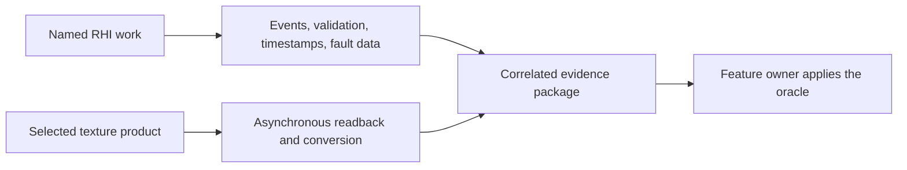
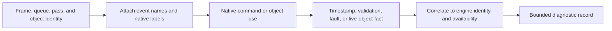
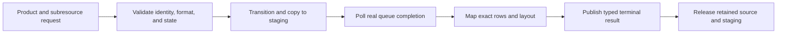

# RHI Diagnostics And Capture

[Docs](../../../../../../README.md) / [Up](../README.md)

Sections: [Diagnostics](#diagnostics) / [Texture Capture](#texture-capture).

**Status:** RHI feature-family guide

**Scope:** route attributable backend observations, asynchronous texture readback and native external-tool capture

This family explains what the RHI can reveal about native work and how a selected GPU texture becomes a retained inspection artifact.

**Current readiness:** **35/100** — useful instrumentation and readback foundations exist; bounded publication, attribution, observer cost, device-loss, format truth, and external handoff remain unproved. See [Current Feature Readiness](../../../../../../Acceptance/CurrentReadiness.md#rhi-and-gpu-execution).

## At A Glance

| Need | Use | Trust boundary |
| --- | --- | --- |
| understand what native work occurred or failed | [Diagnostics](#diagnostics) | an attributable event/message/timestamp is an observation, not correctness proof |
| capture a native GPU host interval in an external tool | [External Capture](../../../../../CrossModule/PerformanceDiagnostics/ExternalCapture/README.md) | one selected provider, verified native finalization, honest target scope; installation and markers do not prove readiness |
| inspect the bytes of a selected render product | [Texture Capture](#texture-capture) | copy completion and conversion prove delivery, not semantic product correctness |

Diagnostics and capture supply evidence inputs. Only the owning feature can decide whether those inputs satisfy its correctness, quality, performance, or release criteria.

## Choose By Result

| Document | Open it for |
| --- | --- |
| [Diagnostics](#diagnostics) | object/event identity, validation, crash facts, timestamps, live objects, bounds, cost, and availability |
| [External Capture](../../../../../CrossModule/PerformanceDiagnostics/ExternalCapture/README.md) | early bootstrap, one native lease/result, provider/API matrix, viewport trigger and remaining lifecycle/package/adoption evidence |
| [Texture Capture](#texture-capture) | staging/readback lifetime, formats/layout conversion, polling, result publication, failure, and cleanup |

External capture is a separate diagnostic operation; it does not overload pixel readback or expose native handles to Editor. Diagnostics observes backend behavior. Texture capture produces a typed asynchronous product; neither is evidence that the observed or captured feature is correct. The parent [RHI Feature Dossiers](../README.md) index owns capability routing.

## Shared Risks

- Unsupported or disabled observations must remain unavailable, not zero or successful.
- Frame, queue, product, resource, and generation identity must survive asynchronous delivery.
- Buffers, messages, staging memory, and callbacks need explicit capacity and shutdown bounds.
- Enabling diagnostics can change timing and memory behavior; observer cost belongs in retained evidence.

## Diagnostics

**Status:** current feature dossier; source-backed, not diagnostic truthfulness, fault-handling, observer-cost, or release evidence

**Verified:** general dossier snapshot 2026-09-06 at committed `master` revision `8414b5dc`; Vulkan timestamp feature admission re-inspected 2026-10-06 at dirty `5e2388d9`

**Scope:** `RHI-DIAG-01` through `RHI-DIAG-05`; native object identity, GPU events, timestamps, validation messages, D3D12 crash data, live-object reporting, bounded delivery, and observer configuration

**Current readiness:** **35/100** — messages, names, timestamps, memory, and backend diagnostic facts exist; joined bounded consumption, loss/observer cost, and device-failure evidence does not. See [Current Feature Readiness](../../../../../../Acceptance/CurrentReadiness.md#rhi-and-gpu-execution).

**External-capture source reconciliation - 2026-10-10:** the separate neutral `RhiExternalCapture` authority owns early bootstrap, one request identity/native lease and observation. Private PIX/Nsight D3D12 and RenderDoc D3D12/Vulkan adapters are source-present in eligible Editor profiles. This does not add an implicit capture service to `RhiDiagnostics` or turn event availability into readiness. See the [external-capture owner](../../../../../CrossModule/PerformanceDiagnostics/ExternalCapture/ExecutionArchitecture.md#production-route) for semantics, target binding and remaining native/lifecycle/package proof. Existing diagnostic snapshots and readiness retain their evidence limits.

### Diagnostics: At A Glance

| Observation | What it can establish | What it cannot establish |
| --- | --- | --- |
| object names and GPU events | which engine object/pass was lowered to named native work | that the work produced correct pixels |
| timestamps | measured interval on a supported queue after valid resolve | useful overlap, low latency, or a representative workload by itself |
| native validation messages | a native API or synchronization problem detected by the enabled layer | correctness when the stream is quiet or the layer is unavailable |
| D3D12 DRED / Vulkan fault context | best available native context for a failed device operation | recovery or continued device validity |
| live-object reporting | native objects still visible at the reporting boundary | leak ownership without correlated engine identity and lifecycle context |

### Observation Flow

The trustworthy result is an attributable observation with an explicit availability state. Zero messages, zero milliseconds, or a truncated buffer are never silently interpreted as success.

### Feature Promise

RHI diagnostic records identify the neutral request and native work that actually executed. Unsupported, disabled, unresolved, truncated, and dropped observations remain explicit; completion or a quiet validation stream never becomes a correctness claim.

### Ownership And Trust Boundary

- Neutral command/resource owners supply stable frame, queue, pass, object, and resource identity; backend adapters attach native labels and messages.
- Timestamp values require the correct queue frequency and resolve ordering. Unsupported or unresolved timing is unavailable, not zero.
- Native validation, D3D12 DRED, Vulkan messages, and live-object reporting remain backend facts linked to neutral identity where available; asymmetry is reported rather than normalized away.
- D3D12 and Vulkan expose different native facilities. The diagnostic owner reports that asymmetry and availability; it does not fabricate a common observation the backend did not produce.

### Design Decisions And Tradeoffs

#### Vulkan Timestamp Reset Capability

The Vulkan timing implementation resets newly allocated timestamp slots on the host, under its query-pool mutex, and records writes on the query's owning queue. Device bootstrap must query and enable Vulkan 1.2 `hostQueryReset` before that implementation is advertised. Supported and enabled facts remain backend-private in `VulkanFeatureStatus`; no Renderer policy or new neutral API is introduced. When the feature is unavailable, timing initialization creates no query pools and the existing diagnostics composition reports timing unavailable rather than making an invalid reset call or returning a fabricated zero duration.

Do not replace this with a reset command inside every timestamp write: timestamp scopes can surround work within a render pass, where a query-reset command is not admitted. Query reuse still requires the existing frame-slot retirement before resolve/release; enabling the feature does not waive lifetime rules. The selected Stage-8 failure and replay evidence is owned by `artifacts/validation/releases/v0.1.0/410d05e-dvp-stage8-execution-20261005/features/FCR-REN-11/completion.md`. It does not establish observer-cost or complete diagnostic acceptance.

| Decision | Benefit | Cost or risk |
| --- | --- | --- |
| Preserve backend-specific facts | Reports remain truthful about what the native API actually exposed | Tooling and evidence cannot assume identical D3D12/Vulkan detail |
| Correlate through neutral stable identity | A native message can be traced back to a frame/pass/resource owner | Every producer must propagate identity consistently |
| Treat unavailable and dropped data as states | Quiet output cannot masquerade as validation success | Consumers must handle partial diagnostic records explicitly |
| Bound collection and measure observer cost | Diagnostics remain usable in representative runs | Fine-grained detail may be sampled or disabled and must say so |

### Acceptance Criteria

- `AC-RHI-DIAG-01` — object/event/timestamp/validation records correlate stable engine identity, backend, queue, frame/submission, and native object/work without stale attribution.
- `AC-RHI-DIAG-02` — disabled, unsupported, truncated, dropped, or unresolved diagnostics are reported honestly and remain within documented bounds.
- `AC-RHI-DIAG-03` — injected neutral misuse fails before the API call where possible; injected native/device faults retain the best available crash/validation context and reach bounded shutdown or recovery.
- `AC-RHI-DIAG-04` — backend-specific validation, crash, and live-object facilities report their active/unavailable state without implying cross-backend equivalence.
- `AC-RHI-DIAG-05` — diagnostic observer cost and Development/Shipping availability are measured or explicitly classified.

### Controlled Failures And Checks

| Failure | Safe result | Check |
| --- | --- | --- |
| `FM-RHI-DIAG-01` unsupported timestamp or overflowed message buffer | unavailable/truncated state is explicit | `CHK-RHI-DIAG-01` support/bounds/correlation exercise |
| `FM-RHI-DIAG-02` invalid API use or device removal | exact identity/context is retained; no false completion | `CHK-RHI-DIAG-02` native fault exercise |
| `FM-RHI-DIAG-03` requested validation/crash/live-object facility unavailable | facility remains explicitly unavailable; a quiet stream is not reported as validation success | `CHK-RHI-DIAG-03` configuration/availability matrix |

Check coverage: `CHK-RHI-DIAG-01` covers `AC-RHI-DIAG-01`, `AC-RHI-DIAG-02`, `AC-RHI-DIAG-05`, and `FM-RHI-DIAG-01`; `CHK-RHI-DIAG-02` covers `AC-RHI-DIAG-01`, `AC-RHI-DIAG-03`, and `FM-RHI-DIAG-02`; `CHK-RHI-DIAG-03` covers `AC-RHI-DIAG-04` and `FM-RHI-DIAG-03`.

Definition of done: native-tool correlation, fault injection, timestamp validation, delivery bounds, observer-cost, package configuration, and both-backend availability evidence pass.

### Primary Source Routes

- `Engine/RHI/Public/Diagnostics`
- common/backend `Diagnostics` and backend debug layers
- [Renderer Diagnostics, Products, and Capture](../../../Renderer/Features/ViewportAndDiagnostics/README.md#diagnostics-products-and-capture) and [Performance Diagnostics](../../../../../CrossModule/PerformanceDiagnostics/README.md)

## Texture Capture

**Status:** current feature dossier; source-backed, not captured-pixel, format, color, latency, or release evidence

**Verified:** original source audit 2026-09-06 at committed `master` revision `8414b5dc`; ownership reconciled 2026-09-18 against source input `df2f0c0658cbf1cbdc0355c050a496cb513709e5` plus the scoped Stage-9 working tree, without runtime capture evidence

**Scope:** `RHI-DIAG-06`; asynchronous destination-free texture readback, staging lifetime, supported-format layout, polling, result delivery, failure, and cleanup

**Current readiness:** **35/100** — asynchronous readback source paths exist; format/row/orientation, capacity, cancellation, resize/device loss, semantic interpretation, and backend evidence does not. See [Current Feature Readiness](../../../../../../Acceptance/CurrentReadiness.md#rhi-and-gpu-execution).

### Texture Capture: At A Glance

| Request stage | Owned result | Failure boundary |
| --- | --- | --- |
| identify source | exact texture, subresource, frame/generation, dimensions, format, and intended result | stale identity, unsupported state, format, or subresource rejects |
| schedule readback | transitions, copy command, staging allocation, and queue token | allocation, transition, copy, or submit failure produces no success |
| complete readback | mapped bytes with explicit row pitch, format, and extent | mapping or layout failure becomes a terminal Failed result |
| publish or cancel | one immutable image/byte result or explicit abandonment | prior or empty output is never reused as a new capture; current cancellation has no returned terminal payload |
| retire | source and staging survive through completion, then release once | shutdown cannot outlive callbacks or destroy in-flight storage |

### End-To-End Capture

Capture is deliberately asynchronous so the frame does not require a global GPU idle. The corresponding cost is explicit queueing, staging-memory, polling, cancellation, and shutdown ownership.

### Texture Capture: Feature Promise

A request for a supported neutral texture/subresource becomes one asynchronous readback result with explicit dimensions, row layout, format, identity, and terminal status. An empty buffer, stale prior image, unsupported conversion, or merely submitted copy is never capture success.

### Ownership And Lifetime

- Renderer selects the semantic render product and owns its color/encoding provenance; RHI capture owns native copy/readback, staging storage, polling, format mapping, and byte/image result.
- The active backend transitions/copies the exact source, retains it and staging memory through queue completion, then maps only after completion.
- Common RHI capture-format code defines the byte/layout contract used by both backends. Backend code retains only native resource/copy details.
- The requesting Application/tool workflow retains every output path and owns image encoding plus filesystem publication. RHI requests/results never carry a codec, encoded image, destination, staging path, manifest, or written-artifact identity.
- A post-submission native map failure now returns one terminal Failed result and retires its staging owner on both backends. Current cancellation retires after queue completion without publishing a terminal payload; cancellation-result and shutdown fault evidence remain open acceptance work.

### Texture Capture: Design Decisions And Tradeoffs

#### Scalar Float Readback

The shared `IsRhiCaptureFormatSupported` whitelist admits `R32_Float` alongside its existing color formats. This preserves real scalar products such as reconstruction roughness and path hit distance without shader packing or conversion. Each texel is one native 32-bit float; callers decode the returned format, extent and row pitch rather than assuming tightly packed RGBA rows. Vulkan uses the existing format byte-size calculation and D3D12 uses the source's native copy footprint. No additional backend copy path, semantic guide production, neutral API or encoded-image format is introduced.

The selected 2026-10-06 dirty `5e2388d9` Stage-8 candidate exercises scalar readback at the existing capture owner. Candidate results and negative/cleanup provenance belong to `artifacts/validation/releases/v0.1.0/410d05e-dvp-stage8-execution-20261005/features/FCR-REN-11/completion.md`; this narrow extension does not close the full format-pattern, cancellation or device-loss matrix.

| Decision | Benefit | Cost or risk |
| --- | --- | --- |
| Renderer selects semantic product; RHI reads bytes | Color/provenance meaning stays with the feature that produced the texture | A byte-perfect capture can still be semantically misidentified by its caller |
| Complete asynchronously | Avoids unconditional frame stalls | Results arrive later and need bounded queue/memory policy |
| Share layout rules above backend copies | D3D12 and Vulkan can be checked against one byte contract | Backend row pitch and native format differences still require fixtures |
| Publish exactly one terminal result | Callers cannot confuse stale or empty data with success | Every cancellation and shutdown race must converge on the same state machine |

### Texture Capture: Acceptance Criteria

- `AC-RHI-CAP-01` — capture preserves requested resource/subresource, extent, row pitch, format, frame/generation identity, and asynchronous state progression on both backends.
- `AC-RHI-CAP-02` — canonical pixel patterns preserve the documented bytes, row layout, format, and orientation for every supported capture format; encoding correctness is proved by its Application/tool owner.
- `AC-RHI-CAP-03` — source and staging resources remain alive until copy completion and are reclaimed after result delivery, failure, cancellation, or shutdown.
- `AC-RHI-CAP-04` — unsupported format/state, allocation/copy/map/layout failure, queue failure, and stale identity produce one explicit Failed result without stale or empty success.
- `AC-RHI-CAP-05` — queue depth, latency, memory, and observer cost are bounded and reported for the evidence configuration.

### Texture Capture: Controlled Failures And Checks

| Failure | Safe result | Check |
| --- | --- | --- |
| `FM-RHI-CAP-01` unsupported format/state or stale request | reject before copy or complete Failed with exact reason | `CHK-RHI-CAP-01` format/state/identity matrix |
| `FM-RHI-CAP-02` readback allocation/copy/map/layout failure | terminal Failed; all owned resources retire | `CHK-RHI-CAP-02` injected stage failures |
| `FM-RHI-CAP-03` cancellation/shutdown with capture in flight | no callback/use after owner teardown; cleanup waits for completion | `CHK-RHI-CAP-03` in-flight lifecycle stress |

Check coverage: `CHK-RHI-CAP-01` covers `AC-RHI-CAP-01`, `AC-RHI-CAP-02`, `AC-RHI-CAP-04`, and `FM-RHI-CAP-01`; `CHK-RHI-CAP-02` covers `AC-RHI-CAP-03`, `AC-RHI-CAP-04`, and `FM-RHI-CAP-02`; `CHK-RHI-CAP-03` covers `AC-RHI-CAP-03`, `AC-RHI-CAP-05`, and `FM-RHI-CAP-03`.

Definition of done: pattern decoding, all supported formats, fault injection, lifecycle/queue bounds, memory/cost, resize/shutdown, native validation, and both-backend evidence pass.

### Texture Capture: Primary Source Routes

- `Engine/RHI/Public/Capture/RhiCaptureService.h`
- `Engine/RHI/Private/Capture` and backend `Capture` implementations
- [Renderer Diagnostics, Products, and Capture](../../../Renderer/Features/ViewportAndDiagnostics/README.md#diagnostics-products-and-capture)
