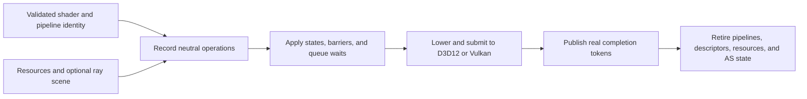
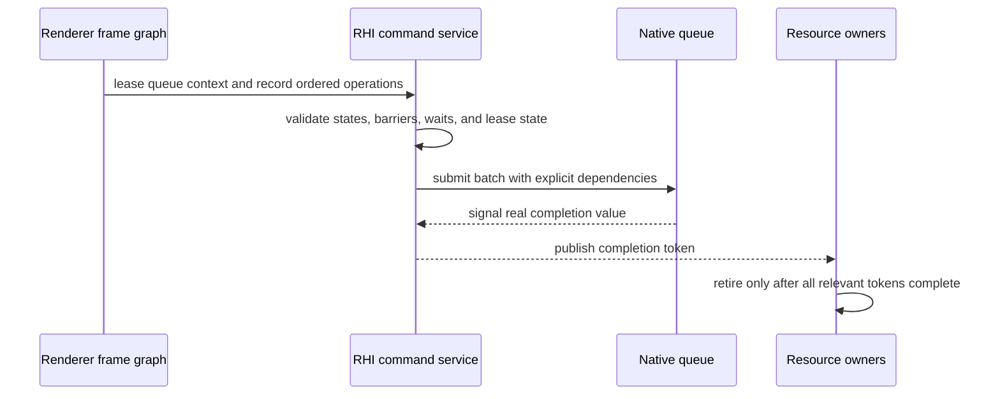
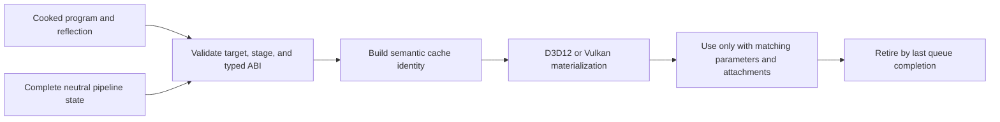
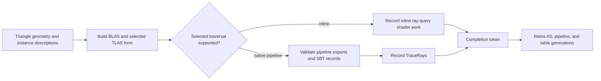

# RHI Pipeline And Execution

[Docs](../../../../../../README.md) / [Up](../RHIFeatureGuide.md)

Sections: [Command Submission and Synchronization](#command-submission-and-synchronization) / [Pipeline and Shader Contracts](#pipeline-and-shader-contracts) / [Ray Tracing](#ray-tracing).

**Status:** RHI feature-family guide

**Scope:** route immutable pipeline/shader contracts, command recording and submission, synchronization, and ray-tracing execution

This family turns validated shader and state descriptions into ordered native GPU work. It is the bridge between Renderer scheduling intent and D3D12/Vulkan execution.

**Current readiness:** **47/100** family projection — pipeline and command paths are broad while ray execution remains capability-gated; all candidate proof is open. See [Current Feature Readiness](../../../../../../Acceptance/CurrentReadiness.md#rhi-and-gpu-execution).

## At A Glance

| Boundary | Owner | Failure if it is wrong |
| --- | --- | --- |
| program, reflection, bindings, and fixed state form one pipeline identity | pipeline and shader contracts | wrong shader ABI/state or unsafe cache reuse |
| operations enter one legal recording lease and queue batch | command submission | invalid native calls, duplicate submission, or incomplete work |
| barriers and waits express producer/consumer hazards | command submission plus Renderer graph input | stale reads, races, cycles, or false overlap |
| acceleration structures, traversal, pipelines, and SBT records agree | ray tracing | wrong hit/material identity or unsupported dispatch |
| completion tokens retire all referenced generations | command/device lifetime | early destruction, leaks, or fabricated completion |

## Choose By Boundary

| Document | Open it for |
| --- | --- |
| [Pipeline And Shader Contracts](#pipeline-and-shader-contracts) | shader/reflection ABI, complete pipeline identity, validation, caching, and backend lowering |
| [Command Submission And Synchronization](#command-submission-and-synchronization) | recording leases, queues, barriers, submits, waits, completion tokens, and shutdown settlement |
| [Ray Tracing](#ray-tracing) | acceleration structures, traversal, SBT contracts, capability gates, providers, and lifetime |

Pipeline identity, queue execution, and ray-tracing capability remain independent contracts even though they meet during command recording. The parent [RHI Feature Dossiers](../RHIFeatureGuide.md) index owns capability routing.

## Shared Design Tension

The neutral contract must be rich enough to express both APIs without exposing native policy to Renderer. More neutral vocabulary improves portability and validation, but vocabulary alone can overstate usable features. Every operation therefore needs a real backend lowering, a capability gate, a current consumer, and completion-safe lifetime before it can support a feature claim.

## Command Submission and Synchronization

**Status:** current feature dossier; source-backed, not synchronization, overlap, deadlock, or shutdown evidence

**Verified:** 2026-09-06 at committed `master` revision `8414b5dc`

**Scope:** `RHI-CMD-*`; recording leases/lists, graphics/compute/copy/ray operations, barriers, queue batches, waits, completion tokens, frame identity, and retirement authority

**Current readiness:** **50/100** — recording, submission, waits, tokens, and retirement exist in source; ordering/state/failure/resize/shutdown/native evidence does not. See [Current Feature Readiness](../../../../../../Acceptance/CurrentReadiness.md#rhi-and-gpu-execution).

### Command Submission and Synchronization: At A Glance

| Question | Current answer |
| --- | --- |
| Who decides dependencies and queue preference? | Renderer frame-graph policy declares them; RHI validates and lowers them. |
| What is recorded? | Neutral raster, compute, copy, barrier, diagnostic, and capability-gated ray operations inside one queue-specific lease. |
| What orders queues? | Explicit batch waits plus resource/UAV/alias transitions—not CPU submission order alone. |
| What proves completion? | A real per-queue token and the aggregate token derived from every queue used by the work. |
| What remains unproved? | Cross-backend synchronization correctness, useful overlap, stall/deadlock bounds, failure settlement, and shutdown stress. |

### Submission Lifecycle

Queue assignment is a correctness decision first. A compute or copy queue in a plan says nothing about concurrent hardware execution or performance until timestamp evidence demonstrates it.

### Feature Promise

Validated recorded operations become explicit ordered submissions on capable queues. Dependencies, resource/UAV/alias state, and cross-queue waits are represented before native submission, and aggregate completion is the sole authority for reclaiming shared GPU state.

### Execution And Lifetime

- Device services issue queue-specific recording leases; a lease owns its recording context and temporary upload/descriptor/resource-use state.
- Command lists expose neutral raster, compute, copy, resource-state, diagnostic, and capability-gated ray operations.
- Submission batches carry explicit waits and produce completion tokens. Queue availability does not prove independent hardware execution or useful overlap.
- D3D12 command queues/fences and Vulkan queues/timeline synchronization lower the same ordering contract.
- `VulkanRenderDeviceServices` sequences frame recording, acquisition, presentation preparation, submission, and resize. Its private `VulkanFrameSubmission` owns pending queue waits, first-graphics consumption of the acquired image's binary semaphore, presentation wait/signal packing, and completion queries. It borrows the device, swapchain, recording context, and current frame index; device services destroy it before those dependencies. `VulkanCommandRecordingContext` retains lease/slot validation and retirement, and `VulkanCommandQueue` retains native queue synchronization. This ownership was reconciled on 2026-10-27 against the working tree based on `186f7a16`; it does not prove GPU ordering or backend parity.
- Renderer frame-graph compilation owns intended dependencies and queue choice; RHI validates and executes that plan without reconstructing render policy.

### Design Decisions And Tradeoffs

| Decision | Benefit | Cost or risk |
| --- | --- | --- |
| Use queue-specific recording leases | Temporary descriptors/uploads and command state get one lifetime owner | Lease misuse must be rejected as a state-machine error |
| Make waits and barriers explicit | Dependencies remain reviewable and backend-neutral | Every producer/consumer hazard must be classified correctly |
| Retire through aggregate completion | Shared resources cannot be freed after only one queue finishes | Slow or failed queues retain state and need bounded failure handling |
| Keep scheduling policy out of RHI | RHI does not duplicate Renderer graph semantics | RHI still needs enough validation to reject impossible native work |

### Acceptance Criteria

- `AC-RHI-CMD-01` — lease acquire/record/close/submit/release has one legal state progression and rejects reuse, double submit, and wrong-queue operations.
- `AC-RHI-CMD-02` — graphics, compute, copy, and ray commands preserve parameters, resource identities, and ordering through native recording.
- `AC-RHI-CMD-03` — transitions, UAV barriers, alias barriers, and cross-queue waits exactly cover producer/consumer hazards without missing or circular dependencies.
- `AC-RHI-CMD-04` — per-queue and aggregate tokens become complete only after their native work; every resource/pipeline/descriptor owner retires from that authority.
- `AC-RHI-CMD-05` — submission failure, device loss, cancellation, stall, and shutdown publish no false completion and reach a bounded diagnosable state.

### Controlled Failures And Checks

| Failure | Safe result | Check |
| --- | --- | --- |
| `FM-RHI-CMD-01` invalid lease state or wrong queue operation | reject before native recording/submission | `CHK-RHI-CMD-01` lease state-machine exercise |
| `FM-RHI-CMD-02` removed wait/barrier or introduced cycle | graph/RHI validation rejects or native validation catches the exact hazard; no silent execution | `CHK-RHI-CMD-02` injected hazard matrix |
| `FM-RHI-CMD-03` submit/device failure or never-signaled work | no completion is fabricated; failure/shutdown path remains bounded and observable | `CHK-RHI-CMD-03` fault and timeout exercise |

Check coverage: `CHK-RHI-CMD-01` covers `AC-RHI-CMD-01`, `AC-RHI-CMD-02`, and `FM-RHI-CMD-01`; `CHK-RHI-CMD-02` covers `AC-RHI-CMD-02`, `AC-RHI-CMD-03`, and `FM-RHI-CMD-02`; `CHK-RHI-CMD-03` covers `AC-RHI-CMD-04`, `AC-RHI-CMD-05`, and `FM-RHI-CMD-03`.

Definition of done: serial/control comparison, multi-queue stress, injected hazards, token/retirement correlation, failure/shutdown, native validation, and both-backend evidence pass.

### Primary Source Routes

- `Engine/RHI/Public/Commands` and `Engine/RHI/Public/Frame`
- common/backend `Commands`, recording resource/upload tables, and device queue composition
- [Renderer Frame Graph and Scheduling](../../../Renderer/Features/FrameExecution/FrameGraphAndScheduling.md)

## Pipeline and Shader Contracts

**Status:** current feature dossier; source-backed, not shader ABI, pipeline parity, or runtime evidence

**Verified:** 2026-09-06 at committed `master` revision `8414b5dc`

**Scope:** `RHI-PIPE-*` plus RHI shader bytecode, target, reflection, parameter-layout, and authoring contracts used to materialize graphics and compute pipelines

**Current readiness:** **50/100** — neutral graphics/compute pipeline and backend materialization paths exist; full-key/ABI/capability/native/parity/cache evidence does not. See [Current Feature Readiness](../../../../../../Acceptance/CurrentReadiness.md#rhi-and-gpu-execution).

### Pipeline and Shader Contracts: At A Glance

| Input | Required agreement | Produced result |
| --- | --- | --- |
| shader bytecode and stage/target identity | selected backend target and declared program stage | backend shader module/bytecode reference eligible for one pipeline |
| reflection and typed parameter layout | binding indices, kinds, arrays, visibility, sizes, and ABI signature | validated binding/pipeline layout |
| render state and attachment descriptions | formats, sample count, vertex layout, raster, depth/stencil, and blend state | complete graphics pipeline identity |
| compute program and layout | compute stage, ABI, and device limits | complete compute pipeline identity |
| shader generation | every cached identity and in-flight owner | old/new generations cannot be mixed or reclaimed early |

The active graphics surface is vertex-plus-pixel, while compute has its own complete descriptor. Geometry, hull, domain, mesh, and task shader vocabulary does not currently form an executable Renderer pipeline.

### Materialization Flow

### Pipeline and Shader Contracts: Feature Promise

A complete validated neutral descriptor—shader programs, reflected bindings, parameter layout, render/depth formats, geometry layout, raster/depth/stencil/blend state, and sample count—materializes one semantically equivalent native pipeline. RHI does not invent Renderer formats, stages, feature defaults, or fallback policy.

### Identity And Lowering

- `ShaderBytecode`, target/stage identity, reflection, and `PassParameterLayout` define the ABI consumed by pipeline validation.
- Graphics and compute pipeline descriptors own all exposed fixed-function and binding state. Cache identity must include every semantic field and the owning shader generation.
- D3D12 root signatures/PSOs and Vulkan layouts/modules/pipelines are lowerings, not separate feature contracts.
- `VulkanTypeConversions` owns shader-stage lowering for modules, binding layouts and push constants; consumers do not keep local conversion tables.
- The current graphics contract binds vertex and pixel programs. Geometry/hull/domain and mesh/task vocabulary is not an active pipeline route.
- Shader authoring macros/types are compile-time contract vocabulary; the ShaderCompiler owns offline compilation/publication and Renderer owns program selection/reload.

Native construction ownership was reconciled on 2026-10-25 against `c02956f3` plus the scoped working tree. Pipeline creation coordinates validation, shader/layout preparation and native materialization; focused functions lower vertex input, raster, blend, depth/stencil and sample state. Referenced arrays and shader modules stay alive through the synchronous native creation call. Backend binding-layout compilation directly coordinates parameter collection and descriptor-set/root-signature creation; the pipeline service selects its concrete compile function at compile time. Stateless implementation classes are removed; resource-owning pipeline/layout classes remain. This source separation adds no native GPU or performance acceptance.

### Pipeline and Shader Contracts: Design Decisions And Tradeoffs

| Decision | Benefit | Cost or risk |
| --- | --- | --- |
| Require complete neutral descriptors | Cache identity and native creation are deterministic and reviewable | Callers must supply every semantic field rather than rely on backend defaults |
| Validate reflected and typed ABI before native creation | Layout defects fail close to their source | Generated metadata and C++ declarations must evolve atomically |
| Lower one contract to both APIs | Backend comparison tests semantics instead of two public designs | D3D12/Vulkan native differences remain substantial implementation work |
| Include shader generation in identity and retirement | Hot replacement cannot mix new metadata with old native pipelines | Reload retains old generations until all GPU users finish |

### Pipeline and Shader Contracts: Acceptance Criteria

- `AC-RHI-PIPE-01` — every descriptor field that changes semantics changes validated native pipeline identity on both backends.
- `AC-RHI-PIPE-02` — bytecode target/stage, reflection, parameter layout, descriptor layout, vertex input, attachment, and depth/sample state agree before materialization.
- `AC-RHI-PIPE-03` — invalid or unsupported stage/state/format combinations fail before native pipeline use with the exact violated contract.
- `AC-RHI-PIPE-04` — cache reuse occurs only for identical semantic descriptors and shader generations; replacement retires after last queue use.
- `AC-RHI-PIPE-05` — supported graphics/compute fixtures produce equivalent semantic results across backends; inactive stage vocabulary remains unavailable.

### Pipeline and Shader Contracts: Controlled Failures And Checks

| Failure | Safe result | Check |
| --- | --- | --- |
| `FM-RHI-PIPE-01` wrong shader target/stage or reflection/layout mismatch | neutral validation rejects before native creation | `CHK-RHI-PIPE-01` ABI mutation matrix |
| `FM-RHI-PIPE-02` invalid fixed-function or attachment combination | exact descriptor field is rejected | `CHK-RHI-PIPE-02` pipeline state boundary matrix |
| `FM-RHI-PIPE-03` shader generation swaps with work in flight | old pipeline survives to completion; partial generation never activates | `CHK-RHI-PIPE-03` reload/retirement stress |

Check coverage: `CHK-RHI-PIPE-01` covers `AC-RHI-PIPE-02`, `AC-RHI-PIPE-03`, and `FM-RHI-PIPE-01`; `CHK-RHI-PIPE-02` covers `AC-RHI-PIPE-01`, `AC-RHI-PIPE-03`, `AC-RHI-PIPE-05`, and `FM-RHI-PIPE-02`; `CHK-RHI-PIPE-03` covers `AC-RHI-PIPE-04` and `FM-RHI-PIPE-03`.

Definition of done: descriptor mutation, ABI, cache identity, reload lifetime, native validation, semantic output, and both-backend evidence pass.

### Pipeline and Shader Contracts: Primary Source Routes

- `Engine/RHI/Public/Pipeline`, `Public/Shaders`, and `Public/ShaderParameters`
- common/backend `Pipeline`, `Shaders`, `ShaderParameters`, and `Validation` implementations
- [Shader System](../../../../../CrossModule/ShaderSystem/ShaderSystemDesign.md) and [Renderer Shader Program Catalog](../../../Renderer/Features/ShaderRuntime/ShaderProgramCatalog.md)

## Ray Tracing

**Status:** current feature dossier; source-backed, not ray correctness, backend parity, vendor support, or performance evidence

**Verified:** 2026-09-06 at committed `master` revision `8414b5dc`

**Scope:** `RHI-RT-*` and RHI-side `RHI-RTC-*`; acceleration structures, inline queries, native pipelines, shader tables, TLAS, PTLAS, transforms, capability gates, and native lowering

**Current readiness:** **40/100** — AS, inline, native-pipeline, shader-table, and PTLAS vocabulary/routes exist but remain capability-gated and unproved across devices/backends/effects. See [Current Feature Readiness](../../../../../../Acceptance/CurrentReadiness.md#rhi-and-gpu-execution).

Source ownership reconciled on 2026-10-06: Vulkan PTLAS sizing and build recording both call `VulkanTypeConversions::ConfigurePtlasInput`. One conversion owns the instance capacities, partition counts, fast-trace flag, and partition-translation flag chain; backend capability and native execution contracts are unchanged.

Scoped source reconciliation on 2026-10-25: Vulkan advertises PTLAS descriptor access when the PTLAS feature is enabled and native size/build functions are loaded. Binding layouts, descriptor pools, address-based descriptor writes, and command binding use the selected provider. `RhiPtlasGlobalPartitionIndex` names the native reserved global index; regular partition count and global occupancy capacity remain separate. Native descriptor semantics follow the [Vulkan descriptor contract](https://docs.vulkan.org/spec/latest/chapters/descriptors.html#descriptors-partitioned-acceleration-structure) and [partitioned instance definition](https://docs.vulkan.org/refpages/latest/refpages/source/VkPartitionedAccelerationStructureWriteInstanceDataNV.html). This source correction does not qualify backend parity or unrestricted PTLAS operations.

### Ray Tracing: At A Glance

| Capability | Current RHI contract | Does not imply |
| --- | --- | --- |
| triangle BLAS and TLAS | neutral geometry/instance descriptions, sizing, build, address, and completion lifetime | procedural geometry, every update/refit mode, or valid Renderer scene mapping |
| inline ray queries | capability-gated traversal from compute/pixel shader contracts | native ray-pipeline support or parity for every effect |
| native ray pipelines | exports, hit groups, pipeline creation, `TraceRays`, and shader-table regions | correct logical record mapping or inline-path equivalence |
| shader binding table (SBT) | alignment, stride, regions, and record bytes | correct Renderer material/instance semantics without the higher-level plan |
| PTLAS | vendor/API/capability-gated provider vocabulary and operations | general PTLAS availability, unrestricted updates, or backend symmetry |

### Ray Work Lifecycle

RHI guarantees native mechanism validity; Renderer owns why a ray is traced and how scene/material identity maps into instances and records.

### Ray Tracing: Feature Promise

RHI exposes separable capabilities for triangle acceleration structures, inline traversal, native ray pipelines, shader tables, TLAS update, and optional PTLAS. Each request succeeds only when its exact contract is complete; one supported ray mechanism never implies support for every Renderer effect.

### Contract Boundaries

- BLAS/TLAS descriptions own geometry, instance identity/mask/flags/transform, build/update intent, addresses, and sizing. Current public geometry is indexed triangles; procedural intersection is not a Renderer path.
- Inline queries and native pipelines are distinct capabilities. Native pipelines own exports/hit groups and raygen/miss/hit/callable SBT regions.
- Vulkan buffer allocation honors the device's scratch, acceleration-structure and shader-table address alignment; rounding buffer size alone does not align its native allocation.
- TLAS and PTLAS are independent services. PTLAS remains vendor/API/capability gated and its public vocabulary exceeds the current Renderer-selected subset.
- RHI owns native object, layout, and command validity. Renderer owns scene mapping, SBT record semantics, effect selection, and fallback/rejection policy.

### Ray Tracing: Design Decisions And Tradeoffs

| Decision | Benefit | Cost or risk |
| --- | --- | --- |
| Model inline and native traversal separately | Devices/effects can use only the mechanism they actually support | Every shared effect needs semantic parity checks across frontends |
| Keep scene/SBT semantics in Renderer | RHI remains a reusable mechanism layer | Native layout bugs and logical mapping bugs cross an ownership boundary |
| Capability-gate every AS/traversal operation | Unsupported work fails before recording | Support matrices become multi-dimensional by API, adapter, provider, and operation |
| Retire all ray generations by queue completion | Prevents stale AS/pipeline/SBT use | Dynamic scenes can retain large overlapping generations and need bounds |

### Ray Tracing: Acceptance Criteria

- `AC-RHI-RT-01` — BLAS/TLAS build inputs, transforms, addresses, instance IDs/masks/flags, sizing, update rules, and completion lifetime match on both backends.
- `AC-RHI-RT-02` — inline and native-pipeline capability reports match native features; strict unsupported requests reject before recording.
- `AC-RHI-RT-03` — pipeline exports/hit groups and SBT region alignment/stride/record bytes map every Renderer logical record to the intended native shader record.
- `AC-RHI-RT-04` — TLAS update/refit and PTLAS operations activate only for their documented support and never alias unsupported BLAS-refit/procedural/callable feature claims.
- `AC-RHI-RT-05` — shared supported effect fixtures produce equivalent hit/miss/material/visibility semantics for D3D12/Vulkan and inline/native paths within declared tolerances.

### Ray Tracing: Controlled Failures And Checks

| Failure | Safe result | Check |
| --- | --- | --- |
| `FM-RHI-RT-01` missing feature/extension/export/hit group or malformed SBT | reject before build/dispatch and identify requirement | `CHK-RHI-RT-01` capability/pipeline/SBT mutation matrix |
| `FM-RHI-RT-02` stale BLAS/TLAS/SBT identity during scene change | old state remains alive only to completion; new dispatch cannot consume mismatched records | `CHK-RHI-RT-02` scene churn and retirement stress |
| `FM-RHI-RT-03` PTLAS provider unavailable or operation unsupported | feature reports unavailable; TLAS/neutral state is not corrupted | `CHK-RHI-RT-03` provider/capability matrix |

Check coverage: `CHK-RHI-RT-01` covers `AC-RHI-RT-02`, `AC-RHI-RT-03`, and `FM-RHI-RT-01`; `CHK-RHI-RT-02` covers `AC-RHI-RT-01`, `AC-RHI-RT-03`, `AC-RHI-RT-05`, and `FM-RHI-RT-02`; `CHK-RHI-RT-03` covers `AC-RHI-RT-04` and `FM-RHI-RT-03`.

Definition of done: AS build/update, SBT decoding, effect semantic parity, unsupported-path rejection, lifetime stress, native validation, named hardware/driver, and both-backend evidence pass.

### Ray Tracing: Primary Source Routes

- `Engine/RHI/Public/RayTracing` and common/backend `RayTracing` implementations
- backend ray-command and pipeline lowering
- [Renderer Ray Tracing](../../../Renderer/Features/RayTracing/RayTracingDesign.md) for effect policy and scene/SBT semantics
