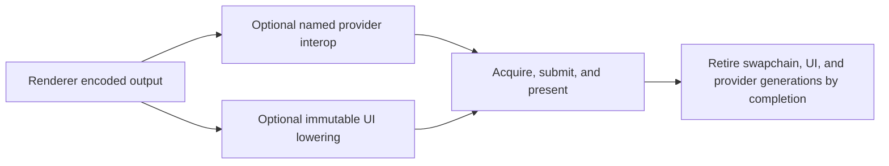
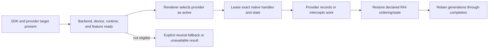
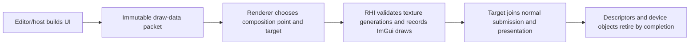
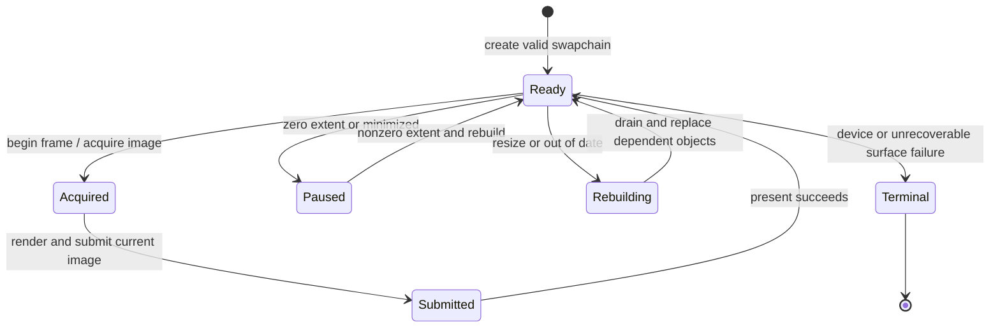

# RHI Presentation And Interop

[Docs](../../../../../../README.md) / [Up](../RHIFeatureGuide.md)

Sections: [External Interop](#external-interop) / [ImGui Rendering](#imgui-rendering) / [Presentation](#presentation).

**Status:** RHI feature-family guide

**Scope:** route window presentation, immutable ImGui lowering, and deliberately narrow external-native integration

This family owns the final native boundaries around a frame: putting the encoded image on a window, adding already-built UI draw data, and temporarily exposing native objects to a named external provider.

**Current readiness:** **43/100** family projection — SDR presentation and UI lowering are integrated, while interop is narrow/capability-gated and HDR/device-recovery proof is absent. See [Current Feature Readiness](../../../../../../Acceptance/CurrentReadiness.md#rhi-and-gpu-execution).

## At A Glance

| Route | Normal input | Observable result | Principal limitation |
| --- | --- | --- | --- |
| presentation | encoded Renderer output and a valid window/swapchain | current frame is acquired, submitted, and presented | SDR only; resize/pacing/device-loss evidence remains open |
| ImGui lowering | immutable draw packet plus registered texture generations | UI draws join the intended target and frame | RHI does not own widgets, layout, input, or composition policy |
| external interop | eligible provider plus exact native device/resource/command state | provider call participates in ordered GPU work | narrow D3D12/provider path; no general Vulkan parity claim |

## Choose By Boundary

| Document | Open it for |
| --- | --- |
| [Presentation](#presentation) | swapchain acquisition, state, resize/minimize, pacing, VSync, present, and device-loss boundary |
| [ImGui Rendering](#imgui-rendering) | immutable draw-data lowering, textures/descriptors, clipping, blend/color behavior, and completion lifetime |
| [External Interop](#external-interop) | native identity/state/hooks, provider eligibility, generation, fallback, and package boundary |

Presentation owns swapchain images, ImGui owns UI command lowering, and interop owns exceptional external access. The parent [RHI Feature Dossiers](../RHIFeatureGuide.md) index owns capability routing.

### Backend Implementation Owners

Source ownership reconciled on 2026-10-27 against the working tree based on `186f7a16`: the hardware-interface aggregates compose focused services. `D3D12BackBufferPresentation` and `VulkanBackBufferPresentation`, under each backend's private `SwapChain` directory, own target setup, native rendering, and presentation transitions; the Vulkan owner also retains per-image layout tracking. `RhiPresentationServiceAdapter` contains the one begin/end pairing invariant and owns its narrow native implementation by value. It no longer borrows the whole hardware-interface aggregate. Recording context and frame-slot lifetime remain explicit borrows from the device lifecycle; no second frame index is stored.

Vulkan device services request acquired-image preparation and final presentation preparation without casting command lists or supplying command buffers. The hardware-interface implementation resolves the recording context for those operations. Frame wait/semaphore ownership is described by [Command Submission And Synchronization](../PipelineAndExecution/PipelineAndExecutionDesign.md#execution-and-lifetime); swapchain resize and failed-acquisition cancellation remain explicit device-lifecycle decisions.

Native format/feature queries live in `Device/D3D12Capabilities.cpp` and `Device/VulkanCapabilities.cpp`; common RHI `Device/RhiCapabilitySupport.cpp` owns their shared diagnostics and memory-support projection. The aggregates publish those results without encoding native query mechanics.

`VulkanDeviceBootstrap.cpp` creates the native device, `VulkanRhiQueues.cpp` creates queue wrappers, and `VulkanRhiDiagnostics.cpp` owns bootstrap naming and diagnostic formatting. This placement and target-build evidence do not establish native presentation, resize, validation, or backend parity acceptance.

Native ImGui backends borrow the native device, swapchain and descriptor service directly. D3D12 descriptor callbacks retain only the descriptor service. `UiFrameRenderer` selects the current graphics command list from the same `RenderDeviceServices` that supplies the ImGui renderer and passes a call-scoped borrow through packet replay to `RhiImGuiRenderer::RenderDrawData`; native UI lowering does not select a command list or submit work. Common private `UI/RhiImGuiContext` owns context acquisition, activation, restoration and release mechanics while each backend instance retains its one context/ownership state. ImGui is an explicit private dependency of the common and final RHI targets. This source ownership was rechecked on 2026-10-25; it is not native UI or presentation acceptance.

## Shared Risks

- Resize and minimize replace presentation identity while older frames may remain in flight.
- UI textures and provider-native handles must not outlive their resource/device generation.
- Provider availability and a successful present do not prove Renderer color correctness.
- HDR remains absent but HDR10 activation is a mandatory first-release target under Renderer-owned `FCR-REN-26`; broad native access and equivalent provider support across backends remain explicit non-capabilities.

## External Interop

**Status:** current feature dossier; source-backed, not provider compatibility, backend parity, native-state, or package evidence

**Verified:** 2026-09-06 at committed `master` revision `8414b5dc`

**Scope:** `RHI-DIAG-07`; narrow native device/resource/command handles, resource states, capability reporting, and interposer hooks for optional external providers

**Current readiness:** **35/100** — narrow provider/native access seams exist; provider/backend/device/package matrices, misuse rejection, lifetime, and executable evidence remain incomplete. See [Current Feature Readiness](../../../../../../Acceptance/CurrentReadiness.md#rhi-and-gpu-execution).

### External Interop: At A Glance

| Question | Current answer |
| --- | --- |
| Why does interop exist? | A named optional provider sometimes needs native device, resource, command, state, or present hooks that the neutral RHI cannot express. |
| Who may request it? | A known provider integration with an explicit build/runtime capability path—not arbitrary Renderer code. |
| What is currently active? | D3D12 contains the inspected Streamline interposer/manual seams; Vulkan vocabulary does not establish an equivalent active provider. |
| What must survive the call? | Resource state, queue order, generation identity, provider/device lifetime, and completion-safe retirement. |
| What is not proved? | Provider compatibility, Vulkan parity, resize/reload/device-loss behavior, package contents, and output correctness. |

### Provider Activation And Use

The decisive state is *active provider readiness*, not SDK registration. A provider route that fails eligibility must remain observably inactive.

### Feature Promise

An active external provider receives only the native identity and hooks it requires, with explicit backend, capability, state, queue, generation, and lifetime constraints. Interop is a named escape hatch, not a general native-object API or evidence that an equivalent provider exists on every backend.

### Ownership Boundary

- `RhiInteropService`, native handles, resource-state translation, and interposer hooks are RHI-owned mechanics with named consumers.
- D3D12 currently carries active Streamline interposer/manual seams. Vulkan neutral/native interop types do not imply equivalent active provider support.
- Renderer owns provider selection, required semantic inputs, requested-versus-active fallback, and feature output. RHI owns valid native access and restoration of resource/queue invariants.
- External use cannot bypass generation identity or GPU-completion retirement.

### Design Decisions And Tradeoffs

| Decision | Benefit | Cost or risk |
| --- | --- | --- |
| Keep interop narrow and consumer-named | Native escape hatches do not spread through the Renderer/RHI boundary | Each provider requires explicit integration and evidence |
| Preserve requested-versus-active selection in Renderer | Feature fallback remains semantic and user-visible | RHI cannot decide whether provider absence is acceptable |
| Expose exact state/queue context | External work can coexist with RHI transitions and submissions | Incorrect restoration can corrupt later neutral work |
| Tie handles to device/resource/provider generations | Reload and shutdown cannot use stale native objects | More lifetime coordination across third-party code |

### Acceptance Criteria

- `AC-RHI-INT-01` — interop reports backend, capability, native object identity, resource state, queue/command context, and lifetime accurately for each supported route.
- `AC-RHI-INT-02` — unsupported backend/provider/interposer combinations reject or leave Renderer on its documented neutral fallback; partial external activation never publishes.
- `AC-RHI-INT-03` — external calls preserve RHI state, ordering, ownership, and completion invariants and do not outlive resource/device/provider generations.
- `AC-RHI-INT-04` — manual/interposer paths, reload, resize, device loss, and shutdown produce one active generation and deterministic cleanup.
- `AC-RHI-INT-05` — optional SDK/runtime absence and package contents are explicit and contain no unintended binaries, paths, or capabilities.

### Controlled Failures And Checks

| Failure | Safe result | Check |
| --- | --- | --- |
| `FM-RHI-INT-01` SDK/runtime/hook/native handle unavailable | provider stays inactive with exact prerequisite; neutral path remains valid | `CHK-RHI-INT-01` capability/package matrix |
| `FM-RHI-INT-02` stale resource/device/provider generation | call rejects before external use; old generation retires by completion | `CHK-RHI-INT-02` reload/resize/device churn |
| `FM-RHI-INT-03` external call leaves wrong state/order | integration/native validation fails before publication | `CHK-RHI-INT-03` state/queue capture matrix |

Check coverage: `CHK-RHI-INT-01` covers `AC-RHI-INT-01`, `AC-RHI-INT-02`, `AC-RHI-INT-05`, and `FM-RHI-INT-01`; `CHK-RHI-INT-02` covers `AC-RHI-INT-03`, `AC-RHI-INT-04`, and `FM-RHI-INT-02`; `CHK-RHI-INT-03` covers `AC-RHI-INT-01`, `AC-RHI-INT-03`, and `FM-RHI-INT-03`.

Definition of done: provider activation/fallback, native state capture, generation stress, device/resize/shutdown, package audit, and all applicable backend evidence pass.

### Primary Source Routes

- `Engine/RHI/Public/Interop`
- backend `Interop`, device external-feature capabilities, and D3D12 interposer hooks
- [Renderer Image Reconstruction and Upscaling](../../../Renderer/Features/PostProcessing/ReconstructionAndGeneration/ReconstructionAndGenerationDesign.md#image-reconstruction-and-upscaling)

## ImGui Rendering

**Status:** current feature dossier; source-backed, not UI image, clipping, DPI, lifetime, or backend-parity evidence

**Verified:** 2026-09-06 at committed `master` revision `8414b5dc`

**Scope:** `RHI-DIAG-08`; backend-specific ImGui device objects, font/texture descriptors, draw-data lowering, clip rectangles, recording, resize, and shutdown lifetime

**Current readiness:** **40/100** — both backend UI-lowering source paths exist; packet/texture/generation/color/DPI/failure/retirement and Shipping-product evidence does not. See [Current Feature Readiness](../../../../../../Acceptance/CurrentReadiness.md#rhi-and-gpu-execution).

### ImGui Rendering: At A Glance

| Input or state | RHI responsibility | Outside this dossier |
| --- | --- | --- |
| immutable ImGui draw data | lower vertices, indices, draw ranges, clip rectangles, textures, blend state, and target recording | widget behavior and editor interaction |
| font and registered texture handles | own backend descriptors and completion-safe generations | which viewport/product the texture semantically represents |
| target/back-buffer generation | bind the matching native render target and viewport/scissor | scene tone mapping and presentation policy |
| resize/rebuild/shutdown | replace affected native objects and retire old ones safely | host layout, input routing, or multi-window product policy |

### Composition Flow

RHI performs draw lowering only. Keeping widgets and composition policy above this layer avoids a backend-specific UI system, but it requires immutable packets and explicit texture-generation handoff.

### ImGui Rendering: Feature Promise

The active backend renders immutable ImGui draw data and registered texture handles into the intended target while preserving draw order, clipping, blending, color interpretation, descriptor lifetime, and frame completion. RHI owns backend lowering only; Editor and Renderer own UI state and composition policy.

### Ownership And Lifetime

- `RhiImGuiRenderer` is the neutral device-facing seam. D3D12 and Vulkan adapters own their native ImGui backend objects and descriptors.
- Renderer owns packet capture/replay timing and scene/UI ordering. Editor owns widgets, viewport composition requests, and texture registration intent.
- Font and registered texture descriptors survive every frame that references them and retire only after GPU completion.
- Resize, swapchain rebuild, shader/provider reload, and shutdown cannot reuse stale native descriptor or render-target identity.

### ImGui Rendering: Design Decisions And Tradeoffs

| Decision | Benefit | Cost or risk |
| --- | --- | --- |
| Consume immutable draw data | Backend recording cannot race live widget mutation | Packet capture/replay consumes memory and needs strict frame identity |
| Use backend-native ImGui adapters | Proven native draw lowering stays localized | D3D12 and Vulkan descriptor/object lifetimes differ internally |
| Register textures through typed handles | UI cannot directly own arbitrary native descriptors | Stale-handle rejection and generation churn need visible behavior |
| Compose within normal frame submission | UI shares synchronization and presentation lifetime | Scene/UI color and order must be explicitly defined above RHI |

### ImGui Rendering: Acceptance Criteria

- `AC-RHI-UI-01` — canonical UI fixtures preserve draw order, index/vertex offsets, clip rectangles, texture selection, blending, and color on both backends.
- `AC-RHI-UI-02` — font/device objects and registered texture bindings have explicit generations and completion-safe lifetime across frame overlap.
- `AC-RHI-UI-03` — resize, swapchain rebuild, viewport texture replacement, and shutdown invalidate only affected native objects without stale use or leaks.
- `AC-RHI-UI-04` — invalid/stale texture handles and malformed draw data reject or omit the affected draw visibly; they never sample an unrelated descriptor.
- `AC-RHI-UI-05` — UI observer/composition cost and package/runtime availability are measured or classified for the supported product routes.

### ImGui Rendering: Controlled Failures And Checks

| Failure | Safe result | Check |
| --- | --- | --- |
| `FM-RHI-UI-01` invalid or stale texture descriptor | affected draw rejects/omits with diagnostics; no unrelated texture is sampled | `CHK-RHI-UI-01` descriptor churn fixture |
| `FM-RHI-UI-02` resize/rebuild while frames are in flight | old objects retire by completion and new generation renders correctly | `CHK-RHI-UI-02` resize/lifetime stress |
| `FM-RHI-UI-03` backend object creation or recording failure | frame reports failure; no partial UI success is published | `CHK-RHI-UI-03` injected backend failure |

Check coverage: `CHK-RHI-UI-01` covers `AC-RHI-UI-01`, `AC-RHI-UI-02`, `AC-RHI-UI-04`, and `FM-RHI-UI-01`; `CHK-RHI-UI-02` covers `AC-RHI-UI-02`, `AC-RHI-UI-03`, and `FM-RHI-UI-02`; `CHK-RHI-UI-03` covers `AC-RHI-UI-04`, `AC-RHI-UI-05`, and `FM-RHI-UI-03`.

Definition of done: image comparisons for order/clip/texture/blend/color, descriptor/generation stress, resize/shutdown, cost, native validation, and both-backend evidence pass.

### ImGui Rendering: Primary Source Routes

- `Engine/RHI/Public/UI/RhiImGuiRenderer.h`
- `Engine/RHI/Private/D3D12/UI` and `Engine/RHI/Private/Vulkan/UI`
- [Renderer UI and Viewport Composition](../../../Renderer/Features/ViewportAndDiagnostics/ViewportAndDiagnosticsDesign.md#ui-and-viewport-composition)

## Presentation

**Status:** current SDR feature dossier plus first-release HDR10 collaboration boundary; source-backed absence is not HDR or release evidence

**Verified:** 2026-09-06 at committed `master` revision `8414b5dc`

**Scope:** `RHI-PRES-*`; swapchain construction, back-buffer identity/state, acquire, resize, frame count, pacing, VSync, submit/present, and RHI mechanics for the admitted HDR10 target

**Current readiness:** **50/100** for the current SDR scope — acquire/resize/present routes exist for both backends; executable pacing, failure, parity, format, and packaged evidence does not. HDR output is separately **0/100**, first-release admitted, and Blocked under `FCR-REN-26`. See [Current Feature Readiness](../../../../../../Acceptance/CurrentReadiness.md#rhi-and-gpu-execution).

### Presentation: At A Glance

| State | Observable behavior | Important boundary |
| --- | --- | --- |
| ready window and swapchain | acquire exposes one current back buffer and generation | acquiring is not presenting; identity must reach the submitted frame |
| normal frame | submit finishes rendering, then present advances the visible surface | success requires the current frame/present result, not a prior image |
| VSync or pacing request | backend activates, rejects, or reports the effective mode | configuration intent is not proof of timing behavior |
| resize/minimize/out-of-date | pause/drain and replace swapchain-dependent objects without replacing the device | this is presentation recovery, not whole-device recovery |
| device or surface failure | exact failure reaches a recoverable presentation state or bounded terminal path | no stale back buffer may be reported as a fresh present |
| HDR request | unavailable in current source; admitted target | SDR swapchain support does not imply an HDR surface/color-space contract; the discovery-blocked target is [HDR Display Output](../../../Renderer/Features/PostProcessing/DisplayPipeline/HDRDisplayOutput/HDRDisplayOutputDesign.md) |

### Swapchain Lifecycle

### Presentation: Feature Promise

For a valid native window and supported configuration, RHI owns one swapchain lifecycle that acquires a current back buffer, exposes its neutral render state, submits/presents it in order, and rebuilds safely on size changes. Current source is SDR-oriented. The admitted target extends that same owner with HDR capability discovery, compatible format/color-space activation, static metadata, transitions, and truthful fallback; Renderer retains color-transform policy.

### Ownership And Lifecycle

- Presentation defaults and runtime request determine back-buffer count, frames in flight, VSync, and related neutral configuration within documented bounds.
- Backend swapchains own native buffers, views, acquisition state, present mode/flags, and pacing primitives.
- Vulkan acquisition records the acquired image's transition to the graph's `Present` import state before graph or direct UI recording uses it, including after resize.
- Resize/minimize must settle or preserve in-flight ownership before replacing buffers; a zero-sized window is not a renderable surface.
- Renderer owns what color it writes and when UI composition occurs. RHI owns swapchain format/state and present mechanics, not tone mapping or output encoding policy.

### Presentation: Design Decisions And Tradeoffs

Back-buffer viewport/scissor dimensions describe the allocated image, not the live window. Renderer resolves direct presentation extent after backend frame acquisition, which may recreate the swapchain. Editor viewport extent remains an independent render request.

| Decision | Benefit | Cost or risk |
| --- | --- | --- |
| Separate Renderer encoding from RHI presentation | Color policy does not become API-specific | End-to-end SDR/HDR evidence must join two owners |
| Treat back buffers as generated identities | Resize cannot silently leave stale views in flight | Consumers must propagate and invalidate the generation |
| Drain only the presentation-dependent boundary when possible | Resize can recover without rebuilding the whole device | Incorrectly retained swapchain resources cause stalls or stale use |
| Expose requested and active pacing modes | Unsupported configuration is visible | Backend timing policies differ and need measured evidence |

### Presentation: Acceptance Criteria

- `AC-RHI-PRES-01` — create/acquire/render/submit/present preserves back-buffer index, frame identity, state, and completion ordering across supported buffer/frame counts on both backends.
- `AC-RHI-PRES-02` — resize, minimize/restore, rapid resize, surface loss, and shutdown replace or retain native buffers without stale views, use-after-free, deadlock, or fabricated presentation.
- `AC-RHI-PRES-03` — VSync and pacing requests produce the documented active mode and observable fallback/rejection; measurements record backend/device configuration.
- `AC-RHI-PRES-04` — device/present failure is surfaced with recoverable state or bounded shutdown; the prior frame is not reported as a new success.
- `AC-RHI-PRES-05` — until `FCR-REN-26` is implemented, HDR requests remain explicitly unavailable; completion requires the linked `AC-HDR-*` format/color-space/metadata, transition, fallback, Renderer-transform, backend, hardware, and display evidence.

### Presentation: Controlled Failures And Checks

| Failure | Safe result | Check |
| --- | --- | --- |
| `FM-RHI-PRES-01` zero/invalid extent or lost surface | no new back-buffer work; wait/rebuild/failure is explicit | `CHK-RHI-PRES-01` resize/minimize/surface-loss loop |
| `FM-RHI-PRES-02` present/device error | exact failure propagates; no success counter/identity advances | `CHK-RHI-PRES-02` injected backend failure |
| `FM-RHI-PRES-03` unsupported pacing/VSync or HDR capability/activation failure | requested-versus-active/fallback result is explicit; HDR preserves a valid SDR presentation route | `CHK-RHI-PRES-03` mode/capability matrix plus `CHK-HDR-*` |

Check coverage: `CHK-RHI-PRES-01` covers `AC-RHI-PRES-01`, `AC-RHI-PRES-02`, and `FM-RHI-PRES-01`; `CHK-RHI-PRES-02` covers `AC-RHI-PRES-02`, `AC-RHI-PRES-04`, and `FM-RHI-PRES-02`; `CHK-RHI-PRES-03` covers `AC-RHI-PRES-03`, `AC-RHI-PRES-05`, and `FM-RHI-PRES-03`.

Definition of done: long resize/minimize/restore runs, buffer/frame-count matrices, pacing measurements, device-loss behavior, native validation, color/format checks, and both-backend evidence pass.

### Presentation: Primary Source Routes

- `Engine/RHI/Public/Presentation`
- `Engine/RHI/Private/D3D12/SwapChain` and `Engine/RHI/Private/Vulkan/SwapChain`
- [Renderer Presentation and Output](../../../Renderer/Features/PostProcessing/DisplayPipeline/DisplayPipelineDesign.md#presentation-and-output)
