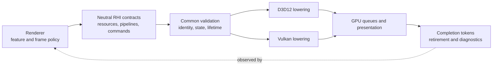
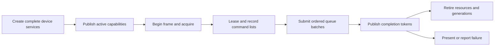

# Render Hardware Interface

[Docs](../../../../README.md) / [Up](../README.md) / [Implementation](FirstReleaseImplementationPlan.md)

**Status:** module index and current-system reading route; not executable backend or release evidence

**Scope:** route backend-neutral GPU contracts, D3D12/Vulkan lowering, and each independently reviewable RHI capability to one documentation owner

**Current-state basis:** source and build configuration inspected 2026-09-06 at committed `master` revision `8414b5dc`

**Current readiness:** **45/100** portfolio average (`I/R` present; `V/D = 0/0`); all six tracked RHI families remain Blocked. See [Current Feature Readiness](../../../../Acceptance/CurrentReadiness.md#rhi-and-gpu-execution).

The Render Hardware Interface (RHI) translates backend-neutral GPU work into one active D3D12 or Vulkan implementation. It owns GPU mechanisms; Renderer owns what those mechanisms mean for a frame.

> [!IMPORTANT]
> **Current state:** D3D12 and Vulkan source paths cover device creation, resources, descriptors, pipelines, commands, ray tracing, presentation, diagnostics, and capture.
>
> **Readiness:** **45/100** — broad source paths exist, but there is no candidate-bound backend execution, native-validation, parity, or delivery evidence.
>
> **Main limitation:** No current candidate has proved the backend matrix with builds, device runs, native validation, parity, fault injection, performance, or packaged operation.
>
> **Evidence:** Source/build configuration was inspected through 2026-09-06. This page does not claim that either backend currently passes executable acceptance.

## At A Glance

| You have | You do not have yet |
| --- | --- |
| One neutral service surface with separate D3D12 and Vulkan lowerings | Accepted D3D12/Vulkan feature parity or minimum-hardware matrix |
| Resource/view/sampler creation, upload/readback, allocation, aliasing, and retirement contracts | Proved allocation-pressure, aliasing, delayed-completion, and leak behavior |
| Descriptor layouts/writes, graphics/compute/ray pipelines, commands, queues, barriers, waits, and tokens | Complete boundary/capacity/invalid-use and native-validation results |
| BLAS/TLAS, inline ray queries, native ray pipelines and shader tables, plus PTLAS vocabulary/path | Accepted support matrix across devices, backends, traversal modes, and dynamic geometry |
| Swapchain acquire/resize/present, ImGui rendering, external interop, diagnostics, and texture capture | Implemented HDR presentation, broad external-native access, or whole-device recreation after device loss; HDR10 is an admitted target only |

## Where RHI Sits

Renderer expresses semantic work; RHI validates neutral contracts and lowers them to exactly one backend.

The binding ownership decision is [Renderer And RHI](../../../Decisions/RendererRhiBoundary.md).

## GPU Work Lifecycle

A frame is safe only when resource, descriptor, pipeline, command, and retirement identity all refer to compatible generations and actual queue completion.

## Feature Families

| Family | What it owns | Main open boundary | Read next |
| --- | --- | --- | --- |
| Device and resources | backend selection, adapter/device aggregate, capabilities, resources, memory, descriptors, creation/destruction | partial-create cleanup, pressure, capacity, delayed completion, device loss | [Device And Resources](Features/DeviceAndResources/DeviceAndResourcesDesign.md) |
| Pipeline and execution | shader/pipeline ABI, command recording, queue submission/waits/tokens, ray tracing | invalid combinations, synchronization, parity, SBT/AS capability and retirement | [Pipeline And Execution](Features/PipelineAndExecution/PipelineAndExecutionDesign.md) |
| Presentation and interop | swapchain, acquire/resize/present, pacing, UI lowering, narrow provider-native access | resize/device-loss behavior, admitted-but-absent HDR10 activation, interop/provider/package restrictions | [Presentation And Interop](Features/PresentationAndInterop/PresentationAndInteropDesign.md) |
| Diagnostics and capture | names, events, timestamps, native validation/crash facts, live objects, asynchronous readback | attribution, delivery bounds, observer cost, format correctness, fault evidence | [Diagnostics And Capture](Features/DiagnosticsAndCapture/DiagnosticsAndCaptureDesign.md) |

The [RHI Feature Guide](Features/RHIFeatureGuide.md) maps every public service and source directory to one of these contracts.

## Backend And Capability Snapshot

| Capability | D3D12 | Vulkan | Important qualification |
| --- | --- | --- | --- |
| Device, queues, resources, views, samplers | Implemented source path | Implemented source path | Actual format/queue/capability support comes from the selected device |
| Descriptor binding | Implemented source path | Implemented source path | Capacity, recording lifetime, and semantic equivalence remain unproved |
| Graphics and compute pipelines/commands | Implemented source path | Implemented source path | Shader/reflection ABI and native validation remain open |
| Inline ray queries | Capability-gated path | Capability-gated path | Requires reported ray-query and descriptor capabilities |
| Native ray pipelines and shader tables | Capability-gated path | Capability-gated path | Native object/table layout and cross-backend semantic parity remain open |
| PTLAS | Narrow capability/provider path | Narrow capability/provider path | Renderer exercises a restricted subset; do not infer general update/refit support |
| Swapchain and SDR presentation | Implemented source path | Implemented source path | resize and pacing evidence open |
| HDR10 format/color-space/metadata activation | First-release target; not found | First-release target; not found | owned by Renderer `FCR-REN-26` with RHI backend mechanics |
| External provider interop | Narrow capability-gated path | No general equivalent claim | Native access is provider-specific and deliberately not a general escape hatch |
| Diagnostics and texture capture | Implemented source path with backend differences | Implemented source path with backend differences | Availability, format, fault correlation, and observer cost need executable proof |

Use the [Capability Inventory](CapabilityInventory.md) for exact `RHI-*` cells and limits. `Implemented source path` does not mean a backend passed.

## Ownership Boundary

RHI owns:

- device, adapter, queue, and capability truth;
- resources, formats, memory, descriptors, pipelines, commands, barriers, submission, and completion;
- native D3D12/Vulkan translation;
- acceleration structures, traversal mechanisms, shader tables, presentation, diagnostics, capture, and narrow interop.

RHI does not own:

- scene, view, material, lighting, post-processing, or debug semantics;
- which Renderer feature should activate or which fallback is acceptable;
- frame-graph feature ordering or user-facing quality policy;
- evidence that a rendered result is visually correct or shippable.

Public contracts live under `Engine/RHI/Public`. Common validation and neutral implementation live in non-backend `Engine/RHI/Private` paths. `Private/D3D12` and `Private/Vulkan` own real API differences. `Engine/RHI/CMakeLists.txt` remains executable membership authority.

### Reading Orchestration And Mechanism

Source responsibilities were reconciled on 2026-11-08 in the working tree starting at `7c94ab4581bd17b3aa12da4388bfc18e9f117eb2`. This is an ownership map, not native execution or backend acceptance.

| Follow the workflow in | Read implementation details in |
| --- | --- |
| `Private/Device/RenderDeviceServices.cpp` and backend `Device/*RenderDeviceServices.cpp` | Backend resources, descriptors, command recording, swapchain and diagnostics owners; device services compose their lifetimes |
| Vulkan `Device/VulkanDeviceBootstrap.cpp` | `Device/VulkanDeviceCreation.cpp` owns logical-device queue descriptions, enabled extensions, feature-chain storage and native creation; `VulkanDeviceExtensions` owns extension enumeration |
| Vulkan device services' frame operations | `Commands/VulkanFrameSubmission` owns acquire-semaphore consumption and pending waits; the recording context and command queue retain slot retirement and native synchronization |
| Backend `Pipeline/*RayTracingPipeline.cpp` | `Pipeline/*RayTracingPipelineCreation.cpp` owns temporary native shader/group/subobject assemblies through the synchronous creation call |
| Backend `RayTracing/*PtlasServices.cpp` | Allocation/upload functions own resource construction; `RayTracing/*PtlasOperationPacking.cpp` owns native record layouts, flags, operation headers and argument encoding |
| Vulkan descriptor allocation and binding operations | `Descriptors/VulkanDescriptorAllocator` owns identity, immutable recording views and registry retirement; `VulkanDescriptorWrites` consumes borrowed entries and owns native write validation, chunk packing and `vkUpdateDescriptorSets` |
| Vulkan acceleration-structure command entry points | Command lists retain input validation, rendering-state boundaries and resource tracking; `RayTracing/VulkanAccelerationStructureCommands` owns native BLAS/TLAS/PTLAS descriptions and their existing barrier sequence |
| Backend memory snapshot requests | `D3D12MemoryUsage` and `VulkanMemoryUsage` own native accounting algorithms; allocators retain record authority and lock the borrowed live-record spans |
| Vulkan shader-table creation and adapter selection | Shader tables name native handle retrieval, region packing and upload; adapter selection names enumeration, eligibility and capability publication, with native probing in focused functions |
| D3D12 crash-diagnostic collection | Focused DRED interface collectors own native queries; breadcrumb and page-fault functions own message construction, including the older native interface's existing behavior |
| `Shaders/GlobalShaderMapLoading.cpp` | Record decoding stays in `ReadRecords`; `GlobalShaderMapValidation.cpp` owns key, provenance, ray-contract and reflected-metadata validation; `ShaderMap.cpp` owns feature-bit operations and validated map queries; `CookedShaderLibrary.cpp` owns code-index loading and hash validation; `ShaderMapRanges.cpp` owns their shared range predicates, declared in its private header |

Temporary native assemblies own pointer targets rather than copies of device or pipeline authority. They cannot move while native structures refer into them. Allocation and descriptor registries retain their shared allocation, recording-reference and retirement invariants; stateless native write encoding and memory accounting have focused implementors. File length alone does not justify another owner. Backend capability folders remain the durable boundaries, without a directory per helper or a generic manager layer.

The second 2026-11-08 pass (`ITER-RHI-SRP-02`, working tree based on `0758e939292f669bc3d743cfffd4e08617dba64e`) reviewed the complete owned RHI source inventory and refined these additional routes. Vulkan adapter candidates are local to bootstrap implementation, clear their query-chain pointers before storage, and move selected queue topology into the device owner. No public operation, persistent service, backend policy or serialized layout is added by this responsibility pass. Native execution and release acceptance remain separate.

The external precedents are NVIDIA [NVRHI's common/backend build separation](https://github.com/NVIDIA-RTX/NVRHI/blob/bf0bbd9b666a7297492beb1999a4ddc0dfded143/CMakeLists.txt) and Epic's [subsystems with managed lifetimes](https://dev.epicgames.com/documentation/unreal-engine/programming-subsystems-in-unreal-engine), inspected 2026-11-08. The local adoption is focused capabilities and explicit composition lifetimes. It does not import Unreal reflection/automatic instancing or NVRHI's resource-state policy. The falsifiers are native details returning to workflow bodies, duplicated mutable authority, or referenced native storage expiring before creation returns.

## Design Decisions And Tradeoffs

| Decision | Benefit | Cost or drawback |
| --- | --- | --- |
| Keep the public surface backend-neutral | Renderer can express one semantic operation for D3D12 and Vulkan | Lowest-common-denominator pressure and explicit capability branches |
| Report capabilities instead of branching on backend names | Feature selection follows actual device support | Capability accuracy becomes a startup-critical invariant |
| Use opaque handles/generations and completion tokens | Prevent direct native-object coupling and early retirement | More identity validation and deferred lifetime bookkeeping |
| Centralize command/submission lifetime | Queue waits, batches, and retirement have one authority | Incorrect token propagation can affect many resource families |
| Keep native interop narrow and provider-specific | Optional SDKs can integrate without contaminating core contracts | Some provider features remain backend/vendor/package restricted |
| Treat device loss as terminal while swapchain resize is recoverable | Avoid pretending incomplete whole-device recreation is safe | A real device loss currently terminates the rendering session |
| Maintain two full backend lowerings | Exposes portability and API design defects | Every feature adds implementation, validation, parity, and maintenance work twice |

## Known Limitations And Failure Boundaries

- No backend, adapter, driver, or minimum-hardware matrix has accepted executable evidence.
- Device loss has diagnostics and terminal handling, but no complete whole-device recreation path.
- HDR presentation is absent but its Windows HDR10 backend mechanics are mandatory first-release work under Renderer-owned `FCR-REN-26`.
- Optional provider interop is not a general native API surface and does not imply Vulkan/provider parity.
- Public vocabulary can be broader than current Renderer consumers; unused or partial modes must remain unreachable or explicitly classified.
- Ray tracing and PTLAS remain capability-gated and narrower than the neutral vocabulary may suggest.
- Allocation, descriptor, queue, readback, resize, shutdown, and delayed-completion failure behavior still needs focused evidence.

## Evidence And Reference

| Need | Document |
| --- | --- |
| Exact implementation states, limits, and backend rows | [RHI Capability Inventory](CapabilityInventory.md) |
| Cohesive feature mechanisms and local acceptance | [RHI Feature Guide](Features/RHIFeatureGuide.md) |
| Cross-backend Renderer feature comparison | [Graphics Feature Coverage](../../../CrossModule/GraphicsCoverageMatrix.md) |
| Request-to-command-to-retirement traces | [Graphics Feature Execution Traces](../../../CrossModule/FeatureExecutionTraces.md) |
| First-release RHI work packages | [RHI And GPU Execution Plan](FirstReleaseImplementationPlan.md) |
| Smallest missing RHI checks | [RHI Evidence Plan](../../CapabilityEvidencePlan.md#rhi-capability-to-evidence-map) |
| Candidate and release disposition | [Feature Completion Reports](../../../../Acceptance/FeatureCompletionReports.md) and [First Release](../../../../Acceptance/FirstRelease.md) |
| Rules for changing an RHI contract or backend | [RHI Engineering](../../../../Engineering/Modules/RHI.md) |

Do not infer backend support from a class or enum alone. Verify the neutral declaration, common validation, backend lowering, CMake membership, real Renderer consumer, capability selection, failure path, and completion lifetime together.
