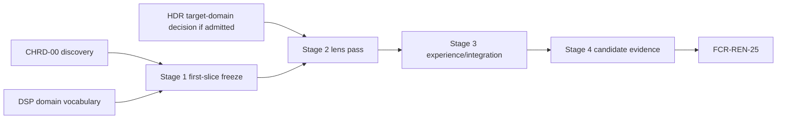

# Chromatic Aberration Delivery Plan

[Docs](../../../../../../../../README.md) / [Up](ChromaticAberrationDesign.md)

Stages: [Stage 0](#stage-0--close-chrd-00) / [Stage 1](#stage-1--freeze-the-first-lens-slice) / [Stage 2](#stage-2--implement-and-prove-the-lens-pass) / [Stage 3](#stage-3--complete-experience-and-integration) / [Stage 4](#stage-4--candidate-evidence-and-closure).

Add a small lens effect with defined channel offsets, clamp behavior and a zero-cost neutral state.

**Status:** conditional implementation plan; Stage 0 is permitted, Stages 1-4 are blocked until `CHRD-00 PASS` and `DSP-6` prerequisites

**Current source, 2026-10-31:** the dedicated `ChromaticAberration.cpp`/`.hlsl`, shader registration, `r.ChromaticAberration` and shared settings bridge already exist. Presentation composes tone mapping -> chromatic aberration -> vignette -> encoding. The shader uses fixed rounded integer red/blue offsets and clamped loads; this is not the accepted reference-height/bilinear/per-view contract or native proof. Freeze the exact delta against these owners, then repair and qualify it; do not create another lens pass. [Current capability](ChromaticAberrationDesign.md#current-capability) retains the source routes and limits.

**Current readiness:** **0/100** — target only.

## Work This Plan

| What to do | Working route |
| --- | --- |
| First action | [Stage 0 discovery](#stage-0--close-chrd-00): close CHRD-00 model, units, pixel domain and independent numerical checks. |
| Result to reach | A fixed three-channel formula and accepted placement against the connected pass and fixed offsets, before changing their contract. |
| Start / stop | Stage 0 planning is permitted; production waits for CHRD-00 PASS and DSP-6. An unresolved HDR target cell must be separately dispositioned. |

## Outcome

Deliver one small, stateless, per-view chromatic-aberration effect with a Stage-0-selected fixed three-channel model, exact reference-height units, analytic CPU/GPU agreement, bounded clamp sampling, target-linear pre-encode/pre-UI placement, zero-cost neutral state, truthful workflow, and admitted backend/package evidence. Completion is `FCR-REN-25` for one immutable candidate—not a colorful screenshot or compiled shader.

## Gate And Dependency Graph



An available display-pipeline seam does not bypass `CHRD-00`. HDR output may remain blocked independently; Stage 0 must either define a separately testable HDR target-linear cell or exclude that cell from the current candidate without weakening SDR truth.

## Planning Envelope

CHRD-00 freezes the exact model/domain, current owner/file map, public/settings state, graph placement, sample/variant/transient cost and numeric thresholds. Retain raw/backend/package/artifact-classification proof and actual check/artifact bounds. Spectral assets, persistent history, a quality framework or guard-band system exceed the selected basic effect; return to scope discovery instead of enlarging a time estimate.

## Execution Contract

Every stage and copied prompt follows [stage completion and resume](../../../../../../../../Engineering/Workflow/ChangeLifecycle.md#stage-completion-and-resume). Close its finite local exit once; keep later aggregate proof separate.

Each stage passes the [Stage Source-Style Gate](../../../../../../../../Engineering/Workflow/ChangeLifecycle.md#stage-source-style-gate) after the final edit, retaining exact formatter coverage and authored spacing/responsibility review. No-source work records justified N/A and its artifact/docs checks.

Each stage maps the touched `AC-CHR-*`, `FM-CHR-*`, `RISK-CHR-*`, and `CHK-CHR-*`; starts from current status/revision/dirty state; uses the smallest defect-detecting check; and applies the [stage complexity budget](../../../../../../../../Engineering/Workflow/ChangeLifecycle.md#define-the-outcome-and-complexity-budget) to current settings/View/graph/shader/editor/capture/package owners. Retain/narrow/delete touched existing paths, justify actual additions and finish their cleanup before exit. Stop on an unresolved domain, unit, channel, edge, debug, or budget decision. No compatibility path, spectral-LUT framework, history, quality tiers, permanent test code, or silent fallback is allowed.

Every stage records prerequisites, production files and generated/build/package membership, owned output, non-goals, deletions, checks/results, unrun checks, downstream evidence invalidated, revision, and dirty boundary. Temporary test-only classes/files/executables remain local and are removed before submission unless the user separately authorizes them.

## Cross-Stage Invariants

1. One accepted model, coordinate/filter contract, semantic revision, and state vocabulary govern editor, manifest, CPU oracle, shader, captures, and all backends.
2. Global/default and per-view intent resolves once into immutable frame state; no UI/global shadow cache exists.
3. Active rectangle—not window, monitor, DPI, or full backing resource—defines coordinates and reference-height scaling.
4. Zero, invalid, unavailable, and minimized states schedule no effect pass/resource.
5. Active execution is stateless, asset-free, history-free, bounded, and preserves alpha/product identity.
6. Target tone/gamut, lens effect, encoding, debug, UI, capture, and presentation remain separately identifiable.
7. Incidental fringes remain defects unless matching active effect lineage proves intentional output.
8. D3D12/Vulkan use one Renderer semantic implementation with RHI mechanism adapters only.
9. Excluded spectral/profile/volume/history/quality/guard-band/player surfaces stay unreachable.
10. Any semantic, stage, sampler, precision, result, fusion, or candidate change invalidates dependent evidence explicitly.

## Stage Contract Matrix

<details>
<summary>Expand stage contract matrix</summary>

| Stage | Required inputs | Owned output | Non-goals | Minimum falsifiers |
| --- | --- | --- | --- | --- |
| 0 | current source, pinned research, release/product boundary | accepted basic-effect semantic/ownership/proof decisions and `CHRD-00` result | production code/readiness | `CHK-CHRD-01` through `10`, hand cases, separate review |
| 1 | accepted basic model and existing settings/View/display owners | reviewed first-slice state/binding/output and check map | production state, registrations, inactive seam | real consumer, neutral/failure oracle, bounded files and deletion list |
| 2 | accepted equations/domain/edge/precision/budgets | one distinct backend-neutral lens pass/product | UI polish, fusion, spectral/quality/history | analytic patterns, seeded defects, alpha/stage/extent, native validation, cost |
| 3 | stable runtime state/result/product vocabulary | complete UX, debug/UI/capture/automation/package integration | player UI or new framework | first use, reset, states/errors, rapid edits, views/resize, capture lineage, manifest parity |
| 4 | frozen candidate/manifests/thresholds | acceptance artifacts and clean closure | tuning thresholds/model after output | all `CHK-CHR-*`, fault controls, paired backend, package, cost, exclusions/classification |

</details>

## Stages

### Stage 0 — Close `CHRD-00`

Run `CHR-EXP-01` through `06`, disposition `CHRD-01` through `10`, freeze model/controls/domains/units/bounds/state/debug/budgets/evidence, and accept exact document revisions. No production code changes.

**Exit:** the semantics can be independently implemented without choosing a constant or coordinate rule, every risk/criterion/failure has a defect-detecting check, and the first slice has a bounded addition/deletion map. Remove disposable experiments and superseded model/control instructions; no production model variants or settings vocabulary land here.

<details>
<summary>Copy implementation prompt</summary>

```text
Read Docs/Architecture/Modules/Engine/Renderer/Features/PostProcessing/DisplayPipeline/ChromaticAberration/ImplementationPlan.md#stage-0--close-chrd-00; apply its execution contract, named stage work/exit and Stage Source-Style Gate.
Execute only Chromatic Aberration Stage 0. Inspect current post/display/settings/View/shader/debug/capture/UI/package paths, reuse the existing three-channel precedent and close only unaccepted CHRD model/constant/control/domain/unit/edge/matrix/budget/oracle decisions; retain accepted values and explicit invalidation triggers. Update only the owning documents. Stop instead of choosing from visual preference alone.
NON-NEGOTIABLE: no production changes, model choice is justified by predeclared quality/cost evidence, and every accepted document revision is named or the gate remains `Blocked`.
```

</details>

### Stage 1 — Freeze The First Lens Slice

Freeze the accepted channel displacement, coordinates/filtering/alpha, settings/View identity, graph edge, independent numeric oracle and concrete file/build map. This is documentation and check design; do not register inactive state, shaders or graph vocabulary without a consumer.

**Exit:** the first effect slice has a reviewed producer-to-output change, neutral/failure checks and deletion list. No dormant production types or framework were added.

```text
Read Docs/Architecture/Modules/Engine/Renderer/Features/PostProcessing/DisplayPipeline/ChromaticAberration/ImplementationPlan.md#stage-1--freeze-the-first-lens-slice; apply its execution contract, named stage work/exit and Stage Source-Style Gate.
Execute only Chromatic Aberration Stage 1 from its ImplementationPlan.md. Freeze the concrete first-slice contract and checks without production changes. Carry required state, shader and build edits into Stage 2 with the real output consumer; add no inactive seam.
```

### Stage 2 — Implement And Prove The Lens Pass

Compare the existing connected pass/settings/shader with the accepted freeze and change only the missing contract. Reconcile fixed integer offsets with the accepted units/bilinear oracle, resolved View/settings identity, typed binding and build membership. Resolve the recorded chromatic/vignette order against the owning target; preserve alpha/product identity, clamp reads and prove neutral omission. Delete replaced offsets/state/intermediates in the same slice. Retain one distinct target-linear pass and no history, lens manager, extra public selector or parameter snapshot. If an affected requirement already has applicable proof, reuse it.

**Exit:** `AC-CHR-01` through `04` semantic portions pass; swapped channel, wrong scale/aspect/stage, wrap, alpha, and zero-work defects are detected; D3D12/Vulkan shaders compile through owned routes and cost meets the frozen budget. One consumed model/pass remains; replaced offsets/branches/intermediates and proof-only code are gone, with retained display behavior checked.

<details>
<summary>Copy implementation prompt</summary>

```text
Read Docs/Architecture/Modules/Engine/Renderer/Features/PostProcessing/DisplayPipeline/ChromaticAberration/ImplementationPlan.md#stage-2--implement-and-prove-the-lens-pass; apply its execution contract, named stage work/exit and Stage Source-Style Gate.
Execute only Chromatic Aberration Stage 2. Start with the connected ChromaticAberration pass/shader and shared settings bridge; implement only their missing accepted contract and delete replaced offsets/state. Prove the frozen three-channel model, target-linear order, pixel units, bilinear clamp, alpha and zero omission. Compare an independent double-precision CPU evaluator over the frozen pattern/aspect/resolution/parameter matrix and seeded semantic defects. Inspect bindings, native validation, raw pre/post products and cost on both backends. Reuse applicable passes and record the exact remaining cell for any unexplained mismatch.
NON-NEGOTIABLE: one model/domain/filter contract serves both backends, every seeded channel/scale/aspect/stage/edge/alpha defect fails, no history/asset/quality tier exists, and zero remains no-work.
```

</details>

### Stage 3 — Complete Experience And Integration

Join the approved On default and existing Editor/shared settings/reset path to actual view/frame and capture truth. Add no new public lens toggles or Game settings frontend. Exercise neutral/invalid values through existing typed or disposable validation routes, then resize/view isolation, missing pipeline, debug/UI bypass, capture and package behavior. Reset restores the approved default, not the neutral test setting.

**Exit:** `AC-CHR-05/06/08` and all controlled failure paths pass; a developer can identify whether the intentional effect is active; ordinary artifacts cannot be mislabeled. Any replaced UI/config/status authority is deleted; no new toggle, settings frontend, status cache or permanent fault control survives the actual hook/copy budget review.

<details>
<summary>Copy implementation prompt</summary>

```text
Read Docs/Architecture/Modules/Engine/Renderer/Features/PostProcessing/DisplayPipeline/ChromaticAberration/ImplementationPlan.md#stage-3--complete-experience-and-integration; apply its execution contract, named stage work/exit and Stage Source-Style Gate.
Execute only Chromatic Aberration Stage 3. Use the existing Editor/shared settings and capture route to prove approved On/default-reset and actual View state; add no public lens toggle or Game settings frontend. Use a typed/local neutral control, classify debug bypass and keep UI downstream. Exercise first use, reset, invalid values, two views, rapid edits, resize/DPI/minimize, mode/debug changes, missing pipeline, capture lineage, and packaged settings. Do not add a player-facing menu or generic post-process framework.
NON-NEGOTIABLE: requested/active/artifact truth comes from runtime state, reset is exact, incidental fringes cannot be labeled intentional, and excluded workflow surfaces remain absent.
```

</details>

### Stage 4 — Candidate Evidence And Closure

Run `CHK-CHR-01` through `05` for one immutable candidate, including analytic defect controls, matched resolutions, temporal camera motion, SDR/HDR cells, D3D12/Vulkan raw comparison, native validation, package, cost/memory, excluded-surface audit, and artifact classification through existing tools. Remove temporary probes, verify preceding model/state/dependency cleanup and submit `FCR-REN-25`; no permanent capture/comparison/report framework is selected. A production repair returns to its owner with affected evidence invalidated.

**Exit:** all `AC-CHR-01` through `08` pass conjunctively, each failure/risk has detecting evidence, and the acceptance owner records the verdict.

<details>
<summary>Copy implementation prompt</summary>

```text
Read Docs/Architecture/Modules/Engine/Renderer/Features/PostProcessing/DisplayPipeline/ChromaticAberration/ImplementationPlan.md#stage-4--candidate-evidence-and-closure; apply its execution contract, named stage work/exit and Stage Source-Style Gate.
Execute only Chromatic Aberration Stage 4 for one frozen candidate. Run the complete predeclared CHK-CHR matrix and seeded defects across domains, resolutions, aspects, views, debug/UI/capture, backends, package, and cost. Remove temporary test-only code; reconcile source/header/shader/generated/CMake/settings/package/docs membership; and file FCR-REN-25 with exact evidence and limitations. Do not retune the model or thresholds after seeing candidate output.
NON-NEGOTIABLE: candidate/model/thresholds are frozen before output, all criteria and controlled failures close conjunctively, temporary probes are removed, and any ambiguous artifact or missing cell yields `Blocked`.
```

</details>

## Phase-To-Acceptance Traceability

<details>
<summary>Expand phase-to-acceptance traceability</summary>

| Claim | Establishing stage | Closing evidence | Invalidated by |
| --- | --- | --- | --- |
| `AC-CHR-01` exact neutral/no resources | 2; contract freeze in 1 | Stage 4 `CHK-CHR-01/04` plus graph/resource trace | neutral predicate, graph/fusion, state/result change |
| `AC-CHR-02` model/coordinate/filter agreement | 2 | `CHK-CHR-01` with retained hand cases/defects | model/constant/range/coordinate/filter/precision/compiler change |
| `AC-CHR-03` resolution-independent authored units | 2 | `CHK-CHR-03` across frozen extents/aspects/subrects | strength units/extent source/scaling/viewport policy change |
| `AC-CHR-04` stage/alpha/product identity | 2; UX join in 3 | `CHK-CHR-02` raw topology/captures | display/HDR/debug/UI/capture/fusion ordering change |
| `AC-CHR-05` per-view state/workflow | 2 state; 3 complete experience | `CHK-CHR-04` | settings precedence, digest, reset, View/extent/result vocabulary change |
| `AC-CHR-06` controlled invalid/failure behavior | 2 validation/graph; 3 recovery | `CHK-CHR-03/04` | validation/fallback/program/device/graph behavior change |
| `AC-CHR-07` backend/package/cost | incremental 2-3 | Stage 4 `CHK-CHR-03/05` | shader/RHI/package/budget/candidate change |
| `AC-CHR-08` artifact classification/exclusions | 0 contract; 3 labels/reachability | Stage 4 `CHK-CHR-05/NEG-01` | selector/source/shader/package/docs claim change |

</details>

## Deletion And Preservation Ledger

| Surface | Preserve | Delete before handoff |
| --- | --- | --- |
| display/tone/encoding/debug/UI/capture owners | their independent policy and products | duplicate aberration ordering or result authority |
| settings/View | existing default/override and immutable frame preparation patterns | prototype global lens manager, UI state cache, aliases |
| graph/resources | current dependency/transient lifetime mechanisms | hidden in-place route, persistent history/profile/LUT workarounds |
| shader/program/RHI | typed registration and mechanism ownership | ad hoc bindings, backend-specific semantic forks, experimental model variants |
| editor/automation/package | current display workflow/config/reachability route | console-only enable, player menu, duplicate manifest schema |
| evidence | useful original candidate artifacts/reports, including negative results | local probes, temporary fixtures/classes/executables and disposable screenshots with no retained evidence consumer |
| repository | unrelated user-owned dirty work | only superseded paths introduced or explicitly replaced by this feature |

## Stop And Escalation Rules

Stop and record `Blocked` when:

- any `CHRD-*` rule, constant, range, domain, matrix cell, budget, tolerance, owner, or fallback remains unresolved;
- current source contradicts the accepted graph/settings/View owner and resolution would broaden the stage;
- three-channel quality cannot meet the frozen artifact bound without spectral/multisample/history/guard-band scope;
- active rectangle/subrect or SDR/HDR target domain cannot be named coherently;
- zero/invalid/minimized state still schedules work or a failure is silently relabeled `Off`/`Active`;
- the independent oracle shares shader code or a seeded channel/scale/aspect/stage/wrap/alpha defect survives;
- one backend requires different effect semantics instead of an RHI mechanism adapter;
- UI/debug/capture/product ordering cannot remain independently identifiable;
- cost, transient memory, capture, package, or matrix workload exceeds its accepted budget;
- concurrent user work overlaps owned files and cannot be reconciled without changing intent;
- a required check is unavailable and the unresolved claim is necessary for stage exit.

Return policy questions to Discovery, equations to Semantics, ownership/lifetime to Execution Architecture, observable states to User Experience, release scope to the release owner, and evidence disposition to Acceptance. Do not hide ambiguity in a shader, widget, backend special case, or relaxed threshold.

## Completion Rule

A working shader is not completion. The plan closes only when the authored units remain stable across the admitted matrix, the effect is distinguishable from accidental fringing, zero is exact no-work identity, and `FCR-REN-25` records an accepted candidate result.

## Reference And Ownership

<details>
<summary>Exact owners, source snapshots and related contracts</summary>

**Responsibility:** order discovery, first-slice freeze, complete semantic output, editor/debug/capture integration, and candidate evidence for `FCR-REN-25`

**Authority boundary:** [Discovery](Discovery.md) freezes decisions; [Semantics](Semantics.md), [Execution Architecture](ExecutionArchitecture.md), and [User Experience](UserExperience.md) own accepted target contracts; [README](ChromaticAberrationDesign.md) owns acceptance; [Display And Reconstruction](../../../../FirstRelease/DisplayAndReconstructionImplementationPlan.md#dsp-6--chromatic-aberration-and-vignette) owns release sequence

</details>
