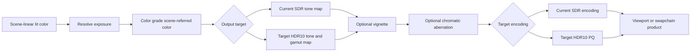

# Renderer Display Pipeline

[Docs](../../../../../../../README.md) / [Up](../PostProcessingDesign.md)

Sections: [Exposure](#exposure) / [Exposure Semantics](#exposure-semantics) / [Tone Mapping](#tone-mapping) / [Presentation And Output](#presentation-and-output).

**Status:** Renderer post-processing feature-family guide

**Scope:** route implemented scene-to-display transforms, admitted first-release display targets, output encoding, and target publication

This family owns the meaning of the pixel after lighting: how scene-linear values are exposed, mapped into a display range, optionally transformed by future looks, encoded, and handed to presentation.

**Current readiness:** historical **23/100** across six described display capabilities; basic vignette is an additional 2026-10-10 target at **0/100**, not an automatic portfolio rescore. In the historical snapshot, exposure, tone mapping, and SDR output are **45/100**; color grading, chromatic aberration, and HDR10 output are admitted **0/100** targets. See [Current Feature Readiness](../../../../../../../Acceptance/CurrentReadiness.md#renderer).

## At A Glance

| Stage | Current state | What readers must not infer |
| --- | --- | --- |
| exposure | implemented source path with manual/automatic state and history | accepted adaptation quality or temporal stability |
| tone mapping | selectable Reinhard, ACES approximation, and ACES fitted source routes | exact standards compliance or calibrated display output |
| color grading | first-release target; not found | tone mapping is not a grading or LUT system |
| vignette | first-release target; not found | scene corner darkening is independent of chromatic displacement; no implementation inferred |
| chromatic aberration | first-release target; not found | generic filtering/reconstruction is not lens simulation |
| output/presentation handoff | implemented SDR-oriented encoding/copy route | accepted color accuracy or HDR support |
| HDR10 display output | first-release target; not found | 10-bit or Linear output alone is not HDR activation |



## Choose By Stage

| Document | Open it for |
| --- | --- |
| [Exposure](#exposure) | luminance measurement, history, manual/automatic exposure, and frame placement |
| [Exposure Semantics](#exposure-semantics) | metering statistics, bounded multiplier equations, temporal response, and provider/display color domains |
| [Tone Mapping](#tone-mapping) | selectable scene-referred HDR to display-linear operators and their limits |
| [Color Grading](ColorGrading/ColorGradingDesign.md) | feature definition, discovery, research, semantics, architecture, experience, and conditional delivery plan |
| [Basic Vignette](Vignette/VignetteDesign.md) | small scene-only mask, neutral-work erasure, settings/viewport ownership and paired-backend proof |
| [Chromatic Aberration](ChromaticAberration/ChromaticAberrationDesign.md) | feature definition, discovery, research, semantics, architecture, experience, and conditional delivery plan |
| [Presentation And Output](#presentation-and-output) | current SDR encoding, back-buffer or viewport publication, and debug handoff |
| [HDR Display Output](HDRDisplayOutput/HDRDisplayOutputDesign.md) | feature definition, discovery, research, semantics, architecture, experience, and conditional delivery plan |

The parent [Post Processing](../PostProcessingDesign.md) dossier owns shared stage order. Each transformation retains a separate input/output and proof contract.

The order is semantic: exposure acts on scene-linear lighting, grading authors the reconstructed scene-referred look, the selected SDR or HDR tone/gamut mapping creates target-linear intent, vignette and then chromatic aberration act before target encoding and UI, and SDR/HDR output paths own their final encoding/publication contracts. Reordering stages requires an explicit color-domain decision, not only a graph edit.

## Exposure

**Status:** current feature dossier and acceptance contract; candidate results remain separate

**Verified:** 2026-10-07 against the exposure repair worktree based on `b4f189a9`; executable evidence is candidate-bound

**Scope:** `REN-POST-01` through `REN-POST-03`; manual and automatic exposure, metering, adaptation, history, per-viewport overrides, and asynchronous scheduling

**Parent family:** [Post Processing](../PostProcessingDesign.md)

**Current readiness:** the portfolio row remains **45/100**; this repair does not promote whole-family, colorimetric, performance, or release acceptance. See [Current Feature Readiness](../../../../../../../Acceptance/CurrentReadiness.md#renderer) and the [`FCR-REN-09` result route](../../../../../../../Acceptance/FeatureCompletionReports.md#initial-completion-report-registry).

### Exposure: At A Glance

| Mode or boundary | Current behavior | Main limitation |
| --- | --- | --- |
| Manual | fixed requested multiplier plus compensation and bounds | requires authored intent; no colorimetric acceptance |
| Automatic / histogram | meters the percentile-trimmed arithmetic mean of luminance bins | fixed log range and quantization; percentiles express a local quality policy |
| Automatic / downsample pyramid | meters the full-frame geometric mean | dark/black regions can drive a high exposure multiplier |
| Adaptation | asymmetric exponential response in log2 multiplier space | rates are inverse seconds; cuts and discontinuities require valid history reset |
| Async scheduling | may run on a capable non-graphics queue | queue assignment does not prove overlap or benefit |

Exposure is measured from pre-debug scene-linear color and resolved per view. Its single multiplier then feeds reconstruction providers and tone mapping, so stale or cross-viewport history can affect several downstream stages even when their own code is correct.

### Feature Promise

Sparkle produces one bounded 1x1 exposure multiplier from resolved per-view settings and the scene-linear lighting result. Exposure is measured before debug visualization can replace scene color, so diagnostic selection does not itself drive eye adaptation.

| Feature | Selector/current choices | Current behavior |
| --- | --- | --- |
| Manual exposure | `r.Exposure.Mode=Manual`, `r.Exposure.Manual`, compensation, min/max | produces a bounded linear multiplier |
| Automatic exposure | `r.Exposure.Mode=Automatic` | meters scene luminance toward target 0.18 by default and applies compensation/bounds |
| Metering | `r.Exposure.MeteringMethod` | `0=Histogram`, `1=DownsamplePyramid`; deliberately different statistics |
| Adaptation | speed-up `3/s`, speed-down `1/s` defaults | history-aware exponential approach to target |
| Scheduling | graph queue preference/capability | may execute on asynchronous compute; useful overlap is unmeasured |

Default exposure is Automatic with Histogram. Default multiplier bounds are `0.000001` and `65536`. Per-viewport overrides can replace mode, method, manual value, compensation, target, bounds, and rates in resolved display settings. [Exposure Semantics](#exposure-semantics) owns equations, finite-value policy, histogram layout/percentiles, history payload, and the end-to-end color-domain ledger.

### Ownership And Frame Placement

- `RenderView` owns resolved display intent for the frame; global settings are not a second runtime authority.
- The exposure pass reads the original scene-linear lighting result after lighting and before reconstruction/upscaling/debug/presentation consumers.
- Current/prior 1x1 textures own adaptation history. Scene/view/topology discontinuities invalidate affected history.
- Exposure is an input to image providers and tone mapping; it does not own either feature.

### Failure, Tradeoffs, And Evidence

- Non-finite settings use engine defaults; finite settings and final adaptation are bounded by the semantic contract. Invalid HDR samples cannot poison metering/history. Camera cuts, resize, and mode/viewport changes still require candidate-bound reset evidence.
- Async scheduling centralizes dependency/barrier ownership in the frame graph, but source presence is not proof of overlap or speedup.
- Automatic metering improves adaptation but adds temporal behavior that can flicker or lag; manual mode is deterministic but requires authored intent.
- `REN-E13` owns controlled luminance steps, camera cuts, resize, viewport overrides, bounds, and adaptation. `REN-E17` separately owns how the resulting value participates in tone mapping.
- The implementation-ledger and bounded checks for `ITER-EXPOSURE-01` are retained locally under `build/exposure-investigation.txt`; results do not replace the broader proof obligations below.

### Acceptance Criteria

- `AC-EXP-01` — Manual mode resolves the requested multiplier plus compensation into the documented min/max range and remains invariant for fixed settings across frames and scheduling modes.
- `AC-EXP-02` — Histogram agrees with an independent CPU bin/CDF reference, and DownsamplePyramid agrees with the finite full-frame geometric mean, within predeclared tolerance for uniform, split, black, bright, NaN/Inf-contaminated, odd-size, and high-dynamic-range fixtures. Their outputs need not match each other.
- `AC-EXP-03` — adaptation follows the declared asymmetric exponential rates in inverse seconds under controlled luminance steps and converges monotonically without overshoot outside tolerance, including multipliers below `0.0001`.
- `AC-EXP-04` — per-viewport overrides resolve once into `RenderView`; two views with different settings do not share or contaminate exposure history.
- `AC-EXP-05` — camera cut, scene/view discontinuity, resize, mode/metering change, and relevant topology generation reset history to the documented first-frame result.
- `AC-EXP-06` — graphics-queue and async-compute execution produce the same exposure/history values and correct dependencies; queue assignment is not called a speedup without measurement.
- `AC-EXP-07` — the exposure producer reads pre-debug scene-linear lighting and supplies exactly one multiplier to provider/tone-mapping consumers; debug-view selection alone does not remeter or reset it.

### Controlled Failure Modes And Checks

| Failure ID | Injection or cause | Required safe behavior | Detecting check |
| --- | --- | --- | --- |
| `FM-EXP-01` | min greater than max, non-finite setting, zero/negative target, or extreme luminance | resolve rejects or clamps by documented policy and never publishes non-finite history | `CHK-EXP-01` |
| `FM-EXP-02` | camera cut/resize/mode/view identity changes without reset | history oracle detects stale adaptation and candidate fails | `CHK-EXP-02` |
| `FM-EXP-03` | async queue unavailable or cross-queue dependency omitted | graph selects supported queue or rejects; no stale/uninitialized exposure reaches consumers | `CHK-EXP-03` |
| `FM-EXP-04` | one viewport changes exposure while another renders concurrently | resolved state/history remain isolated by viewport identity | `CHK-EXP-02` |

| Check | Exercise and oracle | Covers |
| --- | --- | --- |
| `CHK-EXP-01` | CPU/reference evaluation plus 1x1 readback over manual/automatic methods, luminance ramps, invalid/extreme inputs, bounds, compensation, and timestep series | `AC-EXP-01`–`AC-EXP-03`; `FM-EXP-01` |
| `CHK-EXP-02` | dual-viewport temporal sequence over overrides, cuts, resize, mode/metering switches, debug-mode changes, and scene reload | `AC-EXP-04`, `AC-EXP-05`, `AC-EXP-07`; `FM-EXP-02`, `FM-EXP-04` |
| `CHK-EXP-03` | same fixture on graphics and async-compute scheduling with capability unavailable/available, plan/barrier inspection, decoded value comparison, and native validation | `AC-EXP-06`; `FM-EXP-03` |

`REN-E13` owns candidate execution; tolerances, timestep, luminance domain, and first-frame reset value must be declared before results are viewed. Bounded repair checks do not prove concurrent dual-view isolation, every discontinuity, queue overlap, display calibration, or the full release workload.

### Primary Source Routes

- [Exposure Semantics](#exposure-semantics), including NVIDIA/AMD precedent and its limits
- [`ExposureAdaptation.cpp`](../../../../../../../../Engine/Renderer/Private/Passes/PostProcessing/Exposure/ExposureAdaptation.cpp) and [`ViewportDisplaySettings.cpp`](../../../../../../../../Engine/Renderer/Private/View/ViewportDisplaySettings.cpp)
- [`ViewportDisplayCVars.cpp`](../../../../../../../../Engine/Renderer/Private/View/ViewportDisplayCVars.cpp)
- [`RenderViewBuilder.cpp`](../../../../../../../../Engine/Renderer/Private/View/RenderViewBuilder.cpp)

## Exposure Semantics

**Status:** implemented contract; source and numerical evidence have separate owners

**Verified:** 2026-10-07 against the exposure repair worktree based on `b4f189a9`; inspect the candidate report for executable evidence

**Owner:** [Exposure](#exposure); these equations and color-domain rules are authoritative for that feature

### One Scene-Linear Multiplier

Lighting produces scene-linear RGB. Exposure meters that signal before debug visualization, ray reconstruction, or upscaling. It does not multiply the lighting buffers or modify authored lights/materials. Rec.709 luminance uses positive RGB and weights `(0.2126, 0.7152, 0.0722)`.

The producer publishes a 1x1 RGBA32F texture: `(current multiplier, metered luminance, target multiplier, exposure mode)`. Providers and tone mapping consume `.r`; the fourth component tags the history's mode. Both current output and history receive the same payload. There is no pass-specific uniform-buffer payload or CPU exposure-history mirror.

### Settings And Bounds

Renderer resolves global defaults and enabled viewport overrides into the current `RenderView`. Non-finite numeric values use the corresponding engine default before clamping. Manual exposure is non-negative, compensation is limited to `[-16, 16]` stops, target luminance is at least `0.0001`, and adaptation rates are non-negative. Multiplier bounds satisfy `0 <= minimum <= maximum <= 65536`; the upper limit keeps finite RGBA16F scene color within the supported tone curves' arithmetic range.

Let `C = 2^compensation`, `K = target luminance`, `L = metered luminance`, and `[Emin, Emax]` be the resolved multiplier bounds:

```text
manual target    = clamp(manual multiplier * C, Emin, Emax)
automatic target = clamp(K / max(L, 0.0001) * C, Emin, Emax)
```

Manual exposure is a linear multiplier, not an EV100 photographic-camera setting. Compensation is a stop offset for either mode. A zero manual multiplier is valid when the minimum is zero. The luminance floor has luminance units and must never become an exposure floor.

### Metering Methods

`r.Exposure.MeteringMethod=0` selects Histogram, the default. One full-resolution scan builds 512 integer bins: black occupies bin zero; 511 positive bins span log2 luminance `[-16, 16]`. Finite positive samples outside the range use its endpoint bins. Positive bin luminance is evaluated at the midpoint. Invalid RGB pixels are excluded entirely.

Resolve retains the middle 10th through 90th percentiles of valid sample counts. Boundary bins contribute only their fractional overlap with that count interval. The result is the arithmetic mean of retained bin luminances, floored at `0.0001`. Black pixels participate in the distribution; isolated dark regions and extreme highlights cannot dominate the whole-frame statistic. The histogram range covers the current finite RGBA16F lighting target. For uniform luminance at or above the metering floor within that range, midpoint quantization error is at most approximately 2.2%; numerical acceptance declares a 2.3% bound.

`r.Exposure.MeteringMethod=1` selects DownsamplePyramid. Its 2x2 stages sum `(log(max(luminance, 0.0001)), valid sample count)` through ceil-divided extents to 1x1. Out-of-bounds and invalid RGB samples contribute neither log luminance nor count. Resolve computes `exp(sumLog / count)`: the full-frame geometric mean. Dark valid pixels contribute the luminance floor, so a substantial black region can increase exposure significantly. These methods deliberately measure different statistics; equivalence is not a correctness requirement.

An entirely invalid automatic frame retains a valid, bounded prior multiplier. Without valid prior history it uses bounded neutral exposure `1`. A valid all-black image still meters at the luminance floor and resolves the bounded automatic target. This protects exposure state; it does not repair an invalid lighting producer.

Histogram source ownership was reconciled on 2026-10-25. `ExposureHistogram.hlsli` owns sample counting and percentile-weighted average luminance; `ExposureHistogramResolve.hlsl` invokes those operations and publishes the existing log-luminance/valid-count moments. The build kernel retains its group-shared initialization, barriers and atomic publication as one GPU operation. This separation adds no shader records, resources or dispatches and preserves the reduction order and empty-histogram result; it is not metering-quality, native GPU or performance acceptance.

### Temporal Response And History

Manual mode, missing/invalid history, a mode-tag mismatch, or a non-positive/non-finite prior multiplier resolves directly to target. Automatic mode with valid positive history adapts in log2 multiplier space:

```text
rate  = target > previous ? speedUp : speedDown
alpha = 1 - exp(-max(unscaledDeltaSeconds, 0) * rate)
E     = 2^(log2(previous) + (log2(max(target, 1e-20)) - log2(previous)) * alpha)
E     = clamp(E, Emin, Emax)
```

Rates have units of inverse seconds. They are exponential response coefficients, not a fixed EV-per-second velocity. Defaults are `3/s` up and `1/s` down; stored or overridden values remain authoritative. Zero delta or zero rate preserves the prior value within the current bounds. Increasing the linear multiplier means brightening the displayed image. The tiny positive target in the logarithm is numerical protection, not a published minimum.

The existing frame-graph history ring owns GPU lifetime and preceding-frame ordering. View identity, scene/shader/provider generation, graph topology, camera cuts/teleports/projection discontinuities, and resize invalidate history through their current view/graph owners. Changing metering method rebuilds graph settings. Mode changes are rejected by the GPU payload tag without adding generic view state. Ordinary manual values, compensation, targets, bounds, and rates are fresh per-frame parameters.

### Consumers And Transfer Functions

| Boundary | Required domain and behavior | Current source owner |
| --- | --- | --- |
| Material input | Cooked color textures use sRGB views for hardware decoding; scalar/normal data remain linear. Authored factors are unchanged. | Texture cook format policy, Renderer texture factory, material shaders |
| Lighting | Sky, direct/indirect components, and emissive accumulate scene-linear radiance; sky-disabled pixels preserve the initial black clear. | RealTimePathTracer passes and LightingComposite |
| Debug selection | Meter original lighting first; diagnostic replacement then follows its own presentation policy. | SceneRenderingPasses and PresentationPolicy |
| DLSS/DLAA | HDR input, tagged engine 1x1 exposure, provider auto exposure disabled, pre-exposure/exposure-scale defaults `1`; output remains in the original HDR domain. | StreamlineDlssOptions, resource tags, evaluation |
| Ray reconstruction | Same engine exposure texture and HDR convention; no second application of exposure in Renderer. | Streamline ray-reconstruction options/tags/evaluation |
| Tone mapping | Multiply resolved HDR by `.r` exactly once, then apply Reinhard, ACES approximation, or ACES filmic fit. Output is display-linear RGBA16F. | ToneMapping pass/shader |
| Encoding/presentation | Encode sRGB in the output shader for a linear UNorm swapchain, or leave linear for hardware sRGB conversion. Explicit output-encoding selection remains an override. The encoded intermediate is stored in a linear format. | OutputEncoding and presentation/UI backend |

The current pipeline does not pre-expose the lighting buffers. If that domain changes, metering must undo pre-exposure and every provider/tone-mapping consumer must be reconciled together. An exposure texture is a scale input for reconstruction, not proof that its output has already been exposed.

### Primary Precedent And Local Decisions

- [NVIDIA Donut exposure shader](https://github.com/NVIDIA-RTX/Donut/blob/main/shaders/passes/exposure_cs.hlsl) uses histogram percentile selection, a retained arithmetic luminance statistic, bounded adaptation, and a separate tone-mapping consumer. Sparkle's 10%-90% policy, midpoint bins, fractional boundary weights, and multiplier history are local decisions; they are not Donut's defaults or payload.
- [AMD FSR2 luminance pyramid](https://github.com/GPUOpen-Effects/FidelityFX-FSR2/blob/master/src/ffx-fsr2-api/shaders/ffx_fsr2_compute_luminance_pyramid.h) measures log luminance after undoing pre-exposure and uses a delta-time exponential response. Its photographic exposure conversion is not substituted for Sparkle's declared target-luminance multiplier.
- [NVIDIA Streamline DLSS guide](https://github.com/NVIDIA-RTX/Streamline/blob/main/docs/ProgrammingGuideDLSS.md) and [ray-reconstruction guide](https://github.com/NVIDIA-RTX/Streamline/blob/main/docs/ProgrammingGuideDLSS_RR.md) define the HDR/exposure tags and pre-exposure conventions. Check the pinned SDK in the build for the candidate's actual defaults and supported options.

### Source Routes

- [Exposure passes](../../../../../../../../Engine/Renderer/Private/Passes/PostProcessing/Exposure/ExposurePasses.cpp), [histogram declaration](../../../../../../../../Engine/Renderer/Private/Passes/PostProcessing/Exposure/ExposureMeteringPasses.cpp), and [adaptation parameters](../../../../../../../../Engine/Renderer/Private/Passes/PostProcessing/Exposure/ExposureAdaptation.cpp)
- [Histogram math](../../../../../../../../Engine/Assets/Shaders/Passes/PostProcessing/Exposure/ExposureHistogram.hlsli), [histogram resolve](../../../../../../../../Engine/Assets/Shaders/Passes/PostProcessing/Exposure/ExposureHistogramResolve.hlsl), [shared exposure math](../../../../../../../../Engine/Assets/Shaders/Display/Exposure.hlsli), and [history resolve](../../../../../../../../Engine/Assets/Shaders/Passes/PostProcessing/Exposure/Exposure.hlsl)
- [View settings resolution](../../../../../../../../Engine/Renderer/Private/View/ViewportDisplaySettings.cpp) and [frame placement](../../../../../../../../Engine/Renderer/Private/Passes/Scene/SceneRenderingPasses.cpp)
- [Tone mapping](../../../../../../../../Engine/Assets/Shaders/Passes/Presentation/Display/ToneMapping.hlsl) and [output encoding](../../../../../../../../Engine/Renderer/Private/Passes/Presentation/Display/OutputEncoding.cpp)

## Tone Mapping

**Status:** current feature dossier; source-backed, not numerical, colorimetric, display, backend, or release evidence

**Verified:** 2026-09-19 against source input revision `a884b6946802e933fafc9fe4c6cdfb93c4cde7e4` plus the current frame-composition worktree; evidence `S` only

**Scope:** `REN-POST-07`; exposure-weighted HDR scene-referred color to display-linear color through one selected tone-mapping operator

**Parent family:** [Post Processing](../PostProcessingDesign.md)

**Current readiness:** **45/100** — three selectable tone operators exist in the integrated display path; numeric/colorimetric, extreme, alpha, backend, exact-domain, and visual proof remains open. See [Current Feature Readiness](../../../../../../../Acceptance/CurrentReadiness.md#renderer).

### Tone Mapping: At A Glance

| Operator | Intended role | Current proof boundary |
| --- | --- | --- |
| Reinhard | simple compressive reference curve | numeric implementation, highlight behavior, and backend agreement unproved |
| ACES approximation | default ACES-inspired display mapping | name does not establish standards conformance |
| ACES fitted filmic | alternate fitted filmic curve | output/colorimetric agreement and artistic suitability unproved |

For a scene-referred HDR mode, exactly one operator consumes exposure-weighted HDR scene color and produces display-linear `ToneMappedSceneColor`. Display-linear exact debug modes bypass this pass through the presentation owner. The admitted color-grading stage will supply graded scene-referred input before this operator; output-device encoding and publication happen later. Grading remains absent from current source and is never folded into these curves.

### Tone Mapping: Feature Promise

Sparkle multiplies output-extent `ResolvedSceneColor` by the current 1x1 exposure value and applies exactly one selected operator into `ToneMappedSceneColor`. The result remains display-linear; [Presentation and Output](#presentation-and-output) owns later transfer encoding and publication.

| Selector | Default | Reachable choices | Current boundary |
| --- | --- | --- | --- |
| `r.ToneMapper` / resolved per-view `EngineToneMapper` | ACES approximation | Reinhard, ACES approximation, ACES fitted filmic | no public None or custom operator; exact-view bypass is presentation policy, not a tone operator |

The shader clamps alpha with `saturate` while mapping RGB. Current source does not establish reference-ACES conformance, working/display gamut transforms, scene-white/nit semantics, artistic grading, or exact curve accuracy.

### Tone Mapping: Ownership And Frame Placement

- `RenderView` owns the resolved per-view tone-mapper intent; the tone-mapping pass binds it when that pass is scheduled.
- Tone mapping consumes resolved scene color after reconstruction/upscaling for scene-referred HDR modes. The presentation owner omits it for display-linear exact modes.
- Exposure is multiplied in the tone-mapping shader, but [Exposure](#exposure) owns metering and temporal adaptation.
- Tone mapping is not color grading: no grading controls, grading stack, or LUT is applied in current source, and the target stage remains a distinct pre-tone owner.
- Output encoding is a separate pass and remains the only owner of Linear/sRGB transfer selection.

### Tone Mapping: Failure, Tradeoffs, And Evidence

- Unknown enum values are fatal settings defects rather than silent substitutions.
- One operator boundary keeps lighting and provider routes from inventing their own display transforms; exact raw debug presentation is an exhaustive presentation-domain decision rather than a fourth tone operator.
- `REN-E17` owns known HDR ramps, finite/extreme input behavior, all three operators, alpha behavior, and interaction with exposure/output encoding.
- Stable numerical and color-domain obligations are defined below; execution remains pending.

### Tone Mapping: Acceptance Criteria

- `AC-TMO-01` — Reinhard, ACES approximation, and ACES fitted filmic match a pinned CPU/reference implementation over black, gray, primary, negative, HDR ramp, and extreme finite inputs within declared precision.
- `AC-TMO-02` — exposure is multiplied exactly once before the selected curve; changing exposure produces the reference result and no provider/debug/presentation stage duplicates it.
- `AC-TMO-03` — output is `R16G16B16A16_Float` display-linear RGB at output extent; output encoding and color grading are not performed in this pass.
- `AC-TMO-04` — alpha follows the documented saturated-input policy independently of RGB, including negative, unit, greater-than-one, NaN, and Inf cases.
- `AC-TMO-05` — unknown selector values fail settings/graph resolution; all three valid operators are reported as requested/active per view with no silent substitution.
- `AC-TMO-06` — D3D12 and Vulkan decoded outputs agree within the predeclared numeric tolerance for every operator/exposure case.

### Tone Mapping: Controlled Failure Modes And Checks

| Failure ID | Injection or cause | Required safe behavior | Detecting check |
| --- | --- | --- | --- |
| `FM-TMO-01` | invalid operator enum | resolve rejects before dispatch and identifies the invalid value | `CHK-TMO-02` |
| `FM-TMO-02` | NaN/Inf/extreme RGB or alpha | output follows the predeclared finite/non-finite policy; no unclassified value is accepted | `CHK-TMO-01` |
| `FM-TMO-03` | exposure or output transfer is accidentally applied twice | reference chain comparison fails at the first incorrect stage | `CHK-TMO-01`, `CHK-TMO-03` |
| `FM-TMO-04` | backend shader/compiler result exceeds tolerance | affected backend/operator cell remains Pending/Blocked with raw artifacts | `CHK-TMO-03` |

| Check | Exercise and oracle | Covers |
| --- | --- | --- |
| `CHK-TMO-01` | deterministic shader readback against pinned CPU curves over operator × exposure × RGB/alpha vectors | `AC-TMO-01`–`AC-TMO-04`; `FM-TMO-02`, `FM-TMO-03` |
| `CHK-TMO-02` | selector/per-view test over every valid operator plus invalid value and dual-viewport choices | `AC-TMO-05`; `FM-TMO-01` |
| `CHK-TMO-03` | paired-backend raw display-linear readback followed by separate encoding verification | `AC-TMO-02`, `AC-TMO-03`, `AC-TMO-06`; `FM-TMO-03`, `FM-TMO-04` |

This contract is **defined but unproved**. It does not claim reference ACES color management; evidence must name the exact approximation implemented and compare the unencoded display-linear product.

### Tone Mapping: Primary Source Routes

- [`ToneMapping.hlsl`](../../../../../../../../Engine/Assets/Shaders/Passes/Presentation/Display/ToneMapping.hlsl)
- [`ToneMapping.hlsli`](../../../../../../../../Engine/Assets/Shaders/Display/ToneMapping.hlsli)
- [`ViewportDisplaySettings.cpp`](../../../../../../../../Engine/Renderer/Private/View/ViewportDisplaySettings.cpp)
- [`ToneMapping.cpp`](../../../../../../../../Engine/Renderer/Private/Passes/Presentation/Display/ToneMapping.cpp) and [`PresentationPasses.cpp`](../../../../../../../../Engine/Renderer/Private/Passes/Presentation/PresentationPasses.cpp)

## Presentation And Output

**Status:** current feature dossier; source-backed, not colorimetric, numerical, display, capture, backend, or release evidence

**Verified:** 2026-09-19 against source input revision `a884b6946802e933fafc9fe4c6cdfb93c4cde7e4` plus the current frame-composition worktree; evidence `S` only

**Scope:** `REN-POST-08` and `REN-POST-10`; debug-to-presentation handoff, current SDR output encoding, back-buffer copy, and viewport-product publication. `REN-POST-09` HDR output has its own dossier.

**Current readiness:** **45/100** for current SDR output. [HDR Display Output](HDRDisplayOutput/HDRDisplayOutputDesign.md) is a separately tracked first-release target at **0/100**. Encoding/format, resize/DPI, capture interpretation, backend present, and artifact proof remains open. See [Current Feature Readiness](../../../../../../../Acceptance/CurrentReadiness.md#renderer).

### Presentation And Output: At A Glance

| Destination or transform | Current result | Important boundary |
| --- | --- | --- |
| output encoding | display-linear color becomes the selected Linear or sRGB-oriented encoded result | this is transfer encoding, not grading or HDR display management |
| game/host back buffer | encoded output is copied into the acquired presentation target | RHI owns acquire/present mechanics and format capability |
| editor viewport | final color becomes a typed viewport product and registered texture generation | product/generation must match the UI packet and viewport |
| debug result | presentation resolves scene-referred HDR or display-linear exact from the selected mode | exact diagnostics bypass exposure/tone mapping but retain output encoding |
| HDR display | separately admitted target, currently absent | [HDR Display Output](HDRDisplayOutput/HDRDisplayOutputDesign.md) owns discovery of the surface/color-space/metadata policy, display policy, fallback, and proof contract |

This stage is the semantic handoff from Renderer image processing to an external consumer. A visible image is not enough: the destination, encoding, extent, alpha, frame, viewport, and generation must all identify the product that was actually published.

**Parent family:** [Post Processing](../PostProcessingDesign.md); [Tone Mapping](#tone-mapping) owns the scene-referred HDR-to-display-linear transform

### Presentation And Output: Feature Promise

Sparkle accepts one output-extent display-linear result from the presentation-domain owner, applies one output encoding, then copies it to the imported back buffer or publishes an offscreen viewport product. Scene-referred HDR passes through tone mapping; display-linear exact diagnostics bypass it.

```text
ResolvedSceneColor
  -> Display Mapping (tone map HDR / preserve exact display-linear)
  -> Output Encoding
  -> back-buffer copy or FinalColorLdr viewport product
```

| Stage | Choices | Current boundary |
| --- | --- | --- |
| Debug handoff | Lit or one of 15 diagnostic modes | [Debug Views](../../DebugViews/DebugViewsDesign.md) owns the producer and presentation-domain classification; exact views use point reconstruction and HDR views retain configured reconstruction |
| Output encoding | Automatic from output format, Linear, sRGB shader encoding | writes the linear counterpart of the presentation format before copy/publication |
| HDR display | no current route | mandatory HDR target and SDR fallback are defined in [HDR Display Output](HDRDisplayOutput/HDRDisplayOutputDesign.md), with the exact platform route discovery-blocked |

The current source implements the [Debug View Presentation Architecture](../../DebugViews/DebugViewsDesign.md#debug-view-presentation-architecture) split between scene-referred HDR and display-linear exact products. Runtime pixels, numerical behavior, backend agreement, and capture interpretation remain unproved, so `REN-POST-10` remains Partial.

### Output Ownership

- Viewport ID 0 imports the presentable back buffer and copies encoded color into it.
- Nonzero viewport requests retain `FinalColorLdr`; `SceneDepth` and `Normals` may also be exported as viewport products.
- Product identity carries viewport-request generation, extent, and format. Capture provenance remains incomplete for shader/graph generation and requested-versus-resolved product/color interpretation.
- UI composition happens after graph execution and is owned by [UI and Viewport Composition](../../ViewportAndDiagnostics/ViewportAndDiagnosticsDesign.md#ui-and-viewport-composition), not by the color-conversion passes.
- Frame generation is absent; one executed render frame leads to the normal submission/present route without a generated-frame owner.

### Presentation And Output: Failure, Tradeoffs, And Evidence

- Invalid encoding selection, unsupported HDR request, wrong format pairing, double encoding, clipping, NaN/Inf, and stale output identity must be visible failures.
- One presentation owner prevents each lighting/provider path from inventing a color pipeline and owns the exact diagnostic bypass explicitly.
- `REN-E17` owns numerical mapper/encoding combinations; `REN-E18` owns debug presentation; `RHI-E04` and `RHI-E12` own format and present behavior. The feature-local contract is defined below.

### Presentation And Output: Acceptance Criteria

- `AC-OUT-01` — Automatic, Linear, and sRGB choices resolve deterministically from the selected output format and encode a pinned display-linear ramp exactly once within declared tolerance.
- `AC-OUT-02` — the output-encoding target uses the required linear-format counterpart and the final copy/publication preserves channel order, alpha policy, dimensions, and viewport rectangle.
- `AC-OUT-03` — viewport 0 reaches the imported presentable back buffer; nonzero viewports publish generation-bound final color and requested depth/normal products without cross-viewport or stale-generation reuse.
- `AC-OUT-04` — resize, minimize/restore, output-format change, viewport destruction/recreation, and scene reload rebuild/invalidate the right products and never present a stale prior image as current.
- `AC-OUT-05` — SDR/Linear encoding is never advertised as HDR display support; HDR requested/active/fallback behavior delegates to `AC-HDR-*` and cannot bypass the HDR dossier.
- `AC-OUT-06` — scene-referred HDR debug modes receive exposure/tone mapping exactly once; display-linear exact modes bypass both; every mode receives output encoding exactly once.
- `AC-OUT-07` — D3D12 and Vulkan decoded back-buffer/offscreen products agree with the numerical oracle and produce no uncategorized native presentation/format validation issue.

### Presentation And Output: Controlled Failure Modes And Checks

| Failure ID | Injection or cause | Required safe behavior | Detecting check |
| --- | --- | --- | --- |
| `FM-OUT-01` | invalid encoding or incompatible format pair | graph/settings resolution rejects before copy/present and names both values | `CHK-OUT-01` |
| `FM-OUT-02` | stale viewport/product generation after resize/recreate | product/draw/capture is refused or retired; stale image is not current output | `CHK-OUT-02` |
| `FM-OUT-03` | minimize/zero extent or unavailable back buffer | no out-of-bounds dispatch/copy occurs; recovery rebuilds on valid extent | `CHK-OUT-02` |
| `FM-OUT-04` | NaN/Inf/extreme display-linear input or double encoding | numerical check exposes the declared policy or fails the candidate | `CHK-OUT-01` |
| `FM-OUT-05` | SDR/Linear route or partial HDR plumbing is advertised as complete HDR | cross-dossier selector/source/package audit rejects the support claim | `CHK-OUT-03` |

| Check | Exercise and oracle | Covers |
| --- | --- | --- |
| `CHK-OUT-01` | shader/copy readback of known ramps over encoding × output-format × alpha/extreme-value cells | `AC-OUT-01`, `AC-OUT-02`, `AC-OUT-07`; `FM-OUT-01`, `FM-OUT-04` |
| `CHK-OUT-02` | swapchain and two offscreen viewports through resize, zero extent, minimize/restore, format change, destruction/recreation, reload, and capture | `AC-OUT-03`, `AC-OUT-04`; `FM-OUT-02`, `FM-OUT-03` |
| `CHK-OUT-03` | inspect selectors, package/runtime UI, debug captures, and documentation for exact-debug and SDR claims; route all HDR state/evidence to `CHK-HDR-*` | `AC-OUT-05`, `AC-OUT-06`; `FM-OUT-05` |
| `CHK-OUT-04` | paired D3D12/Vulkan presentation/offscreen run with decoded artifacts and native validation | `AC-OUT-02`, `AC-OUT-03`, `AC-OUT-07` |

This contract is **source-present but unproved**. Passing source checks does not close `REN-POST-10`, separate `REN-POST-09`/`FCR-REN-26` HDR output, or runtime/backend acceptance.

### Presentation And Output: Primary Source Routes

- [`PresentationPasses.cpp`](../../../../../../../../Engine/Renderer/Private/Passes/Presentation/PresentationPasses.cpp), [`ToneMapping.cpp`](../../../../../../../../Engine/Renderer/Private/Passes/Presentation/Display/ToneMapping.cpp), and [`OutputEncoding.cpp`](../../../../../../../../Engine/Renderer/Private/Passes/Presentation/Display/OutputEncoding.cpp)
- [`SceneRenderingPasses.cpp`](../../../../../../../../Engine/Renderer/Private/Passes/Scene/SceneRenderingPasses.cpp) and [`PresentationPasses.cpp`](../../../../../../../../Engine/Renderer/Private/Passes/Presentation/PresentationPasses.cpp)
