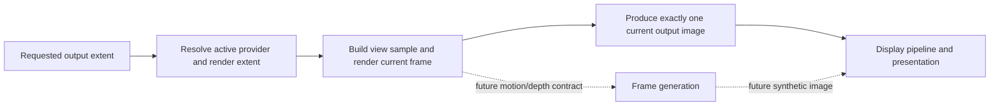

# Renderer Reconstruction And Generation

[Docs](../../../../../../../README.md) / [Up](../PostProcessingDesign.md)

Sections: [Resolution, Sampling, And Anti-Aliasing](#resolution-sampling-and-anti-aliasing) / [Image Reconstruction And Upscaling](#image-reconstruction-and-upscaling) / [Frame Generation](#frame-generation).

**Status:** Renderer post-processing feature-family guide

**Scope:** route resolution reconstruction/upscaling and the independently absent generated-frame capability

This family separates *where the frame is sampled*, *how one current output image is reconstructed*, and *whether new display frames are synthesized*. Those are different products and must never share a vague “upscaling” claim.

**Current readiness:** **27/100** across described capabilities — reconstruction/upscaling and resolution/sampling are **40/100**; frame generation is **0/100**. See [Current Feature Readiness](../../../../../../../Acceptance/CurrentReadiness.md#renderer).

## At A Glance

| Capability | Current state | Key limitation |
| --- | --- | --- |
| render/output extent and temporal samples | explicit extents plus Halton view jitter; active attachments remain single-sample | no dynamic-resolution controller, Renderer MSAA, or standalone TAA/FXAA/SMAA |
| linear reconstruction | implemented source path | quality, scale range, temporal behavior, and cost unproved |
| DLSS Super Resolution / Ray Reconstruction | optional capability-gated D3D12 provider path | vendor/runtime/hardware/package prerequisites and no Vulkan route |
| frame generation | not implemented | no synthetic-frame product, interpolation inputs, pacing, or UI/presentation policy |



## Choose By Question

| Document | Open it for |
| --- | --- |
| [Resolution, Sampling, And Anti-Aliasing](#resolution-sampling-and-anti-aliasing) | output/render extents, sample policy, provider selection, resize invalidation, and explicit absent AA/dynamic-resolution modes |
| [Image Reconstruction And Upscaling](#image-reconstruction-and-upscaling) | linear and provider-backed reconstruction, extent/history contracts, readiness, fallback, and output identity |
| [Frame Generation](#frame-generation) | explicit negative capability boundary and the additional pacing, latency, UI, provenance, and presentation obligations |

Reconstruction produces one resolved image for the submitted frame. Frame generation would create additional presented frames and cannot be inferred from an upscaler or latency provider. The parent [Post Processing](../PostProcessingDesign.md) dossier owns shared stage order.

The one-current-image invariant protects presentation, capture, history, and latency identity. A future frame generator must introduce a separately named synthetic product rather than hiding interpolation inside reconstruction.

## Resolution, Sampling, And Anti-Aliasing

**Status:** current cross-feature dossier; source-backed, not image-quality, temporal-stability, backend, performance, or release evidence

**Verified:** 2026-09-07 at committed `master` revision `c28b33bd`

**Scope:** `REN-RESO-01` through `REN-RESO-07`; output/render extent ownership, viewport/scissor, provider quality resolution, temporal sample policy, attachment sample count, resize/history behavior, and explicit absent anti-aliasing/dynamic-resolution modes

**Related owners:** [Temporal Sampling and History](../../FrameExecution/TemporalSamplingAndHistory.md) owns jitter/history semantics; [Image Reconstruction and Upscaling](#image-reconstruction-and-upscaling) owns Linear/DLSS/RR evaluation; [Presentation and Output](../DisplayPipeline/DisplayPipelineDesign.md#presentation-and-output) owns the final target

**Current readiness:** **40/100** — output/render extent and temporal jitter paths exist; Renderer MSAA, standalone TAA/FXAA/SMAA, and dynamic resolution are **0/100**, and executable extent/reset/provider proof is absent. See [Current Feature Readiness](../../../../../../../Acceptance/CurrentReadiness.md#renderer).

### Resolution, Sampling, And Anti-Aliasing: At A Glance

| Concept | Current state | Must not be conflated with |
| --- | --- | --- |
| output extent | requested/published final image dimensions | internal render extent |
| render extent | resolved from output plus active reconstruction provider/quality | a dynamic-resolution controller |
| temporal sample | deterministic Halton jitter carried by view/history identity | a complete standalone TAA feature |
| attachment samples | active Renderer attachments are single-sample | RHI sample-count vocabulary or Renderer MSAA |
| reconstruction | Linear or eligible provider produces one output-extent image | frame generation |
| anti-aliasing modes | no standalone TAA, FXAA, or SMAA route found | incidental filtering or temporal provider behavior |

Keeping these concepts separate makes resize, capture, motion, provider selection, and cost interpretable. It also prevents dormant helper/API vocabulary from becoming an accidental feature claim.

### Feature Promise And Motivation

For each view, Renderer resolves one output extent and one render extent before graph materialization, constructs view/raster state on that pixel grid, applies one shared temporal sample policy, and produces exactly one output-extent scene color through the selected image-provider route.

This contract prevents four different concepts from being conflated:

- viewport/output size;
- internal render size;
- spatial/temporal reconstruction provider and quality mode;
- raster attachment sample count and anti-aliasing method.

`NativeAA` is a DLSS quality selection, not proof of a generic TAA implementation. An RHI enum admitting sample counts 2/4/8 is not proof that Renderer creates multisampled targets, uses multisample shaders, or resolves MSAA.

### Current Resolution Trace

```text
viewport request extent when valid, otherwise window extent
  -> OutputExtent
  -> choose image pipeline from lighting/reconstruction state
  -> active provider resolves RenderExtent
       no external provider / Linear: RenderExtent = OutputExtent
       DLSS SR or RR: provider queries/stores supported optimal extent
  -> graph topology/resources + RenderView viewport/scissor
  -> Halton jitter normalized by RenderExtent
  -> GBuffer/lighting/history at render extent
  -> exactly one Linear, DLSS SR, or DLSS RR result at OutputExtent
  -> tone/output/product or swapchain presentation
```

Invalid output or provider extents must not produce divided-by-zero jitter or a partially materialized graph. A provider, extent, lighting, shader, or topology change invalidates common/provider history and replaces graph resources by generation/completion rules.

### Current Mode Matrix

| Requested route | Render extent | Sampling/AA meaning | Active/fallback boundary |
| --- | --- | --- | --- |
| Linear | output extent | single-sample raster plus active Halton camera jitter; Linear resolves/copies the current scene result | internal baseline; no separate resolution-scale selector found |
| NVIDIA DLSS SR `NativeAA` | provider-selected extent, expected native/output-sized when provider accepts it | vendor reconstruction quality mode using shared temporal inputs | D3D12/SDK/adapter/interposer gated; initialization failure resolves to Linear |
| NVIDIA DLSS SR Quality/Balanced/Performance/UltraPerformance | provider optimal internal extent | vendor temporal upscaling/reconstruction | requested mode is not active evidence; actual extent/provider must be reported |
| NVIDIA DLSS RR | equal render-extent input/output using the provider's NativeAA mode | vendor lighting denoising produces a render-resolution intermediate | unavailable/unsupported resolves Off; selected Linear/DLSS SR quality independently owns render-to-output resolution conversion |
| RHI sample counts 2/4/8 | vocabulary supported by neutral texture/pipeline validation | potential multisample resource/pipeline contract only | no current Renderer pass/selector/end-to-end resolve route found |
| MSAA jitter helper | source-only 8-sample offset table | temporal sample vocabulary only | active `RenderViewState` hard-codes Halton; helper is not selected |

### Ownership, State, And Invalidation

| Concern | Owner | Required identity |
| --- | --- | --- |
| output extent | viewport request or window fallback in `FramePipeline` | viewport/window generation and exact width/height |
| render extent | image-provider stack and active provider | provider kind/quality/readiness plus output extent |
| graph resources | frame-graph settings/topology generation | render/output extent, format, provider/lighting route |
| viewport/scissor | `RenderViewBuilder`/RHI raster state | current render target extent and view |
| jitter | `RenderViewState` | view identity, render extent, temporal sample index and history validity |
| denoised lighting result | optional DLSS RR | one `DenoisedSceneColor` at render extent |
| presentation-resolution result | selected DLSS SR or Linear | one `ResolvedSceneColor` at output extent |
| presentation/product | output/presentation owners | output extent, target/product generation, format and encoding |

A resize or any change that modifies the resolved extents/provider/topology invalidates common temporal and provider history before incompatible consumers. Old graph/provider resources retire after their last real queue use. Per-view state cannot silently borrow another viewport's extent or history.

### Explicit Negative Boundaries

- No Renderer selector or active end-to-end path was found for MSAA, an MSAA resolve, alpha-to-coverage as a product mode, FXAA, SMAA, or a standalone engine TAA pass.
- No frame-time controller, target-frame-budget policy, automatic resolution scaler, min/max percentage, hysteresis, or dynamic-resolution telemetry was found.
- The active temporal sample path is the 16-frame Halton sequence. Jitter alone is not anti-aliasing; the consumer that reconstructs samples and its history behavior must be named.
- Single-sample Renderer attachments may be represented by the default `sampleCount = 1`; frame-graph/pipeline compatibility code accepting other counts is infrastructure, not feature reachability.
- External provider support remains backend/adapter/SDK/driver/interposer gated and does not establish Vulkan parity.

### Acceptance Criteria

- `AC-RESO-01` — valid swapchain/offscreen viewport requests resolve the exact declared output extent; invalid requests use the documented window fallback or reject without a partial graph.
- `AC-RESO-02` — every Linear/DLSS SR/DLSS RR quality cell reports requested provider/mode, active provider/mode, output extent, actual render extent, reason/fallback, and graph/provider generation.
- `AC-RESO-03` — graph resources, viewport, scissor, dispatch dimensions, history resources, provider tags, resolved output, capture metadata, and presentation target agree on their declared render/output extent for unity, odd, one-pixel, resize and supported ratio cases.
- `AC-RESO-04` — Halton jitter uses the actual render extent and shared sign/unit convention; resize/provider/topology changes invalidate all incompatible common and provider history before consumption.
- `AC-RESO-05` — current Renderer raster attachments and pipeline materialization remain sample-count compatible and truthfully report the active single-sample path.
- `AC-RESO-06` — RHI 2/4/8 sample vocabulary and source-only MSAA jitter cannot be selected or advertised as Renderer MSAA until multisampled resources, compatible shaders/pipelines, depth/material semantics, resolve/order, selectors, diagnostics, fallback and evidence exist.
- `AC-RESO-07` — standalone TAA/FXAA/SMAA and dynamic resolution remain explicit not-found cells until a real owner, selector, algorithm/state, quality/cost contract, failure behavior and evidence route exist.

### Controlled Failure Modes And Checks

| Failure ID | Injection or cause | Required safe behavior | Detecting check |
| --- | --- | --- | --- |
| `FM-RESO-01` | zero/invalid/overflowing or rapidly changing extent | graph refuses/rebuilds safely; jitter remains finite/zero as declared; no stale product is published | `CHK-RESO-01`, `CHK-RESO-03` |
| `FM-RESO-02` | provider returns invalid/unsupported extent or requested quality falls back | named active state/fallback; no provider claim and no mixed-extent graph | `CHK-RESO-02` |
| `FM-RESO-03` | pass/resource/dispatch/capture uses output extent where render extent is required, or inverse | dimensional oracle detects mismatch before candidate acceptance | `CHK-RESO-01` |
| `FM-RESO-04` | resize/provider switch retains incompatible history | first changed frame marks history invalid and provider reset | `CHK-RESO-03` |
| `FM-RESO-05` | multisample resource/pipeline mismatch or implicit resolve assumption | graph/pipeline validation rejects; active mode remains single-sample | `CHK-RESO-04` |
| `FM-RESO-06` | dormant sample/AA/dynamic-resolution vocabulary becomes selectable or documented as active | capability/selector audit fails until independently owned and proved | `CHK-RESO-05` |

| Check | Cheapest claim-falsifying exercise | Covers |
| --- | --- | --- |
| `CHK-RESO-01` | graph/resource/dispatch/product dimensional ledger for unity, odd, minimum, resize and supported provider ratios | `AC-RESO-01`, `AC-RESO-03`; `FM-RESO-01`, `FM-RESO-03` |
| `CHK-RESO-02` | provider/backend/quality/readiness matrix recording requested/active states and actual extents | `AC-RESO-02`; `FM-RESO-02` |
| `CHK-RESO-03` | resize and provider/quality/topology churn with exact jitter/history/reset/generation observations | `AC-RESO-03`, `AC-RESO-04`; `FM-RESO-01`, `FM-RESO-04` |
| `CHK-RESO-04` | enumerate all Renderer attachment descriptions and materialized raster pipelines; assert equal active sample counts and exercise an injected mismatch | `AC-RESO-05`, `AC-RESO-06`; `FM-RESO-05` |
| `CHK-RESO-05` | enumerate public settings/CVars/UI, graph routes, passes/shaders, sample-count writes and jitter-pattern selectors | `AC-RESO-06`, `AC-RESO-07`; `FM-RESO-06` |

This contract is **defined but unproved**. A provider returning an extent, a temporally stable screenshot, or RHI sample vocabulary does not prove resolution correctness, anti-aliasing quality, or performance.

Primary evidence destination: `REN-E33` in the [Capability Evidence Plan](../../../../../CapabilityEvidencePlan.md#renderer-capability-to-evidence-map).

### Primary Source Routes

- [`FramePipelineGraph.cpp`](../../../../../../../../Engine/Renderer/Private/Frame/FramePipelineGraph.cpp)
- [`RendererImageProviderStack.cpp`](../../../../../../../../Engine/Renderer/Private/Providers/RendererImageProviderStack.cpp)
- `Engine/Renderer/Private/Upscaling`, `RayReconstruction`, and `Streamline`
- [`RenderViewState.cpp`](../../../../../../../../Engine/Renderer/Private/View/RenderViewState.cpp) and [`TemporalJitterPatterns.cpp`](../../../../../../../../Engine/Renderer/Private/Temporal/TemporalJitterPatterns.cpp)
- `Engine/Renderer/Private/FrameGraph`, `Engine/Renderer/Private/Passes`, and RHI resource/pipeline sample-count contracts

## Image Reconstruction And Upscaling

**Status:** current feature dossier; source-backed, not provider validation, visual-quality, latency, performance, packaging, or release evidence

**Verified:** 2026-09-06 against source revision `d236da11`; `Engine/Renderer` is unchanged from the earlier `8414b5dc` source audit

**Scope:** `REN-POST-04` through `REN-POST-06`; render-to-output extent resolution through Linear upscale, NVIDIA DLSS Super Resolution, or NVIDIA DLSS Ray Reconstruction

**Current readiness:** **40/100** — Linear plus capability-gated DLSS SR/RR routes exist; requested/active/provider truth, inputs, failure, package, temporal quality, latency, and memory evidence remains open. See [Current Feature Readiness](../../../../../../../Acceptance/CurrentReadiness.md#renderer).

**Release amendment, 2026-10-10:** [Required rendering closure](../../../../../../../Acceptance/FirstRelease.md#required-rendering-closure) makes SR and RR Included on both APIs for the named machine. At source `93e86b81`, `StreamlineRuntimeSupport::Initialize`/interop eligibility still accept D3D12 only and set `eD3D12`; Vulkan texture-tagging helpers alone cannot satisfy this requirement. The historical source matrix below is not release disposition. Vulkan startup/evaluation and complete paired input/lifecycle/quality/package proof remain delivery work.

Use the official pinned Streamline `v2.11.1` [SR guide](https://github.com/NVIDIA-RTX/Streamline/blob/v2.11.1/docs/ProgrammingGuideDLSS.md) and [RR guide](https://github.com/NVIDIA-RTX/Streamline/blob/v2.11.1/docs/ProgrammingGuideDLSS_RR.md), retrieved 2026-10-10, with installed headers: device registration, frame/viewport identity, optimal extent, input tags/constants, guide semantics, state restoration and resource release are implementation questions, not SDK-presence proof. RR documentation describes a denoised output at output resolution; freeze whether the local NativeAA-denoise-then-SR composition meets the pinned contract before treating it as complete. Do not copy guide snippets into native/public API policy or assume every optional SDK input applies to the admitted scene domain.

### Image Reconstruction And Upscaling: At A Glance

| Active producer | Eligibility | Output contract | Main limitation |
| --- | --- | --- | --- |
| Linear | built-in selectable route | one current-frame `ResolvedSceneColor` at output extent | filter/edge/alpha quality and scale range unproved |
| DLSS Super Resolution | D3D12 plus built/runtime/device/interposer/provider readiness | one reconstructed current-frame output from color, depth, motion, exposure, camera, and extent tags | vendor/hardware/package constraints and no Vulkan route |
| DLSS Ray Reconstruction | D3D12 provider readiness plus ReSTIR-specific guides | optional render-resolution `DenoisedSceneColor` consumed by the selected presentation upscaler | mode/guide restrictions and quality/history proof open |

Only the selected presentation upscaler may own `ResolvedSceneColor` for a frame. Ray Reconstruction owns a separate render-resolution `DenoisedSceneColor`; it composes before Linear or DLSS Super Resolution instead of replacing either. Selected vendor initialization or evaluation failure is fatal and preserves the requested selection. Linear and RR Off are explicit user choices; they are not automatic recovery paths.

**Parent family:** [Post Processing](../PostProcessingDesign.md)

Cross-feature resolution/sample contract: [Resolution, Sampling, and Anti-Aliasing](#resolution-sampling-and-anti-aliasing). This dossier owns provider evaluation and output identity; it does not promote RHI sample-count or jitter vocabulary into a separate AA feature.

### Feature Promise

Sparkle may first denoise eligible ReSTIR lighting into `DenoisedSceneColor` at render extent, then always converts the selected raw or denoised scene color into one `ResolvedSceneColor` at output extent. Ray Reconstruction and DLSS Super Resolution are independent stages and may run sequentially: the former owns lighting denoising, while the latter owns presentation-resolution reconstruction.

| Feature | Requested choices | Active/failure rule | Inputs |
| --- | --- | --- | --- |
| Linear upscale | baseline provider | always-available internal path | scene color |
| NVIDIA DLSS Super Resolution | NativeAA, Quality, Balanced, Performance, UltraPerformance | Streamline/capability/native-interop gated; initialization failure is fatal; selection is unchanged | color, device depth, motion, exposure, camera/temporal/extents |
| NVIDIA DLSS Ray Reconstruction | Off or NVIDIA RR | ReSTIR-only render-resolution denoising; initialization failure is fatal; RR and upscaler selections are unchanged | color, depth, motion, diffuse/specular albedo, normal, roughness, specular hit distance, exposure |

Vulkan currently refuses the external Streamline evaluation route instead of claiming parity with D3D12 native interop. Provider source presence does not prove supported hardware, driver behavior, input tagging, binary staging, quality, performance, or redistribution.

### Ownership And Lifetime

- Renderer settings/CVars express requested provider and quality; the provider stack owns readiness and resolved active state.
- `AddSceneUpscalingPasses` visibly selects exactly one implemented presentation upscaler: Linear or NVIDIA DLSS. The selected provider and quality own the render extent, so DLSS NativeAA remains available at native resolution; the concrete NVIDIA operation maps and validates its color/depth/motion/exposure inputs before the generic provider evaluation bridge.
- Scene composition encloses `AddRestirRayReconstructionPass` in Lit mode; the pass checks feature-owned reconstruction policy and inserts Ray Reconstruction when enabled. The frame-graph builder carries no view mode. Reconstruction consumes ReSTIR guides, writes a distinct render-resolution product, and changes only the input passed to the selected presentation upscaler.
- Ray Reconstruction evaluates with equal input/output render extents and its provider's NativeAA mode. The selected presentation-upscaler quality controls only the later DLSS SR extent conversion; it does not turn Ray Reconstruction into the resolution owner.
- Provider identity contributes to temporal continuity and resource lifetime. Graph declarations and compilation are fresh each executable frame; provider identity does not cache graph compilation.
- Old provider generations retire after their last queue submissions complete.
- The ReSTIR reconstruction resource owner declares and clears four guide targets even with RR Off. Indirect lighting uses one resolve shader with all four guide UAVs bound; a uniform enables guide writes when RR is selected and eligible. With indirect lighting disabled, the selected surface-guide pass remains the producer. Disabled guide resources remain declared under this uniform strategy; graph culling and GPU allocation reuse are separate mechanisms. Linear/DLSS SR consume the selected raw or denoised scene color plus their normal depth/motion/exposure inputs.
- Tone mapping consumes the one resolved output; reconstruction/upscaling does not own tone mapping, color grading, chromatic aberration, output encoding, or frame generation.

### Failure, Tradeoffs, And Evidence

- Unavailable selected-provider initialization and failed evaluation terminate through the explicit diagnostic failure path before a successful output can be published; selection is unchanged.
- Resize, scene/view discontinuity, provider/shader/topology generation changes must reset affected temporal state.
- The built-in Linear path provides a deterministic selectable output path but has an unmeasured quality/cost envelope.
- External providers reduce in-engine algorithm ownership but add adapter, SDK, binary, interop, packaging, and attribution dependencies.
- DLSS Super Resolution and Ray Reconstruction reconstruct the current frame; neither is evidence of DLSS Frame Generation.
- `REN-E14`, `REN-E15`, and `REN-E16` own Linear, DLSS SR, and DLSS RR execution evidence respectively; the proof contract is defined below.

### Horizontal Coverage

| Provider/result | D3D12 | Vulkan | Required distinction |
| --- | --- | --- | --- |
| Linear | implemented baseline | implemented baseline | render/output extent, filtering, alpha, and cost |
| DLSS Super Resolution | capability/SDK/driver/interposer gated | external evaluation refused | requested quality versus active provider, tagged inputs, reset, fatal failure with unchanged selection |
| DLSS Ray Reconstruction | capability-gated and ReSTIR-only | external evaluation refused | requested versus active mode, guide completeness, reset, fatal failure with unchanged selection |

NativeAA and render-to-output scaling ratios need separate quality/cost cells. Unsupported selected provider/backend/lighting combinations require explicit refusal; successful Linear or D3D12 execution cannot prove those combinations.

### Image Reconstruction And Upscaling: Acceptance Criteria

- `AC-IRU-01` — one and only one producer writes `ResolvedSceneColor` at the requested output extent and documented scene-linear format for every supported combination.
- `AC-IRU-02` — Linear produces finite in-bounds output for unity, down/upscale, odd dimensions, one-pixel edges, resize, and alpha fixtures with a predeclared filtering oracle.
- `AC-IRU-03` — DLSS SR activates only with matching adapter/driver/SDK/interposer/backend readiness and complete color/depth/motion/exposure/camera/extent tags; requested quality and actual active provider are inspectable.
- `AC-IRU-04` — DLSS RR activates only for ReSTIR with every required guide, writes only render-resolution `DenoisedSceneColor`, and leaves the independently selected Linear or DLSS SR stage responsible for output-resolution `ResolvedSceneColor`.
- `AC-IRU-05` — selected-provider initialization/evaluation failure reports the reason and terminates before successful output publication, preserving SR/RR selection without automatic fallback.
- `AC-IRU-06` — camera cut, resize, scene/view/provider/shader/topology change resets temporal provider state and prevents mixed-generation inputs or outputs.
- `AC-IRU-07` — old provider generations remain alive through last-use queue tokens and are reclaimed within a declared bound during repeated switches/failures/shutdown.
- `AC-IRU-08` — package/runtime evidence identifies binaries, versions, provenance, redistribution boundary, adapter/driver, backend, quality mode, extents, input tags, latency, quality metric, and observer configuration.

### Image Reconstruction And Upscaling: Controlled Failure Modes And Checks

| Failure ID | Injection or cause | Required safe behavior | Detecting check |
| --- | --- | --- | --- |
| `FM-IRU-01` | SDK/interposer/binary/capability absent or initialization fails | selected-provider initialization fails explicitly with the reason; selection remains unchanged and successful output is not published | `CHK-IRU-02` |
| `FM-IRU-02` | missing/wrong-format/wrong-extent/stale guide or motion/depth/exposure input | graph construction or provider evaluation rejects before publication; no unrelated buffer, fabricated guide, silent provider substitution, or stale product is presented | `CHK-IRU-02`, `CHK-IRU-03` |
| `FM-IRU-03` | resize/cut/provider or lighting-mode switch while work is in flight | temporal state resets, graph generation changes, and old provider retires by completion | `CHK-IRU-03` |
| `FM-IRU-04` | external provider requested on Vulkan | selected-provider initialization/evaluation fails explicitly according to its owner, never claims parity | `CHK-IRU-02` |
| `FM-IRU-05` | Ray Reconstruction claims `ResolvedSceneColor`, changes presentation extent/provider policy, or suppresses the selected upscaler | graph/resource contract detects the ownership or stage-composition violation | `CHK-IRU-01` |

| Check | Exercise and oracle | Covers |
| --- | --- | --- |
| `CHK-IRU-01` | graph/resource audit plus Linear numeric pattern tests over extent/edge/alpha matrix | `AC-IRU-01`, `AC-IRU-02`; `FM-IRU-05` |
| `CHK-IRU-02` | provider readiness matrix varying backend, adapter capability, SDK/binary/interposer, quality, lighting mode, and each missing input | `AC-IRU-03`–`AC-IRU-05`, `AC-IRU-08`; `FM-IRU-01`, `FM-IRU-02`, `FM-IRU-04` |
| `CHK-IRU-03` | temporal churn across motion, camera cut, resize, scene/view/provider/shader/topology changes and repeated failure/recovery; inspect tags, generations, queue tokens, and retention | `AC-IRU-06`, `AC-IRU-07`; `FM-IRU-02`, `FM-IRU-03` |
| `CHK-IRU-04` | representative quality/performance/package run with predeclared metric and baseline at each supported extent/quality cell | `AC-IRU-02`, `AC-IRU-03`, `AC-IRU-04`, `AC-IRU-08` |

This contract is **defined but unproved**. Linear, DLSS SR, and DLSS RR receive independent verdicts; a valid explicitly selected Linear or RR Off route does not prove vendor failure recovery.

### Image Reconstruction And Upscaling: Primary Source Routes

- [`SceneUpscalingPasses.cpp`](../../../../../../../../Engine/Renderer/Private/Passes/Presentation/Upscaling/SceneUpscalingPasses.cpp), [`PresentationPolicy.cpp`](../../../../../../../../Engine/Renderer/Private/Passes/Presentation/PresentationPolicy.cpp), and [`NvidiaDlssUpscale.cpp`](../../../../../../../../Engine/Renderer/Private/Upscaling/NvidiaDlss/NvidiaDlssUpscale.cpp)
- [`RendererImageProviderStack.cpp`](../../../../../../../../Engine/Renderer/Private/Providers/RendererImageProviderStack.cpp)
- [`RestirRayReconstruction.cpp`](../../../../../../../../Engine/Renderer/Private/Passes/Lighting/Restir/Reconstruction/RestirRayReconstruction.cpp)

## Frame Generation

**Status:** feature dossier; current negative capability and source-backed absence, not a delivery plan

**Verified:** 2026-09-06 against source revision `d236da11`; inspected Renderer/Streamline/frame paths are unchanged from the earlier `8414b5dc` audit

**Scope:** `REN-POST-13`; generation and presentation of interpolated frames between normally rendered frames

**Current readiness:** **0/100** — no frame-synthesis provider, optical-flow product, generated-frame identity, UI composition, pacing, or present-integration route was found. See [Current Feature Readiness](../../../../../../../Acceptance/CurrentReadiness.md#explicit-missing-or-not-yet-admitted-capabilities).

### Frame Generation: At A Glance

| Question | Current answer |
| --- | --- |
| Does Sparkle generate interpolated display frames? | No. There is no frame-generation provider, synthetic-frame product, selector, pacing policy, or presentation integration. |
| Does DLSS Super Resolution or Ray Reconstruction count? | No. Both reconstruct one image for the currently rendered frame. |
| Does Reflex/PCL count? | No. It coordinates/observes latency markers and does not synthesize pixels or present an extra frame. |
| What new contract would be required? | Motion/depth/input provenance, synthetic frame identity, UI composition policy, input sampling, pacing, capture, latency, failure/fallback, and package/provider readiness. |

Frame generation changes the product model from “one admitted simulation/render frame produces one presented frame” to a sequence containing synthetic presentations. That affects input latency, UI, capture, telemetry, history, and swapchain ownership; it cannot be hidden inside the existing upscaler abstraction.

**Parent family:** [Post Processing](../PostProcessingDesign.md)

### Current Capability

Frame generation was not found. Sparkle has no optical-flow or frame-generation provider, DLSS-G feature registration/evaluation, generated-frame resource contract, generated-versus-rendered frame identity, UI composition policy, swapchain/interposer path, pacing scheduler, present-count model, or frame-generation selector/diagnostic.

The Streamline runtime registers DLSS Super Resolution, DLSS Ray Reconstruction, PCL, and Reflex. PCL/Reflex markers and sleep calls support latency coordination for rendered frames; they do not synthesize or present an additional frame. Temporal upscaling and Ray Reconstruction also reconstruct the current rendered frame and are not frame generation.

### Required Boundary Before A Future Claim

A future feature would need to define:

- provider capability, backend/device/driver/SDK/binary gates and requested-versus-active fallback truth;
- rendered, generated, simulation, input, UI, capture, frame-token, and present identity;
- motion/depth/color/optical-flow inputs, disocclusion policy, resize/cut/reset behavior, and resource lifetime;
- where UI is composed, whether it is reprojected or independently overlaid, and how editor viewport products behave;
- latency markers, pacing, queue/swapchain ownership, generated-frame failures, telemetry, screenshots/captures, and performance reporting;
- artifact, latency, stability, fallback, packaging, and backend acceptance workloads.

Until those owners exist, Sparkle must report frame generation as unavailable even when NVIDIA Streamline and Reflex support are present.

### Evidence And Source Audit

- `REN-E28` owns the negative provider/build/runtime/selector/frame-pacing/presentation/documentation audit.
- No runtime test is implied by this source-only absence finding.
- Adjacent source routes inspected: [`StreamlineRuntimeSupport.cpp`](../../../../../../../../Engine/Renderer/Private/Streamline/StreamlineRuntimeSupport.cpp), [`RendererImageProviderStack.cpp`](../../../../../../../../Engine/Renderer/Private/Providers/RendererImageProviderStack.cpp), and [`FramePipeline.cpp`](../../../../../../../../Engine/Renderer/Private/Frame/FramePipeline.cpp).

#### Current Negative Acceptance

- `AC-FGN-NEG-01` — no provider registration/evaluation, generated-frame resource/identity, selector, pacing/present route, UI policy, diagnostic, or package claim advertises frame generation.
- `AC-FGN-NEG-02` — DLSS SR, DLSS RR, PCL, Reflex, temporal history, and ordinary multi-buffered presentation remain explicitly distinguished from synthesized frames.

`FM-FGN-NEG-01` occurs when a provider symbol/control or extra present-like path appears without generated-versus-rendered identity and complete ownership, or adjacent NVIDIA functionality is mislabeled. `CHK-FGN-NEG-01`/`REN-E28` covers `AC-FGN-NEG-01`, `AC-FGN-NEG-02`, and `FM-FGN-NEG-01` by auditing registrations, binaries, runtime support, providers, frame/present counting, UI/capture identity, settings, package surfaces, and documentation; any unmatched result fails the negative contract.
