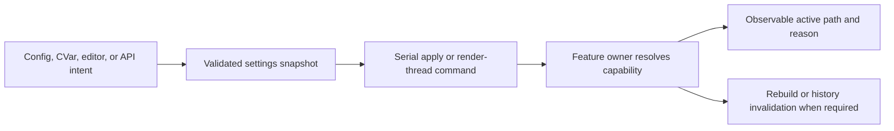

# Renderer Runtime Configuration

[Docs](../../../../../../README.md) / [Up](../RendererFeatureGuide.md)

Sections: [Feature Selector Catalog](#feature-selector-catalog) / [Settings State and Persistence](#settings-state-and-persistence).

**Status:** Renderer feature-family guide

**Scope:** route the independently maintained catalogs for aggregate rendering settings, persistence, selectors, defaults, requested state, and active-state reachability

Runtime configuration turns user/editor/startup intent into feature-owner requests. It coordinates state transport, but it does not decide whether a requested path is supported or semantically acceptable.

**Current readiness:** **40/100** — broad selectors and an editor persistence route exist; one ineffective selector plus requested/active/fallback, malformed/unwritable, package, queue, and restart truth remain open. See [Current Feature Readiness](../../../../../../Acceptance/CurrentReadiness.md#renderer).

## At A Glance

| Layer | Owns | Must expose |
| --- | --- | --- |
| settings aggregate | defaults, editable values, persistence names, startup load, and whole-state commit | loaded/saved state, invalid values, restart requirements, and commit failure |
| selector catalog | every reachable CVar/control and its exact consumer | domain, default, requested value, active result, fallback/rejection, topology/history effect |
| feature owner | capability resolution and actual implementation selection | why the request became active, inactive, substituted, or rejected |



## Choose By State

| Document | Open it for |
| --- | --- |
| [Settings State And Persistence](#settings-state-and-persistence) | aggregate settings transport, defaults, startup/editor commit, persistence, restart requirements, and diagnostics |
| [Feature Selector Catalog](#feature-selector-catalog) | exact public/CVar selector membership, consumers, requested-versus-active behavior, and ineffective or absent controls |

Settings state owns the durable aggregate. The selector catalog owns exact reachability and must not become a second persistence schema. The parent [Renderer Feature Dossiers](../RendererFeatureGuide.md) index owns capability routing.

## Shared Risks

- A registered CVar without a real consumer is documentation and product debt, not a working selector.
- Persisted intent can differ from active state because of build, backend, device, provider, or restart prerequisites.
- Threaded application must preserve the same ordering and final state as serial application.
- Topology-affecting changes must rebuild the right graph state and invalidate only the histories that became incompatible.

## Feature Selector Catalog

**Status:** capability snapshot; current selector catalog, source-backed but not proof that every valid/invalid value activates, persists, recovers, or ships correctly

**Verified:** broad catalog snapshot 2026-09-06 against committed `master` revision `d236da11`; scoped ReSTIR indirect reuse rows reconciled 2026-10-04 against `410d05ef` and its admission candidate; three Direct controls reconciled 2026-10-05 against the Stage-3 dirty candidate. Removed indirect NormalBias/MaxDistance rows have no current registration; these scoped updates do not re-audit every other selector.

**Scope:** every Renderer feature CVar discovered in current Renderer source plus RHI presentation/adapter/TLAS controls consumed by the Renderer settings surface; maps request, persistence, active consumer, restart/topology effect, and feature dossier. Aggregate state transport, save/restore, and serial/threaded application are owned by [Settings State and Persistence](#settings-state-and-persistence).

> [!TIP]
> Search this catalog by UI term, CVar, or feature. Read each selector across the whole route—producer, parser, persisted value, active consumer, fallback, restart/topology effect, and observable active state. A registered name without that route is not a usable feature.

**Current readiness:** **40/100** for the settings/selector family — the catalog proves source reachability and known negative selectors, not active runtime behavior or delivery. See [Current Feature Readiness](../../../../../../Acceptance/CurrentReadiness.md#renderer).

### Selection Contract

A registered name is not automatically a feature. A trustworthy selector has a producer (console/config/editor/API), parser and valid domain, owned game consumer, requested-versus-active result, topology/history/invalidation behavior, visible failure/fallback, persistence/restart contract, and release classification. `REN-E23` keeps the selector inventory open until each row has that closure.

### Persisted Renderer Settings Section

Application-private `EngineRenderingSettingsPersistence` owns 26 names under `/Script/SparkleRenderer.EngineRenderingSettings`. It applies immutable workspace/package `Config/DefaultEngine.ini` first, overlays per-user `Settings/EngineRendering.ini`, and writes only the user file. The Editor-private settings section edits the Renderer-owned state value and submits it through Application. Renderer contains neither filesystem persistence nor an Editor interaction model. View mode is not a Renderer setting: it is one non-persisted `RenderViewMode` selected by each viewport owner; Editor owns only its presentation and interaction.

| Feature | Persisted selectors | Default/request boundary | Active owner and effect |
| --- | --- | --- | --- |
| Presentation/device | `r.VSync`, `r.BackBufferFormat`, `r.PreferHighPerformanceAdapter` | VSync on; backend default format; high-performance preference on | RHI present/device selection. Format and adapter preference are reported pending restart; VSync is live. |
| Tone mapping/output | `r.ToneMapper`, `r.OutputColorEncoding` | ACES approximation; Automatic encoding | resolved view, [Tone Mapping](../PostProcessing/DisplayPipeline/DisplayPipelineDesign.md#tone-mapping), and [Presentation/Output](../PostProcessing/DisplayPipeline/DisplayPipelineDesign.md#presentation-and-output) passes; graph parameters update per frame |
| Exposure | `r.Exposure.Mode`, `r.Exposure.MeteringMethod`, `r.Exposure.Manual`, `r.Exposure.Compensation`, `r.Exposure.TargetLuminance`, `r.Exposure.Min`, `r.Exposure.Max`, `r.Exposure.AdaptationSpeedUp`, `r.Exposure.AdaptationSpeedDown` | Automatic, Histogram, 1.0, 0 EV, 0.18, 0.000001, 65536, 3/s, 1/s | view display resolution and [Exposure](../PostProcessing/DisplayPipeline/DisplayPipelineDesign.md#exposure) pass/history |
| Upscaling | `r.Upscaler.Provider`, `r.Upscaler.QualityMode` | Linear, NativeAA | [reconstruction/upscaling](../PostProcessing/ReconstructionAndGeneration/ReconstructionAndGenerationDesign.md#image-reconstruction-and-upscaling) provider stack and graph key; external provider may resolve back to Linear |
| Ray reconstruction | `r.RayReconstruction.Mode` | Off | [reconstruction/upscaling](../PostProcessing/ReconstructionAndGeneration/ReconstructionAndGenerationDesign.md#image-reconstruction-and-upscaling) provider stack; ReSTIR only; unavailable path resolves Off |
| GBuffer | `r.GBuffer.Algorithm` | Rasterized | graph topology; the shared ray-tracing owner resolves the traversal frontend automatically when RayTracing is selected |
| Mesh work | `r.MeshAutoBatching` | on | per-view raster batch construction |
| Classic TLAS | `r.RayTracing.Tlas.Refit` | on | classic TLAS strategy after initial build |
| PTLAS | `r.RayTracing.PreferPartitionedTlas`, `r.RayTracing.Ptlas.PartitionsPerAxis`, `r.RayTracing.Ptlas.PartitionUpdateMode`, `r.RayTracing.Ptlas.MarkAllDynamicInPartition`, `r.RayTracing.Ptlas.ModeChangeDistance` | off, 8, AlwaysUpdatePartition, false, 100 | RHI capability preference plus per-view partition planner; actual current execution remains the narrow one-operation/no-update/no-translation strategy |

The settings writer replaces only its owned INI section. Loading silently ignores names outside its allowlist and currently discards `TrySetValueFromString` error text; malformed persisted-value diagnostics remain a gap.

### Per-View And Developer Selectors

The seven lighting leaves are also reachable through [Editor Show](../DebugViews/Controls/ShowFlags.md#editor-interaction), sharing the sequenced console authority. The execution descriptions below retain their admitted Stage-2–6 contracts; [Bounded Show evidence](../../../../../../Acceptance/Renderer/DebugViews.md#earlier-execution-evidence) names the subsequently changed schemas. Menu/control proof does not automatically preserve native omission or guide evidence for changed source.

| Selector | Default/domain | Current consumer and effect | Persistence/reachability boundary | Dossier |
| --- | --- | --- | --- | --- |
| `ViewportRenderRequest::ViewMode` | Lit, Reference Path Tracer, Wireframe, and 14 debug modes | `RenderViewBuilder` freezes the one mode into `RenderView`; frame composition, raster GBuffer, and debug shaders consume it only at their owning decisions | ordinary non-persisted per-view request; Editor and Game submit the same Renderer semantic; the Editor Reference row remains unavailable until Stage 7 | [Debug Views](../DebugViews/DebugViewsDesign.md) and [Reference Path Tracer](../Lighting/ReferencePathTracer/ReferencePathTracerDesign.md) |
| `r.RayTracedShadows.NormalBias` | 0.01 world units | shadow ray input | console only; inspected frame binding does not clamp it | [Direct Lighting](../Lighting/DirectLighting/DirectLightingDesign.md) |
| `r.RayTracedShadows.MaxDistance` | 100000 world units | directional shadow ray maximum | console only; inspected frame binding does not clamp it | [Direct Lighting](../Lighting/DirectLighting/DirectLightingDesign.md) |
| `r.Lighting.Shadows.Direct` | true; bool | Shadows-owned retained intent; inactive with no direct family; accepted target omits exclusive signal allocation/producer and uses no-signal visibility one; current schema requires reconciliation | sequenced console and [Editor Show](../DebugViews/Controls/ShowFlags.md#editor-interaction) batch route; prior execution proof is candidate-bound | [Bounded Show evidence](../../../../../../Acceptance/Renderer/DebugViews.md#earlier-execution-evidence) |
| `r.Lighting.Direct.Diffuse` | true; bool | direct feature-local IsEnabled/IsActive; early temporal/spatial/resolve response gate and omitted exclusive UAV writes; all-direct-off omits the family before allocation | existing sequenced console route; no persistence or Editor mirror; disabled raw diagnostic unavailable, enabled missing products fail | [Bounded Show evidence](../../../../../../Acceptance/Renderer/DebugViews.md#earlier-execution-evidence) |
| `r.Lighting.Direct.Specular` | true; bool | same direct owner/16-byte uniform and active-target contract; authored allocation and proposal PDFs retained | same direct diagnostic/control route | [Bounded Show evidence](../../../../../../Acceptance/Renderer/DebugViews.md#earlier-execution-evidence) |
| `r.Lighting.Direct.Subsurface` | true; bool | same direct owner/ABI; early subsurface gate; direct leaf edits reset six reservoir/provider histories, exposure retained; family transitions rebuild/retire topology | same direct diagnostic/control route; indirect-only histories still invalidate | [Bounded Show evidence](../../../../../../Acceptance/Renderer/DebugViews.md#earlier-execution-evidence) |
| `r.Lighting.Indirect.Diffuse` | true; bool | indirect feature-local intent/activation; primary physical response gates before exclusive math in generation/replay/reuse/resolve; full material proposal PDFs and continuation lobes retained | sequenced console route; no settings mirror; uniform leaf edits reset existing reservoir/provider histories, exposure retained; all-off rebuilds before exclusive allocation; disabled raw diagnostic unavailable | [Bounded Show evidence](../../../../../../Acceptance/Renderer/DebugViews.md#earlier-execution-evidence) |
| `r.Lighting.Indirect.Specular` | true; bool | same indirect owner and existing 32-byte uniform; genuine path-derived specular guide only when active | same console/lifecycle route; requested reconstruction with inactive specular is unavailable/MissingRequiredProduct, without provider substitution or intent mutation | [Stage-5 guide contract](../Lighting/IndirectLighting/Discovery.md#debug-controls-lobe-accounting-dependency) |
| `r.Lighting.Shadows.Indirect` | true; bool | Lit indirect owner retains intent; active only with admitted indirect consumers; explicit uniform policy bypasses secondary-hit direct-light visibility before tracing | existing reservoir/provider invalidation, exposure/topology retained; continuation/Reference unaffected; family re-enable restores retained intent | [Shadow scope contract](../DebugViews/Controls/ShowFlags.md#shadows) |
| `r.RayTracing.Restir.Indirect.Bounces` | 2 requested; active clamp 1..8 | source-named ReSTIR indirect candidate path; estimator conformance unproved | console only; requested value can differ from active clamped value | [Indirect Lighting](../Lighting/IndirectLighting/IndirectLightingDesign.md) |
| `r.RayTracing.Restir.Indirect.TemporalReuse` | true; bool | early temporal replay admission; current candidates still published when off; dependent reservoir/provider invalidation | console only; real owner CVar read directly at shader preparation | [Indirect admission evidence](../Lighting/IndirectLighting/Discovery.md#debug-controls-lobe-accounting-dependency) |
| `r.RayTracing.Restir.Indirect.SpatialReuse` | true; bool | early neighbor replay admission; current reservoir still resolved when off; dependent reservoir/provider invalidation | console only; no settings mirror | [Indirect admission evidence](../Lighting/IndirectLighting/Discovery.md#debug-controls-lobe-accounting-dependency) |
| `r.Diagnostics.MarkerVerbosity` | FramePass; Off/FramePass/Detailed | frame/pass/detailed GPU marker emission | developer console; package exposure must be classified | [Diagnostics](../ViewportAndDiagnostics/ViewportAndDiagnosticsDesign.md#diagnostics-products-and-capture) |
| `r.Diagnostics.GpuTiming` | off | timestamp collection/resolution | developer console; observer cost unmeasured | [Diagnostics](../ViewportAndDiagnostics/ViewportAndDiagnosticsDesign.md#diagnostics-products-and-capture) |
| `r.FrameGraph.ParallelRecording` | on | Tasks-backed recording chunks | developer console; equivalence/scaling unproved | [Frame Graph](../FrameExecution/FrameGraphAndScheduling.md) |

### RHI Console Controls Outside The Renderer Settings State

| Selector | Current contract | Boundary |
| --- | --- | --- |
| `r.BackBufferCount` | supported values 2 or 3; renderer/device recreation required | registered/owned by RHI; absent from `EngineRenderingSettingsState` and its persisted 26-name section |
| `r.MaximumFramesInFlight` | supported values 1..3 and no greater than back-buffer count; recreation required | registered/owned by RHI; absent from Renderer settings UI/persistence |

These controls affect frame storage and presentation but are not proof that every combination is exposed or stable. Their current lack of Renderer settings integration must not be described as “back-buffer/frame-count settings support.”

### Deliberately Absent Feature Selectors

| Capability | Current selector state | Documentation owner |
| --- | --- | --- |
| Volumetric lighting, fog, atmosphere, aerial perspective | no Renderer/RHI setting, CVar, viewport request, or editor control was found | [Volumetric Lighting](../Lighting/VolumetricLighting/VolumetricLightingDesign.md); `REN-E24` audits continued absence and production remains roadmap-blocked |
| Deferred decals | no authored/editor/game selector was found; `GR-5` must add truthful requested/active state with the implementation | [Deferred Decals](../DeferredDecals/DeferredDecalsDesign.md); `REN-E25` preserves current absence truth until `FCR-REN-23` is implemented |
| Color grading | no grading parameter, LUT, transform, or editor selector exists; `DSP-5` must add the admitted surface | [Color Grading](../PostProcessing/DisplayPipeline/ColorGrading/ColorGradingDesign.md); `REN-E26` preserves current absence truth until `FCR-REN-24` is implemented |
| Chromatic aberration | no lens/channel effect or viewport selector exists; `DSP-6` must add the admitted surface | [Chromatic Aberration](../PostProcessing/DisplayPipeline/ChromaticAberration/ChromaticAberrationDesign.md); `REN-E27` preserves current absence truth until `FCR-REN-25` is implemented |
| Frame generation | no provider, quality, pacing, or presentation selector exists; Reflex/PCL controls are not frame synthesis | [Frame Generation](../PostProcessing/ReconstructionAndGeneration/ReconstructionAndGenerationDesign.md#frame-generation); `REN-E28` audits continued absence |
| HDR display output | no HDR request, supported/active/fallback state, PQ/display-nit policy, or HDR swapchain selection exists; `DSP-7` must add it | [HDR Display Output](../PostProcessing/DisplayPipeline/HDRDisplayOutput/HDRDisplayOutputDesign.md); `REN-E34` preserves current absence truth until `FCR-REN-26` is implemented |
| Non-ray lighting fallback | no shadow-map/lightmap/probe-only/deferred-raster lighting mode exists | [Lighting](../Lighting/LightingDesign.md) |

An absent selector is not a UI omission when the feature itself is absent. Adding a selector before its producer, active-state reporting, failure behavior, and completion contract exist would create misleading public vocabulary.

### Implemented But Non-Selectable Runtime Contracts

| Capability | Current reachability | Boundary |
| --- | --- | --- |
| temporal jitter pattern | the active view path hard-codes the 16-frame Halton sequence; no setting selects MSAA, R2, white-noise, or None source vocabulary | [Temporal Sampling and History](../FrameExecution/TemporalSamplingAndHistory.md); exposing a pattern requires active-result/history/quality evidence |
| Streamline PCL/Reflex latency coordination | compiled capability/readiness decides whether public simulation and D3D12 submit/present markers do provider work; no latency mode or active-state setting exists | [Latency Coordination](../FrameExecution/LatencyCoordination.md); marker presence is not a user-selectable low-latency feature or measured benefit |

These are current implementation contracts without a selector. They remain in the capability inventory and their own dossiers so selector enumeration does not accidentally classify them as absent features.

### Change And Review Rule

When adding or changing a selector:

1. update this catalog and the owning feature dossier/capability ID;
2. verify the producer, parser/domain, game consumer, requested/active diagnostic, topology/history/restart effect, and Shipping reachability;
3. add or update the smallest `REN-E23` case and the feature-specific evidence item;
4. remove unused names/values rather than retaining misleading compatibility vocabulary under the current clean-break policy.

### Acceptance Criteria

- `AC-SEL-01` — every Renderer-owned registered CVar and every RHI control surfaced by Renderer settings has exactly one catalog row with parser/domain, default, producer, active consumer or explicit no-consumer state, persistence, restart/topology/history effect, and dossier.
- `AC-SEL-02` — every enum value and numeric boundary is accepted, clamped, rejected, or marked vocabulary-only exactly as documented; malformed values produce actionable diagnostics rather than disappearing silently.
- `AC-SEL-03` — requested and active state remain separately inspectable for capability-gated traversal/provider/PTLAS choices, including fallback/refusal reason.
- `AC-SEL-04` — the 26-name owned INI section round-trips valid settings without modifying other sections; non-persisted/session/RHI-only controls remain absent by design.
- `AC-SEL-05` — live changes apply on the next permitted frame, topology/history changes rebuild/reset their owners, and restart-required changes do not claim live activation.
- `AC-SEL-06` — Editor, Game, Debug/Development/Shipping, workspace/package, D3D12/Vulkan reachability is independently classified; hidden console reachability still counts unless erased/locked.
- `AC-SEL-07` — absent feature selectors remain absent; material texture-table support derives from RHI capabilities without an ineffective binding-mode control.

### Controlled Failure Modes And Checks

| Failure ID | Injection or cause | Required safe behavior | Detecting check |
| --- | --- | --- | --- |
| `FM-SEL-01` | malformed/unknown persisted name or value | load reports/records the invalid input according to the declared policy and does not mutate unrelated state | `CHK-SEL-02` |
| `FM-SEL-02` | strict capability-gated request unavailable | active state reports unavailable/refused; Automatic only uses documented fallback | `CHK-SEL-03` |
| `FM-SEL-03` | concurrent file edit/write failure or packaged unwritable location | save fails visibly and preserves a valid previous file/section | `CHK-SEL-02` |
| `FM-SEL-04` | selector registered without consumer or undocumented control becomes reachable | source/runtime enumeration reports orphan and scope freeze fails | `CHK-SEL-01` |
| `FM-SEL-05` | restart/topology/history-affecting value is treated as ordinary live state | lifecycle check detects mismatched requested/active generation and holds the cell | `CHK-SEL-03` |

| Check | Exercise and oracle | Covers |
| --- | --- | --- |
| `CHK-SEL-01` | mechanically enumerate Renderer CVars, Renderer-settings allowlist/state/UI, and routed RHI controls; compare names/domains/defaults/consumers to every catalog row and negative selector | `AC-SEL-01`, `AC-SEL-06`, `AC-SEL-07`; `FM-SEL-04` |
| `CHK-SEL-02` | round-trip exact 26-name section with boundary/malformed/unknown values, unrelated sections, concurrent edit, write failure, and packaged path cases | `AC-SEL-02`, `AC-SEL-04`; `FM-SEL-01`, `FM-SEL-03` |
| `CHK-SEL-03` | runtime matrix over valid/invalid/strict/Automatic/restart/topology/history changes; compare requested/active state, reason, graph/history generation, and next-frame result | `AC-SEL-02`, `AC-SEL-03`, `AC-SEL-05`; `FM-SEL-02`, `FM-SEL-05` |

This selector contract is **defined but unproved**. A registered or persisted name is not feature evidence; release results must demonstrate the active consumer and observable result in every advertised cell.

### Primary Source Routes

- [`RendererCVars.cpp`](../../../../../../../Engine/Renderer/Private/Debug/RendererCVars.cpp)
- [`EngineRenderingSettingsControls.cpp`](../../../../../../../Engine/Renderer/Private/Settings/EngineRenderingSettingsControls.cpp) and [`EngineRenderingSettingsPersistence.cpp`](../../../../../../../Engine/Application/Private/RenderingSettings/EngineRenderingSettingsPersistence.cpp)
- [`ViewportDisplayCVars.cpp`](../../../../../../../Engine/Renderer/Private/View/ViewportDisplayCVars.cpp)
- [`UpscalerSettings.cpp`](../../../../../../../Engine/Renderer/Private/Upscaling/UpscalerSettings.cpp) and [`RayReconstructionSettings.cpp`](../../../../../../../Engine/Renderer/Private/RayReconstruction/RayReconstructionSettings.cpp)
- [`RayTracedShadowCVars.cpp`](../../../../../../../Engine/Renderer/Private/RayTracing/Effects/Shadows/RayTracedShadowCVars.cpp) and [`RestirIndirectLightingCVars.cpp`](../../../../../../../Engine/Renderer/Private/RayTracing/Effects/RestirLighting/RestirIndirectLightingCVars.cpp)
- [`MaterialTextureTableCapability.cpp`](../../../../../../../Engine/Renderer/Private/Scene/Materials/MaterialTextureTableCapability.cpp)
- [`RHICVars.cpp`](../../../../../../../Engine/RHI/Private/CVars/RHICVars.cpp)

## Settings State and Persistence

**Status:** current feature dossier; source-backed, not round-trip, package, threaded-equivalence, or release evidence

**Verified:** source route re-audited 2026-09-19 against revision `d1108d44de49d90313abb43a66f924f89d6c6bb2` plus the current ownership-cleanup working tree; executable build/runtime evidence remains unrun

**Scope:** `REN-SET-01` through `REN-SET-05`; owns the lifecycle of the aggregate rendering-settings state, editor commit, per-user persistence, startup restore, render-thread handoff, live versus restart-required application, and requested-state limitations. [Feature Selector Catalog](#feature-selector-catalog) remains the exact per-selector ledger.

**Current readiness:** **40/100** — settings edit/load/save/handoff is reachable; durable error reporting, malformed/concurrent/package storage, queue pressure, and structured requested-versus-active state remain incomplete. See [Current Feature Readiness](../../../../../../Acceptance/CurrentReadiness.md#renderer).

### PD-1 Settings Changes

**Working candidate:** `62918f7b13ec38fbebf2f8b6b25fd8707e719930` plus the PD-1 patch. `EngineRenderingSettingsControls` captures and applies Renderer settings; Application owns startup validation and atomic per-user publication. Editor preserves the original session values for restart detection, rolls back rejected saves and exposes their diagnostic. Rendering settings remain in the existing Editor controller and shared settings/persistence owner. Game rendering-setting widgets and the separate viewport status projection were removed at the owner's request; a shared frontend is deferred.

Vignette and chromatic aberration default to On. Each has a dedicated compute shader, registration and presentation pass; tone mapping is unchanged. The order is tone mapping (where the presentation domain requires it) -> chromatic aberration -> vignette -> output encoding -> UI. Lit and Reference enable both effects by default. Debug views bypass them by default (`r.PostProcessing.DebugViews`, default Off). Dedicated effect widgets and Show-menu additions are deferred. Raw Reference radiance and moment products stay unchanged. Vignette attenuates linear-display RGB by up to 20% at the corners; chromatic aberration offsets the red/blue pixel lookups radially in opposite directions, with clamped edge coordinates. Disabling an effect removes its pass from the graph. These are product defaults, not calibrated optical models or visual/performance acceptance.

### Settings State and Persistence: At A Glance

| Question | Current answer |
| --- | --- |
| what is edited? | one aggregate `EngineRenderingSettingsState`; 26 fields describe requested rendering configuration |
| what is persisted? | 26 allowlisted `r.*` values in per-user `Settings/EngineRendering.ini`; source/package `Config/DefaultEngine.ini` supplies immutable defaults, and view mode is owned separately by each viewport session |
| how does it reach rendering? | startup applies the section before command-line overrides; editor commits go through the Renderer facade and serial or render-thread control path |
| what becomes active immediately? | only settings whose feature owner can apply them without recreation; adapter and back-buffer format changes require restart |
| what is missing? | atomic persistence, surfaced parse/write errors, round-trip/package evidence, and a structured requested-versus-active/fallback status model |

The aggregate exists to make an editor commit coherent, not to centralize feature policy. Each feature still resolves capability, fallback, topology, and active state at its own owner.

### Feature Contract

The settings route coordinates three owners without merging them. Renderer publicly owns only `EngineRenderingSettingsState`, captures/applies that rendering state, and accepts it through its sequenced control boundary. Editor privately owns `EngineRenderingSettingsController`, the mutable interaction model and restart message. Application owns `EngineRenderingSettingsPersistence`, startup restore order, filesystem location, and save-before-submit policy. Serial execution applies CVars directly, while threaded execution queues a `RenderSettingsChangedCommand` for the render execution context.

```text
application startup
  -> load immutable defaults, then user override -> set registered CVars

editor setter
  -> mutate Editor-owned aggregate interaction state
  -> Application callback -> rewrite owned INI section
  -> Renderer facade -> coordinator
  -> serial apply or render-thread control command -> set changed CVars
  -> feature owners resolve active per-frame/topology behavior
```

The motivation is one coherent editor transaction and deterministic render-thread ownership. It does not make every console selector an editor setting, and a requested CVar value is not automatically the active capability result.

### State, Persistence, And Reachability

| Surface | Current coverage | Boundary |
| --- | --- | --- |
| aggregate public state | 26 fields: presentation/device, tone/output, exposure, upscale/RR, GBuffer/RT, batching, and TLAS/PTLAS | value snapshot; it does not contain per-viewport UI state or active provider/capability/fallback reasons |
| persisted allowlist | 26 exact `r.*` names in `/Script/SparkleRenderer.EngineRenderingSettings` | View mode is deliberately not Renderer settings; `RenderViewMode` is one non-persisted per-view request value, while Editor owns its menu presentation and interaction |
| persistence files | immutable workspace/package `Config/DefaultEngine.ini`, then per-user `Settings/EngineRendering.ini`; writes replace the owned section only in the user file and retain its other loaded lines/sections | not an atomic temp-and-replace write; error/status is not returned |
| startup | `Application` applies persisted settings before command-line CVar overrides | malformed values are currently attempted and their error text is discarded |
| editor commit | each changed setter invokes the Application-owned callback; Application persists and submits the state | Editor has no filesystem access; whole snapshot is resent and unchanged fields are skipped by Renderer CVar comparison |
| threaded Renderer | control queue transfers the snapshot to render execution context | ordering/backpressure and exit behavior need executable evidence |
| restart-required fields | adapter preference and back-buffer format are compared with session-start values and produce a restart message | values are still persisted/submitted; the message, not an active-state object, expresses pending restart |
| routed controls outside state | direct-shadow controls plus RHI back-buffer count/maximum frames in flight and other developer CVars | console/catalog-owned; absence from this state must not be presented as UI support |

### Persistence Semantics And Known Gaps

The loader applies the immutable default file first and the per-user override second. It ignores missing files, comments, blank lines, other sections, unknown names, and registered-name lookup failures. It trims key/value strings. Valid allowlisted values are parsed by the owning CVar. Invalid parse diagnostics are presently discarded. The writer creates the user-settings parent directory best-effort, reads the existing user file, removes the first matching owned section, inserts a freshly generated 26-value section, and truncates/re-writes only that user file.

Consequences that must remain explicit:

- no status reaches the caller for directory creation, open, write, flush, or truncation failure;
- concurrent edits can be overwritten between read and truncate;
- malformed/unknown/duplicate section/value behavior has no user-facing diagnostic contract;
- the per-user package route is source-present but lacks packaged standard-user and reset/retention evidence;
- no schema/version/migration compatibility path exists or is intended under the current clean-break policy;
- requested state, CVar state, resolved graph/provider state, and restart-active state are not one thing and must be reported separately where a feature can reject, clamp, defer, or fall back.

### Ownership Rules

- This dossier owns the cross-module aggregate state route. Each feature dossier owns value meaning, clamps, graph/history impact, capability fallback, and output evidence.
- [Feature Selector Catalog](#feature-selector-catalog) owns exact names, defaults, domains, persistence membership, consumers, and absent/ineffective controls.
- Application owns persistence, filesystem location, startup ordering, and save-before-submit policy; Editor owns the private interaction model and restart presentation; Renderer owns the value contract, capture/apply operation, cross-thread delivery, and rendering consumers. CVar/feature owners remain the active runtime authority.
- Adding a setting requires the state field, setter/UI, CVar/parser, persistence decision, game consumer, requested/active report, topology/history/restart behavior, and feature dossier to change together.

### Horizontal Coverage

| Axis | Required cells | Invariant |
| --- | --- | --- |
| execution | direct/no callback, serial Renderer callback, threaded Renderer callback, queue pressure, shutdown | committed state reaches the owning CVar once in order or fails visibly |
| persistence | missing/existing file, unrelated sections/comments, first/last owned section, malformed/unknown/duplicate values, read-only/full/concurrently edited file | unrelated data is preserved and failure never masquerades as saved state |
| lifecycle | startup, command-line override, live edit, topology/history change, pending restart, restart, package run | requested, CVar, resolved active, and session-active state remain distinguishable |
| surface | editor/public state, console-only Renderer, RHI-only controls, absent features | no hidden or orphan selector is inferred as supported UI capability |
| configuration | Debug/Development/Shipping, editor/game, workspace/package, D3D12/Vulkan | reachability and writable location are explicitly classified |

### Settings State and Persistence: Acceptance Criteria

- `AC-SET-01` — public state, editor controls, setters, CVar capture/apply, persistence allowlist, selector catalog, and feature consumers agree field-for-field with intentional exclusions named.
- `AC-SET-02` — a valid 26-name section round-trips exactly while comments and unrelated sections remain unchanged according to the declared formatting policy; per-viewport view mode remains outside Application rendering-settings persistence.
- `AC-SET-03` — malformed, unknown, duplicate, unreadable, unwritable, partial-write, and concurrent-edit cases return an actionable result and preserve a valid prior file/state rather than silently succeeding.
- `AC-SET-04` — startup persisted values apply before command-line overrides; serial and threaded commits produce equivalent ordered CVar and next-frame resolved states.
- `AC-SET-05` — live, topology/history-affecting, capability-gated, and restart-required changes expose requested/CVar/resolved/session-active state and reason without false activation.
- `AC-SET-06` — editor/game and workspace/package reachability plus writable configuration location are classified for every supported build/backend cell.
- `AC-SET-07` — adding/removing a selector leaves no orphan state field, setter, persisted name, UI control, CVar, consumer, or stale compatibility alias.

### Settings State and Persistence: Controlled Failure Modes And Checks

| Failure ID | Injection or cause | Required safe behavior | Detecting check |
| --- | --- | --- | --- |
| `FM-SET-01` | malformed/unknown/duplicate key or value | actionable diagnostic; unrelated and last valid state follow declared policy | `CHK-SET-02` |
| `FM-SET-02` | directory/open/write/flush failure, partial disk, or concurrent edit | commit reports failure and valid prior file is preserved atomically | `CHK-SET-02` |
| `FM-SET-03` | render control queue pressure/reorder or shutdown with pending settings | last admitted state applies in declared order or reports rejection; no post-shutdown mutation | `CHK-SET-03` |
| `FM-SET-04` | unsupported/clamped/fallback/restart-required request | active state and reason differ visibly from request until genuinely active | `CHK-SET-03` |
| `FM-SET-05` | field/name/UI/consumer added or removed on only one surface | mechanical inventory detects mismatch and scope freeze fails | `CHK-SET-01` |

| Check | Cheapest claim-falsifying exercise | Covers |
| --- | --- | --- |
| `CHK-SET-01` | mechanically enumerate public fields/setters, editor controls, persisted names, Renderer/RHI CVars, consumers, and catalog rows; compare one-to-one decisions | `AC-SET-01`, `AC-SET-07`; `FM-SET-05` |
| `CHK-SET-02` | isolated-config round trip with valid/boundary/malformed/unknown/duplicate values, unrelated content, read-only/full/partial/concurrent-write faults, and package path | `AC-SET-02`, `AC-SET-03`, `AC-SET-06`; `FM-SET-01`, `FM-SET-02` |
| `CHK-SET-03` | replay identical edit sequence through direct, serial, and threaded routes including pressure/shutdown, topology/history/provider fallback, and restart; compare ordered requested/CVar/resolved/session state | `AC-SET-04`, `AC-SET-05`; `FM-SET-03`, `FM-SET-04` |

This contract is **defined but unproved**. The current implementation does not yet satisfy the documented durable-write/error-reporting criteria; those are explicit gaps, not claimed behavior.

### Settings State and Persistence: Primary Source Routes

- [`EngineRenderingSettings.h`](../../../../../../../Engine/Renderer/Public/Settings/EngineRenderingSettings.h)
- [`EngineRenderingSettingsController.cpp`](../../../../../../../Engine/Editor/Private/Settings/EngineRenderingSettingsController.cpp)
- [`EngineRenderingSettingsPersistence.cpp`](../../../../../../../Engine/Application/Private/RenderingSettings/EngineRenderingSettingsPersistence.cpp)
- [`EngineRenderingSettingsControls.cpp`](../../../../../../../Engine/Renderer/Private/Settings/EngineRenderingSettingsControls.cpp)
- [`RenderCoordinator.cpp`](../../../../../../../Engine/Renderer/Private/Concurrency/Coordinator/RenderCoordinator.cpp) and [`RendererExecutionContext.cpp`](../../../../../../../Engine/Renderer/Private/Concurrency/Coordinator/RendererExecutionContext.cpp)
- [`Application.cpp`](../../../../../../../Engine/Application/Private/Application.cpp) and [`UI.cpp`](../../../../../../../Engine/Editor/Private/UI.cpp)
