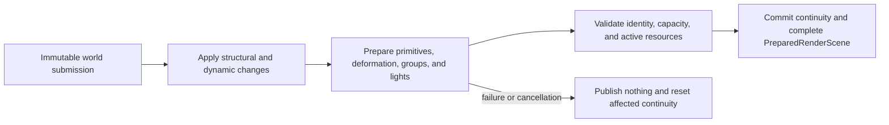
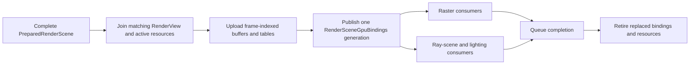
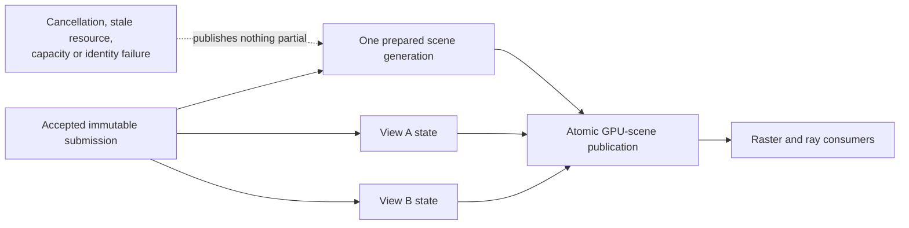

# Renderer Scene and View Preparation

[Docs](../../../../../../README.md) / [Up](../RendererFeatureGuide.md)

Sections: [Scene Preparation](#scene-preparation) / [View Preparation](#view-preparation) / [GPU-Scene Publication](#gpu-scene-publication) / [Scene and View Preparation Acceptance](#scene-and-view-preparation-acceptance).

**Status:** current feature-family dossier; source-backed, not runtime, concurrency, visibility, memory, or release evidence

**Verified:** 2026-09-06 against committed `master` revision `d236da11`; `Engine/Renderer` is unchanged from the earlier `8414b5dc` source audit

**Scope:** `REN-SCENE-01` through `REN-SCENE-10` plus scene/view portions of `REN-OWN-02` through `REN-OWN-04`; routes the three distinct owners that turn immutable world data into prepared scene, prepared view, and published GPU-scene state

**Current readiness:** **50/100** — scene/view preparation and GPU publication are integrated in source; identity, capacity, failure, multi-view, deformation, lifetime, and memory evidence remains absent. See [Current Feature Readiness](../../../../../../Acceptance/CurrentReadiness.md#renderer).

## At A Glance

| Owner | Keeps across frames | Produces for this frame | Must never own |
| --- | --- | --- | --- |
| scene preparation | scene generation, primitive/material/light identity, deformation continuity | one complete `PreparedRenderScene` for an admitted frame slot | camera, viewport, or per-view history policy |
| view preparation | per-view persistent temporal state | matrices, extents, visibility, batches, display intent, and RT partition plan | shared scene mutation or another view's state |
| GPU-scene publication | persistent/frame-indexed GPU storage and binding generations | one coherent binding set consumed by raster and ray work | feature selection or an independently recomputed scene truth |

The visible invariant is simple: every pass for a frame must observe one compatible scene generation, one view identity, and one GPU binding generation. Preparation failure publishes none of the partial result.

## Family Contract

GameFramework owns live world/ECS state and publishes `RenderFrameSubmission`. Renderer never queries ECS storage. One admitted submission updates the persistent scene, derives frame-slot scene and view state, then publishes one GPU-scene generation consumed by raster and ray passes.

```text
RenderFrameSubmission
  -> RenderScene::Apply
  -> RenderScenePreparation -> PreparedRenderScene
  -> RenderViewBuilder + RenderViewPreparation -> RenderView
  -> RenderScene::UpdateGpuScene -> RenderSceneGpuBindings
```

## Independent Owners

| Owner | Lifetime and result | Document |
| --- | --- | --- |
| `RenderScene` and `RenderScenePreparation` | persistent scene generation plus one frame-slot prepared scene; structural/dynamic inputs become resolved primitives, deformation continuity, lights, and references to active resources | [Scene Preparation](#scene-preparation) |
| `RenderViewBuilder` and `RenderViewPreparation` | one view/frame-slot result; camera/output intent and shared temporal input become matrices, visibility, batches, and RT partition plan | [View Preparation](#view-preparation) |
| `RenderGpuScene` and `RenderSceneGpuBindings` | persistent plus frame-indexed GPU storage; prepared semantic data becomes coherent buffers/tables for raster and ray consumers | [GPU-Scene Publication](#gpu-scene-publication) |
| feature family | cross-owner identity, failure, backend, reset, capacity, and completion requirements | [Acceptance](#scene-and-view-preparation-acceptance) |

These pages are separate because their state owners, lifetimes, outputs, and invalidation reasons differ. They remain one family because the publication invariant allows no mixed scene/view/GPU generation to escape.

## Shared Invariants

- Scene data and view data remain separate: geometry/material/light/resource identity is scene-owned; camera, frustum, extents, display intent, temporal identity, and partition planning are view-owned.
- A failed/cancelled preparation publishes none of its partial outputs. Successful scene and view preparation must agree on the admitted frame and scene generation before GPU publication.
- Scene reset, view discontinuity, resource completion, provider/shader changes, and graph-topology changes invalidate only their named histories/generations.
- GPU completion, not CPU scope exit, authorizes frame-slot and GPU-resource reuse.

Mesh/texture lifecycle is owned by [Mesh and Texture Residency](../GeometryAndResources/MeshAndTextureResidency.md). Per-view culling, classification, sorting, and batching semantics are owned by [Visibility and Draw Preparation](../GeometryAndResources/VisibilityAndDrawPreparation.md). Per-view sampling and history semantics are owned by [Temporal Sampling and History](../FrameExecution/TemporalSamplingAndHistory.md). This family consumes those active identities without duplicating their state machines or proof contracts.

See [Geometry, Materials, and GBuffer](../GeometryAndResources/GeometryMaterialsAndGBuffer.md) for the next semantic consumer and [Rendering a Sparkle Frame](../../RenderingASparkleFrame.md) for whole-frame order.

## Scene Preparation

**Status:** current feature dossier; source-backed, not task, continuity, residency, capacity, or runtime evidence

**Verified:** 2026-09-06 against committed `master` revision `d236da11`

**Scope:** scene-owned portions of `REN-SCENE-02` through `REN-SCENE-07`; persistent `RenderScene` mutation, frame-slot preparation, deformation continuity, light preparation, active-resource references, and failure before publication

**Current readiness:** **50/100** — persistent-scene to prepared-scene source flow exists; failure/cancellation, capacity, deformation continuity, serial/threaded equivalence, and performance evidence does not. See [Current Feature Readiness](../../../../../../Acceptance/CurrentReadiness.md#renderer).

### Scene Preparation: At A Glance

| Input | Persistent owner | Frame result | Refusal boundary |
| --- | --- | --- | --- |
| structural add/update/remove changes | `RenderScene` scene generation and object/resource identity | resolved primitives and groups for one frame slot | non-monotonic identity or invalid structural change rejects before publication |
| current dynamic transforms, joints, and morph weights | scene deformation continuity | current/previous deformation pairs | failed or cancelled preparation resets continuity and publishes no partial state |
| directional, point, spot, and rectangular lights | scene light identity | bounded GPU-ready light records | more than 2 directional or 1024 of another kind rejects before upload |
| active mesh/texture generations | residency owners remain authoritative | references to safe active resources | pending, stale, failed, or evicted generations cannot masquerade as current |



The owner keeps scene continuity so downstream raster and ray paths share the same current/previous geometry meaning. The cost is strict transactional publication: partial task work is discarded rather than exposed for best-effort rendering.

### Feature Promise

An admitted immutable submission updates one persistent Renderer scene generation, then produces one complete `PreparedRenderScene`. The owner commits deformation continuity only after all required work succeeds; failure or cancellation leaves no partial prepared scene visible.

### Ownership And Work

`RenderScene` consumes structural add/update/remove changes and moved dynamic arrays while retaining geometry, material, texture, light, GPU-scene, and ray-scene identity. `PreparedRenderScene` belongs to one RHI frame-in-flight slot and contains resolved primitives, instance groups, current/previous deformation, prepared lights/sky, and the eventual GPU-binding pointer.

`RenderScenePreparation` reuses a capacity-bucketed Tasks graph:

| Work | Serial threshold / grain / max partitions | Result |
| --- | --- | --- |
| primitive transforms and bounds | 128 / 64 / 8 | prepared transforms, bounds, draw/material identity |
| joint-matrix copies | 64 / 16 / 8 | current and previous joint matrices |
| morph-weight copies | 64 / 16 / 8 | current and previous morph weights |
| light preparation | 32 / 16 / 4 | directional, point, spot, and rect GPU-ready semantics |

Capacities round to a power of two beyond the serial threshold to reuse the compiled task graph. These are scheduling constants, not proven optimal workloads or total memory bounds.

**Preparation ownership amendment (2026-10-06):** source input `047b303b` plus the scoped working tree. `PrepareRenderPrimitives`, `PrepareRenderLights`, and `CommitPreparedRenderLights` are direct operations; transform and per-kind conversion helpers remain file-private. Task adapters and merge/publication entry points are namespace operations, with no static-only class shells. `PreparedRenderLight` contains one typed payload (empty, directional, point, spot, or rect), so its active type is also its commit classification. Each reused output is reset before visibility/control selection, and successful merge retains input order within the existing per-kind collections. The scoped MSVC CPU probe measured the record at 88 bytes versus 240 previously and compared every meaningful light field, primitive result, and identity against the source baseline. This does not close task cancellation, GPU capacity/upload, native-backend, or visual acceptance.

### Failure, Capacity, And Lifetime

- Non-monotonic frame identity rejects before scene mutation/publication.
- Preparation failure/cancellation resets continuity and publishes no partial result; success commits continuity before moving merged output into the frame slot.
- Scene reset unloads scene textures and invalidates dependent scene/view/provider/frame history.
- Scene preparation consumes only the active generation exposed by [Mesh and Texture Residency](../GeometryAndResources/MeshAndTextureResidency.md); it does not own admission, decode, upload, eviction, or their budgets.
- Light payload limits are 2 directional and 1024 each for point, spot, and rect; overflow rejects before GPU upload.
- Static BLAS reuse and deforming BLAS rebuild are downstream RT consequences; this page does not claim BLAS refit.

Feature-family proof is owned by [Acceptance](#scene-and-view-preparation-acceptance), especially `AC-SVP-01` through `AC-SVP-04`, `AC-SVP-06` through `AC-SVP-08`, and `CHK-SVP-01`/`03`/`04`. Residency state-machine proof stays in [Mesh and Texture Residency](../GeometryAndResources/MeshAndTextureResidency.md).

### Primary Source Routes

- [`FramePipeline::AcceptFrameSubmission` and `PrepareRenderFrame`](../../../../../../../Engine/Renderer/Private/Frame/FramePipeline.cpp)
- [`RenderScenePreparation.cpp`](../../../../../../../Engine/Renderer/Private/Scene/Preparation/RenderScenePreparation.cpp)
- [`RenderFrameSubmission.h`](../../../../../../../Engine/GameFramework/Public/Rendering/RenderFrameSubmission.h)

## View Preparation

**Status:** current feature dossier; source-backed, not visibility, batching, temporal, multi-view, or runtime evidence

**Verified:** 2026-09-06 against committed `master` revision `d236da11`

**Scope:** `REN-OWN-03`, `REN-SCENE-10`, and view-owned preparation; camera/output intent, temporal identity, culling, material visibility classes, raster batches, workload counts, and RT partition planning

**Current readiness:** **45/100** — per-view camera/visibility/display/history preparation exists; multi-view isolation, edge cases, failure, capacity, equivalence, and cost evidence does not. See [Current Feature Readiness](../../../../../../Acceptance/CurrentReadiness.md#renderer).

### View Preparation: At A Glance

| View-owned input | Derived result | Kept separate from scene |
| --- | --- | --- |
| perspective/orthographic camera and world/view/projection convention | current matrices, frustum, viewport, and scissor | camera never mutates persistent geometry/material/light identity |
| requested render/output extent and display settings | resolved extent, display intent, and debug mode | output policy can differ between views sharing one scene |
| persistent per-view temporal state | jitter, previous matrices, history-validity input | one view cannot reuse another view's history |
| prepared scene primitives/groups | visible indices, material classes, deterministic batches, and workload counts | rejection/batching is per-view policy |
| ray-tracing capability and view plan | per-view RT partition/instance plan | RHI mechanisms and shared scene data retain their own owners |

The current route prepares one view at a time from shared scene state. It does not establish stereo, multiview, or view-family batching; those remain explicit absent capabilities.

### View Preparation: Feature Promise

For one prepared scene and one viewport/view identity, Renderer produces one frame-slot `RenderView` without mutating scene authority or another view. Camera, output, visibility, display intent, temporal history, batching, and RT partition decisions remain view-owned.

### Build And Prepare

`RenderViewBuilder` resolves perspective or orthographic matrices under the engine coordinate/depth convention, render/output extents, viewport/scissor, display settings, debug mode, and the temporal data produced by [Temporal Sampling and History](../FrameExecution/TemporalSamplingAndHistory.md). That dossier owns `RenderViewState`, jitter, previous matrices, history validity, and invalidation semantics; view preparation only consumes their current result.

`RenderViewPreparation` produces the visible raster indices, compatible batches, workload counts, and view-relative RT partition plan. [Visibility and Draw Preparation](../GeometryAndResources/VisibilityAndDrawPreparation.md) owns the exact frustum, classification, validation, authored-group, sort/batch, task-capacity, failure, and absent advanced-culling contract.

Transparency classification is routing vocabulary, not evidence of a completed transparent rendering feature. Automatic batching is a current path, but its draw-count benefit, ordering behavior, and CPU/GPU cost remain unmeasured.

### Ownership, Failure, And Invalidation

- Two views may share one scene generation while owning different cameras, extents, visibility, display settings, temporal state, batches, and partition plans.
- Camera cut, resize, view selection/kind change, scene reload, shader/provider generation, and graph topology invalidate their owned temporal work deterministically.
- Failed/cancelled culling or batching publishes no partial `RenderView`; another view is never modified.
- View preparation cannot promote missing scene resources, exceed scene-owned capacities, or redefine material/geometry identity.

### Design Decisions And Tradeoffs

| Decision | Benefit | Cost or risk |
| --- | --- | --- |
| Keep all camera/output/visibility state view-owned | Multiple editor/game views can share scene identity without contaminating each other | Every cache/history/batch needs a stable view key and invalidation rules |
| Consume prepared scene rather than live ECS | Rendering input is immutable and thread-safe | World changes appear only through the next admitted submission |
| Publish no partial view after task failure | Downstream passes never see a prefix of visibility/batches | A local preparation failure drops the whole view result |
| Keep visibility/batching in a dedicated child contract | Scene/view ownership stays understandable | Reviewers must join this page with the detailed visibility dossier |

Feature-family proof is owned by [Acceptance](#scene-and-view-preparation-acceptance), especially `AC-SVP-03`, `AC-SVP-05`, `AC-SVP-08`, `AC-SVP-09`, and `CHK-SVP-02`/`04`. Exact temporal proof stays in [Temporal Sampling and History](../FrameExecution/TemporalSamplingAndHistory.md).

### View Preparation: Primary Source Routes

- [`RenderViewBuilder.cpp`](../../../../../../../Engine/Renderer/Private/View/RenderViewBuilder.cpp)
- [`RenderViewPreparation.cpp`](../../../../../../../Engine/Renderer/Private/View/RenderViewPreparation.cpp)
- `Engine/Renderer/Private/View`, `Engine/Renderer/Private/Temporal`, and `Engine/Renderer/Private/Settings`

## GPU-Scene Publication

**Status:** current feature dossier; source-backed, not upload, capacity, raster/ray parity, residency, or runtime evidence

**Verified:** 2026-09-06 against committed `master` revision `d236da11`

**Scope:** `REN-SCENE-01` and GPU-publication portions of `REN-SCENE-03` through `REN-SCENE-07`; persistent/frame-indexed GPU-scene storage, binding identity, upload, publication, and completion-safe replacement

**Current readiness:** **50/100** — one checked GPU-scene publication path exists; stale/capacity/partial-failure, resource-generation, backend, lifetime, memory, and stress proof remains open. See [Current Feature Readiness](../../../../../../Acceptance/CurrentReadiness.md#renderer).

### GPU-Scene Publication: At A Glance

| Published family | Consumers | Identity/lifetime concern |
| --- | --- | --- |
| lights and mesh-instance/slot tables | deferred geometry and lighting | counts, slots, and scene generation must agree |
| current/previous joint and morph data | deformed raster/ray geometry and motion | continuity and frame-slot identity cannot mix |
| ray vertices/indices/influences/hit instances/materials | BLAS/TLAS, ray GBuffer, shadows, and indirect paths | scene-to-hit/SBT mapping must use the matching generation |
| material texture table and binding revision | eligible ray material evaluation | fixed capacity and completion-safe texture-generation replacement |
| per-view instance/partition payload | selected TLAS/PTLAS strategy | view identity joins shared scene identity without becoming scene authority |



The publication object is a coherence boundary, not a second copy of scene truth. It trades broader up-front preparation/upload for simple downstream binding: passes either receive one complete matching generation or fail before dispatch.

### GPU-Scene Publication: Feature Promise

After scene and view preparation agree on one admitted identity, `RenderGpuScene` publishes one coherent `RenderSceneGpuBindings` generation. Raster, ray GBuffer, lighting, and RT-scene consumers cannot observe a mixture of old and new geometry, deformation, material, texture, light, or partition state.

### Published State

- directional, point, spot, and rect light buffers;
- mesh instances and compact instance-slot indirection;
- current and previous joint matrices and morph weights;
- ray-hit vertices, indices, skin influences, morph deltas, hit instances, and hit materials;
- material texture table and binding state used by eligible ray consumers;
- per-view RT instance/partition data and TLAS preparation inputs.

Persistent scene resources and frame-indexed storage have distinct lifetimes. Handle/generation identity must survive recording; replacement and reclamation wait for every consuming queue token.

### Publication Boundaries

- Publication occurs only after complete scene and view preparation, preserving one semantic identity across GBuffer, lighting, and ray work.
- Publication consumes only active generations from [Mesh and Texture Residency](../GeometryAndResources/MeshAndTextureResidency.md); pending/failed/evicted resources cannot masquerade as the prior generation.
- Fixed descriptor/light/resource capacities reject before upload/dispatch, never by truncating into plausible output.
- Scene reset, resource reload, shader/provider change, and frame-slot reuse retire affected resources through completion authority.
- Equal layouts or successful upload do not prove raster/ray deformation, material, or backend parity.

Feature-family proof is owned by [Acceptance](#scene-and-view-preparation-acceptance), especially `AC-SVP-02` through `AC-SVP-04`, `AC-SVP-06` through `AC-SVP-09`, and `CHK-SVP-03`/`04`.

### GPU-Scene Publication: Primary Source Routes

- [`RenderGpuScene.cpp`](../../../../../../../Engine/Renderer/Private/Scene/GpuScene/RenderGpuScene.cpp)
- `Engine/Renderer/Private/Scene/GpuScene`, `Engine/Renderer/Private/Scene/Materials`, and `Engine/Renderer/Private/ShaderData`
- [Geometry, Materials, and GBuffer](../GeometryAndResources/GeometryMaterialsAndGBuffer.md) and [Ray Tracing](../RayTracing/RayTracingDesign.md)

## Scene and View Preparation Acceptance

**Status:** feature-local acceptance contract; defined but unproved

**Scope:** shared identity, concurrency, capacity, failure, backend, reset, and completion requirements across scene preparation, view preparation, and GPU-scene publication

**Authority boundary:** [Scene Preparation](#scene-preparation), [View Preparation](#view-preparation), and [GPU-Scene Publication](#gpu-scene-publication) own their mechanisms. [Mesh and Texture Residency](../GeometryAndResources/MeshAndTextureResidency.md) owns resource state/budgets; [Temporal Sampling and History](../FrameExecution/TemporalSamplingAndHistory.md) owns jitter/history semantics. This page owns only the joins needed for one coherent prepared publication. Candidate results and release disposition remain in [Acceptance reporting](../../../../../../Acceptance/FeatureCompletionReports.md).

**Current readiness:** **50/100** — the implementation/integration baseline exists; this contract contains no executed candidate verification or delivery result. See [Current Feature Readiness](../../../../../../Acceptance/CurrentReadiness.md#renderer).

### Acceptance At A Glance



The contract proves a join, not three isolated implementations. Scene data must remain shared, view data must remain independent, and publication must describe exactly one accepted identity across CPU preparation, residency, GPU buffers, and ray work. Serial/threaded and D3D12/Vulkan checks are equivalence obligations; successful execution on one route is not enough.

### Horizontal Coverage

| Axis | Independently meaningful cells | Shared invariant |
| --- | --- | --- |
| execution | serial coordinator, render thread, reused task graph | one admitted submission produces at most one complete publication; partial task output never escapes |
| view | perspective/orthographic; swapchain/editor viewport; first/continuing frame | scene identity is shared while camera, extent, visibility, display intent, and temporal history remain view-owned |
| geometry | static, instanced, skinned, morphed, combined skin+morph | current/previous deformation, bounds, visibility, GPU payload, and ray work describe one primitive identity |
| residency join | resident versus unavailable/stale mesh and texture generation | preparation/publication consumes only the residency owner's active generation; detailed lifecycle proof stays in its dossier |
| lifecycle | add, update, remove, reset, cut, resize, reload, cancellation, shutdown | named generations invalidate only dependent history and completion owns reclamation |
| backend | D3D12 and Vulkan | prepared CPU semantics and GPU-scene layout agree; native mechanics remain RHI-owned |

### Acceptance Criteria

- `AC-SVP-01` — accepted submissions have strictly increasing frame identity; rejection leaves the prior scene/view state authoritative and publishes no partial replacement.
- `AC-SVP-02` — structural add/update/remove and moved dynamic arrays produce one coherent `RenderScene` generation whose primitives, lights, materials, textures, and ray records share source identities.
- `AC-SVP-03` — serial and threaded preparation produce identical ordered prepared data for static, instanced, skinned, morphed, and combined fixtures.
- `AC-SVP-04` — current/previous transforms, joints, and morph weights preserve continuity across ordinary frames and reset deterministically after discontinuity.
- `AC-SVP-05` — two simultaneous views differ independently in camera, projection, extent, visibility, display settings, batching, and partition plan without cross-talk or duplicated scene authority.
- `AC-SVP-06` — light capacities accept the documented maximum and reject the first excess element before GPU-scene publication with family/count/capacity identified.
- `AC-SVP-07` — preparation and GPU publication consume only the residency owner's active mesh/texture generation; unavailable or stale identities cannot enter a published scene/view binding.
- `AC-SVP-08` — reset, resize, cut, shader/provider/topology change, cancellation, and shutdown consume the temporal owner's invalidation result and retire scene/view slot and GPU-publication resources after completion.
- `AC-SVP-09` — D3D12 and Vulkan consume the same prepared scene/view semantics; backend differences do not alter IDs, counts, transforms, or declared capacity behavior.

### Controlled Failure Modes

| ID | Injection or cause | Safe state | Check |
| --- | --- | --- | --- |
| `FM-SVP-01` | duplicate/decreasing frame ID | reject before mutation; prior generation remains active | `CHK-SVP-01` |
| `FM-SVP-02` | preparation task failure or cancellation before merge | reset affected continuity, publish nothing partial, report failed stage | `CHK-SVP-01` |
| `FM-SVP-03` | one light beyond hard capacity | reject before upload with family/count/capacity | `CHK-SVP-03` |
| `FM-SVP-04` | pending/failed/evicted resource or stale completion | select documented placeholder/refusal or discard stale completion | `CHK-SVP-03`, `CHK-SVP-04` |
| `FM-SVP-05` | viewport identity reuse or concurrent views | invalidate mismatched view work/history; modify no other view | `CHK-SVP-02`, `CHK-SVP-04` |

### Checks And Completion

| Check | Cheapest claim-falsifying exercise | Covers |
| --- | --- | --- |
| `CHK-SVP-01` | submission/scene mutation harness comparing serial/threaded prepared records plus non-monotonic admission | `AC-SVP-01`–`AC-SVP-04`; `FM-SVP-01`, `FM-SVP-02` |
| `CHK-SVP-02` | two-view perspective/orthographic fixture with different extents, visibility, batching, cuts, resize, and reload | `AC-SVP-05`, `AC-SVP-08`; `FM-SVP-05` |
| `CHK-SVP-03` | capacity/boundary-plus-one lights, then consume the pending/fail/evict/stale resource states produced by `CHK-RES-01` through `CHK-RES-03` and inspect the preparation/publication join | `AC-SVP-06`, `AC-SVP-07`; `FM-SVP-03`, `FM-SVP-04` |
| `CHK-SVP-04` | D3D12/Vulkan capture of counts/IDs/transforms/GPU bindings with native validation and completion-drain shutdown | `AC-SVP-08`, `AC-SVP-09`; `FM-SVP-04`, `FM-SVP-05` |

Definition of done: every applicable criterion passes in the candidate report, every controlled failure reaches its safe state, and retained artifacts identify revision, execution mode, backend, scene/view generations, and fixture. Source review or one rendered frame cannot close this contract.
