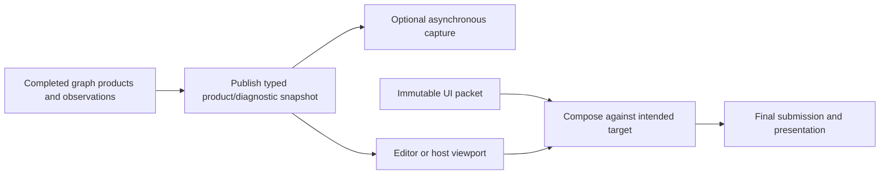
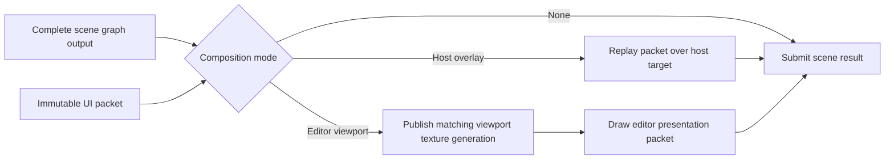

# Renderer Viewport And Diagnostics

[Docs](../../../../../../README.md) / [Up](../RendererFeatureGuide.md)

Sections: [Diagnostics, Products, and Capture](#diagnostics-products-and-capture) / [UI And Viewport Composition](#ui-and-viewport-composition).

**Status:** Renderer feature-family guide

**Scope:** route viewport-facing products, capture and observation, immutable UI composition, and editor/host publication boundaries

This family explains how a completed frame becomes inspectable: named products and diagnostic facts are published first, then immutable UI data may be composed into the intended viewport or host target.

**Current readiness:** **40/100** family projection — viewport/UI/debug/capture source paths exist with partial diagnostics truth; candidate semantics, lifetime, observer-cost, and Shipping proof is absent. See [Current Feature Readiness](../../../../../../Acceptance/CurrentReadiness.md#renderer).

## At A Glance

| Concern | Produced result | Boundary |
| --- | --- | --- |
| frame diagnostics | attributable frame/pass/timing/memory/active-state observations | observation does not own or prove feature semantics |
| render products | stable product identity, format, extent, and generation for viewport/capture consumers | a native texture handle alone is not a semantic product |
| capture/preview | asynchronous result with product and provenance identity | delivery is not visual correctness |
| UI composition | immutable draw packet replayed after scene work and before final submission | widgets, input, and editor intent remain outside RHI lowering |



## Choose By Result

| Document | Open it for |
| --- | --- |
| [Diagnostics, Products, And Capture](#diagnostics-products-and-capture) | diagnostic observations, render products, capture requests/results, provenance, bounds, and failure |
| [UI And Viewport Composition](#ui-and-viewport-composition) | immutable UI packets, viewport texture identity, composition order, host/editor integration, and lifetime |

Diagnostics and capture own observable facts and products. UI/viewport composition owns how already-produced data reaches a viewport; it does not recompute diagnostic truth. The parent [Renderer Feature Dossiers](../RendererFeatureGuide.md) index owns capability routing.

## Shared Risks

- Product, frame, shader, resource, and viewport generations can become stale independently.
- Diagnostic collection must be bounded and its cost classified.
- Captures and previews need exact color/encoding provenance to be interpretable.
- UI texture handles must remain valid through the same submission that consumes the packet.

## Diagnostics, Products, and Capture

**Status:** current feature dossier; source-backed, not proof that diagnostics are correct, complete, low-overhead, or release-safe

**Verified:** source route reverified 2026-09-18 against input revision `df2f0c0658cbf1cbdc0355c050a496cb513709e5` plus the current capture-ownership working tree; executable evidence remains unrun

**Scope:** `REN-DIAG-01` through `REN-DIAG-07`; defines Renderer observability, viewport products, asynchronous capture, and previews from the frame owner's perspective

**Current readiness:** **35/100** — useful products, observations, and capture seams exist; attribution, bounded publication, semantic truth, failure, observer-cost, backend, and support evidence remains open. See [Current Feature Readiness](../../../../../../Acceptance/CurrentReadiness.md#renderer).

### Diagnostics, Products, and Capture: At A Glance

| Product or observation | Current purpose | Trust boundary |
| --- | --- | --- |
| frame/pass diagnostics | expose active path, pass identity, timing, workload, and failure context | source counters and quiet logs do not prove correctness or low observer cost |
| memory/residency snapshots | report the owning caches/RHI memory facts rather than recalculate them | attribution, timing, and cross-owner reconciliation unproved |
| viewport products | publish named output with extent, format, frame, view, and generation identity | a texture handle without semantic identity is insufficient |
| asynchronous capture | request a product and receive a typed result after RHI readback | byte delivery does not prove intended color or feature semantics |
| preview/hot-reload observations | expose generation and replacement state | partial generation must never be presented as active success |

Diagnostics are observers of the existing owners. They may summarize or correlate facts, but must not become a shadow frame graph, memory authority, feature selector, or acceptance verdict.

### Feature Promise

Renderer exposes bounded observations of the frame it actually prepared/submitted and publishes named render products that editor and capture consumers can identify. Diagnostics must describe active state and failure; they are not allowed to become a second implementation authority or imply that a frame was correct merely because it completed.

### Current Diagnostic And Product Features

| Feature | Producer -> consumer | Current result and limit |
| --- | --- | --- |
| Frame/pass diagnostics | `FramePipeline`/frame graph/RHI scopes -> renderer read state/editor | frame execution, pass execution, marker, optional timestamp, and graph-contract observations |
| GPU markers | `r.Diagnostics.MarkerVerbosity` Off/FramePass/Detailed -> backend events | profiler-visible frame/pass names; detailed mode may enable draw/dispatch diagnostics |
| GPU timing | `r.Diagnostics.GpuTiming` -> timestamp queries -> later frame resolution | opt-in internal timings; availability and observer cost depend on backend |
| Mesh diagnostics | GPU mesh cache -> snapshot | cache/residency/detail information exposed through Renderer facade |
| Texture diagnostics | texture cache -> snapshot/editor texture registration | cache/residency rows and UI-usable texture handles |
| Memory diagnostics | Renderer memory monitor + cache/RHI budgets -> snapshot | combined renderer/resource budget view ticked at frame begin |
| Viewport products | frame graph -> `ViewportRenderProductPublication` | final color, scene depth, normals, producer-neutral scene-linear radiance, optional radiance second moment, extents and generation identity |
| Async capture | public request -> coordinator -> `ViewportCaptureService` -> RHI readback -> ticket-addressed completion | requested viewport/intermediate product read back without blocking submission or host-level feature dispatch |
| Mesh preview | Renderer preview product/handle route -> editor | editor-consumable mesh preview; fidelity/usability unproved |

Renderer now exposes `GetViewportPresentation()` as one fixed `ViewportPresentationSnapshot` containing Products, Texture and an independent PublicationSequence. Coordinator publishes under its existing read-state lock; serial/threaded Editor consumers acquire once and project matching products/texture. The actual x64 value is 600 bytes, bounded at compile time to <=2 KiB. Texture is borrowed and generation/retirement validation remains with the existing owners; publication identity is not native surface identity. [Stage 0C](../../../../../CrossModule/PerformanceDiagnostics/ExternalCapture/Discovery.md#stage-0c-implementation-handoff---2026-10-08) records current scoped implementation and controls without changing whole-feature release readiness.

### Capture Lifecycle

```text
BeginViewportCapture(request, id)
  -> resolve current named product; check expected frame identity
  -> begin RHI asynchronous texture readback
  -> PollFrameServices on later frames
  -> move completed readback to coordinator read state
  -> owning caller TryTakeViewportCapture(id) moves that result out
```

Readback admission now returns `ViewportCaptureAdmission` with Accepted/Full/Closed and an ID only when accepted. Threaded requests use the existing command queue's TryPush without a capacity wait; serial requests retain direct execution and the same three-outstanding cap. Three tracked IDs are released only when their exact completion is taken; render-owner abandonment preserves published results and fails other accepted identities once. Screenshot and Reference artifact callers distinguish rejection and settle accepted work before retry. [Stage 0B](../../../../../CrossModule/PerformanceDiagnostics/ExternalCapture/Discovery.md#stage-0b-implementation-handoff---2026-10-08) records the current scoped implementation and checks, including mutex-contention and default long-destination writer limitations; this does not change whole-feature release readiness.

The coordinator admits at most three outstanding capture tickets. Each accepted ticket remains owned by its requester until that requester takes the matching completion; the Renderer does not expose an anonymous FIFO and does not drop an admitted completion to make room for another. A fourth request is rejected before readback allocation. "No result yet" means that exact ticket is pending, not success. The current result records frame, scene, provider and immutable product provenance plus failure and readback dimensions/format; it does not carry shader or graph-topology generation. Requested-versus-resolved product and color/encoding metadata therefore remain documentation/evidence gaps rather than implied state.

Product names describe data rather than the feature that produced it. `Radiance` is the scene-linear HDR first moment: Lit publishes its pre-exposure scene color and the Reference middle publishes its committed estimator mean. `RadianceSecondMoment` is optional; the current Reference producer uses it for its committed Welford M2 accumulator and ordinary Lit leaves it absent. Progressive producers attach `RenderProductSamplePrefix`; non-progressive producers leave it empty. Reference-specific convergence, checkpoint, and authority claims remain outside this generic capture contract.

### Where Observation Occurs In A Frame

- At frame start, completed capture, retirement, provider/shader retirement, and residency work is polled.
- `BeginFrame` resolves prior GPU timings and ticks memory state for the new frame ID.
- Graph execution emits frame/pass scopes, compiled-barrier/alias markers, and optional detailed command markers.
- Product publication identifies resources before graph execution so later capture requests can resolve the owning graph generation.
- After submission, queue tokens become the authority for upload, graph, provider, and shader retirement.

This sequence makes diagnostics causally attachable to a frame, but correlation with PIX, RenderDoc, Nsight, RGP, DRED, or Vulkan validation remains an evidence task.

### Failure And Trust Boundaries

- Invalid/unavailable product or unsupported readback format must report failure; an empty image or stale prior product is not success.
- Diagnostic buffers/queues must expose truncation or drops. A bounded container that silently loses the newest relevant failure is not trustworthy.
- GPU timestamp values require valid queue frequency/order and must not be compared across unsupported clock domains.
- Enabling detailed markers/timing/capture changes observer cost; performance evidence must record diagnostic configuration.
- Development diagnostics, private paths, shader debug artifacts, or editor handles must not leak into the Shipping runtime package.
- A responsive process, submitted command list, nonempty capture, or plausible metric is not proof of visual/numerical correctness.

### Intent And Tradeoffs

- Observability lives beside the owner that can attach correct identities, while native validation/crash data stays in RHI. This avoids Renderer guessing backend state.
- Capture is asynchronous to preserve frame progress. The tradeoff is explicit ticket ownership, bounded admission, polling, and lifetime management.
- Diagnostics observe active shader/provider/graph generations where available, but [Pipeline Materialization and Typed Binding](../ShaderRuntime/PipelineMaterializationAndTypedBinding.md) owns shader-generation validation, activation, and retirement.
- Bounded snapshots protect runtime memory but require visible truncation/drop semantics and support-oriented prioritization.

Primary evidence: `REN-E21`, `RHI-E13`, `RHI-E14`, `ED-E03`, and the external-capture workflow in `WF-011`/`WF-017`.

### Acceptance Criteria

- `AC-DAC-01` — frame/pass/marker/timing observations identify the actual frame, pass, queue, backend, and diagnostic configuration; disabled features emit no misleading partial values.
- `AC-DAC-02` — mesh, texture, and memory snapshots are bounded, internally consistent, generation/timestamp identified, and explicitly report truncation, unavailable categories, and pressure thresholds.
- `AC-DAC-03` — viewport products identify viewport/request generation, frame, scene, provider, extent, format, and semantic product; missing shader/topology/color provenance remains visibly Unknown rather than inferred.
- `AC-DAC-04` — capture accepts only an available matching product, remains asynchronous, and moves exactly one terminal result to the owner of the matching ticket without stale duplication or cross-consumer routing.
- `AC-DAC-05` — the exact outstanding-ticket bound is enforced; overflow rejects the new request before allocation and no admitted completion is silently dropped.
- `AC-DAC-06` — captured row pitch, format, extent, channel/color interpretation, and pixels match the source product within a predeclared oracle on D3D12 and Vulkan.
- `AC-DAC-08` — marker/timing/capture observer cost is measured or classified for performance evidence, and Shipping/package audits contain only deliberately supported diagnostics/artifacts.

### Controlled Failure Modes And Checks

| Failure ID | Injection or cause | Required safe behavior | Detecting check |
| --- | --- | --- | --- |
| `FM-DAC-01` | request absent/stale product, mismatched frame, or unsupported readback format | capture completes Failed with identity/reason; empty or prior pixels are not success | `CHK-DAC-02` |
| `FM-DAC-02` | exceed the outstanding-ticket bound or poll one ticket from another workflow | the new request is rejected, admitted results remain retained for their owners, and no cross-consumer payload is returned | `CHK-DAC-02` |
| `FM-DAC-03` | GPU timing unsupported, invalid, or unresolved | observation reports unavailable/pending; zero/stale duration is not presented as measurement | `CHK-DAC-01` |
| `FM-DAC-05` | diagnostic buffer truncates or Shipping contains private artifacts/paths | truncation/package audit fails explicitly | `CHK-DAC-01`, `CHK-DAC-04` |

| Check | Exercise and oracle | Covers |
| --- | --- | --- |
| `CHK-DAC-01` | toggle marker/timing modes, force unsupported/unresolved timing, overflow diagnostic rows, correlate with an external capture, and record observer-cost state | `AC-DAC-01`, `AC-DAC-02`, `AC-DAC-08`; `FM-DAC-03`, `FM-DAC-05` |
| `CHK-DAC-02` | capture known final/depth/normal patterns across pending/completed limits, stale/missing identity, unsupported format, resize, and both backends; decode metadata/pixels | `AC-DAC-03`–`AC-DAC-06`; `FM-DAC-01`, `FM-DAC-02` |
| `CHK-DAC-04` | Development versus Shipping package manifest/string/path audit plus focused diagnostic-off performance baseline | `AC-DAC-08`; `FM-DAC-05` |

This contract is **defined but unproved**. Diagnostic presence proves observability only; it cannot substitute for the visual, numerical, synchronization, performance, or release contract of the feature being observed.

### Primary Source Routes

- [`FramePipeline.cpp`](../../../../../../../Engine/Renderer/Private/Frame/FramePipeline.cpp) and [`FramePipelineDiagnostics.cpp`](../../../../../../../Engine/Renderer/Private/Frame/FramePipelineDiagnostics.cpp)
- [`FrameExecutionDiagnostics.cpp`](../../../../../../../Engine/Renderer/Private/Diagnostics/FrameExecutionDiagnostics.cpp) and [`PassExecutionDiagnostics.cpp`](../../../../../../../Engine/Renderer/Private/Diagnostics/PassExecutionDiagnostics.cpp)
- [`RendererMemoryMonitor.cpp`](../../../../../../../Engine/Renderer/Private/Diagnostics/RendererMemoryMonitor.cpp)
- [`ViewportCaptureService.cpp`](../../../../../../../Engine/Renderer/Private/Viewport/ViewportCaptureService.cpp)
- [`ViewportRenderProductPublication.cpp`](../../../../../../../Engine/Renderer/Private/Viewport/ViewportRenderProductPublication.cpp)
- [Performance Diagnostics](../../../../../CrossModule/PerformanceDiagnostics/PerformanceDiagnosticsDesign.md) for cross-module/external-tool architecture and [Validation and Evidence](../../../../../../Engineering/Verification/ValidationAndEvidence.md) for proof grades.

## UI And Viewport Composition

**Status:** current feature dossier; source-backed, not blend, color, DPI, input, lifetime, stress, or release evidence

**Scoped update:** 2026-10-05 source repair separates host UI replay from viewport-image admission. Missing or generation-mismatched images retire the viewport handle; unresolved image commands are omitted while valid UI commands continue. Native blend, DPI, transition, and lifetime acceptance remains unproved.

The 2026-10-06 replay correction removes unresolved image commands from the native command list. A zero element count alone still lets ImGui bind the texture descriptor before drawing, which caused a D3D12 validation exception during Sponza startup. Reset-state callbacks and resolved commands retain their original order and vertex/index offsets.

**Verified:** 2026-09-06 against source revision `d236da11`; `Engine/Renderer` is unchanged from the earlier `8414b5dc` source audit

**Scope:** `REN-UI-01` through `REN-UI-04`; immutable UI packets, host overlays, editor viewport presentation, texture handles, and the post-graph/pre-submit composition boundary

**Current readiness:** **45/100** — immutable UI packet and viewport composition routes exist; color/blend/DPI, stale identity, resize/switch, lifetime, failure, and Shipping evidence does not. See [Current Feature Readiness](../../../../../../Acceptance/CurrentReadiness.md#renderer).

### UI And Viewport Composition: At A Glance

| Mode | Scene result | UI/product result | Main risk |
| --- | --- | --- | --- |
| None | graph output proceeds unchanged | no UI work | a stale prior UI result must not be implied |
| HostOverlay | scene output remains the composition target | immutable packet is replayed through the RHI ImGui route | blend/color/DPI and packet lifetime unproved |
| Viewport | final graph color becomes a typed viewport product | matching generation is registered and drawn by the submitted viewport UI packet | stale/wrong viewport texture or unbounded registration growth |



Composition occurs after the scene graph and before final submit. This gives host and editor one backend lowering path, but it makes packet, product, texture, viewport, and frame generations part of the correctness contract.

### UI And Viewport Composition: Feature Promise

`UiFrameRenderer` consumes one immutable UI packet after scene graph execution and before final frame submission.

| Mode | Current operation | Refusal/safe state |
| --- | --- | --- |
| None | no UI work | scene output continues unchanged |
| HostOverlay | replay packet through the RHI ImGui renderer inside a presentation overlay pass | empty draw data produces no overlay |
| Viewport | transition final viewport color to shader read, resolve/publish a texture handle, require packet/product viewport-generation agreement, draw the viewport presentation pass, then return the product to Common state | missing graph/product/texture or generation disagreement retires the viewport texture; valid host UI commands still draw, unresolved image commands are omitted, and empty draw data produces no UI work |

### Ownership And Lifetime

- Application/Editor produces immutable draw data; Renderer owns when it is replayed relative to graph execution and submit.
- RHI owns the actual ImGui/native resource rendering mechanism and transitions requested by Renderer.
- Renderer UI's private `UiTextureRegistry` gives the viewport a generation-derived `UiTextureHandle` and maps other texture IDs for UI/diagnostic consumers. The binding is published separately from `RenderProduct`; viewport products remain rendering-only metadata.
- The inspected non-viewport registration list appends unique bindings and has only the `uint32` slot-space bound; no explicit unregister/reclamation owner was found. Long-session growth and stale-handle behavior are therefore Partial capability, not an unlimited-lifetime guarantee.

The replay command list is explicit: `UiFrameRenderer` borrows its current graphics list from `RenderDeviceServices`, and `UiRenderPacketPlayer` passes that same list with reconstructed draw data to `RhiImGuiRenderer::RenderDrawData`. The list belongs to the same device as the renderer and is borrowed only for the call. Packet preparation neither selects a queue nor retains the list or a live Editor pointer. Source ownership reconciled on 2026-10-25; backend/device execution remains a separate proof gate.

### Failure, Tradeoffs, And Evidence

- Missing products, generation mismatch, stale handles, empty packets, resize, level switch, and repeated texture registration need controlled behavior.
- Immutable packets preserve threading and ownership clarity, but can still carry stale identity if producer/consumer generation checks are incomplete.
- Shared host/editor composition reduces duplicated UI backends while increasing the importance of explicit mode and texture lifetime.
- `REN-E21` owns blend/color/DPI correctness, viewport generation, stale/wrong textures, registry bounds, and attribution. The feature-local proof contract is defined below.

### UI And Viewport Composition: Acceptance Criteria

- `AC-UVC-01` — None, HostOverlay, and Viewport modes execute only their documented post-graph/pre-submit behavior and do not alter scene products when no UI work is requested.
- `AC-UVC-02` — immutable packet replay preserves vertex/index/command order, clipping, texture selection, premultiplied/straight-alpha contract, color transfer, and draw-data lifetime through submission.
- `AC-UVC-03` — host overlay composition matches the declared blend/color result across transparent, opaque, nested clip, empty, high-DPI, and resize fixtures without changing input ownership.
- `AC-UVC-04` — editor viewport image draw occurs only when packet and product viewport generations match; host UI remains drawable without that image; missing/stale product or texture retires/refuses the handle and never draws another viewport's image.
- `AC-UVC-05` — final viewport color transitions Common -> shader read -> Common around UI use, with correct queue ordering and completion lifetime on D3D12 and Vulkan.
- `AC-UVC-06` — repeated viewport create/resize/destroy/recreate and non-viewport texture registration have a measured/documented bound and stale-handle behavior; append-only growth is not treated as unlimited support.
- `AC-UVC-07` — two simultaneous viewports with different generations, DPI, extents, packets, and textures remain isolated through rapid switching and level reload.
- `AC-UVC-08` — UI diagnostics/captures identify composition mode, viewport generation, source product, texture handle, and failure reason sufficiently to distinguish no-op, refusal, and successful draw.

### UI And Viewport Composition: Controlled Failure Modes And Checks

| Failure ID | Injection or cause | Required safe behavior | Detecting check |
| --- | --- | --- | --- |
| `FM-UVC-01` | empty/malformed packet, invalid clip/index range, or missing texture | reject/skip the invalid command with visible error policy; scene output remains valid | `CHK-UVC-01` |
| `FM-UVC-02` | packet/product generation mismatch or stale viewport handle | draw is refused and stale mapping retired; no wrong viewport texture appears | `CHK-UVC-02` |
| `FM-UVC-03` | resize/destroy/recreate during in-flight UI use | old resources survive to completion, new generation is isolated, and registry remains bounded by its declared policy | `CHK-UVC-02`, `CHK-UVC-03` |
| `FM-UVC-04` | wrong resource state/queue ordering | native validation or state-contract check fails before the candidate can pass | `CHK-UVC-03` |
| `FM-UVC-05` | DPI/color/blend convention mismatch | decoded reference image comparison identifies the mismatched cell | `CHK-UVC-01` |

| Check | Exercise and oracle | Covers |
| --- | --- | --- |
| `CHK-UVC-01` | deterministic UI pattern suite over packet order, alpha/color, clip, texture, empty/malformed, and DPI cells; compare decoded output | `AC-UVC-01`–`AC-UVC-03`; `FM-UVC-01`, `FM-UVC-05` |
| `CHK-UVC-02` | dual-viewport generation stress across resize/destroy/recreate/level reload with deliberately stale/missing packet/product/texture identities | `AC-UVC-04`, `AC-UVC-06`, `AC-UVC-07`; `FM-UVC-02`, `FM-UVC-03` |
| `CHK-UVC-03` | paired-backend native-validation run inspecting transitions, queue tokens, registry/texture retirement, and shutdown drain | `AC-UVC-05`, `AC-UVC-06`; `FM-UVC-03`, `FM-UVC-04` |
| `CHK-UVC-04` | inspect emitted diagnostics/capture metadata for None, successful overlay/editor draws, and each refusal path | `AC-UVC-08`; `FM-UVC-01`, `FM-UVC-02` |

This contract is **defined but unproved**. The absence of a crash or the presence of UI pixels does not prove correct blending, transfer, DPI, identity, transitions, or long-session lifetime.

### UI And Viewport Composition: Primary Source Routes

- [`UiFrameRenderer.cpp`](../../../../../../../Engine/Renderer/Private/UI/UiFrameRenderer.cpp)
- [`UiRenderPacketPlayer.cpp`](../../../../../../../Engine/Renderer/Private/UI/UiRenderPacketPlayer.cpp)
- [`UiTextureRegistry.cpp`](../../../../../../../Engine/Renderer/Private/UI/UiTextureRegistry.cpp)
