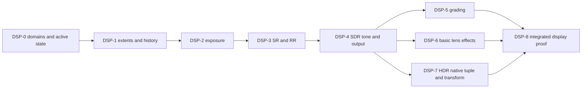

# Renderer Display And Reconstruction Closure Plan

[Docs](../../../../../README.md) / [Up](README.md) / [Design](../RendererDesign.md)

Qualify existing temporal/exposure/reconstruction/SDR behavior, then integrate approved grading, basic lens and HDR features through their bounded contracts.

**Status:** remaining release integration and proof; stage names do not imply missing implementation or passed evidence.

## Work This Plan

Use DSP-0 only for a changed domain/order decision. Select the earliest wrong display product after raw lighting is valid. Existing exposure/provider/tone code is repaired or proved, not rebuilt by default. Grading, chromatic aberration, vignette and HDR retain their release obligations and local discovery gates.

Run the stage that owns the demonstrated missing contract or failing check. Stage numbers identify responsibilities; they do not require rebuilding existing layers or completing unrelated stages first. Every stage and copied prompt follows the [Stage Source-Style Gate](../../../../../Engineering/Workflow/ChangeLifecycle.md#stage-source-style-gate) and the [shared delivery contract](../../../../CrossModule/FirstRelease/ImplementationPlan.md#phase-card-contract).

## Dependencies



The diagram expresses inputs, not instructions to execute every stage. Qualified predecessors are reused. A missing HDR display blocks native HDR proof, not independent SDR/grading/lens work. Raw-reference, exact-debug and UI products retain their bypass/composition rules.

## `DSP-0` — Freeze Domains, Extents, And Active-State Truth

**Start:** The selected transform/provider/output cell lacks a ratified domain or ordering decision.

**Work:** Trace its scene-linear signal, exposure, guides/motion/jitter, reconstruction, tone/grade/lens edge, encoding, alpha/UI and capture product. Freeze actual render/output/client extents, requested/active/fallback and generation in existing owners. HDR discovery chooses the native tuple needed for the HDR10 signal; this phase does not independently select an extra output profile.

**Cleanup:** Remove duplicate order/domain definitions and obsolete selector assumptions; no general color or AA framework.

**Exit:** A current diagram and affected AC/FM/check cells decide the next slice; every retained feature has one transform/output owner.

```text
Execute only DSP-0 from Docs/Architecture/Modules/Engine/Renderer/FirstRelease/DisplayAndReconstructionImplementationPlan.md#dsp-0--freeze-domains-extents-and-active-state-truth. Apply the linked Phase Card Contract, including the Stage Source-Style Gate.
Selected work: Trace its scene-linear signal, exposure, guides/motion/jitter, reconstruction, tone/grade/lens edge, encoding, alpha/UI and capture product.
Verify the stage's Start condition against current owners and exact prerequisite artifacts. Execute its full Work, Cleanup and Exit under the accepted scope; preserve the selected frame/product and reuse valid code/proof. Stop on a missing contract, unsafe lifetime, silent fallback, changed quality/identity or a required unavailable falsifier.
NON-NEGOTIABLE: one producer/consumer authority; actual artifact/API/profile/settings identity; no unledgered state/API/hooks/copies/dependencies; same-stage replacement deletion and positive retained-path checks. A no-source stage records justified source-style N/A. Handoff exact checks/artifacts/limits to the stage's existing report owner; no neighboring stage or new mechanism merely to fill a report.
```

## `DSP-1` — Temporal Sampling, History, Resolution, And AA Truth

**Start:** An admitted view/history/provider input or extent cell needs closure.

**Work:** Check Halton index/sign/matrices, rigid/skin/morph/sky motion, cuts/resize/provider/scene reset and view isolation. Match attachment/dispatch/scissor/product and SDK-derived extents; preserve actual sample count and explicit absence of standalone TAA/FXAA/SMAA/MSAA/dynamic resolution.

**Cleanup:** Remove duplicate extent/jitter/reset authority and superseded history validity; no new AA technique or hidden provider jitter.

**Exit:** FCR-REN-18/FCR-REN-22 affected numerical/reset/isolation/native controls pass both APIs with requested/actual extents recorded.

```text
Execute only DSP-1 from Docs/Architecture/Modules/Engine/Renderer/FirstRelease/DisplayAndReconstructionImplementationPlan.md#dsp-1--temporal-sampling-history-resolution-and-aa-truth. Apply the linked Phase Card Contract, including the Stage Source-Style Gate.
Selected work: Check Halton index/sign/matrices, rigid/skin/morph/sky motion, cuts/resize/provider/scene reset and view isolation.
Verify the stage's Start condition against current owners and exact prerequisite artifacts. Execute its full Work, Cleanup and Exit under the accepted scope; preserve the selected frame/product and reuse valid code/proof. Stop on a missing contract, unsafe lifetime, silent fallback, changed quality/identity or a required unavailable falsifier.
NON-NEGOTIABLE: one producer/consumer authority; actual artifact/API/profile/settings identity; no unledgered state/API/hooks/copies/dependencies; same-stage replacement deletion and positive retained-path checks. A no-source stage records justified source-style N/A. Handoff exact checks/artifacts/limits to FCR-REN-18, FCR-REN-22; no neighboring stage or new mechanism merely to fill a report.
```

## `DSP-2` — Exposure

**Start:** Valid raw lighting and the existing exposure semantic contract are available.

**Work:** Check retained manual/metering modes, luminance/reduction, finite min/max, adaptation direction/speed/time and step response, reset/isolation, async producer dependencies and provider multiplier. Repair demonstrated failures; reuse valid numeric results by identity.

**Cleanup:** Delete replaced metering/adaptation state and duplicate multiplier application; exposure cannot repair transport units or conceal nonfinite raw input.

**Exit:** FCR-REN-09 meets owned ramp/extreme/step/finite/reset/scheduling tolerances and changed cost bounds.

```text
Execute only DSP-2 from Docs/Architecture/Modules/Engine/Renderer/FirstRelease/DisplayAndReconstructionImplementationPlan.md#dsp-2--exposure. Apply the linked Phase Card Contract, including the Stage Source-Style Gate.
Selected work: Check retained manual/metering modes, luminance/reduction, finite min/max, adaptation direction/speed/time and step response, reset/isolation, async producer dependencies and provider multiplier.
Verify the stage's Start condition against current owners and exact prerequisite artifacts. Execute its full Work, Cleanup and Exit under the accepted scope; preserve the selected frame/product and reuse valid code/proof. Stop on a missing contract, unsafe lifetime, silent fallback, changed quality/identity or a required unavailable falsifier.
NON-NEGOTIABLE: one producer/consumer authority; actual artifact/API/profile/settings identity; no unledgered state/API/hooks/copies/dependencies; same-stage replacement deletion and positive retained-path checks. A no-source stage records justified source-style N/A. Handoff exact checks/artifacts/limits to FCR-REN-09; no neighboring stage or new mechanism merely to fill a report.
```

## `DSP-3` — Image Reconstruction And Provider Integration

**Start:** Required raw signals, temporal/exposure conventions and exact pinned SDK/runtime tuple are known.

**Work:** Close Linear control and every exposed SDK-supported DLSS SR/RR combination required on the named NVIDIA machine for D3D12/Vulkan. Inspect current initialization/evaluation rather than infer it from texture helpers; freeze realtime internal/output extent and one composition owner. Follow the selected REC-S1 topology: RR directly owns reconstructed output when active; remove the current RR-then-SR sequence and qualify requested/active compatibility without silent settings changes. Prove guides, motion/depth/jitter/exposure/reset, temporal quality, state restoration, retirement, DLL/rights/package and failures.

**Cleanup:** Remove duplicate provider/extent/history/status paths and obsolete bindings. Preserve truthful Linear/Off recovery without accepting it as requested SR/RR proof; no frame generation or provider catalog.

**Exit:** FCR-REN-10 required cells pass independently on both APIs; fallback, missing hardware or Experimental cannot close an Included provider result.

```text
Execute only DSP-3 from Docs/Architecture/Modules/Engine/Renderer/FirstRelease/DisplayAndReconstructionImplementationPlan.md#dsp-3--image-reconstruction-and-provider-integration. Apply the linked Phase Card Contract, including the Stage Source-Style Gate.
Selected work: Close Linear control and every exposed SDK-supported DLSS SR/RR combination required on the named NVIDIA machine for D3D12/Vulkan.
Verify the stage's Start condition against current owners and exact prerequisite artifacts. Execute its full Work, Cleanup and Exit under the accepted scope; preserve the selected frame/product and reuse valid code/proof. Stop on a missing contract, unsafe lifetime, silent fallback, changed quality/identity or a required unavailable falsifier.
NON-NEGOTIABLE: one producer/consumer authority; actual artifact/API/profile/settings identity; no unledgered state/API/hooks/copies/dependencies; same-stage replacement deletion and positive retained-path checks. A no-source stage records justified source-style N/A. Handoff exact checks/artifacts/limits to FCR-REN-10; no neighboring stage or new mechanism merely to fill a report.
```

## `DSP-4` — Tone Mapping, Encoding, And Presentation

**Start:** Valid radiance and provider/exposure domains exist; current SDR output is selected.

**Work:** Check retained Reinhard/ACES approximation/fitted choices against owned ramps/extremes, finite/alpha behavior, one exposure/tone/encoding sequence, format/domain pairing, viewport/backbuffer generations, debug/capture labels, UI and resize/DPI/present. This is the SDR control for later output changes.

**Cleanup:** Delete double transforms, redundant output products and replaced tone/encoding state. No color-management suite or UI repair of scene/display math.

**Exit:** FCR-REN-14/FCR-REN-15 affected numerical/domain/publication/native output cells pass both APIs.

```text
Execute only DSP-4 from Docs/Architecture/Modules/Engine/Renderer/FirstRelease/DisplayAndReconstructionImplementationPlan.md#dsp-4--tone-mapping-encoding-and-presentation. Apply the linked Phase Card Contract, including the Stage Source-Style Gate.
Selected work: Check retained Reinhard/ACES approximation/fitted choices against owned ramps/extremes, finite/alpha behavior, one exposure/tone/encoding sequence, format/domain pairing, viewport/backbuffer generations, debug/capture labels, UI and resize/DPI/present.
Verify the stage's Start condition against current owners and exact prerequisite artifacts. Execute its full Work, Cleanup and Exit under the accepted scope; preserve the selected frame/product and reuse valid code/proof. Stop on a missing contract, unsafe lifetime, silent fallback, changed quality/identity or a required unavailable falsifier.
NON-NEGOTIABLE: one producer/consumer authority; actual artifact/API/profile/settings identity; no unledgered state/API/hooks/copies/dependencies; same-stage replacement deletion and positive retained-path checks. A no-source stage records justified source-style N/A. Handoff exact checks/artifacts/limits to FCR-REN-14, FCR-REN-15; no neighboring stage or new mechanism merely to fill a report.
```

## `DSP-5` — Color Grading

**Start:** CGRD-00 and contributing scene/display domains are accepted for the retained parameter/LUT subset.

**Work:** Execute the next [grading stage](../Features/PostProcessing/DisplayPipeline/ColorGrading/ImplementationPlan.md). Retain independent numeric oracle, neutral identity, typed current asset/cook/residency, view/reset, raw/debug/UI bypass and package/cost proof.

**Cleanup:** Delete replaced grade/settings/source-cooked authority in the leaf stage; no grading graph/editor or arbitrary LUT format.

**Exit:** FCR-REN-24 satisfies AC-CGR-01 through 08 and mapped failures for the admitted candidate. SDR proof does not claim native HDR cells.

```text
Execute only DSP-5 from Docs/Architecture/Modules/Engine/Renderer/FirstRelease/DisplayAndReconstructionImplementationPlan.md#dsp-5--color-grading. Apply the linked Phase Card Contract, including the Stage Source-Style Gate.
Selected work: Execute the next [grading stage](../Features/PostProcessing/DisplayPipeline/ColorGrading/ImplementationPlan.md).
Verify the stage's Start condition against current owners and exact prerequisite artifacts. Execute its full Work, Cleanup and Exit under the accepted scope; preserve the selected frame/product and reuse valid code/proof. Stop on a missing contract, unsafe lifetime, silent fallback, changed quality/identity or a required unavailable falsifier.
NON-NEGOTIABLE: one producer/consumer authority; actual artifact/API/profile/settings identity; no unledgered state/API/hooks/copies/dependencies; same-stage replacement deletion and positive retained-path checks. A no-source stage records justified source-style N/A. Handoff exact checks/artifacts/limits to FCR-REN-24; no neighboring stage or new mechanism merely to fill a report.
```

## `DSP-6` — Chromatic Aberration And Vignette

**Start:** CHRD-00 is accepted for chromatic work, or the independent vignette freeze is accepted for vignette work.

**Work:** Execute one selected [chromatic](../Features/PostProcessing/DisplayPipeline/ChromaticAberration/ImplementationPlan.md) or [vignette](../Features/PostProcessing/DisplayPipeline/Vignette/ImplementationPlan.md) stage. Neither waits for the other's discovery. Keep independent formula/units/edges/alpha/aspect checks, selected settings and actual On defaults; neutral controls omit all effect work.

**Cleanup:** Remove replaced offsets/masks/fields/intermediates in that leaf; reuse settings/display/graph owners without a lens stack or artistic suite.

**Exit:** FCR-REN-25 closes only when AC-CHR-01 through 08 and AC-VIG-01 through 06 each pass raw/debug/UI, view/backend/package/cost and controlled failures. One effect cannot inherit the other's verdict.

```text
Execute only DSP-6 from Docs/Architecture/Modules/Engine/Renderer/FirstRelease/DisplayAndReconstructionImplementationPlan.md#dsp-6--chromatic-aberration-and-vignette. Apply the linked Phase Card Contract, including the Stage Source-Style Gate.
Selected work: Execute one selected [chromatic](../Features/PostProcessing/DisplayPipeline/ChromaticAberration/ImplementationPlan.md) or [vignette](../Features/PostProcessing/DisplayPipeline/Vignette/ImplementationPlan.md) stage.
Verify the stage's Start condition against current owners and exact prerequisite artifacts. Execute its full Work, Cleanup and Exit under the accepted scope; preserve the selected frame/product and reuse valid code/proof. Stop on a missing contract, unsafe lifetime, silent fallback, changed quality/identity or a required unavailable falsifier.
NON-NEGOTIABLE: one producer/consumer authority; actual artifact/API/profile/settings identity; no unledgered state/API/hooks/copies/dependencies; same-stage replacement deletion and positive retained-path checks. A no-source stage records justified source-style N/A. Handoff exact checks/artifacts/limits to FCR-REN-25; no neighboring stage or new mechanism merely to fill a report.
```

## `DSP-7` — HDR10 Display Output

**Start:** HDRD-00 accepts signal/UI/native tuple and contributing contracts; native proof also requires a qualified HDR display/OS tuple.

**Work:** Execute the next [HDR stage](../Features/PostProcessing/DisplayPipeline/HDRDisplayOutput/ImplementationPlan.md). Renderer owns scene/UI/gamut/tone/transfer; RHI owns capability/activation/metadata/recreation/present. Qualify native state, PQ/gamut/luminance/UI, transitions/faults, SDR recovery and package/cost on each required API.

**Cleanup:** Remove duplicate native/Renderer active-state and tone/encoding paths in the replacement stage. No second display/settings framework, extra HDR profile or hardware purchase by implication.

**Exit:** FCR-REN-26 meets AC-HDR-01 through 08 on admitted hardware. Math can pass without a display; actual HDR activation/output stays unrun until observed.

```text
Execute only DSP-7 from Docs/Architecture/Modules/Engine/Renderer/FirstRelease/DisplayAndReconstructionImplementationPlan.md#dsp-7--hdr10-display-output. Apply the linked Phase Card Contract, including the Stage Source-Style Gate.
Selected work: Execute the next [HDR stage](../Features/PostProcessing/DisplayPipeline/HDRDisplayOutput/ImplementationPlan.md).
Verify the stage's Start condition against current owners and exact prerequisite artifacts. Execute its full Work, Cleanup and Exit under the accepted scope; preserve the selected frame/product and reuse valid code/proof. Stop on a missing contract, unsafe lifetime, silent fallback, changed quality/identity or a required unavailable falsifier.
NON-NEGOTIABLE: one producer/consumer authority; actual artifact/API/profile/settings identity; no unledgered state/API/hooks/copies/dependencies; same-stage replacement deletion and positive retained-path checks. A no-source stage records justified source-style N/A. Handoff exact checks/artifacts/limits to FCR-REN-26; no neighboring stage or new mechanism merely to fill a report.
```

## `DSP-8` — Display Candidate Closure

**Start:** Compatible temporal, exposure/provider, SDR and required feature results exist for final configuration.

**Work:** Join nine reports and raw/intermediate/presented domains on one candidate. Fill missing interactions/reset/failure/native/package and quality/time/memory cells; keep provider and baseline verdicts separate.

**Cleanup:** Verify neutral-work omission and stage-local removal of obsolete transforms/state/build/shader membership; retire completed prompts after retaining proof.

**Exit:** FCR-REN-09/10/14/15/18/22/24/25/26 close admitted criteria and negatives. Required missing HDR/SR/RR proof stays blocked without creating unrelated display work.

```text
Execute only DSP-8 from Docs/Architecture/Modules/Engine/Renderer/FirstRelease/DisplayAndReconstructionImplementationPlan.md#dsp-8--display-candidate-closure. Apply the linked Phase Card Contract, including the Stage Source-Style Gate.
Selected work: Join nine reports and raw/intermediate/presented domains on one candidate.
Verify the stage's Start condition against current owners and exact prerequisite artifacts. Execute its full Work, Cleanup and Exit under the accepted scope; preserve the selected frame/product and reuse valid code/proof. Stop on a missing contract, unsafe lifetime, silent fallback, changed quality/identity or a required unavailable falsifier.
NON-NEGOTIABLE: one producer/consumer authority; actual artifact/API/profile/settings identity; no unledgered state/API/hooks/copies/dependencies; same-stage replacement deletion and positive retained-path checks. A no-source stage records justified source-style N/A. Handoff exact checks/artifacts/limits to FCR-REN-09; no neighboring stage or new mechanism merely to fill a report.
```

## Reference And Ownership

[Display contract](../Features/PostProcessing/DisplayPipeline/DisplayPipelineDesign.md), [reconstruction](../Features/PostProcessing/ReconstructionAndGeneration/ReconstructionAndGenerationDesign.md), [temporal history](../Features/FrameExecution/TemporalSamplingAndHistory.md) and linked leaf dossiers own semantics. [Required rendering closure](../../../../../Acceptance/FirstRelease.md#required-rendering-closure), approved defaults and budgets remain unchanged.
