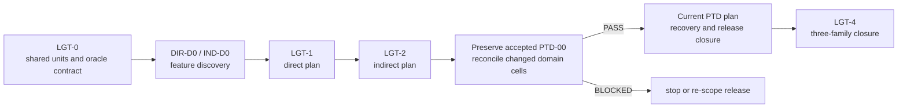

# Renderer Lighting Closure Plan

[Docs](../../../../../README.md) / [Up](README.md) / [Design](../RendererDesign.md)

Stages: [LGT-0](#lgt-0--freeze-units-estimators-and-comparison-domain) / [LGT-1](#lgt-1--direct-lighting) / [LGT-2](#lgt-2--indirect-lighting) / [LGT-3](#lgt-3--preserve-discovery-and-close-the-required-reference) / [LGT-4](#lgt-4--lighting-candidate-closure).

Produce correct direct, indirect and progressive reference lighting before judging reconstruction or frame rate.

**Status:** cross-feature release sequence for direct/indirect/reference closure; feature-local implementation order lives in the linked plans and no plan is evidence

**Current readiness:** section projection **37/100**; direct/indirect source routes exist, the Reference Path Tracer family is **20/100**, and all three remain `Blocked`

## Work This Plan

| What to do | Working route |
| --- | --- |
| First action | [Reference recovery](../Features/Lighting/ReferencePathTracer/ImplementationPlan.md#required-execution-order) handles the current recovery task. For release-wide lighting contracts, start with [LGT-0](#lgt-0--freeze-units-estimators-and-comparison-domain). |
| Result to reach | Finite trustworthy raw radiance, shared units/material/light meanings, then the direct and indirect feature plans and candidate comparisons. |
| Start / stop | Preserve accepted PTD-00 discovery and delivered source. Direct/indirect production work still needs its own discovery and release gates; realtime and reference are separate obligations. |

## Plan At A Glance



| Phase | Primary family | Current boundary |
| --- | --- | --- |
| `LGT-0` | all three | source routes exist, but shared units/material/light/reference contract must be reconciled |
| `LGT-1` | `FCR-REN-06` | direct source reservoir exists; `DIR-D0` and [the feature plan](../Features/Lighting/DirectLighting/ImplementationPlan.md) own its correctness-led clean break |
| `LGT-2` | `FCR-REN-07` | indirect seed-replay source exists; `IND-D0` and [the feature plan](../Features/Lighting/IndirectLighting/ImplementationPlan.md) own its path/shift/GRIS replacement |
| `LGT-3` | `FCR-REN-08`, discovery preservation and closure handoff | PTD-00-R1 passed development discovery; remaining recovery/Stage-10/reference proof is unclosed |
| `PTD-01` | `FCR-REN-08`, implementation | accepted development contract and source stages exist; finish the current recovery plan, with Stage 10 separately release-gated |
| `LGT-4` | all three | candidate comparison/adoption reports absent |

> [!CAUTION]
> Preserve the accepted PTD-00-R1 development contract and completed source stages; do not restart discovery. [Owner-directed release closure](../../../../../Acceptance/FirstRelease.md#required-rendering-closure) requires a reliable full admitted progressive reference and a separate realtime path-traced >=30 FPS result on both APIs. Domain changes require the exact affected discovery cells to reopen; existing recovery and Stage-10 proof remain mandatory.

NVIDIA's [RTXDI integration guide](https://github.com/NVIDIA-RTX/RTXDI/blob/main/Doc/Integration.md) is a primary reference for the boundary where the application owns scene, materials, GBuffer, rays, and API integration while the SDK supplies reservoir algorithms. [RTX Path Tracing](https://github.com/NVIDIA-RTX/RTXPT) and the repository's [completion study](../Features/Lighting/ReferencePathTracer/Research.md) are precedents and research inputs, never local proof.

## `LGT-0` — Freeze Units, Estimators, And Comparison Domain

**Goal:** establish one testable material/light/sky/unit, sampling identity, raw-output, and comparison contract for all three families.

**Non-goals:** choosing the Reference Path Tracer transport scope before discovery, tuning for release screenshots, or forcing direct/indirect/reference histories into one lifetime.

**Required work:** reconcile four light types/limits, material lobes, units/spaces, sky/environment boundary, surface/ray spawn, PDFs/weights/reservoir validity, deterministic sample identity, output lobe channels, composite, history/reset, debug separation, backends/routes, quality/cost/memory matrices, and feature `AC/FM/CHK`.

**Failure modes:** unit mismatch hidden by exposure; invalid PDF/weight; NaN/Inf clamped before evidence; direct energy double-counted; sky semantics differ; post-tonemapped image used as raw oracle; stochastic comparison lacks seed/sample identity.

**Phase exit criteria:** analytic fixtures and raw observables exist for every currently admitted direct/indirect cell; `FCR-REN-08` remains unaccepted until remaining recovery, estimator/oracle and release evidence closes; no undocumented transport claim enters implementation.

<details>
<summary>Copy implementation prompt</summary>

```text
Execute only LGT-0 from Docs/Architecture/Modules/Engine/Renderer/FirstRelease/LightingImplementationPlan.md#lgt-0--freeze-units-estimators-and-comparison-domain.
Goal: establish one testable material/light/sky/unit, sampling identity, raw-output, and comparison contract for all three families. Follow this stage's work, non-goals and owning checks.
Check prerequisites; reuse completed work and follow repository conventions. Record exact candidate/configuration, commands and exit results. Stop on unresolved contracts or unavailable required checks.
```

</details>

## `LGT-1` — Direct Lighting

**Goal:** sequence the accepted [Direct Lighting plan](../Features/Lighting/DirectLighting/ImplementationPlan.md) to close `FCR-REN-06` for all admitted analytic light kinds, material lobes, reservoir reuse, visibility, reconstruction, and many-light behavior.

**Non-goals:** expanding light types, replacing the BRDF, hiding bias/leaks with post effects, or separate inline/RGS lighting implementations.

**Required work:** prove light units and limits, BRDF/lobe outputs, candidate generation/PDF/weight/reservoir validity, temporal/spatial reuse if admitted, shadow visibility/bias, alpha/two-sided/subsurface scope, inline/native parity, invalid/missing data behavior, debug separability, and cost; use analytic single-light/material/occluder fixtures before maps.

**Failure modes:** zero/negative/non-finite weight; stale reservoir after identity/reset; self-intersection/acne or light leak; unsupported traversal hidden; light beyond limit corrupts buffer; one lobe receives duplicate/missing energy.

**Phase exit criteria:** `DIR-D0` is accepted and every required stage/criterion in the feature plan passes or produces an explicit blocker in `FCR-REN-06`.

<details>
<summary>Copy implementation prompt</summary>

```text
Execute only LGT-1 from Docs/Architecture/Modules/Engine/Renderer/FirstRelease/LightingImplementationPlan.md#lgt-1--direct-lighting.
Goal: sequence the accepted Direct Lighting plan (../Features/Lighting/DirectLighting/ImplementationPlan.md) to close FCR-REN-06 for all admitted analytic light kinds, material lobes, reservoir reuse, visibility, reconstruction, and many-light behavior. Follow this stage's work, non-goals and owning checks.
Check prerequisites; reuse completed work and follow repository conventions. Record exact candidate/configuration, commands and exit results. Stop on unresolved contracts or unavailable required checks.
```

</details>

## `LGT-2` — Indirect Lighting

**Goal:** sequence the accepted [Indirect Lighting plan](../Features/Lighting/IndirectLighting/ImplementationPlan.md) to close `FCR-REN-07` for the explicitly admitted path, shift, GRIS, reuse, material, sky, temporal, reconstruction, and failure domain.

**Non-goals:** calling the current Reference Path Tracer route ground truth, increasing bounces/features without acceptance need, or tuning away bias without identifying it.

**Required work:** reconcile candidate/sample generation, PDFs/weights/reservoir math, secondary ray/material/sky evaluation, bounce scope, direct/indirect separation, temporal/spatial reuse, motion/disocclusion/reset, firefly/non-finite policy, deterministic seeds, inline/RGS/backend equivalence, raw lobe outputs, artifact gallery, and quality/time/memory frontier.

**Failure modes:** zero PDF or exploding weight; reuse crosses view/scene generation; disocclusion ghosts; sky double-counts; firefly clamp biases silently; NaN/Inf enters history; reset leaves stale energy; route/backend diverges statistically.

**Phase exit criteria:** `IND-D0` is accepted and every required stage/criterion in the feature plan passes or produces an explicit blocker in `FCR-REN-07`.

<details>
<summary>Copy implementation prompt</summary>

```text
Execute only LGT-2 from Docs/Architecture/Modules/Engine/Renderer/FirstRelease/LightingImplementationPlan.md#lgt-2--indirect-lighting.
Goal: sequence the accepted Indirect Lighting plan (../Features/Lighting/IndirectLighting/ImplementationPlan.md) to close FCR-REN-07 for the explicitly admitted path, shift, GRIS, reuse, material, sky, temporal, reconstruction, and failure domain. Follow this stage's work, non-goals and owning checks.
Check prerequisites; reuse completed work and follow repository conventions. Record exact candidate/configuration, commands and exit results. Stop on unresolved contracts or unavailable required checks.
```

</details>

## `LGT-3` — Preserve Discovery And Close The Required Reference

**Goal:** finish the existing progressive Reference recovery/validation and Stage-10 delivery against the accepted PTD-00-R1 transport contract; this phase cannot substitute finite-depth/denoised output for full admitted reference truth.

**Non-goals:** replaying completed development discovery/source stages, expanding physical transport silently, calling a running viewport an oracle, or changing the realtime frame budget to the reference convergence budget.

**Required work:** preserve the accepted [discovery](../Features/Lighting/ReferencePathTracer/Discovery.md) and execute the [current recovery plan](../Features/Lighting/ReferencePathTracer/ImplementationPlan.md). Reconcile release maps/materials/lights/camera/pose and supported backend/domain cells before oracle use; reopen only changed domain decisions. Prove independent analytic/minimal/external comparisons, correct PDFs/units, invalid-sample rejection, convergence/uncertainty, raw-linear export, reset/cancel/lifetime and consumer selection. Keep the realtime direct/indirect path's finite/reuse/approximation policy and performance evidence separately owned. Stage 10 still waits for named release inputs, package and its own gates.

**Phase exit criteria:** required Reference feature criteria pass on both APIs and the actual candidate; no invalid/unconverged/finite diagnostic is admitted as reference. Full reference usability and realtime >=30 FPS remain separately required in the release owner. No score is awarded by completing this plan text.

<details>
<summary>Copy implementation prompt</summary>

```text
Execute only LGT-3 from Docs/Architecture/Modules/Engine/Renderer/FirstRelease/LightingImplementationPlan.md#lgt-3--preserve-discovery-and-close-the-required-reference.
Goal: finish the existing progressive Reference recovery/validation and Stage-10 delivery against the accepted PTD-00-R1 transport contract; this phase cannot substitute finite-depth/denoised output for full admitted reference truth. Follow this stage's work, non-goals and owning checks.
Check prerequisites; reuse completed work and follow repository conventions. Record exact candidate/configuration, commands and exit results. Stop on unresolved contracts or unavailable required checks.
```

</details>

## `LGT-4` — Lighting Candidate Closure

**Goal:** after `FCR-REN-08` implementation through the authorized `PTD-01`, compare direct/indirect results with the accepted Reference Path Tracer and close all three families for one candidate.

**Non-goals:** treating one attractive image as convergence, allowing the reference to share the same defect without independent checks, or skipping packaged/backend routes.

**Failure modes:** reference/candidate share unverified input; accumulation not converged; exposure/tone confounds raw result; one backend/provider differs; artifact gallery is cherry-picked; path-tracer evidence predates lighting changes.

**Phase exit criteria:** direct, indirect, and Reference Path Tracer reports satisfy their complete Architecture contracts; raw/reference, convergence, analytic/independent, failure, backend, package, quality/time/memory, and release-map evidence share one candidate identity.

<details>
<summary>Copy implementation prompt</summary>

```text
Execute only LGT-4 from Docs/Architecture/Modules/Engine/Renderer/FirstRelease/LightingImplementationPlan.md#lgt-4--lighting-candidate-closure.
Goal: after FCR-REN-08 implementation through the authorized PTD-01, compare direct/indirect results with the accepted Reference Path Tracer and close all three families for one candidate. Follow this stage's work, non-goals and owning checks.
Check prerequisites; reuse completed work and follow repository conventions. Record exact candidate/configuration, commands and exit results. Stop on unresolved contracts or unavailable required checks.
```

</details>

## Reference And Ownership

<details>
<summary>Exact owners, source snapshots and related contracts</summary>

**Release requirement:** [Rendering closure](../../../../../Acceptance/FirstRelease.md#required-rendering-closure) requires Included realtime primary/secondary transport on both APIs under REL-RT-1080P, compared against an accepted progressive reference. Freeze the exact finite-depth/reuse policy and temporal quality thresholds before benchmark results; a raster GBuffer plus prototype seed reservoirs is not accepted path tracing.

**Families:** `FCR-REN-06`, `FCR-REN-07`, `FCR-REN-08`

**Responsibility:** sequence lighting closure, preserve accepted reference discovery and route remaining reference recovery/release work to its feature plan

**Parent:** [First Release Renderer Plans](README.md)

**Architecture:** [Lighting](../Features/Lighting/LightingDesign.md), [Direct Lighting](../Features/Lighting/DirectLighting/DirectLightingDesign.md), [Indirect Lighting](../Features/Lighting/IndirectLighting/IndirectLightingDesign.md), [Volumetric Lighting](../Features/Lighting/VolumetricLighting/VolumetricLightingDesign.md), and [Reference Path Tracer](../Features/Lighting/ReferencePathTracer/ReferencePathTracerDesign.md)

</details>
