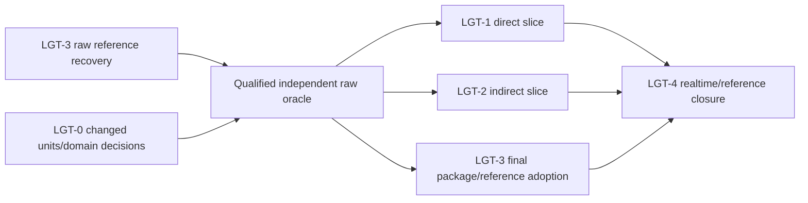

# Renderer Lighting Closure Plan

[Docs](../../../../../README.md) / [Up](README.md) / [Design](../RendererDesign.md)

Qualify raw surface radiance first, then close the admitted direct/indirect realtime path against that reference and its fixed performance target.

**Status:** remaining release integration and proof; stage names do not imply missing implementation or passed evidence.

## Work This Plan

Every stage and copied prompt follows [stage completion and resume](../../../../../Engineering/Workflow/ChangeLifecycle.md#stage-completion-and-resume). Close its finite local exit once; keep later aggregate proof separate.

Current entry is [Reference recovery](../Features/Lighting/ReferencePathTracer/ImplementationPlan.md#required-execution-order), represented here by LGT-3. Preserve accepted PTD-00 and delivered source stages. Use LGT-0 only for a changed shared semantic decision; reference recovery does not wait for completion of realtime estimators.

Run the stage that owns the demonstrated missing contract or failing check. Stage numbers identify responsibilities; they do not require rebuilding existing layers or completing unrelated stages first. Every stage and copied prompt follows the [Stage Source-Style Gate](../../../../../Engineering/Workflow/ChangeLifecycle.md#stage-source-style-gate) and the [shared delivery contract](../../../../CrossModule/FirstRelease/ImplementationPlan.md#phase-card-contract).

## Dependencies



Reference usability/oracle qualification precedes dependent image-quality claims. Final reference package adoption waits for its own release inputs, so it does not create a cycle blocking direct/indirect source work. Indirect work waits for any direct/PDF dependency it actually consumes, not a replay of the direct plan.

## `LGT-0` — Freeze Units, Estimators, And Comparison Domain

**Start:** An admitted light/material/sky or comparison cell changed or lacks a decidable contract.

**Work:** Reconcile that cell's units/spaces, ray/PDF/weight semantics, lobe/direct-indirect separation, raw output and independent oracle. Freeze actual backend/content/reset and quality/cost thresholds in existing discoveries; reopen only invalidated decisions.

**Cleanup:** Remove duplicate formula/domain definitions and obsolete decision instructions; keep reference and realtime histories separate where estimators/lifetimes differ.

**Exit:** The changed cell has one semantic owner and falsifying raw/analytic check. No additional lobe, medium or light family enters scope through this audit.

```text
Execute only LGT-0 from Docs/Architecture/Modules/Engine/Renderer/FirstRelease/LightingImplementationPlan.md#lgt-0--freeze-units-estimators-and-comparison-domain. Apply the linked Phase Card Contract, including the Stage Source-Style Gate.
Selected work: Reconcile that cell's units/spaces, ray/PDF/weight semantics, lobe/direct-indirect separation, raw output and independent oracle.
Verify the stage's Start condition against current owners and exact prerequisite artifacts. Execute its full Work, Cleanup and Exit under the accepted scope; preserve the selected frame/product and reuse valid code/proof. Stop on a missing contract, unsafe lifetime, silent fallback, changed quality/identity or a required unavailable falsifier.
NON-NEGOTIABLE: one producer/consumer authority; actual artifact/API/profile/settings identity; no unledgered state/API/hooks/copies/dependencies; same-stage replacement deletion and positive retained-path checks. A no-source stage records justified source-style N/A. Handoff exact checks/artifacts/limits to the stage's existing report owner; no neighboring stage or new mechanism merely to fill a report.
```

## `LGT-1` — Direct Lighting

**Start:** Its DIR-D0 decisions and an appropriate raw/analytic oracle are accepted; shared dependencies are valid.

**Work:** Execute only the next necessary [Direct Lighting stage](../Features/Lighting/DirectLighting/ImplementationPlan.md). Close selected analytic-light/PDF, reservoir/reuse, visibility and reconstruction failures. Use single-light/material/occluder controls before maps; preserve separate lobe outputs.

**Cleanup:** Delete replaced light/PDF/BRDF rules, reservoir layouts and stale history in their replacement stage. Many-light, emissive/environment or ReGIR expansion needs a separately demonstrated failing workload and admission.

**Exit:** FCR-REN-06 closes the admitted direct contract and negatives. Optional Stage 7 may remain deferred; its absence is not a release failure or permission to skip a selected light's correctness.

```text
Execute only LGT-1 from Docs/Architecture/Modules/Engine/Renderer/FirstRelease/LightingImplementationPlan.md#lgt-1--direct-lighting. Apply the linked Phase Card Contract, including the Stage Source-Style Gate.
Selected work: Execute only the next necessary [Direct Lighting stage](../Features/Lighting/DirectLighting/ImplementationPlan.md).
Verify the stage's Start condition against current owners and exact prerequisite artifacts. Execute its full Work, Cleanup and Exit under the accepted scope; preserve the selected frame/product and reuse valid code/proof. Stop on a missing contract, unsafe lifetime, silent fallback, changed quality/identity or a required unavailable falsifier.
NON-NEGOTIABLE: one producer/consumer authority; actual artifact/API/profile/settings identity; no unledgered state/API/hooks/copies/dependencies; same-stage replacement deletion and positive retained-path checks. A no-source stage records justified source-style N/A. Handoff exact checks/artifacts/limits to FCR-REN-06; no neighboring stage or new mechanism merely to fill a report.
```

## `LGT-2` — Indirect Lighting

**Start:** Its IND-D0 decisions, path/shift semantics and independent raw oracle are accepted.

**Work:** Execute only the next necessary [Indirect Lighting stage](../Features/Lighting/IndirectLighting/ImplementationPlan.md) for admitted secondary surface transport, sky/direct separation, reuse, disocclusion and reconstruction. Freeze finite-depth/reuse/approximation policy before realtime comparisons and timing.

**Cleanup:** Remove seed-replay and replaced path/reservoir/history/shift representations atomically. Retain qualified raw/classical control; discard failed packing/fusion/half-resolution experiments instead of retaining alternate production routes.

**Exit:** FCR-REN-07 passes selected numerical/statistical, mutation, backend and cost checks. Guiding, caches, extra bounces or media are not required to finish the family.

```text
Execute only LGT-2 from Docs/Architecture/Modules/Engine/Renderer/FirstRelease/LightingImplementationPlan.md#lgt-2--indirect-lighting. Apply the linked Phase Card Contract, including the Stage Source-Style Gate.
Selected work: Execute only the next necessary [Indirect Lighting stage](../Features/Lighting/IndirectLighting/ImplementationPlan.md) for admitted secondary surface transport, sky/direct separation, reuse, disocclusion and reconstruction.
Verify the stage's Start condition against current owners and exact prerequisite artifacts. Execute its full Work, Cleanup and Exit under the accepted scope; preserve the selected frame/product and reuse valid code/proof. Stop on a missing contract, unsafe lifetime, silent fallback, changed quality/identity or a required unavailable falsifier.
NON-NEGOTIABLE: one producer/consumer authority; actual artifact/API/profile/settings identity; no unledgered state/API/hooks/copies/dependencies; same-stage replacement deletion and positive retained-path checks. A no-source stage records justified source-style N/A. Handoff exact checks/artifacts/limits to FCR-REN-07; no neighboring stage or new mechanism merely to fill a report.
```

## `LGT-3` — Preserve Discovery And Close The Required Reference

**Start:** Current recovery identifies the earliest wrong product; PTD-00 stays accepted unless a specific domain decision changes.

**Work:** Follow existing recovery and remaining checks for admitted progressive surface reflection. Qualify independent analytic/minimal/external comparisons, invalid-sample rejection, convergence/uncertainty and raw-linear export before dependent oracle use. Close approved Shipping host controls/shared raw export in Stages 7/9, preserving one session and no Editor dependency in Game; finish reset/cancel and final Stage-10 map/package/adoption when their own prerequisites exist.

**Cleanup:** Remove competing mode/session/history/export truth and temporary probes in the owning repair. Do not restart delivered integrator stages, add a second offline renderer or expand into transmission/media/spectral/physical subsurface to accommodate a map.

**Exit:** Reference claims use the qualified raw product and uncertainty on both APIs. Final FCR-REN-08 closure also needs remaining package/adoption proof; finite-depth diagnostics or a running viewport cannot substitute.

```text
Execute only LGT-3 from Docs/Architecture/Modules/Engine/Renderer/FirstRelease/LightingImplementationPlan.md#lgt-3--preserve-discovery-and-close-the-required-reference. Apply the linked Phase Card Contract, including the Stage Source-Style Gate.
Selected work: Follow existing recovery and remaining checks for admitted progressive surface reflection.
Verify the stage's Start condition against current owners and exact prerequisite artifacts. Execute its full Work, Cleanup and Exit under the accepted scope; preserve the selected frame/product and reuse valid code/proof. Stop on a missing contract, unsafe lifetime, silent fallback, changed quality/identity or a required unavailable falsifier.
NON-NEGOTIABLE: one producer/consumer authority; actual artifact/API/profile/settings identity; no unledgered state/API/hooks/copies/dependencies; same-stage replacement deletion and positive retained-path checks. A no-source stage records justified source-style N/A. Handoff exact checks/artifacts/limits to FCR-REN-08; no neighboring stage or new mechanism merely to fill a report.
```

## `LGT-4` — Lighting Candidate Closure

**Start:** Admitted direct/indirect and reference checks exist for compatible inputs; final delivery inputs are available.

**Work:** Join all three reports using raw lobe/transport evidence, analytic/independent controls and frozen motion/disocclusion cases. Close [REL-RT-1080P](../../../../../Acceptance/FirstRelease.md#required-rendering-closure) >=30 FPS separately from progressive reference convergence, retaining actual approximation and reconstruction policy.

**Cleanup:** Remove temporary filter/estimator variants, stale comparison instructions and duplicate reports. Verify prior representations were deleted in their replacement stages.

**Exit:** FCR-REN-06/07/08 agree on candidate, domain, APIs and references; quality, failure, lifetime, package and performance cells pass independently. Artistic transforms cannot conceal transport error.

```text
Execute only LGT-4 from Docs/Architecture/Modules/Engine/Renderer/FirstRelease/LightingImplementationPlan.md#lgt-4--lighting-candidate-closure. Apply the linked Phase Card Contract, including the Stage Source-Style Gate.
Selected work: Join all three reports using raw lobe/transport evidence, analytic/independent controls and frozen motion/disocclusion cases.
Verify the stage's Start condition against current owners and exact prerequisite artifacts. Execute its full Work, Cleanup and Exit under the accepted scope; preserve the selected frame/product and reuse valid code/proof. Stop on a missing contract, unsafe lifetime, silent fallback, changed quality/identity or a required unavailable falsifier.
NON-NEGOTIABLE: one producer/consumer authority; actual artifact/API/profile/settings identity; no unledgered state/API/hooks/copies/dependencies; same-stage replacement deletion and positive retained-path checks. A no-source stage records justified source-style N/A. Handoff exact checks/artifacts/limits to FCR-REN-06; no neighboring stage or new mechanism merely to fill a report.
```

## Reference And Ownership

[Lighting](../Features/Lighting/LightingDesign.md), [Direct](../Features/Lighting/DirectLighting/DirectLightingDesign.md), [Indirect](../Features/Lighting/IndirectLighting/IndirectLightingDesign.md) and [Reference](../Features/Lighting/ReferencePathTracer/ReferencePathTracerDesign.md) own semantics and acceptance. The [required rendering contract](../../../../../Acceptance/FirstRelease.md#required-rendering-closure) owns separate reference/realtime promises. Volumetrics is outside this delivery.
