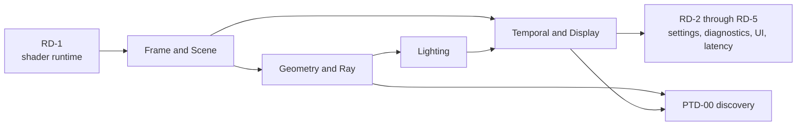

# First Release Renderer Plans

[Docs](../../../../../README.md) / [Up](../RendererDesign.md)

Choose the renderer work by the result you need: a valid frame, correct surfaces, useful lighting, a finished image or usable controls. The [Roadmap](../../../../../Strategy/Roadmap.md#required-feature-closure-priority) selects global priority; the table below routes that work.

**Status:** Renderer release-plan index; routing and dependency order, not feature evidence

**Snapshot:** 2026-09-08; Renderer portfolio projection **36/100**; 26 of 26 families are `Blocked`

**Parent orchestrator:** [First Release Implementation Plan](../../../../CrossModule/FirstRelease/ImplementationPlan.md)

**Architecture owner:** [Renderer](../RendererDesign.md), [Rendering A Sparkle Frame](../RenderingASparkleFrame.md), and [Renderer Feature Dossiers](../Features/RendererFeatureGuide.md)

## Choose The Plan By Result

| Plan | Primary families | Result you work toward |
| --- | --- | --- |
| [Frame And Scene](FrameAndSceneImplementationPlan.md) | `FCR-REN-01`, `02`, `03` | immutable admission, Scene/View/GPU-scene preparation, graph compile/execute |
| [Geometry And Ray Tracing](GeometryAndRayTracingImplementationPlan.md) | `FCR-REN-04`, `05`, `12`, `17`, `21`, `23` | resident visible geometry, raster/ray GBuffer, TLAS, traversal identity, and deferred decals |
| [Lighting](LightingImplementationPlan.md) | `FCR-REN-06`, `07`, `08` | direct/indirect lighting and discovery-gated Reference Path Tracer closure |
| [Display And Reconstruction](DisplayAndReconstructionImplementationPlan.md) | `FCR-REN-09`, `10`, `14`, `15`, `18`, `22`, `24`–`26` | view-owned temporal/display state through grading, lens, SDR, and HDR10 output |
| [Runtime And Diagnostics](RuntimeAndDiagnosticsImplementationPlan.md) | `FCR-REN-11`, `13`, `16`, `19`, `20` | shader binding, settings, debug/capture, UI composition, latency coordination |

Every Renderer FCR appears once as a primary work owner. Cross-plan dependencies do not create a second owner.

## Dependency Order

The file boundaries group cohesive features; they do not force whole-file execution. Close `RD-1` before pipeline consumers, then Frame/Scene, Geometry/Ray, Lighting, Display, and the remaining runtime/diagnostic phases. A phase may move earlier only when its dependencies and candidate identity remain explicit.

## Relationship To Existing Renderer Plans

[Debug Views](../Features/DebugViews/DebugViewsDesign.md) owns current presentation and control contracts; its completed Show slice is recorded in [Bounded Show evidence](../../../../../Acceptance/Renderer/DebugViews.md). `RD-3` selects remaining work from current feature acceptance. [Deferred GBuffer Decals](../Features/DeferredDecals/ImplementationPlan.md) is the detailed subplan selected by `GR-5` for first-release `FCR-REN-23`. Plan presence alone is not scope admission; the mother plan and FCR registry provide that admission.

Follow the [shared Renderer rules and stop conditions](../RendererDesign.md#release-implementation-rules).
