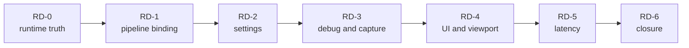

# Renderer Runtime And Diagnostics Closure Plan

[Docs](../../../../../README.md) / [Up](README.md) / [Design](../RendererDesign.md)

Stages: [RD-0](#rd-0--freeze-runtime-state-and-observation-contracts) / [RD-1](#rd-1--pipeline-materialization-and-typed-binding) / [RD-2](#rd-2--settings-state-and-persistence) / [RD-3](#rd-3--debug-views-diagnostics-products-and-capture) / [RD-4](#rd-4--ui-and-viewport-composition) / [RD-5](#rd-5--latency-coordination) / [RD-6](#rd-6--runtime-and-diagnostics-candidate-closure).

Make shader binding, settings, debug views, capture and viewport controls agree about the frame the user sees.

**Status:** implementation plan; not shader, UX, capture, latency, performance, or release evidence

**Current readiness:** section projection **40/100**; substantial pipeline/settings/debug/UI source exists, latency is partial, and all five families are `Blocked`

## Work This Plan

| What to do | Working route |
| --- | --- |
| First action | [RD-0 state review](#rd-0--freeze-runtime-state-and-observation-contracts): trace a user request into active pipeline/feature state and the displayed or captured frame. |
| Result to reach | One state authority and observable frame identity, then the selected binding/settings/diagnostic/UI/latency slice. |
| Start / stop | Keep development diagnostics outside Shipping and follow the selected phase prerequisites. A second settings truth or missing capture identity stops the slice. |

## Plan At A Glance



`RD-1` is an early Renderer dependency and should execute before geometry/lighting pipeline consumers. The other phases close product-facing control and observation after the underlying frame paths are stable.

| Phase | Primary family | Result |
| --- | --- | --- |
| `RD-0` | all five | one selector/settings/pipeline/frame/capture/latency identity map |
| `RD-1` | `FCR-REN-16` | complete registered/cooked ABI and typed pipeline binding |
| `RD-2` | `FCR-REN-19` | durable requested/resolved/active settings truth |
| `RD-3` | `FCR-REN-11` | interpretable bounded debug views and capture products |
| `RD-4` | `FCR-REN-13` | immutable generation-safe UI/viewport composition |
| `RD-5` | `FCR-REN-20` | correctly scoped and measured latency coordination |
| `RD-6` | all five | candidate-bound runtime/diagnostic closure |

## `RD-0` — Freeze Runtime State And Observation Contracts

**Goal:** reconcile how a user request becomes active shader/pipeline/feature state and how that exact frame is identified in UI, debug, capture, and latency artifacts.

**Non-goals:** a new global settings registry, an internal performance-dashboard product, or making diagnostics mutable authorities.

**Required work:** trace registration/cooked shader identity, pipeline/layout/cache generation, typed bindings, settings file/CVar/command/UI precedence, requested/resolved/active/restart/fallback state, debug semantics/display mapping, capture sidecar, UI packet/product generations, frame/latency tokens, provider/backend/package matrices, and all feature criteria/checks.

**Failure modes:** state shown differs from bound pipeline; stale pipeline/cache survives ABI change; settings save lies; debug label lacks domain; capture and latency use different frame identity; UI packet holds invalid resource; unavailable provider appears enabled.

**Phase exit criteria:** one identity/state diagram and matrix covers all five families; each mutable owner and immutable observer is named; missing or conflicting acceptance blocks implementation.

<details>
<summary>Copy implementation prompt</summary>

```text
Execute only RD-0 from Docs/Architecture/Modules/Engine/Renderer/FirstRelease/RuntimeAndDiagnosticsImplementationPlan.md#rd-0--freeze-runtime-state-and-observation-contracts.
Goal: reconcile how a user request becomes active shader/pipeline/feature state and how that exact frame is identified in UI, debug, capture, and latency artifacts. Follow this stage's work, non-goals and owning checks.
Check prerequisites; reuse completed work and follow repository conventions. Record exact candidate/configuration, commands and exit results. Stop on unresolved contracts or unavailable required checks.
```

</details>

## `RD-1` — Pipeline Materialization And Typed Binding

**Goal:** close `FCR-REN-16` so every admitted graphics/compute/ray pipeline validates cooked ABI, materializes correctly, binds complete current resources, and replaces generations safely.

**Non-goals:** untyped descriptor plumbing, preserving obsolete layouts, a second pipeline cache, or executing the whole Shader System plan without a failing release criterion.

**Required work:** reconcile registration/build/cook membership, code/reflection identity, every parameter/domain, graphics key completeness, capability rejection, layout/pipeline creation, typed binding, cache identity, whole-generation replacement, failed reload safe state, in-flight retirement, and retained/high-water bounds on both backends.

**Failure modes:** registered program missing; reflection/ABI mismatch accepted; cache key omits state; wrong resource domain binds; unsupported ray pipeline materializes; reload partially replaces; old generation retires while in flight; cache grows forever.

**Phase exit criteria:** complete program/parameter/domain matrix, invalid/missing/corrupt/capability/reload failures, cache key/retirement, native backend validation, and performance/memory checks pass.

<details>
<summary>Copy implementation prompt</summary>

```text
Execute only RD-1 from Docs/Architecture/Modules/Engine/Renderer/FirstRelease/RuntimeAndDiagnosticsImplementationPlan.md#rd-1--pipeline-materialization-and-typed-binding.
Goal: close FCR-REN-16 so every admitted graphics/compute/ray pipeline validates cooked ABI, materializes correctly, binds complete current resources, and replaces generations safely. Follow this stage's work, non-goals and owning checks.
Check prerequisites; reuse completed work and follow repository conventions. Record exact candidate/configuration, commands and exit results. Stop on unresolved contracts or unavailable required checks.
```

</details>

## `RD-2` — Settings State And Persistence

**Goal:** close `FCR-REN-19` with one aggregate requested state, deterministic precedence, durable atomic persistence, and truthful resolution/activation.

**Non-goals:** each feature parsing its own config, hiding restart requirements, writing into the package, or preserving obsolete setting aliases.

**Required work:** reconcile field/name/default/range, file location/schema, command-line/CVar/UI precedence, load/edit/save/transfer, serial/render-thread delivery, requested/CVar/resolved/active/restart state, malformed/unknown value policy, atomic save and last-good behavior, concurrent edit, queue pressure, and shutdown.

**Failure modes:** package config modified; partial save corrupts state; malformed value silently activates; unknown legacy name persists; UI/CVar/file disagree; concurrent change is lost; queue overflow applies stale state; restart-only field claims active.

**Phase exit criteria:** field/consumer coverage, valid and malformed round trip, precedence, atomic failure, concurrent/pressure/shutdown, package path, and requested-to-active state checks pass.

<details>
<summary>Copy implementation prompt</summary>

```text
Execute only RD-2 from Docs/Architecture/Modules/Engine/Renderer/FirstRelease/RuntimeAndDiagnosticsImplementationPlan.md#rd-2--settings-state-and-persistence.
Goal: close FCR-REN-19 with one aggregate requested state, deterministic precedence, durable atomic persistence, and truthful resolution/activation. Follow this stage's work, non-goals and owning checks.
Check prerequisites; reuse completed work and follow repository conventions. Record exact candidate/configuration, commands and exit results. Stop on unresolved contracts or unavailable required checks.
```

</details>

## `RD-3` — Debug Views, Diagnostics Products, And Capture

**Goal:** close `FCR-REN-11` with exact mode semantics, correct display treatment, explicit unavailable state, and reproducible capture metadata.

**Non-goals:** building the separate Performance Diagnostics product, exposing private development data in Shipping, or making debug output an unqualified colorimetric oracle.

**Required work:** inventory Lit/wireframe/GBuffer/lighting/GPU-scene modes and required resources; close the one per-view mode route, labels, unavailable reasons, exposure/tone/encoding mapping, stable visualization ranges/legends, capture readback/format/sidecar/provenance, bounded observer cost, privacy and Shipping erasure; reconcile remaining work against [current Debug Views acceptance](../Features/DebugViews/Acceptance.md). Completed Show implementation records are [Bounded Show evidence](../../../../../Acceptance/Renderer/DebugViews.md).

**Failure modes:** process-global mode leaks across viewports; unavailable resource displays stale data; mode goes through wrong tone/encoding; legend/range changes without metadata; capture generation mismatches frame; private path/content leaks; observer changes timing materially.

**Phase exit criteria:** every admitted mode/resource/view/display/capture/unavailable/privacy/cost cell passes; sidecars identify candidate/frame/view/settings/domain/encoding; Shipping behavior matches scope.

<details>
<summary>Copy implementation prompt</summary>

```text
Execute only RD-3 from Docs/Architecture/Modules/Engine/Renderer/FirstRelease/RuntimeAndDiagnosticsImplementationPlan.md#rd-3--debug-views-diagnostics-products-and-capture.
Goal: close FCR-REN-11 with exact mode semantics, correct display treatment, explicit unavailable state, and reproducible capture metadata. Follow this stage's work, non-goals and owning checks.
Check prerequisites; reuse completed work and follow repository conventions. Record exact candidate/configuration, commands and exit results. Stop on unresolved contracts or unavailable required checks.
```

</details>

## `RD-4` — UI And Viewport Composition

**Goal:** close `FCR-REN-13` with immutable host/editor packets, generation-safe viewport products and texture handles, and correct blend/color/DPI composition.

**Non-goals:** moving UI ownership into Renderer, retaining mutable UI objects across threads, or requiring Editor UI in the Shipping runtime.

**Required work:** reconcile packet creation/copy budget/lifetime, viewport identity and generation, texture-handle validation, product publication/retirement, blend and color domain, DPI/extent, graph execution ordering, submission, resize/level switch, missing/stale products, bounds, and package behavior.

**Failure modes:** packet references mutable/freed memory; stale product sampled after resize; invalid handle indexes descriptor; UI uses wrong color/alpha convention; level switch shows old viewport; missing product crashes; Shipping includes excluded editor path.

**Phase exit criteria:** packet lifetime/copy, handle/generation/bounds, blend/color/DPI, missing/stale/failure, resize/switch/shutdown, and Shipping classification checks pass.

<details>
<summary>Copy implementation prompt</summary>

```text
Execute only RD-4 from Docs/Architecture/Modules/Engine/Renderer/FirstRelease/RuntimeAndDiagnosticsImplementationPlan.md#rd-4--ui-and-viewport-composition.
Goal: close FCR-REN-13 with immutable host/editor packets, generation-safe viewport products and texture handles, and correct blend/color/DPI composition. Follow this stage's work, non-goals and owning checks.
Check prerequisites; reuse completed work and follow repository conventions. Record exact candidate/configuration, commands and exit results. Stop on unresolved contracts or unavailable required checks.
```

</details>

## `RD-5` — Latency Coordination

**Goal:** close `FCR-REN-20` for the explicitly supported Streamline PCL/Reflex boundary, with correct six-marker frame identity and independently measured benefit.

**Non-goals:** claiming latency reduction from marker presence, supporting Vulkan Reflex when the contract excludes it, or making provider availability a runtime requirement.

**Required work:** reconcile host simulation and render submit/present frame tokens, six marker order/ownership, 64-to-32-bit conversion limits, Streamline on/off/readiness, PCL versus Reflex capability, D3D12/Vulkan boundary, sleep/marker failure, shutdown, package DLL/signature/redistribution, and measurement method separate from functional checks.

**Failure modes:** duplicate/out-of-order marker; token truncation aliases frame; marker from wrong thread/phase; provider fault stalls frame; Reflex called unsupported; missing DLL silently changes active state; shutdown uses provider after release; latency claim lacks controlled comparison.

**Phase exit criteria:** marker order/identity, misuse/provider/failure/shutdown, backend/package, requested-active state, and controlled latency measurements pass for admitted cells; unsupported cells remain explicit.

<details>
<summary>Copy implementation prompt</summary>

```text
Execute only RD-5 from Docs/Architecture/Modules/Engine/Renderer/FirstRelease/RuntimeAndDiagnosticsImplementationPlan.md#rd-5--latency-coordination.
Goal: close FCR-REN-20 for the explicitly supported Streamline PCL/Reflex boundary, with correct six-marker frame identity and independently measured benefit. Follow this stage's work, non-goals and owning checks.
Check prerequisites; reuse completed work and follow repository conventions. Record exact candidate/configuration, commands and exit results. Stop on unresolved contracts or unavailable required checks.
```

</details>

## `RD-6` — Runtime And Diagnostics Candidate Closure

**Goal:** prove that bound pipelines, settings, debug/capture, UI composition, and latency artifacts all describe the same active frame and candidate.

**Non-goals:** one UI smoke standing in for shader/native checks or admitting the separate diagnostics product.

**Failure modes:** requested state differs from active but capture omits it; pipeline/provider DLL differs from manifest; UI/debug observe stale generation; latency token cannot join capture; evidence predates settings/shader change.

**Phase exit criteria:** all five FCR reports carry complete candidate-bound criteria/failure/check coverage, package/native/provider matrices, identity joins, performance/observer data, limitations, and explicit decisions.

<details>
<summary>Copy implementation prompt</summary>

```text
Execute only RD-6 from Docs/Architecture/Modules/Engine/Renderer/FirstRelease/RuntimeAndDiagnosticsImplementationPlan.md#rd-6--runtime-and-diagnostics-candidate-closure.
Goal: prove that bound pipelines, settings, debug/capture, UI composition, and latency artifacts all describe the same active frame and candidate. Follow this stage's work, non-goals and owning checks.
Check prerequisites; reuse completed work and follow repository conventions. Record exact candidate/configuration, commands and exit results. Stop on unresolved contracts or unavailable required checks.
```

</details>

## Reference And Ownership

<details>
<summary>Exact owners, source snapshots and related contracts</summary>

**Families:** `FCR-REN-11`, `FCR-REN-13`, `FCR-REN-16`, `FCR-REN-19`, `FCR-REN-20`

**Responsibility:** sequence pipeline binding, runtime state, diagnostic presentation, viewport composition, and latency coordination closure

**Parent:** [First Release Renderer Plans](README.md)

**Architecture:** [Shader Runtime](../Features/ShaderRuntime/ShaderRuntimeDesign.md), [Runtime Configuration](../Features/RuntimeConfiguration/RuntimeConfigurationDesign.md), [Debug Views](../Features/DebugViews/DebugViewsDesign.md), [Viewport And Diagnostics](../Features/ViewportAndDiagnostics/ViewportAndDiagnosticsDesign.md), and [Latency Coordination](../Features/FrameExecution/LatencyCoordination.md)

</details>
