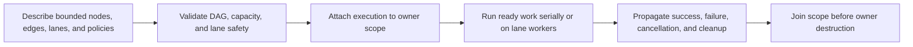

# Tasks Capability Inventory

[Docs](../../../../README.md) / [Up](../README.md)

**Status:** capability snapshot; current, but not release approval, stress evidence, or performance evidence

**Snapshot:** 2026-11-08 at base revision `0758e939292f` plus the final `ITER-TASKS-02` source manifest below; all Tasks source, direct consumers and generated target membership inspected. The earlier ownership pass and subsequent failure-path repairs have separate evidence records; broader stress, performance and release evidence remain unchanged.

**Scope:** task graphs, lane topology, parallel ranges, execution handles, cancellation, scopes, events, shutdown, failure propagation, and tracing

**Owner:** `Engine/Tasks` / `SparkleTasks`

**Evidence and disposition:** [Capability Evidence Plan](../../CapabilityEvidencePlan.md) and [First Release Acceptance Contract](../../../../Acceptance/FirstRelease.md)

**Current readiness:** **50/100** — the shared task runtime and consumers exist in source; selected executor parity, pressure, failure and settlement proof is recorded below. Broader stress and causal-performance acceptance remain open. See [Current Feature Readiness](../../../../Acceptance/CurrentReadiness.md#foundation-world-content-shaders-and-tools).

Source ownership reconciled on 2026-10-06: `ParallelFor` computes balanced partition boundaries with widened arithmetic (`count * index / partitions`). Each nonempty range stays within the item count, including counts just above the partition cap. GameFramework resolves live counts at settled host dependency waves and delegates populated ranges to this shared implementation.

## At A Glance

| Contract | Current behavior | Important limit |
| --- | --- | --- |
| topology | FrameCritical, Background, and BlockingIo lanes with local/injection queues and within-lane stealing | no intra-lane priority; cross-lane dependencies are deliberately restricted |
| work graph | compiled DAG, continuations, `WhenAll`, nested completion, and bounded parallel ranges | graph capacities and policies reject before launch |
| serial reference | zero-worker configuration executes on the caller | mixed invalid worker configurations reject |
| failure/cancellation | exceptions become failure; descendants suppress; cleanup settles; cancellation is cooperative | already-running tasks must observe stop and return |
| structured lifetime | hosts explicitly settle typed parent/child scopes before owner destruction | destructor cancellation is a fallback and asserts prior settlement; worker-side waits/shutdown that could self-deadlock reject |
| prepared dispatch | reusable scope-owned invocation; allocation-free notification and coalescing | [prepared-dispatch contract](../../../CrossModule/MultithreadedEngine.md#prepared-task-dispatch); asynchronous lane and explicit close/settlement |
| observation | generation/status/result/per-node data and Windows ETW tracing | no portable trace provider or accepted stress/performance result |

Tasks supplies execution mechanics, not subsystem state ownership. Parallel work must still publish through the module that owns the result.

## Scheduler Contract

| ID | Capability | State | Exact current coverage and limit | Evidence |
| --- | --- | --- | --- | --- |
| `TASK-001` | Three-lane execution | Implemented path | `FrameCritical`, `Background`, and `BlockingIo` have separate worker pools, injection queues, per-worker local queues, and within-lane work stealing. No priority levels exist inside a lane. | `S` |
| `TASK-002` | Deterministic serial reference path | Implemented path | All worker counts at zero execute the compiled graph on the submitting caller. A mixed configuration with no frame-critical workers but other lanes is rejected. | `S` |
| `TASK-003` | Compiled DAG | Implemented path | Builder supports tasks, prerequisites, continuations, `WhenAll`, and nested-completion children. Compile checks handles, self/duplicate edges, cycles, policies, capacities, generations, and lane rules before execution. | `S` |
| `TASK-004` | Lane dependency safety | Implemented path | Graph compilation rejects invalid cross-lane dependency/nesting patterns, preventing frame-critical work from waiting through unsupported lane relationships. Exact admissible edges are enforced in `TaskGraphCompilation`. | `S` |
| `TASK-005` | Parallel ranges | Implemented path | `ParallelFor` partitions an item range using grain size, serial threshold, and maximum partitions; default policy is 64/128/64. Consumers override this for world and renderer work. | `S` |
| `TASK-006` | Logical nested completion | Implemented path | A parent's logical completion waits for its nested tasks, and dependents release only after prerequisite/nested settlement. This supports forked work without worker-side recursive submission. | `S` |
| `TASK-007` | Failure propagation | Implemented path | Results are Succeeded/Failed/Cancelled with messages; exceptions are caught and converted to failure; normal descendants of failed/cancelled prerequisites do not run, while cleanup nodes still settle. | `S` |
| `TASK-008` | Cooperative cancellation | Implemented path | Every task context receives a stop token. Execution handles, scopes, and shutdown request cancellation; queued normal bodies are suppressed, already-running bodies must cooperate and finish. | `S` |
| `TASK-009` | Structured scopes | Implemented path | Application, World, Document, AssetGeneration, Frame, and ToolInvocation scope kinds form parent/child lifetime trees with cancel, timed join, and destructor cancel-and-join behavior. | `S` |
| `TASK-010` | Execution observation | Implemented path | Move-only handles expose generation, status, aggregate result, first failing task name, per-node result, settled count, and timed wait. Waiting from a worker owned by the same executor is rejected to avoid self-deadlock. | `S` |
| `TASK-011` | Blocking event | Implemented path | Generation-tagged `TaskEvent` can signal/reset and wait with cancellation, but waits are accepted only on the `BlockingIo` lane. Tokens reject stale identity/generation. | `S` |
| `TASK-012` | Drain/cancel shutdown | Implemented path | Drain stops new work after active executions settle; Cancel requests cancellation before settlement. Shutdown invoked from one of the executor's own workers is rejected. | `S` |
| `TASK-013` | Capacity policy | Implemented path | Defaults: 1,024 tasks, 4,096 edges, 64 active executions. Hard graph maxima: 65,535 tasks and 262,144 edges. Task names max 96 chars; result messages max 512 chars. Invalid/exceeded limits reject work. | `S` |
| `TASK-014` | Windows task tracing | Capability-gated | ETW/TraceLogging records graph dependencies and task begin/end with generation, lane, worker, outcome, and duration on Windows; `advapi32` is private. No portable trace provider is present. | `S` |

## Current Consumers

| Consumer | How it uses Tasks | Important bound |
| --- | --- | --- |
| Application | Owns executor and application scope; configures worker counts; passes both to world and renderer. | Runtime defaults and shutdown ordering must be measured, not inferred. |
| GameFramework | Scene-load graphs plus an 11-stage compiled world-system graph and bounded parallel ranges. | World structure is frozen while query systems run. |
| Renderer | Asset work and selected parallel CPU preparation; threaded renderer itself has a separate ownership thread. | Task lanes do not substitute for RHI/render-thread ownership. |
| Launcher | Long-running operation service and cancellation around tool/build/content workflows. | Child processes need cancellation/handoff evidence. |
| Texture cooker | Parallel batch cooking with an additional memory limiter. | Worker count alone does not bound decoded memory. |

## Vertical Execution Trace

Builder records nodes/edges -> `Compile` validates the complete graph -> `Submit` takes a settled host-boundary path or `Launch` attaches execution to a scope -> ready nodes enter their declared lane -> a worker pops local/injection/steal work -> task body runs with lane/cancellation context -> result releases nested tasks and dependents -> execution aggregates the first failure and final status -> scope and shutdown join before owner destruction.

Context ownership rechecked on 2026-10-25: lane and cancellation binding is private to execution/dispatch. Contexts do not duplicate execution generation; generation identity remains on execution handles, scheduler state and profiling records that consume it. Hosts cannot rebind runtime state through a public helper.

### Worker Configuration And Source Proof

`TaskExecutor::Implementation::ValidateConfiguration` owns executor admission. It sums the three public 32-bit lane counts in 64 bits before checking the existing 256-worker aggregate limit, so overflow cannot bypass rejection before worker allocation. Zero workers retain the serial path; unsupported lane mixtures and graph capacities still reject through the existing exception. The constructor's later bounded reservation and all scheduling, queue, cancellation and publication policies are unchanged.

Application resolves its task settings into this configuration and owns the application scope. The scene loader borrows that executor, owns a child Document scope and shared load state, and submits read/decode/fan-in/finalize dependencies with at most two scene assets in flight. Each asset slot has one writer per dependent stage; finalization consumes the settled slots. Cancellation and owner retirement use those existing scopes, not a second executor or loading-specific cancellation runtime.

[FCR-TASK-01](../../../../Acceptance/FeatureCompletionReports.md#foundation-contract-progress) records the selected FWC-2 repair and native production-API checks: serial and 1/2/4 workers per lane, exclusive ranges and nested completion, controlled failure, worker-wait rejection, bounded active-execution pressure, cooperative cancellation and Drain/Cancel settlement. The raw negative probe detects the superseded overflow guard. This is executor-boundary proof using a load-shaped DAG; it is not actual Sponza decoding/frame acceptance, exhaustive dispatch/stress qualification or measured throughput/crossover evidence.

## Orchestration Ownership Pass

**Iteration:** `ITER-TASKS-01`, 2026-11-08; owner: Tasks. Start revision `0758e939292f`; no initial Tasks or Tasks-dossier edits. The [source manifest](../../../../../build/validation/tasks-ownership-20261108/source-hashes.json) binds the final working-tree implementation; unrelated concurrent work is excluded.

**Outcome:** advance `NS-OWNERSHIP`, `NS-SIMPLIFY` and `NS-ADOPTION`; preserve `NS-REAL` and `NS-MATH-DATA`. Preserve `TASK-001` through `TASK-014`; `PGE-07` and `PGE-15` are preservation only. Other persona targets and release workloads are not applicable to this private ownership repair. No readiness, performance or release-evidence increase is claimed. Existing roadmap/release sequencing remains current.

### Private Ownership

| Owner | Responsibility |
| --- | --- |
| `TaskExecutor.cpp` | Public host operations compose one private implementation; no queue, mutex or condition-variable mechanics. |
| `TaskExecutorImplementation.*` | One executor lifetime owns admission and workers. Construction sequences validation, initialization and startup; submission sequences launch and settlement; launch sequences validation, admission and execution. The former Runtime allocation/header/forwarding layer is deleted. |
| `TaskExecutionAdmission.cpp` | Configuration/request validation and graph admission. Prune settled entries and reserve tracking storage before scope registration; commit without later allocation. Publish rejection outside the lifecycle lock. |
| `TaskDispatchAdmission.cpp` | Prepare validates, creates dispatch storage, then admits. Gate/lifecycle/scope order and non-allocating commit remain together. |
| `TaskExecutorShutdown.cpp` | Close admission, request selected cancellation, close dispatches, await executions, stop/join workers and publish stopped state. |
| `TaskWorkerScheduling.cpp` | Worker creation, local/injection/dispatch queues, lane-local stealing and wake/stop order share one scheduling invariant. User bodies run outside scheduler locks. |
| `TaskDispatch.cpp` | Reusable invocation sequences begin, body, completion transition and terminal publication. Prepared exception storage serves its allocation-free notification/settlement contract. |
| `SerialTaskExecution.cpp` and `ScheduledTaskExecution.cpp` | Separate serial/concurrent DAG state machines sequence body execution, result recording, nested release and logical completion. Logical completion separately records the node, releases dependents, propagates nested results and finishes execution. |
| `TaskFunctionInvoker.*` and `TaskExecution.*` | One graph-body suppression/exception rule serves both modes. Execution state owns publication and host-wait synchronization. |

Graph construction/compilation and partitioning remain cohesive algorithms; scopes/events own lifetime protocols; profiling owns tracing. The whole-module responsibility pass found no remaining actionable mixed owner, god function, god file or catch-all folder under this iteration's criteria. Public contracts and dependencies are unchanged; direct consumers use the public Tasks API.

**Data/cost ledger:** no new public API, scheduler, persistent state, dependency or integration hook. Per-task context copies isolate lane/cancellation; logical-result copies preserve synchronized observation. Terminal threaded result vectors and failure metadata move into publication. Removing the second implementation owner removes one executor allocation. Tracking storage prunes settled handles and reserves before admission. No notification allocation or throughput/latency improvement is claimed.

### Criteria, Failures And Evidence

| Criterion / check | Result |
| --- | --- |
| `AC-TASKS-01 / CHK-TASKS-01` | Whole-module source/dependency/consumer review, stale-name scan, generated membership and scoped diff review show cohesive owners and intent-level workflows. All 42 source/header files pass `CMake/CodeStyle.bat -Mode Check -Path <file>` with clang-format 22.1.3 and repository structural rules; changed code also passes authored layout review. |
| `AC-TASKS-02 / CHK-TASKS-02` | `cmake -S . -B build` reconciles globbed membership. `cmake --build build --config <DebugEditor or DevelopmentEditor> --target SparkleTasks -- /p:BuildProjectReferences=false /m:2 /verbosity:minimal` passes for both. See [Debug build](../../../../../build/validation/tasks-ownership-20261108/debug-build.log) and [Development build](../../../../../build/validation/tasks-ownership-20261108/development-build.log). |
| `AC-TASKS-03 / CHK-TASKS-03` | Temporary public-API probe links final Development Tasks and existing Development Core support. Serial and 1/2/4 workers per lane preserve ranges, nested failure, suppressed descendants, cleanup, cancellation and bounded settlement. Dispatch covers 10,000 allocation-free coalesced notifications, preserved rerun on close, idle/queued/running cancellation, failure, same-worker notification, capacity rejection/reuse, Drain/Cancel and handles outliving shutdown. Negative boundaries cover worker submission/wait/shutdown, serial/borrowed/foreign-thread preparation, missing lanes, stale graph/event handles and worker-count overflow. See [native results](../../../../../build/validation/tasks-ownership-20261108/native-probe.log) and [commands](../../../../../build/validation/tasks-ownership-20261108/commands.txt). |

`RISK-TASKS-01 / FM-TASKS-01`: admission extraction could leave partial ownership or invert locks, causing leaks/deadlock. Preserve gate/lifecycle/scope order and reserve storage before scope commit. Two graph tracking/scope-storage allocation faults and ten dispatch-preparation allocation faults leave both owners unadmitted and joinable. A private negative-control object moves ordinary storage reservation after scope registration: the probe detects the leaked scope admission and exits 42 as required; see [negative result](../../../../../build/validation/tasks-ownership-20261108/negative-admission.log). A failed oracle requires a Tasks admission repair before completion.

`RISK-TASKS-02 / FM-TASKS-02`: completion extraction could release parents/dependents early or lose failure/cancellation. Retain mutexes, memory orders and release order. Controlled blocking-lane events expose cancellation and queued/running dispatch states. Terminal outcomes, suppressed normal work, cleanup, exact rerun counts and bounded host joins are the oracles; Tasks owns repair if any fail.

`FM-TASKS-03`: stale assertion spelling broke Debug compilation. The destructor now checks its declared `bSettledBeforeDestruction`; the owning Debug build passes with assertions enabled.

**Decision:** `PASS` for `AC-TASKS-01` through `AC-TASKS-03` at the `ITER-TASKS-01` snapshot. At closure, all 43 module files matched its source manifest and generated membership covered exactly 42 source/header files. The later failure-path review below owns the additional repairs. UTF-8, all 13 local document links/anchors, current index routes and scoped `git diff --check` pass. Temporary probe/mutation sources, objects and executables are removed; only evidence logs, commands and hashes remain. Reopen the affected checks if source hashes, public contracts, admission/completion order or selected toolchain change. No required repair remained in that iteration's selected matrix; broader stress/performance work retains its existing owner and release order. These selected checks do not qualify exhaustive stress, fairness, throughput, GPU, package or release behavior.

## Failure-Path Review

**Iteration:** `ITER-TASKS-02`, 2026-11-08; owner: Tasks. Base revision `0758e939292f` plus the complete `ITER-TASKS-01` working-tree snapshot; all 43 module-file hashes matched that snapshot at entry. Review covers all five capability folders, public contracts, direct consumers, build membership and source-style rules. Advance `NS-OWNERSHIP`, `NS-SIMPLIFY`, `NS-MATH-DATA` and `NS-EVIDENCE`; preserve public APIs, `TASK-001` through `TASK-014`, and `PGE-07/PGE-15`. Other persona/workload gates and roadmap sequencing are unchanged because this repairs existing Tasks contracts.

**Confirmed failures:** the four-node topology `A depends on B; C nested in A; D nested in B; D depends on C` compiles even though neither parent can complete. Serial execution settles 0/4 nodes and rejects; worker execution cannot settle that dependency cycle. Separate start/completion cycle graphs miss the combined lifetime relation. A long-lived scope retains 1,000 additional allocations after 1,000 joined/destroyed children. Failing the second dependency-vector allocation or the nested-child-vector allocation leaves a partial topology that compiles but settles only 1/2 nodes.

**Repair boundary:** one temporary body/completion event graph is the compiler's cycle authority; both adjacency directions reserve geometrically before graph mutation commits; scope child registration prunes expired weak records. The stateless private TaskProfiler class is replaced by namespace functions; the real trace-provider lifetime remains owned by Profiling. No new public API, persistent runtime state, scheduler, dependency, feature hook or production file was added. Event-graph storage is compile-local and replaces the previous two projections; weak ownership and cancellation callbacks remain unchanged.

| Criterion / check | Required oracle |
| --- | --- |
| `AC-TASKS02-01 / CHK-TASKS02-01` | `PASS`: mixed cycle rejects with `Cycle` before admission. All 98,304 combinations of four-node parent forests/dependencies agree with an independent ready-body/logical-completion simulation; 1,716 are valid. Both valid mixed-nesting counterparts execute exactly four bodies and settle with serial and 1/2/4 workers. |
| `AC-TASKS02-02 / CHK-TASKS02-02` | `PASS`: retained allocation growth after warm-up is 0 across 1,000 joined/destroyed children, within the threshold of at most 1. Live child cancellation and parent settlement pass with 1/2/4 workers. |
| `AC-TASKS02-03 / CHK-TASKS02-03` | `PASS`: injected second dependency-storage and first nested-child-storage allocation failures leave the original topology unchanged and executable; both retries succeed. The 512-relation allocation oracles observe 522 edge-storage allocations (512 independent prerequisite lists plus 10 shared fan-out growths; threshold 528) and 10 nested-list growths (threshold 16), preserving amortized growth. |
| `AC-TASKS02-04 / CHK-TASKS02-04` | Whole-module responsibility/consumer review finds no remaining actionable orchestration, ownership or scaffolding finding. Owning DebugEditor/DevelopmentEditor builds and current style checks pass for all four changed source/header files; the 38 unchanged files retain their exact earlier style-checked contents and formatter policy is unchanged. Final membership, docs/anchors, hashes, scoped diff and probe cleanup are reconciled below. |

**Risk/failure ledger:** `RISK-TASKS02-01 / FM-TASKS02-01`: an incorrect event relation can reject valid graphs or admit deadlocks; preserve parent-body release, child logical completion and prerequisite completion as separate events, with exhaustive simulation and named counterexamples as retirement evidence. `RISK-TASKS02-02 / FM-TASKS02-02`: allocation failure can publish half an edge/nesting relation; reserve before any topology mutation and inject each changed allocation boundary. `RISK-TASKS02-03 / FM-TASKS02-03`: pruning can lose live child cancellation; prune only expired records and prove live-child cancellation/settlement. Each failure is detected at the owning Graph/Lifetime boundary, has potentially hanging or growing-memory consequences, and requires an owning repair before this iteration closes. Worker scheduling, execution, dispatch and public contracts remain unchanged; Profiling loses only its stateless class shell.

**Evidence:** [baseline negative results](../../../../../build/validation/tasks-ownership-20261108/iteration-02/baseline-cycle.log), [final native results](../../../../../build/validation/tasks-ownership-20261108/iteration-02/native-results.log), [Debug build](../../../../../build/validation/tasks-ownership-20261108/iteration-02/debug-build.log), [Development build](../../../../../build/validation/tasks-ownership-20261108/iteration-02/development-build.log), [commands and negative controls](../../../../../build/validation/tasks-ownership-20261108/iteration-02/commands.txt), and [final source/binary hashes](../../../../../build/validation/tasks-ownership-20261108/iteration-02/source-hashes.json). Each original defect failed its probe with exit 42 before repair; final probes exit 0. Earlier selected evidence did not cover these four cases.

**Decision:** `PASS` for `AC-TASKS02-01` through `AC-TASKS02-04`. All four reproduced defects are repaired and the final whole-folder responsibility review has no outstanding actionable finding. All 43 module files match this iteration's manifest; generated membership covers exactly 42 source/header files; public headers/CMake remain unchanged. UTF-8, all 19 document links/anchors, index routes and both scoped/whole-worktree `git diff --check` pass. The three temporary probe source/object/executable files are removed; only commands, hashes and result logs remain. Reopen affected checks if the recorded source, toolchain, graph-mutation protocol or completion relations change. No release/roadmap next pointer changes; broader stress/performance work retains its existing owner. GPU, package, release, exhaustive concurrency stress and throughput claims remain outside this private repair.

## Explicit Non-Capabilities And Risks

- No coroutines, fibers, GPU task scheduler, arbitrary task priorities, dynamic graph mutation after compile, cross-process queue, or distributed execution was found.
- `TaskEvent::Wait` is deliberately blocking-I/O-only; it is not a general wait primitive for frame-critical work.
- Cancellation is cooperative for running bodies; bounded cancellation latency depends on each task checking its token.
- Work stealing is lane-local. The inventory does not prove load balance, fairness, determinism of parallel completion order, or absence of starvation.
- No permanent repository test target owns these checks. The linked selected source proof retains temporary native-probe results; exhaustive races, remaining capacity/dispatch cells and causal performance still require their own admitted evidence.
