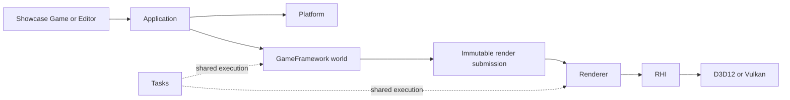

# Runtime and module map

[Docs](../README.md) ? [Subjects](README.md)

Application turns platform events and a GameFramework world into immutable render submissions. Renderer produces frames through RHI. Tasks supplies shared execution; Core supplies low-level mechanisms.

The world publishes data; Renderer does not query ECS storage. Editor adds inspection and commands through public contracts. Build targets, includes and link visibility in each module's CMake remain authoritative.

## Owners and limits

| Owner | Responsibility and boundary |
| --- | --- |
| [Core](../../Engine/Core) | Diagnostics, CVars, synchronous events, input vocabulary, time, math, strings/hashes, paths/files/JSON and child processes. No engine dependency, feature policy, package manager or async bus. Public out-of-line DLL functions use `SPARKLE_CORE_API`. |
| [Platform](../../Engine/Platform) | Win32 windows, OS input and layered routing. Core input state is neutral; Platform owns acquisition. Native Linux is absent from this program. |
| [Tasks](../../Engine/Tasks) | Graph compilation, hazards, scheduling, execution, scoped settlement and profiling. One shared runtime; reusable topology is distinct from one execution. |
| [GameFramework](../../Engine/GameFramework) | Levels, ECS/world systems, animation, assets and immutable read/render publication. Fixed world pipeline; no Renderer/RHI dependency or general plugin system. |
| [Application](../../Engine/Application) | Product startup/shutdown, level session, frame loop, settings persistence and composition. Separate game/editor hosts keep Editor dependencies out of Game. |
| [Showcase](../../Projects/Showcase) | Concrete Editor/Game products, level definitions, acquisition choices and example workload inputs. |

## World and concurrency

`LevelSession` prepares a candidate world, decodes cooked resources, settles workers and publishes only a complete accepted result. Failed/cancelled replacement preserves the accepted world. Editor submits typed edits against a world generation; world commit owns mutation. Animation sampling, pose, morph/skinning and transforms precede extraction.

Extraction emits a sequenced structural delta, immutable dynamic/resource data and per-view inputs in `RenderFrameSubmission`. Editor read views pin their generation; Renderer owns its derived scene. Generation and sequence protect identity and stale access, not content compatibility.

Tasks correctness comes from declared dependencies and exclusive write ranges, not lane names. Define a serial result, deterministic commit order and bounded grain/worker policy before parallelism. Cancellation is settled before captured owners or borrowed inputs disappear. Shutdown drains/rejects new work in order, settles world/render work, then releases dependent services. [Renderer](Renderer.md) owns its bounded frame/control queues.

## Files, paths and processes

Core discovers ordinary workspace/project/executable markers and the common `artifacts/dev` layout. Source and extracted products use the same path model; Core has no installed/release-manifest branch. Tool-only build/source preparation grammar stays in [ToolSupport](../../Tools/Support).

Core's file-set publisher owns lock/marker/replacement/rollback mechanics. [Content publication](Content.md#publication-and-recovery) defines the disposable-output policy. Lightweight JSON is not a general DOM or migration system. Synchronous event handles are same-thread subscriptions, not thread safety.

Child execution owns argv encoding, cwd/environment, output, cancellation and typed start failures. A Launcher bootstrap may hand off to another process; verify the surviving window/product, not the initial exit code.

## Work and checks

Repair only a demonstrated blocker for the selected frame or reproduction journey. Preserve fixed world order, typed edits, immutable publication and one Tasks runtime; retire unused public inspection/storage surfaces rather than completing speculative frameworks.

For touched concurrency, compare serial/worker results, stale-generation rejection, cancellation and destruction in flight. For Core DLL changes, link a real consumer. For process/path changes, check quoted/Unicode paths and real handoff/cancellation. These are required checks when those claims change; this page grants no current runtime or package pass.
