# Animation runtime: ozz-animation

[Migration catalogue](../ThirdPartyMigration.md#assets-images-animation-and-editor-widgets) | [Animation implementation](../../Engine/GameFramework/Private/Animation) | [Module and lifetime rules](../Engineering.md#module-boundaries)

## Recommendation and status

**Use ozz-animation as the first feasibility candidate for delegating animation algorithms. It is the best fit among the standalone open-source options reviewed here for Sparkle's goal of avoiding animation specialization. A complete migration is not yet proved.** Its value is upstream ownership of sampling, compression, pose blending and optional IK; immediate code deletion is modest.

This document proposes an implementation, explains the tradeoffs and identifies the actual retirement boundary. No dependency, cooked format or runtime code has changed. Research was checked on **November 21, 2026** against ozz **0.17.0**, released August 1, 2026, at commit `744eb9d99f606eda849acb0b1204f7a3dc20bca1`. Sparkle source inspection began at `719f89ec1b52968abaa139b8b9b70867b90df254`; the counted source hashes were rechecked after unrelated workspace commits. [Release](https://github.com/guillaumeblanc/ozz-animation/releases/tag/0.17.0).

There are already concrete fit concerns: skeletal STEP/cubic conversion, different quaternion interpolation, arbitrary parent-space matrices, a smaller joint limit and bounded archive admission. Resolve these before adopting the dependency. Retaining the existing implementation is preferable to adding ozz alongside comparable local machinery. This investigation does not change the roadmap's delivery order.

## Responsibilities before and after

An animation clip describes how joint translation, rotation and scale change over time. Sampling produces a local pose relative to each joint's parent. Hierarchy evaluation turns that into model-space matrices. Sparkle then applies inverse-bind matrices to produce the palette used to deform vertices.

**The intended split is: ozz owns animation algorithms; Sparkle owns content meaning, playback decisions and delivery to the renderer.** The transfer below is conditional on the compatibility checks later in this plan. A retained responsibility can still need implementation changes when its data or caller changes.

| Responsibility | Today | Proposed ownership and change | What remains Sparkle's responsibility |
| --- | --- | --- | --- |
| **Sample a skeletal pose at a chosen time** | Sparkle searches keys, interpolates curves and applies joint channels. | **Transfer to ozz.** Replace the custom runtime sampler and channel evaluator with upstream sampling. | Supply the chosen time and correct asset; preserve defaults, supported curve behavior and output quality through conversion. |
| **Evaluate the joint hierarchy** | Sparkle composes local transforms, extra parent-space matrices and parents. | **Transfer to ozz if the hierarchy bridge passes.** Replace ordinary runtime pose traversal. | Preserve skeleton/skin-reference meaning, inverse binds and skin-joint identity; convert/remap the hierarchy correctly. |
| **Store and prepare animation data** | Sparkle cooks and loads custom channel/key/tangent arrays. | **Change the representation.** Ozz builds, compresses and serializes its animation data; Sparkle's cook/load path adopts it. | Asset identity, binding metadata, bounded loading and matching skeleton/clip data. |
| **Interpret imported content** | Existing importers parse glTF/FBX and normalize values into Sparkle conventions. | **Keep the import owners; add a focused cook bridge.** Source curves and hierarchy information must become suitable upstream inputs. | Coordinates/units, source identities, missing-channel defaults and conversion accuracy. Cubic baking or residual matrix handling may still require local algorithms; moving them offline does not delegate their ownership. |
| **Sample morph weights** | Sparkle samples four-component weight curves. | **Transfer sampling to ozz after conversion.** Replace the morph evaluator as part of retiring the shared sampler. | Which source node/instance receives the four weights, component ordering and mesh deformation meaning. |
| **Choose and control playback** | Sparkle selects clips and maintains play/pause, time, speed and looping. | **Keep in Sparkle.** Upstream evaluates the animation requested by the existing controls. | Clip selection and all playback policy; adopting ozz does not supply a controller or state machine. |
| **Manage instances and execution lifetime** | Sparkle binds resources/entities and runs evaluation inside world work. | **Keep ownership; change private resources and scratch.** Add exclusive upstream sampling state for each concurrently evaluated instance. | Identity/generation checks, scheduling, cancellation, replacement and keeping inputs alive until workers settle. |
| **Produce rendered deformation** | Sparkle builds inverse-bind palettes, extracts matrices/weights and performs GPU deformation. | **Keep in Sparkle.** Consume upstream pose results in the existing skinning and render contracts. | Palette order, current/previous deformation, immutable submission, GPU upload, shaders and GPU resource lifetime. |
| **Publish assets and world results** | Sparkle publishes complete cooked generations and immutable runtime outputs. | **Keep in Sparkle.** Animation payloads change inside the existing publication flow. | Accepted-output preservation, complete skeleton/clip generations, failure propagation and publication after evaluation settles. |
| **Build and distribute the dependency** | No ozz dependency is present. | **New integration work in Sparkle.** Pin/fetch/build upstream and connect its runtime/offline targets. | Build profiles/tool requirements, notices, package/source identity, offline delivery and reviewing upgrades. |

For future cross-fades, masks, additive poses, aim/two-bone IK and root-motion extraction, use upstream facilities when a real consumer needs them. Sparkle would choose when and with which inputs to use those features; upstream would own their numerical algorithms. These are avoided future implementations, not existing code removals. [Features](https://guillaumeblanc.github.io/ozz-animation/documentation/features/), [runtime model](https://guillaumeblanc.github.io/ozz-animation/documentation/animation_runtime/), [samples](https://guillaumeblanc.github.io/ozz-animation/samples/).

Your ongoing work would be integrating and validating animated content, maintaining the small playback/binding policy and delivering correct deformation to the renderer. You would delegate the runtime sampling, compression and adopted blending/IK algorithms. The initial curve/hierarchy bridge still needs animation knowledge; the feasibility trial must show that this remaining responsibility stays small enough to justify the transfer.

Retargeting remains outside the proposed transfer: ozz's feature list still marks it as unplanned. Imported clips need compatible rigs or external retargeting; adopting ozz does not make arbitrary downloaded characters and motions interchangeable. [Retargeting status](https://guillaumeblanc.github.io/ozz-animation/documentation/features/).

## Is it the best choice?

The recommendation is about fit for this repository, not a universal quality or speed ranking. No comparative Sparkle benchmark has been run.

| Option | Strength | Remaining work and decision |
| --- | --- | --- |
| **[ozz-animation](https://github.com/guillaumeblanc/ozz-animation)** | Engine-independent runtime, offline construction, compression, hierarchy evaluation, blending, generic tracks and focused IK facilities. | **Preferred candidate for transferring animation algorithm ownership.** Requires a real importer/cooked-format bridge and numerical/capacity proof. |
| **[Animation Compression Library / ACL](https://github.com/nfrechette/acl)** | Strong compression/decompression focus, scalar and transform tracks, documented error controls and production-oriented integration. | Best alternative if compressed clip size/sampling becomes the main problem. It leaves hierarchy evaluation, blending and IK elsewhere, so it transfers less of the responsibility you want to avoid. Uniform resampling also needs source-curve conversion. Do not stack ACL and ozz in this migration. [Integration](https://github.com/nfrechette/acl/blob/v2.1.0/docs/README.md). |
| **Existing cgltf/Assimp; [ufbx](https://ufbx.github.io/elements/animation/)** | Source parsing is already delegated. Ufbx can evaluate FBX scenes and animation during import. | Import-time evaluation can help baking, but does not supply an engine-neutral runtime for both current glTF and FBX workflows. An importer replacement is a separate decision. |
| **A complete engine animation system, for example [Godot](https://docs.godotengine.org/en/stable/tutorials/assets_pipeline/retargeting_3d_skeletons.html)** | Broader authoring, rig and retargeting workflows. | Appropriate when choosing that engine. Extracting its object/resource/editor systems into Sparkle would be a much broader integration; it is not the recommended leaf dependency. |
| **Keep the current evaluator** | Small, understood code with direct STEP/cubic support and existing matrix semantics. | Lowest immediate integration cost. Still makes Sparkle the owner of future animation algorithms. Prefer this outcome if the ozz bridge becomes another animation subsystem. |

### Trust, benefits and costs

Ozz is an established specialist project: the repository had approximately **3,150 stars** when checked, a recent 0.17.0 release, a substantial test tree and a Windows CI definition covering Debug/Release, x64/Win32 and selected shared/reference configurations. The Forge documents an ozz multithreading example, providing a relevant external integration precedent. These are maintenance/adoption signals, not proof of Sparkle correctness or a commercial support guarantee. [Repository](https://github.com/guillaumeblanc/ozz-animation), [pinned CI](https://github.com/guillaumeblanc/ozz-animation/blob/0.17.0/.github/workflows/windows.yml), [The Forge](https://github.com/ConfettiFX/The-Forge/blob/master/README.md).

| Benefit | Cost or limit |
| --- | --- |
| A focused upstream owns performance-sensitive animation algorithms and their tests. | A relatively small specialist project still creates upstream maintenance risk; pin and review upgrades. |
| Runtime code is renderer-independent and uses the C/C++ standard libraries. | Sparkle still bridges ozz math/layout to its DirectXMath and GPU contracts. |
| Compression and SIMD-oriented sampling are already implemented. | Quantization, different interpolation and per-instance caches introduce quality/memory tradeoffs; no speed or size improvement is established here. |
| Offline builders can consume Sparkle's existing imported representation. | Source semantics and curve conversion remain an integration responsibility. Moving the sampler into the cooker is relocation, not full algorithm retirement. |
| MIT-licensed library source. | Preserve its notice; sample media, optional FBX SDK and bundled tool dependencies have separate terms. Inspect the actual license rather than relying on GitHub's automatic classification. [License](https://github.com/guillaumeblanc/ozz-animation/blob/0.17.0/LICENSE.md). |
| Unused tools, samples and tests can be disabled in product builds. | Version 0.17.0 requires **CMake 3.30**, above Sparkle's current declared 3.27 minimum. Align setup, discovery and source delivery if adopting this pin. [Upstream build](https://github.com/guillaumeblanc/ozz-animation/blob/0.17.0/CMakeLists.txt), [Sparkle build](../../CMakeLists.txt). |

ACL remains a credible alternative rather than an inferior library: its latest tagged release was v2.1.0 from December 2023 while repository activity continued in November 2026. Evaluate a particular release, not a mix of develop documentation and release behavior. Its v2.1.0 runtime math dependency is RTM; file-format/testing dependencies have separate roles. [Releases](https://github.com/nfrechette/acl/releases), [dependencies](https://github.com/nfrechette/acl/blob/v2.1.0/external/README.md).

## Exactly what it would replace

Counts below were reproduced with **cloc 2.06**, including headers. Physical lines include blanks/comments; code lines exclude them. The [local research evidence](../../artifacts/analysis/animation-20261121) retains counts and source hashes. These are inspected surfaces, not predicted net savings.

| Current files under `Engine/GameFramework/Private/Animation/` | Physical / code lines | Proposed treatment |
| --- | ---: | --- |
| [`AnimationSampler.cpp`](../../Engine/GameFramework/Private/Animation/AnimationSampler.cpp) and `.h` | **136 / 120** | Retire runtime segment search, STEP, Hermite cubic, lerp and quaternion-slerp sampling after every caller converts. Morph evaluation also calls this sampler. |
| [`AnimationPoseEvaluator.cpp`](../../Engine/GameFramework/Private/Animation/AnimationPoseEvaluator.cpp) and `.h` | **99 / 89** | Replace bind-pose initialization/channel application and hierarchy traversal with upstream jobs plus the proved boundary conversion. Keep domain validation with admission. |
| **Existing catalogue scope: four files** | **235 / 209** | Gross ceiling before the replacement bridge; deleting only skeletal callers cannot retire the sampler while morphs still use it. |
| [`MorphWeightEvaluator.cpp`](../../Engine/GameFramework/Private/Animation/MorphWeightEvaluator.cpp) and `.h` | **38 / 31** | Additional conditional retirement through upstream four-float tracks. Keep four-weight output and source-node/instance binding. |
| **Expanded runtime target: six files** | **273 / 240** | Includes the existing 235-line scope; do not add both totals. |
| Remaining eight files in the folder | **453 / 388** | Retain or revise asset representation, evaluation storage, skeleton contracts and skinning integration. |
| **Whole current folder: fourteen files** | **726 / 628** | Inventory only. It is not wholly removable. |

The expanded target is **37.6% of the folder's physical lines before replacement code**. It does not establish that 37.6% of the subsystem, maintenance effort or final native code disappears. New cooker conversion can outweigh those 273 lines.

### Files that change or stay

| Owner and current location | What changes; what remains Sparkle's responsibility |
| --- | --- |
| [`AnimationClipResource.h`](../../Engine/GameFramework/Private/Animation/AnimationClipResource.h) | Replace the runtime channel/key/tangent mirror with upstream animation/track objects plus identity, duration and binding metadata. Keep raw source keys offline only. |
| [`SkeletonResource.h`](../../Engine/GameFramework/Private/Animation/SkeletonResource.h), [`SkeletonResourceStore.*`](../../Engine/GameFramework/Private/World/Resources/SkeletonResourceStore.cpp), [`AnimationEvaluationTypes.h`](../../Engine/GameFramework/Private/Animation/AnimationEvaluationTypes.h) | Store the upstream evaluation skeleton and the required mapping to skin-joint order. Retire redundant runtime bind decomposition/evaluation-order storage when upstream owns it. Keep inverse binds, resource handles and canonical transform validation where consumed. |
| [`AnimationEvaluationStorage.*`](../../Engine/GameFramework/Private/Animation/AnimationEvaluationStorage.h) | Replace local-TRS scratch with ozz SoA output and a sampling context per independently evaluated instance. Retain instance matching, output slots, generation checks and final matrices/weights. |
| [`AnimationClipResourceStore.*`](../../Engine/GameFramework/Private/World/Resources/AnimationClipResourceStore.cpp), [`AnimationSystemExecution.*`](../../Engine/GameFramework/Private/World/Systems/Execution/AnimationSystemExecution.cpp) | Convert resource lookup and evaluation calls. Retain clock/looping policy, work ranges, failure propagation and output commitment. Ozz jobs execute inside existing work; they do not add a scheduler. |
| [`SkinningMatrixEvaluator.*`](../../Engine/GameFramework/Private/Animation/SkinningMatrixEvaluator.cpp), [`SkeletonTransformContract.*`](../../Engine/GameFramework/Private/Animation/SkeletonTransformContract.cpp) | Keep the inverse-bind palette operation and cross-module spatial checks. Upstream CPU skinning samples do not replace Sparkle GPU deformation. |
| [`CookedAnimationAsset.h`](../../Engine/GameFramework/Public/Assets/Cooked/CookedAnimationAsset.h), [`Animations/`](../../Tools/Cooking/SceneCooker/Private/Animations), [`AnimationAssetLoader.*`](../../Engine/GameFramework/Private/Assets/Loaders/AnimationAssetLoader.cpp), [`LoadedAnimationAsset.h`](../../Engine/GameFramework/Private/Assets/Cooked/LoadedAnimationAsset.h), [`SceneAssetAnimationTranslator.*`](../../Engine/GameFramework/Private/Assets/Translators/SceneAssetAnimationTranslator.cpp) | Replace custom animation key payloads with upstream serialization plus focused Sparkle identity/binding metadata. Retire key-array copies and old codec branches. Maintain bounded admission, complete-generation staging and accepted-output preservation. |
| [`Gltf/Animation/`](../../Tools/Import/SourceImporters/Private/Gltf/Animation), [`FbxAnimationImporter.*`](../../Tools/Import/SourceImporters/Private/Fbx/FbxAnimationImporter.cpp), [`ImportedAnimation.h`](../../Tools/Import/SourceImporters/Public/Types/ImportedAnimation.h) | Preserve source formats, coordinate normalization, source identities and input validation. Add only the information needed for cooking; no entire importer retirement is credited. |
| [`RenderSceneDynamicDataExtractor.cpp`](../../Engine/GameFramework/Private/World/Extraction/Dynamic/RenderSceneDynamicDataExtractor.cpp), Renderer and shaders | Retain palette/weight extraction, immutable submission, GPU upload/deformation, current/previous data and GPU resource lifetime. |

The ten animation-format/builder/writer/loader/translator files named above contain **581 physical / 502 code lines**. That is a **rewrite surface**, not an additional removal estimate: identity, admission and publication survive, while upstream serialization and new adapters replace other parts. Skeleton formats, importers and callers add further work outside that count.

For an implementation result, count the entire connected before/after change:

```text
net first-party native removal = deleted native lines - added native lines
```

Include headers, templates, callers, offline conversion and relocated algorithms. Report CMake/scripts, upstream source/build size, cooked size, load time, per-instance memory and runtime cost separately. Current accepted net removal is **zero**; no adapter-cost estimate or performance forecast is justified yet.

## Proposed pipeline and ownership

```mermaid
flowchart LR
    Source["glTF / FBX"] --> Import["Existing source importers<br/>canonical values and identities"]
    Import --> Cook["SceneCooker bridge<br/>curve and hierarchy conversion"]
    Cook --> Offline["Ozz offline builders<br/>optimization and serialization"]
    Offline --> Publish["Existing scene-generation publication"]
    Publish --> Load["Bounded loading<br/>identity and binding checks"]
    Load --> Jobs["Ozz sampling / track / local-to-model jobs"]
    Jobs --> Palette["Sparkle inverse-bind palette<br/>and morph target bindings"]
    Palette --> Render["Immutable extraction<br/>existing GPU deformation"]
```



Keep upstream types private to their actual consumers. `SparkleGameFramework` privately links runtime `ozz_animation`/`ozz_base`; `SceneCooker` privately links `ozz_animation_offline`. SourceImporters can continue exposing canonical imported values rather than ozz types. Cook once; runtime should deserialize upstream data directly, without rebuilding compressed animations or retaining a second raw clip representation.

Prefer the offline library API over invoking `gltf2ozz` or `fbx2ozz` as another scene-import pipeline. That preserves existing mesh/material/skin identities and avoids adding tinygltf or an Autodesk SDK to the current import workflow. The shipped glTF converter is useful evidence for conversion behavior, but its inspected channel path handles translation/rotation/scale; it does not establish parity for Sparkle's morph-weight import and binding. [Converter source](https://github.com/guillaumeblanc/ozz-animation/blob/0.17.0/src/animation/offline/gltf/gltf2ozz.cc).

### Decisive compatibility questions

| Contract | Observed difference | Required implementation proof |
| --- | --- | --- |
| **Linear quaternion rotation** | Sparkle uses normalized `XMQuaternionSlerp`; ozz skeletal sampling uses `NLerpEst` on compressed keys. Equal endpoint rotations do not imply equal motion between them. | Compare interior times, large rotations and quaternion sign changes. Bake additional samples where needed; charge that conversion and its error. Do not label this lossless substitution. [Sampling source](https://github.com/guillaumeblanc/ozz-animation/blob/0.17.0/src/animation/runtime/sampling_job.cc). |
| **Skeletal STEP** | Ozz raw skeletal animation has time/value TRS keys rather than per-channel STEP flags. Its glTF tool approximates a step using the previous representable time before the next key. | Prove transition behavior after time-to-ratio conversion, building, compression and optimization. Generic upstream STEP tracks could override affected local components, but their extra storage/packing/calls must be costed and exact cutover verified. Do not retain the old sampler as a fallback. |
| **CUBICSPLINE** | Sparkle evaluates duration-scaled Hermite tangents at runtime and normalizes sampled rotations. Ozz's glTF tool samples cubic curves offline; raw skeletal/float tracks do not retain cubic tangent semantics. | Prove bounded error between baked keys, including overshoot and quaternion normalization. A fixed bake rate alone is not an error bound. Use source keys/endpoints and interior/adversarial times; count any retained cubic evaluator in the cooker. [Raw animation](https://github.com/guillaumeblanc/ozz-animation/blob/0.17.0/include/ozz/animation/offline/raw_animation.h), [raw tracks](https://github.com/guillaumeblanc/ozz-animation/blob/0.17.0/include/ozz/animation/offline/raw_track.h), [conversion](https://github.com/guillaumeblanc/ozz-animation/blob/0.17.0/src/animation/offline/gltf/gltf2ozz.cc). |
| **Missing channels and static clips** | Sparkle starts from bind-local TRS. Ozz raw-animation duration must be positive; empty component tracks have identity defaults. Sparkle accepts zero-duration clips. | Fill missing components from the actual bind pose. Represent zero-duration content as an explicit static sample with preserved external duration/controls; never divide by zero or silently substitute identity. |
| **Parent-space transforms** | Sparkle computes `model[j] = localTRS[j] * parentSpace[j] * model[parent]`. Only bind-local matrices must be TRS-decomposable; the extra parent-space matrix can contain shear. Ozz evaluates a hierarchy of local TRS. | Folding the extra matrix into a single TRS is unsafe. First try preserving static source ancestors as evaluation-only helper joints, with an explicit map back to deform joints. Products of valid source TRS can preserve collapsed shear without decomposing it. Arbitrary residual matrices and skin-reference transforms still need proof; helper insertion is not a universal solution. [Current cooker](../../Tools/Cooking/SceneCooker/Private/Skeletons/CookedSceneSkeletonBuilder.cpp), [current loader](../../Engine/GameFramework/Private/Assets/Loaders/SkeletonAssetLoader.cpp). |
| **Joint order and capacity** | Ozz uses depth-first evaluation order and `kMaxJoints = 1024`. Sparkle's glTF importer permits up to **65,536** skin joints; helper joints consume extra upstream capacity. | Preserve vertex joint indices, inverse binds and channel targets through one cook-time mapping. Exercise more than 1,024 joints. A supported partitioning solution has to preserve cross-partition parents and be fully costed; no silent limit reduction or private upstream constant patch. This is an unresolved full-contract blocker. [Upstream skeleton](https://github.com/guillaumeblanc/ozz-animation/blob/0.17.0/include/ozz/animation/runtime/skeleton.h), [current importer](../../Tools/Import/SourceImporters/Private/Gltf/Animation/GltfSkinImporter.cpp). |
| **Math convention and skin reference** | Sparkle uses left-handed canonical coordinates and row-vector multiplication. Ozz model evaluation multiplies parent and local matrices in its own representation. | Convert representation once, without applying source axis/unit conversion twice. Check a translated, rotated, nonuniformly scaled hierarchy and actual skinned vertices; a byte copy or identity-pose test is insufficient. |
| **Morph weights** | Current import/runtime explicitly carries four weights, including STEP/cubic behavior, bound by source node and source instance. | Use `Float4Track` for values; preserve target identity and four-component ordering. Upstream generic STEP support does not imply native cubic support. Include morph conversion in sampler retirement. |
| **Sampling cache lifetime** | Ozz contexts contain mutable per-playback sampling state. Its header warns that automatic invalidation based on animation address can fail when an address is reused. | Give each concurrently evaluated instance exclusive context/scratch. Invalidate/recreate on resource/target replacement, keep clips alive through settlement, and use stable context ownership: the inspected context disables copy/move. [Context contract](https://github.com/guillaumeblanc/ozz-animation/blob/0.17.0/include/ozz/animation/runtime/sampling_job.h). |
| **Malformed cooked data and budgets** | Ozz job parameter checks are not a replacement for Sparkle asset admission. Its archive loader reads counts before allocating; archive reads also use assertions. | Demonstrate graceful rejection of truncation, forged counts, invalid references and wrong upstream archive identity within existing allocation limits in Release. A byte-limited stream alone does not bound allocations. Reject a design that needs a second complete handwritten upstream codec merely to restore the current contract. [Animation loading](https://github.com/guillaumeblanc/ozz-animation/blob/0.17.0/src/animation/runtime/animation.cc), [archive](https://github.com/guillaumeblanc/ozz-animation/blob/0.17.0/include/ozz/base/io/archive.h). |

The hierarchy bridge must preserve **existing accepted behavior**, including static collapsed ancestors and skin-reference placement. If the current imported representation has already discarded the needed source chain, extend the import/cook boundary deliberately and count that work. Do not assume the current `parentSpaceTransform` can always be recovered as one helper TRS, or build a general-purpose affine factorization system for this migration.

Compression is another quality stage even when optional key reduction is disabled. Establish errors at the **deformed vertex/palette output**, not just at isolated joint keys. Existing bind-matrix tolerance is `2e-3` per element; it is not automatically an acceptable animation or visible deformation error budget. [Current contract](../../Engine/GameFramework/Public/Scene/Animations/SkeletonTransformContract.h).

## Implementation sequence

### 1. Prove the difficult fit on a local prototype

Freeze source identities, sampling times and comparison limits before running candidates. Use small known-value cases plus representative current glTF/FBX content: nonidentity bind components, missing channels, linear rotations, STEP boundaries, cubic tangents/overshoot, static clips, morphs, reordered joints and two instances of the same source.

Address hierarchy/shear, more-than-1,024-joint capacity and archive admission early. Test bind/model/palette reconstruction and actual deformed positions. The prototype may compare old and new implementations locally; that comparison is not a permanent runtime backend. Keep temporary probes/fixtures out of the submitted change.

Record curve/quantization errors, required helper joints, context memory and the complete conversion design. **Stop the migration if capability preservation needs comparable local animation machinery, unsupported upstream changes or a second runtime path.** Any proposed scope reduction requires a separate explicit decision; this document does not adopt one.

### 2. Connect the real cook/load owners

Once fit is supported, add the pinned dependency through the existing [dependency workflow](../ThirdPartyMigration.md#ownership-and-dependency-workflow). Disable `ozz_build_tools`, `ozz_build_fbx`, `ozz_build_gltf`, `ozz_build_data`, `ozz_build_samples`, `ozz_build_howtos` and product test builds. Match Sparkle's DLL CRT and chosen static/shared composition without changing the parent project's global options. Check CMake 3.30/tool discovery and target grouping rather than assuming current defaults fit.

Convert animation/skeleton payload production and consumption together. Let upstream own its encoded animation data; keep one bounded Sparkle envelope/binding description only where the asset contract needs it. Preserve transactional scene-generation staging, cancellation and failure cleanup. Update cache checks, Launcher dependency metadata, notices, source-package identity and distribution inputs.

Recook disposable outputs under the repository's clean-break policy. Do not add old/new format readers, format migration tools or an internal version framework. The external ozz pin/archive identity is legitimate dependency provenance, not permission for parallel internal formats.

### 3. Convert runtime owners and delete superseded code

Move resources directly into the stores, prepare exclusive per-instance contexts/SoA buffers, and replace pose/morph evaluation calls with upstream jobs. Produce palette matrices in the established skin-joint order. Keep failure settlement before output publication and before destroying/replacing referenced assets.

Retire all six target files when their complete responsibilities have transferred. Remove old runtime key/tangent records, translation copies, redundant bind/evaluation-order caches and obsolete build/package membership where their consumers are gone. Do not replace the files with forwarding facades or retain the old sampler for selected assets. The small skinning palette loop and actual domain/lifetime checks remain legitimate Sparkle ownership.

### 4. Close the code change with focused evidence

Code completion requires preserved supported inputs/semantics, one upstream runtime owner, all real caller/producer/consumer conversions, superseded implementation removal, dependency/delivery-input changes, affected builds and focused correctness/failure/lifetime checks. Follow the existing [code delivery and qualification policy](../ThirdPartyMigration.md#code-delivery-and-qualification).

| Focused check | What it must establish |
| --- | --- |
| Known-value and source/runtime comparisons | Correct defaults, curve boundaries/interiors, bind/model/palette matrices, four morph weights and deformed vertices within predeclared budgets; no NaNs. Include long clips and high-curvature/large-rotation cases. |
| Identity, timing and lifetime | Same-source instances remain separate; play/pause, speed, loop/end behavior and seeking retain defined semantics; serial/worker results agree; replacement invalidates contexts; cancellation settles before resource release. |
| Admission and publication failures | Bad/truncated/oversized archives fail within budgets in Release; failed cooking/loading preserves accepted outputs/state; no partial skeleton/animation generation is published. |
| Affected builds and consumers | SceneCooker/AssetCooker, GameFramework and the affected application profiles build. Check static/shared boundaries and ensure runtime delivery does not require offline tools/source downloads. |
| Complete change accounting | Report measured net native change and all retained/new bridges, including cubic baking. Record missed simplification targets honestly; do not add machinery just to chase a line count. |

Broader GUI/GPU image checks on both APIs, cost distributions, cold/relocated/offline package and clean-machine runs remain with product qualification. Mark unrun work **UNVERIFIED**; neither upstream tests nor local numerical probes establish those results. This documentation-only investigation has run **no integration build, animation parity probe, GPU test or performance benchmark**.

## Decision after the prototype

Adopt ozz if it takes ownership of the runtime animation algorithms while Sparkle keeps a focused asset/math/lifetime bridge and preserves current capabilities. The main benefit can be reduced future expertise burden even if immediate line savings are small; report net growth if that is the measured result.

Keep the current evaluator if the bridge recreates an animation engine around ozz. Reconsider ACL if the actual requirement becomes compression rather than broader algorithm delegation. Retarget externally and avoid building a general animation-authoring/controller system without a concrete renderer/showcase consumer. After implementation closure, fold lasting decisions into the migration guide and remove this temporary plan.
