# Animation runtime: ozz-animation

[Migration catalogue](../ThirdPartyMigration.md#assets-images-animation-and-editor-widgets) | [Animation implementation](../../Engine/GameFramework/Private/Animation) | [Module and lifetime rules](../Engineering.md#module-boundaries)

## Recommendation and status

**Use ozz-animation as the first feasibility candidate for delegating animation algorithms. It is the best fit among the standalone open-source options reviewed here for Sparkle's goal of avoiding animation specialization. A complete migration is not yet proved.** Its value is upstream ownership of sampling, compression, pose blending and optional IK; immediate code deletion is modest.

This document proposes an implementation, explains the tradeoffs and identifies the actual retirement boundary. No dependency, cooked format or runtime code has changed. Research was checked on **November 21, 2026** against ozz **0.17.0**, released August 1, 2026, at commit `744eb9d99f606eda849acb0b1204f7a3dc20bca1`. Sparkle source inspection began at `719f89ec1b52968abaa139b8b9b70867b90df254`; the counted source hashes were rechecked after unrelated workspace commits. [Release](https://github.com/guillaumeblanc/ozz-animation/releases/tag/0.17.0).

There are already concrete fit concerns: skeletal STEP/cubic conversion, different quaternion interpolation, arbitrary parent-space matrices, a smaller joint limit and bounded archive admission. Resolve these before adopting the dependency. Retaining the existing implementation is preferable to adding ozz alongside comparable local machinery. This investigation does not change the roadmap's delivery order.

**Next action: [stage 0 — study and integration design](#stage-0--study-existing-integrations-and-choose-the-shape).** All stages below are unexecuted. Preparing this plan and its source research does not pass the architecture study, executable fit or implementation gates.

## Proposed responsibility split

**Ozz handles animation evaluation and its optimized data. Sparkle keeps content interpretation, playback policy and rendering.** Source parsing already uses cgltf/Assimp; the intended new transfer is:

| Area | Transfer to ozz-animation | Keep in Sparkle |
| --- | --- | --- |
| Skeletal sampling | Find keys, interpolate and decompress them into a local pose. | Choose the clip/time, bind it to the correct skeleton and preserve source-curve behavior through conversion. |
| Joint hierarchy | Convert local poses into model-space matrices, if the hierarchy bridge passes. | Canonical spaces, joint identity, inverse binds and mapping evaluation joints back to skin-joint order. |
| Morph sampling | Evaluate four-component weight tracks after curve conversion. | Bind weights to the correct source node/instance and preserve component ordering. |
| Cooked animation data | Build, optimize, compress and serialize upstream skeleton/animation/track data. | Import glTF/FBX, normalize coordinates/units, convert source curves/hierarchies and retain asset/binding metadata. |
| Playback | Evaluate the requested animation at the supplied time. | Clip selection, play/pause, speed, looping and any future controller policy. |
| Instances and execution | Provide sampling-context and pose-buffer mechanisms. | Resource/entity identity, exclusive per-instance state, scheduling, cancellation, replacement and worker settlement. |
| Deformation and rendering | Supply evaluated poses and morph weights. | Build inverse-bind palettes, extract current/previous deformation, upload GPU data, execute shaders and manage GPU lifetime. |
| Validation and publication | Provide upstream data/job checks and serialization facilities. | Enforce input/allocation limits, verify content agreement, publish complete generations and preserve accepted output on failure. |
| Future blending and IK | Supply cross-fade/mask/additive-pose, aim/two-bone IK and root-motion algorithms when needed. | Choose their inputs, weights and use; these are future capabilities rather than existing code removals. |

The proposed runtime workflow becomes:

**Sparkle selects clip/time → ozz evaluates pose/weights → Sparkle builds the skinning palette → Sparkle publishes → Renderer deforms vertices.**

The main maintenance retirement is the custom runtime sampler, pose evaluator and morph evaluator. Cook/load owners remain, using upstream data in place of custom runtime key arrays; their integration changes are part of the migration cost. Sparkle also owns dependency pinning/builds, notices, packaging and upgrade qualification. The [replacement map](#exactly-what-it-would-replace) identifies the affected files.

In practice, you keep integrating animated content and deciding how it plays and renders. Ozz owns the adopted sampling, compression, blending and IK algorithms. Source-curve baking and hierarchy conversion still need animation knowledge; moving a local algorithm into the cooker does not transfer its maintenance upstream. Adoption depends on proving that bridge and retiring the superseded runtime. [Features](https://guillaumeblanc.github.io/ozz-animation/documentation/features/), [runtime model](https://guillaumeblanc.github.io/ozz-animation/documentation/animation_runtime/), [samples](https://guillaumeblanc.github.io/ozz-animation/samples/).

Retargeting remains outside the proposed transfer: ozz's feature list still marks it as unplanned. Imported clips need compatible rigs or external retargeting; adopting ozz does not make arbitrary downloaded characters and motions interchangeable. [Retargeting status](https://guillaumeblanc.github.io/ozz-animation/documentation/features/).

## Is it the best choice?

The recommendation is about fit for this repository, not a universal quality or speed ranking. No comparative Sparkle benchmark has been run.

| Option | Strength | Remaining work and decision |
| --- | --- | --- |
| **[ozz-animation](https://github.com/guillaumeblanc/ozz-animation)** | Engine-independent runtime, offline construction, compression, hierarchy evaluation, blending, generic tracks and focused IK facilities. | **Preferred candidate for transferring animation algorithm ownership.** Requires a real importer/cooked-format bridge and numerical/capacity proof. |
| **[Animation Compression Library / ACL](https://github.com/nfrechette/acl)** | Strong compression/decompression focus, scalar and transform tracks, documented error controls and production-oriented integration. | Best alternative if compressed clip size/sampling becomes the main problem. It leaves hierarchy evaluation, blending and IK elsewhere, so it transfers less of the responsibility you want to avoid. Uniform resampling also needs source-curve conversion. Do not stack ACL and ozz in this migration. [Integration](https://github.com/nfrechette/acl/blob/v2.1.0/docs/README.md). |
| **Existing cgltf/Assimp; [ufbx](https://ufbx.github.io/elements/animation/)** | Source parsing is already delegated. Ufbx can evaluate FBX scenes and animation during import. | Import-time evaluation can help baking, but does not supply an engine-neutral runtime for both current glTF and FBX workflows. An importer replacement is a separate decision. |
| **A complete engine animation system, for example [Godot](https://docs.godotengine.org/en/stable/tutorials/assets_pipeline/retargeting_3d_skeletons.html)** | Broader authoring, rig and retargeting workflows. | Appropriate when choosing that engine. Extracting its object/resource/editor systems into Sparkle would be a much broader integration; it is not the recommended leaf dependency. |
| **Keep the current evaluator** | Small, understood code with direct STEP/cubic support and existing matrix semantics. | Lowest immediate integration cost. Still makes Sparkle the owner of future animation algorithms. Prefer this outcome if the ozz bridge becomes another animation subsystem. |

### Trust, benefits and costs

Ozz is an established specialist project: the repository had approximately **3,150 stars** when checked, a recent 0.17.0 release, a substantial test tree and a Windows CI definition covering Debug/Release, x64/Win32 and selected shared/reference configurations. The Forge documents an ozz multithreading example, providing a relevant external integration precedent. These are maintenance/adoption signals, not proof of Sparkle correctness or a commercial support guarantee. [Repository](https://github.com/guillaumeblanc/ozz-animation), [pinned CI](https://github.com/guillaumeblanc/ozz-animation/blob/0.17.0/.github/workflows/windows.yml), [The Forge](https://github.com/ConfettiFX/The-Forge/blob/master/README.md).

| Benefit | Cost or limit |
| --- | --- |
| A focused upstream owns performance-sensitive animation algorithms and their tests. | A relatively small specialist project still creates upstream maintenance risk; pin and review upgrades. |
| Runtime code is renderer-independent and uses the C/C++ standard libraries. | Sparkle still bridges ozz math/layout to its DirectXMath and GPU contracts. |
| Compression and SIMD-oriented sampling are already implemented. | Quantization, different interpolation and per-instance caches introduce quality/memory tradeoffs; no speed or size improvement is established here. |
| Offline builders can consume Sparkle's existing imported representation. | Source semantics and curve conversion remain an integration responsibility. Moving the sampler into the cooker is relocation, not full algorithm retirement. |
| MIT-licensed library source. | Preserve its notice; sample media, optional FBX SDK and bundled tool dependencies have separate terms. Inspect the actual license rather than relying on GitHub's automatic classification. [License](https://github.com/guillaumeblanc/ozz-animation/blob/0.17.0/LICENSE.md). |
| Unused tools, samples and tests can be disabled in product builds. | Version 0.17.0 requires **CMake 3.30**, above Sparkle's current declared 3.27 minimum. Align setup, discovery and source delivery if adopting this pin. [Upstream build](https://github.com/guillaumeblanc/ozz-animation/blob/0.17.0/CMakeLists.txt), [Sparkle build](../../CMakeLists.txt). |

ACL remains a credible alternative rather than an inferior library: its latest tagged release was v2.1.0 from December 2023 while repository activity continued in November 2026. Evaluate a particular release, not a mix of develop documentation and release behavior. Its v2.1.0 runtime math dependency is RTM; file-format/testing dependencies have separate roles. [Releases](https://github.com/nfrechette/acl/releases), [dependencies](https://github.com/nfrechette/acl/blob/v2.1.0/external/README.md).

## Exactly what it would replace

Counts below were reproduced with **cloc 2.06**, including headers. Physical lines include blanks/comments; code lines exclude them. The [local research evidence](../../artifacts/analysis/animation-20261121) retains counts and source hashes. These are inspected surfaces, not predicted net savings.

| Current files under `Engine/GameFramework/Private/Animation/` | Physical / code lines | Proposed treatment |
| --- | ---: | --- |
| [`AnimationSampler.cpp`](../../Engine/GameFramework/Private/Animation/AnimationSampler.cpp) and `.h` | **136 / 120** | Retire runtime segment search, STEP, Hermite cubic, lerp and quaternion-slerp sampling after every caller converts. Morph evaluation also calls this sampler. |
| [`AnimationPoseEvaluator.cpp`](../../Engine/GameFramework/Private/Animation/AnimationPoseEvaluator.cpp) and `.h` | **99 / 89** | Replace bind-pose initialization/channel application and hierarchy traversal with upstream jobs plus the proved boundary conversion. Keep domain validation with admission. |
| **Existing catalogue scope: four files** | **235 / 209** | Gross ceiling before the replacement bridge; deleting only skeletal callers cannot retire the sampler while morphs still use it. |
| [`MorphWeightEvaluator.cpp`](../../Engine/GameFramework/Private/Animation/MorphWeightEvaluator.cpp) and `.h` | **38 / 31** | Additional conditional retirement through upstream four-float tracks. Keep four-weight output and source-node/instance binding. |
| **Expanded runtime target: six files** | **273 / 240** | Includes the existing 235-line scope; do not add both totals. |
| Remaining eight files in the folder | **453 / 388** | Retain or revise asset representation, evaluation storage, skeleton contracts and skinning integration. |
| **Whole current folder: fourteen files** | **726 / 628** | Inventory only. It is not wholly removable. |

The expanded target is **37.6% of the folder's physical lines before replacement code**. It does not establish that 37.6% of the subsystem, maintenance effort or final native code disappears. New cooker conversion can outweigh those 273 lines.

### Files that change or stay

| Owner and current location | What changes; what remains Sparkle's responsibility |
| --- | --- |
| [`AnimationClipResource.h`](../../Engine/GameFramework/Private/Animation/AnimationClipResource.h) | Replace the runtime channel/key/tangent mirror with upstream animation/track objects plus identity, duration and binding metadata. Keep raw source keys offline only. |
| [`SkeletonResource.h`](../../Engine/GameFramework/Private/Animation/SkeletonResource.h), [`SkeletonResourceStore.*`](../../Engine/GameFramework/Private/World/Resources/SkeletonResourceStore.cpp), [`AnimationEvaluationTypes.h`](../../Engine/GameFramework/Private/Animation/AnimationEvaluationTypes.h) | Store the upstream evaluation skeleton and the required mapping to skin-joint order. Retire redundant runtime bind decomposition/evaluation-order storage when upstream owns it. Keep inverse binds, resource handles and canonical transform validation where consumed. |
| [`AnimationEvaluationStorage.*`](../../Engine/GameFramework/Private/Animation/AnimationEvaluationStorage.h) | Replace local-TRS scratch with ozz SoA output and a sampling context per independently evaluated instance. Retain instance matching, output slots, generation checks and final matrices/weights. |
| [`AnimationClipResourceStore.*`](../../Engine/GameFramework/Private/World/Resources/AnimationClipResourceStore.cpp), [`AnimationSystemExecution.*`](../../Engine/GameFramework/Private/World/Systems/Execution/AnimationSystemExecution.cpp) | Convert resource lookup and evaluation calls. Retain clock/looping policy, work ranges, failure propagation and output commitment. Ozz jobs execute inside existing work; they do not add a scheduler. |
| [`SkinningMatrixEvaluator.*`](../../Engine/GameFramework/Private/Animation/SkinningMatrixEvaluator.cpp), [`SkeletonTransformContract.*`](../../Engine/GameFramework/Private/Animation/SkeletonTransformContract.cpp) | Keep the inverse-bind palette operation and cross-module spatial checks. Upstream CPU skinning samples do not replace Sparkle GPU deformation. |
| [`CookedAnimationAsset.h`](../../Engine/GameFramework/Public/Assets/Cooked/CookedAnimationAsset.h), [`Animations/`](../../Tools/Cooking/SceneCooker/Private/Animations), [`AnimationAssetLoader.*`](../../Engine/GameFramework/Private/Assets/Loaders/AnimationAssetLoader.cpp), [`LoadedAnimationAsset.h`](../../Engine/GameFramework/Private/Assets/Cooked/LoadedAnimationAsset.h), [`SceneAssetAnimationTranslator.*`](../../Engine/GameFramework/Private/Assets/Translators/SceneAssetAnimationTranslator.cpp) | Replace custom animation key payloads with upstream serialization plus focused Sparkle identity/binding metadata. Retire key-array copies and old codec branches. Maintain bounded admission, complete-generation staging and accepted-output preservation. |
| [`Gltf/Animation/`](../../Tools/Import/SourceImporters/Private/Gltf/Animation), [`FbxAnimationImporter.*`](../../Tools/Import/SourceImporters/Private/Fbx/FbxAnimationImporter.cpp), [`ImportedAnimation.h`](../../Tools/Import/SourceImporters/Public/Types/ImportedAnimation.h) | Preserve source formats, coordinate normalization, source identities and input validation. Add only the information needed for cooking; no entire importer retirement is credited. |
| [`RenderSceneDynamicDataExtractor.cpp`](../../Engine/GameFramework/Private/World/Extraction/Dynamic/RenderSceneDynamicDataExtractor.cpp), Renderer and shaders | Retain palette/weight extraction, immutable submission, GPU upload/deformation, current/previous data and GPU resource lifetime. |

The ten animation-format/builder/writer/loader/translator files named above contain **581 physical / 502 code lines**. That is a **rewrite surface**, not an additional removal estimate: identity, admission and publication survive, while upstream serialization and new adapters replace other parts. Skeleton formats, importers and callers add further work outside that count.

For an implementation result, count the entire connected before/after change:

```text
net first-party native removal = deleted native lines - added native lines
```

Include headers, templates, callers, offline conversion and relocated algorithms. Report CMake/scripts, upstream source/build size, cooked size, load time, per-instance memory and runtime cost separately. Current accepted net removal is **zero**; no adapter-cost estimate or performance forecast is justified yet.

## Proposed pipeline and ownership

```mermaid
flowchart LR
    Source["glTF / FBX"] --> Import["Existing source importers<br/>canonical values and identities"]
    Import --> Cook["SceneCooker bridge<br/>curve and hierarchy conversion"]
    Cook --> Offline["Ozz offline builders<br/>optimization and serialization"]
    Offline --> Publish["Existing scene-generation publication"]
    Publish --> Load["Bounded loading<br/>identity and binding checks"]
    Load --> Jobs["Ozz sampling / track / local-to-model jobs"]
    Jobs --> Palette["Sparkle inverse-bind palette<br/>and morph target bindings"]
    Palette --> Render["Immutable extraction<br/>existing GPU deformation"]
```



Keep upstream types private to their actual consumers. `SparkleGameFramework` privately links runtime `ozz_animation`/`ozz_base`; `SceneCooker` privately links `ozz_animation_offline`. SourceImporters can continue exposing canonical imported values rather than ozz types. Cook once; runtime should deserialize upstream data directly, without rebuilding compressed animations or retaining a second raw clip representation.

Prefer the offline library API over invoking `gltf2ozz` or `fbx2ozz` as another scene-import pipeline. That preserves existing mesh/material/skin identities and avoids adding tinygltf or an Autodesk SDK to the current import workflow. The shipped glTF converter is useful evidence for conversion behavior, but its inspected channel path handles translation/rotation/scale; it does not establish parity for Sparkle's morph-weight import and binding. [Converter source](https://github.com/guillaumeblanc/ozz-animation/blob/0.17.0/src/animation/offline/gltf/gltf2ozz.cc).

### Decisive compatibility questions

| Contract | Observed difference | Required implementation proof |
| --- | --- | --- |
| **Linear quaternion rotation** | Sparkle uses normalized `XMQuaternionSlerp`; ozz skeletal sampling uses `NLerpEst` on compressed keys. Equal endpoint rotations do not imply equal motion between them. | Compare interior times, large rotations and quaternion sign changes. Bake additional samples where needed; charge that conversion and its error. Do not label this lossless substitution. [Sampling source](https://github.com/guillaumeblanc/ozz-animation/blob/0.17.0/src/animation/runtime/sampling_job.cc). |
| **Skeletal STEP** | Ozz raw skeletal animation has time/value TRS keys rather than per-channel STEP flags. Its glTF tool approximates a step using the previous representable time before the next key. | Prove transition behavior after time-to-ratio conversion, building, compression and optimization. Generic upstream STEP tracks could override affected local components, but their extra storage/packing/calls must be costed and exact cutover verified. Do not retain the old sampler as a fallback. |
| **CUBICSPLINE** | Sparkle evaluates duration-scaled Hermite tangents at runtime and normalizes sampled rotations. Ozz's glTF tool samples cubic curves offline; raw skeletal/float tracks do not retain cubic tangent semantics. | Prove bounded error between baked keys, including overshoot and quaternion normalization. A fixed bake rate alone is not an error bound. Use source keys/endpoints and interior/adversarial times; count any retained cubic evaluator in the cooker. [Raw animation](https://github.com/guillaumeblanc/ozz-animation/blob/0.17.0/include/ozz/animation/offline/raw_animation.h), [raw tracks](https://github.com/guillaumeblanc/ozz-animation/blob/0.17.0/include/ozz/animation/offline/raw_track.h), [conversion](https://github.com/guillaumeblanc/ozz-animation/blob/0.17.0/src/animation/offline/gltf/gltf2ozz.cc). |
| **Missing channels and static clips** | Sparkle starts from bind-local TRS. Ozz raw-animation duration must be positive; empty component tracks have identity defaults. Sparkle accepts zero-duration clips. | Fill missing components from the actual bind pose. Represent zero-duration content as an explicit static sample with preserved external duration/controls; never divide by zero or silently substitute identity. |
| **Parent-space transforms** | Sparkle computes `model[j] = localTRS[j] * parentSpace[j] * model[parent]`. Only bind-local matrices must be TRS-decomposable; the extra parent-space matrix can contain shear. Ozz evaluates a hierarchy of local TRS. | Folding the extra matrix into a single TRS is unsafe. First try preserving static source ancestors as evaluation-only helper joints, with an explicit map back to deform joints. Products of valid source TRS can preserve collapsed shear without decomposing it. Arbitrary residual matrices and skin-reference transforms still need proof; helper insertion is not a universal solution. [Current cooker](../../Tools/Cooking/SceneCooker/Private/Skeletons/CookedSceneSkeletonBuilder.cpp), [current loader](../../Engine/GameFramework/Private/Assets/Loaders/SkeletonAssetLoader.cpp). |
| **Joint order and capacity** | Ozz uses depth-first evaluation order and `kMaxJoints = 1024`. Sparkle's glTF importer permits up to **65,536** skin joints; helper joints consume extra upstream capacity. | Preserve vertex joint indices, inverse binds and channel targets through one cook-time mapping. Exercise more than 1,024 joints. A supported partitioning solution has to preserve cross-partition parents and be fully costed; no silent limit reduction or private upstream constant patch. This is an unresolved full-contract blocker. [Upstream skeleton](https://github.com/guillaumeblanc/ozz-animation/blob/0.17.0/include/ozz/animation/runtime/skeleton.h), [current importer](../../Tools/Import/SourceImporters/Private/Gltf/Animation/GltfSkinImporter.cpp). |
| **Math convention and skin reference** | Sparkle uses left-handed canonical coordinates and row-vector multiplication. Ozz model evaluation multiplies parent and local matrices in its own representation. | Convert representation once, without applying source axis/unit conversion twice. Check a translated, rotated, nonuniformly scaled hierarchy and actual skinned vertices; a byte copy or identity-pose test is insufficient. |
| **Morph weights** | Current import/runtime explicitly carries four weights, including STEP/cubic behavior, bound by source node and source instance. | Use `Float4Track` for values; preserve target identity and four-component ordering. Upstream generic STEP support does not imply native cubic support. Include morph conversion in sampler retirement. |
| **Sampling cache lifetime** | Ozz contexts contain mutable per-playback sampling state. Its header warns that automatic invalidation based on animation address can fail when an address is reused. | Give each concurrently evaluated instance exclusive context/scratch. Invalidate/recreate on resource/target replacement, keep clips alive through settlement, and use stable context ownership: the inspected context disables copy/move. [Context contract](https://github.com/guillaumeblanc/ozz-animation/blob/0.17.0/include/ozz/animation/runtime/sampling_job.h). |
| **Malformed cooked data and budgets** | Ozz job parameter checks are not a replacement for Sparkle asset admission. Its archive loader reads counts before allocating; archive reads also use assertions. | Demonstrate graceful rejection of truncation, forged counts, invalid references and wrong upstream archive identity within existing allocation limits in Release. A byte-limited stream alone does not bound allocations. Reject a design that needs a second complete handwritten upstream codec merely to restore the current contract. [Animation loading](https://github.com/guillaumeblanc/ozz-animation/blob/0.17.0/src/animation/runtime/animation.cc), [archive](https://github.com/guillaumeblanc/ozz-animation/blob/0.17.0/include/ozz/base/io/archive.h). |

The hierarchy bridge must preserve **existing accepted behavior**, including static collapsed ancestors and skin-reference placement. If the current imported representation has already discarded the needed source chain, extend the import/cook boundary deliberately and count that work. Do not assume the current `parentSpaceTransform` can always be recovered as one helper TRS, or build a general-purpose affine factorization system for this migration.

Compression is another quality stage even when optional key reduction is disabled. Establish errors at the **deformed vertex/palette output**, not just at isolated joint keys. Existing bind-matrix tolerance is `2e-3` per element; it is not automatically an acceptable animation or visible deformation error budget. [Current contract](../../Engine/GameFramework/Public/Scene/Animations/SkeletonTransformContract.h).

## Design goals and implementation guidelines

The consumer is the rendering developer loading animated glTF/FBX content through the existing Launcher/cooker/GameFramework path. The useful result is less animation machinery to maintain with correct deformation still inspectable through the renderer. This supports **Content to correct pixel** and **One measured frame, two APIs**; it is not a new character-authoring or gameplay program.

Stage 0 must turn the following guides into specific design decisions, rather than merely list them as reading completed:

| Guide | Consequence for the integration |
| --- | --- |
| [Goals](../Goals.md#north-star) | Demonstrate useful algorithm delegation, explained numerical choices and less complexity; credit upstream work separately from Sparkle integration. |
| [Engineering](../Engineering.md#module-boundaries) | Keep cohesive capability/lifetime owners, narrow contracts, explicit composition and one authority for each representation. |
| [Code style](../CodeStyle.md) | Make the call flow readable, use meaningful locals/logical paragraphs and match files to responsibilities; mechanical formatting follows ownership review. |
| [README](../README.md#guides) | Keep this as the single active animation plan; put evidence in ignored output and lasting decisions in their existing guide. |
| [References](../References.md#integration-precedents) | Inspect primary integration source and record its revision, lesson and limits; a precedent is not local qualification. |
| [Rendering](../Rendering.md#frame-and-materials) | Preserve source-to-deformation meaning, immutable frame inputs, temporal data and independent D3D12/Vulkan qualification. |
| [Repository footprint](../RepositoryFootprint.md#cuts-before-expansion) | Charge the complete bridge/caller change against the small retirement scope; preserve the small cookers and reject comparable replacement glue. |
| [Roadmap](../Roadmap.md#supporting-system-simplification) | Respect current rendering/release priorities and require a demonstrated net win for this conditional replacement; add no new release prerequisite. |
| [Third-party migration](../ThirdPartyMigration.md#code-delivery-and-qualification) | Prove decisive fit early, convert real owners, remove the old mechanism and distinguish bounded code completion from broader qualification. |

| Area | Positive guideline | Negative guideline |
| --- | --- | --- |
| Scope | Transfer sampling/pose mechanisms through the current import, cook, world and extraction owners. | Do not introduce an animation graph editor, character controller, retargeter, general ECS or another application/task framework. |
| Ownership | Use upstream objects directly inside private consumers; keep only metadata with an actual identity, binding or admission consumer. | Do not retain raw and upstream runtime clips, mirrored skeleton authorities, forwarding facades or a permanent old/new backend selector. |
| Structure and APIs | Keep runtime state in GameFramework, conversion in SceneCooker, source meaning in SourceImporters and rendering in Renderer/RHI. | Do not expose ozz types through public engine contracts, add a generic AnimationService, or create one class/file per workflow step. |
| State and copies | Name the writer, readers, lifetime and invalidation of every retained buffer, mapping and cache. Borrow/move where appropriate. | Do not add a second pose/output tree, reconstruct compressed clips at load, or count relocated algorithms as removed. |
| Math and admission | Convert spaces/layout once and validate immutable inputs at admission. Prove source-curve and output accuracy with meaningful limits. | Do not silently smooth STEP curves, drop tangents, approximate a sheared matrix as one TRS, reduce joint capacity or replace malformed data with identity. |
| Lifetime | Give each concurrent instance exclusive sampling state and settle work before replacement, destruction or publication. | Do not share mutable sampling contexts, retain borrowed scratch after settlement or use CPU completion as GPU retirement. |
| Dependency | Reuse the pin/cache/source-package owners, configure the leaf locally and keep upstream source unmodified. | Do not bypass Sync/cache validation, change global CRT/shared-build options, fetch at runtime or grow a maintained upstream fork. |
| Review and evidence | Apply CodeStyle to changed source, review the complete connected structure and use focused existing checks plus temporary local probes. | Do not reformat unrelated work, add permanent test-only machinery, delete existing tests or promote source/build success to image/package acceptance. |

## Failure modes and required outcomes

These failure IDs connect the existing [compatibility questions](#decisive-compatibility-questions) to executable checks. They define what to observe, not a new runtime error-code framework.

| Failure | Trigger or symptom | Required outcome / deciding stage |
| --- | --- | --- |
| F1 — Curve disagreement | STEP cutover moves, cubic overshoot disappears, large rotations change angular motion, or float time-to-ratio conversion merges keys. | Prove transition behavior and declared interior-time error bounds; unsupported conversion stops adoption. Stage 1, repeated on the real path in stage 3. |
| F2 — Hierarchy/capacity mismatch | Collapsed ancestors, shear, skin-reference placement, reordered joints or more than 1,024 evaluation joints produce incorrect output. | Preserve current admitted capabilities and skin-joint identity through supported upstream use. No silent limit cut or constant patch. Stages 0–1. |
| F3 — Wrong defaults or bindings | Missing channels use identity, zero-duration clips divide by zero, morph components reorder or identical source instances share output. | Preserve bind defaults, static behavior and instance/node targeting; compare palettes, weights and deformed vertices. Stages 1 and 3. |
| F4 — Unsafe archive admission | Truncation, forged counts/indices, unsupported archive identity, non-finite data or size overflow causes assert, excessive allocation or out-of-bounds access. | Reject gracefully within current budgets in Release before publishing replacement state; keep accepted state usable. Stages 1 and 3. |
| F5 — Cache/lifetime defect | Resource addresses are reused, work is cancelled during replacement, or two instances access one sampling context. | Invalidate/recreate contexts at the owning boundary and settle workers before releasing inputs/scratch; no stale pose or race. Stages 1 and 3. |
| F6 — Partial publication | Build, serialization, disk write or publication fails after some skeleton/clip products are staged. | Preserve the accepted complete generation, clean owned temporaries and report the actual failure through existing owners. Stage 3. |
| F7 — Build/delivery mismatch | Wrong pin/dirty cache, inadequate CMake, CRT/static/shared mismatch, missing runtime payload or unintended upstream tool dependency. | Reject mismatched inputs or fix dependency composition; keep prebuilt use independent of source acquisition. Stages 2 and 4. |
| F8 — Renderer continuity defect | Wrong palette order, stale current/previous matrices, animation-only updates reset Editor history/viewport, or GPU data retires early. | Preserve extraction and CPU/GPU lifetime contracts; investigate demonstrated defects even when CPU sampling matches. Stages 3–4; broad image coverage stays separately recorded. |
| F9 — Failed ownership transfer | The bridge grows its own curve engine, hierarchy scheduler, duplicate codec or fallback runtime. | Stop, record the complete cost and revise/reject the candidate; moving it to another module does not cure the failure. Every stage. |
| F10 — Evidence or cost overclaim | Candidate inputs drift, quality is relaxed after results, a build is called a runtime pass, or temporary code escapes into submission. | Reuse only matching evidence, rerun affected checks and report failure/inconclusive/unverified honestly. Remove local probes before submission. Every stage. |

## Staged implementation plan

**Current state: all stages are NOT STARTED.** A stage proceeds only after its prerequisite exit is supported. These are work boundaries, not repeated permission checkpoints; report a real blocker or rejection instead of advancing on an assumption.

| Stage | Deliverable | Exit needed for the next stage |
| --- | --- | --- |
| 0 — Study and shape | Evidence-based owner/representation/lifetime design and a bounded trial contract. | A specific supported candidate shape, retirement map, comparison limits and unresolved executable fit questions. |
| 1 — Decisive fit | Local prototype of the difficult contracts, separate from production. | Supported curve/hierarchy/capacity/admission/lifetime fit with a credible complete maintenance win. |
| 2 — Dependency | Pinned private runtime/offline linkage and matching delivery inputs. | Correct cache/toolchain/linkage/source-package composition through existing owners. |
| 3 — Complete cutover | One functioning import → cook → load → evaluation → extraction route. | Real consumers converted, superseded mechanisms retired and focused correctness/failure/lifetime checks passing. |
| 4 — Code closure | Final structural review, affected builds and complete change accounting. | Bounded code-completion exit; broader unrun product qualification remains explicit. |

### Shared execution and handoff contract

Each copied prompt below includes this contract by reference. Read the live plan, prerequisite results, relevant guides and current diff before acting; preserve unrelated edits and source identities. If another session is building in the same output tree, wait for it or use an isolated configured tree; do not cancel it or compete for outputs.

Keep original commands, source/input/toolchain hashes, expected limits, observations and failures under ignored `build/validation/animation/stage-<N>/`. Existing research evidence remains historical. Bind dirty work with per-file hashes; an unrelated HEAD change alone does not invalidate unchanged results. Choose numerical limits before candidate measurements; do not run the entire performance/package campaign before the decisive prototype.

Before every handoff, **edit the existing plan in place**: record the stage verdict, exact candidate/scope, passed and missing criteria, evidence links, invalidation triggers, remaining work and exact next action. Use PASS, FAIL, INCONCLUSIVE, BLOCKED or NOT STARTED as appropriate; unrun coverage is UNVERIFIED. A rejected candidate is a documented decision, not implementation success. Update catalogue/roadmap pointers only when their decision or product limit changes; do not duplicate progress there. Preserve passed stages unless their actual inputs change.

Keep local probes, fixtures, executables and validation-only build additions out of the submitted source change. Preserve existing tests. Do not silently waive requirements, lower quality/capacity or add compatibility paths. After code closure, fold lasting decisions/remaining product limits into their current owners and remove this temporary plan, retaining ignored reports.

### Stage 0 — Study existing integrations and choose the shape

**Purpose:** decide the best complete integration for the documented graphics goal before writing production code or adding the dependency. This is an architecture deep dive with a concrete decision, not a checklist saying the guides were read.

Study the live implementation through two complete paths: skeletal glTF/FBX playback and four-weight morph playback. Follow source identities and coordinate conversion through imported records, skeleton/clip builders, scene-generation publication, bounded loaders, resource stores, evaluation work, palette construction and immutable extraction. Include resource replacement/cancellation and current/previous deformation consumers. Record the real producers/readers and build membership of the [replacement map](#exactly-what-it-would-replace), including retained contracts.

Study these existing integrations and state what to reuse or deliberately avoid:

| Precedent to inspect | Integration question to answer |
| --- | --- |
| [SourceImporters composition](../../Tools/Import/SourceImporters/CMakeLists.txt), [cgltf recipe](../../CMake/Dependencies/Targets/cgltf.cmake), [Assimp recipe](../../CMake/Dependencies/Targets/assimp.cmake) and their private source adapters | How are parsers kept private while canonical imported contracts preserve source meaning? What hierarchy information has already been collapsed, and where must needed information survive for cooking? |
| [DirectXTex recipe](../../CMake/Dependencies/Targets/directxtex.cmake), [TextureCooker composition](../../Tools/Cooking/TextureCooker/CMakeLists.txt), [TextureProcessor](../../Tools/Cooking/TextureCooker/Private/Processing/TextureProcessor.cpp) and the [texture contract](../Rendering.md#texture-cooking) | How does upstream own a complete algorithm/data mechanism while Sparkle keeps material intent, admission and publication? Reuse the boundary and local CMake-option scoping, not a second copy of the texture pipeline. |
| [JSON recipe](../../CMake/Dependencies/Targets/nlohmann_json.cmake), [input admission](../../Engine/Core/Private/Json/JsonInputAdmission.cpp) and the [retained JSON decision](../ThirdPartyMigration.md#json) | How does upstream own parsing/storage while Sparkle retains bounded admission and domain rules? Do not reproduce the old animation codec to compensate for unsafe upstream loading. The unreleased JSON pin grants no general exception for another dependency. |
| [Scene-generation publisher](../../Tools/Cooking/SceneCooker/Private/CookedSceneGenerationWriter.cpp), [GameFramework](../../Engine/GameFramework/CMakeLists.txt), [SceneCooker](../../Tools/Cooking/SceneCooker/CMakeLists.txt) and current extraction consumers | Which owners already handle complete-generation staging, private target dependencies, worker settlement and immutable output? Preserve them instead of adding per-animation publication or another world-output authority. |
| Ozz's pinned [custom animation importer](https://github.com/guillaumeblanc/ozz-animation/blob/0.17.0/howtos/custom_animation_importer.cc), [custom skeleton importer](https://github.com/guillaumeblanc/ozz-animation/blob/0.17.0/howtos/custom_skeleton_importer.cc), [playback](https://github.com/guillaumeblanc/ozz-animation/blob/0.17.0/samples/playback/sample_playback.cc), [multithread sample](https://github.com/guillaumeblanc/ozz-animation/blob/0.17.0/samples/multithread/sample_multithread.cc) and archive/build source | Which supported APIs actually cover raw construction, sampling, hierarchy evaluation, allocation and serialization? Trace ownership/error behavior in source; demo loading is not proof of bounded malformed-input admission. |
| [The Forge's ozz example](https://github.com/ConfettiFX/The-Forge/blob/master/README.md) and relevant [References integration precedents](../References.md#integration-precedents) | Inspect and record the actual source revision and narrow integration boundary. Identify what Sparkle can reuse as an idea and what is engine-specific; do not import another framework, scheduler or asset pipeline. |

**Design work:** compare at least (a) full ozz sampling plus hierarchy evaluation, (b) upstream sampling with retained Sparkle hierarchy work, and (c) retaining the current implementation. Include the entire conversion/admission/delivery cost and unchanged capabilities. A smaller transfer must earn its own benefit and revised retirement scope; it cannot inherit the six-file target. Reconsider ACL only if the requirement becomes compression rather than broader algorithm delegation.

For the preferred shape, resolve the following in the plan/report before the prototype:

| Design decision | Required concrete result |
| --- | --- |
| Module/file/API shape | Name existing owners to extend, mechanisms/files to delete and each necessary new private surface. Keep source parsing upstream/private, conversion in SceneCooker and runtime objects in GameFramework. Justify any public contract change by a real module boundary; do not prescribe speculative files/classes. |
| Representation and copy budget | List source keys, offline raw inputs, cooked bytes, loaded upstream objects, skeleton metadata/maps, per-instance context/scratch and renderer output. For each, name its sole authority, purpose, multiplicity, writer/readers, lifetime and invalidation. Remove runtime raw-key mirrors and duplicate pose/skeleton stores; distinguish necessary final palette output from redundant copies. |
| Spatial and temporal contract | Specify joint/ancestor remapping, skin-reference and row/column conversion, missing channels, static duration, STEP boundaries, quaternion/cubic baking and four-weight bindings. Identify exactly which conversion algorithms remain local and why they are small. No unsupported TRS decomposition assumption. |
| Capacity, admission and lifetime | Explain a supported route for the current joint range, including helper expansion; malformed-count/allocation admission; context invalidation/address reuse; concurrent instances; cancellation and publication ordering. Define allocation/destruction ownership across static/shared module boundaries; avoid global allocator changes during concurrent loads. |
| Dependency/delivery | Select an immutable candidate, required source files, runtime/offline targets, CRT/linkage, local build options and the CMake 3.30/tool-discovery consequence. Map Sync/Clean/cache, Launcher metadata, notices, source/prebuilt package inputs and absence of runtime downloads to existing owners. |
| Comparison and stopping rules | Identify real glTF/FBX/skin/morph inputs, small analytic cases and reproducible commands. Set absolute/relative matrix, deformed-position, quaternion and weight tolerances, exact STEP/default/identity requirements, allocation/capacity limits and relevant cost comparisons before stage 1. Do not reuse bind-matrix tolerance as a visible-animation budget. |

**Acceptance:** the study contains a reasoned choice and rejected alternatives, complete retirement/retention and representation/lifetime maps, source-backed upstream API use, a specific F1–F5 prototype plan, later consumer/delivery checks for F6–F8 and predeclared comparison limits. It explains how the chosen shape reduces owned mechanisms without weakening rendering or existing workflows. Known contradictions are not hidden as later TODOs; genuine executable uncertainties have a discriminating check and stop condition in stage 1. Record GO TO TRIAL or REJECT/REVISE with reasons. No production dependency, cooked format or runtime changes occur in this stage.

Ready-to-use prompt:

```text
Execute only stage 0 of Docs/Implementation/Animation.md, including its Shared
execution and handoff contract. Do a deep integration-design study before any
production code/dependency change. Read all nine guides linked by the plan and
turn their goals into concrete design constraints. Trace the real glTF/FBX,
skeleton, morph, cook/load, world/extraction and replacement/cancellation paths.
Study the named local integrations and pinned ozz examples, plus the actual
The Forge integration source; record revisions, lessons and limits.

Compare full ozz evaluation, sampling-only delegation and keeping current code.
Choose the smallest supported complete shape for Sparkle's rendering goals.
Specify owners/files/APIs, representations and copy budget, context/module
lifetimes, conversion/admission/capacity strategy, dependency/delivery costs,
retirements and preserved workflows. Freeze concrete comparison limits and
inputs for stage 1, including all difficult compatibility questions. Put raw
evidence in ignored output and revise this plan's proposed architecture and
status in place. Finish with GO TO TRIAL or REJECT/REVISE, explicit unresolved
proofs and the next action. Do not execute stage 1 or mark this research as fit.
```

### Stage 1 — Prove decisive fit locally

**Work:** use stage 0's frozen design, inputs and limits to build the smallest isolated prototype exercising F1–F5 through upstream construction, serialization/loading, sampling and final deformation values. Include STEP times immediately before/at/after a transition, cubic interior/overshoot, large rotations, missing/default components, zero-duration clips, sheared/collapsed ancestors, more than 1,024 evaluation joints, reordered joints, morphs and two independently playing instances. Check malformed input in Release and repeated context/resource replacement under serial and worker execution. Compare both the existing implementation and independent known values so a shared existing defect cannot become the oracle.

**Do / avoid:** prefer upstream facilities and actual owner behavior; allow comparison implementations only in ignored local output. Do not patch library limits, hide failures with a fallback, move the complete local evaluator into the cooker or launch the full benchmark campaign before resolving decisive fit.

**Acceptance:** the preferred shape passes its declared curve/spatial/capacity/default/binding limits and bounded malformed-input/lifetime checks. Report any retained conversion algorithm, helper expansion, context memory and full integration cost; show a credible complete maintenance win before production work. Record failed/inconclusive cases. If a preservation gate needs comparable local machinery or unsupported upstream behavior, stop and revise/reject; do not silently narrow capability or reinterpret a failure as a pass. Stage 0 design changes require only their affected checks to be repeated.

Ready-to-use prompt:

```text
Execute only stage 1 of Docs/Implementation/Animation.md and its Shared execution
and handoff contract. Verify stage 0's recorded GO TO TRIAL and matching inputs;
if absent, report the missing prerequisite without assuming a design. Build an
isolated local prototype of that shape and exercise F1-F5 against the frozen
limits through real upstream build/serialize/load/sample/deformation operations.
Use current behavior plus independent known values, and include capacity,
malformed Release input, concurrent instances and context replacement.
Record failures, conversion retained and the complete estimated integration
cost. Keep production code/recipes untouched and probes out of submitted source.
Update this plan with the fit verdict, affected design corrections, passed and
missing criteria, evidence and exact next action. Do not execute stage 2 or
claim GPU, package or performance acceptance from local numerical checks.
```

### Stage 2 — Integrate the qualified dependency and delivery inputs

**Work:** add the stage-1-qualified immutable dependency through the existing [dependency workflow](../ThirdPartyMigration.md#ownership-and-dependency-workflow). Privately link `ozz_animation`/`ozz_base` to GameFramework and `ozz_animation_offline` to SceneCooker as the selected design requires. Disable `ozz_build_tools`, `ozz_build_fbx`, `ozz_build_gltf`, `ozz_build_data`, `ozz_build_samples`, `ozz_build_howtos` and product test builds. Match CRT/static/shared choices locally; resolve minimum CMake and tool discovery. Connect required-file/revision/cleanliness checks, Sync/Clean, Launcher metadata, notices and source/runtime distribution inputs without another dependency registry.

**Do / avoid:** follow the inspected leaf-composition patterns and upstream APIs. Do not modify global build options, route upstream types into public headers, install a machine-wide prerequisite, add fallback downloads or link offline builders/tools into the runtime product.

**Acceptance:** configured real consumers build/link with the intended private targets and allocation/destruction boundaries; targeted shared/static checks cover the affected boundary. Good/missing/wrong-revision/dirty-cache states are reported correctly and failures preserve inspection state. Required source-package/notices/runtime payload inputs agree with the pin; prebuilt use has no source-download requirement. Exercise affected prepared-source/offline configuration directly where available and record what remains unverified. Library-only build success is insufficient; full relocated-package qualification is not this stage's exit.

Ready-to-use prompt:

```text
Execute only stage 2 of Docs/Implementation/Animation.md and its Shared execution
and handoff contract after verifying stage 1 passed for matching inputs. Integrate
only the qualified pin through existing dependency/cache/Launcher/notices and
source/runtime package owners. Apply the chosen private runtime/offline linkage,
local options, CRT/static/shared and toolchain design. Build the real consumers
and test affected cache/availability failure states and prepared-source inputs.
Keep upstream unmodified; do not add another registry, public ozz surface or
runtime download. Preserve unrelated edits/builds. Update the plan with exact
checks, limits, status and next action. Do not start the format/runtime cutover
or claim complete package/clean-machine qualification.
```

### Stage 3 — Convert the complete production route and retire old mechanisms

**Work:** convert the source/import additions, offline construction, skeleton/animation payloads, bounded loading, private resources, per-instance sampling state, evaluation calls and extraction bindings as one coherent route. Keep existing cookers/world/extraction owners. Produce upstream serialized data once and load it directly; retain only required Sparkle identity/binding metadata. Recook disposable outputs under the clean-break policy. Preserve scene-generation publication and keep worker settlement before output/state replacement. Convert morph callers with the skeletal callers so the shared sampler can actually retire.

**Do / avoid:** remove replaced files, fields, translation copies, runtime key/tangent records and redundant bind/evaluation-order caches as their consumers convert. Regenerate CMake/source-group membership and fix real shared consumers. Do not leave forwarding facades, old/new readers, format migration/version frameworks, a fallback runtime or an intermediate mainline state that requires both formats. Retain the legitimate inverse-bind palette, spatial admission and GPU-lifetime owners.

**Acceptance:** the real import → cook → load → evaluate → palette/weights → immutable extraction path passes stage 1's applicable checks and F1–F6/F8 under actual consumer lifetimes. Failed cook/load/replacement leaves accepted outputs/state intact. Same-source instances, playback controls, current/previous deformation and serial/worker behavior agree within the fixed contracts. All six retirement targets and connected obsolete records/copies are removed for the full-transfer design; if scope changed, its accepted map and benefit must already have been revised. No fallback evaluator, duplicate hierarchy authority or unbounded admission path survives. Affected consumer targets build.

Ready-to-use prompt:

```text
Execute only stage 3 of Docs/Implementation/Animation.md and its Shared execution
and handoff contract after checking the prerequisite verdicts and design. Convert
the complete production import/cook/load/evaluate/extract route to that design,
including skeleton and morph identities, context lifetime, bounded admission,
transactional publication and current/previous deformation. Change producers and
consumers together, recook disposable output and remove displaced code as it
converts. Keep one production implementation and upstream types private.
Run the focused real-owner correctness/failure/lifetime checks, including failed
publication/replacement and instance/worker parity. Apply CodeStyle and regenerate
affected source membership. Update this plan with the actual retirement/copy map,
evidence, missing coverage and next action. Do not expand into gameplay or certify
broader GPU/image/package behavior from a build or CPU probe.
```

### Stage 4 — Complete code delivery and reconcile qualification

**Work:** review the entire connected change against the stage-0 owner/API/representation design and all positive/negative guidelines. Check filenames, folders, includes, exports, generated source membership, caller clarity and each retained map/cache/bridge. Remove temporary probes/build entries and obsolete dependency/package paths. Run the affected builds, source-style/architecture checks and focused success/failure/lifetime checks; reuse matching observations and repeat only checks invalidated by changed inputs, new failures or unresolved concerns.

**Acceptance:** one supported upstream owner covers the adopted mechanism; every required caller and delivery input is converted; superseded implementations/facades are gone; affected builds and focused correctness/admission/cancellation/publication checks pass. Verify changed export boundaries with a real shared caller. Explain the complete measured first-party native delta and all retained/new conversion code, with scripts/CMake/upstream/build/runtime/memory/package costs separate. A demonstrated defect, unsafe lifetime, weakened capacity/quality or duplicate mechanism blocks closure. Report a missed size target and its cause honestly; do not chase a number through repeated experiments or removing safeguards.

Broad profile/API/image matrices, performance distributions, cache-cold/relocated/offline package and clean-machine campaigns stay with existing product qualification. Record observed rendering defects as defects and unrun work as UNVERIFIED, never implicit passes or waivers. Preserve animation-only Editor-history/viewport behavior. Integration code completion does not close existing image/release blockers. After the bounded exit passes, fold lasting decisions and unresolved product limits into their owning guides, retain evidence and delete this plan.

Ready-to-use prompt:

```text
Execute only stage 4 of Docs/Implementation/Animation.md and its Shared execution
and handoff contract. Review the complete connected change against stage 0's
design, responsibility split, copy/lifetime budget and all guidelines. Remove
obsolete mechanisms, facades, memberships and local validation-only additions.
Verify affected builds, style, real shared boundaries and focused numerical,
admission, cancellation, replacement and publication behavior using matching
evidence. Account for all deleted/added/relocated native code and other costs.
Fix actual defects and unexplained scaffolding; do not weaken contracts to hit
counts or rerun unaffected broad campaigns. Give the bounded code-completion
verdict separately from explicit unverified GPU/image/performance/package cells.
Reconcile existing catalogue/product pointers. If code completion passes, fold
lasting guidance and remaining limits into their owners and remove this plan;
otherwise edit it with the exact blocker, remaining work and next action.
```

Keep the current evaluator if supported integration cannot deliver a demonstrated maintenance win while preserving existing capabilities. Future feature lists and dependency popularity alone do not justify adoption. This document revision has executed no implementation stage, integration build, animation parity probe, GPU test or performance benchmark.
