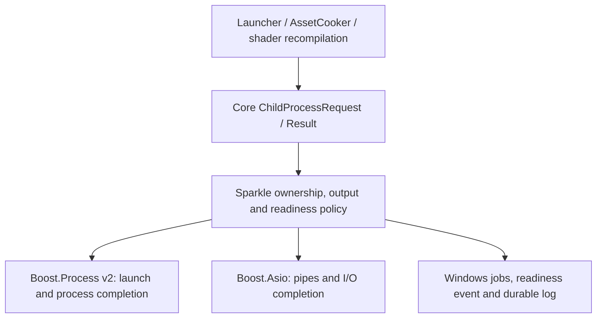

# Boost.Process implementation study

[Third-party migration](../ThirdPartyMigration.md#native-removal-estimates) | [Dependency workflow](../ThirdPartyMigration.md#ownership-and-dependency-workflow) | [Engineering](../Engineering.md)

**Proposal:** transfer generic child-process mechanics to Boost.Process v2 and Boost.Asio. SparkleEngine keeps workflow decisions and ownership policy in Core. The intended users are Launcher build/cook/run operations, AssetCooker subprocesses and Editor shader compilation.

**Recommendation: a bounded feasibility trial is worthwhile; adoption remains conditional.** The strongest benefit is retiring delicate Windows I/O machinery. The main drawback is introducing a compiled Boost dependency and its closure for a reviewed ceiling of **342 physical / 312 code lines before replacement costs**. Net removal and performance are unmeasured.

This document explains the proposed implementation; no migration has started. Repository inspection: **2026-11-21**, HEAD `719f89ec1b52968abaa139b8b9b70867b90df254`, with existing unrelated working-tree edits. Paths and symbols below were inspected in that working tree. Upstream API research uses the released **Boost 1.92.0** sources; this is a research baseline, not an adopted dependency pin. [Release](https://www.boost.org/releases/1.92.0/).

## Responsibility split

| Area | Transfer to Boost.Process / Asio | Keep in SparkleEngine |
| --- | --- | --- |
| Launching | Encode arguments/environment and create the process | Choose executable, arguments, environment and working directory |
| Output | Create pipes and read bytes asynchronously | Capture output, write logs and interpret progress messages |
| Completion | Observe process exit and I/O completion | Decide success/failure and ensure output is fully collected |
| Cancellation | Cancel pending I/O operations | Decide when to cancel, terminate the entire child tree and settle cleanup |
| Lifetime | Manage the process handle | Establish Windows job ownership before execution and control descendants |
| Readiness | Provide basic process observation | Verify application readiness, run validators and transfer lifetime after acceptance |

The main maintenance retirement would be Sparkle's handwritten argument/environment encoding, pipe reader and output-event waiting machinery. Launch, output and readiness owners would remain with narrower responsibilities. This is the proposed split; adoption still depends on the implementation checks below.

## What the library would help you do

For a concrete example, Launcher already describes a CMake build as an executable, separate arguments, working directory, environment, cancellation token and output callback. Today Core turns that into a Windows command line, environment block, suspended process, pipe and event-wait loop. After this migration, the same request would use upstream process and I/O primitives; Sparkle would supervise the operation and interpret its outcome.

| Benefit | What it means in this repository | Limit |
| --- | --- | --- |
| Less native process plumbing | Retire handwritten Windows launch encoding and overlapped-pipe implementation. Upstream owns those mechanisms and their maintenance. | Job control and product policy still need Windows code. |
| One I/O completion model | Use Asio pipe reads and process completion in place of manually assembling output/process/cancel wait arrays. | Completion ordering, output drainage and cancellation settlement remain integration responsibilities. |
| Explicit argument boundaries | Pass executable and argument values directly instead of constructing a launch string in Core. | Prove exact child-observed values for quotes, backslashes, empty strings and Unicode. |
| Upstream environment support | Use upstream environment values and block construction; retain a small merge from request overrides. | Inheritance, override precedence and Windows key semantics must be checked. |
| Reusable base for existing tools | Launcher, cookers and shader recompilation benefit through the same Core entry point. | It does not replace CMake, cook planning, progress decoding or shader publication. |
| A possible future portability benefit | Launch and I/O mechanisms have upstream platform implementations. | Sparkle currently implements this API only on Windows. Jobs/readiness and other engine owners still prevent a Linux support claim. |

Boost.Process v2 uses an Asio executor/context, an executable and an argument range. It is the current default API; v1 is deprecated. Use v2 explicitly during the trial and avoid older tutorials built around `child`, the v1 property DSL or v1 group helpers. [Process documentation](https://www.boost.org/doc/libs/1_92_0/libs/process/doc/html/index.html).

The dependency is established enough to investigate: its release sources include [v2 tests](https://github.com/boostorg/process/blob/boost-1.92.0/test/v2/CMakeLists.txt) and a [CI definition with Windows/MSVC configurations](https://github.com/boostorg/process/blob/boost-1.92.0/.github/workflows/ci.yml). Their presence does not establish passing results on Sparkle's recorded VS 2026 toolchain. Exact-pin defects/advisories and that toolchain remain implementation checks.

## What would actually be replaced

The four counts below come from proposal **P** in the migration guide. They describe selected old code, including mixed responsibilities; they are not promised savings or whole-folder deletion counts.

| Existing owner and symbols | Proposed upstream owner | Retirement boundary | Gross physical ceiling |
| --- | --- | --- | ---: |
| [ChildProcessWindowsArguments.cpp](../../Engine/Core/Private/Process/Windows/ChildProcessWindowsArguments.cpp) and [header](../../Engine/Core/Private/Process/Windows/ChildProcessWindowsArguments.h): `Utf8ToWide`, `BuildWindowsChildCommandLine`, `BuildWindowsChildEnvironment` | Windows argument encoding; `environment::current`, environment key/value types and `process_environment` | Delete the pair after replacing its callers. A small inherited-environment/override merge still has a cost. | 100 |
| [ChildProcessWindowsLaunch.cpp](../../Engine/Core/Private/Process/Windows/ChildProcessWindowsLaunch.cpp): `CreateSuspendedWindowsChild` | `windows::default_launcher`, creation flags, start directory and stdio initializers | Replace this function's launch mechanics. Retain error classification, job assignment, resume and failure cleanup with the launch owner. | 45 |
| [ChildProcessWindowsPipe.cpp](../../Engine/Core/Private/Process/Windows/ChildProcessWindowsPipe.cpp) and [header](../../Engine/Core/Private/Process/Windows/ChildProcessWindowsPipe.h): `CreateChildOutputPipe`, `WindowsChildOutputReader` | Asio connected pipes, `async_read_some`, cancellation and completion | Delete the pipe pair. Preserve output accumulation/callback/log writes in the output owner; these are excluded from the pipe-mechanics ceiling. | 142 |
| [ChildProcessWindowsOutput.cpp](../../Engine/Core/Private/Process/Windows/ChildProcessWindowsOutput.cpp): `ChildOutputEvent`, `WaitForChildOutputEvent` | Process `async_wait`, asynchronous pipe reads and posted cancellation | Delete the enum and wait-array dispatcher. Rewrite collection around upstream completions, retaining completion/drain policy. | 55 |
| **Total reviewed scope** | | **Before retained policy and all integration costs** | **342** |

The [launcher source](https://github.com/boostorg/process/blob/boost-1.92.0/include/boost/process/v2/windows/default_launcher.hpp) exposes the Windows launch fields/hooks. The [stdio implementation](https://github.com/boostorg/process/blob/boost-1.92.0/include/boost/process/v2/stdio.hpp) accepts Asio pipes and native handles. The [environment API](https://github.com/boostorg/process/blob/boost-1.92.0/include/boost/process/v2/environment.hpp) provides Windows-aware key comparisons and environment values. These are source mappings, not tested substitutions.

Use **one shared stdout/stderr destination**, as today. Creating separate pipes and merging their callbacks would change the current stream behavior. Prove an upstream connected pipe plus one child write handle bound to both outputs; close the parent's write endpoint immediately after launch so EOF can arrive. Check every duplicate and inherited handle lifetime.

### What stays owned by Sparkle

| Retained owner | Why it remains |
| --- | --- |
| [ChildProcess.h](../../Engine/Core/Public/Process/ChildProcess.h), [ChildProcess.cpp](../../Engine/Core/Private/Process/ChildProcess.cpp) and [Windows entry point](../../Engine/Core/Private/Process/Windows/ChildProcessWindows.cpp) | Request/result semantics, pre-launch cancellation, dispatch to exit/readiness modes and `Succeeded()` are used across module boundaries. Keep Boost types private. |
| [Launch owner](../../Engine/Core/Private/Process/Windows/ChildProcessWindowsLaunch.cpp) | Own the Windows job, `JOB_OBJECT_LIMIT_KILL_ON_JOB_CLOSE`, assignment before resume, whole-tree termination and existing bounded cleanup wait. Killing the root alone is insufficient. |
| [Readiness owner](../../Engine/Core/Private/Process/Windows/ChildProcessWindowsReadiness.cpp), [child signal](../../Engine/Core/Private/Process/ProcessReadiness.cpp) and [environment names](../../Engine/Core/Private/Process/ProcessReadinessEnvironment.h) | Named readiness event/value, durable log, validator, rejection and transfer of application lifetime. Generic process completion cannot decide that the engine is usable. |
| [Output owner](../../Engine/Core/Private/Process/Windows/ChildProcessWindowsOutput.cpp) | Captured bytes, callback delivery, log opening/writing/flush errors and the requirement to settle exit and output. |
| [WindowsProcessHandle.cpp](../../Engine/Core/Private/Process/Windows/WindowsProcessHandle.cpp), [private declarations](../../Engine/Core/Private/Process/Windows/ChildProcessWindows.h), [diagnostics](../../Engine/Core/Private/Process/Windows/ChildProcessWindowsDiagnostics.cpp) | Retained job/event/file handles and readable native failures. Let Boost own its process handle; never wrap that same owning handle twice. |
| [CommandLineUtils.cpp](../../Engine/Core/Private/Process/CommandLineUtils.cpp) | Current-process argument discovery/parsing and Launcher display quoting still have consumers. Removing launch-string construction does not retire these shared helpers. |
| [ProcessRelaunch.cpp](../../Engine/Core/Private/Process/ProcessRelaunch.cpp) | Editor relaunch preserves the existing raw command line and transfers lifetime to the OS. Its separate `CreateProcessW` path is outside P's count; do not silently convert it to a managed child. |

## Proposed implementation and the difficult parts



Keep the current synchronous `RunChildProcess` boundary. Give each invocation one local `io_context`, driven on its calling worker thread, with process/pipe/cancellation state alive until all handlers settle. This proposes no permanent service thread, global context, task-runtime replacement or second application scheduler. Concurrent invocations have separate state. Charge this context and every adapter to the migration.

Asio provides the asynchronous I/O model; the invocation can still block its existing worker while driving it. GUI presentation continues through the current output/operation owners. This is an integration design, not a demonstrated responsiveness or throughput improvement. [Asio overview](https://www.boost.org/doc/libs/1_92_0/doc/html/boost_asio.html).

### 1. Preserve ownership before the first child instruction

The existing invariant is:

```text
Create suspended -> configure kill-on-close job -> assign child -> resume
Failure after creation -> terminate and settle -> report failure
```

The inspected v2 Windows launcher exposes `creation_flags` and `process_information`, and calls initializer `on_success` before closing the initial thread handle. This suggests a small initializer can preserve assignment/resume without reimplementing creation. **This is a feasibility inference from upstream source, not a passed fit result.** [Windows launcher](https://github.com/boostorg/process/blob/boost-1.92.0/include/boost/process/v2/windows/default_launcher.hpp).

Set suspended/no-window creation through the supported launch interface. Keep the owned job alive through settlement or accepted handoff. In the success hook, assign the suspended child and resume only after assignment succeeds. Capture the native error before cleanup. The hook does not return a launch error through its return value: record failure explicitly, terminate/settle the child, and make the outer operation reject it. Also handle failures while constructing the returned managed process and any exception after native creation. Confirm thread/process handles close exactly once.

Reject the candidate if this requires an upstream fork, copying its launcher, resuming before job ownership or losing failure cleanup. A wrapped `CreateProcessW` alongside a full local pipe/wait implementation would not achieve the intended transfer.

### 2. Settle process exit, output and cancellation separately

Arm one asynchronous read at a time and process completion on the same context. Each read consumes exactly its delivered byte count into the existing capture/callback/log path, then rearms. Return after the process has exited and output has reached EOF, or after failure cleanup has terminated the owned tree and settled outstanding I/O. Root exit alone does not imply EOF: descendants can hold the write handle.

Bridge `std::stop_token` to a posted operation on that context. Serialize state changes there; a stop callback must not race a pipe/process operation or access a destroyed context. Cancellation means **terminate the owned job**, then settle process/read handlers. Cancelling an Asio wait is only cancelling observation. Define and check the lifetime order of the stop callback, context, buffers and handlers; `io_context::stop()` alone does not drain cancelled operations.

Keep stdout/stderr chunks as bytes, preserving partial-line handling in consumers. Handle callback exceptions and I/O/log failures through cleanup so a child or pending handler cannot outlive stack state. This does not add a new output-retention policy; the current accumulated output remains potentially large, and memory must be measured.

### 3. Preserve readiness and explicit lifetime transfer

Readiness mode currently writes the child's stdout/stderr directly to a durable file and tails it while waiting. Keep that path so the application can continue logging after Launcher returns. Bind its existing native file handle through upstream stdio; using the generic path-opening initializer could change creation/sharing behavior. The inspected stdio source uses `OPEN_ALWAYS` and different sharing flags, while Sparkle explicitly uses `CREATE_ALWAYS` with delete sharing. [Stdio source](https://github.com/boostorg/process/blob/boost-1.92.0/include/boost/process/v2/stdio.hpp).

Retain the readiness wait/tail policy initially; its removal is outside the 55-line output-event scope. Both launch modes must use the same upstream creation path. Preserve `Ready`, `Rejected` and `ReleaseWithoutReadiness` distinctly, including process re-observation for `Ready` and the existing result values. After accepted transfer, clear kill-on-close policy and detach the Boost-managed process before its destructor. A failed transfer still terminates the owned tree.

Boost's process object terminates a running child on destruction unless detached; `detach()` returns a non-terminating process handle. Dropping an attached object on successful readiness would undo the handoff. [Process lifetime source](https://github.com/boostorg/process/blob/boost-1.92.0/include/boost/process/v2/process.hpp).

### 4. Preserve arguments, environment and useful errors

Pass argument values once; do not prequote values for Boost. Use a snapshot of inherited environment plus request overrides, with Windows-aware names and last-override-wins behavior. Never modify the parent's environment to launch a child. Exercise `PATH`/`Path`, empty values, Unicode and inherited drive-directory entries. The current merge compares case-sensitively; record any correction of that discrepancy explicitly instead of silently claiming byte-identical behavior. [Environment implementation](https://github.com/boostorg/process/blob/boost-1.92.0/include/boost/process/v2/environment.hpp).

Retain `ExecutableNotFound`, `AccessDenied`, `BlockedByPolicy` and generic OS failure classification. Translate upstream failures once at Core's boundary, preserving the native code and operation. Validate launch encoding with the actual child parser, including consecutive backslashes before a quote; upstream quoting is an implementation to qualify, not proof of equivalent behavior. [Argument encoder](https://github.com/boostorg/process/blob/boost-1.92.0/src/windows/default_launcher.cpp).

## Real callers and workflows to preserve

| Consumer | What changes / what must continue to work |
| --- | --- |
| [Launcher process runner](../../Tools/Launcher/SparkleLauncher/Private/Operations/ProcessRunner.cpp), [CMake requests](../../Tools/Launcher/SparkleLauncher/Private/Build/CMakeWorkflowProcessRequests.cpp), [cook requests](../../Tools/Launcher/SparkleLauncher/Private/Cook/CookOperationProcessRequests.cpp) | Request producers should need little or no API change. Preserve command display, configure/build/cook output, logs, nonzero exits and cancellation of descendants. |
| [GUI operation execution](../../Tools/Launcher/SparkleLauncher/Private/Gui/Operations/LauncherOperationExecution.cpp) and [progress decoding](../../Tools/Launcher/SparkleLauncher/Private/Gui/Operations/LauncherProgressStreamDecoder.cpp) | Preserve stop-token propagation, callback execution expectations and fragmented progress records. The task-runtime plan separately owns removal of `TaskContextProcessRunner`; give P no credit for it. |
| [Run-level requests](../../Tools/Launcher/SparkleLauncher/Private/Levels/LevelRunOperationProcessRequests.cpp) and [GPU crash verification](../../Tools/Launcher/SparkleLauncher/Private/GpuCrash/GpuCrashLaunch.cpp) | Preserve graphics/profile/environment arguments, named readiness, validation and release decisions. An accepted Editor/Game survives Launcher completion; a rejected/cancelled launch remains owned and is terminated. |
| [Editor shader compilation](../../Tools/Launcher/SparkleLauncher/Private/Editor/EditorShaderCompilation.cpp) | Preserve Editor -> Launcher -> shader cook output, missing-Launcher diagnostics, cancellation and failure propagation. Shader publication/reload rules stay with their existing owners. |
| [AssetCooker subprocess](../../Tools/Cooking/AssetCooker/Private/Dispatch/AssetCookerToolProcess.cpp) | Preserve live console bytes, child exit status and nested cooker cancellation. This consumer has no Qt dependency. |
| [Dependency inspection](../../Tools/Launcher/SparkleLauncher/Private/Dependencies/SourceDependencyState.cpp) and [VS discovery](../../Tools/Launcher/SparkleLauncher/Private/Build/Toolchains/VisualStudioToolchainDiscovery.cpp) | Preserve captured Git/vswhere output, working directory and failures. Test concurrent short invocations as well as long tool jobs. |

Keeping the public request/result contract is justified by these real consumers. Do not add a general process framework or a second public Boost-shaped facade. Any caller edits still count in the complete change.

## Costs, alternatives and adoption decision

| Cost or risk | Practical consequence / proposed response |
| --- | --- |
| Compiled dependency and transitive headers | v2 is separately compiled. The upstream target links Asio, System, Algorithm, Config, Core, Fusion, Iterator, Move, Optional, Tokenizer, TypeIndex and WinAPI, plus Filesystem unless configured otherwise. Account for the full transitive closure. |
| Build and package growth | Private headers limit exposure, but Core consumers still pay relevant link/runtime costs. Measure acquisition, configure/build time, binary size, context memory and required runtime files. Do not assume header-only or zero-DLL delivery. |
| Small gross scope | New context, cancellation, environment and job bridges could consume the entire ceiling. Reject comparable replacement machinery; report the actual ledger. |
| Two lifetime models to reconcile | Boost process destruction and Sparkle job closure can both terminate children. Define one ownership/transfer sequence and prove failures and handoff. |
| Different launch/stdio details | Argument escaping, invalid/absent stdin, inherited handles, file opening and environment behavior need explicit checks. Avoid assuming defaults match. |
| New asynchronous concepts | Completion, executor and cancellation lifetimes take effort to learn. Keep them private to the process owner and avoid extra threads/services. |
| Toolchain/update responsibility | Upstream CI is useful evidence, but Sparkle must build its exact pin and recheck the adapter on updates. A supported hook must replace any need for private implementation access. |

The dependency list, optional `BOOST_PROCESS_USE_STD_FS`, Windows system libraries and static/shared definitions above come from the [1.92.0 CMake target](https://github.com/boostorg/process/blob/boost-1.92.0/CMakeLists.txt). Prefer `std::filesystem` to match Core, and trial a static Boost.Process library with the project's existing CRT selection to avoid another runtime DLL. Confirm the actual resulting closure; this choice does not guarantee a smaller binary.

The code is distributed under the [Boost Software License 1.0](https://www.boost.org/LICENSE_1_0.txt). Record the selected source's notices and provenance through the existing dependency/package owners; review the actual shipped artifacts at adoption.

| Alternative | Fit here |
| --- | --- |
| Keep the present Win32 implementation | No new dependency, exact existing job/readiness integration. Sensible if the upstream trial cannot retire enough mechanics or preserve ownership. Sparkle keeps maintaining pipes and encoding. |
| Use existing Qt `QProcess` | Attractive inside Launcher, but Core also serves non-Qt AssetCooker/engine consumers. Making Core depend on Qt or adding a second backend would change the architecture. It still needs a proved Windows job/readiness design. |
| Use Boost.Process v2 + Asio | Best candidate here for common launch/pipe mechanisms across those consumers. Worth adopting only if the retained Windows policy stays small and cohesive. |

This migration improves supporting infrastructure. It adds no rendering feature, GPU performance improvement, application-readiness policy or automatic cross-platform engine support.

## Dependency integration and implementation order

1. **Freeze the candidate, then prove the difficult fit.** Resolve the released baseline to an immutable source revision/archive hash and record required files. Use local-only probes to prove suspended creation/job assignment/resume failure cleanup and readiness detach. Stop the trial if supported upstream hooks cannot carry those invariants. No fallback backend enters production.
2. **Integrate the dependency through existing owners.** Add one recipe under [CMake/Dependencies/Targets](../../CMake/Dependencies/Targets), select it in [FetchDependencies.cmake](../../CMake/Dependencies/FetchDependencies.cmake) and the standalone [Launcher allowlist](../../Tools/Launcher/CMakeLists.txt), and link it privately in [Core](../../Engine/Core/CMakeLists.txt). Acquire an intact pinned Boost source tree and its dependency closure; fetching only `boostorg/process` is insufficient. Keep source under ignored `build/_deps` and build only Process plus its dependencies. Upstream supports `BOOST_INCLUDE_LIBRARIES=process`; disable dependency tests/examples/install rules in product builds. [Boost CMake selection](https://github.com/boostorg/cmake/blob/boost-1.92.0/include/BoostRoot.cmake).
3. **Replace the actual mechanisms.** Convert shared launch first, then exit-mode pipes/completions and readiness-mode launch/handoff. Delete the arguments and pipe pairs and displaced event dispatcher. Keep policy with the existing launch/output/readiness owners; update private process ownership declarations and regenerate CMake source membership. Preserve request producers unless a necessary correction is identified.
4. **Finish distribution and focused verification.** Update [Launcher dependency metadata](../../Tools/Launcher/SparkleLauncher/Private/Dependencies/SourceDependencyState.cpp), sync/clean/cache validation, [notices](../../CMake/Notices/ThirdPartyNotices.txt) and [package inventory](../../CMake/Packaging). Metadata reflects the same pin without another authoritative registry. Verify source-prepared/offline and prebuilt paths at their existing owners. Remove local probes and their build files before handoff.

Do not globally change `BUILD_SHARED_LIBS` or CRT settings to configure this leaf dependency. Source acquisition must preserve the existing cache's revision/cleanliness checks; design any needed closure acquisition in that owner, and charge it. No machine-installed Boost prerequisite or configure-time fallback download should bypass the source-sync workflow.

### Focused evidence needed for code completion

| Check | Required observation |
| --- | --- |
| Launch fidelity and failure | Child reports exact executable/arguments/cwd/environment; empty/quoted/Unicode/trailing-backslash values survive. Preserve existing start-failure classes and useful native diagnostics for missing executables, denied/policy failures and bad working directories. |
| Ownership before execution | A child that immediately spawns a descendant remains controlled. Inject assignment/resume failure: no child escapes or remains suspended, and no process/thread/job handle leaks. |
| Output and exit | Mixed stdout/stderr, more output than pipe capacity, fragmented records, EOF before exit and exit before EOF all settle without truncation or deadlock. Log-open/write/flush failures remain failures. |
| Cancellation and lifetime | Stop before launch, during launch, during output and after root exit with a descendant holding stdout. Terminate the owned tree; settle reads/waits before destroying buffers/context. Repeated/concurrent runs do not grow handles or threads. |
| Readiness | Early exit, validator exception/rejection, cancellation and failed ownership release terminate the owned child. `Ready` and `ReleaseWithoutReadiness` preserve their distinct results; transferred applications survive return and keep writing the durable log. |
| Real consumers and linkage | Build root Core and affected tools plus standalone Launcher with the pin, project profiles and CRT. Exercise build/cook, AssetCooker subprocesses, shader compilation and run handoff; retain a real shared Core consumer. |

Freeze representative commands/inputs and cost criteria before comparing the candidate. Use the [existing code-completion policy](../ThirdPartyMigration.md#code-delivery-and-qualification): focused correctness/build/removal work determines code delivery; broader timing distributions, full interactive/API matrices and relocated-package/clean-machine qualification remain with the existing release owners. Unrun checks remain **UNVERIFIED**.

Report the complete connected ledger:

```text
net native removal = old scoped lines actually retired
                   - new or relocated native integration lines
```

Count retained old lines, headers, context/state, cancellation/environment/job bridges and every changed caller once. Report CMake/scripts, upstream bytes, binaries, memory and build/runtime costs separately. A missed numerical estimate needs an honest result; a second local implementation, unsafe ownership or broken workflow blocks adoption regardless of the line count.

**Current status:** source/API investigation only. No Boost pin, prototype, build, runtime, cost or package result has been qualified. The first implementation decision is whether the supported launch hook and detach semantics preserve Sparkle's ownership invariant with a small adapter. If that passes, the pipe implementation is the main maintenance retirement to pursue. At code closure, fold lasting decisions and unresolved product limits into their existing guides and remove this active plan.
