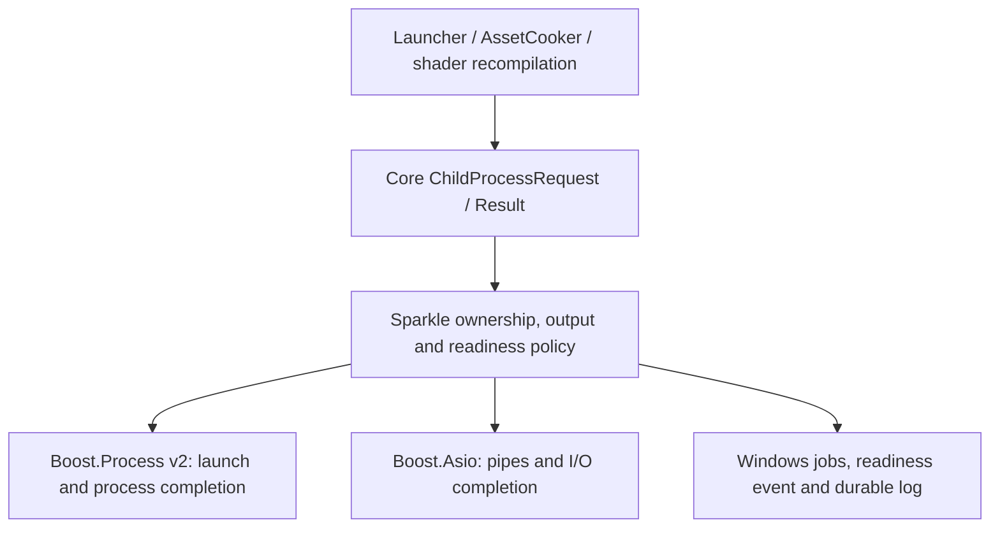

# Boost.Process staged implementation plan

[Third-party migration](../ThirdPartyMigration.md#native-removal-estimates) | [Dependency workflow](../ThirdPartyMigration.md#ownership-and-dependency-workflow) | [Engineering](../Engineering.md)

**Proposal:** transfer generic child-process mechanics to Boost.Process v2 and Boost.Asio. SparkleEngine keeps workflow decisions and ownership policy in Core. The intended users are Launcher build/cook/run operations, AssetCooker subprocesses and Editor shader compilation.

**Recommendation: a bounded feasibility trial is worthwhile; adoption remains conditional.** The strongest benefit is retiring delicate Windows I/O machinery. The main drawback is introducing a compiled Boost dependency and its closure for a reviewed ceiling of **342 physical / 312 code lines before replacement costs**. Net removal and performance are unmeasured.

This document specifies proposed work; no implementation stage has passed. The original source study used **2026-11-21**, HEAD `719f89ec1b52968abaa139b8b9b70867b90df254`, with assessed local edits. The staged-plan review used HEAD `293e2b209f215926eb952dcd277a95177368e831`, rereading the guides, dependency recipes/cache, Core process contract and launch/output/readiness owners. Upstream API research uses released **Boost 1.92.0** sources; this is a research baseline, not an adopted dependency pin. Stage 0 must bind its own current inputs. [Release](https://www.boost.org/releases/1.92.0/).

**Next action: Stage 0, design deep dive.** Documentation research does not pass its design exit or the executable fit exit. [Stages and prompts](#staged-delivery) | [Positive and negative guidelines](#positive-and-negative-guidelines) | [Failure modes and acceptance](#failure-modes-and-acceptance).

## Responsibility split

| Area | Transfer to Boost.Process / Asio | Keep in SparkleEngine |
| --- | --- | --- |
| Launching | Encode arguments/environment and create the process | Choose executable, arguments, environment and working directory |
| Output | Create pipes and read bytes asynchronously | Capture output, write logs and interpret progress messages |
| Completion | Observe process exit and I/O completion | Decide success/failure and ensure output is fully collected |
| Cancellation | Cancel pending I/O operations | Decide when to cancel, terminate the entire child tree and settle cleanup |
| Lifetime | Manage the process handle | Establish Windows job ownership before execution and control descendants |
| Readiness | Provide basic process observation | Verify application readiness, run validators and transfer lifetime after acceptance |

The main maintenance retirement would be Sparkle's handwritten argument/environment encoding, pipe reader and output-event waiting machinery. Launch, output and readiness owners would remain with narrower responsibilities. This is the proposed split; adoption still depends on the implementation checks below.

## What the library would help you do

For a concrete example, Launcher already describes a CMake build as an executable, separate arguments, working directory, environment, cancellation token and output callback. Today Core turns that into a Windows command line, environment block, suspended process, pipe and event-wait loop. After this migration, the same request would use upstream process and I/O primitives; Sparkle would supervise the operation and interpret its outcome.

| Benefit | What it means in this repository | Limit |
| --- | --- | --- |
| Less native process plumbing | Retire handwritten Windows launch encoding and overlapped-pipe implementation. Upstream owns those mechanisms and their maintenance. | Job control and product policy still need Windows code. |
| One I/O completion model | Use Asio pipe reads and process completion in place of manually assembling output/process/cancel wait arrays. | Completion ordering, output drainage and cancellation settlement remain integration responsibilities. |
| Explicit argument boundaries | Pass executable and argument values directly instead of constructing a launch string in Core. | Prove exact child-observed values for quotes, backslashes, empty strings and Unicode. |
| Upstream environment support | Use upstream environment values and block construction; retain a small merge from request overrides. | Inheritance, override precedence and Windows key semantics must be checked. |
| Reusable base for existing tools | Launcher, cookers and shader recompilation benefit through the same Core entry point. | It does not replace CMake, cook planning, progress decoding or shader publication. |
| A possible future portability benefit | Launch and I/O mechanisms have upstream platform implementations. | Sparkle currently implements this API only on Windows. Jobs/readiness and other engine owners still prevent a Linux support claim. |

Boost.Process v2 uses an Asio executor/context, an executable and an argument range. It is the current default API; v1 is deprecated. Use v2 explicitly during the trial and avoid older tutorials built around `child`, the v1 property DSL or v1 group helpers. [Process documentation](https://www.boost.org/doc/libs/1_92_0/libs/process/doc/html/index.html).

The dependency is established enough to investigate: its release sources include [v2 tests](https://github.com/boostorg/process/blob/boost-1.92.0/test/v2/CMakeLists.txt) and a [CI definition with Windows/MSVC configurations](https://github.com/boostorg/process/blob/boost-1.92.0/.github/workflows/ci.yml). Their presence does not establish passing results on Sparkle's recorded VS 2026 toolchain. Exact-pin defects/advisories and that toolchain remain implementation checks.

## What would actually be replaced

The four counts below come from proposal **P** in the migration guide. They describe selected old code, including mixed responsibilities; they are not promised savings or whole-folder deletion counts.

| Existing owner and symbols | Proposed upstream owner | Retirement boundary | Gross physical ceiling |
| --- | --- | --- | ---: |
| [ChildProcessWindowsArguments.cpp](../../Engine/Core/Private/Process/Windows/ChildProcessWindowsArguments.cpp) and [header](../../Engine/Core/Private/Process/Windows/ChildProcessWindowsArguments.h): `Utf8ToWide`, `BuildWindowsChildCommandLine`, `BuildWindowsChildEnvironment` | Windows argument encoding; `environment::current`, environment key/value types and `process_environment` | Delete the pair after replacing its callers. A small inherited-environment/override merge still has a cost. | 100 |
| [ChildProcessWindowsLaunch.cpp](../../Engine/Core/Private/Process/Windows/ChildProcessWindowsLaunch.cpp): `CreateSuspendedWindowsChild` | `windows::default_launcher`, creation flags, start directory and stdio initializers | Replace this function's launch mechanics. Retain error classification, job assignment, resume and failure cleanup with the launch owner. | 45 |
| [ChildProcessWindowsPipe.cpp](../../Engine/Core/Private/Process/Windows/ChildProcessWindowsPipe.cpp) and [header](../../Engine/Core/Private/Process/Windows/ChildProcessWindowsPipe.h): `CreateChildOutputPipe`, `WindowsChildOutputReader` | Asio connected pipes, `async_read_some`, cancellation and completion | Delete the pipe pair. Preserve output accumulation/callback/log writes in the output owner; these are excluded from the pipe-mechanics ceiling. | 142 |
| [ChildProcessWindowsOutput.cpp](../../Engine/Core/Private/Process/Windows/ChildProcessWindowsOutput.cpp): `ChildOutputEvent`, `WaitForChildOutputEvent` | Process `async_wait`, asynchronous pipe reads and posted cancellation | Delete the enum and wait-array dispatcher. Rewrite collection around upstream completions, retaining completion/drain policy. | 55 |
| **Total reviewed scope** | | **Before retained policy and all integration costs** | **342** |

The [launcher source](https://github.com/boostorg/process/blob/boost-1.92.0/include/boost/process/v2/windows/default_launcher.hpp) exposes the Windows launch fields/hooks. The [stdio implementation](https://github.com/boostorg/process/blob/boost-1.92.0/include/boost/process/v2/stdio.hpp) accepts Asio pipes and native handles. The [environment API](https://github.com/boostorg/process/blob/boost-1.92.0/include/boost/process/v2/environment.hpp) provides Windows-aware key comparisons and environment values. These are source mappings, not tested substitutions.

Use **one shared stdout/stderr destination**, as today. Creating separate pipes and merging their callbacks would change the current stream behavior. Prove an upstream connected pipe plus one child write handle bound to both outputs; close the parent's write endpoint immediately after launch so EOF can arrive. Check every duplicate and inherited handle lifetime.

### What stays owned by Sparkle

| Retained owner | Why it remains |
| --- | --- |
| [ChildProcess.h](../../Engine/Core/Public/Process/ChildProcess.h), [ChildProcess.cpp](../../Engine/Core/Private/Process/ChildProcess.cpp) and [Windows entry point](../../Engine/Core/Private/Process/Windows/ChildProcessWindows.cpp) | Request/result semantics, pre-launch cancellation, dispatch to exit/readiness modes and `Succeeded()` are used across module boundaries. Keep Boost types private. |
| [Launch owner](../../Engine/Core/Private/Process/Windows/ChildProcessWindowsLaunch.cpp) | Own the Windows job, `JOB_OBJECT_LIMIT_KILL_ON_JOB_CLOSE`, assignment before resume, whole-tree termination and existing bounded cleanup wait. Killing the root alone is insufficient. |
| [Readiness owner](../../Engine/Core/Private/Process/Windows/ChildProcessWindowsReadiness.cpp), [child signal](../../Engine/Core/Private/Process/ProcessReadiness.cpp) and [environment names](../../Engine/Core/Private/Process/ProcessReadinessEnvironment.h) | Named readiness event/value, durable log, validator, rejection and transfer of application lifetime. Generic process completion cannot decide that the engine is usable. |
| [Output owner](../../Engine/Core/Private/Process/Windows/ChildProcessWindowsOutput.cpp) | Captured bytes, callback delivery, log opening/writing/flush errors and the requirement to settle exit and output. |
| [WindowsProcessHandle.cpp](../../Engine/Core/Private/Process/Windows/WindowsProcessHandle.cpp), [private declarations](../../Engine/Core/Private/Process/Windows/ChildProcessWindows.h), [diagnostics](../../Engine/Core/Private/Process/Windows/ChildProcessWindowsDiagnostics.cpp) | Retained job/event/file handles and readable native failures. Let Boost own its process handle; never wrap that same owning handle twice. |
| [CommandLineUtils.cpp](../../Engine/Core/Private/Process/CommandLineUtils.cpp) | Current-process argument discovery/parsing and Launcher display quoting still have consumers. Removing launch-string construction does not retire these shared helpers. |
| [ProcessRelaunch.cpp](../../Engine/Core/Private/Process/ProcessRelaunch.cpp) | Editor relaunch preserves the existing raw command line and transfers lifetime to the OS. Its separate `CreateProcessW` path is outside P's count; do not silently convert it to a managed child. |

## Proposed implementation and the difficult parts



**Initial shape to challenge in Stage 0:** retain synchronous `RunChildProcess`, with one local `io_context` driven on its calling worker thread and process/pipe/cancellation state alive until handlers settle. Concurrent invocations have separate state. Prefer this over a permanent service thread or global context unless a real consumer proves otherwise. Account for upstream internal resources too; no zero-thread-cost claim is established. Charge the context and every adapter to the migration.

Asio provides the asynchronous I/O model; the invocation can still block its existing worker while driving it. GUI presentation continues through the current output/operation owners. This is an integration design, not a demonstrated responsiveness or throughput improvement. [Asio overview](https://www.boost.org/doc/libs/1_92_0/doc/html/boost_asio.html).

### 1. Preserve ownership before the first child instruction

The existing invariant is:

```text
Create suspended -> configure kill-on-close job -> assign child -> resume
Failure after creation -> terminate and settle -> report failure
```

The inspected v2 Windows launcher exposes `creation_flags` and `process_information`, and calls initializer `on_success` before closing the initial thread handle. This suggests a small initializer can preserve assignment/resume without reimplementing creation. **This is a feasibility inference from upstream source, not a passed fit result.** [Windows launcher](https://github.com/boostorg/process/blob/boost-1.92.0/include/boost/process/v2/windows/default_launcher.hpp).

Set suspended/no-window creation through the supported launch interface. Keep the owned job alive through settlement or accepted handoff. In the success hook, assign the suspended child and resume only after assignment succeeds. Capture the native error before cleanup. The hook does not return a launch error through its return value: record failure explicitly, terminate/settle the child, and make the outer operation reject it. Also handle failures while constructing the returned managed process and any exception after native creation. Confirm thread/process handles close exactly once.

Reject the candidate if this requires an upstream fork, copying its launcher, resuming before job ownership or losing failure cleanup. A wrapped `CreateProcessW` alongside a full local pipe/wait implementation would not achieve the intended transfer.

### 2. Settle process exit, output and cancellation separately

Arm one asynchronous read at a time and process completion on the same context. Each read consumes exactly its delivered byte count into the existing capture/callback/log path, then rearms. Return after the process has exited and output has reached EOF, or after failure cleanup has terminated the owned tree and settled outstanding I/O. Root exit alone does not imply EOF: descendants can hold the write handle.

Bridge `std::stop_token` to a posted operation on that context. Serialize state changes there; a stop callback must not race a pipe/process operation or access a destroyed context. Cancellation means **terminate the owned job**, then settle process/read handlers. Cancelling an Asio wait is only cancelling observation. Define and check the lifetime order of the stop callback, context, buffers and handlers; `io_context::stop()` alone does not drain cancelled operations.

Keep stdout/stderr chunks as bytes, preserving partial-line handling in consumers. Handle callback exceptions and I/O/log failures through cleanup so a child or pending handler cannot outlive stack state. This does not add a new output-retention policy; the current accumulated output remains potentially large, and memory must be measured.

### 3. Preserve readiness and explicit lifetime transfer

Readiness mode currently writes the child's stdout/stderr directly to a durable file and tails it while waiting. Keep that path so the application can continue logging after Launcher returns. Bind its existing native file handle through upstream stdio; using the generic path-opening initializer could change creation/sharing behavior. The inspected stdio source uses `OPEN_ALWAYS` and different sharing flags, while Sparkle explicitly uses `CREATE_ALWAYS` with delete sharing. [Stdio source](https://github.com/boostorg/process/blob/boost-1.92.0/include/boost/process/v2/stdio.hpp).

Retain the readiness wait/tail policy initially; its removal is outside the 55-line output-event scope. Both launch modes must use the same upstream creation path. Preserve `Ready`, `Rejected` and `ReleaseWithoutReadiness` distinctly, including process re-observation for `Ready` and the existing result values. After accepted transfer, clear kill-on-close policy and detach the Boost-managed process before its destructor. A failed transfer still terminates the owned tree.

Boost's process object terminates a running child on destruction unless detached; `detach()` returns a non-terminating process handle. Dropping an attached object on successful readiness would undo the handoff. [Process lifetime source](https://github.com/boostorg/process/blob/boost-1.92.0/include/boost/process/v2/process.hpp).

### 4. Preserve arguments, environment and useful errors

Pass argument values once; do not prequote values for Boost. Use a snapshot of inherited environment plus request overrides, with Windows-aware names and last-override-wins behavior. Never modify the parent's environment to launch a child. Exercise `PATH`/`Path`, empty values, Unicode and inherited drive-directory entries. The current merge compares case-sensitively; record any correction of that discrepancy explicitly instead of silently claiming byte-identical behavior. [Environment implementation](https://github.com/boostorg/process/blob/boost-1.92.0/include/boost/process/v2/environment.hpp).

Retain `ExecutableNotFound`, `AccessDenied`, `BlockedByPolicy` and generic OS failure classification. Translate upstream failures once at Core's boundary, preserving the native code and operation. Validate launch encoding with the actual child parser, including consecutive backslashes before a quote; upstream quoting is an implementation to qualify, not proof of equivalent behavior. [Argument encoder](https://github.com/boostorg/process/blob/boost-1.92.0/src/windows/default_launcher.cpp).

## Real callers and workflows to preserve

| Consumer | What changes / what must continue to work |
| --- | --- |
| [Launcher process runner](../../Tools/Launcher/SparkleLauncher/Private/Operations/ProcessRunner.cpp), [CMake requests](../../Tools/Launcher/SparkleLauncher/Private/Build/CMakeWorkflowProcessRequests.cpp), [cook requests](../../Tools/Launcher/SparkleLauncher/Private/Cook/CookOperationProcessRequests.cpp) | Request producers should need little or no API change. Preserve command display, configure/build/cook output, logs, nonzero exits and cancellation of descendants. |
| [GUI operation execution](../../Tools/Launcher/SparkleLauncher/Private/Gui/Operations/LauncherOperationExecution.cpp) and [progress decoding](../../Tools/Launcher/SparkleLauncher/Private/Gui/Operations/LauncherProgressStreamDecoder.cpp) | Preserve stop-token propagation, callback execution expectations and fragmented progress records. The task-runtime plan separately owns removal of `TaskContextProcessRunner`; give P no credit for it. |
| [Run-level requests](../../Tools/Launcher/SparkleLauncher/Private/Levels/LevelRunOperationProcessRequests.cpp) and [GPU crash verification](../../Tools/Launcher/SparkleLauncher/Private/GpuCrash/GpuCrashLaunch.cpp) | Preserve graphics/profile/environment arguments, named readiness, validation and release decisions. An accepted Editor/Game survives Launcher completion; a rejected/cancelled launch remains owned and is terminated. |
| [Editor shader compilation](../../Tools/Launcher/SparkleLauncher/Private/Editor/EditorShaderCompilation.cpp) | Preserve Editor -> Launcher -> shader cook output, missing-Launcher diagnostics, cancellation and failure propagation. Shader publication/reload rules stay with their existing owners. |
| [AssetCooker subprocess](../../Tools/Cooking/AssetCooker/Private/Dispatch/AssetCookerToolProcess.cpp) | Preserve live console bytes, child exit status and nested cooker cancellation. This consumer has no Qt dependency. |
| [Dependency inspection](../../Tools/Launcher/SparkleLauncher/Private/Dependencies/SourceDependencyState.cpp) and [VS discovery](../../Tools/Launcher/SparkleLauncher/Private/Build/Toolchains/VisualStudioToolchainDiscovery.cpp) | Preserve captured Git/vswhere output, working directory and failures. Test concurrent short invocations as well as long tool jobs. |

Keeping the public request/result contract is justified by these real consumers. Do not add a general process framework or a second public Boost-shaped facade. Any caller edits still count in the complete change.

## Costs, alternatives and adoption decision

| Cost or risk | Practical consequence / proposed response |
| --- | --- |
| Compiled dependency and transitive headers | v2 is separately compiled. The upstream target links Asio, System, Algorithm, Config, Core, Fusion, Iterator, Move, Optional, Tokenizer, TypeIndex and WinAPI, plus Filesystem unless configured otherwise. Account for the full transitive closure. |
| Build and package growth | Private headers limit exposure, but Core consumers still pay relevant link/runtime costs. Measure acquisition, configure/build time, binary size, context memory and required runtime files. Do not assume header-only or zero-DLL delivery. |
| Small gross scope | New context, cancellation, environment and job bridges could consume the entire ceiling. Reject comparable replacement machinery; report the actual ledger. |
| Two lifetime models to reconcile | Boost process destruction and Sparkle job closure can both terminate children. Define one ownership/transfer sequence and prove failures and handoff. |
| Different launch/stdio details | Argument escaping, invalid/absent stdin, inherited handles, file opening and environment behavior need explicit checks. Avoid assuming defaults match. |
| New asynchronous concepts | Completion, executor and cancellation lifetimes take effort to learn. Keep them private to the process owner and avoid extra threads/services. |
| Toolchain/update responsibility | Upstream CI is useful evidence, but Sparkle must build its exact pin and recheck the adapter on updates. A supported hook must replace any need for private implementation access. |

The dependency list, optional `BOOST_PROCESS_USE_STD_FS`, Windows system libraries and static/shared definitions above come from the [1.92.0 CMake target](https://github.com/boostorg/process/blob/boost-1.92.0/CMakeLists.txt). Prefer `std::filesystem` to match Core, and trial a static Boost.Process library with the project's existing CRT selection to avoid another runtime DLL. Confirm the actual resulting closure; this choice does not guarantee a smaller binary.

The code is distributed under the [Boost Software License 1.0](https://www.boost.org/LICENSE_1_0.txt). Record the selected source's notices and provenance through the existing dependency/package owners; review the actual shipped artifacts at adoption.

| Alternative | Fit here |
| --- | --- |
| Keep the present Win32 implementation | No new dependency, exact existing job/readiness integration. Sensible if the upstream trial cannot retire enough mechanics or preserve ownership. Sparkle keeps maintaining pipes and encoding. |
| Use existing Qt `QProcess` | Attractive inside Launcher, but Core also serves non-Qt AssetCooker/engine consumers. Making Core depend on Qt or adding a second backend would change the architecture. It still needs a proved Windows job/readiness design. |
| Use Boost.Process v2 + Asio | Best candidate here for common launch/pipe mechanisms across those consumers. Worth adopting only if the retained Windows policy stays small and cohesive. |

This migration improves supporting infrastructure. It adds no rendering feature, GPU performance improvement, application-readiness policy or automatic cross-platform engine support.

## Positive and negative guidelines

These apply to every stage and its copied prompt. The [engineering rules](../Engineering.md#module-boundaries) and [code style](../CodeStyle.md) remain authoritative.

| Do | Avoid / reject |
| --- | --- |
| Transfer a complete named mechanism to supported upstream primitives; delete the displaced implementation. | A Boost label around the same local encoder, pipe reader or event dispatcher; a fallback backend or copied upstream implementation. |
| Keep one process/result authority and one owner for each handle, cancellation decision and handoff. | A second mutable process state model, duplicate owning handle or result mirror. Necessary completion state needs an invariant and lifetime. |
| Keep Boost/Asio private to Core's process implementation; compose through the existing request/result contract. | Boost in public headers, Core depending on Qt/Tasks/Launcher, a new process facade, service locator or generic executor framework. |
| Keep launch/job cleanup, output settlement and readiness policy cohesive in their existing owners. | A god context, forwarding-only file pairs, numbered fragments or renames that only move the maintenance cost. |
| Use meaningful locals, readable named phases, narrow typed values and RAII for real lifetimes. | Dense nested setup calls, boolean mode combinations, type erasure, speculative wrappers or mechanical fragmentation. Review changed code against the full CodeStyle guide. |
| Freeze relevant inputs/criteria before the candidate; reuse matching evidence and count callers and relocated code. | Recounting a cheaper scope, counting delivered JSON retirement again, compression to meet LOC, or full benchmark campaigns before decisive fit. |
| Scope dependency options and CRT/link choices to the dependency composition, following existing recipes. | Global `BUILD_SHARED_LIBS`/CRT changes, system-installed Boost fallbacks, modifying fetched source or configuring all Boost libraries. |
| Preserve the supported GUI/CLI/offline workflows and useful failures; record actual limitations. | Root-only termination, early return with pending callbacks, readiness inferred from creation, swallowed failures or source/build evidence presented as GPU/package acceptance. |

## Failure modes and acceptance

These are the shared acceptance cases; stages refer to their IDs instead of copying another checklist. Run on identified inputs with expected results and bounded observation. A timeout is a failed or inconclusive observation, never a pass.

| ID | Failure mode / negative case | Required positive observation | Proved by |
| --- | --- | --- | --- |
| P1 | Wrong/incomplete Boost closure, dirty cache, escaped override, bad hash or mismatched CRT | Reject invalid inputs while preserving inspection state; exact pin/closure builds in root and standalone Launcher configurations; source sync/clean, notices and target-derived inventory agree. Prebuilt use needs no source download. | 1 fit; 2 integration; 5 final inputs |
| P2 | Empty/quoted/Unicode/backslash arguments change; environment override changes parent state; absent stdin or invalid cwd is mishandled | Actual child reports expected arguments/cwd/environment; shared output binding and inherited handles are correct; existing start-failure classes/native diagnostics survive. Freeze intended Windows key-comparison corrections explicitly. | 1 decisive cases; 3 complete cases |
| P3 | Child executes/spawns before ownership; assignment/resume fails; exception occurs after native creation | Establish job control before resume. Inject failure at each ownership transition: no escaped, suspended or leaked child; cleanup closes each owned handle once and reports the original operation/error. | 1 and 3 |
| P4 | Output fills pipe, stream ends before process, root exits before descendant closes stdout, final chunk is fragmented | One merged stdout/stderr stream reaches the callback/capture/log without byte loss or deadlock; success waits for exit and output settlement. Compare bytes, not scheduling-dependent chunk boundaries. | 1 pipe fit; 4 real output |
| P5 | Stop before/during launch, during read, simultaneous exit/stop, or descendant retains stdout | Cancellation terminates the owned tree; pending handlers settle before state destruction; repeated/concurrent runs show no growth. Check cancellation against the existing Launcher/Editor 10-second limit, distinguishing the existing 5-second native cleanup wait from the whole operation. | 1 lifecycle fit; 3 launch; 4 I/O |
| P6 | Early exit, validator throw/reject, failed job release or attached-object destruction after handoff | Preserve `Ready`, `Rejected` and `ReleaseWithoutReadiness`, including result values and re-observation rules. Accepted applications survive return and continue durable logging; failure retains ownership through termination/settlement. | 1 and 3 |
| P7 | Callback throws; log open/write/flush fails; posted stop races teardown; context exits with pending operations | Useful failure survives; child tree and all asynchronous work settle; no handler uses destroyed buffers, result, callback or context. Freeze callback thread/reentrancy expectations before conversion. | 0 contract; 4 executable checks |
| P8 | A library probe passes but a real caller, DLL boundary or standalone Launcher breaks | Exercise configure/build/cook, Git/vswhere capture, AssetCooker subprocesses, Editor shader compilation and level handoff with current cancellation/progress paths. Build affected consumers, including a shared Core consumer. | 3 smoke; 4 consumer checks; 5 final build |
| P9 | New adapters erase the maintenance benefit or add material build/runtime/package cost | Publish complete before/after native and non-native costs and the chosen criteria. Demonstrate real mechanism retirement and a justified net benefit. Report misses once; fix defects/unnecessary machinery without repeated redesign solely for a line target. | 0 criteria; 5 accounting |
| P10 | Old code survives elsewhere, generated source membership is stale, or checks are attributed to different bytes | Displaced arguments/pipe pairs and event dispatcher are gone, relevant membership is regenerated, all affected files pass style/manual responsibility review, and evidence matches final source or explicit per-file hashes. | 3/4 deletion; 5 closure |

Broader cost distributions, cold runs, full profile/API/image matrices and relocated-package/clean-machine campaigns remain with the existing [release owner](../Roadmap.md#supporting-system-simplification). Implement required dependency/package inputs here; do not require a new full release campaign to pass this code plan. Mark missing coverage **UNVERIFIED**, uncertainty **INCONCLUSIVE**, and use **WAIVED / UNVERIFIED** only for an explicit waiver. A demonstrated defect still needs a fix.

## Staged delivery

| Stage | Deliverable | Current state |
| --- | --- | --- |
| 0 | Deep integration design, consumer contracts and frozen comparison scope | **NOT STARTED**; next action |
| 1 | Local executable proof of the decisive upstream fit | NOT STARTED; depends on 0 |
| 2 | Pinned dependency, private linkage and distribution inputs | NOT STARTED; depends on 1 |
| 3 | Shared upstream launch/environment and safe readiness handoff | NOT STARTED; depends on 2 |
| 4 | Upstream pipe/completion/cancellation mechanics through real callers | NOT STARTED; depends on 3 |
| 5 | Complete retirement, focused validation and code closure | NOT STARTED; depends on 4 |

The prompts below each execute **one** stage. This planning request does not execute them. Preserve unrelated work and do not cancel or compete with another session's build in shared outputs; wait or use a truly isolated source/build/artifact setup.

At **every stage handoff**, update this table and replace its remaining actions with the actual result, source/pin/configuration identity, evidence paths, failed/missing cases, invalidation conditions and exact next action. Keep original logs/manifests in ignored `build/validation/boost-process/`. Reconcile affected dependency/roadmap pointers only when their actual state changed. A passed local stage is not aggregate acceptance; unrelated HEAD movement does not invalidate matching per-file evidence. Remove temporary probe sources, test-only files, executables and build registrations before handoff; preserve existing tests and compact non-executable evidence. Do not create another progress registry.

### Stage 0 — Deep integration design before implementation

**Purpose:** choose the best complete integration for a compact rendering/evidence platform. Challenge the initial shape above. Do not start production C++, dependency recipes or caller conversion during this stage.

Read the nine guides as design constraints and turn them into decisions:

| Guide | Consequence for the integration design |
| --- | --- |
| [CodeStyle](../CodeStyle.md) | Name phases and owners clearly, keep meaningful locals and small decisions, place policy in `.cpp`, keep native/upstream headers private, and avoid generic helper layers. |
| [Engineering](../Engineering.md#module-boundaries) | Core owns mechanism plus product-independent lifetime; callers own operation policy. One mutable authority, narrow dependency direction, cohesive cleanup and complete connected removal. |
| [Goals](../Goals.md#north-star) | Name the rendering developer and build/cook/run outcome. Free maintenance for the three graphics cases; preserve usability, reproducibility and failure behavior. Dependency count itself is not an outcome. |
| [README](../README.md#guides) | Keep one temporary plan here, durable decisions in existing guides and original evidence in ignored output. |
| [References](../References.md#integration-precedents) | Study actual upstream boundaries, examples and CMake composition. Identify the lesson applied and what local evidence it cannot establish. |
| [Rendering](../Rendering.md#sdk-integration-and-owned-research) | Keep rendering/RHI/Reference, shader publication and GPU lifetime untouched by this support-code migration. Preserve the tool paths used to reproduce graphics work. |
| [RepositoryFootprint](../RepositoryFootprint.md#cuts-before-expansion) | Review the entire connected maintenance surface. P's 342 physical / 312 code lines are ceilings; adapters, headers, acquisition and callers have costs. No blanket Core or peer-ratio quota. |
| [Roadmap](../Roadmap.md#supporting-system-simplification) | Keep Tasks/SDL priority and current rendering blockers intact. This plan adds no first-release prerequisite. Preserve applicable cancellation/offline requirements. |
| [ThirdPartyMigration](../ThirdPartyMigration.md#requirements-for-adoption) | Freeze relevant comparisons, prove decisive fit early, remove superseded mechanisms and distinguish bounded code delivery from broader qualification. |

Study existing integrations **in code**, not just their catalogue entries:

| Existing integration / source to follow | Question and applicable lesson |
| --- | --- |
| [CLI11 recipe](../../CMake/Dependencies/Targets/cli11.cmake) -> [LauncherArguments](../../Tools/Launcher/SparkleLauncher/Private/Startup/LauncherArguments.cpp) | Upstream owns parsing; domain option/operation decisions remain local. Identify how the same distinction avoids rebuilding process machinery in an adapter. |
| [JSON recipe](../../CMake/Dependencies/Targets/nlohmann_json.cmake) -> [admission](../../Engine/Core/Private/Json/JsonInputAdmission.cpp) and [real parse consumer](../../Tools/Launcher/SparkleLauncher/Private/Operations/ProcessRunner.cpp) | Upstream owns grammar/values; Sparkle retains bounded admission and domain validation without a second parser/value tree. Map that lesson to one process/result authority. The JSON development-pin exception does not authorize an unreleased Boost pin. |
| [DirectXTex recipe](../../CMake/Dependencies/Targets/directxtex.cmake) -> [TextureCooker composition](../../Tools/Cooking/TextureCooker/CMakeLists.txt) and [texture contract](../Rendering.md#texture-cooking) | Private processing dependency, narrow retained semantics and function-scoped generic CMake options. Learn the boundary without copying a texture framework into Core. |
| [spdlog recipe](../../CMake/Dependencies/Targets/spdlog.cmake) -> [Core composition](../../Engine/Core/CMakeLists.txt) | Existing compiled dependency and local static-library configuration. Choose Boost linkage/CRT deliberately; do not copy public linkage when no upstream type crosses the public API. |
| [Cache](../../CMake/Dependencies/DependencyCache.cmake), [selection](../../CMake/Dependencies/FetchDependencies.cmake), [standalone Launcher](../../Tools/Launcher/CMakeLists.txt), [metadata](../../Tools/Launcher/SparkleLauncher/Private/Dependencies/SourceDependencyState.cpp), [package graph](../../CMake/Packaging/ReleaseProducts.cmake) | Trace acquire -> verify -> configure -> link -> source identity -> package. Decide how the complete Boost closure joins this path without another registry or silent repair. |

The inspected cache has both Git and archive helpers. Git admission checks revision/cleanliness; the archive helper checks required paths and can re-extract an incomplete root. These are different guarantees. Compare a pinned modular Git tree against a verified complete CMake archive and explicitly resolve closure integrity, incomplete/dirty-cache preservation, extraction layout and source/prebuilt offline behavior. Do not reuse a helper merely because its name fits.

Complete this deep dive in six concrete steps:

1. **Bind and trace.** Record HEAD, dirty relevant files and hashes. Follow request producers -> Core launch -> job -> output/readiness -> result consumers for both exit and handoff modes. Inventory owners, state, handle/resource lifetime, callback thread, failure cleanup, CMake membership and incoming dependencies. Include nested cooker/shader children and the task-runtime overlap; do not assume concurrent work still matches the earlier study.
2. **Extract required behavior.** Build a transition/resource-ownership table for unlaunched, suspended, owned/running, exited/draining, cancelled/settling and released states. Record who closes process/thread/job/pipe/event/file handles, when stop callbacks can run and which result fields change. Cover exceptions between native creation and construction of the managed object, descendant-held stdout and readiness/cancellation races. Specify result precedence and existing API behavior; do not add a general state-machine framework.
3. **Inspect the exact upstream mapping.** Read v2 Windows launch hooks, stdio/pipe binding, environment encoding, managed-process construction/destruction/detach, process wait/cancellation and CMake closure. Verify supported public extension points and ordering, including errors that cannot be returned from a success hook. Check maintenance/tests/advisories and the recorded Windows toolchain. Resolve a proposed immutable release identity for Stage 1; record any unverified assumption as such.
4. **Compare complete shapes.** Evaluate keeping Win32, reusing Qt `QProcess`, and Boost v2/Asio with per-invocation context. Within the Boost option compare direct native-handle/job integration against additional adapters or a shared context/service. Judge real callers, ownership, public surface, allocations/copies, callback settlement, startup/build/package cost and exact old-code deletion. Reject private upstream APIs, new Qt/Tasks dependencies in Core and comparable local machinery. Select one shape or return a justified no-go.
5. **Design the smallest final owner map.** Name intended edits/deletions and private types by invariant/lifetime; explain each retained adapter/field and its consumer. Prefer existing launch/output/readiness files and current public API. Define dependency acquisition/linkage, CRT/options scope, inventory, no-window creation, combined output binding and readiness-file behavior. Record the old-code retirement ledger and distinguish necessary policy from rebuilt mechanisms. Keep relaunch/shared command-line helpers outside P unless separately justified and counted.
6. **Freeze useful checks and cost criteria.** Select exact real-owner commands, failure injection points, bounded observation times, expected bytes/result fields, representative concurrency and handle/thread/memory observations for P1–P10. Choose numerical comparison limits before candidate measurements, drawing existing product limits from Roadmap and recording any new local review target as proposed. Keep acquisition/build/native/package units separate. A full cold benchmark is not required before Stage 1; do not infer time saved from LOC or grow a validation framework.

**Acceptance:** the plan contains an inspectable selected design (or no-go), a guide-to-decision rationale, lessons from the named existing integrations, a file/state/dependency/deletion map, exact upstream points, frozen relevant criteria and named unresolved questions for Stage 1. Every retained piece has an owner, consumer and lifetime; every transferred mechanism has an old-code retirement. No required behavior is dropped to improve the accounting. Stage 0 passes a design, not executable safety. A no-go ends the trial without production changes.

**Ready-to-use prompt:**

```text
Execute Stage 0 of Docs/Implementation/BoostProcess.md only: a deep integration design, not implementation. Read Docs/CodeStyle.md, Docs/Engineering.md, Docs/Goals.md, Docs/README.md, Docs/References.md, Docs/Rendering.md, Docs/RepositoryFootprint.md, Docs/Roadmap.md and Docs/ThirdPartyMigration.md. Follow the plan's existing-integration study through actual CLI11, JSON, DirectXTex, spdlog, cache, Launcher and package code. Trace both Core child-process modes and every real caller; bind the current source/dirty state. Inspect exact-release Boost v2/Asio sources and supported hooks before choosing a design.
Compare complete alternatives and challenge the proposed per-invocation context. Produce the six Stage 0 outputs: ownership/state/dependency/deletion maps, guide-based rationale, acquisition/linkage design, exact upstream mapping, frozen relevant correctness/cost criteria and a selected shape or justified no-go. Explain each retained adapter and unresolved fit question. Do not add production code, dependencies, test infrastructure or new product requirements.
Preserve concurrent work. Update this plan's Stage 0 result, remaining actions, evidence identities and exact next action before handoff; reconcile other pointers only if their state changed. Do not mark executable fit or release qualification passed.
```

### Stage 1 — Prove the decisive fit locally

**Entry:** Stage 0 selected a concrete shape and froze relevant criteria. Use ignored, isolated trial inputs; do not switch production callers or create a permanent selectable backend.

Acquire the exact proposed source/closure, build a minimal local consumer on the recorded toolchain and exercise **P2/P3/P5/P6** first: suspended launch, assignment/resume failure, exceptions after native creation and safe readiness detach. Then prove **P4** can use one shared stdout/stderr write endpoint with upstream pipes and settle outstanding I/O. Test captured arguments on the real child parser. Record the actual adapter and closure cost against Stage 0; study a failed mapping before adding glue.

**Do:** use supported hooks and representative Core request/lifetime behavior. **Reject:** copied launcher code, upstream patching, attach-after-resume, root-only cancellation, a retained full pipe reader or a probe that omits the hard failure paths.

**Acceptance:** decisive cases execute with expected observations on the pinned bytes; handle and callback lifetimes are explicit; the design remains materially simpler. A compile-only result or missing decisive case cannot pass. If the supported mapping fails, record no-go and leave production unchanged. Remove temporary probe files before handoff; retain logs, identities, exact commands and observations.

```text
Execute Stage 1 of Docs/Implementation/BoostProcess.md only after its Stage 0 design exit passes. Read the frozen design and common guidelines. In an isolated ignored trial, acquire the exact proposed upstream closure and prove P2/P3/P5/P6 plus the shared-pipe P4 fit. Exercise assignment/resume failures, construction exceptions, descendants, cancellation and readiness detach; compiling an example is insufficient. Use supported public APIs and reject copied mechanisms or capability cuts. Do not convert production callers or add a selectable fallback.
Compare the real adapter/dependency shape with Stage 0, keep failed/inconclusive evidence and remove temporary probes before handoff. Preserve concurrent work/builds. Update this plan's stage result, identities, missing cases, remaining work and exact next action; do not claim later code/package/release acceptance.
```

### Stage 2 — Integrate the pinned dependency and delivery inputs

**Entry:** Stage 1 passed the decisive executable fit. Add one recipe under [dependency targets](../../CMake/Dependencies/Targets), existing selection and standalone Launcher allowlist, then private Core linkage. Keep fetched source under ignored `build/_deps`, per-build outputs separate, and build only Process plus its closure. Upstream offers `BOOST_INCLUDE_LIBRARIES=process`; verify it in the selected pin. Follow [upstream CMake composition](https://github.com/boostorg/cmake/blob/boost-1.92.0/include/BoostRoot.cmake), keeping tests/examples/install and generic option changes scoped.

Update source identity/required files, Launcher sync/clean metadata, notices and target-derived package inputs together. Preserve dirty/incomplete source for inspection rather than silently replacing it. Use existing `sparkle_set_source_package` ownership without duplicating registries. Trial static Boost.Process and `std::filesystem` with the project's CRT; verify the actual closure instead of assuming no DLLs.

**Do:** reuse the studied recipe/cache/composition patterns. **Avoid:** a machine Boost prerequisite, uncontrolled fallback downloads, broad dependency-fetch refactors or production process changes in this stage.

**Acceptance:** **P1** passes focused exact-pin/required-file/hash-or-revision/dirty-cache checks and root/standalone builds; package metadata represents the actual chosen closure. Prebuilt use remains independent of source acquisition. Record unrun relocated-package checks separately. Process behavior remains on its current implementation until Stage 3; dependency integration alone earns no retirement credit.

```text
Execute Stage 2 of Docs/Implementation/BoostProcess.md only after Stage 1 passes. Reuse the Stage 0 acquisition/linkage decision and the common guidelines. Integrate the exact verified Boost closure through existing recipes, selection, standalone Launcher allowlist and private Core linkage. Scope generic CMake options/CRT choices, disable unused builds, and keep upstream source unmodified. Update existing source metadata, sync/clean handling, notices and target-derived package inputs together.
Verify P1 with root and standalone configurations, invalid/incomplete/dirty cache cases and source/prebuilt separation. Do not convert process behavior or grow a dependency framework. Preserve concurrent work/builds. Update this plan's result, exact identities/evidence, remaining actions and next stage before handoff; leave unrun package/release campaigns explicit.
```

### Stage 3 — Replace launch/environment and preserve handoff

**Entry:** Stage 2 supplies the verified private dependency. Replace shared child creation and argument/environment construction for **both** exit and readiness modes. Retire the arguments pair and native creation function as mapped above. Let Boost own its process handle and keep Windows job/event/file ownership unambiguous. Bind native handles only as borrows where appropriate.

Implement job assignment before resume, original-error preservation, post-creation exception cleanup and accepted handoff detachment as one safe conversion. Keep the readiness event, validator/result policy and durable file behavior; any required minimum output adaptation belongs in this slice. Existing pipe mechanics may remain only until Stage 4; do not add a backend selector or leave readiness broken between stages.

**Do:** use the proved hook and existing owners. **Avoid:** changing the public API for convenience, double-closing a Boost handle, prequoting arguments, global environment mutation or counting shared relaunch/quoting helpers as retired.

**Acceptance:** **P2/P3/P6**, launch-related **P5**, and smoke checks for exit/readiness consumers pass on actual Core. Verify both `Ready` and `ReleaseWithoutReadiness` survive destruction with their distinct results and logs; inject release failure and validator failure. Regenerate membership after deletion and review affected exports/shared consumers. Match Stage 1 evidence only where bytes/conditions still apply.

```text
Execute Stage 3 of Docs/Implementation/BoostProcess.md only after Stage 2 passes. Convert the actual shared launch/environment owner for both exit and readiness modes using the proved upstream hook. Delete the displaced argument files and creation mechanics. Preserve Windows job-before-resume ownership, original failures, cleanup after native creation, and exact readiness/release decisions with durable logging and Boost detach. Keep one process-handle owner and upstream types private.
Pass P2/P3/P6, launch cancellation P5 and real-consumer smoke checks. Keep any still-required old output mechanics only for Stage 4, without a fallback selector; leave both modes functional. Follow code style and regenerate changed membership. Preserve concurrent work/builds and remove temporary checks. Before handoff update this plan's source/evidence, passed/missing cases, remaining deletions and exact next action.
```

### Stage 4 — Replace pipes/completion and verify real callers

**Entry:** Stage 3 safely runs both modes through upstream launch. Convert exit-mode output collection to the selected Asio pipe/read/process-completion design. Serialize cancellation/handler state, preserve shared stdout/stderr and callback/log behavior, and settle pending operations before returning. Delete the pipe pair and output event dispatcher; do not relocate their implementation.

Drive the [real consumers](#real-callers-and-workflows-to-preserve), including GUI and shell output/progress, nested AssetCooker/shader children, Git/vswhere and accepted/rejected application handoff. Preserve caller request/result meaning and change callers only where necessary. Coordinate changes with the task-runtime owner; its `TaskContextProcessRunner` retirement is not P's saving.

**Do:** prove exit/EOF ordering, byte fidelity, cancellation races and failure cleanup. **Avoid:** treating `io_context::stop()` as settlement, blocking callbacks on the GUI thread, capturing stack state beyond return or adding a new output/timeout policy without a domain decision.

**Acceptance:** **P4/P5/P7/P8** pass the focused checks through actual Core and relevant callers; verify P6 after output changes. Cancellation respects the frozen applicable product limits. Run repetition/concurrency checks with actual handle/thread/memory observations and investigate growth. Regenerate deletion membership; current sources pass mechanical and manual style/ownership review. A passing local helper with unconverted real owners is incomplete.

```text
Execute Stage 4 of Docs/Implementation/BoostProcess.md only after Stage 3 passes. Replace the actual exit-mode pipe reader and event dispatcher with the selected upstream pipe/read/process completions. Delete their old files/mechanisms. Preserve merged bytes, logs, callback threading, whole-tree cancellation and physical settlement, including EOF/exit inversion, descendant-held output, callback/log failures and stop/teardown races.
Verify P4/P5/P7/P8 through the named GUI/CLI, cooker, shader and discovery consumers; recheck affected readiness P6. Keep task-runtime work and credit separate. Do not add process facades, new product policy or an alternate backend. Follow code style, regenerate membership, preserve concurrent work/builds and remove temporary checks. Update this plan's result, evidence identities, missing cases, remaining work and exact next action before handoff.
```

### Stage 5 — Review complete retirement and close the code initiative

Review the entire connected change against Stage 0 and all nine guides, including final filenames/responsibilities, headers, public surface, mutable state, caller adapters, dependencies and build/package membership. Remove redundant scaffolding exposed by conversion. Verify old mechanisms are gone rather than renamed or moved; do not retire the intentionally retained readiness/job/relaunch policy.

Pass the affected builds and focused **P1–P10** checks on the final candidate, reusing matching results and rerunning only invalidated checks. Cover root and standalone Launcher, affected cook/shader tools and a real shared Core consumer in the configurations chosen in Stage 0. Run the repository's source-style checks per changed file plus manual ownership/readability review, document links/UTF-8/whitespace checks and `git diff --check`. Remove all temporary test-only additions and their registrations; preserve existing tests.

Publish the connected accounting against the original scope:

```text
net native removal = old scoped lines actually retired
                   - new or relocated native integration lines
```

Count retained old scope, headers, contexts, cancellation/environment/job bridges and caller edits once. Keep CMake/scripts, upstream acquisition, binary/runtime files, memory and build/runtime cost separate. A numerical miss is reported and reviewed once; a parallel implementation, unsafe lifetime, material regression or unjustified comparable glue blocks completion. Under Roadmap, adopting this conditional replacement still needs a demonstrated net benefit. If the final result warrants rejection, record the reason and remove only this trial's production changes and unused dependency inputs against the frozen baseline, preserving concurrent edits; do not leave both implementations or use a blanket reset.

**Acceptance:** supported upstream ownership, complete caller conversion and old-mechanism retirement, dependency/notices/package-input integration, affected builds and focused correctness/failure/lifetime checks are all complete. Remaining broad qualification has exact owners and honest statuses. Fold lasting decisions into existing dependency/engineering owners, leave release limits with Roadmap and delete this temporary plan on closure. Do not keep a finished code initiative open for an unrun full release campaign or claim release readiness from its closure.

```text
Execute Stage 5 of Docs/Implementation/BoostProcess.md only after Stage 4 passes. Audit the full connected change against Stage 0, all nine named guides and P1-P10. Verify supported upstream ownership, actual caller conversions, deletion rather than relocation, private/public boundaries, cohesive state/lifetime, final CMake membership and dependency/notices/package inputs. Finish affected root/standalone/tool/shared-consumer builds and focused failure/cancellation/handoff checks using matching evidence; rerun only invalidated checks.
Report complete native and separate non-native/dependency/build/runtime costs against the frozen criteria. Fix defects and needless machinery; report numerical misses honestly without endless redesign. Run style/manual review and documentation/whitespace checks, remove temporary test-only additions and preserve concurrent work/builds. Before handoff reconcile result, remaining qualification owners and exact next action. If code completion passes, retain lasting decisions/limits in existing guides and delete this plan. Do not claim broader package, GPU or release acceptance.
```
