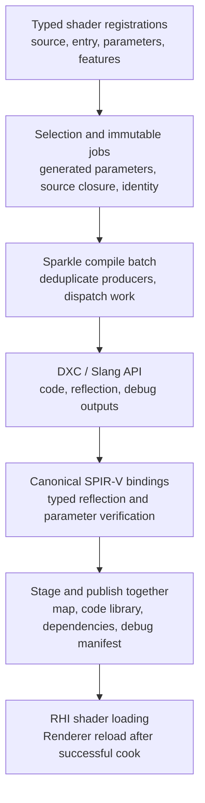
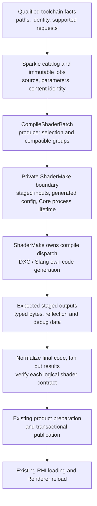

# ShaderMake integration study and implementation plan

[Third-party migration](../ThirdPartyMigration.md) | [Goals](../Goals.md) | [Rendering](../Rendering.md) | [References](../References.md) | [Engineering](../Engineering.md#module-boundaries)

**Status: Stage 0 BLOCKED, refined 2026-11-21. Stages 1-5 are NOT STARTED.** The source review now establishes a credible Slang code/PDB container route; export of its exact entry-point cache key and effective-option parity still need resolution under S0-D. No prototype, build, dependency adoption or production retirement has occurred. See the [decision and resumption conditions](#stage-0-decision-and-resumption).

[Responsibility split](#high-level-responsibility-split-after-full-integration) | [Governing guides](#fit-with-the-project-and-your-development-goals) | [Target architecture](#target-architecture-and-structural-review) | [Stages and prompts](#implementation-stages-and-exits) | [Failure modes](#failure-modes-and-required-responses)

**Recommendation:** retain the current direct DXC/Slang integration while resolving the Stage 0 blockers. If they close, the best ShaderMake shape is offline batches over sealed prepared inputs, keeping Sparkle's typed contracts, reflection validation, publication and reload. This can support the graphics systems and DevTech goals, but the inspected candidate cannot yet justify a fit trial under S0-D. Do not compensate with a second compiler path, missing symbols or a substantial fork.

The intended user is a rendering developer who wants to spend less time maintaining compiler integration. The expected return is less compiler plumbing to maintain and an inspectable path for reproducing shader builds, leaving more effort for rendering, GPU kernels and measured results. This is conditional maintenance value; faster compilation, better images and new shader capabilities have not been established.

## High-level responsibility split after full integration

Sparkle already uses third-party shader compilers: Microsoft's **DXC** and **Slang** parse shader languages, optimize programs and generate GPU code. Sparkle does not implement those compiler algorithms. Its own `ShaderCompiler` executable prepares inputs, calls their APIs, extracts results and publishes engine assets.

**You would delegate the mechanics of running compilation and keep control of what gets compiled, how results are verified and how the engine uses them.** ShaderMake is NVIDIA DevTech's offline batch tool above DXC/Slang. The intended split is:

| Responsibility | Owner after integration |
| --- | --- |
| Execute compile batches, distribute compile work and invoke qualified DXC/Slang tools | **ShaderMake** |
| Expand configured permutations and translate supported common compiler options | **ShaderMake**, from Sparkle-generated configuration |
| Parse shader languages, optimize programs and generate DXIL/SPIR-V | **DXC / Slang**, as today |
| Decide required shaders, variants, targets and rendering features | **Sparkle** |
| Own authored shader algorithms, typed registration and generated parameter declarations | **Sparkle** |
| Select qualified compiler versions, engine-specific options and concurrency limits | **Sparkle** |
| Preserve virtual source paths, captured inputs, content identity and changed-source selection | **Sparkle** |
| Interpret reflection, normalize bindings and verify C++/shader layouts | **Sparkle**, using existing upstream reflection libraries |
| Assemble matching code, symbols, sources and diagnostics into debug bundles | **Sparkle**, consuming compiler-produced outputs |
| Publish complete cooked assets and preserve accepted output on failure | **Sparkle** |
| Load/reload shaders, create GPU pipelines and manage GPU resource lifetime | **Sparkle** |

`ShaderCompiler.exe` remains the engine's cooker. Its proposed workflow becomes:

**Sparkle plans work → ShaderMake runs DXC/Slang → Sparkle verifies → Sparkle publishes → Renderer loads/reloads.**

In practice, you still write and optimize shaders, investigate generated code, debug rendering and measure GPU behavior. The maintenance removed is compiler-session, generic invocation and compile-worker machinery. Source preprocessing is a separate decision; virtual mounts, dependency identity, reflection and publication do not transfer automatically.

This is the target ownership split. Exact reflection/debug-output fit and retirement of the superseded implementation must pass before it becomes the production architecture. The [replacement map](#what-would-be-replaced-in-this-repository) identifies the affected files; the [architecture section](#target-architecture-and-structural-review) defines the required boundaries and lifetimes.

### Terms

| Term | Meaning here |
| --- | --- |
| Compiler backend | DXC or Slang, selected today by `--backend dxc`, `slang` or `auto`. |
| Target | The output contract, such as `DxilSm66` or `SpirV16`. Vulkan uses SPIR-V; D3D12 uses DXIL. |
| Reflection | Compiler information about resource bindings, constant-buffer members, offsets and entry points. Sparkle translates it into its own contracts. |
| Permutation | A compilation with a particular set of defines/options. Different variants can share a source file. |
| Publication | Making a complete, validated shader asset generation available to readers. Successful individual compilations are only inputs to this step. |

ShaderMake supports configuration-driven permutations, bounded parallel compilation, raw binaries and optional headers/blobs, DXIL/SPIR-V output, explicit compiler paths and additional compiler flags. Its incremental logic tracks timestamps and build settings. These are upstream features; their compatibility and performance in Sparkle are unproved. See the [upstream README](https://github.com/NVIDIA-RTX/ShaderMake/blob/4f1ffd56dac27fc3d620ad7efeee42b4dd71fa72/README.md).

## Fit with the project and your development goals

**The nine governing guides support investigating this bounded delegation.** Their recurring requirement is to understand, own and prove the rendering result while keeping supporting systems small. Stage 0 applied the decisions and checks below; fit is conditional on retiring local machinery without losing the information needed to explain executed shaders.

| Governing guide | Owner/interface decision | Prohibited outcome | Check |
| --- | --- | --- | --- |
| [Code style](../CodeStyle.md) | Cohesive private batch boundary and format readers; readable C++20 orchestration, meaningful locals, naming/header/include rules. | Forwarding classes, mechanical splitting or SDK types in runtime contracts. | Review changed responsibilities/files manually, then run existing applicable per-file checks in S3. |
| [Engineering](../Engineering.md) | Existing offline cooker composes immutable inputs, Core child processes, typed verification and publication. | Dual compiler/publisher, borrowed input destruction before settlement, stronger recovery claims than the owner supports. | Trace success/failure/cancellation and reader/process/GPU lifetimes; exercise their actual owners in S1–S4. |
| [Goals: target persona and North Star](../Goals.md#target-persona) | Case 2 consumes traceable DXIL/SPIR-V/symbols; developer retains shader, ABI, numerical and API reasoning. | Treating library adoption as proof of compiler expertise, image correctness or role seniority. | Reproduce a registered shader request and later connect it to executed code; report maintenance value separately from frame results. |
| [README: documentation ownership](../README.md#guides) | This active plan owns stage decisions; raw traces remain ignored evidence. | Competing plans or stage history duplicated across main guides. | Update this plan and only the changed migration pointer; validate links/state before handoff. |
| [References: roles and production studies](../References.md#role-sources) | Pinned producer/consumer studies inform Sparkle's batch boundary and source-to-code reproduction. | Vendor branding as architecture evidence or claims of implementing compiler internals. The [archived compiler role](../References.md#employer-role-study) remains distinct. | Record actual readers/tool pins and adopt/adapt/reject decisions; distinguish archived roles from current vacancies. |
| [Rendering: features and source ownership](../Rendering.md#source-map) | Renderer/RHI keep passes, frame graph, algorithms, material meaning and production/Reference/neural responsibilities. | New rendering defaults, delegated estimator correctness, removed backend capability or shared-compiler agreement used as an independent control. | Retain typed GBuffer and inline/library paths; later verify native pipelines/raw signals separately on both APIs. |
| [Repository footprint](../RepositoryFootprint.md#shader-preprocessing) | Connected ledger charges readers, source capture, scripts/build/package costs and C overlap once. | Mixed-file totals or relocated code credited as deletion; peer ratios treated as quotas. | Freeze inventory/units now, then compare complete first-party/native and non-native changes at S3. |
| [Roadmap](../Roadmap.md#supporting-system-simplification) | Supporting investment stays subordinate to existing rendering repairs/delivery; coordinate compile-dispatch overlap with task-runtime work. | New first-release prerequisite, neural program or duplicated dispatcher migration. | Check current priorities and cancel/quit limit; change Roadmap only if its actual decision changes. |
| [Third-party migration](../ThirdPartyMigration.md#requirements-for-adoption) | Qualified tools/pin, complete mechanism retirement and bounded code exit precede broader product qualification. | Auto-download substitution, assumed unreleased-pin exception, fallback compilation or unrun product checks called PASS. | S0/S1 fit gates, S3 retirement ledger and S4 qualified/offline workflow results; pin eligibility stays explicit. |

The role comparison uses the dated descriptions already archived in References. It does not reassess current vacancies, qualifications or employment history.

### Contribution to the three cases

ShaderMake belongs in the supporting workflow of the [existing cases](../Goals.md#the-three-cases). It needs no fourth headline case.

| Case | Useful contribution if the migration succeeds | Work and evidence you still provide |
| --- | --- | --- |
| **Content to correct pixel** | An identified path from shader sources and generated parameters to verified cooked code, with a reproducible failed/accepted cook. | Material interpretation, transforms, lighting mathematics, ABI agreement and checked raw pixels. A common compiler path for production and Reference is shared infrastructure, so independent analytic/external controls must still detect shared mistakes. |
| **One measured frame, two APIs** | Trace the actual DXIL/SPIR-V and symbols back to inputs; reproduce a shader issue or controlled code-generation experiment outside the renderer. | Matched D3D12/Vulkan execution, source/capture identity, shader/CPU/resource-lifetime studies and whole-frame measurements. DXIL/SPIR-V disassembly is not native GPU ISA, and offline compile time is separate from runtime PSO creation and frame time. |
| **Owned model to shader** | Compile the HLSL/Slang operators you implement through the same identified toolchain and inspect their outputs. | Owned data/model/training, checked operators, precision/layout/fusion/traffic choices and held-out GPU results under the [neural requirements](../Rendering.md#owned-neural-rendering). ShaderMake provides no training, inference runtime, automatic model conversion or guarantee of neural-instruction support. |

### Depth retained and evidence gained

You can delegate compiler invocation while continuing to learn shader optimization: choose a real kernel, predict an ALU/bandwidth/register or precision effect, inspect available code and counters, then test correct images/numerics and whole-frame cost. DXC/Slang and the driver still generate/optimize code; you own the hypothesis, shader, API use and conclusion. Modern language features require their own compiler/device checks.

The learning tradeoff is less routine exposure to in-process compiler API/session setup. Reflection and diagnostic interpretation remain. Parser design, IR passes, instruction selection and driver engineering are separate specialties; the current direct compiler adapters do not implement them either. If a real compiler defect appears, capture a minimal source/flags/toolchain reproduction and compare hypotheses; that is useful specialist collaboration without maintaining a compiler fork.

Retain one concise decision record with the retired mechanism, complete maintenance/cost comparison, reproducible failure and successful cook, and reviewer/reproduction feedback. Attribute ShaderMake/DXC/Slang upstream and Sparkle's integration/verification separately. A measured simplification or justified rejection supports the productization goal; adoption alone establishes neither independent transfer nor role seniority.

## Research basis and trust

Stage 0 inspected the live checkout and nine governing guides on 2026-11-21. Its frozen input manifest records HEAD `2c14f97d32b4fe728700fb91da645e0a466ac4de` and per-file SHA-256 identities; HEAD alone does not identify concurrent work. Local evidence is under `build/validation/shadermake/stage-0/20261121-ae5b1e5b/`: `inputs.json`, `retirement-scope.json`, `sdk-observations.json`, pinned `upstream/` snapshots with `source-index.json`, `pin-comparison.json` and `stage0-report.md`. These ignored research artifacts are local; the decisions, limits and gates below remain in this tracked plan.

Evidence is source inspection and installed-file inventory, not executable/compiler equivalence, measured performance or product qualification. Recheck changed owners, guide requirements, tool bytes and upstream pins before using the design. Review was by the implementing agent; no independent architectural review occurred.

The inspected ShaderMake revision is [`4f1ffd56dac27fc3d620ad7efeee42b4dd71fa72`](https://github.com/NVIDIA-RTX/ShaderMake/commit/4f1ffd56dac27fc3d620ad7efeee42b4dd71fa72), committed 2026-11-11. GitHub's [tags](https://api.github.com/repos/NVIDIA-RTX/ShaderMake/tags) and [releases](https://api.github.com/repos/NVIDIA-RTX/ShaderMake/releases) endpoints returned empty lists during this study. This is an inspection reference, not an approved production pin; the existing dependency-adoption rules apply to an unreleased revision.

The [pinned Donut CMake](https://github.com/NVIDIA-RTX/Donut/blob/52efbe37d7f550ea1c5c7ee02b75404ec7c72c09/CMakeLists.txt) supplies an integration precedent. The actual output consumers and dependency pins are traced in Stage 0. There is no need to adopt Donut or NVRHI to use ShaderMake.

The inspected [CI workflow](https://github.com/NVIDIA-RTX/ShaderMake/blob/4f1ffd56dac27fc3d620ad7efeee42b4dd71fa72/.github/workflows/build.yml) defines Windows/Linux/macOS builds and a macOS Metal smoke check. It does not establish Sparkle's DXIL/SPIR-V, reflection, cancellation or debugger behavior. ShaderMake uses the [MIT license](https://github.com/NVIDIA-RTX/ShaderMake/blob/4f1ffd56dac27fc3d620ad7efeee42b4dd71fa72/LICENSE.txt), with a separate [argparse notice](https://github.com/NVIDIA-RTX/ShaderMake/blob/4f1ffd56dac27fc3d620ad7efeee42b4dd71fa72/ThirdPartyLicenses.txt). Compiler/runtime redistribution terms remain separate. Exact-pin advisory review and distribution qualification remain open.

## How the current pipeline works

The starting points are the [typed catalog builder](../../Tools/Shaders/ShaderCompiler/Private/Contracts/ShaderContractCatalogBuilder.cpp), [job builder](../../Tools/Shaders/ShaderCompiler/Private/Cooking/Planning/ShaderCompileJobBuilder.cpp), [compile batch](../../Tools/Shaders/ShaderCompiler/Private/Cooking/Compilation/ShaderCompileBatch.cpp) and [publication owner](../../Tools/Shaders/ShaderCompiler/Private/Cooking/Publication/ShaderArtifactPublication.cpp).



The CLI defaults to `DxilSm66` and `SpirV16`, `auto` backend selection and four parallel compiles. [Backend selection](../../Tools/Shaders/ShaderCompiler/Private/Backend/ShaderBackendFactory.cpp) chooses DXC for `.hlsl` and Slang for `.slang`, subject to target support. The advertised target set also includes DXIL SM 6.0 through 6.7 and SPIR-V 1.4/1.5/1.6; a migration must preserve the existing supported combinations and explicit rejection behavior.

Source preparation currently expands textual includes and injects generated parameter blocks into in-memory source. It maintains `/Engine`, `/Project` and optional `/Plugin/<name>` virtual identities. Jobs carry source/dependency/request hashes and backend identity. Compilation deduplicates only after checking input equality, then fans results back out to shader types. Reflection and debug artifacts are part of the result, not optional substitutes for bytecode.

The Launcher still invokes Sparkle's tool; Application owns the Editor operation, and Renderer reload follows successful completion. Those responsibilities have distinct lifetimes and remain useful after a compiler-invocation migration.

## What would be replaced in this repository

Paths in this table are relative to `Tools/Shaders/ShaderCompiler/Private/` unless linked elsewhere. **Replace** means a proposed retirement after demonstrated fit. **Adapt** means retained engine policy with a changed boundary. No row is an accepted saving yet.

| Current owner | Proposed result | Why / what remains |
| --- | --- | --- |
| [`Backend/Dxc/DxcShaderBackend.*`](../../Tools/Shaders/ShaderCompiler/Private/Backend/Dxc/DxcShaderBackend.cpp), [`DxcCompileArguments.*`](../../Tools/Shaders/ShaderCompiler/Private/Backend/Dxc/DxcCompileArguments.cpp) | **Replace invocation/session and generic argument machinery.** | ShaderMake calls DXC. Keep target/feature policy and result interpretation; debug/reflection extraction needs a proved file-output path first. The entire backend file is not automatically removable. |
| [`Backend/Slang/SlangShaderBackend.*`](../../Tools/Shaders/ShaderCompiler/Private/Backend/Slang/SlangShaderBackend.cpp) | **Replace compilation/session machinery if fit passes.** | ShaderMake calls `slangc`. Slang reflection, source capture and external symbol output are decisive gaps to resolve before claiming retirement. |
| [`Cooking/Compilation/ShaderCompileBatch.cpp`](../../Tools/Shaders/ShaderCompiler/Private/Cooking/Compilation/ShaderCompileBatch.cpp) | **Replace compile worker dispatch. Adapt producer/result mapping.** | Submit a real batch to ShaderMake. Preserve equality-checked deduplication, typed result association and progress. Never launch a multithreaded ShaderMake per existing worker. |
| [`ShaderCompileJobExecutor.*`](../../Tools/Shaders/ShaderCompiler/Private/Cooking/Compilation/ShaderCompileJobExecutor.cpp), [`Backend/IShaderBackend.*`](../../Tools/Shaders/ShaderCompiler/Private/Backend/IShaderBackend.h), factory/pool | **Retire the single-job compiler interface, executor and instance pool.** | Keep compiler selection/capabilities as explicit policy and immutable toolchain facts. Rework planner and CLI consumers; do not preserve compilation objects solely for discovery or wrap a batch tool behind `Compile(request)`. |
| [`Compiler/ShaderSourcePreprocessor.*`](../../Tools/Shaders/ShaderCompiler/Private/Compiler/ShaderSourcePreprocessor.cpp), [`ShaderIncludeResolver.*`](../../Tools/Shaders/ShaderCompiler/Private/Compiler/ShaderIncludeResolver.cpp) | **Separate conditional retirement.** | ShaderMake does not supply Sparkle virtual mounts or generated parameters. Its scanner is not a complete preprocessor. The existing compiler-preprocessing proposal C remains the bounded alternative. |
| [`Compiler/ShaderSourceMountTable.*`](../../Tools/Shaders/ShaderCompiler/Private/Compiler/ShaderSourceMountTable.cpp) | **Retain mount identity/admission.** | Case policy, traversal rejection, physical containment and authored virtual paths are engine requirements. Any disk-based compiler input must preserve them. |
| [`Planning/Identity`](../../Tools/Shaders/ShaderCompiler/Private/Cooking/Planning/Identity), [`Dependencies/ShaderDependencyManifest.*`](../../Tools/Shaders/ShaderCompiler/Private/Cooking/Planning/Dependencies/ShaderDependencyManifest.cpp) | **Retain content identity and changed-source selection; adapt dependencies if proved.** | ShaderMake timestamps/build signatures do not replace content-based identity, immutable input checks or Sparkle's dependency manifest. |
| [`DxilReflectionExtractor.*`](../../Tools/Shaders/ShaderCompiler/Private/Backend/Dxc/DxilReflectionExtractor.cpp), [`DxilLibraryReflectionExtractor.cpp`](../../Tools/Shaders/ShaderCompiler/Private/Backend/Dxc/DxilLibraryReflectionExtractor.cpp), [`SlangReflectionExtractor.*`](../../Tools/Shaders/ShaderCompiler/Private/Backend/Slang/SlangReflectionExtractor.cpp) | **Retain semantic translation; adapt input.** | Current DXIL/Slang extraction consumes in-process compiler objects. A raw binary alone is not proof that all required metadata survives. |
| [`Compiler/SpirV`](../../Tools/Shaders/ShaderCompiler/Private/Compiler/SpirV), [`Verification/ShaderParameterStructVerifier.*`](../../Tools/Shaders/ShaderCompiler/Private/Verification/ShaderParameterStructVerifier.cpp) | **Retain.** | Canonical bindings, buffer layout, resource meaning and host/shader ABI must still agree. SPIRV-Reflect and SPIRV-Tools already provide upstream mechanisms here. |
| [`Contracts`](../../Tools/Shaders/ShaderCompiler/Private/Contracts), [`Cooking/Planning`](../../Tools/Shaders/ShaderCompiler/Private/Cooking/Planning) | **Retain domain catalog/planning; adapt requests.** | C++ registrations stay the authority for shader identity, parameters and features. Generate ShaderMake config; do not maintain a second authored shader list. |
| [`Cooking/Publication`](../../Tools/Shaders/ShaderCompiler/Private/Cooking/Publication), [`Analysis`](../../Tools/Shaders/ShaderCompiler/Private/Analysis), [`Cli`](../../Tools/Shaders/ShaderCompiler/Private/Cli) | **Retain product contracts; adapt compiler provenance.** | Keep inspection, statistics, CLI behavior, accepted-output protection and complete debug bundles. ShaderMake output is staging input, not a published Sparkle asset. |
| [RHI shader storage/loading](../../Engine/RHI/Private/Shaders), [Editor compile operation](../../Engine/Application/Private/Editor/Shaders/EditorShaderCompileOperation.cpp), [Launcher cook requests](../../Tools/Launcher/SparkleLauncher/Private/Cook/CookOperationProcessRequests.cpp) | **Retain consumers and workflows.** | Keep `GlobalShaderMap.smap`, `CookedShaderLibrary.slib`, typed lookup and successful-cook reload. No ShaderMake dependency belongs in runtime RHI/Renderer. |

The current catalogue's **0 / 0 (protected/study)** records no established retirement credit. Stage 0 inventoried **16 mixed mechanism files / 1,642 physical lines**, plus the conditional `CompiledShader` pair / 61 physical lines. These files also contain retained policy and result handling: their total is neither a deletion forecast nor removable LOC. The separate preprocessing **C** pair is 190 physical lines (161 code lines in the frozen footprint study); charge any overlap once. The [frozen accounting scope](#stage-0-retirement-and-comparison-boundaries) includes generated inputs, readers, retained translation, process handling, CMake, SDK admission and packaging. No net saving has been established.

## What would change for you, and what it costs

These are proposed workflow outcomes, not delivered features. The benefit depends on removing the local mechanisms in the replacement map above.

| Workflow | Proposed change and practical value | Limit |
| --- | --- | --- |
| Maintain or update compiler integration | Upstream owns generic invocation and compile dispatch; Sparkle maps engine policy into generated config and ingests verified results. | Qualified DXC/Slang upgrades, metadata changes and engine-specific flags remain your decisions. The adapter must be smaller than the machinery retired. |
| Add or edit a shader | Keep typed registration as the authority and generate batch inputs from it; use upstream batch/permutation facilities where required. | No second authored shader catalogue or language migration. ShaderMake cannot decide which rendering variants are correct or necessary. |
| Diagnose a compile or shader failure | Capture exact inputs, arguments and tools for an external reproduction, while preserving current reflection/debug inspection. | Sparkle already exports debug artifacts; this is a possible simplification of reproduction, not a newly established debugger capability. Symbols/source correlation must pass first. |
| Cook and reload during rendering work | Keep Launcher Cook and Editor Recompile Shaders / `CompileShaders [symbols]`, with verified results published before reload. | No automatic watcher or completed Apply Changed feature. Initial forced compilation of selected jobs claims no incremental speedup; process startup can add cost. |
| Compare generated code or compiler settings | Use an isolated, identified batch for a controlled experiment on owned shaders, retaining correctness and profiling controls. | Generated-code quality comes from compiler/driver behavior and your shader choices. ShaderMake does not imply faster kernels or higher FPS. |
| Run or distribute the project | End users continue to load prebuilt cooked shaders offline. Development tools carry the explicitly inventoried compiler toolset. | No runtime dependency on ShaderMake in RHI/Renderer, no unattended downloads, and no expansion to DXBC, Metal or other platforms. |

Donut remains a useful integration precedent. Its asset/runtime contracts do not transfer automatically to Sparkle.

| Cost or disadvantage | Implication for Sparkle |
| --- | --- |
| Another executable and configuration boundary | Requires staging, result association, process-tree settlement, logs, build inputs, notices and offline delivery. This can outweigh retired code. |
| External compiler startup | The inspected path uses subprocesses rather than Sparkle's API sessions. Small/incremental cooks may get slower; do not assume multithreading is a speedup. |
| Reflection is not a complete Sparkle output | Sidecars/container reflection must replace the current result-object path without losing members, library exports or resource meaning. |
| Debug output differs by compiler | ShaderMake's Slang `--PDB` path lacks separate PDB output. The qualified Slang CLI has a source-backed container route to associated PDBs, requiring bounded ingestion and a fit check; the exact entry-point cache-key export remains unresolved. |
| Filesystem input replaces in-memory input | Generated parameters, virtual paths, immutable snapshots and original-source correlation need a deliberate design. |
| Two possible incremental authorities | Keep Sparkle's job selection/content identity authoritative initially. Avoid a second cache deciding whether required work can be skipped. |
| Maintenance shifts rather than disappears | You still choose qualified tools, investigate regressions and validate ABI/output. An upstream fork carrying Sparkle's compiler framework would defeat the purpose. |

## Decisive compatibility questions

These are source-based concerns and proposed checks, not observed prototype failures. Relevant upstream implementation is in [`ShaderMake.cpp`](https://github.com/NVIDIA-RTX/ShaderMake/blob/4f1ffd56dac27fc3d620ad7efeee42b4dd71fa72/ShaderMake/ShaderMake.cpp), particularly `ExeCompile`, `GetHierarchicalUpdateTime`, `SignalHandler` and `main`.

### Reflection and final bytecode

The current DXC path takes reflection from `IDxcResult`, including separate reflection while runtime DXIL is stripped. Slang consumes `ProgramLayout` for DXIL and SPIR-V reflection for its SPIR-V path. ShaderMake raw output does not recreate those objects.

Prove compiler-generated reflection sidecars or container extraction with the exact qualified tools. Compare buffer members/offsets/sizes, resource kinds/counts, vertex inputs, compute group sizes, push constants and ray-library exports. If this needs a second full compilation through the old backend, it fails the proposed ownership transfer. Reusing compiler APIs to read metadata is compatible with retiring their compilation path.

Keep Sparkle's name-based SPIR-V binding normalization. Generic register-class shifts are not its canonical global assignment. Reflect and hash the final normalized bytecode, and ensure debug/exported code matches the bytes actually published.

### Exact sources, virtual paths and preprocessing

The inspected ShaderMake dependency scanner uses regex matching and timestamps. It is not a compiler preprocessor. At the pinned revision, [`ProcessConfigLine`](https://github.com/NVIDIA-RTX/ShaderMake/blob/4f1ffd56dac27fc3d620ad7efeee42b4dd71fa72/ShaderMake/ShaderMake.cpp#L2324-L2430) calls it only inside `if (!force)`: **`--force` bypasses this scan as well as its skip decision.** This corrects the earlier study assumption. Keep forced, fresh invocation outputs for Sparkle-selected producers; compiler preprocessing and source identity remain separate responsibilities.

The smallest first experiment can materialize the already prepared `ShaderCompileRequest::SourceCode` in isolated staging, retaining its virtual `#line` directives. That tests invocation without prematurely claiming preprocessing retirement. Prove original source availability to both compilers/debuggers; line directives alone do not embed source bytes. If a later design drops `--force` or enables incremental reuse, reopen scanner/dependency admission and content-versus-timestamp checks.

If source preparation moves upstream later, compilers must own preprocessing while Sparkle retains mount admission, generated parameter declarations and captured dependency identity. Probe conditional/macro includes, repeated/guarded includes, cycles, case collisions, traversal, project/plugin roots and source changes during job construction. Do not build a second general preprocessor to make ShaderMake fit.

### Symbols, provenance and compiler identity

The existing [debug result](../../Tools/Shaders/ShaderCompiler/Private/Compiler/Output/ShaderDebugArtifactSet.h) includes arguments, diagnostics, disassembly, preprocessed source, symbols, symbol name and compiler lookup key. ShaderMake's Slang `--PDB` convenience path cannot emit a separate PDB. Further source review found a credible existing Slang CLI route through a `.dir` artifact container that retains associated PDB/name; this is still untested. Export of the exact `SlangEntryPointCacheKey` remains missing. Preserve both contracts; see the [output acquisition matrix](#stage-0-output-acquisition-and-fit-checks).

Keep identities distinct: Sparkle's request hash selects work; final normalized code hash identifies published code; a Slang entry-point key identifies that compiler's program/cache input; native debugger/Aftermath hashes follow their own formats. The Slang key includes linkage, compiler and component state, so source/module naming or options can change it even when bytecode matches. Preserve its actual API semantics rather than requiring unexplained byte equality across different invocation models or calling it a native GPU hash. Current RHI GPU-crash metadata leaves its compiler-key field unpopulated; exporting a key alone does not prove native symbol lookup.

[ShaderDebugArtifactWriter](../../Tools/Shaders/ShaderCompiler/Private/Cooking/Publication/ShaderDebugArtifactWriter.cpp) currently records compiler DLLs loaded in the Sparkle process. After external compilation, those modules can differ from the ones loaded by `dxc.exe` or `slangc.exe`. Record the actual qualified subprocess toolchain and inputs; hashing a parent-process DLL is insufficient provenance. Include ShaderMake identity and effective invocation settings in job identity so transport/option changes invalidate old results. Keep `dxc`/`slang` as compiler identities, rather than pretending ShaderMake is a third code generator.

GPU-crash mode has [identity-bound compiler inputs](../../CMake/Dependencies/GpuCrashInputs.json), including a patched Slang build. Do not accept ShaderMake's automatic downloads as interchangeable with those tools. Missing symbol/source support blocks a complete migration; do not silently disable a diagnostic workflow.

### Target flags and shader libraries

Match strictness, HLSL 2021, optimization, warnings, debug stripping, layout, storage-image policy and feature extensions. The inspected upstream invocation automatically adds `-enable-16bit-types` for DXC SM 6.2+, unlike Sparkle's current argument builder; no opt-out was found. Resolve this before comparison through a supported option or a bounded upstream correction. Sparkle's Slang `SessionDesc` defaults to row-major in the inspected SDK header; ShaderMake emits column-major unless row-major is explicitly selected. Preserve row-major explicitly. These are source-derived differences, not observed image failures.

Ray tracing is an early test, not a final corner case. Sparkle uses DXC `-exports` for selected library entry points; upstream's DXC construction supplies `-E`, and its Slang library path omits `-entry`. Prove the intended export/entry behavior through supported configuration or a small upstreamable correction. Also retain today's capability-based rejections, including the Slang backend's narrower advertised DXIL ray support.

### Concurrency, cancellation and publication

Use one ShaderMake batch at a time initially and pass the existing `--parallel-compiles` allowance as `--jobs`. Group jobs by platform and compatible global options/compiler selection; run groups sequentially until a measured need justifies sharing a bounded allowance. Do not multiply the batch limit by the number of outer workers.

Coordinate this boundary with the [task-runtime migration](TaskRuntime.md): ShaderMake would own only shader compilation dispatch. Avoid converting the retiring compile dispatcher into a new task-runtime adapter first, and count its retirement once. Other tool and application execution remains with its existing owner.

Use Core's existing [child-process owner](../../Engine/Core/Public/Process/ChildProcess.h) for cancellation/logging and verify that descendants settle. Upstream's signal handler alone does not prove process-tree cancellation during an active compiler call. Set `--retryCount 0` initially: the upstream budget defaults to ten shared retries for subprocess/shell-launch failures, not failed shader syntax, and Sparkle has no equivalent retry loop today. Preserve coarse group/verification progress through the existing callback and retain compiler logs. `--compactProgress` is human text, not a structured per-job result protocol; do not add a text parser or an upstream progress patch without a required UI consumer.

ShaderMake writes only into invocation staging. On compilation, metadata, verification or cancellation failure, keep accepted products untouched. Only the existing publisher may replace the validated map/library/dependency/debug set. Keep readers and worker-owned storage alive until all access has settled.

## Target architecture and structural review

Stage 0 selected this as the conditional best ShaderMake shape, compared with the [simpler direct-API alternative](#stage-0-shape-comparison). It is a design recommendation, not a GO decision: the output/option blockers must close before Stage 1. Follow [module ownership](../Engineering.md#module-boundaries), [data/lifetime rules](../Engineering.md#data-and-lifetime) and [code structure](../CodeStyle.md#c-structure). Review the complete planning-to-publication path, its CLI/host callers and build/package membership. The integration is incomplete while old compilation owners survive behind new wrappers.



### Owners, authority and lifetime

| Owner | Authority and lifetime | Boundary |
| --- | --- | --- |
| `CookGlobalShaders` | Composes toolchain resolution, planning, batch compilation, product preparation and publication for one cook. | Keep intent/order visible. Config grammar, subprocess details, metadata decoding and binding algorithms belong to their capability owners. |
| Toolchain resolution and planning | Resolve qualified tool paths/identity once for the invocation; build immutable jobs from the existing typed catalog, source snapshot and policy. | Planning consumes facts, not live compiler sessions. Config and command lines derive from the same effective options used for job identity; do not maintain a second option model/hash. |
| `ShaderCompileBatch` | Owns equality-checked producer selection, bounded compatible groups and mapping results to logical jobs. | ShaderMake owns compile-worker dispatch. Per-shader `dxc`/`slang` choice remains policy; serial mode uses the same production mechanism with one job allowed. |
| Private ShaderMake execution boundary | Owns invocation staging, generated config, expected-output associations and child-process settlement until ingestion completes. | Reuse Core process/filesystem mechanisms. Its output destination is staging only; final publication paths do not belong in its interface. |
| Format extraction and typed verification | Convert compiler output into existing neutral values, normalize SPIR-V, hash final code and verify every consuming shader contract. | No subprocesses or publication here. A shared producer does not excuse skipping a consumer's typed parameter check. |
| Product preparation and publication | Own cooked product association, complete/partial catalog policy, staged validation and accepted-output replacement. | Consume typed results after compile work settles; keep rollback and reader lifetime with existing owners. |
| Launcher, Application and Renderer/RHI | Keep tool selection/status, host operation lifetime and successful-cook runtime consumption with their existing owners. | No ShaderMake config, filenames, sidecar schema or compiler process policy in runtime modules. |

The [current planner](../../Tools/Shaders/ShaderCompiler/Private/Cooking/Planning/ShaderCookPlanBuilder.cpp) and [job builder](../../Tools/Shaders/ShaderCompiler/Private/Cooking/Planning/ShaderCompileJobBuilder.cpp) receive `ShaderBackendPool`, and job construction acquires `IShaderBackend` for identity. Replace that dependency with invocation-owned toolchain facts. Retire `IShaderBackend`, `ShaderBackendPool`, compiler creation/session code and `ShaderCompileJobExecutor` after their consumers convert. Retain capability/selection logic as focused functions/values with filenames that describe the remaining policy.

Keep one authoritative input snapshot and one result representation per lifetime. Borrow immutable jobs while the batch is alive; materialize required compiler inputs once per producer and move output bytes into owned results. Results retain no borrowed staging storage or live process handles; capture required source/debug bytes before staging retires. Audit whether `CompiledShader` still has a role after direct API compilation retires; remove it if it only transfers the same fields into `ShaderCompileResult`/`CookedStageBuild`. Preserve necessary typed reflection/debug values and deliberate multi-consumer fan-out; moving or renaming them earns no simplification credit.

### File and dependency shape

Keep `ShaderCompiler.exe` as the CLI/cooker and `CompileShaderBatch` as the private domain operation. The proposed placement below describes responsibilities, not a requirement to add a class or file for each workflow step:

| Private location | Final responsibility |
| --- | --- |
| `Cooking/GlobalShaderCooker.*`, `Cooking/Planning/` | Cook composition and immutable domain planning. No live backend pool. |
| `Cooking/Compilation/ShaderCompileBatch.*` | Producer/group orchestration and logical result mapping. Replace its current task graph. |
| `Cooking/Compilation/ShaderMake/ShaderMakeBatch.*` | Cohesive config/input/process/output boundary. Split config emission or output ingestion only when substantial independent logic warrants it. |
| `Compiler/Dxil/`, existing `Compiler/SpirV/` | Format-specific reflection/disassembly and binding operations. Relocate retained DXIL readers from `Backend/Dxc` when compilation retires. |
| `Compiler/Slang/`, only if needed | Retained Slang-specific metadata translation if the proved output path requires it. Do not keep a compiler session or add an empty abstraction for symmetry. |
| Existing `Compiler/Output/`, `Verification/`, `Cooking/Publication/` | Neutral output values, typed invariants and cooked asset publication, respectively. |

No new public module, compiler service, generic plugin interface or forwarding facade is justified. Keep compiler SDK types in private extraction code; runtime contracts remain independent of SDK headers and ShaderMake. Apply naming, includes and generated CMake membership to the final responsibilities, deleting obsolete files/targets rather than leaving an old folder shape underneath a new call.

### Integration policy

Generate configuration from selected typed jobs. Maintain only an invocation-local association from producers to collision-free expected outputs, including repeated basenames, entries and targets. Read the named raw output/sidecars or one named compiler container; reject missing, empty, duplicate or mismatched output. A container reader may inspect its bounded `children`/`associated` hierarchy to locate compiler-named artifacts; a loose staging-directory scan or console text cannot establish success. No persistent job-status mirror is needed.

Use `--binary --force --noRegShifts --retryCount 0`, explicit compiler paths and a nonzero bounded `--jobs`. Group by compiler, platform and compatible global settings; initially avoid mixed compiler aliases. DXC emits raw code and named sidecars. Slang may emit its own `.dir` compiler container as described below, from which code/PDB are ingested into the same neutral results. That temporary compiler container is consumed inside the cooker; Sparkle keeps its single cooked library/map and runtime readers.

Give each producer a simple staged basename and output subdirectory, for example `p000001.hlsl` and config-local `-o p000001`. Keep config-local permutation `-D` lists empty initially: encode the already selected request's defines through its compiler-specific `-X` options. This avoids reproducing ShaderMake's implementation-specific permutation filename hash while preserving actual compiler defines in the one effective-option model. Under the [pinned output-name rules](https://github.com/NVIDIA-RTX/ShaderMake/blob/4f1ffd56dac27fc3d620ad7efeee42b4dd71fa72/ShaderMake/ShaderMake.cpp#L2288-L2334), `main` raw DXIL then has the known path `<out>/p000001/p000001.dxil`; other entries follow the `_entry` suffix rule. Slang `.dir` output drops the final `.dir` extension when creating its directory. Derive and validate expected paths before launch, including sidecar names; test config quoting, option translation and shell quoting as separate boundaries. No local permutation expander or compiler wrapper is justified.

Use one production compile route after cutover. Existing backend choices select code generators through ShaderMake; they do not select old versus new invocation implementations. Keep baseline executables only in ignored comparison output. A ShaderMake failure reports failure and preserves accepted assets. Retaining direct compilation as a fallback, recompiling through it for missing metadata, or adding a permanent implementation-selection flag blocks this migration's completion. A small upstream fix can be evaluated; a local compiler framework inside a fork fails the ownership-transfer goal.

At integration, add a dependency recipe under `CMake/Dependencies/Targets/` using the existing verified source-cache workflow. Gate acquisition/building on `SPARKLE_ENABLE_SHADER_COMPILER`; disable ShaderMake compiler discovery/downloads (`SHADERMAKE_FIND_COMPILERS=OFF`) and supply the qualified SDK tools. The upstream [host-tool CMake](https://github.com/NVIDIA-RTX/ShaderMake/blob/4f1ffd56dac27fc3d620ad7efeee42b4dd71fa72/CMakeLists.txt#L196-L236) offers `SHADERMAKE_TOOL` for a host-platform Release tool independent of parent configurations. Evaluate that existing path before inventing custom build orchestration; reconcile its target/output with Sparkle's verified dependency and staging owners. Do not link `ShaderMakeBlob` into runtime products.

Update [ShaderCompiler CMake](../../Tools/Shaders/ShaderCompiler/CMakeLists.txt), its [SDK discovery](../../Tools/Shaders/ShaderCompiler/CMake/ShaderCompilerSdks.cmake) and [runtime staging](../../Tools/Shaders/ShaderCompiler/CMake/ShaderCompilerRuntime.cmake), [Launcher SDK admission](../../Tools/Launcher/SparkleLauncher/Private/Build/Toolchains/ShaderCompilerSdkDiscovery.cpp), notices and source/prebuilt package inventories together. Current SDK admission lists DLL/API inputs, not a complete external compiler toolset. Inventory the required executables and their actual runtime dependencies. Remove API imports only after remaining reflection/disassembly users are accounted for. Render-only products need no ShaderMake runtime dependency.

### Structural review exit

Before claiming code completion, review the connected final diff against the owner table and verify:

- The call path reads as planning, compilation, product preparation and publication; each mechanism has one actual owner. The ShaderMake boundary has not absorbed catalog policy, binding semantics, verification or publication.
- Every old compiler factory/pool/interface and task-dispatch caller is converted or retired, including `list-backends` and identity discovery. No forwarding aliases, fallback compilation route or duplicate cache/options/status authority remains.
- Source snapshots, borrowed jobs, staged files, child processes and result bytes have explicit lifetimes through success, partial failure and cancellation. Final published code, reflection and debug identity agree.
- File names, includes, target dependencies, feature-disabled builds and package inventories match the final ownership. Check regenerated source membership; an include-boundary scan alone cannot prove architectural quality.
- Focused normal/failure/lifetime checks pass, and the complete maintenance ledger shows what retired, what remained and what adaptation was added. Fewer lines cannot excuse a second framework or weaker rendering contracts.

Run the existing applicable architecture/style checks during implementation and inspect the actual domain boundaries manually. Fix architectural findings before handoff. Unrun GUI/GPU/package qualification remains separate and explicit; this source study certifies no implemented architecture.

## Implementation stages and exits

### Execution rules and stage state

Run stages in order through Stage 3. **Stage 0 is research/design only and must pass before any prototype or production implementation.** Stage 1 is an isolated fit trial, not adoption. Stage 2 converts the actual owner; Stage 3 is the bounded code-completion exit. Stage 4 records broader product qualification separately. Stage 5 can close code after Stage 3 while transferring unrun Stage 4 work to its existing qualification owner, following [code delivery and qualification](../ThirdPartyMigration.md#code-delivery-and-qualification).

Start each stage with live status/revision, applicable `AGENTS.md` instructions if present, the nine governing guides and this plan. Preserve concurrent edits. Bind evidence to relevant per-file hashes, tools and products; do not restart unrelated passed work just because HEAD changes. Wait for another session using the same build output instead of starting a competing build or cancelling its work.

Keep raw source traces, commands, results and measurements in ignored `build/validation/shadermake/stage-N/`. Record the exact temporary probe paths and remove test-only source/executables/build trees before handoff; retain useful reports and existing repository validation. Do not add a permanent test framework or project-wide policy scanner.

After every stage, update the row below and the relevant design text **before handoff**. Record candidate/scope, passed and missing criteria, verdict, command/artifact references, evidence invalidation triggers, remaining work and exact next action. Use `NOT STARTED`, `IN PROGRESS`, `PASS`, `BLOCKED` or `NO-GO`; individual unrun qualification cells stay `UNVERIFIED`, uncertain comparisons `INCONCLUSIVE`, and waivers require explicit authorization. A blocked row names the failed/missing cell and next discriminating action. A design NO-GO closes the investigation without enabling later implementation prompts.

| Stage | State | Required predecessor / exit | Evidence / next action |
| --- | --- | --- | --- |
| [0: deep dive and design](#stage-0-deep-dive-and-integration-design) | BLOCKED | S0-A/B/C/E recorded; S0-D still needs Slang key export and option resolution. PDB container transport has a credible source route. | Refined source/pin comparison, option decisions and closure evidence below. Resolve P0 at the named upstream owners; no Stage 1 work. |
| [1: isolated fit](#stage-1-isolated-fit-and-baseline) | NOT STARTED | Stage 0 PASS; prove decisive compiler/output/lifetime fit. | None; gated by Stage 0. |
| [2: production conversion](#stage-2-production-boundary-and-retirement) | NOT STARTED | Stage 1 PASS and eligible pin; one production compile owner. | None; gated by Stage 1. |
| [3: code acceptance](#stage-3-caller-build-and-code-acceptance) | NOT STARTED | Stage 2 PASS; structural/build/focused behavior exit. | None; gated by Stage 2. |
| [4: product qualification](#stage-4-product-qualification-and-cost) | NOT STARTED | Stage 3 PASS; report each exercised/unrun product cell. | None; separate from code completion. |
| [5: handoff and closure](#stage-5-handoff-and-plan-closure) | NOT STARTED | Stage 3 PASS plus Stage 4 results/transfer, or documented Stage 0/1 NO-GO closure. | None; no release claim follows automatically. |

### Positive and negative guidelines

These apply to every stage alongside its specific instructions.

| Do | Avoid |
| --- | --- |
| Trace a real producer, consumer, invariant, lifetime and failure before choosing an abstraction. | Copying a sample framework, adding a compiler service bag, or forcing the existing single-job interface around a batch tool. |
| Derive config, arguments and identity from the same admitted inputs; retain one domain authority. | Duplicate authored shader lists, option/hash models, timestamp caches, status mirrors or a renamed local dispatcher. |
| Reuse Core process/publication and existing reflection mechanisms with explicit private dependencies. | Moving process policy into Renderer/Editor, exposing SDK types in runtime contracts, or implementing a second publisher. |
| Keep orchestration readable, meaningful locals/paragraphs, cohesive files and purpose-based names under CodeStyle. | Mechanical function/file splitting, forwarding-only classes, generic helper folders or weakening checks to meet a line target. |
| Compare like-for-like inputs and identify compiler/flag differences before interpreting outputs. | Attributing compiler upgrades to ShaderMake, accepting visual differences because both paths compile, or equating DXIL/SPIR-V with native ISA. |
| Remove superseded code with converted callers and report the entire added/retained surface. | Production fallback compilers, hidden feature cuts, permanent implementation switches or counting relocated/overlapping code as savings. |
| Run the smallest check that can falsify the stage's claim, then update current plan state. | Repeated full campaigns without changed inputs, new infrastructure for hypothetical cases, or promoting source/build checks to GPU/package/release proof. |

### Stage 0: deep dive and integration design

**Purpose:** decide the best integration shape for Sparkle's graphics systems/DevTech target before implementation. Study the existing integrations deeply enough to explain why their choices do or do not fit Sparkle. The architecture above is a proposal to challenge, not a predetermined answer.

#### Stage 0 consumer and live owner trace

The concrete consumer is **Goals case 2, One measured frame, two APIs**: reproduce the same registered shader request as DXIL and SPIR-V, retain generated parameter layout and source/symbol identity, then use the existing Renderer path. The maintenance benefit would be removal of compilation/session/dispatch mechanics while retaining enough information to explain the executed shader. No frame was rendered and no GPU or debugger claim follows from this study.

The frozen fit workload uses existing `ComputeClearCS`, `GBufferVS`, `GBufferPS`, `ReferencePathTracerInlineCS` and `ReferencePathTracerRGS`: compute, typed raster resources/parameters, inline queries and a selected ray-library export. Registrations are in [ComputeClear](../../Engine/Renderer/Private/Passes/Core/ComputeClearShaderRegistration.cpp), [GBuffer raster](../../Engine/Renderer/Private/Passes/GBuffer/Raster) and [ReferencePathTracer](../../Engine/Renderer/Private/Passes/Lighting/ReferencePathTracer). Their authored paths begin `/Engine/Passes/`; generated declarations remain registration-owned. A full catalog cook later checks coverage beyond these five. Shared compiler infrastructure remains no proof of Reference correctness; cases 1 and 3 keep their independent numerical/material and owned-model work.

| Live producer to consumer | Values, mutable state and failure/lifetime boundary | Integration consequence |
| --- | --- | --- |
| [Registration CMake](../../Engine/Renderer/CMake/ShaderRegistrations.cmake) → `GlobalShaderRegistry` → `ShaderContractCatalogBuilder` | Runtime and cook object libraries retain registrations; cook uses `SPARKLE_SHADER_CONTRACTS_ONLY`. Catalog rejects colliding IDs and produces sorted descriptors/typed parameter layouts. | Keep both object-target carriers and one authored catalog. Generate configuration from selected descriptors. |
| `ShaderCookPlanner` / `ShaderCookPlanBuilder` → `ShaderCompileJobBuilder` | Full, ID and changed-source selection; dependency manifest and target validation. The builders receive `ShaderBackendPool`; resolving identity constructs live compiler backends. | Retain selection/coverage policy; replace the pool dependency with invocation-owned immutable toolchain facts, including CLI discovery callers. |
| Mounts / source preparation / `ShaderIncludeClosureHasher` → `ShaderCompileRequest` | Mounted authored paths, generated parameter text, expanded source, source/closure/request/backend hashes. Source capture is enabled for debug export. Both expander and closure scanner use literal regex includes without conditional evaluation. | Seal source bytes and captured dependencies before dispatch. Retain containment, case policy and content identity. Prepared-input batching earns no C preprocessing credit. |
| `ShaderCompileBatch` → `ShaderCompileJobExecutor` → DXC/Slang | Hash grouping is followed by actual request/dependency/source equality. The task graph dispatches one producer; default allowance 4, upper bound `min(hardware, 8)`. Results fan out by copy except the final moved result. Executor creates another backend. | Keep equality and typed result association; replace the outer compile task graph with sequential compatible ShaderMake groups under the same allowance. No nested scheduling or hash-only dedup. |
| DXC/Slang → `CompiledShader` / compile results | DXC result objects supply code, reflection, PDB/name/hash and optional preprocess/disassembly. Slang supplies code, ProgramLayout for DXIL, result-filesystem PDB and entry-point cache key. SPIR-V is normalized before final reflection/hash. | Preserve typed values and ordering; use file/container readers only after the complete acquisition path is established. Do not recompile for missing metadata. |
| Fan-out → `VerifyCookedShaderParameters` → product preparation | Each logical shader is checked against its own C++ parameter contract, even when code is shared. Preparation validates type/target/input association before moving owned stage results into products. | No verification shortcut after dedup and no borrowed staging buffers in products. Retire `CompiledShader` only if its remaining role is redundant transfer. |
| [Artifact publication](../../Tools/Shaders/ShaderCompiler/Private/Cooking/Publication/ShaderArtifactPublication.cpp) → Core publisher / guarded readers | Staged `.smap`, `.slib`, dependency and requested debug outputs are reopened/validated before publication. Core owns root containment, locks, incomplete markers and handled rollback. | Keep this owner. Returned failures preserve accepted output; interrupted publication can require cleanup/recook. No persisted-journal or power-loss recovery claim. |
| CLI → Launcher → Application → Renderer/RHI | Launcher owns child logs/stop token; Application requests reload only after successful cook. [Runtime cache](../../Engine/Renderer/Private/Pipeline/RenderPassRuntimeCache.cpp) holds a read scope while opening/validating map/library, creates a replacement generation, then retires the old generation after recorded GPU submissions complete. | Preserve existing CLI/options/exits and Editor operation lifetime. ShaderMake never enters Renderer/RHI, and CPU compilation completion never substitutes for GPU retirement. |

The existing supported/rejected boundary matters: defaults are `DxilSm66`/`SpirV16`; advertised targets cover DXIL SM 6.0–6.7 and SPIR-V 1.4–1.6. DXC advertises ray-library/inline support for both formats; Slang currently advertises it only for SPIR-V and rejects the DXIL ray cases. Enumeration is source policy, not proof that every cell executes successfully. No compiler/runtime failure was reproduced in Stage 0. The preprocessor's conditional-include concern is source-derived, and existing rendering/qualification defects remain with their current owners.

#### Stage 0 pinned integration findings

These references were selected from [References' existing integration and CMake studies](../References.md#pipeline-automation): **Donut** is the framework/config/output-reader precedent, **RTXPT** demonstrates its downstream deployment and dynamic-compile limits, **NRD** supplies a different embedded-library consumer, and **qualified DXC/Slang source** decides exact output/option feasibility. Prefer pinned implementation and actual consumers over a README claim. Default download versions describe source configuration, not verified deployed binary hashes.

| Pinned family and its own tool dependencies | Actual producer → output consumer | Adopt / adapt / reject |
| --- | --- | --- |
| Donut `52efbe37d7f550ea1c5c7ee02b75404ec7c72c09`; gitlink ShaderMake `37fef17e70cb90e865abe61e4280df6a3436530c`. That [ShaderMake CMake](https://github.com/NVIDIA-RTX/ShaderMake/blob/37fef17e70cb90e865abe61e4280df6a3436530c/CMakeLists.txt) defaults to DXC `v1.9.2609`, Slang `2026.19`. | [compileshaders.cmake](https://github.com/NVIDIA-RTX/Donut/blob/52efbe37d7f550ea1c5c7ee02b75404ec7c72c09/compileshaders.cmake#L24-L151) chooses separate compiler/platform commands; BINARY means `--binaryBlob` / `.bin`, and its NVRHI binding shifts and SM 6.5/Vulkan 1.2 defaults are explicit. [ShaderFactory](https://github.com/NVIDIA-RTX/Donut/blob/52efbe37d7f550ea1c5c7ee02b75404ec7c72c09/src/engine/ShaderFactory.cpp#L98-L204) reads/caches VFS bytes, selects blob permutations, then creates NVRHI shaders/libraries. | **Adopt** explicit batch/compiler selection. **Adapt** output association to raw staged files. **Reject** runtime blob/NVRHI adoption, sample target/shift defaults and `PRE_BUILD` replacement as Sparkle publication. |
| RTXPT `303b408ab81790a5051abd7573830b7a4112eb8e`; Donut gitlink `e50042f4bbd762971cc90431261e967404855b81`, also ShaderMake `37fef17e70cb90e865abe61e4280df6a3436530c`. [Root CMake](https://github.com/NVIDIA-RTX/RTXPT/blob/303b408ab81790a5051abd7573830b7a4112eb8e/CMakeLists.txt) overrides DXC with NuGet `Microsoft.Direct3D.DXC` `1.9.2609.5`. | [Rtxpt flag composition](https://github.com/NVIDIA-RTX/RTXPT/blob/303b408ab81790a5051abd7573830b7a4112eb8e/Rtxpt/CMakeLists.txt#L38-L64) preserves combined options; the same file copies compiler/source inputs for dynamic use. [ShaderCompilerUtils](https://github.com/NVIDIA-RTX/RTXPT/blob/303b408ab81790a5051abd7573830b7a4112eb8e/Rtxpt/SampleCommon/ShaderCompilerUtils.cpp), [ComputePipelineBaker](https://github.com/NVIDIA-RTX/RTXPT/blob/303b408ab81790a5051abd7573830b7a4112eb8e/Rtxpt/SampleCommon/ComputePipelineBaker.cpp) and [PTPipelineBaker](https://github.com/NVIDIA-RTX/RTXPT/blob/303b408ab81790a5051abd7573830b7a4112eb8e/Rtxpt/SampleCommon/PTPipelineBaker.cpp) retain separate direct-DXC commands, scheduling, output loading and pipeline replacement. | **Adopt** preserving combined flags and avoiding stale deployed tools. **Adapt** batch inputs only. **Reject** copying its dynamic compiler/scheduler, SM 6.9 or embedded-debug defaults. It demonstrates coexistence, not complete retirement; Donut and RTXPT are one related stack. |
| NRD `e06852bd545973cb224eb28820b891205cfc1624`; [CMake](https://github.com/NVIDIA-RTX/NRD/blob/e06852bd545973cb224eb28820b891205cfc1624/CMakeLists.txt) fetches ShaderMake `3f01623a76b092ac127d2debd79a672f55d77665`, whose defaults are DXC `v1.9.2609`, Slang `2026.19`. | Config → `--headerBlob`, flattened output, stripped reflection, explicit register shifts. [InstanceImpl.h](https://github.com/NVIDIA-RTX/NRD/blob/e06852bd545973cb224eb28820b891205cfc1624/Source/InstanceImpl.h#L32-L96) selects permutations from embedded arrays; [InstanceImpl.cpp](https://github.com/NVIDIA-RTX/NRD/blob/e06852bd545973cb224eb28820b891205cfc1624/Source/InstanceImpl.cpp#L586-L626) adds/reuses `PipelineDesc` bytecode pointers and exports dispatch/pipeline descriptions to integration consumers. | **Adopt** bounded batches and generated variants. **Adapt** platform separation. **Reject** embedded header blobs, stripped metadata and fixed register shifts as Sparkle's ABI/debug/publication policy. NRD's fixed-library contract is materially different. |
| Candidate ShaderMake `4f1ffd56dac27fc3d620ad7efeee42b4dd71fa72`; [CMake](https://github.com/NVIDIA-RTX/ShaderMake/blob/4f1ffd56dac27fc3d620ad7efeee42b4dd71fa72/CMakeLists.txt) defaults DXC `v1.9.2609`, Slang `2026.22`. | [ExeCompile/main](https://github.com/NVIDIA-RTX/ShaderMake/blob/4f1ffd56dac27fc3d620ad7efeee42b4dd71fa72/ShaderMake/ShaderMake.cpp) construct compiler commands and run subprocesses through `popen`/`pclose`; worker bounds, retries, scanner/build signatures and signals are upstream mechanisms. Raw binaries are available, but no neutral Sparkle reflection/debug result is exported. | **Adopt conditionally** batch/invocation ownership. **Adapt** via Core process lifetime and exact output readers. **Reject** auto-downloaded tools, timestamp identity, default flags and signal handling as proof of whole-process-tree settlement. These precedents use different revisions/toolchains. |

The pinned comparison records **six commits ahead of Donut/RTXPT's ShaderMake pin, three ahead of NRD's** (including merges). The changes are host-tool/compiler architecture selection, Slang import dependency tracking and the default Slang download version; the inspected compiler-command construction is unchanged. The older pins have the same automatic 16-bit option and separate-Slang-PDB warning. With forced prepared inputs and compiler downloads disabled, the new import scanner/default download supplies no initial feature benefit. Keep the candidate as an inspection reference; choose the smallest justified eligible pin after resolving the blockers. Sample use is evidence of integration shape, not approval of either pin or compiler binaries. Comparison JSON is retained with the local evidence.

The resulting rule is to follow the samples' **host-owned requests/tools and upstream-owned batches**, adapting their output boundary to Sparkle's actual consumer. The existing [direct API result path](../../Tools/Shaders/ShaderCompiler/Private/Backend/Slang/SlangShaderBackend.cpp) and qualified compiler source are the stronger references for Sparkle's source/reflection/symbol requirements.

#### Stage 0 shape comparison

| Shape | Maintained surface and contract access | Decision |
| --- | --- | --- |
| **Keep direct APIs; independently reuse compiler preprocessing C** | Keeps current compile workers/sessions and rich API result access. Include-handler/filesystem adaptation still owns mount admission, generated parameters, capture and closure identity. No new executable, output schema or compiler deployment boundary. | **Simpler retained alternative.** Existing upstream facilities give a credible preprocessing route; C still requires its own fit checks. No C implementation is authorized by this study. |
| **ShaderMake over sealed prepared source** | Retires sessions/generic invocation/worker dispatch if full fit passes; adds staged input/config, process settlement, output association/readers, qualified CLI/tool inventories and provenance. Keeps current expander initially and all engine semantic verification. | **Conditional best ShaderMake shape.** Separates batch fit from preprocessing changes and keeps one runtime format/publisher. Blocked on required Slang outputs and option parity; no present GO. |
| **ShaderMake with compiler-owned includes from the start** | Could also retire C, but a disk snapshot must preserve admitted virtual names, generated declarations, macro/conditional includes and exact captured closure. ShaderMake's scanner cannot supply that authority. Adds simultaneous source/debug/identity changes. | **Defer.** Prove batch fit first; otherwise failures have multiple changing causes and adaptation can exceed retirement. Never recreate a parser/VFS framework merely to fit the tool. |
| **Reject ShaderMake migration** | Keeps a working result boundary and all current contracts; avoids new process/readers/delivery maintenance but retains current invocation/dispatch ownership. | Prefer rejection if the blockers require a substantial fork, second compiler, capability cut or comparable local framework. The integration goals do not require adopting this library. |

#### Stage 0 output acquisition and fit checks

Credible source/API routes below are design evidence, not successful output comparisons. The missing route is explicit; Stage 1 remains gated until it is resolved in Stage 0.

| Required output or invariant | Acquisition/design finding | Smallest subsequent check and owner |
| --- | --- | --- |
| DXC DXIL reflection, including stripped code and selected library exports | DXC supports `-Fre` reflection output; private `IDxcUtils::CreateReflection` can consume its bytes and reuse existing shader/library translators. CLI `-Fd` supplies requested PDB/name. `GetDxilContainerPart(DXC_PART_SHADER_HASH)` provides a credible source for the compiler hash; validate against the API baseline. [DXC guide](https://github.com/microsoft/DirectXShaderCompiler/wiki/Using-dxc.exe-and-dxcompiler.dll). | **P1 / format extraction:** one raster/compute and one selected library export with identical qualified tools/options. Compare all reflection fields, final code and full PDB/name/`DxcShaderHash`. No second compilation to recover outputs. |
| SPIR-V reflection, normalization and debug correlation | Existing SPIRV-Reflect/Tools consume emitted binary. Preserve name-based canonical binding mutation, then reflect/hash final code and export those same bytes. Retain captured original sources and verify compiler line/source output separately. | **P2 / SPIR-V owner:** ComputeClear, typed GBuffer and inline/ray-library requests on supported paths, generated offsets/resources and debug lines. Reject any loss of required information. |
| Slang DXIL reflection | `-reflection-json <path>` has an existing sidecar route. The [pinned emitter](https://github.com/shader-slang/slang/blob/d88cc8fff35baf96cf30d242b2572564cf8043b6/source/slang/slang-reflection-json.cpp#L194-L269) includes binding/category/offset/size/semantic data, nested types and entry-point/thread-group metadata elsewhere in that file. Its mapping is not yet proved equivalent to current `ProgramLayout` translation. | **P3 / Slang metadata:** explicit Slang GBufferPS DXIL; compare every field consumed by `SlangReflectionExtractor`, including type/array/resource access and nested constant-buffer layout. Reuse the private JSON dependency; no second compiler session or generic reflection framework. |
| Slang full DXIL PDB/name | **Credible existing container route; untested.** [OptionsParser](https://github.com/shader-slang/slang/blob/d88cc8fff35baf96cf30d242b2572564cf8043b6/source/slang/slang-options.cpp#L1572-L1588) accepts `.dir`/`.zip` outputs. [maybeCreateContainer](https://github.com/shader-slang/slang/blob/d88cc8fff35baf96cf30d242b2572564cf8043b6/source/slang/slang-end-to-end-request.cpp#L529-L609) gathers the actual generated artifacts; [filter/writeContainer](https://github.com/shader-slang/slang/blob/d88cc8fff35baf96cf30d242b2572564cf8043b6/source/compiler-core/slang-artifact-container-util.cpp#L499-L550) preserves their associated hierarchy, including the PDB created by downstream DXC. This follows the same artifact family used by today's `getResultAsFileSystem`. | **P4 / Slang ingestion:** use a single target/entry and `--binary --outputExt .dir` for a Slang group; current standard DXIL debug policy maps to per-job `-g2 -gpdb` ([CLI syntax](https://github.com/shader-slang/slang/blob/d88cc8fff35baf96cf30d242b2572564cf8043b6/docs/command-line-slangc-reference.md#g)). Slang strips `.dir` when making the directory; ordinary loose code output is suppressed in container mode. Ingest exactly one expected target code artifact and requested full PDB/name, rejecting ambiguity/escape/truncation; discard temporary IR after settlement. Compare with the API baseline. No new archive dependency or compiler-internal SDK headers. |
| Slang exact entry-point key on both targets | **BLOCKED.** [getEntryPointHash](https://github.com/shader-slang/slang/blob/d88cc8fff35baf96cf30d242b2572564cf8043b6/source/slang/slang-linkable.cpp#L267-L298) hashes actual linkage/component/entry state. The inspected CLI/container routes do not establish an export of that value. A `.dir` container solves artifact transport in principle; it does not establish the key. `-separate-debug-info` concerns SPIR-V and `source-embed-style` emits binary as source, so neither closes this gap. | **P0 / Stage 0 source research first:** find an existing export, or resolve the bounded export proposal below at the actual Slang output owner, with eligibility/cost. **P4** then validates key kind and exact API semantics on the same program/options/toolchain. No reconstructed algorithm, driver-hash substitution or recompilation. |
| Effective options, source identity and library entry semantics | One immutable request plus admitted tool identities generates config/arguments/hash; tool name/version alone is insufficient. Explicit row-major fixes the known Slang matrix difference. Automatic DXC 16-bit types needs a supported opt-out/bounded correction; DXC `-E` versus Sparkle `-exports`, and Slang library entry omission require a concrete compatible argument design. Preserve current narrower Slang DXIL ray rejection. | **P0 / Stage 0 option design:** resolve automatic 16-bit behavior without changing qualified semantics. **P5 / planning and execution:** replay exact flags for all five shader types, debug/optimized modes and existing negative cases; check ABI, exports, requested features and final output. Compare content edits with restored timestamps and source mutation during capture. |
| Prepared inputs and original debug sources | Seal existing expanded source and captured authored bytes before launch; physical staging names identify producers, authored virtual names identify diagnostics. Force bypasses the upstream timestamp scanner. Compiler reads must stay within the captured source/qualified tool inputs; line directives alone do not establish original-source availability. | **P6 / source preparation:** prepared input and original-source capture, stable module names, repeated basenames/entries, project/plugin paths and Windows spaces/non-ASCII/config metacharacters. Include cases compare current preparation versus intended semantics separately. If fit requires a new general resolver or silently rejects a formerly supported request, reject/defer that shape. |
| Process, failure, retries and publication lifetime | Core owns Windows job containment/cancellation and logging; batch owns staging until descendants and reads settle. Run groups sequentially with one allowance and `--retryCount 0`; reject partial/missing expected outputs even after exit zero, then move owned results and verify every consumer. Compiler logs support diagnosis, not result association. | **P7 / batch and Core:** serial/bounded results, reordered/partial/missing/stale outputs, syntax error/child crash and cancellation while a compiler is active; require zero descendants after settlement and successful repair/retry. Publication/reload checks belong to S2/S3/S4 at their actual owners. No process-tree or runtime behavior has been exercised here. |

**Boundary and copy design:** toolchain resolution owns immutable qualified executable/runtime/module hashes and supported requests for one invocation. Planning borrows them and owns the request/source closure. Producer equality remains stronger than hash equality. One effective-option record supplies canonical identity and config; identity includes transport/tool bytes, ordered relevant options, defines/remaps, generated parameters and source content, rather than a second authored option model. Materialize prepared source once per distinct producer, retaining original captured bytes for debug. The batch owns generated config and output associations until Core settles every descendant and ingestion completes; typed results own their bytes afterward. Shared producers may require deliberate fan-out copies, and every consumer is verified. On failure, accepted publication is untouched; if settlement cannot be established, retain storage until settlement instead of destroying borrowed inputs. No persistent staging cache, job-status mirror or second publisher is introduced.

#### Stage 0 effective-option decisions

The authoritative inputs are [current DXC arguments](../../Tools/Shaders/ShaderCompiler/Private/Backend/Dxc/DxcCompileArguments.cpp), [current Slang session setup](../../Tools/Shaders/ShaderCompiler/Private/Backend/Slang/SlangShaderBackend.cpp) and the candidate's [actual command construction](https://github.com/NVIDIA-RTX/ShaderMake/blob/4f1ffd56dac27fc3d620ad7efeee42b4dd71fa72/ShaderMake/ShaderMake.cpp#L1783-L1977). Configuration is only serialization of this one policy. Source names, global/local options and automatic upstream arguments all belong in the comparison; matching a few switches is insufficient.

| Request aspect | Design instruction / remaining gap |
| --- | --- |
| Matrix layout and language | Slang groups select `--matrixRowMajor`; DXC groups preserve their existing default. Match Slang's API language/module behavior explicitly; `.hlsl` alone does not justify `--slangHLSL`. Current API module name is `SparkleShader` and debug input path `/SparkleCompilerInput.hlsl`; staged path/module changes need explained source/key/debug identity. |
| DXC baseline policy | Preserve strictness, HLSL 2021, all-resources-bound, requested warning/optimization policy, DXIL reflection stripping and library auto-binding space. Use supported flags/custom options from the request; no implicit adoption of sample SM or Vulkan defaults. |
| 16-bit types and library entry | Automatic SM 6.2+ `-enable-16bit-types` has no inspected opt-out. A bounded upstream explicit option is a possible design correction, not an implemented one. DXC library construction also needs a source-backed way to retain selected `-exports` while omitting or proving harmless its automatic `-E`; Slang library selection needs explicit `-entry`. Preserve existing rejected cells. |
| Debug flags and symbols | DXC convenience `--PDB` injects `-Zi -Zsb` and `-Fd`; audit the binary-hash policy rather than assuming parity. Prefer exact per-job debug/PDB/reflection options if the convenience switch adds unwanted behavior. Slang DXIL needs explicit PDB format in the container route; embedded debug alone is insufficient. Keep requested strip/debug combinations and original sources. |
| SPIR-V | Preserve DX layout, unknown storage-image format, feature-specific extensions, direct Slang emission and entry names. Select `--vulkanVersion 1.1spirv1.4`, `1.2` or `1.3` for current SPIR-V 1.4/1.5/1.6 requests. Upstream translates some `-X` options and injects `__SLANG__`/`__spirv__`; record their actual effect. |
| Requested versus implemented options | Current Slang session setup does not consult request warning-as-error or strip-debug fields. Record that baseline limitation separately and decide intended behavior explicitly before S1 comparisons. Passing ShaderMake `--WX` without review would change effective behavior; preserving an ignored field is not proof the requested policy worked. |
| Naming, failures and progress | One selected producer per config line, compiler defines through per-job options, simple staged names and known output roots. Force work, set the bounded jobs allowance, disable upstream retries initially, and consume validated outputs after settlement. Keep coarse group/verification progress and raw logs; no parser for human progress lines. |

**Installed-tool limitation, separate from fit:** the configured SDK root is `C:\VulkanSDK\1.4.350.0`; GPU-crash debugging is OFF in the inspected root cache. Its `slang-compiler.dll` is SHA-256 `cfdc9c0067942608757cbb343b53302bd7da1c6b945e9dd343c9474941f9830b` (31,122,360 bytes), whereas the qualified patched manifest expects `17018b56015e482583da2cc1e3dc16c137857b6ba9ed245af2876eed1f4b62b2` (31,383,552 bytes). Normal-mode availability is not GPU-crash qualification. DXC DLL bytes match their listed input, but `dxc.exe`/`slangc.exe` are not in that inventory. Later admission must include actual executables and subprocess dependencies; do not change receipts to bless these observed files. No SDK was changed or compiler executed.

#### Stage 0 retirement and comparison boundaries

The [replacement map](#what-would-be-replaced-in-this-repository) fixes the connected conversion scope. The 16-file mixed inventory comprises `DxcShaderBackend`, `DxcCompileArguments`, `SlangShaderBackend`, `IShaderBackend`, `ShaderBackendPool`, `ShaderBackendFactory`, `ShaderCompileBatch` and `ShaderCompileJobExecutor` pairs. Retire compilation/session/interface/pool/executor/task dispatch; retain selection/capabilities, equality/fan-out and semantic translation in their actual owners. Delete obsolete files only after those retained responsibilities and all callers move. The optional `CompiledShader` pair is a separate conditional transfer retirement. Existing registration carriers remain; only retired compiler API imports/target memberships may disappear after remaining readers are accounted for.

Before/after accounting includes all changed callers in planning, source capture/identity, reflection/debug readers and writer, CLI, ShaderCompiler CMake/runtime staging, dependency recipes, Launcher SDK admission, Core changes if actually required, notices and product/package inventories. New staging/config/readers/scripts count even outside ShaderCompiler. Report maintained first-party C++ headers/sources as both **physical lines** (all lines, including blank/comments) and **code lines** (excluding blank/comment-only lines), using cloc 2.06 with `--skip-uniqueness --by-file --json --list-file=<connected-source-list>` on both sides; freeze tool bytes and lists with the baseline. Shader, script/CMake, generated and vendored source are separate units. List and charge maintained upstream patches explicitly, including Slang/tool requalification and the temporary container/IR cost; placing owned changes in a vendor tree does not remove their maintenance cost. Record bytes for delivered tools/runtime/modules and uncompressed package payload. No relocated code, C overlap, vendor LOC or avoided future work earns native deletion credit. Acceptance targets fewer maintained mechanisms and positive connected net native retirement; counts do not waive correctness or justify comparable replacement machinery.

Freeze baseline/candidate compiler bytes and effective flags before attributing any difference to ShaderMake. Workloads are: the five registered shader types × both default targets (**10 planned logical jobs**, not observed executions); explicit Slang GBufferPS × both targets (**2 additional planned jobs**); full live catalog; selected ID; changed-source selection; repeated cook; requested debug export. Preserve capability-rejection cases separately. Run serial allowance 1 and the existing default 4, never above `min(hardware, 8)`; compatible groups initially run sequentially. Freeze full catalog membership and accepted artifact identities with the matching Stage 1 baseline before generating candidate results. No measurements were run in Stage 0.

The following are **new study review limits**, fixed before measurement, not inherited release promises or measured results. For each cost delta, both the relative and absolute limits must hold; report a near-zero/unmeasurable baseline as INCONCLUSIVE rather than inventing a percentage. A missed benefit target triggers one explained review under ThirdPartyMigration; it cannot excuse a correctness/lifetime regression or endless tuning.

| Comparison | Frozen review limit / method |
| --- | --- |
| Full shader cook wall time | Regression ≤10% **and** ≤2 s, with full catalog and debug/non-debug reported separately. |
| Selected shader cook wall time | Regression ≤20% **and** ≤250 ms, including process startup; selected/repeated/changed requests reported separately. |
| Owning-tool clean / no-change incremental build | Regression ≤10% and ≤10 s clean; ≤10% and ≤1 s incremental. Same configuration, dependency-cache state and compiler toolchain. |
| Cooker startup (`--help`) | Regression ≤10% and ≤50 ms; no claim about GUI startup or frame time. |
| Peak compilation memory | Aggregate private committed memory of cooker + ShaderMake + compiler descendants: regression ≤10% and ≤128 MiB. State sampling interval/limits; do not compare only the parent process. |
| Delivered development tool/runtime payload | Growth ≤5% and ≤20 MiB over the frozen complete shader-tool bundle. Count executables, DLLs, modules and notices; render-only payload gains **0 ShaderMake files/dependencies**. |
| Cancellation and correctness | Zero descendants after reported settlement; existing Editor/Launcher 10 s cancellation/quit requirement retained. Zero unexplained ABI/metadata/debug/source-identity differences or capability cuts. These are correctness requirements, not negotiable benefit targets. |

For time/memory costs, Stage 1 fixes one machine/configuration, SDK and workload inputs; Stage 4 uses one warm-up then five measured alternating baseline/candidate runs per warm cell, reporting each run, median and range. Cold full-cook/build cells use three separately reset, identically defined cache states with no pooled cold/warm result. Record reset procedure, filesystem/cache limits and background load; do not label uncontrolled OS cache state "cold." A range spanning a limit remains INCONCLUSIVE. Broader qualification can remain UNVERIFIED at code closure under the existing policy; none of these cells is PASS today.

#### Stage 0 decision and resumption

**Verdict: BLOCKED; Stage 1 is not permitted.** S0-A/B/C are recorded as source/design findings and S0-E is satisfied by this explicit verdict. The refinement closes the missing *design route* for Slang PDB/name through the existing `.dir` container; it supplies no executable PDB proof. **S0-D still lacks export of the exact entry-point key and an eligible effective-option correction**, especially automatic DXC 16-bit behavior and selected library exports. This does not establish that ShaderMake can never fit; an unexplained output adapter cannot justify implementation.

| Criterion | Recorded result | Evidence / limit |
| --- | --- | --- |
| S0-A | PASS, source/design scope | Nine-guide owner/prohibition/check table and registered two-API case; no delivery-priority change. |
| S0-B | PASS, source scope | Live owner trace, pinned producer/output-reader studies and actual dependency/default-tool pins. Deployed upstream binaries were not qualified. |
| S0-C | PASS, conditional design scope | Prepared-input batch versus direct-API/preprocessing comparison, explicit ownership/lifetimes/placement and mixed retirement inventory. Implementation fit is still gated by S0-D. |
| S0-D | BLOCKED | Slang PDB container route is credible; exact key export and effective-option correction remain open. P1–P7 and the unchanged numeric comparison bounds are fixed; proposed upstream changes are not available supported outputs. |
| S0-E | PASS, decision scope | BLOCKED verdict, retained current architecture, invalidation triggers and exact next research action recorded. No implementation or product acceptance implied. |

Self-review challenged the proposal against F01–F14: the boundaries preserve one catalog, source/option identity, one compile dispatcher, per-consumer ABI verification, process settlement, one publisher and GPU-delayed retirement. The strongest counterexample is Slang's rich API result being replaced by an incomplete output set; keeping the old backend to recover it would defeat the retirement. RTXPT's separate dynamic compiler reinforces that adoption alone does not remove this responsibility. The direct-API/preprocessing alternative therefore remains the simpler current architecture. No independent reviewer or runtime check has validated this design.

The following is a **bounded correction proposal, not an implemented patch or an approval to change qualified tools**. It makes the remaining work reviewable at the actual upstream owners.

| Open item / owner | Proposed resolution and evidence needed to close the design gate |
| --- | --- |
| **P0-key / Slang CLI output** | Prefer an existing exact export if identified. Otherwise propose an optional CLI sidecar at the [existing output owner](https://github.com/shader-slang/slang/blob/d88cc8fff35baf96cf30d242b2572564cf8043b6/source/slang/slang-end-to-end-request.cpp#L729-L790): after successful code generation, obtain the actual program's `getEntryPointHash(entryIndex, targetIndex)` and emit compiler build tag plus entries with entry name, target format/profile and exact hash bytes in a stated hex encoding. Emit no sidecar on compile failure; writer failure must fail the invocation. It changes output transport only. No second compile, reconstructed IR/session, copied hash algorithm or public Sparkle compiler wrapper. Record the precise option/schema, upstream diff/eligibility and owned maintenance cost before closing the gate; this proposal is not an existing export. |
| **P0-options / ShaderMake invocation** | A proposed explicit disable-native-16-bit switch can preserve existing integrator defaults while allowing Sparkle's current policy; it must participate in config/build identity. For `lib`, omit automatic DXC `-E` and pass the selected `-exports` through supported options, following [RTXPT's existing library distinction](https://github.com/NVIDIA-RTX/RTXPT/blob/303b408ab81790a5051abd7573830b7a4112eb8e/Rtxpt/SampleCommon/ShaderCompilerUtils.cpp#L192-L213). Slang's selected `-entry` can use per-job options. Record supported argument spelling and bounded upstream diff/eligibility; do not lower shader model, change layout or introduce a launcher shim to bypass the problem. |
| **Tool qualification / existing SDK owner** | Any changed Slang/compiler tool bits need the normal qualified-input decision, exact source/patch/runtime inventory and matching API baseline. Keep the existing loop-location correction and all required modules. Do not edit a receipt to accept arbitrary local files. Resolve the installed GPU-crash SDK mismatch before its fit cell. |
| **S1 readiness / ShaderCompiler owner** | Record the named output/entry/target associations, qualified compiler bytes, exact effective flags, baseline registration/artifact identities, bounded container reader scope and P1–P7 replay expectations. Source-backed container transport can proceed to a probe only after all S0-D outputs/options have a credible eligible route. No raw-file existence or sample build substitutes for the debug/ABI/lifetime checks. |

**Exact next action remains Stage 0:** resolve P0-key/P0-options using those source owners and update their evidence/eligibility/cost. If a complete narrow route requires a substantial fork, recompilation or lost capability, record NO-GO and retain direct APIs. Only recorded S0-D closure and Stage 0 PASS permit the separately requested P1–P7 trial. The present delivery is ready for design review and further source research; it is **not ready for implementation**. Existing sample integration patterns and the new PDB route do not waive the remaining gate.

Invalidate the affected findings when source preparation/requests, backends/output contracts, publication/reload/process ownership, guide requirements, SDK bytes/qualified manifest or upstream pins change. Recheck per-file identities and only the affected trace/decision. The SDK mismatch must be resolved through the existing qualified-input owner before GPU-crash fit evidence; it is a setup limitation, not an observed shader regression.

**Acceptance criteria:**

- **S0-A:** all nine guide implications and the concrete rendering consumer are recorded; delivery order and retained graphics ownership remain intact.
- **S0-B:** the live producer-to-consumer map and pinned Donut/RTXPT/NRD traces identify output readers, option/tool identities and adopt/adapt/reject decisions.
- **S0-C:** one justified target shape and its simpler alternative are compared; data/authority/lifetime, file/build/package placement and named retirements are explicit.
- **S0-D:** every decisive fit unknown has a credible output path and a specific Stage 1 check; failure modes and comparison/cost boundaries are fixed before implementation.
- **S0-E:** the plan records PASS with a GO decision for the isolated trial, or BLOCKED/NO-GO with the missing fact/reason and next action. No production-adoption or runtime claim follows from research.

**Failure/stop conditions:** unsupported required debug/reflection acquisition, a necessary second compiler owner, major fork, unclear source identity or no plausible complete retirement. Resolve the design or record NO-GO; do not move those questions into production glue.

**Copy-ready prompt:**

```text
Work in C:\Users\stole\Documents\GitHub\SparkleEngine. Execute only Stage 0 of Docs/Implementation/ShaderMake.md. Read its execution rules, all nine governing guides and applicable AGENTS.md instructions. This is research/design and documentation only: do not prototype, build, add dependencies or change production code.

Stage 0 is currently BLOCKED on S0-D. Read its recorded source traces, pin comparisons, effective-option decisions and exact resumption conditions first; verify affected live source/tool/guide identities rather than restarting unchanged research. Slang's .dir code/PDB container now has a credible source route, while exact getEntryPointHash export remains missing. Resolve P0-key at the existing Slang CLI output owner and P0-options at ShaderMake's invocation owner, including source-backed spelling or a bounded upstream proposal, eligibility and full maintenance cost. Preserve the actual program/key semantics, current 16-bit/layout/library policy and qualified loop-location support. Do not implement a shim, reconstruct a session/IR/hash algorithm, recompile through the old API, assume a different compiler version works or silently cut diagnostics.

Revisit the live producer-to-consumer, pinned Donut/RTXPT/NRD/candidate and direct-API traces only where new evidence changes them. Challenge the prepared-input batch design against the simpler retained direct-API/preprocessing option, full source/debug identity, process/publication lifetime, complete retirement and frozen connected costs. Preserve all nine guide decisions and the concrete two-API rendering case. Map a credible resolved path to the focused P1-P7 Stage 1 checks without executing them.

Revise the existing plan sections around the chosen shape. Apply S0-A through S0-E and record PASS, BLOCKED or NO-GO honestly. Before handoff update the stage row with candidate/scope, evidence, passed/missing criteria, invalidation triggers, remaining work and exact next action; reconcile affected dependency/roadmap pointers only if their state changed. Do not start Stage 1 in this turn.
```

### Stage 1: isolated fit and baseline

**Entry:** Stage 0 PASS. Acquire/build the studied candidate only in isolated ignored output with automatic compiler downloads disabled; use identified qualified compilers. This research does not grant production-pin eligibility.

**Work:** freeze matching baseline source/tool/option identities and accepted artifact hashes. Probe real compute, raster and ray-library jobs with generated parameters, both default targets and currently supported Slang cases. Obtain all metadata/debug outputs from the candidate route, normalize final SPIR-V and compare typed results. Exercise source/case/include/flag risks, equivalent-input dedup, one-job/bounded-parallel execution and active-child cancellation. Record pre-existing failures separately. Full performance qualification is not a prerequisite.

**Do:** test the hardest reflection/symbol/library/source questions first; keep exact replay commands and final-code hashes. **Avoid:** production switches, accepted-output mutation, building a permanent adapter, hiding a failing baseline, or recompiling through the old backend to fill candidate metadata gaps.

**Acceptance:** **S1-A** every required output/capability path has executable evidence or its existing supported rejection; **S1-B** canonical layout/bindings, code/debug/source identity and options agree within the frozen contract; explain any changed binary bytes rather than assuming semantic equivalence; **S1-C** bounded execution and cancellation settle before input/staging destruction; **S1-D** repair/retry and failure preservation pass, probe code is removed, and a specific GO/BLOCKED/NO-GO decision updates the design. Missing mandatory fit blocks Stage 2.

**Failure focus:** F01-F08 below. An unresolved compiler regression, symbol gap or need for a substantial fork is a fit failure, not permission to cut a supported workflow.

**Copy-ready prompt:**

```text
Work in C:\Users\stole\Documents\GitHub\SparkleEngine. Execute only Stage 1 of Docs/Implementation/ShaderMake.md after verifying Stage 0 PASS and its input identities. Read the plan's execution rules and governing guides; preserve unrelated work and avoid shared-build conflicts.

Use isolated ignored inputs/outputs and the recorded candidate/qualified compilers. Capture a matching baseline, then execute P1-P7 from the refined Stage 0 contract: exact flags and source/module identity, raster/compute/selected ray-library exports, DXC reflection/PDB, Slang .dir code/PDB plus reflection and actual key export, final normalized SPIR-V, typed ABI and original sources. Compare requested versus actually implemented baseline options honestly. Prove bounded concurrency with retries disabled, active-child cancellation, failure preservation and repaired retry. Do not alter production ownership or fill missing output through legacy recompilation. Apply S1-A through S1-D and the relevant failure matrix.

Keep replay commands and reports, remove temporary test-only code/binaries, and update this plan before handoff with candidate/scope, passed/missing criteria, verdict, evidence, invalidation triggers, design corrections and exact next action. Preserve existing failures as failures. Do not start Stage 2.
```

### Stage 2: production boundary and retirement

**Entry:** Stage 1 PASS, design still matches live owners, and the exact production pin/acquisition/license/toolchain policy is resolved. A new unreleased pin needs its own eligibility decision; the unrelated JSON exception is not authorization.

**Work:** integrate the private dependency through existing CMake/cache/inventory owners. Replace planning's live compiler pool with immutable toolchain facts. Convert the real compile batch to generated inputs/config, Core-managed process execution, typed output ingestion, normalization/verification and existing publication. Update CLI identity/capability consumers and compiler provenance. Retire the old pool/interface/sessions/job executor/dispatcher and update file placement, includes and generated membership together. Reuse Stage 1 findings rather than grow a second adapter system.

**Do:** deliver one cohesive production path with serial execution through the same mechanism, private SDK readers and typed results. **Avoid:** fallback compilation, dual implementation flags, one ShaderMake process per old worker, second publication/cache/options authority or a broad RHI/Renderer redesign. An unfinished slice remains IN PROGRESS, not an accepted dual architecture.

**Acceptance:** **S2-A** every supported compile request uses the chosen upstream batch mechanism and all obsolete compilation consumers are converted/retired; **S2-B** canonical config/options/identity and immutable sources/results match the design; **S2-C** metadata/source/debug and final-code verification precede existing publication, with accepted-output and process lifetime protection; **S2-D** the owning tool builds and focused normal/failure/retry cases pass, while dependency/notices/tool-admission/package inputs and disabled-feature enclosure match the new boundary. No GUI/GPU/release qualification is implied.

**Failure focus:** F01-F12. Fix broken ownership and behavior in the actual owner. Do not call a wrapper around the old path a completed stage.

**Copy-ready prompt:**

```text
Work in C:\Users\stole\Documents\GitHub\SparkleEngine. Execute only Stage 2 of Docs/Implementation/ShaderMake.md. Verify Stage 1 PASS, current matching design/evidence and exact dependency-pin eligibility before production changes. Follow the execution rules, nine guides and applicable local instructions.

Implement the chosen private batch boundary through existing dependency/process/publication owners. Convert planning to immutable toolchain facts, preserve effective-option/source identity, ingest exact metadata/debug outputs, normalize/verify final code and retain typed publication. Convert all old compiler-interface/pool/executor/CLI callers and remove their superseded implementation, task dispatch, dead files/targets and redundant transfer wrappers. Update names/includes/CMake membership, tool admission, provenance, notices and package inputs with the actual owner change. Add no fallback, duplicate authority or permanent probe framework.

Build the affected owning tool and run the focused success/failure/lifetime checks required by S2-A through S2-D. Wait for competing shared builds. Before handoff update the plan's state, candidate/scope, evidence, passed/missing criteria, invalidation triggers, remaining work and exact next action; reconcile changed dependency/roadmap state. Do not start Stage 3 or claim runtime qualification.
```

### Stage 3: caller, build and code acceptance

**Entry:** Stage 2 PASS. Review the entire connected final diff against the architecture and CodeStyle, including filenames, data copies, native SDK exposure, factory/pool remnants, generated target membership and feature-disabled/package boundaries.

**Work:** run affected tool/host builds, the existing [`ShaderCompilerCliValidation`](../../Tools/Shaders/ShaderCompiler/ValidateShaderCompilerCli.cmake), full/selected/repeated/changed-source cooks and supported backend/target cases. Check `list-backends`, inspection, option/exit semantics, debug export and Windows path/argument cases. Exercise F01-F12 at the real owner boundaries, including publication handled failure and interruption refusal/recovery. Complete the whole-change maintenance ledger and review cost misses once under the migration policy.

**Do:** fix concrete architectural findings and retain protections for input, ABI, cancellation and publication. **Avoid:** source-text scans as sole architectural proof, weakening validation to obtain a green result, or delaying code closure for unrun broad cost/GUI/GPU campaigns. Named missing implementation, unsafe lifetime, duplicate scheduling or demonstrated regression still blocks completion.

**Acceptance:** **S3-A** the structural review exit and all named retirements pass; **S3-B** applicable owner builds, per-file style/manual readability, generated membership and existing CLI validation pass; **S3-C** focused success/failure/identity/cancellation/publication checks pass against frozen inputs; **S3-D** dependency/notices/tool/distribution inputs are reconciled, the native/non-native/dependency cost ledger is honest, temporary test-only additions are removed and broader unverified work is explicitly assigned. This is the bounded code-completion milestone, not product/release acceptance.

**Copy-ready prompt:**

```text
Work in C:\Users\stole\Documents\GitHub\SparkleEngine. Execute only Stage 3 of Docs/Implementation/ShaderMake.md after verifying Stage 2 PASS. Read the execution rules, all governing guides and the complete connected final diff.

Audit and fix ownership, interfaces, files/includes, copies, lifetime, superseded compiler machinery, target membership and feature/distribution boundaries. Build affected owners; run existing ShaderCompilerCliValidation and focused real-owner full/selected/changed/repeated/debug, explicit backend/target, CLI/Windows-path, identity, failure, cancellation, repair/retry and publication checks. Apply F01-F12 and S3-A through S3-D. Do not equate build/cook success with GUI/GPU/package qualification or start a broad benchmark campaign solely to meet a line count.

Before handoff update the plan with the exact code-completion verdict, candidate/scope, evidence, passed/missing criteria, invalidation triggers, complete maintenance ledger, remaining qualification owners and next action. Remove temporary test-only additions, preserve existing tests and unrelated edits, and reconcile dependency/roadmap state only where changed. Do not start Stage 4 automatically.
```

### Stage 4: product qualification and cost

**Entry:** Stage 3 PASS. Qualify the actual changed products/inputs; reuse matching evidence and coordinate with existing image/package/release owners. This stage can remain partially UNVERIFIED without reversing a valid bounded code exit.

**Work:** exercise Launcher Cook and Editor Recompile Shaders / `CompileShaders [symbols]`, successful reload, failed/cancelled compilation and close/retry on D3D12 and Vulkan. Confirm executed-code/source/symbol lookup with applicable tools. Compare matched raw outputs and real pipeline creation against valid controls; report pre-existing scene/Reference defects rather than fixing them by changing compiler policy. Exercise relocated offline tool/prebuilt/matching-source layouts without global SDK/PATH/network discovery. Measure the frozen cost comparisons and report cold/warm and per-backend results separately. Keep source/private-symbol sharing and public rights/signing with their existing owners.

**Do:** report configuration, actual toolchain/artifact hashes, machine/driver, tolerances, uncertainty and observed failure. **Avoid:** assuming a common compiler proves Reference correctness, replacing raw comparisons with tone-mapped screenshots, inferring frame-time gains from cook time, or claiming support from package file presence alone.

**Acceptance:** **S4-A** every planned GUI/API/debug/offline cell has a candidate-bound result or explicit UNVERIFIED/BLOCKED owner; **S4-B** observed new correctness/lifetime/delivery regressions are fixed and affected checks rerun; **S4-C** cost comparisons use predeclared limits with PASS/FAIL/INCONCLUSIVE observations and no fabricated savings/speedup. A full Stage 4 PASS needs required product criteria to pass, not merely be observed. Unrun or failed mandatory cells stay open; broader unrun coverage transfers honestly at closure, and reviewed benefit-target misses remain visible.

**Failure focus:** F05, F08-F14. A new unsafe implementation defect reopens its affected code criterion; an unavailable GPU/tool or unrelated existing release blocker remains a scoped qualification gap.

**Copy-ready prompt:**

```text
Work in C:\Users\stole\Documents\GitHub\SparkleEngine. Execute only Stage 4 of Docs/Implementation/ShaderMake.md after verifying Stage 3 PASS and exact current product/input identities. Follow its execution rules and governing guides; coordinate with existing qualification owners.

Exercise the declared Launcher/Editor compile-symbols-reload/failure/cancel/close/retry workflows on D3D12 and Vulkan. Verify executed-code/debug/source correlation and matched raw output/native pipeline behavior. Check relocated offline tools/prebuilt/matching-source delivery without global SDK/PATH/network discovery and measure only the frozen cost workloads/limits. Use F05 and F08-F14, preserving existing rendering/release defects as separately identified limitations. Do not publish or upload anything.

Apply S4-A through S4-C. Before handoff update the plan and owning qualification pointers with candidate/scope/configuration, observed and unrun cells, evidence, regressions/fixes, invalidation triggers, cost conclusions, remaining owners and exact next action. Do not label unavailable or inconclusive work PASS. Do not start closure automatically.
```

### Stage 5: handoff and plan closure

**Entry:** Stage 3 PASS and Stage 4 evidence or an explicit record transferring its unrun cells. If a required code/architecture defect remains, keep the plan open; this stage cannot waive it.

**Work:** verify the final code/retirement verdict against the actual diff and matching evidence. Reconcile the existing ThirdPartyMigration ShaderMake row, code/dependency metadata and any affected footprint/roadmap statements without rewriting frozen totals or claiming unmeasured removal. Retain one concise decision/maintenance/reproduction account with correct attribution. Transfer broader qualification/cost gaps to the existing subject/release owner with actionable evidence pointers. Remove local probe artifacts and retire this active plan after lasting guidance and incoming links are reconciled, as Engineering requires. A Stage 0/1 NO-GO instead closes the study with the justified rejection and retained working architecture; do not pretend later stages passed.

**Do:** separate code delivered, product verified and release readiness; preserve measured requirements and evidence provenance. **Avoid:** duplicating stage history into the nine main guides, leaving stale plan links or continuing experiments solely to make a metric green.

**Acceptance:** **S5-A** current owners/decisions and accepted/missing claims agree; **S5-B** no superseded production/test-only residue or stale links remains; **S5-C** the user receives exact delivered scope, verification limits, maintenance result and remaining qualification owner/action. Plan removal records closure rather than loss of unresolved work.

**Copy-ready prompt:**

```text
Work in C:\Users\stole\Documents\GitHub\SparkleEngine. Execute Stage 5 of Docs/Implementation/ShaderMake.md using its execution rules and nine governing guides. Require Stage 3 PASS plus Stage 4 results or a precise transfer of unrun product cells; otherwise report the exact open code criterion. For a recorded Stage 0/1 NO-GO, close only that investigation without implementing or marking later stages passed.

Verify current code/retirement and evidence identities, reconcile existing migration/dependency/footprint/roadmap statements only where changed, preserve frozen counts and numerical limits, and retain concise lasting ownership/reproduction guidance with correct attribution. Transfer unresolved qualification to its existing owner, remove local test-only residue, repair incoming links and retire the active plan only when its required code work is complete or the investigation is explicitly rejected. Do not fabricate runtime/release acceptance or duplicate stage history.

Before removing the plan, record the final candidate/scope, passed/missing criteria, verdict, evidence, invalidation triggers and remaining owner/next action in the durable owner. Apply S5-A through S5-C and run the final applicable diff/docs checks. Report the final delivered scope and validation limits.
```

## Failure modes and required responses

These are checks to execute during the assigned stages, not failures observed in this planning revision. Keep one compact result matrix in ignored evidence and reference it from stage state; do not create another progress registry.

| ID / failure mode | Required behavior and discriminating check | Earliest owner/stage |
| --- | --- | --- |
| **F01: wrong/unqualified/missing tool** | Reject missing compiler/runtime/modules or changed identity; identify the exact path/version/hash. Check both normal and GPU-crash toolchains. No automatic compiler download, receipt alteration or parent-DLL identity substituted for the executing tool. | Toolchain design/fit, 0-1; admission, 2-3. |
| **F02: effective flags or library contract changes** | Compare actual options/implicit macros, source/module identity, SM/target, optimization/debug/warnings, matrix/16-bit layout, storage-image/extensions, exports and Slang entry behavior. Record ignored baseline request fields; preserve required capabilities/rejections and explain changed code/ABI/hash behavior. | Design/fit, 0-1; full requests, 3. |
| **F03: hidden or mutable source dependency** | Test conditional/macro/repeated/cyclic includes, generated parameters, virtual roots/case/traversal and files changed during capture; content edits with restored timestamps invalidate identity. Compilers read admitted captured inputs; scanner timestamps are not the content authority. | Input design/fit, 0-1; real jobs, 3. |
| **F04: missing/corrupt/wrong reflection** | Reject incomplete sidecars, resource/member/type/offset/size/count, vertex/group/push-constant or library-export mismatches. Normalize SPIR-V before final reflection/hash and verify every logical consumer after dedup. No legacy second compilation to obtain metadata. | Metadata fit, 1; verification, 2-3. |
| **F05: symbols/source identify different code** | Require matching published code/hash, full requested DXIL PDB/name/lookup key, SPIR-V line/source data and original captured bytes. Detect missing/ambiguous symbols and subprocess provenance mismatch; exercise actual tool lookup during product qualification. | Debug fit, 1; export, 3; tools, 4. |
| **F06: stale/colliding/misassociated outputs** | Repeated basenames, multiple entries/targets, reordered completion, equal-hash unequal-input producers and duplicate/missing/empty/stale sidecars cannot substitute for the expected producer. Validate named raw/container association, bounded artifact hierarchy, contained paths and exactly one required code/PDB; exit zero alone is insufficient. Verify typed fan-out before publication. | Batch fit, 1; actual owner, 2-3. |
| **F07: duplicate scheduling or unbounded work** | One compile dispatcher respects the invocation allowance across groups; serial and bounded-parallel results agree. No old outer task graph multiplied by ShaderMake workers, local fallback dispatcher or unbounded staging/workspace growth. | Lifetime design/fit, 0-1; dispatch, 2-3. |
| **F08: failure/cancellation leaves active children** | Syntax failure, child crash/nonzero exit, cancellation/close after partial compile and repaired retry settle descendants before inputs/results/staging retire. No accepted publication or runtime reload on failed/cancelled compile; retained storage outlives missed settlement. | Process fit, 1; owner checks, 3; host workflow, 4. |
| **F09: publication fails or is interrupted** | Returned write/verification/publication failure preserves accepted hashes through the existing supported rollback. A killed publication may leave an incomplete set: readers refuse it and documented cleanup/recook applies. Do not claim restart-safe atomic recovery or introduce a second publisher. | Publication, 2-3; recovery workflow, 4. |
| **F10: architectural retirement is incomplete** | Detect live factory/pool/interface/executor/dispatch remnants, forwarding facades, dual catalogs/options/caches/status or SDK exposure into runtime contracts. Compare final owners/callers/build membership to named retirements; reject comparable replacement machinery even if LOC drops. | Design, 0; conversion/review, 2-3. |
| **F11: tool builds but offline delivery fails** | Verify feature-disabled enclosure, executables/DLLs/modules, source-cache metadata, notices and inventories. Test relocated prebuilt/matching-source tool use without global discovery/network; render-only products do not require ShaderMake. | Dependency inputs, 2-3; relocation, 4. |
| **F12: CLI/UI behavior or accepted output regresses** | Existing CLI validation plus full/selected/changed/repeated/debug requests, explicit targets/backends, option/exit behavior, Windows spaces/non-ASCII/long commands and progress must work. Failure keeps accepted products; Application reload occurs only on successful cook. | CLI/tool, 3; interactive host, 4. |
| **F13: compile success masks GPU/image regression** | Create actual pipelines and compare matched raw signals/numerics against independent controls on each API. Preserve shader/material/Reference conventions. A shared compiler or tone-mapped agreement cannot establish reference correctness or higher FPS. | Product qualification, 4. |
| **F14: stale evidence or misleading benefit** | Bind results to actual relevant source/tool/flags/products; rerun only affected checks. Report first-party native, shader, script/build, generated/upstream and package/runtime costs separately; charge C overlap once. Predeclared cost misses/inconclusive runs remain visible and do not become invented savings. | Baseline, 0-1; ledger, 3; costs/handoff, 4-5. |

Build/cook success proves only the checked source/tool/artifact behavior. It does not establish GUI interaction, GPU image correctness, debugger usability, package portability or release readiness. Preserve the separate meanings at every stage exit.

## Alternatives and the decision

| Option | Best reason to choose it | Main drawback |
| --- | --- | --- |
| **ShaderMake batch migration** | Delegate generic invocation and compile dispatch to an existing graphics tool. | Must bridge exact metadata/debug/source contracts without replacing retired code with comparable machinery. |
| **Existing DXC/Slang preprocessing reuse (C)** | Remove the custom regex expander through compiler include/filesystem facilities while keeping direct result/reflection/debug access. | Retains local compilation and batch adapters; still needs source/dependency capture and virtual-path policy. |
| **Slang-first compilation strategy** | Investigate consolidating code generation/reflection around the already integrated Slang API. | Separate compatibility decision for all shaders, targets and diagnostics; ShaderMake adoption does not require it. |
| **Keep the current boundary** | Existing integration retains direct access to rich compiler outputs and known engine contracts. | Continued ownership of invocation, source preparation and dispatch. Reasonable if the proposed adapter is more complex. |

[DXC's API guide](https://github.com/microsoft/DirectXShaderCompiler/wiki/Using-dxc.exe-and-dxcompiler.dll) and [Slang's compilation guide](https://docs.shader-slang.org/en/latest/external/slang/docs/user-guide/08-compiling.html) are the first references for the narrower reuse option. No option requires writing compiler optimization or code-generation algorithms yourself.

**Decision in the full project context:** a bounded ShaderMake integration could support the existing graphics systems and DevTech goals, but Stage 0 is currently BLOCKED on the complete output/option design. Retain direct APIs while resolving that gap or rejecting the migration. This remains a supporting-system investment with no first-release prerequisite; the [roadmap](../Roadmap.md#supporting-system-simplification) still prioritizes current rendering defects and sets delivery order. It cannot repair Sponza lighting, establish Reference accuracy, finish neural rendering or qualify either API by itself.

**Next actionable step:** resolve the [Stage 0 resumption conditions](#stage-0-decision-and-resumption) through source/API research. Only recorded S0-D closure and Stage 0 PASS permit the isolated Stage 1 reflection/symbol/lifetime trial; production conversion begins at Stage 2 after fit and pin eligibility pass. If a complete narrow output route is unavailable, record NO-GO and retain the current rich result boundary. Compiler-preprocessing reuse C remains a separate option, not automatically authorized implementation. A justified rejection prevents another compiler framework becoming permanent maintenance.
