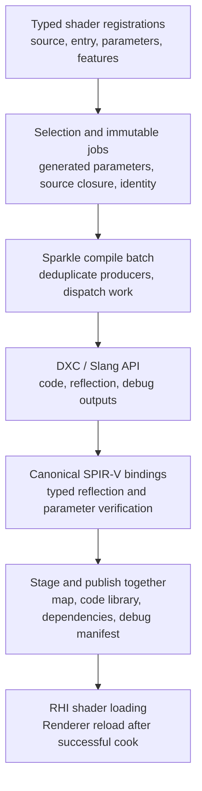
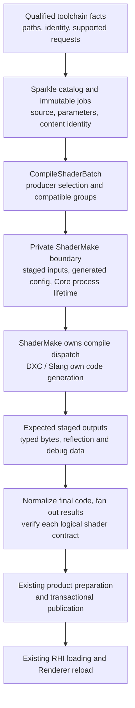

# ShaderMake: remaining integration delivery

[Third-party migration](../ThirdPartyMigration.md) | [Goals](../Goals.md) | [Rendering](../Rendering.md) | [References](../References.md) | [Engineering](../Engineering.md#module-boundaries)

**Remaining: close Stage 1's process-settlement and complete SDK-delivery gates, then convert the production cooker.** Source routing, Windows child paths and exact target-version mapping now have additional executable evidence. The pinned dependency and staging preparation build under Ninja and Visual Studio; the cooker still uses direct compiler APIs. Stage 1 remains BLOCKED, including settlement qualification on matching products with the corrected Core. Stages 3-5 are not started. DXC and Slang remain required; unchanged ShaderMake remains NO-GO.

[Responsibility split](#high-level-responsibility-split-after-full-integration) | [Starting point](#starting-point-and-evidence) | [Target architecture](#target-architecture-and-structural-review) | [Stages and prompts](#implementation-stages-and-exits) | [Failure modes](#failure-modes-and-required-responses)

**Recommendation:** finish the named settlement and SDK gates before replacing the production compiler. Retain prepared-input batches, full Slang JSON metadata and contained artifact ingestion; Sparkle keeps source identity, typed verification, publication and reload. The specific ShaderMake development pin and bounded correction are selected for continued implementation below. That decision does not qualify the compiler SDK payload or waive process lifetime requirements.

The intended user is a rendering developer who wants to spend less time maintaining compiler integration. The expected return is less compiler plumbing to maintain and an inspectable path for reproducing shader builds, leaving more effort for rendering, GPU kernels and measured results. This is conditional maintenance value; faster compilation, better images and new shader capabilities have not been established.

## High-level responsibility split after full integration

Sparkle already integrates third-party shader compilers: Microsoft's **DXC** and **Slang** parse shader languages, optimize programs and generate GPU code. Current authored shaders found under Engine/Projects are HLSL, whose automatic selection uses DXC; Slang is an existing optional backend and remains a desired supported choice. Sparkle does not implement compiler algorithms. Its own `ShaderCompiler` executable prepares inputs, calls their APIs, extracts results and publishes engine assets.

**You would delegate the mechanics of running compilation and keep control of what gets compiled, how results are verified and how the engine uses them.** ShaderMake is NVIDIA DevTech's offline batch tool above DXC/Slang. The intended split is:

| Responsibility | Owner after integration |
| --- | --- |
| Execute compile batches, distribute compile work and invoke qualified DXC/Slang tools | **ShaderMake** |
| Expand configured permutations and translate supported common compiler options | **ShaderMake**, from Sparkle-generated configuration |
| Parse shader languages, optimize programs and generate DXIL/SPIR-V | **DXC / Slang**, as today |
| Decide required shaders, variants, targets and rendering features | **Sparkle** |
| Own authored shader algorithms, typed registration and generated parameter declarations | **Sparkle** |
| Select qualified compiler versions, engine-specific options and concurrency limits | **Sparkle** |
| Preserve virtual source paths, captured inputs, content identity and changed-source selection | **Sparkle** |
| Interpret reflection, normalize bindings and verify C++/shader layouts | **Sparkle**, using existing upstream reflection libraries |
| Assemble matching code, symbols, sources and diagnostics into debug bundles | **Sparkle**, consuming compiler-produced outputs |
| Publish complete cooked assets and preserve accepted output on failure | **Sparkle** |
| Load/reload shaders, create GPU pipelines and manage GPU resource lifetime | **Sparkle** |

`ShaderCompiler.exe` remains the engine's cooker. Its proposed workflow becomes:

**Sparkle plans work → ShaderMake runs DXC/Slang → Sparkle verifies → Sparkle publishes → Renderer loads/reloads.**

In practice, you still write and optimize shaders, investigate generated code, debug rendering and measure GPU behavior. The maintenance removed is compiler-session, generic invocation and compile-worker machinery. Source preprocessing is a separate decision; virtual mounts, dependency identity, reflection and publication do not transfer automatically.

This is the target ownership split. Exact reflection/debug-output fit and retirement of the superseded implementation must pass before it becomes the production architecture. The [replacement map](#what-would-be-replaced-in-this-repository) identifies the affected files; the [architecture section](#target-architecture-and-structural-review) defines the required boundaries and lifetimes.

### Terms

| Term | Meaning here |
| --- | --- |
| Compiler backend | DXC or Slang, selected today by `--backend dxc`, `slang` or `auto`. |
| Target | The output contract, such as `DxilSm66` or `SpirV16`. Vulkan uses SPIR-V; D3D12 uses DXIL. |
| Reflection | Compiler information about resource bindings, constant-buffer members, offsets and entry points. Sparkle translates it into its own contracts. |
| Permutation | A compilation with a particular set of defines/options. Different variants can share a source file. |
| Publication | Making a complete, validated shader asset generation available to readers. Successful individual compilations are only inputs to this step. |

ShaderMake supports configuration-driven permutations, bounded parallel compilation, raw binaries and optional headers/blobs, DXIL/SPIR-V output, explicit compiler paths and additional compiler flags. Its incremental logic tracks timestamps and build settings. These are upstream features; their compatibility and performance in Sparkle are unproved. See the [upstream README](https://github.com/NVIDIA-RTX/ShaderMake/blob/4f1ffd56dac27fc3d620ad7efeee42b4dd71fa72/README.md).

## Starting point and evidence

The completed [design and pinned-reference study](../../build/validation/shadermake/stage-0/20261122-closeout/stage0-report.md) owns the guide implications, consumer traces, compared shapes and exact source/SDK inventories. Its source index and per-file hashes bind the study beyond HEAD `0ee11bf2cb45fe4a337fb27f9d8c098700dfd987`. Reopen only affected findings; source research is not runtime or production-input qualification. The concrete consumer remains Goals case 2: trace one registered shader request through DXIL/SPIR-V and the existing Renderer, preserving independent controls for rendering correctness.

The independent [production compiler cleanup](../../build/validation/shadercompiler-review/20261121-8f42a9) is delivered. Planning uses immutable backend descriptors and creates compiler instances only for execution; the pool and redundant virtual capability query are retired. Slang uses one upstream-parsed effective argument list. Keep those owners and do not count their retirement again. Source/output evidence and baseline limitations remain in that report; no ShaderMake conversion or GPU/package/performance acceptance follows from the cleanup.

**Specific source decision, 2026-11-22:** select `4f1ffd56dac27fc3d620ad7efeee42b4dd71fa72` plus the [compiler-contract correction](../../CMake/Dependencies/Patches/ShaderMakeCompilerContract.patch) for continued implementation. Rechecked [tags](https://api.github.com/repos/NVIDIA-RTX/ShaderMake/tags) and [releases](https://api.github.com/repos/NVIDIA-RTX/ShaderMake/releases) are empty; the [maintainer advisory page](https://github.com/NVIDIA-RTX/ShaderMake/security/advisories) has no published advisories at this review. This development-pin decision uses the traced mechanism and executable fit, and inherits no unrelated dependency exception. The correction changes 46 physical lines (27 added, 19 removed), within the original 80-line bound, without adding a compiler/process implementation. The recipe keeps the acquired cache clean and patches a private build copy; MIT/argparse notices are included. Windows MSVC/Ninja and Visual Studio builds pass. SDK eligibility and distribution qualification remain open; no advisory publication is not a security certification. The upstream traces still do not require adopting their renderer.

## How the current pipeline works

The starting points are the [typed catalog builder](../../Tools/Shaders/ShaderCompiler/Private/Contracts/ShaderContractCatalogBuilder.cpp), [job builder](../../Tools/Shaders/ShaderCompiler/Private/Cooking/Planning/ShaderCompileJobBuilder.cpp), [compile batch](../../Tools/Shaders/ShaderCompiler/Private/Cooking/Compilation/ShaderCompileBatch.cpp) and [publication owner](../../Tools/Shaders/ShaderCompiler/Private/Cooking/Publication/ShaderArtifactPublication.cpp).



The CLI defaults to `DxilSm66` and `SpirV16`, `auto` backend selection and four parallel compiles. [Backend selection](../../Tools/Shaders/ShaderCompiler/Private/Backend/ShaderBackendFactory.cpp) chooses DXC for `.hlsl` and Slang for `.slang`, subject to target support. The advertised target set also includes DXIL SM 6.0 through 6.7 and SPIR-V 1.4/1.5/1.6; a migration must preserve the existing supported combinations and explicit rejection behavior.

Source preparation currently expands textual includes and injects generated parameter blocks into in-memory source. It maintains `/Engine`, `/Project` and optional `/Plugin/<name>` virtual identities. Jobs carry source/dependency/request hashes and backend identity. Compilation deduplicates only after checking input equality, then fans results back out to shader types. Reflection and debug artifacts are part of the result, not optional substitutes for bytecode.

The Launcher still invokes Sparkle's tool; Application owns the Editor operation, and Renderer reload follows successful completion. Those responsibilities have distinct lifetimes and remain useful after a compiler-invocation migration.

## What would be replaced in this repository

Paths in this table are relative to `Tools/Shaders/ShaderCompiler/Private/` unless linked elsewhere. **Replace** means a proposed retirement after demonstrated fit. **Adapt** means retained engine policy with a changed boundary. No row is an accepted saving yet.

| Current owner | Proposed result | Why / what remains |
| --- | --- | --- |
| [`Backend/Dxc/DxcShaderBackend.*`](../../Tools/Shaders/ShaderCompiler/Private/Backend/Dxc/DxcShaderBackend.cpp), [`DxcCompileArguments.*`](../../Tools/Shaders/ShaderCompiler/Private/Backend/Dxc/DxcCompileArguments.cpp) | **Replace invocation/session and generic argument machinery.** | ShaderMake calls DXC. Keep target/feature policy and result interpretation; debug/reflection extraction needs a proved file-output path first. The entire backend file is not automatically removable. |
| [`Backend/Slang/SlangShaderBackend.*`](../../Tools/Shaders/ShaderCompiler/Private/Backend/Slang/SlangShaderBackend.cpp) | **Replace compilation/session machinery if fit passes.** | ShaderMake calls `slangc`. Slang reflection, source capture and external symbol output are decisive gaps to resolve before claiming retirement. |
| [`Cooking/Compilation/ShaderCompileBatch.cpp`](../../Tools/Shaders/ShaderCompiler/Private/Cooking/Compilation/ShaderCompileBatch.cpp) | **Replace compile worker dispatch. Adapt producer/result mapping.** | Submit a real batch to ShaderMake. Preserve equality-checked deduplication, typed result association and progress. Never launch a multithreaded ShaderMake per existing worker. |
| [`ShaderCompileJobExecutor.*`](../../Tools/Shaders/ShaderCompiler/Private/Cooking/Compilation/ShaderCompileJobExecutor.cpp), [`Backend/IShaderBackend.*`](../../Tools/Shaders/ShaderCompiler/Private/Backend/IShaderBackend.h), factory | **Retire the remaining single-job compiler interface/executor at adoption. Pool already retired in compiler cleanup.** | Planning now consumes immutable descriptor values; retain selection/capabilities as policy. Do not recreate planning compiler instances or wrap a batch tool behind `Compile(request)`. |
| [`Compiler/ShaderSourcePreprocessor.*`](../../Tools/Shaders/ShaderCompiler/Private/Compiler/ShaderSourcePreprocessor.cpp), [`ShaderIncludeResolver.*`](../../Tools/Shaders/ShaderCompiler/Private/Compiler/ShaderIncludeResolver.cpp) | **Separate conditional retirement.** | ShaderMake does not supply Sparkle virtual mounts or generated parameters. Its scanner is not a complete preprocessor. The existing compiler-preprocessing proposal C remains the bounded alternative. |
| [`Compiler/ShaderSourceMountTable.*`](../../Tools/Shaders/ShaderCompiler/Private/Compiler/ShaderSourceMountTable.cpp) | **Retain mount identity/admission.** | Case policy, traversal rejection, physical containment and authored virtual paths are engine requirements. Any disk-based compiler input must preserve them. |
| [`Planning/Identity`](../../Tools/Shaders/ShaderCompiler/Private/Cooking/Planning/Identity), [`Dependencies/ShaderDependencyManifest.*`](../../Tools/Shaders/ShaderCompiler/Private/Cooking/Planning/Dependencies/ShaderDependencyManifest.cpp) | **Retain content identity and changed-source selection; adapt dependencies if proved.** | ShaderMake timestamps/build signatures do not replace content-based identity, immutable input checks or Sparkle's dependency manifest. |
| [`DxilReflectionExtractor.*`](../../Tools/Shaders/ShaderCompiler/Private/Backend/Dxc/DxilReflectionExtractor.cpp), [`DxilLibraryReflectionExtractor.cpp`](../../Tools/Shaders/ShaderCompiler/Private/Backend/Dxc/DxilLibraryReflectionExtractor.cpp), [`SlangReflectionExtractor.*`](../../Tools/Shaders/ShaderCompiler/Private/Backend/Slang/SlangReflectionExtractor.cpp) | **Retain semantic translation; adapt input.** | Current DXIL/Slang extraction consumes in-process compiler objects. A raw binary alone is not proof that all required metadata survives. |
| [`Compiler/SpirV`](../../Tools/Shaders/ShaderCompiler/Private/Compiler/SpirV), [`Verification/ShaderParameterStructVerifier.*`](../../Tools/Shaders/ShaderCompiler/Private/Verification/ShaderParameterStructVerifier.cpp) | **Retain.** | Canonical bindings, buffer layout, resource meaning and host/shader ABI must still agree. SPIRV-Reflect and SPIRV-Tools already provide upstream mechanisms here. |
| [`Contracts`](../../Tools/Shaders/ShaderCompiler/Private/Contracts), [`Cooking/Planning`](../../Tools/Shaders/ShaderCompiler/Private/Cooking/Planning) | **Retain domain catalog/planning; adapt requests.** | C++ registrations stay the authority for shader identity, parameters and features. Generate ShaderMake config; do not maintain a second authored shader list. |
| [`Cooking/Publication`](../../Tools/Shaders/ShaderCompiler/Private/Cooking/Publication), [`Analysis`](../../Tools/Shaders/ShaderCompiler/Private/Analysis), [`Cli`](../../Tools/Shaders/ShaderCompiler/Private/Cli) | **Retain product contracts; adapt compiler provenance.** | Keep inspection, statistics, CLI behavior, accepted-output protection and complete debug bundles. ShaderMake output is staging input, not a published Sparkle asset. |
| [RHI shader storage/loading](../../Engine/RHI/Private/Shaders), [Editor compile operation](../../Engine/Application/Private/Editor/Shaders/EditorShaderCompileOperation.cpp), [Launcher cook requests](../../Tools/Launcher/SparkleLauncher/Private/Cook/CookOperationProcessRequests.cpp) | **Retain consumers and workflows.** | Keep `GlobalShaderMap.smap`, `CookedShaderLibrary.slib`, typed lookup and successful-cook reload. No ShaderMake dependency belongs in runtime RHI/Renderer. |

The catalogue's **0 / 0 (protected/study)** records no established ShaderMake retirement credit. After the independent compiler cleanup, the refreshed mixed mechanism inventory is **14 files / 1,575 physical / 1,354 code lines**; it includes retained policy and is not a deletion forecast. The older 16-file / 1,642-physical-line inventory is historical; pool retirement earns no second credit. The conditional `CompiledShader` pair is outside that mixed inventory. The separate preprocessing **C** pair remains 190 physical lines (161 code lines in the frozen footprint study); charge overlap once. The [accounting scope](#retirement-and-frozen-comparison-boundaries) charges all adapters, retained policy and build/package work. No net ShaderMake saving has been established.

## What would change for you, and what it costs

These are proposed workflow outcomes, not delivered features. The benefit depends on removing the local mechanisms in the replacement map above.

| Workflow | Proposed change and practical value | Limit |
| --- | --- | --- |
| Maintain or update compiler integration | Upstream owns generic invocation and compile dispatch; Sparkle maps engine policy into generated config and ingests verified results. | Qualified DXC/Slang upgrades, metadata changes and engine-specific flags remain your decisions. The adapter must be smaller than the machinery retired. |
| Add or edit a shader | Keep typed registration as the authority and generate batch inputs from it; use upstream batch/permutation facilities where required. | No second authored shader catalogue or language migration. ShaderMake cannot decide which rendering variants are correct or necessary. |
| Diagnose a compile or shader failure | Capture exact inputs, arguments and tools for an external reproduction, while preserving current reflection/debug inspection. | Sparkle already exports debug artifacts; this is a possible simplification of reproduction, not a newly established debugger capability. Symbols/source correlation must pass first. |
| Cook and reload during rendering work | Keep Launcher Cook and Editor Recompile Shaders / `CompileShaders [symbols]`, with verified results published before reload. | No automatic watcher or completed Apply Changed feature. Initial forced compilation of selected jobs claims no incremental speedup; process startup can add cost. |
| Compare generated code or compiler settings | Use an isolated, identified batch for a controlled experiment on owned shaders, retaining correctness and profiling controls. | Generated-code quality comes from compiler/driver behavior and your shader choices. ShaderMake does not imply faster kernels or higher FPS. |
| Run or distribute the project | End users continue to load prebuilt cooked shaders offline. Development tools carry the explicitly inventoried compiler toolset. | No runtime dependency on ShaderMake in RHI/Renderer, no unattended downloads, and no expansion to DXBC, Metal or other platforms. |

Donut remains a useful integration precedent. Its asset/runtime contracts do not transfer automatically to Sparkle.

| Cost or disadvantage | Implication for Sparkle |
| --- | --- |
| Another executable and configuration boundary | Requires staging, result association, process-tree settlement, logs, build inputs, notices and offline delivery. This can outweigh retired code. |
| External compiler startup | The inspected path uses subprocesses rather than Sparkle's API sessions. Small/incremental cooks may get slower; do not assume multithreading is a speedup. |
| Reflection is not a complete Sparkle output | Sidecars/container reflection must replace the current result-object path without losing members, library exports or resource meaning. |
| Debug output differs by compiler | Slang's container route now returns verified full PDBs with the bounded SDK correction. Its hierarchy and transport suffix require explicit ingestion; stock SDK behavior and the old flat API reader still fail. Tool qualification and original-source routing remain separate costs. The optional API cache-key export is not required. |
| Filesystem input replaces in-memory input | Generated parameters, virtual paths, immutable snapshots and original-source correlation need a deliberate design. |
| Two possible incremental authorities | Keep Sparkle's job selection/content identity authoritative initially. Avoid a second cache deciding whether required work can be skipped. |
| Maintenance shifts rather than disappears | You still choose qualified tools, investigate regressions and validate ABI/output. An upstream fork carrying Sparkle's compiler framework would defeat the purpose. |

## Decisive compatibility questions

These are source-based concerns and proposed checks, not observed prototype failures. Relevant upstream implementation is in [`ShaderMake.cpp`](https://github.com/NVIDIA-RTX/ShaderMake/blob/4f1ffd56dac27fc3d620ad7efeee42b4dd71fa72/ShaderMake/ShaderMake.cpp), particularly `ExeCompile`, `GetHierarchicalUpdateTime`, `SignalHandler` and `main`.

### Reflection and final bytecode

The current DXC path takes reflection from `IDxcResult`, including separate reflection while runtime DXIL is stripped. Slang consumes `ProgramLayout` for DXIL and SPIR-V reflection for its SPIR-V path. ShaderMake raw output does not recreate those objects.

Prove compiler-generated reflection sidecars or container extraction with the exact qualified tools. Compare buffer members/offsets/sizes, resource kinds/counts, vertex inputs, compute group sizes, push constants and ray-library exports. If this needs a second full compilation through the old backend, it fails the proposed ownership transfer. Reusing compiler APIs to read metadata is compatible with retiring their compilation path.

Keep Sparkle's name-based SPIR-V binding normalization. Generic register-class shifts are not its canonical global assignment. Reflect and hash the final normalized bytecode, and ensure debug/exported code matches the bytes actually published.

### Exact sources, virtual paths and preprocessing

The inspected ShaderMake dependency scanner uses regex matching and timestamps. It is not a compiler preprocessor. At the pinned revision, [`ProcessConfigLine`](https://github.com/NVIDIA-RTX/ShaderMake/blob/4f1ffd56dac27fc3d620ad7efeee42b4dd71fa72/ShaderMake/ShaderMake.cpp#L2324-L2430) calls it only inside `if (!force)`: **`--force` bypasses this scan as well as its skip decision.** This corrects the earlier study assumption. Keep forced, fresh invocation outputs for Sparkle-selected producers; compiler preprocessing and source identity remain separate responsibilities.

Materialize the prepared `ShaderCompileRequest::SourceCode` once per producer, using the [adopted source transport](#stage-1-delivery-and-resumption). Keep logical virtual identities while deriving compiler line names before hashing; line directives alone do not embed source bytes. This delegates invocation without claiming preprocessing retirement. If a later design drops `--force` or enables incremental reuse, reopen scanner/dependency admission and content-versus-timestamp checks.

If source preparation moves upstream later, compilers must own preprocessing while Sparkle retains mount admission, generated parameter declarations and captured dependency identity. Probe conditional/macro includes, repeated/guarded includes, cycles, case collisions, traversal, project/plugin roots and source changes during job construction. Do not build a second general preprocessor to make ShaderMake fit.

### Symbols, provenance and compiler identity

The existing [debug result](../../Tools/Shaders/ShaderCompiler/Private/Compiler/Output/ShaderDebugArtifactSet.h) includes arguments, diagnostics, disassembly, preprocessed source, symbols, symbol name and an optional compiler lookup key. ShaderMake's Slang `--PDB` convenience path cannot emit a separate PDB. The `.dir` route now produces full code-associated PDBs with the verified [SDK correction](../../CMake/Dependencies/Patches/SlangDebugInformationFormat.patch). Stock/control builds do not. The pinned writer places the PDB at `children/<code>/associated/<compiler-name>.pdb/<compiler-name>.pdb.unknown`; API filesystem output has the corresponding association below its root code artifact. Read that bounded producer container, validate the binary/hash/native name and retain the compiler's `.pdb` name for publication. File extension or exit zero alone cannot identify a valid PDB. Finish qualification/source routing before production adoption.

Keep identities distinct: Sparkle's request hash selects work; final normalized code hash identifies published code; a Slang entry-point key identifies that compiler's program/cache input; native debugger/Aftermath hashes follow their own formats. The refined Slang backend and [writer](../../Tools/Shaders/ShaderCompiler/Private/Cooking/Publication/ShaderDebugArtifactWriter.cpp) both permit an absent key. A repository-wide search found no reader; [RHI GPU-crash metadata](../../Engine/RHI/Private/Diagnostics/GpuCrash/GpuCrashSession.cpp) leaves its compiler-key field unpopulated. Omit unavailable key data/leave its kind null, retain real code/source/tool identity and never substitute another hash under its name. Reopen only for a named consumer; no upstream key-export patch is required.

[ShaderDebugArtifactWriter](../../Tools/Shaders/ShaderCompiler/Private/Cooking/Publication/ShaderDebugArtifactWriter.cpp) currently records compiler DLLs loaded in the Sparkle process. After external compilation, those modules can differ from the ones loaded by `dxc.exe` or `slangc.exe`. Record the actual qualified subprocess toolchain and inputs; hashing a parent-process DLL is insufficient provenance. Include ShaderMake identity and effective invocation settings in job identity so transport/option changes invalidate old results. Keep `dxc`/`slang` as compiler identities, rather than pretending ShaderMake is a third code generator.

GPU-crash mode has [identity-bound compiler inputs](../../CMake/Dependencies/GpuCrashInputs.json), including a patched Slang build. Do not accept ShaderMake's automatic downloads as interchangeable with those tools. Missing symbol/source support blocks a complete migration; do not silently disable a diagnostic workflow.

### Target flags and shader libraries

Match strictness, HLSL 2021, optimization, warnings, debug stripping, layout, storage-image policy and feature extensions. Preserve current native-16-bit policy: do not add `-enable-16bit-types`. The candidate forces it for DXC SM 6.2+ and offers no opt-out. It also generates Slang profiles and default extension/define arguments that require explicit control; appending a second Slang profile is not a clean override. The [effective-option decisions](#effective-option-constraints) resolve these as source-backed reasons for the unchanged-candidate NO-GO. Preserve Slang row-major explicitly. No image regression is inferred from this source evidence.

Ray tracing is an early test, not a final corner case. Sparkle's DXC library selection remains per-job `-exports <entry>`; the inspected DXC parser deliberately ignores `-E` for library profiles, so no entry-suppression patch is required. Stage 1 compared the full DXC catalog, including selected library exports, through existing native reflection and typed verification. Slang library groups need explicit per-job `-entry <entry>` and stage selection; their current material-header failure still blocks output comparison. Retain current capability rejections, including Slang's narrower DXIL ray support.

### Concurrency, cancellation and publication

Use one ShaderMake batch at a time initially and pass the existing `--parallel-compiles` allowance as `--jobs`. Group jobs by platform and compatible global options/compiler selection; run groups sequentially until a measured need justifies sharing a bounded allowance. Do not multiply the batch limit by the number of outer workers.

Coordinate this boundary with the [task-runtime migration](TaskRuntime.md): ShaderMake would own only shader compilation dispatch. Avoid converting the retiring compile dispatcher into a new task-runtime adapter first, and count its retirement once. Other tool and application execution remains with its existing owner.

Use Core's existing [child-process owner](../../Engine/Core/Public/Process/ChildProcess.h) for cancellation/logging and verify that descendants settle. Upstream's signal handler alone does not prove process-tree cancellation during an active compiler call. Set `--retryCount 0` initially: the upstream budget defaults to ten shared retries for subprocess/shell-launch failures, not failed shader syntax, and Sparkle has no equivalent retry loop today. Preserve coarse group/verification progress through the existing callback and retain compiler logs. `--compactProgress` is human text, not a structured per-job result protocol; do not add a text parser or an upstream progress patch without a required UI consumer.

ShaderMake writes only into invocation staging. On compilation, metadata, verification or cancellation failure, keep accepted products untouched. Only the existing publisher may replace the validated map/library/dependency/debug set. Keep readers and worker-owned storage alive until all access has settled.

## Target architecture and structural review

Stage 0 selected this as the best prospective ShaderMake shape, compared with the [simpler direct-API alternative](../../build/validation/shadermake/stage-0/20261122-closeout/ShaderMake.before.md). The unchanged candidate received NO-GO; this architecture remains a design for a reopened study, not an accepted implementation. Follow [module ownership](../Engineering.md#module-boundaries), [data/lifetime rules](../Engineering.md#data-and-lifetime) and [code structure](../CodeStyle.md#c-structure). Review the complete planning-to-publication path, its CLI/host callers and build/package membership. The integration is incomplete while old compilation owners survive behind new wrappers.



### Owners, authority and lifetime

| Owner | Authority and lifetime | Boundary |
| --- | --- | --- |
| `CookGlobalShaders` | Composes toolchain resolution, planning, batch compilation, product preparation and publication for one cook. | Keep intent/order visible. Config grammar, subprocess details, metadata decoding and binding algorithms belong to their capability owners. |
| Toolchain resolution and planning | Resolve qualified tool paths/identity once for the invocation; build immutable jobs from the existing typed catalog, source snapshot and policy. | Planning consumes facts, not live compiler sessions. Config and command lines derive from the same effective options used for job identity; do not maintain a second option model/hash. |
| `ShaderCompileBatch` | Owns equality-checked producer selection, bounded compatible groups and mapping results to logical jobs. | ShaderMake owns compile-worker dispatch. Per-shader `dxc`/`slang` choice remains policy; serial mode uses the same production mechanism with one job allowed. |
| Private ShaderMake execution boundary | Owns invocation staging, generated config, expected-output associations and child-process settlement until ingestion completes. | Reuse Core process/filesystem mechanisms. Its output destination is staging only; final publication paths do not belong in its interface. |
| Format extraction and typed verification | Convert compiler output into existing neutral values, normalize SPIR-V, hash final code and verify every consuming shader contract. | No subprocesses or publication here. A shared producer does not excuse skipping a consumer's typed parameter check. |
| Product preparation and publication | Own cooked product association, complete/partial catalog policy, staged validation and accepted-output replacement. | Consume typed results after compile work settles; keep rollback and reader lifetime with existing owners. |
| Launcher, Application and Renderer/RHI | Keep tool selection/status, host operation lifetime and successful-cook runtime consumption with their existing owners. | No ShaderMake config, filenames, sidecar schema or compiler process policy in runtime modules. |

The [current planner](../../Tools/Shaders/ShaderCompiler/Private/Cooking/Planning/ShaderCookPlanBuilder.cpp) now queries descriptor values once per selected backend; the [job builder](../../Tools/Shaders/ShaderCompiler/Private/Cooking/Planning/ShaderCompileJobBuilder.cpp) consumes those values and validates capabilities. No planning compiler pool remains. At ShaderMake adoption, extend those facts to the qualified subprocess toolchain and retire the remaining `IShaderBackend`, API compilation/session code and `ShaderCompileJobExecutor` after their consumers convert. Retain capability/selection policy and actual result readers.

Keep one authoritative input snapshot and one result representation per lifetime. Borrow immutable jobs while the batch is alive; materialize required compiler inputs once per producer and move output bytes into owned results. Results retain no borrowed staging storage or live process handles; capture required source/debug bytes before staging retires. Audit whether `CompiledShader` still has a role after direct API compilation retires; remove it if it only transfers the same fields into `ShaderCompileResult`/`CookedStageBuild`. Preserve necessary typed reflection/debug values and deliberate multi-consumer fan-out; moving or renaming them earns no simplification credit.

### File and dependency shape

Keep `ShaderCompiler.exe` as the CLI/cooker and `CompileShaderBatch` as the private domain operation. The proposed placement below describes responsibilities, not a requirement to add a class or file for each workflow step:

| Private location | Final responsibility |
| --- | --- |
| `Cooking/GlobalShaderCooker.*`, `Cooking/Planning/` | Cook composition and immutable domain planning. No live backend pool. |
| `Cooking/Compilation/ShaderCompileBatch.*` | Producer/group orchestration and logical result mapping. Replace its current task graph. |
| `Cooking/Compilation/ShaderMake/ShaderMakeBatch.*` | Cohesive config/input/process/output boundary. Split config emission or output ingestion only when substantial independent logic warrants it. |
| `Compiler/Dxil/`, existing `Compiler/SpirV/` | Format-specific reflection/disassembly and binding operations. Relocate retained DXIL readers from `Backend/Dxc` when compilation retires. |
| `Compiler/Slang/`, only if needed | Retained Slang-specific metadata translation if the proved output path requires it. Do not keep a compiler session or add an empty abstraction for symmetry. |
| Existing `Compiler/Output/`, `Verification/`, `Cooking/Publication/` | Neutral output values, typed invariants and cooked asset publication, respectively. |

No new public module, compiler service, generic plugin interface or forwarding facade is justified. Keep compiler SDK types in private extraction code; runtime contracts remain independent of SDK headers and ShaderMake. Apply naming, includes and generated CMake membership to the final responsibilities, deleting obsolete files/targets rather than leaving an old folder shape underneath a new call.

### Integration policy

Generate configuration from selected typed jobs. Maintain only an invocation-local association from producers to collision-free expected outputs, including repeated basenames, entries and targets. Read the named raw output/sidecars or one named compiler container; reject missing, empty, duplicate or mismatched output. A container reader may inspect its bounded `children`/`associated` hierarchy to locate compiler-named artifacts; a loose staging-directory scan or console text cannot establish success. No persistent job-status mirror is needed.

Use `--binary --force --noRegShifts --retryCount 0`, explicit compiler paths and a nonzero bounded `--jobs`. Group by compiler, platform and compatible global settings; initially avoid mixed compiler aliases. DXC emits raw code and named sidecars. Slang may emit its own `.dir` compiler container as described below, from which code/PDB are ingested into the same neutral results. That temporary compiler container is consumed inside the cooker; Sparkle keeps its single cooked library/map and runtime readers.

Give each producer a simple staged basename and output subdirectory, for example `p000001.hlsl` and config-local `-o p000001`. Keep config-local permutation `-D` lists empty initially: encode the already selected request's defines through its compiler-specific `-X` options. This avoids reproducing ShaderMake's implementation-specific permutation filename hash while preserving actual compiler defines in the one effective-option model. Under the [pinned output-name rules](https://github.com/NVIDIA-RTX/ShaderMake/blob/4f1ffd56dac27fc3d620ad7efeee42b4dd71fa72/ShaderMake/ShaderMake.cpp#L2288-L2334), `main` raw DXIL then has the known path `<out>/p000001/p000001.dxil`; other entries follow the `_entry` suffix rule. Slang `.dir` output drops the final `.dir` extension when creating its directory. Derive and validate expected paths before launch, including sidecar names; test config quoting, option translation and shell quoting as separate boundaries. No local permutation expander or compiler wrapper is justified.

Use one production compile route after cutover. Existing backend choices select code generators through ShaderMake; they do not select old versus new invocation implementations. Keep baseline executables only in ignored comparison output. A ShaderMake failure reports failure and preserves accepted assets. Retaining direct compilation as a fallback, recompiling through it for missing metadata, or adding a permanent implementation-selection flag blocks this migration's completion. A small upstream fix can be evaluated; a local compiler framework inside a fork fails the ownership-transfer goal.

At integration, add a dependency recipe under `CMake/Dependencies/Targets/` using the existing verified source-cache workflow. Gate acquisition/building on `SPARKLE_ENABLE_SHADER_COMPILER`; disable ShaderMake compiler discovery/downloads (`SHADERMAKE_FIND_COMPILERS=OFF`) and supply the qualified SDK tools. The upstream [host-tool CMake](https://github.com/NVIDIA-RTX/ShaderMake/blob/4f1ffd56dac27fc3d620ad7efeee42b4dd71fa72/CMakeLists.txt#L196-L236) offers `SHADERMAKE_TOOL` for a host-platform Release tool independent of parent configurations. Evaluate that existing path before inventing custom build orchestration; reconcile its target/output with Sparkle's verified dependency and staging owners. Do not link `ShaderMakeBlob` into runtime products.

Update [ShaderCompiler CMake](../../Tools/Shaders/ShaderCompiler/CMakeLists.txt), its [SDK discovery](../../Tools/Shaders/ShaderCompiler/CMake/ShaderCompilerSdks.cmake) and [runtime staging](../../Tools/Shaders/ShaderCompiler/CMake/ShaderCompilerRuntime.cmake), [Launcher SDK admission](../../Tools/Launcher/SparkleLauncher/Private/Build/Toolchains/ShaderCompilerSdkDiscovery.cpp), notices and source/prebuilt package inventories together. Current SDK admission lists DLL/API inputs, not a complete external compiler toolset. Inventory the required executables and their actual runtime dependencies. Remove API imports only after remaining reflection/disassembly users are accounted for. Render-only products need no ShaderMake runtime dependency.

### Structural review exit

Before claiming code completion, review the connected final diff against the owner table and verify:

- The call path reads as planning, compilation, product preparation and publication; each mechanism has one actual owner. The ShaderMake boundary has not absorbed catalog policy, binding semantics, verification or publication.
- Every old compiler factory/pool/interface and task-dispatch caller is converted or retired, including `list-backends` and identity discovery. No forwarding aliases, fallback compilation route or duplicate cache/options/status authority remains.
- Source snapshots, borrowed jobs, staged files, child processes and result bytes have explicit lifetimes through success, partial failure and cancellation. Final published code, reflection and debug identity agree.
- File names, includes, target dependencies, feature-disabled builds and package inventories match the final ownership. Check regenerated source membership; an include-boundary scan alone cannot prove architectural quality.
- Focused normal/failure/lifetime checks pass, and the complete maintenance ledger shows what retired, what remained and what adaptation was added. Fewer lines cannot excuse a second framework or weaker rendering contracts.

Run the existing applicable architecture/style checks during implementation and inspect the actual domain boundaries manually. Fix architectural findings before handoff. Unrun GUI/GPU/package qualification remains separate and explicit; this source study certifies no implemented architecture.

## Implementation stages and exits

### Execution rules and stage state

Resume the unmatched Stage 1 gates, then run stages in order through Stage 3. The completed corrected-candidate design remains the prerequisite; reopen only findings invalidated by changed inputs or new incompatibilities. Stage 1 is an isolated fit trial, not adoption. Stage 2 converts the actual owner; Stage 3 is the bounded code-completion exit. Stage 4 records broader product qualification separately. Stage 5 can close code after Stage 3 while transferring unrun Stage 4 work to its existing qualification owner, following [code delivery and qualification](../ThirdPartyMigration.md#code-delivery-and-qualification).

Start each stage with live status/revision, applicable `AGENTS.md` instructions if present, the nine governing guides and this plan. Preserve concurrent edits. Bind evidence to relevant per-file hashes, tools and products; do not restart unrelated passed work just because HEAD changes. Wait for another session using the same build output instead of starting a competing build or cancelling its work.

Keep raw source traces, commands, results and measurements in ignored `build/validation/shadermake/stage-N/`. Record the exact temporary probe paths and remove test-only source/executables/build trees before handoff; retain useful reports and existing repository validation. Do not add a permanent test framework or project-wide policy scanner.

After every stage, update the row below and the relevant design text **before handoff**. Record candidate/scope, passed and missing criteria, verdict, command/artifact references, evidence invalidation triggers, remaining work and exact next action. Use `NOT STARTED`, `IN PROGRESS`, `PASS`, `BLOCKED` or `NO-GO`; individual unrun qualification cells stay `UNVERIFIED`, uncertain comparisons `INCONCLUSIVE`, and waivers require explicit authorization. A blocked row names the failed/missing cell and next discriminating action. A design NO-GO closes the investigation without enabling later implementation prompts.

| Stage | State | Required predecessor / exit | Evidence / next action |
| --- | --- | --- | --- |
| [1: isolated fit](#stage-1-isolated-fit-and-baseline) | BLOCKED | Prior output/ABI checks retain their inputs. Source/path/version and structural admission checks are added; settlement and complete SDK delivery remain open. | `stage-1/20261122-routing/` extends earlier packets. Follow the [remaining gates](#stage-1-delivery-and-resumption); preserve the strict Core failure. |
| [2: production conversion](#stage-2-production-boundary-and-retirement) | BLOCKED; dependency preparation delivered | Stage 1 PASS and complete eligible toolchain; one production compile owner. | Recipe, notices, Launcher metadata and staging are prepared/tested. API/session/dispatcher retirement and production output ingestion are not implemented. |
| [3: code acceptance](#stage-3-caller-build-and-code-acceptance) | NOT STARTED | Stage 2 PASS; structural/build/focused behavior exit. | None; gated by Stage 2. |
| [4: product qualification](#stage-4-product-qualification-and-cost) | NOT STARTED | Stage 3 PASS; report each exercised/unrun product cell. | None; separate from code completion. |
| [5: handoff and closure](#stage-5-handoff-and-plan-closure) | NOT STARTED | Stage 3 PASS plus Stage 4 results/transfer, or documented Stage 0/1 NO-GO closure. | None; no release claim follows automatically. |

### Positive and negative guidelines

These apply to every stage alongside its specific instructions.

| Do | Avoid |
| --- | --- |
| Trace a real producer, consumer, invariant, lifetime and failure before choosing an abstraction. | Copying a sample framework, adding a compiler service bag, or forcing the existing single-job interface around a batch tool. |
| Derive config, arguments and identity from the same admitted inputs; retain one domain authority. | Duplicate authored shader lists, option/hash models, timestamp caches, status mirrors or a renamed local dispatcher. |
| Reuse Core process/publication and existing reflection mechanisms with explicit private dependencies. | Moving process policy into Renderer/Editor, exposing SDK types in runtime contracts, or implementing a second publisher. |
| Keep orchestration readable, meaningful locals/paragraphs, cohesive files and purpose-based names under CodeStyle. | Mechanical function/file splitting, forwarding-only classes, generic helper folders or weakening checks to meet a line target. |
| Compare like-for-like inputs and identify compiler/flag differences before interpreting outputs. | Attributing compiler upgrades to ShaderMake, accepting visual differences because both paths compile, or equating DXIL/SPIR-V with native ISA. |
| Remove superseded code with converted callers and report the entire added/retained surface. | Production fallback compilers, hidden feature cuts, permanent implementation switches or counting relocated/overlapping code as savings. |
| Run the smallest check that can falsify the stage's claim, then update current plan state. | Repeated full campaigns without changed inputs, new infrastructure for hypothetical cases, or promoting source/build checks to GPU/package/release proof. |

### Frozen constraints for remaining stages

The [completed design](../../build/validation/shadermake/stage-0/20261122-closeout/stage0-report.md) records the live consumer trace, pinned precedents, alternatives and corrected-candidate decision. Keep its source/tool identities and the constraints below; do not rerun the completed investigation without an affected input change. Source/design approval is separate from executable fit and production pin/SDK eligibility.

#### Required outputs and fit checks

Stage 0 established the source/API routes below. The unchanged candidate's option incompatibilities required the bounded correction before Stage 1. These rows define the required checks; their current executable outcomes are in the [Stage 1 delivery](#stage-1-delivery-and-resumption). A source-supported route is not a successful output comparison.

| Required output or invariant | Acquisition/design finding | Required verification and owner (reuse matching evidence) |
| --- | --- | --- |
| DXC DXIL reflection, including stripped code and selected library exports | DXC supports `-Fre` reflection output; private `IDxcUtils::CreateReflection` can consume its bytes and reuse existing shader/library translators. CLI `-Fd` supplies requested PDB/name. `GetDxilContainerPart(DXC_PART_SHADER_HASH)` provides a credible source for the compiler hash; validate against the API baseline. [DXC guide](https://github.com/microsoft/DirectXShaderCompiler/wiki/Using-dxc.exe-and-dxcompiler.dll). | **P1 / format extraction:** one raster/compute and one selected library export with identical qualified tools/options. Compare all reflection fields, final code and full PDB/name/`DxcShaderHash`. No second compilation to recover outputs. |
| SPIR-V reflection, normalization and debug correlation | Existing SPIRV-Reflect/Tools consume emitted binary. Preserve name-based canonical binding mutation, then reflect/hash final code and export those same bytes. Retain captured original sources and verify compiler line/source output separately. | **P2 / SPIR-V owner:** ComputeClear, typed GBuffer and inline/ray-library requests on supported paths, generated offsets/resources and debug lines. Reject any loss of required information. |
| Slang DXIL reflection | `-reflection-json <path>` has an existing sidecar route. The [pinned emitter](https://github.com/shader-slang/slang/blob/d88cc8fff35baf96cf30d242b2572564cf8043b6/source/slang/slang-reflection-json.cpp#L194-L269) includes binding/category/offset/size/semantic data, nested types and entry-point/thread-group metadata elsewhere in that file. Its mapping is not yet proved equivalent to current `ProgramLayout` translation. | **P3 / Slang metadata:** explicit Slang GBufferPS DXIL; compare every field consumed by `SlangReflectionExtractor`, including type/array/resource access and nested constant-buffer layout. Reuse the private JSON dependency; no second compiler session or generic reflection framework. |
| Slang full DXIL PDB/name | **Executable route proved with the bounded SDK correction; production qualification remains open.** [OptionsParser](https://github.com/shader-slang/slang/blob/d88cc8fff35baf96cf30d242b2572564cf8043b6/source/slang/slang-options.cpp#L1572-L1588) accepts `.dir`/`.zip`. [Container writing](https://github.com/shader-slang/slang/blob/d88cc8fff35baf96cf30d242b2572564cf8043b6/source/compiler-core/slang-artifact-container-util.cpp#L172-L263) preserves associated hierarchy; [DXC extraction](https://github.com/shader-slang/slang/blob/d88cc8fff35baf96cf30d242b2572564cf8043b6/source/compiler-core/slang-dxc-compiler.cpp#L747-L785) attaches the PDB when the format reaches it. | **P4 / Slang ingestion:** the continued API and CLI trials verify full PDB status, runtime shader hash and native name for ComputeClear/GBuffer. Preserve single-target/entry forced binary `.dir` mode and bounded association. Do not copy the old flat API reader or identify PDBs solely by `.pdb` extension. No archive dependency, internal SDK headers or recovery compilation. |
| Slang entry-point cache key on both targets | **Optional; not blocking.** [getEntryPointHash](https://github.com/shader-slang/slang/blob/d88cc8fff35baf96cf30d242b2572564cf8043b6/source/slang/slang-linkable.cpp#L267-L298) hashes linkage/component/entry state, and no CLI export was established. Current writer fields permit absence and no repository consumer was found. It is not the native GPU/debugger hash. | **P4 / diagnostics:** permit absent Slang cache-key data while verifying required code/source/tool identity and requested symbols. If a key is provided, retain its true kind/semantics. No new Slang patch, reconstructed algorithm or extra compilation solely to populate unused metadata. |
| Effective options, source identity and library entry semantics | Preserve current precision policy, Slang target profile and feature/define policy. DXC library `-E` is ignored by the inspected compiler; add selected `-exports` through existing custom options. Slang needs one exact profile and explicit selected entry/stage. The unchanged candidate cannot express every policy; see the correction proposal. | **P0 / invocation owner:** reject unchanged forced options; a corrected candidate must first pass source review, then command-argument/default/negative checks. **P5 / planning and execution:** replay all five shader types, optimized/debug modes, selected exports and capability rejections. Check ABI and content edits with restored timestamps/source mutation; do not change policy to make a comparison pass. |
| Prepared inputs and original debug sources | Seal existing expanded source and captured authored bytes before launch; physical staging names identify producers, authored virtual names identify diagnostics. Force bypasses the upstream timestamp scanner. Compiler reads must stay within the captured source/qualified tool inputs; line directives alone do not establish original-source availability. | **P6 / source preparation:** prepared input and original-source capture, stable module names, repeated basenames/entries, project/plugin paths and Windows spaces/non-ASCII/config metacharacters. Include cases compare current preparation versus intended semantics separately. If fit requires a new general resolver or silently rejects a formerly supported request, reject/defer that shape. |
| Process, failure, retries and publication lifetime | Core owns Windows job containment/cancellation and logging; batch owns staging until descendants and reads settle. Run groups sequentially with one allowance and `--retryCount 0`; reject partial/missing expected outputs even after exit zero, then move owned results and verify every consumer. Compiler logs support diagnosis, not result association. | **P7 / batch and Core:** serial/bounded results, reordered/partial/missing/stale outputs, syntax error/child crash and cancellation while a compiler is active; require zero descendants after settlement and successful repair/retry. Publication/reload checks belong to S2/S3/S4 at their actual owners. No process-tree or runtime behavior has been exercised here. |

**Boundary and copy design:** toolchain resolution owns immutable qualified executable/runtime/module hashes and supported requests for one invocation. Planning borrows them and owns the request/source closure. Producer equality remains stronger than hash equality. One effective-option record supplies canonical identity and config; identity includes transport/tool bytes, ordered relevant options, defines/remaps, generated parameters and source content, rather than a second authored option model. Materialize prepared source once per distinct producer, retaining original captured bytes for debug. The batch owns generated config and output associations until Core settles every descendant and ingestion completes; typed results own their bytes afterward. Shared producers may require deliberate fan-out copies, and every consumer is verified. On failure, accepted publication is untouched; if settlement cannot be established, retain storage until settlement instead of destroying borrowed inputs. No persistent staging cache, job-status mirror or second publisher is introduced.

#### Effective-option constraints

The authoritative inputs are [current DXC arguments](../../Tools/Shaders/ShaderCompiler/Private/Backend/Dxc/DxcCompileArguments.cpp), [current Slang session setup](../../Tools/Shaders/ShaderCompiler/Private/Backend/Slang/SlangShaderBackend.cpp) and the candidate's [actual command construction](https://github.com/NVIDIA-RTX/ShaderMake/blob/4f1ffd56dac27fc3d620ad7efeee42b4dd71fa72/ShaderMake/ShaderMake.cpp#L1783-L1977). Configuration is only serialization of this one policy. Source names, global/local options and automatic upstream arguments all belong in the comparison; matching a few switches is insufficient.

| Request aspect | Design instruction / remaining gap |
| --- | --- |
| Matrix layout and language | Slang groups select `--matrixRowMajor`; DXC groups preserve their current default. Use Slang language mode as in the current API, not automatic `--slangHLSL` for an `.hlsl` path. Preserve `-module-name SparkleShader`. Stage/source-path changes must retain captured authored bytes and explained debug identity; P6 tests original virtual paths and reproduction. |
| DXC baseline policy | Preserve strictness, HLSL 2021, all-resources-bound, requested warning/optimization policy, DXIL reflection stripping and library auto-binding space. Use supported flags/custom options from the request; no implicit adoption of sample SM or Vulkan defaults. |
| Native 16-bit policy | **Decision: retain the current absence of `-enable-16bit-types`.** The [candidate adds it automatically](https://github.com/NVIDIA-RTX/ShaderMake/blob/4f1ffd56dac27fc3d620ad7efeee42b4dd71fa72/ShaderMake/ShaderMake.cpp#L1908-L1912). DXC source corresponding to the installed DLL's build tag, [`fe2615732899960b4077d02511810a80ccc4ffc9`](https://github.com/microsoft/DirectXShaderCompiler/blob/fe2615732899960b4077d02511810a80ccc4ffc9/lib/DxcSupport/HLSLOptions.cpp#L624-L625), parses a presence flag with no negative option. Extra `-X` arguments cannot remove it. A future precision-policy experiment is separate from this migration. |
| DXC selected libraries | **Closed at source/design level.** Keep the real config entry, `-T lib -m 6_6`, and per-job `-X "-exports <selected-entry> -auto-binding-space 0"`. DXC [deliberately replaces a library entry with an impossible name](https://github.com/microsoft/DirectXShaderCompiler/blob/fe2615732899960b4077d02511810a80ccc4ffc9/lib/DxcSupport/HLSLOptions.cpp#L556-L570), so ShaderMake's additional `-E` does not require a patch. P1/P5 still compare exports, reflection and recorded debug arguments with the same qualified compiler. |
| Slang profile and selected stage | Current API options use `sm_6_0`–`sm_6_7` for DXIL and `spirv_1_4`–`spirv_1_6` for SPIR-V. ShaderMake emits its generated profile **before** `-target`; a later custom profile applies to the target, then Slang's [single-target default merge](https://github.com/shader-slang/slang/blob/d88cc8fff35baf96cf30d242b2572564cf8043b6/source/slang/slang-options.cpp#L3847-L3852) restores the earlier value through [`overrideWith`](https://github.com/shader-slang/slang/blob/d88cc8fff35baf96cf30d242b2572564cf8043b6/source/slang/slang-compiler-options.h#L171-L180). Appending `-profile` therefore does not preserve Sparkle's SPIR-V profile contract. Require one exact generated profile. Supply registration-owned `-stage compute/vertex/fragment/raygeneration`, plus explicit `-entry <entry>` for `lib`; retain the current single-entry API model. |
| Debug flags and symbols | DXC convenience `--PDB` injects `-Zi -Zsb` and `-Fd`; audit the binary-hash policy rather than assuming parity. Prefer exact per-job debug/PDB/reflection options if the convenience switch adds unwanted behavior. Slang DXIL needs explicit PDB format in the container route; embedded debug alone is insufficient. Keep requested strip/debug combinations and original sources. |
| SPIR-V extensions and implicit defines | Preserve DX layout, unknown storage-image format, required feature extensions, direct Slang emission and entry names. Targets map to `--vulkanVersion 1.1spirv1.4`, `1.2`, `1.3`. The candidate's [default extension list](https://github.com/NVIDIA-RTX/ShaderMake/blob/4f1ffd56dac27fc3d620ad7efeee42b4dd71fa72/ShaderMake/ShaderMake.cpp#L106) includes `SPV_EXT_descriptor_indexing` and `KHR`; its [task construction](https://github.com/NVIDIA-RTX/ShaderMake/blob/4f1ffd56dac27fc3d620ad7efeee42b4dd71fa72/ShaderMake/ShaderMake.cpp#L2444-L2448) injects `__SLANG__`/`__spirv__`. Sparkle's request does not authorize those extra arguments. Preserve compiler-provided builtins and request defines; do not shadow them with guessed values. Removing default arguments needs explicit upstream controls, not an application wrapper or a claimed flag-equal comparison. |
| Requested versus implemented options | Compiler cleanup now routes Slang warning-as-error and DXIL debug stripping through the same upstream-parsed/exported options, including `-Xdxc -Qstrip_debug`. Bare defines retain the API's value `1`. Rebaseline those deliberate fixes before S1; preserve actual effective policy rather than comparing against the earlier ignored fields. |
| Naming, failures and progress | One selected producer per config line, compiler defines through per-job options, simple staged names and known output roots. Force work, set the bounded jobs allowance, disable upstream retries initially, and consume validated outputs after settlement. Keep coarse group/verification progress and raw logs; no parser for human progress lines. |

#### Bounded compiler-contract correction

The [current patch](../../CMake/Dependencies/Patches/ShaderMakeCompilerContract.patch) uses base `4f1ffd56dac27fc3d620ad7efeee42b4dd71fa72`, SHA-256 `f84807984bc52e0d39e3257462dce5bea9aa1175735d8235d64e26e36ca390ff`: **27 added + 19 removed physical lines** in `ShaderMake/ShaderMake.cpp`. All five controls enter the signature. Scheduling, compiler internals, reflection and publication stay upstream/with their existing owners. The original four-control research patch and its 26 P0 checks remain frozen in the first fit packet; the routing follow-up owns the expanded patch and its path/signature/version checks. Keep the acquired source cache unmodified and review an upstream equivalent before maintaining further local changes. The source decision does not qualify the SDK or activate production compilation.

| Research control | Required behavior and scope | Discriminating check |
| --- | --- | --- |
| `--no16bitTypes` | Suppress only ShaderMake's automatic DXC 16-bit flag; preserve existing default behavior when absent. | SM 6.1/6.2/6.6 argument checks; identical compiler precision policy in P0/P5. |
| `--slangProfile <profile>` | Emit one exact Slang target profile instead of the generated profile; registration still supplies selected entry/stage. | DXIL SM 6.0/6.6/6.7 and SPIR-V 1.4/1.5/1.6; no duplicate-profile diagnostic or stage loss. |
| `--noDefaultSpirvExtensions` | Suppress the initial extension defaults while retaining explicitly requested extensions and their order. | Feature-free, descriptor-indexing, inline-query and ray-library requests against current effective arguments. |
| `--noImplicitDefines` | Suppress only tool-injected defines; retain compiler builtins and the request's ordered defines. | Valued/bare definitions, builtin-sensitive source and config selection; P5/P6 must prove no input-selection drift. |
| `--relativePaths` | Preserve relative compiler/source command paths; use native cwd handling and UTF-8 diagnostic path text. The caller supplies controlled paths, not arbitrary shell arguments. | Three adversarial working directories, identical code, four signature cells and original-source/macro checks. |

Keep all changes in the existing option parsing, command construction and build-signature owners. Effective-option/signature changes must be covered; preserve upstream behavior when the controls are absent. Reopen the design if this exceeds **80 maintained native physical lines in one upstream source file**, adds a wrapper executable, or touches scheduling, compiler internals, reflection or publication. Charge the actual owned patch, documentation/build wiring, qualification and distribution cost to the connected ledger; this ceiling is a proposed design bound, not measured implementation. No correction is necessary for DXC library `-E` or Slang's optional cache key.

The intended future command policy is explicit: generated DXC entry-point requests use `-E`; libraries retain selected `-exports`; Slang uses its exact current profile, module name and selected stage/entry; debug/PDB/reflection flags and paths are per producer. Use existing `-X` for supported request flags. The controls above permit exact policy; they do not delegate shader meaning or recreate an application compiler framework. P0 verifies emitted commands before P1–P7 output/lifetime trials.

**Installed-tool limitation, separate from fit:** the configured SDK root is `C:\VulkanSDK\1.4.350.0`; GPU-crash debugging is OFF in the inspected root cache. Its `slang-compiler.dll` is SHA-256 `cfdc9c0067942608757cbb343b53302bd7da1c6b945e9dd343c9474941f9830b` (31,122,360 bytes), whereas the qualified patched manifest expects `17018b56015e482583da2cc1e3dc16c137857b6ba9ed245af2876eed1f4b62b2` (31,383,552 bytes). Normal-mode availability is not GPU-crash qualification. DXC DLL bytes match their listed input, but `dxc.exe`/`slangc.exe` are not in that inventory. Later admission must include actual executables and subprocess dependencies; do not change receipts to bless these observed files. No SDK was changed. The later independent compiler review reproduced missing DXIL PDB output from this DLL with both original API descriptors and parsed options; changing the reader hierarchy cannot recover an artifact that was not returned.

#### Retirement and frozen comparison boundaries

The [replacement map](#what-would-be-replaced-in-this-repository) fixes the connected conversion scope. The refreshed 14-file mixed inventory is **1,575 physical / 1,354 code lines** across the remaining backend/argument/interface/factory/batch/executor pairs. The wider frozen comparison envelope is **244 native files / 19,433 physical / 16,876 code lines**, plus **45 non-native files**; it includes retained connected owners, not removable code. Lists, per-file hashes and cloc 2.06 output are in the closeout evidence. Any later changed caller outside that envelope must be added and charged on both sides. Retire compilation/session/interface/executor/task dispatch; retain selection/capabilities, equality/fan-out and semantic translation. `CompiledShader` is a conditional transfer retirement. Registration carriers remain; remove compiler API imports only after accounting for readers. The separately retired pool earns no second credit. Recheck identities immediately before an authorized trial.

Before/after accounting includes all changed callers in planning, source capture/identity, reflection/debug readers and writer, CLI, ShaderCompiler CMake/runtime staging, dependency recipes, Launcher SDK admission, Core changes if actually required, notices and product/package inventories. New staging/config/readers/scripts count even outside ShaderCompiler. Report maintained first-party C++ headers/sources as both **physical lines** (all lines, including blank/comments) and **code lines** (excluding blank/comment-only lines), using cloc 2.06 with `--skip-uniqueness --by-file --json --list-file=<connected-source-list>` on both sides; freeze tool bytes and lists with the baseline. Shader, script/CMake, generated and vendored source are separate units. List and charge maintained upstream patches explicitly, including Slang/tool requalification and the temporary container/IR cost; placing owned changes in a vendor tree does not remove their maintenance cost. Record bytes for delivered tools/runtime/modules and uncompressed package payload. No relocated code, C overlap, vendor LOC or avoided future work earns native deletion credit. Acceptance targets fewer maintained mechanisms and positive connected net native retirement; counts do not waive correctness or justify comparable replacement machinery.

Freeze baseline/candidate compiler bytes and effective flags before attributing any difference to ShaderMake. Workloads are: the five registered shader types × both default targets (**10 planned logical jobs**, not observed executions); explicit Slang GBufferPS × both targets (**2 additional planned jobs**); full live catalog; selected ID; changed-source selection; repeated cook; requested debug export. Preserve capability-rejection cases separately. Run serial allowance 1 and the existing default 4, never above `min(hardware, 8)`; compatible groups initially run sequentially. Freeze full catalog membership and accepted artifact identities with the matching Stage 1 baseline before generating candidate results. No ShaderMake timing/memory/payload comparison was run in Stage 0.

The following are **new study review limits**, fixed before measurement, not inherited release promises or measured results. For each cost delta, both the relative and absolute limits must hold; report a near-zero/unmeasurable baseline as INCONCLUSIVE rather than inventing a percentage. A missed benefit target triggers one explained review under ThirdPartyMigration; it cannot excuse a correctness/lifetime regression or endless tuning.

| Comparison | Frozen review limit / method |
| --- | --- |
| Full shader cook wall time | Regression ≤10% **and** ≤2 s, with full catalog and debug/non-debug reported separately. |
| Selected shader cook wall time | Regression ≤20% **and** ≤250 ms, including process startup; selected/repeated/changed requests reported separately. |
| Owning-tool clean / no-change incremental build | Regression ≤10% and ≤10 s clean; ≤10% and ≤1 s incremental. Same configuration, dependency-cache state and compiler toolchain. |
| Cooker startup (`--help`) | Regression ≤10% and ≤50 ms; no claim about GUI startup or frame time. |
| Peak compilation memory | Aggregate private committed memory of cooker + ShaderMake + compiler descendants: regression ≤10% and ≤128 MiB. State sampling interval/limits; do not compare only the parent process. |
| Delivered development tool/runtime payload | Growth ≤5% and ≤20 MiB over the frozen complete shader-tool bundle. Count executables, DLLs, modules and notices; render-only payload gains **0 ShaderMake files/dependencies**. |
| Cancellation and correctness | Zero descendants after reported settlement; existing Editor/Launcher 10 s cancellation/quit requirement retained. Zero unexplained ABI/metadata/debug/source-identity differences or capability cuts. These are correctness requirements, not negotiable benefit targets. |

For time/memory costs, Stage 1 fixes one machine/configuration, SDK and workload inputs; Stage 4 uses one warm-up then five measured alternating baseline/candidate runs per warm cell, reporting each run, median and range. Cold full-cook/build cells use three separately reset, identically defined cache states with no pooled cold/warm result. Record reset procedure, filesystem/cache limits and background load; do not label uncontrolled OS cache state "cold." A range spanning a limit remains INCONCLUSIVE. Broader qualification can remain UNVERIFIED at code closure under the existing policy; none of these cells is PASS today.

Affected findings must be rechecked when source preparation/requests, effective options, backend/output contracts, publication/reload/process ownership, guide requirements, SDK bytes/qualified manifests or upstream pins change. Reuse unaffected compiler evidence. Research authorization is not a production dependency/SDK exception; keep direct APIs until the remaining gates pass.

### Stage 1: isolated fit and baseline

**Entry:** Stage 0 PASS. Acquire/build the studied candidate only in isolated ignored output with automatic compiler downloads disabled; use identified qualified compilers. This research does not grant production-pin eligibility.

**Work:** freeze matching baseline source/tool/option identities and accepted artifact hashes. Probe real compute, raster and ray-library jobs with generated parameters, both default targets and currently supported Slang cases. Obtain all metadata/debug outputs from the candidate route, normalize final SPIR-V and compare typed results. Exercise source/case/include/flag risks, equivalent-input dedup, one-job/bounded-parallel execution and active-child cancellation. Record pre-existing failures separately. Full performance qualification is not a prerequisite.

**Do:** test the hardest reflection/symbol/library/source questions first; keep exact replay commands and final-code hashes. **Avoid:** production switches, accepted-output mutation, building a permanent adapter, hiding a failing baseline, or recompiling through the old backend to fill candidate metadata gaps.

**Acceptance:** **S1-A** every required output/capability path has executable evidence or its existing supported rejection; **S1-B** canonical layout/bindings, code/debug/source identity and options agree within the frozen contract; explain any changed binary bytes rather than assuming semantic equivalence; **S1-C** bounded execution and cancellation settle before input/staging destruction; **S1-D** repair/retry and failure preservation pass, probe code is removed, and a specific GO/BLOCKED/NO-GO decision updates the design. Missing mandatory fit blocks Stage 2.

**Failure focus:** F01-F08 below. An unresolved compiler regression, symbol gap or need for a substantial fork is a fit failure, not permission to cut a supported workflow.

#### Stage 1 delivery and resumption

**BLOCKED on complete SDK delivery and matching strict process-settlement evidence.** The [DXC packet](../../build/validation/shadermake/stage-1/20261122), [Slang report](../../build/validation/shadermake/stage-1/20261122-slang/continuation-report.md) and [routing/profile follow-up](../../build/validation/shadermake/stage-1/20261122-routing/REPORT.md) retain exact inputs and failed controls. Prior 78 DXC and six repaired Slang native metadata/ABI comparisons remain scoped to their recorded inputs. The new corrected dependency executable adds four DXC compute/raster comparisons with identical executable programs, three adversarial working-directory checks, 15 exact target-version checks, four path-signature cells and two compiler macro checks. These are offline compiler observations, not a production cook or debugger qualification.

| Remaining fit gate | Current evidence and required exit |
| --- | --- |
| S1-C / process settlement | The earlier ShaderMake groups settled in their tested scope. Preserve the [original strict nested failure](../../build/validation/boost-process/continuation-20261122-r2/consumers-01/nested-cancel-strict-1.json); the [process owner](BoostProcess.md) now supplies a corrected Core and strict passing evidence. Finish matching rebuilt-owner qualification and repeat affected ShaderMake settlement checks. Do not add shader-local supervision or promote eventual exit to PASS. |
| S1-A / complete SDK delivery | ShaderMake's source decision/recipe are recorded. Assemble and admit the exact compiler executables, DLLs, modules and terms through existing SDK/Launcher/package owners. The corrected Slang tools are identified by `20261122-slang/corrected-toolchain.json`; source-build proof does not replace a complete production SDK layout. Preserve installed inputs and old qualified receipts. Ordinary compiler fit and GPU-crash qualification are distinct. |
| S1-B / remaining admission and association | The original eight container cases cover native PDB/hash/name and invalid outputs; 15 additional structural prototype cases cover traversal, root/member junctions, case/conflicting snapshots, size/count/depth and stale invocation creation. Finish producer association under reordered completion and the remaining admitted metadata shapes. These prototypes are not a production reader. Use fixed producer paths and fresh invocation staging, never enumeration order or console text. |
| S1-B / emission policy and canonical identity | Material spelling and explicit capability/binding repairs pass their recorded cases; all 15 new profile/header cases pass with the mapping below. Finish emission-range bounds and canonical effective-option/tool/source identity before conversion. Fixed trial shifts are not an unrestricted production binding policy. |

**Adopted source transport for conversion.** Logical `/Engine`, `/Project` and `/Plugin/<name>` identities remain the domain authority. Emit compiler `#line` names without the leading slash, before prepared-source hashing; materialize exactly captured originals at those contained relative paths. Both compilers report the expected root-relative `__FILE__` values and authored line numbers in Engine/Project/Plugin macro checks. This intentionally changes the compiler-visible filename spelling; the live shader tree has no path-macro use. GBuffer retains all 16 referenced original texts byte-for-byte and unchanged executable program, including the combined Unicode/metacharacter working directory. Reject case collisions or inconsistent same-path snapshots rather than overwriting them. This does not qualify interactive debugger lookup or arbitrary Unicode shader filenames.

**Windows command boundary.** The unchanged tool absolutizes child paths and exposes `%NAME%` expansion through `_popen`; the preserved negative control fails. The correction adds `--relativePaths`, native filesystem cwd discovery and UTF-8 diagnostic paths. Sparkle must launch ShaderMake natively through Core, stage controlled ASCII input/output/config/sidecar paths and use a relative compiler path on the same artifact volume. Three working-directory cases, including Unicode, spaces, ampersand, percent expansion, caret and exclamation, produce identical code. The option is not a general shell serializer: macro values and custom strings still require a proved source/config encoding before conversion. Do not add a second compiler/process wrapper. All five added controls participate in ShaderMake's signature; the four new relative-path signature cells pass.

**Exact Slang target mapping.** Derive both `--slangProfile` and `--vulkanVersion` from Sparkle's one target: `spirv_1_4` / `1.1spirv1.4`, `spirv_1_5` / `1.2`, `spirv_1_6` / `1.3`. Selecting the profile alone leaves ShaderMake's default SPIR-V 1.6 capability: eight lower-version controls exit zero but emit the wrong header. With matching capabilities, ComputeClear/GBuffer/inline PT/RGS across the three SPIR-V versions and ComputeClear DXIL 6.0/6.6/6.7 all emit the requested version. Preserve this failed control and check output headers during ingestion. These new cells check success/version, not an expanded native ABI or GPU matrix.

**Keep the verified Slang output contract.** The three-line [debug-format correction](../../CMake/Dependencies/Patches/SlangDebugInformationFormat.patch), alongside the existing loop-location patch, already produces full PDBs in matched source builds. Consume the pinned associated-artifact hierarchy, validate full-PDB status/runtime hash/native name and preserve that native `.pdb` name; `.pdb.unknown` is only a transport leaf. Retire the legacy flat reader with conversion. Full Slang JSON declaration metadata remains required; optimized DXIL reflection drops needed declarations. Promote the tested material type spelling and explicit emission policy with their real owners, never by mutating already hashed inputs or compiling again through the old backend.

The follow-up reports retain commands, actual binary/source hashes, negative controls and cleanup manifests. **S1-D cleanup remains open:** automatic approval review rejected removal of the two scoped ShaderMake validation packets with "blocked by policy" before execution. Their `cleanup-targets.json` inventories the temporary sources, fixtures, empty consumer executables and build/cache trees; `cleanup-result.json` records that they remain. No alternate deletion was attempted. The production qualified receipt, accepted shader publications and API route are unchanged. Its `spirv-opt` CLI could not read a Unicode absolute path, so comparison-only native byte copies used the ASCII evidence root; compiler outputs retain full debug data. The future production path continues to use the existing in-process SPIR-V owner.

**Copy-ready prompt:**

```text
Work in C:\Users\stole\Documents\GitHub\SparkleEngine. Close only the remaining Stage 1 gates in Docs/Implementation/ShaderMake.md. Verify current identities and reuse the DXC, Slang, routing/profile and dependency packets; do not restart completed PDB/source/profile investigation. Preserve concurrent work and the existing installed SDK/qualified receipts.

Reuse the Core process owner's verified nested-cancellation correction and finish qualification on matching rebuilt products. Repeat affected ShaderMake before-return settlement checks, including concurrent spawn/stop and failure paths; retain the original failure and reused evidence identities. Earlier passing ShaderMake groups and eventual exit do not qualify changed products. Add no shader-local supervisor, fallback compiler or second process authority.

Finish exact SDK acquisition/layout/admission through existing CMake/Launcher/package owners, retaining full Slang symbols/JSON and identified compiler/DLL/module bytes. Separate ordinary fit from GPU-crash and distribution qualification. Complete remaining producer association/reordered-output and metadata-shape checks, emission-range bounds and canonical effective options/tool/source identity. Root-relative source transport and matching Slang profile/Vulkan capabilities are already decided and tested; do not silently rewrite sources after hashing or accept exit zero with a wrong output version.

Apply S1-A through S1-D honestly; retain failing controls, remove local probes, and update the remaining gates/evidence/next action before handoff. Reconcile the prepared ShaderMake dependency/staging slice rather than rebuilding it. Convert the production batch only after fit passes, then retire API compilation/sessions/dispatcher and their consumers together. Do not claim GUI/GPU/package/release acceptance.
```

### Stage 2: production boundary and retirement

**Entry:** Stage 1 PASS, design still matches live owners, and the exact production pin/acquisition/license/toolchain policy is resolved. A new unreleased pin needs its own eligibility decision; the unrelated JSON exception is not authorization.

**Existing preparation:** the [recipe](../../CMake/Dependencies/Targets/shadermake.cmake), patch, shader-feature filtering, Launcher metadata, notices and runtime-staging wiring are delivered. The [dependency results](../../build/validation/shadermake/stage-2/20261122-dependency/dependency-results.json) cover seven cache/configuration cases, matching patched build source, clean cache, stable source timestamps, no unnecessary recompilation and stale-staging repair. [Visual Studio DevelopmentEditor](../../build/validation/shadermake/stage-2/20261122-dependency/vs-results.json) also builds/stages and restores a missing staged tool. These compose actual production CMake with a temporary empty consumer; they do not build or convert the production native ShaderCompiler. The leaf upstream project avoids SDK discovery/downloads. A dedicated staging target refreshes ShaderMake even when the cooker does not relink; source-package identity is derived from the tool target. Runtime SDK inventory/admission and the connected conversion below remain open.

**Work:** integrate the private dependency through existing CMake/cache/inventory owners. Extend planning's immutable backend descriptors to admitted subprocess toolchain facts; the live planning pool is already retired. Convert the real compile batch to generated inputs/config, Core-managed process execution, typed output ingestion, normalization/verification and existing publication. Update CLI identity/capability consumers and compiler provenance. Retire the remaining interface/sessions/job executor/dispatcher and update file placement, includes and generated membership together. Reuse Stage 1 findings rather than grow a second adapter system.

**Do:** deliver one cohesive production path with serial execution through the same mechanism, private SDK readers and typed results. **Avoid:** fallback compilation, dual implementation flags, one ShaderMake process per old worker, second publication/cache/options authority or a broad RHI/Renderer redesign. An unfinished slice remains IN PROGRESS, not an accepted dual architecture.

**Acceptance:** **S2-A** every supported compile request uses the chosen upstream batch mechanism and all obsolete compilation consumers are converted/retired; **S2-B** canonical config/options/identity and immutable sources/results match the design; **S2-C** metadata/source/debug and final-code verification precede existing publication, with accepted-output and process lifetime protection; **S2-D** the owning tool builds and focused normal/failure/retry cases pass, while dependency/notices/tool-admission/package inputs and disabled-feature enclosure match the new boundary. No GUI/GPU/release qualification is implied.

**Failure focus:** F01-F12. Fix broken ownership and behavior in the actual owner. Do not call a wrapper around the old path a completed stage.

**Copy-ready prompt:**

```text
Work in C:\Users\stole\Documents\GitHub\SparkleEngine. Execute only Stage 2 of Docs/Implementation/ShaderMake.md. Verify Stage 1 PASS, current matching design/evidence and exact dependency-pin eligibility before production changes. Follow the execution rules, nine guides and applicable local instructions.

Implement the chosen private batch boundary through existing dependency/process/publication owners. Extend planning's immutable backend descriptors to admitted subprocess toolchain facts, preserve effective-option/source identity, ingest exact metadata/debug outputs, normalize/verify final code and retain typed publication. The planning pool is already retired; convert remaining compiler-interface/executor/CLI callers and remove their superseded implementation, task dispatch, dead files/targets and redundant transfer wrappers. Update names/includes/CMake membership, tool admission, provenance, notices and package inputs with the actual owner change. Add no fallback, duplicate authority or permanent probe framework.

Build the affected owning tool and run the focused success/failure/lifetime checks required by S2-A through S2-D. Wait for competing shared builds. Before handoff update the plan's state, candidate/scope, evidence, passed/missing criteria, invalidation triggers, remaining work and exact next action; reconcile changed dependency/roadmap state. Do not start Stage 3 or claim runtime qualification.
```

### Stage 3: caller, build and code acceptance

**Entry:** Stage 2 PASS. Review the entire connected final diff against the architecture and CodeStyle, including filenames, data copies, native SDK exposure, factory/pool remnants, generated target membership and feature-disabled/package boundaries.

**Work:** run affected tool/host builds, the existing [`ShaderCompilerCliValidation`](../../Tools/Shaders/ShaderCompiler/ValidateShaderCompilerCli.cmake), full/selected/repeated/changed-source cooks and supported backend/target cases. Check `list-backends`, inspection, option/exit semantics, debug export and Windows path/argument cases. Exercise F01-F12 at the real owner boundaries, including publication handled failure and interruption refusal/recovery. Complete the whole-change maintenance ledger and review cost misses once under the migration policy.

**Do:** fix concrete architectural findings and retain protections for input, ABI, cancellation and publication. **Avoid:** source-text scans as sole architectural proof, weakening validation to obtain a green result, or delaying code closure for unrun broad cost/GUI/GPU campaigns. Named missing implementation, unsafe lifetime, duplicate scheduling or demonstrated regression still blocks completion.

**Acceptance:** **S3-A** the structural review exit and all named retirements pass; **S3-B** applicable owner builds, per-file style/manual readability, generated membership and existing CLI validation pass; **S3-C** focused success/failure/identity/cancellation/publication checks pass against frozen inputs; **S3-D** dependency/notices/tool/distribution inputs are reconciled, the native/non-native/dependency cost ledger is honest, temporary test-only additions are removed and broader unverified work is explicitly assigned. This is the bounded code-completion milestone, not product/release acceptance.

**Copy-ready prompt:**

```text
Work in C:\Users\stole\Documents\GitHub\SparkleEngine. Execute only Stage 3 of Docs/Implementation/ShaderMake.md after verifying Stage 2 PASS. Read the execution rules, all governing guides and the complete connected final diff.

Audit and fix ownership, interfaces, files/includes, copies, lifetime, superseded compiler machinery, target membership and feature/distribution boundaries. Build affected owners; run existing ShaderCompilerCliValidation and focused real-owner full/selected/changed/repeated/debug, explicit backend/target, CLI/Windows-path, identity, failure, cancellation, repair/retry and publication checks. Apply F01-F12 and S3-A through S3-D. Do not equate build/cook success with GUI/GPU/package qualification or start a broad benchmark campaign solely to meet a line count.

Before handoff update the plan with the exact code-completion verdict, candidate/scope, evidence, passed/missing criteria, invalidation triggers, complete maintenance ledger, remaining qualification owners and next action. Remove temporary test-only additions, preserve existing tests and unrelated edits, and reconcile dependency/roadmap state only where changed. Do not start Stage 4 automatically.
```

### Stage 4: product qualification and cost

**Entry:** Stage 3 PASS. Qualify the actual changed products/inputs; reuse matching evidence and coordinate with existing image/package/release owners. This stage can remain partially UNVERIFIED without reversing a valid bounded code exit.

**Work:** exercise Launcher Cook and Editor Recompile Shaders / `CompileShaders [symbols]`, successful reload, failed/cancelled compilation and close/retry on D3D12 and Vulkan. Confirm executed-code/source/symbol lookup with applicable tools. Compare matched raw outputs and real pipeline creation against valid controls; report pre-existing scene/Reference defects rather than fixing them by changing compiler policy. Exercise relocated offline tool/prebuilt/matching-source layouts without global SDK/PATH/network discovery. Measure the frozen cost comparisons and report cold/warm and per-backend results separately. Keep source/private-symbol sharing and public rights/signing with their existing owners.

**Do:** report configuration, actual toolchain/artifact hashes, machine/driver, tolerances, uncertainty and observed failure. **Avoid:** assuming a common compiler proves Reference correctness, replacing raw comparisons with tone-mapped screenshots, inferring frame-time gains from cook time, or claiming support from package file presence alone.

**Acceptance:** **S4-A** every planned GUI/API/debug/offline cell has a candidate-bound result or explicit UNVERIFIED/BLOCKED owner; **S4-B** observed new correctness/lifetime/delivery regressions are fixed and affected checks rerun; **S4-C** cost comparisons use predeclared limits with PASS/FAIL/INCONCLUSIVE observations and no fabricated savings/speedup. A full Stage 4 PASS needs required product criteria to pass, not merely be observed. Unrun or failed mandatory cells stay open; broader unrun coverage transfers honestly at closure, and reviewed benefit-target misses remain visible.

**Failure focus:** F05, F08-F14. A new unsafe implementation defect reopens its affected code criterion; an unavailable GPU/tool or unrelated existing release blocker remains a scoped qualification gap.

**Copy-ready prompt:**

```text
Work in C:\Users\stole\Documents\GitHub\SparkleEngine. Execute only Stage 4 of Docs/Implementation/ShaderMake.md after verifying Stage 3 PASS and exact current product/input identities. Follow its execution rules and governing guides; coordinate with existing qualification owners.

Exercise the declared Launcher/Editor compile-symbols-reload/failure/cancel/close/retry workflows on D3D12 and Vulkan. Verify executed-code/debug/source correlation and matched raw output/native pipeline behavior. Check relocated offline tools/prebuilt/matching-source delivery without global SDK/PATH/network discovery and measure only the frozen cost workloads/limits. Use F05 and F08-F14, preserving existing rendering/release defects as separately identified limitations. Do not publish or upload anything.

Apply S4-A through S4-C. Before handoff update the plan and owning qualification pointers with candidate/scope/configuration, observed and unrun cells, evidence, regressions/fixes, invalidation triggers, cost conclusions, remaining owners and exact next action. Do not label unavailable or inconclusive work PASS. Do not start closure automatically.
```

### Stage 5: handoff and plan closure

**Entry:** Stage 3 PASS and Stage 4 evidence or an explicit record transferring its unrun cells. If a required code/architecture defect remains, keep the plan open; this stage cannot waive it.

**Work:** verify the final code/retirement verdict against the actual diff and matching evidence. Reconcile the existing ThirdPartyMigration ShaderMake row, code/dependency metadata and any affected footprint/roadmap statements without rewriting frozen totals or claiming unmeasured removal. Retain one concise decision/maintenance/reproduction account with correct attribution. Transfer broader qualification/cost gaps to the existing subject/release owner with actionable evidence pointers. Remove local probe artifacts and retire this active plan after lasting guidance and incoming links are reconciled, as Engineering requires. A Stage 0/1 NO-GO instead closes the study with the justified rejection and retained working architecture; do not pretend later stages passed.

**Do:** separate code delivered, product verified and release readiness; preserve measured requirements and evidence provenance. **Avoid:** duplicating stage history into the nine main guides, leaving stale plan links or continuing experiments solely to make a metric green.

**Acceptance:** **S5-A** current owners/decisions and accepted/missing claims agree; **S5-B** no superseded production/test-only residue or stale links remains; **S5-C** the user receives exact delivered scope, verification limits, maintenance result and remaining qualification owner/action. Plan removal records closure rather than loss of unresolved work.

**Copy-ready prompt:**

```text
Work in C:\Users\stole\Documents\GitHub\SparkleEngine. Execute Stage 5 of Docs/Implementation/ShaderMake.md using its execution rules and nine governing guides. Require Stage 3 PASS plus Stage 4 results or a precise transfer of unrun product cells; otherwise report the exact open code criterion. For a recorded Stage 0/1 NO-GO, close only that investigation without implementing or marking later stages passed.

Verify current code/retirement and evidence identities, reconcile existing migration/dependency/footprint/roadmap statements only where changed, preserve frozen counts and numerical limits, and retain concise lasting ownership/reproduction guidance with correct attribution. Transfer unresolved qualification to its existing owner, remove local test-only residue, repair incoming links and retire the active plan only when its required code work is complete or the investigation is explicitly rejected. Do not fabricate runtime/release acceptance or duplicate stage history.

Before removing the plan, record the final candidate/scope, passed/missing criteria, verdict, evidence, invalidation triggers and remaining owner/next action in the durable owner. Apply S5-A through S5-C and run the final applicable diff/docs checks. Report the final delivered scope and validation limits.
```

## Failure modes and required responses

These are checks to execute during the assigned stages, not failures observed in this planning revision. Keep one compact result matrix in ignored evidence and reference it from stage state; do not create another progress registry.

| ID / failure mode | Required behavior and discriminating check | Earliest owner/stage |
| --- | --- | --- |
| **F01: wrong/unqualified/missing tool** | Reject missing compiler/runtime/modules or changed identity; identify the exact path/version/hash. Check both normal and GPU-crash toolchains. No automatic compiler download, receipt alteration or parent-DLL identity substituted for the executing tool. | Toolchain design/fit, 0-1; admission, 2-3. |
| **F02: effective flags or library contract changes** | Compare actual options/implicit macros, source/module identity, SM/target, optimization/debug/warnings, matrix/16-bit layout, storage-image/extensions, exports and Slang entry behavior. Record ignored baseline request fields; preserve required capabilities/rejections and explain changed code/ABI/hash behavior. | Design/fit, 0-1; full requests, 3. |
| **F03: hidden or mutable source dependency** | Test conditional/macro/repeated/cyclic includes, generated parameters, virtual roots/case/traversal and files changed during capture; content edits with restored timestamps invalidate identity. Compilers read admitted captured inputs; scanner timestamps are not the content authority. | Input design/fit, 0-1; real jobs, 3. |
| **F04: missing/corrupt/wrong reflection** | Reject incomplete sidecars, resource/member/type/offset/size/count, vertex/group/push-constant or library-export mismatches. Normalize SPIR-V before final reflection/hash and verify every logical consumer after dedup. No legacy second compilation to obtain metadata. | Metadata fit, 1; verification, 2-3. |
| **F05: symbols/source identify different code** | Require matching published code/hash, full requested DXIL PDB/name, SPIR-V line/source data and original captured bytes. Optional API cache keys may be absent; available keys must retain their true meaning. Detect missing/ambiguous symbols and subprocess provenance mismatch; exercise actual native tool lookup during product qualification. | Debug fit, 1; export, 3; tools, 4. |
| **F06: stale/colliding/misassociated outputs** | Repeated basenames, multiple entries/targets, reordered completion, equal-hash unequal-input producers and duplicate/missing/empty/stale sidecars cannot substitute for the expected producer. Validate named raw/container association, bounded artifact hierarchy, contained paths and exactly one required code/PDB; exit zero alone is insufficient. Verify typed fan-out before publication. | Batch fit, 1; actual owner, 2-3. |
| **F07: duplicate scheduling or unbounded work** | One compile dispatcher respects the invocation allowance across groups; serial and bounded-parallel results agree. No old outer task graph multiplied by ShaderMake workers, local fallback dispatcher or unbounded staging/workspace growth. | Lifetime design/fit, 0-1; dispatch, 2-3. |
| **F08: failure/cancellation leaves active children** | Syntax failure, child crash/nonzero exit, cancellation/close after partial compile and repaired retry settle descendants before inputs/results/staging retire. No accepted publication or runtime reload on failed/cancelled compile; retained storage outlives missed settlement. | Process fit, 1; owner checks, 3; host workflow, 4. |
| **F09: publication fails or is interrupted** | Returned write/verification/publication failure preserves accepted hashes through the existing supported rollback. A killed publication may leave an incomplete set: readers refuse it and documented cleanup/recook applies. Do not claim restart-safe atomic recovery or introduce a second publisher. | Publication, 2-3; recovery workflow, 4. |
| **F10: architectural retirement is incomplete** | Detect live factory/pool/interface/executor/dispatch remnants, forwarding facades, dual catalogs/options/caches/status or SDK exposure into runtime contracts. Compare final owners/callers/build membership to named retirements; reject comparable replacement machinery even if LOC drops. | Design, 0; conversion/review, 2-3. |
| **F11: tool builds but offline delivery fails** | Verify feature-disabled enclosure, executables/DLLs/modules, source-cache metadata, notices and inventories. Test relocated prebuilt/matching-source tool use without global discovery/network; render-only products do not require ShaderMake. | Dependency inputs, 2-3; relocation, 4. |
| **F12: CLI/UI behavior or accepted output regresses** | Existing CLI validation plus full/selected/changed/repeated/debug requests, explicit targets/backends, option/exit behavior, Windows spaces/non-ASCII/long commands and progress must work. Failure keeps accepted products; Application reload occurs only on successful cook. | CLI/tool, 3; interactive host, 4. |
| **F13: compile success masks GPU/image regression** | Create actual pipelines and compare matched raw signals/numerics against independent controls on each API. Preserve shader/material/Reference conventions. A shared compiler or tone-mapped agreement cannot establish reference correctness or higher FPS. | Product qualification, 4. |
| **F14: stale evidence or misleading benefit** | Bind results to actual relevant source/tool/flags/products; rerun only affected checks. Report first-party native, shader, script/build, generated/upstream and package/runtime costs separately; charge C overlap once. Predeclared cost misses/inconclusive runs remain visible and do not become invented savings. | Baseline, 0-1; ledger, 3; costs/handoff, 4-5. |

Build/cook success proves only the checked source/tool/artifact behavior. It does not establish GUI interaction, GPU image correctness, debugger usability, package portability or release readiness. Preserve the separate meanings at every stage exit.

## Alternatives and the decision

| Option | Best reason to choose it | Main drawback |
| --- | --- | --- |
| **ShaderMake batch migration** | Delegate generic invocation and compile dispatch to an existing graphics tool. | Must bridge exact metadata/debug/source contracts without replacing retired code with comparable machinery. |
| **Existing DXC/Slang preprocessing reuse (C)** | Remove the custom regex expander through compiler include/filesystem facilities while keeping direct result/reflection/debug access. | Retains local compilation and batch adapters; still needs source/dependency capture and virtual-path policy. |
| **Slang-first compilation strategy** | Investigate consolidating code generation/reflection around the already integrated Slang API. | Separate compatibility decision for all shaders, targets and diagnostics; ShaderMake adoption does not require it. |
| **Keep the current boundary** | Existing integration retains direct access to rich compiler outputs and known engine contracts. | Continued ownership of invocation, source preparation and dispatch. Reasonable if the proposed adapter is more complex. |

[DXC's API guide](https://github.com/microsoft/DirectXShaderCompiler/wiki/Using-dxc.exe-and-dxcompiler.dll) and [Slang's compilation guide](https://docs.shader-slang.org/en/latest/external/slang/docs/user-guide/08-compiling.html) are the first references for the narrower reuse option. No option requires writing compiler optimization or code-generation algorithms yourself.

**Decision in the full project context:** continue the bounded ShaderMake integration with the selected corrected source pin, retaining the direct production compiler until remaining fit gates pass. Source/path/profile and dependency/staging findings are now concrete; full SDK delivery and strict process settlement remain open. No old compiler code is retired by this preparation and no net benefit or GPU/release qualification is claimed. The [roadmap](../Roadmap.md#supporting-system-simplification) still prioritizes rendering defects and delivery.

**Next actionable step:** follow the [remaining Stage 1 gates](#stage-1-delivery-and-resumption): obtain matching strict descendant-settlement evidence from the Core process owner, finish the exact SDK payload/admission decision, and close remaining association/emission bounds. Reuse the verified source correction, profiles, path tests and dependency preparation; then convert the actual batch and retire the APIs/dispatcher together.
