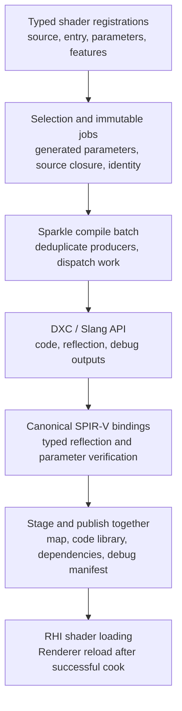
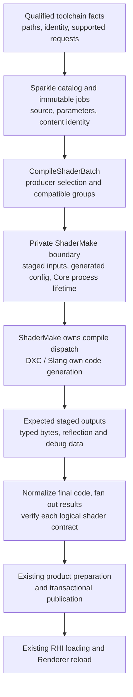

# ShaderMake implementation study

[Third-party migration](../ThirdPartyMigration.md) | [Goals](../Goals.md) | [Rendering](../Rendering.md) | [References](../References.md) | [Engineering](../Engineering.md#module-boundaries)

**Status: researched proposal, 2026-11-21. No compiler integration, prototype cook or retirement has been performed.** This document supports a decision and describes the implementation if the decisive fit checks pass. It does not adopt a dependency or change delivery priorities.

**Recommendation:** ShaderMake is compatible with the documented graphics systems and DevTech direction as a bounded support-code replacement. Trial it as the owner of offline compile batches and compiler invocation. Keep Sparkle's typed shader contracts, reflection validation, cooked publication and runtime reload. Adoption requires the [target architecture and structural review](#target-architecture-and-structural-review) as well as reflection/debug fit; compiling successfully alone is insufficient.

The intended user is a rendering developer who wants to spend less time maintaining compiler integration. The expected return is less compiler plumbing to maintain and an inspectable path for reproducing shader builds, leaving more effort for rendering, GPU kernels and measured results. This is conditional maintenance value; faster compilation, better images and new shader capabilities have not been established.

## High-level responsibility split after full integration

Sparkle already uses third-party shader compilers: Microsoft's **DXC** and **Slang** parse shader languages, optimize programs and generate GPU code. Sparkle does not implement those compiler algorithms. Its own `ShaderCompiler` executable prepares inputs, calls their APIs, extracts results and publishes engine assets.

**You would delegate the mechanics of running compilation and keep control of what gets compiled, how results are verified and how the engine uses them.** ShaderMake is NVIDIA DevTech's offline batch tool above DXC/Slang. The intended split is:

| Responsibility | Owner after integration |
| --- | --- |
| Execute compile batches, distribute compile work and invoke qualified DXC/Slang tools | **ShaderMake** |
| Expand configured permutations and translate supported common compiler options | **ShaderMake**, from Sparkle-generated configuration |
| Parse shader languages, optimize programs and generate DXIL/SPIR-V | **DXC / Slang**, as today |
| Decide required shaders, variants, targets and rendering features | **Sparkle** |
| Own authored shader algorithms, typed registration and generated parameter declarations | **Sparkle** |
| Select qualified compiler versions, engine-specific options and concurrency limits | **Sparkle** |
| Preserve virtual source paths, captured inputs, content identity and changed-source selection | **Sparkle** |
| Interpret reflection, normalize bindings and verify C++/shader layouts | **Sparkle**, using existing upstream reflection libraries |
| Assemble matching code, symbols, sources and diagnostics into debug bundles | **Sparkle**, consuming compiler-produced outputs |
| Publish complete cooked assets and preserve accepted output on failure | **Sparkle** |
| Load/reload shaders, create GPU pipelines and manage GPU resource lifetime | **Sparkle** |

`ShaderCompiler.exe` remains the engine's cooker. Its proposed workflow becomes:

**Sparkle plans work → ShaderMake runs DXC/Slang → Sparkle verifies → Sparkle publishes → Renderer loads/reloads.**

In practice, you still write and optimize shaders, investigate generated code, debug rendering and measure GPU behavior. The maintenance removed is compiler-session, generic invocation and compile-worker machinery. Source preprocessing is a separate decision; virtual mounts, dependency identity, reflection and publication do not transfer automatically.

This is the target ownership split. Exact reflection/debug-output fit and retirement of the superseded implementation must pass before it becomes the production architecture. The [replacement map](#what-would-be-replaced-in-this-repository) identifies the affected files; the [architecture section](#target-architecture-and-structural-review) defines the required boundaries and lifetimes.

### Terms

| Term | Meaning here |
| --- | --- |
| Compiler backend | DXC or Slang, selected today by `--backend dxc`, `slang` or `auto`. |
| Target | The output contract, such as `DxilSm66` or `SpirV16`. Vulkan uses SPIR-V; D3D12 uses DXIL. |
| Reflection | Compiler information about resource bindings, constant-buffer members, offsets and entry points. Sparkle translates it into its own contracts. |
| Permutation | A compilation with a particular set of defines/options. Different variants can share a source file. |
| Publication | Making a complete, validated shader asset generation available to readers. Successful individual compilations are only inputs to this step. |

ShaderMake supports configuration-driven permutations, bounded parallel compilation, raw binaries and optional headers/blobs, DXIL/SPIR-V output, explicit compiler paths and additional compiler flags. Its incremental logic tracks timestamps and build settings. These are upstream features; their compatibility and performance in Sparkle are unproved. See the [upstream README](https://github.com/NVIDIA-RTX/ShaderMake/blob/4f1ffd56dac27fc3d620ad7efeee42b4dd71fa72/README.md).

## Fit with the project and your development goals

**The four guides support delegating this mechanism.** Their recurring requirement is to understand, own and prove the rendering result while keeping supporting systems small. The fit is conditional on retiring local machinery without losing the information needed to explain executed shaders.

| Governing guide | How the proposed introduction supports it | Boundary the migration must preserve |
| --- | --- | --- |
| [Goals: target persona and North Star](../Goals.md#target-persona) | Selecting and integrating an upstream tool can demonstrate technical direction, usable delivery and removal of unnecessary maintenance. | Keep fluency in HLSL/Slang, DXIL/SPIR-V, reflection, host/shader layout, explicit APIs and numerical/performance reasoning. Tool adoption alone does not verify these capabilities. |
| [Rendering: features and source ownership](../Rendering.md#source-map) | A smaller compiler boundary can support the same authored passes, materials, research kernels and compile/reload workflows. | Keep RHI/frame-graph ownership, raw-lighting checks, production/Reference separation and the owned neural path. No estimator, rendering feature or target requirement is delegated to ShaderMake. |
| [Engineering: module boundaries and delivery](../Engineering.md#module-boundaries) | Move complete batch/invocation mechanisms upstream behind the existing offline tool boundary. | One compilation owner; narrow private adaptation; immutable inputs; settled workers/processes; accepted-output preservation; qualified tools and offline delivery. Include all adapters and package costs when judging simplification. |
| [References: roles and production studies](../References.md#role-sources) | Graphics/DevTech and research-productization roles emphasize useful shaders, systems analysis, debugging and integration. Reproducible compiler invocations can support that work. | Preserve source-to-executed-code correlation and useful profiling evidence. The [archived compiler-engineer role](../References.md#employer-role-study) separately requires compiler internals/code-generation work; this integration supplies no such evidence. |

The role comparison uses the dated descriptions already archived in References. It does not reassess current vacancies, qualifications or employment history.

### Contribution to the three cases

ShaderMake belongs in the supporting workflow of the [existing cases](../Goals.md#the-three-cases). It needs no fourth headline case.

| Case | Useful contribution if the migration succeeds | Work and evidence you still provide |
| --- | --- | --- |
| **Content to correct pixel** | An identified path from shader sources and generated parameters to verified cooked code, with a reproducible failed/accepted cook. | Material interpretation, transforms, lighting mathematics, ABI agreement and checked raw pixels. A common compiler path for production and Reference is shared infrastructure, so independent analytic/external controls must still detect shared mistakes. |
| **One measured frame, two APIs** | Trace the actual DXIL/SPIR-V and symbols back to inputs; reproduce a shader issue or controlled code-generation experiment outside the renderer. | Matched D3D12/Vulkan execution, source/capture identity, shader/CPU/resource-lifetime studies and whole-frame measurements. DXIL/SPIR-V disassembly is not native GPU ISA, and offline compile time is separate from runtime PSO creation and frame time. |
| **Owned model to shader** | Compile the HLSL/Slang operators you implement through the same identified toolchain and inspect their outputs. | Owned data/model/training, checked operators, precision/layout/fusion/traffic choices and held-out GPU results under the [neural requirements](../Rendering.md#owned-neural-rendering). ShaderMake provides no training, inference runtime, automatic model conversion or guarantee of neural-instruction support. |

### Depth retained and evidence gained

You can delegate compiler invocation while continuing to learn shader optimization: choose a real kernel, predict an ALU/bandwidth/register or precision effect, inspect available code and counters, then test correct images/numerics and whole-frame cost. DXC/Slang and the driver still generate/optimize code; you own the hypothesis, shader, API use and conclusion. Modern language features require their own compiler/device checks.

The learning tradeoff is less routine exposure to in-process compiler API/session setup. Reflection and diagnostic interpretation remain. Parser design, IR passes, instruction selection and driver engineering are separate specialties; the current direct compiler adapters do not implement them either. If a real compiler defect appears, capture a minimal source/flags/toolchain reproduction and compare hypotheses; that is useful specialist collaboration without maintaining a compiler fork.

Retain one concise decision record with the retired mechanism, complete maintenance/cost comparison, reproducible failure and successful cook, and reviewer/reproduction feedback. Attribute ShaderMake/DXC/Slang upstream and Sparkle's integration/verification separately. A measured simplification or justified rejection supports the productization goal; adoption alone establishes neither independent transfer nor role seniority.

## Research basis and trust

Repository references below were inspected in the working checkout at `719f89ec1b52968abaa139b8b9b70867b90df254`, including existing uncommitted shader debug-publication changes. This is a source map, not a frozen executable baseline. Recheck changed owners before implementation.

The goals review used `References.md`, `Rendering.md`, `Engineering.md` and `Goals.md` from the working checkout at `58143b2a4fe5cff080377b1fc524454c534ade61` on 2026-11-21. The assessment above is a proposal checked against those guides, not implementation or qualification evidence. The guides remain the authority for requirements.

The inspected ShaderMake revision is [`4f1ffd56dac27fc3d620ad7efeee42b4dd71fa72`](https://github.com/NVIDIA-RTX/ShaderMake/commit/4f1ffd56dac27fc3d620ad7efeee42b4dd71fa72), committed 2026-11-11. GitHub's [tags](https://api.github.com/repos/NVIDIA-RTX/ShaderMake/tags) and [releases](https://api.github.com/repos/NVIDIA-RTX/ShaderMake/releases) endpoints returned empty lists during this study. This is an inspection reference, not an approved production pin; the existing dependency-adoption rules apply to an unreleased revision.

There is an actual integration precedent: [NVIDIA Donut's CMake](https://github.com/NVIDIA-RTX/Donut/blob/main/CMakeLists.txt) adds ShaderMake. That shows use in another graphics framework, not equivalence with Sparkle's contracts. There is no need to adopt Donut or NVRHI to use ShaderMake.

The inspected [CI workflow](https://github.com/NVIDIA-RTX/ShaderMake/blob/4f1ffd56dac27fc3d620ad7efeee42b4dd71fa72/.github/workflows/build.yml) defines Windows/Linux/macOS builds and a macOS Metal smoke check. It does not establish Sparkle's DXIL/SPIR-V, reflection, cancellation or debugger behavior. ShaderMake uses the [MIT license](https://github.com/NVIDIA-RTX/ShaderMake/blob/4f1ffd56dac27fc3d620ad7efeee42b4dd71fa72/LICENSE.txt), with a separate [argparse notice](https://github.com/NVIDIA-RTX/ShaderMake/blob/4f1ffd56dac27fc3d620ad7efeee42b4dd71fa72/ThirdPartyLicenses.txt). Compiler/runtime redistribution terms remain separate. Exact-pin advisory review and distribution qualification remain open.

## How the current pipeline works

The starting points are the [typed catalog builder](../../Tools/Shaders/ShaderCompiler/Private/Contracts/ShaderContractCatalogBuilder.cpp), [job builder](../../Tools/Shaders/ShaderCompiler/Private/Cooking/Planning/ShaderCompileJobBuilder.cpp), [compile batch](../../Tools/Shaders/ShaderCompiler/Private/Cooking/Compilation/ShaderCompileBatch.cpp) and [publication owner](../../Tools/Shaders/ShaderCompiler/Private/Cooking/Publication/ShaderArtifactPublication.cpp).

The CLI defaults to `DxilSm66` and `SpirV16`, `auto` backend selection and four parallel compiles. [Backend selection](../../Tools/Shaders/ShaderCompiler/Private/Backend/ShaderBackendFactory.cpp) chooses DXC for `.hlsl` and Slang for `.slang`, subject to target support. The advertised target set also includes DXIL SM 6.0 through 6.7 and SPIR-V 1.4/1.5/1.6; a migration must preserve the existing supported combinations and explicit rejection behavior.

Source preparation currently expands textual includes and injects generated parameter blocks into in-memory source. It maintains `/Engine`, `/Project` and optional `/Plugin/<name>` virtual identities. Jobs carry source/dependency/request hashes and backend identity. Compilation deduplicates only after checking input equality, then fans results back out to shader types. Reflection and debug artifacts are part of the result, not optional substitutes for bytecode.

The Launcher still invokes Sparkle's tool; Application owns the Editor operation, and Renderer reload follows successful completion. Those responsibilities have distinct lifetimes and remain useful after a compiler-invocation migration.

## What would be replaced in this repository

Paths in this table are relative to `Tools/Shaders/ShaderCompiler/Private/` unless linked elsewhere. **Replace** means a proposed retirement after demonstrated fit. **Adapt** means retained engine policy with a changed boundary. No row is an accepted saving yet.

| Current owner | Proposed result | Why / what remains |
| --- | --- | --- |
| [`Backend/Dxc/DxcShaderBackend.*`](../../Tools/Shaders/ShaderCompiler/Private/Backend/Dxc/DxcShaderBackend.cpp), [`DxcCompileArguments.*`](../../Tools/Shaders/ShaderCompiler/Private/Backend/Dxc/DxcCompileArguments.cpp) | **Replace invocation/session and generic argument machinery.** | ShaderMake calls DXC. Keep target/feature policy and result interpretation; debug/reflection extraction needs a proved file-output path first. The entire backend file is not automatically removable. |
| [`Backend/Slang/SlangShaderBackend.*`](../../Tools/Shaders/ShaderCompiler/Private/Backend/Slang/SlangShaderBackend.cpp) | **Replace compilation/session machinery if fit passes.** | ShaderMake calls `slangc`. Slang reflection, source capture and external symbol output are decisive gaps to resolve before claiming retirement. |
| [`Cooking/Compilation/ShaderCompileBatch.cpp`](../../Tools/Shaders/ShaderCompiler/Private/Cooking/Compilation/ShaderCompileBatch.cpp) | **Replace compile worker dispatch. Adapt producer/result mapping.** | Submit a real batch to ShaderMake. Preserve equality-checked deduplication, typed result association and progress. Never launch a multithreaded ShaderMake per existing worker. |
| [`ShaderCompileJobExecutor.*`](../../Tools/Shaders/ShaderCompiler/Private/Cooking/Compilation/ShaderCompileJobExecutor.cpp), [`Backend/IShaderBackend.*`](../../Tools/Shaders/ShaderCompiler/Private/Backend/IShaderBackend.h), factory/pool | **Retire the single-job compiler interface, executor and instance pool.** | Keep compiler selection/capabilities as explicit policy and immutable toolchain facts. Rework planner and CLI consumers; do not preserve compilation objects solely for discovery or wrap a batch tool behind `Compile(request)`. |
| [`Compiler/ShaderSourcePreprocessor.*`](../../Tools/Shaders/ShaderCompiler/Private/Compiler/ShaderSourcePreprocessor.cpp), [`ShaderIncludeResolver.*`](../../Tools/Shaders/ShaderCompiler/Private/Compiler/ShaderIncludeResolver.cpp) | **Separate conditional retirement.** | ShaderMake does not supply Sparkle virtual mounts or generated parameters. Its scanner is not a complete preprocessor. The existing compiler-preprocessing proposal C remains the bounded alternative. |
| [`Compiler/ShaderSourceMountTable.*`](../../Tools/Shaders/ShaderCompiler/Private/Compiler/ShaderSourceMountTable.cpp) | **Retain mount identity/admission.** | Case policy, traversal rejection, physical containment and authored virtual paths are engine requirements. Any disk-based compiler input must preserve them. |
| [`Planning/Identity`](../../Tools/Shaders/ShaderCompiler/Private/Cooking/Planning/Identity), [`Dependencies/ShaderDependencyManifest.*`](../../Tools/Shaders/ShaderCompiler/Private/Cooking/Planning/Dependencies/ShaderDependencyManifest.cpp) | **Retain content identity and changed-source selection; adapt dependencies if proved.** | ShaderMake timestamps/build signatures do not replace content-based identity, immutable input checks or Sparkle's dependency manifest. |
| [`DxilReflectionExtractor.*`](../../Tools/Shaders/ShaderCompiler/Private/Backend/Dxc/DxilReflectionExtractor.cpp), [`DxilLibraryReflectionExtractor.cpp`](../../Tools/Shaders/ShaderCompiler/Private/Backend/Dxc/DxilLibraryReflectionExtractor.cpp), [`SlangReflectionExtractor.*`](../../Tools/Shaders/ShaderCompiler/Private/Backend/Slang/SlangReflectionExtractor.cpp) | **Retain semantic translation; adapt input.** | Current DXIL/Slang extraction consumes in-process compiler objects. A raw binary alone is not proof that all required metadata survives. |
| [`Compiler/SpirV`](../../Tools/Shaders/ShaderCompiler/Private/Compiler/SpirV), [`Verification/ShaderParameterStructVerifier.*`](../../Tools/Shaders/ShaderCompiler/Private/Verification/ShaderParameterStructVerifier.cpp) | **Retain.** | Canonical bindings, buffer layout, resource meaning and host/shader ABI must still agree. SPIRV-Reflect and SPIRV-Tools already provide upstream mechanisms here. |
| [`Contracts`](../../Tools/Shaders/ShaderCompiler/Private/Contracts), [`Cooking/Planning`](../../Tools/Shaders/ShaderCompiler/Private/Cooking/Planning) | **Retain domain catalog/planning; adapt requests.** | C++ registrations stay the authority for shader identity, parameters and features. Generate ShaderMake config; do not maintain a second authored shader list. |
| [`Cooking/Publication`](../../Tools/Shaders/ShaderCompiler/Private/Cooking/Publication), [`Analysis`](../../Tools/Shaders/ShaderCompiler/Private/Analysis), [`Cli`](../../Tools/Shaders/ShaderCompiler/Private/Cli) | **Retain product contracts; adapt compiler provenance.** | Keep inspection, statistics, CLI behavior, accepted-output protection and complete debug bundles. ShaderMake output is staging input, not a published Sparkle asset. |
| [RHI shader storage/loading](../../Engine/RHI/Private/Shaders), [Editor compile operation](../../Engine/Application/Private/Editor/Shaders/EditorShaderCompileOperation.cpp), [Launcher cook requests](../../Tools/Launcher/SparkleLauncher/Private/Cook/CookOperationProcessRequests.cpp) | **Retain consumers and workflows.** | Keep `GlobalShaderMap.smap`, `CookedShaderLibrary.slib`, typed lookup and successful-cook reload. No ShaderMake dependency belongs in runtime RHI/Renderer. |

The current catalogue's **0 / 0 (protected/study)** records no established retirement credit. It does not mean no batching/invocation code could move upstream. The existing **C** preprocessing scope overlaps this investigation; count any eventual retirement once. Measure the entire connected change, including generated-input support, sidecar readers, process handling, CMake and packaging, before claiming net simplification.

## What would change for you, and what it costs

These are proposed workflow outcomes, not delivered features. The benefit depends on removing the local mechanisms in the replacement map above.

| Workflow | Proposed change and practical value | Limit |
| --- | --- | --- |
| Maintain or update compiler integration | Upstream owns generic invocation and compile dispatch; Sparkle maps engine policy into generated config and ingests verified results. | Qualified DXC/Slang upgrades, metadata changes and engine-specific flags remain your decisions. The adapter must be smaller than the machinery retired. |
| Add or edit a shader | Keep typed registration as the authority and generate batch inputs from it; use upstream batch/permutation facilities where required. | No second authored shader catalogue or language migration. ShaderMake cannot decide which rendering variants are correct or necessary. |
| Diagnose a compile or shader failure | Capture exact inputs, arguments and tools for an external reproduction, while preserving current reflection/debug inspection. | Sparkle already exports debug artifacts; this is a possible simplification of reproduction, not a newly established debugger capability. Symbols/source correlation must pass first. |
| Cook and reload during rendering work | Keep Launcher Cook and Editor Recompile Shaders / `CompileShaders [symbols]`, with verified results published before reload. | No automatic watcher or completed Apply Changed feature. Initial forced compilation of selected jobs claims no incremental speedup; process startup can add cost. |
| Compare generated code or compiler settings | Use an isolated, identified batch for a controlled experiment on owned shaders, retaining correctness and profiling controls. | Generated-code quality comes from compiler/driver behavior and your shader choices. ShaderMake does not imply faster kernels or higher FPS. |
| Run or distribute the project | End users continue to load prebuilt cooked shaders offline. Development tools carry the explicitly inventoried compiler toolset. | No runtime dependency on ShaderMake in RHI/Renderer, no unattended downloads, and no expansion to DXBC, Metal or other platforms. |

Donut remains a useful integration precedent. Its asset/runtime contracts do not transfer automatically to Sparkle.

| Cost or disadvantage | Implication for Sparkle |
| --- | --- |
| Another executable and configuration boundary | Requires staging, result association, process-tree settlement, logs, build inputs, notices and offline delivery. This can outweigh retired code. |
| External compiler startup | The inspected path uses subprocesses rather than Sparkle's API sessions. Small/incremental cooks may get slower; do not assume multithreading is a speedup. |
| Reflection is not a complete Sparkle output | Sidecars/container reflection must replace the current result-object path without losing members, library exports or resource meaning. |
| Debug output differs by compiler | Upstream's documented Slang path lacks separate PDB output. Embedded debug information does not satisfy the existing external symbol contract. |
| Filesystem input replaces in-memory input | Generated parameters, virtual paths, immutable snapshots and original-source correlation need a deliberate design. |
| Two possible incremental authorities | Keep Sparkle's job selection/content identity authoritative initially. Avoid a second cache deciding whether required work can be skipped. |
| Maintenance shifts rather than disappears | You still choose qualified tools, investigate regressions and validate ABI/output. An upstream fork carrying Sparkle's compiler framework would defeat the purpose. |

## Decisive compatibility questions

These are source-based concerns and proposed checks, not observed prototype failures. Relevant upstream implementation is in [`ShaderMake.cpp`](https://github.com/NVIDIA-RTX/ShaderMake/blob/4f1ffd56dac27fc3d620ad7efeee42b4dd71fa72/ShaderMake/ShaderMake.cpp), particularly `ExeCompile`, `GetHierarchicalUpdateTime`, `SignalHandler` and `main`.

### Reflection and final bytecode

The current DXC path takes reflection from `IDxcResult`, including separate reflection while runtime DXIL is stripped. Slang consumes `ProgramLayout` for DXIL and SPIR-V reflection for its SPIR-V path. ShaderMake raw output does not recreate those objects.

Prove compiler-generated reflection sidecars or container extraction with the exact qualified tools. Compare buffer members/offsets/sizes, resource kinds/counts, vertex inputs, compute group sizes, push constants and ray-library exports. If this needs a second full compilation through the old backend, it fails the proposed ownership transfer. Reusing compiler APIs to read metadata is compatible with retiring their compilation path.

Keep Sparkle's name-based SPIR-V binding normalization. Generic register-class shifts are not its canonical global assignment. Reflect and hash the final normalized bytecode, and ensure debug/exported code matches the bytes actually published.

### Exact sources, virtual paths and preprocessing

The inspected ShaderMake dependency scanner uses regex matching and timestamps. It is not a compiler preprocessor and does not establish correct conditional/macro include semantics. `--force` bypasses skip decisions; it does not bypass dependency scanning or supply a virtual filesystem.

The smallest first experiment can materialize the already prepared `ShaderCompileRequest::SourceCode` in isolated staging, retaining its virtual `#line` directives. That tests invocation without prematurely claiming preprocessing retirement. Prove original source availability to both compilers/debuggers; line directives alone do not embed source bytes. Also test whether the scanner reads include-like text that survives inside comments or disabled branches of prepared input.

If source preparation moves upstream later, compilers must own preprocessing while Sparkle retains mount admission, generated parameter declarations and captured dependency identity. Probe conditional/macro includes, repeated/guarded includes, cycles, case collisions, traversal, project/plugin roots and source changes during job construction. Do not build a second general preprocessor to make ShaderMake fit.

### Symbols, provenance and compiler identity

The existing [debug result](../../Tools/Shaders/ShaderCompiler/Private/Compiler/Output/ShaderDebugArtifactSet.h) includes arguments, diagnostics, disassembly, preprocessed source, symbols, symbol name and compiler lookup key. A `--PDB` switch alone does not prove this contract. Upstream explicitly documents that Slang separate PDB output is unsupported. Full DXIL PDB and SPIR-V source/line correlation must be checked separately for each supported backend path.

[ShaderDebugArtifactWriter](../../Tools/Shaders/ShaderCompiler/Private/Cooking/Publication/ShaderDebugArtifactWriter.cpp) currently records compiler DLLs loaded in the Sparkle process. After external compilation, those modules can differ from the ones loaded by `dxc.exe` or `slangc.exe`. Record the actual qualified subprocess toolchain and inputs; hashing a parent-process DLL is insufficient provenance. Include ShaderMake identity and effective invocation settings in job identity so transport/option changes invalidate old results. Keep `dxc`/`slang` as compiler identities, rather than pretending ShaderMake is a third code generator.

GPU-crash mode has [identity-bound compiler inputs](../../CMake/Dependencies/GpuCrashInputs.json), including a patched Slang build. Do not accept ShaderMake's automatic downloads as interchangeable with those tools. Missing symbol/source support blocks a complete migration; do not silently disable a diagnostic workflow.

### Target flags and shader libraries

Match strictness, HLSL 2021, optimization, warnings, debug stripping, layout, storage-image policy and feature extensions. The inspected upstream invocation automatically adds `-enable-16bit-types` for DXC SM 6.2+, unlike Sparkle's current argument builder. Treat that as a potential ABI/behavior change and resolve it before comparison. Slang matrix defaults also need explicit agreement.

Ray tracing is an early test, not a final corner case. Sparkle uses DXC `-exports` for selected library entry points; upstream's DXC construction supplies `-E`, and its Slang library path omits `-entry`. Prove the intended export/entry behavior through supported configuration or a small upstreamable correction. Also retain today's capability-based rejections, including the Slang backend's narrower advertised DXIL ray support.

### Concurrency, cancellation and publication

Use one ShaderMake batch at a time initially and pass the existing `--parallel-compiles` allowance as `--jobs`. Group jobs by platform and compatible global options/compiler selection; run groups sequentially until a measured need justifies sharing a bounded allowance. Do not multiply the batch limit by the number of outer workers.

Coordinate this boundary with the [task-runtime migration](TaskRuntime.md): ShaderMake would own only shader compilation dispatch. Avoid converting the retiring compile dispatcher into a new task-runtime adapter first, and count its retirement once. Other tool and application execution remains with its existing owner.

Use Core's existing [child-process owner](../../Engine/Core/Public/Process/ChildProcess.h) for cancellation/logging and verify that descendants settle. Upstream's signal handler alone does not prove process-tree cancellation during an active compiler call. Preserve meaningful producer/verification progress through the existing tool progress contract; avoid a fragile dependency on colored console text. If structured per-job progress requires a change, keep it bounded and upstreamable.

ShaderMake writes only into invocation staging. On compilation, metadata, verification or cancellation failure, keep accepted products untouched. Only the existing publisher may replace the validated map/library/dependency/debug set. Keep readers and worker-owned storage alive until all access has settled.

## Target architecture and structural review

This is the required end state if the fit trial passes. Follow [module ownership](../Engineering.md#module-boundaries), [data/lifetime rules](../Engineering.md#data-and-lifetime) and [code structure](../CodeStyle.md#c-structure). Review the complete planning-to-publication path, its CLI/host callers and build/package membership. The integration is incomplete while old compilation owners survive behind new wrappers.

### Owners, authority and lifetime

| Owner | Authority and lifetime | Boundary |
| --- | --- | --- |
| `CookGlobalShaders` | Composes toolchain resolution, planning, batch compilation, product preparation and publication for one cook. | Keep intent/order visible. Config grammar, subprocess details, metadata decoding and binding algorithms belong to their capability owners. |
| Toolchain resolution and planning | Resolve qualified tool paths/identity once for the invocation; build immutable jobs from the existing typed catalog, source snapshot and policy. | Planning consumes facts, not live compiler sessions. Config and command lines derive from the same effective options used for job identity; do not maintain a second option model/hash. |
| `ShaderCompileBatch` | Owns equality-checked producer selection, bounded compatible groups and mapping results to logical jobs. | ShaderMake owns compile-worker dispatch. Per-shader `dxc`/`slang` choice remains policy; serial mode uses the same production mechanism with one job allowed. |
| Private ShaderMake execution boundary | Owns invocation staging, generated config, expected-output associations and child-process settlement until ingestion completes. | Reuse Core process/filesystem mechanisms. Its output destination is staging only; final publication paths do not belong in its interface. |
| Format extraction and typed verification | Convert compiler output into existing neutral values, normalize SPIR-V, hash final code and verify every consuming shader contract. | No subprocesses or publication here. A shared producer does not excuse skipping a consumer's typed parameter check. |
| Product preparation and publication | Own cooked product association, complete/partial catalog policy, staged validation and accepted-output replacement. | Consume typed results after compile work settles; keep rollback and reader lifetime with existing owners. |
| Launcher, Application and Renderer/RHI | Keep tool selection/status, host operation lifetime and successful-cook runtime consumption with their existing owners. | No ShaderMake config, filenames, sidecar schema or compiler process policy in runtime modules. |

The [current planner](../../Tools/Shaders/ShaderCompiler/Private/Cooking/Planning/ShaderCookPlanBuilder.cpp) and [job builder](../../Tools/Shaders/ShaderCompiler/Private/Cooking/Planning/ShaderCompileJobBuilder.cpp) receive `ShaderBackendPool`, and job construction acquires `IShaderBackend` for identity. Replace that dependency with invocation-owned toolchain facts. Retire `IShaderBackend`, `ShaderBackendPool`, compiler creation/session code and `ShaderCompileJobExecutor` after their consumers convert. Retain capability/selection logic as focused functions/values with filenames that describe the remaining policy.

Keep one authoritative input snapshot and one result representation per lifetime. Borrow immutable jobs while the batch is alive; materialize required compiler inputs once per producer and move output bytes into owned results. Results retain no borrowed staging storage or live process handles; capture required source/debug bytes before staging retires. Audit whether `CompiledShader` still has a role after direct API compilation retires; remove it if it only transfers the same fields into `ShaderCompileResult`/`CookedStageBuild`. Preserve necessary typed reflection/debug values and deliberate multi-consumer fan-out; moving or renaming them earns no simplification credit.

### File and dependency shape

Keep `ShaderCompiler.exe` as the CLI/cooker and `CompileShaderBatch` as the private domain operation. The proposed placement below describes responsibilities, not a requirement to add a class or file for each workflow step:

| Private location | Final responsibility |
| --- | --- |
| `Cooking/GlobalShaderCooker.*`, `Cooking/Planning/` | Cook composition and immutable domain planning. No live backend pool. |
| `Cooking/Compilation/ShaderCompileBatch.*` | Producer/group orchestration and logical result mapping. Replace its current task graph. |
| `Cooking/Compilation/ShaderMake/ShaderMakeBatch.*` | Cohesive config/input/process/output boundary. Split config emission or output ingestion only when substantial independent logic warrants it. |
| `Compiler/Dxil/`, existing `Compiler/SpirV/` | Format-specific reflection/disassembly and binding operations. Relocate retained DXIL readers from `Backend/Dxc` when compilation retires. |
| `Compiler/Slang/`, only if needed | Retained Slang-specific metadata translation if the proved output path requires it. Do not keep a compiler session or add an empty abstraction for symmetry. |
| Existing `Compiler/Output/`, `Verification/`, `Cooking/Publication/` | Neutral output values, typed invariants and cooked asset publication, respectively. |

No new public module, compiler service, generic plugin interface or forwarding facade is justified. Keep compiler SDK types in private extraction code; runtime contracts remain independent of SDK headers and ShaderMake. Apply naming, includes and generated CMake membership to the final responsibilities, deleting obsolete files/targets rather than leaving an old folder shape underneath a new call.

### Integration policy

Generate configuration from selected typed jobs. Maintain only an invocation-local association from producers to collision-free expected outputs, including repeated basenames, entries and targets. Read only current-invocation expected files; reject missing, empty, duplicate or mismatched output. Do not reconstruct success by scanning a directory or parsing colored console output, and do not add a persistent job-status mirror.

Start with raw binary output (`--binary`), forced work for Sparkle-selected jobs (`--force`), disabled generic shifts (`--noRegShifts`) and explicit compiler paths. Do not use ShaderMake's runtime blob format: Sparkle already owns its code library and typed map. Keeping both formats would add another reader and publication contract.

Use one production compile route after cutover. Existing backend choices select code generators through ShaderMake; they do not select old versus new invocation implementations. Keep baseline executables only in ignored comparison output. A ShaderMake failure reports failure and preserves accepted assets. Retaining direct compilation as a fallback, recompiling through it for missing metadata, or adding a permanent implementation-selection flag blocks this migration's completion. A small upstream fix can be evaluated; a local compiler framework inside a fork fails the ownership-transfer goal.

At integration, add a dependency recipe under `CMake/Dependencies/Targets/` using the existing verified source-cache workflow. Gate acquisition/building on `SPARKLE_ENABLE_SHADER_COMPILER`; disable ShaderMake compiler discovery/downloads (`SHADERMAKE_FIND_COMPILERS=OFF`) and supply the qualified SDK tools. The upstream [CMake options](https://github.com/NVIDIA-RTX/ShaderMake/blob/4f1ffd56dac27fc3d620ad7efeee42b4dd71fa72/CMakeLists.txt) support this separation.

Update [ShaderCompiler CMake](../../Tools/Shaders/ShaderCompiler/CMakeLists.txt), its [SDK discovery](../../Tools/Shaders/ShaderCompiler/CMake/ShaderCompilerSdks.cmake) and [runtime staging](../../Tools/Shaders/ShaderCompiler/CMake/ShaderCompilerRuntime.cmake), [Launcher SDK admission](../../Tools/Launcher/SparkleLauncher/Private/Build/Toolchains/ShaderCompilerSdkDiscovery.cpp), notices and source/prebuilt package inventories together. Current SDK admission lists DLL/API inputs, not a complete external compiler toolset. Inventory the required executables and their actual runtime dependencies. Remove API imports only after remaining reflection/disassembly users are accounted for. Render-only products need no ShaderMake runtime dependency.

### Structural review exit

Before claiming code completion, review the connected final diff against the owner table and verify:

- The call path reads as planning, compilation, product preparation and publication; each mechanism has one actual owner. The ShaderMake boundary has not absorbed catalog policy, binding semantics, verification or publication.
- Every old compiler factory/pool/interface and task-dispatch caller is converted or retired, including `list-backends` and identity discovery. No forwarding aliases, fallback compilation route or duplicate cache/options/status authority remains.
- Source snapshots, borrowed jobs, staged files, child processes and result bytes have explicit lifetimes through success, partial failure and cancellation. Final published code, reflection and debug identity agree.
- File names, includes, target dependencies, feature-disabled builds and package inventories match the final ownership. Check regenerated source membership; an include-boundary scan alone cannot prove architectural quality.
- Focused normal/failure/lifetime checks pass, and the complete maintenance ledger shows what retired, what remained and what adaptation was added. Fewer lines cannot excuse a second framework or weaker rendering contracts.

Run the existing applicable architecture/style checks during implementation and inspect the actual domain boundaries manually. Fix architectural findings before handoff. Unrun GUI/GPU/package qualification remains separate and explicit; this source study certifies no implemented architecture.

## Implementation stages and exits

Keep evidence in ignored `build/validation/shadermake/`. Temporary comparison tools/probes stay local and are removed before handoff. Preserve the existing validation target. These stages describe future work; none has run.

| Stage | Concrete work and exit |
| --- | --- |
| **1. Freeze the decision inputs** | Confirm the target owner/data-lifetime map and named retirements before implementation. Record relevant source hashes/dirty state, upstream revision, qualified compiler executables/DLLs/modules, actual catalog and supported target/backend combinations. Capture current full/selected/debug cooks and failure preservation. Choose comparison workload and cost limits before measuring. Refresh advisory/license/toolchain checks and resolve revision eligibility before production adoption. |
| **2. Prove the hard fit in isolation** | Use real compute, raster and ray-library jobs, including generated parameters and both default targets. Include a shader from the current rendering case and its Reference/control path. Prove final-bytecode reflection, exact sources, symbols/lookup keys, flag/layout agreement and process-tree cancellation. Include current supported Slang cases. Stop here if any required output needs a parallel legacy compile path or a substantial fork. |
| **3. Convert the actual batch owner** | Convert planning to immutable toolchain facts, then generate config from producers, call ShaderMake through Core, ingest outputs, normalize/verify and publish through existing owners. Preserve CLI/settings/backend semantics and progress. Delete the superseded pool/interface/session/dispatch implementation and update file ownership in the same bounded conversion; keep baseline comparison binaries only in ignored evidence. |
| **4. Complete code delivery** | Pass the structural review exit, reconcile all callers/targets/tool admission/dependency/notices/package inputs, and check regenerated membership. Build affected tools/consumers and pass focused normal/failure/lifetime checks below. Record the complete before/after maintenance ledger, including sidecars and source staging. Report missed benefit/cost targets honestly. |
| **5. Qualify product workflows** | Exercise interactive Launcher/Editor compile and reload on D3D12/Vulkan, debugger/source lookup, representative rendered outputs and relocated offline packages with developer SDK/PATH unavailable. Broader performance/API/profile coverage stays with the existing qualification owners; unrun checks remain UNVERIFIED. |

For stage 2, reject demonstrated shader/ABI regressions and any second compilation owner. For the maintenance decision, require fewer owned mechanisms and positive measured net retirement across the connected infrastructure; do not invent a line-saving forecast. Before timing, record explicit numerical limits for full/selected cook time, startup/cancellation latency, peak memory and tool/package growth, following [Engineering](../Engineering.md#performance-and-images). This study has no measured speedup, size or memory claim.

### Focused checks

| Claim | Check that could disprove it |
| --- | --- |
| Existing CLI and selection survive | Reuse [`ShaderCompilerCliValidation`](../../Tools/Shaders/ShaderCompiler/ValidateShaderCompilerCli.cmake): catalog, full cook, inspection, changed-source selection, repeated operations and accepted map/library preservation on rejection. Also check current option/exit-code behavior, explicit backend/target combinations, Windows paths with spaces/non-ASCII characters and long generated commands. |
| Input identity remains complete | Change only generated parameter layout, an included file, compiler executable/runtime, ShaderMake revision or effective flags. Each relevant change must invalidate identity. Test content edits with restored timestamps. |
| Output association is safe | Same source basename in different mounts, multiple entries/targets, duplicate compiler inputs, reordered completion, missing/stale/extra sidecars and forced partial failure. Preserve equality-checked deduplication and typed fan-out. |
| ABI and features survive | Compare canonical reflection and parameter signatures against the existing owner, including 16-bit-sensitive layouts, arrays, matrices, push constants, descriptor names and ray exports. Validate final SPIR-V for the actual Vulkan/layout contract; create real pipelines in API qualification. |
| Debugging still identifies executed code | Check code and manifest hashes, compiler lookup keys, external full DXIL PDBs, captured source bytes and original virtual filenames/line mappings. Open actual affected debugger/source workflows during qualification; file existence alone is insufficient. |
| Failure keeps accepted output | Syntax error, missing include/compiler/runtime, rejected path, corrupt metadata, ABI mismatch, disk/write failure and cancellation after partial compilation. Hash all accepted products before/after; retry repaired input successfully. |
| Shutdown settles all work | Cancel/close during active ShaderMake and compiler subprocesses. Verify no descendants keep writing after cleanup and no reload occurs on failure/cancellation. |
| Delivery is self-contained | Start tools and cook from relocated source/prebuilt layouts without global compiler discovery or network access. Verify exact tools/modules/notices and that render-only products do not acquire the dependency. |

Build/cook success proves only the checked source/tool/artifact behavior. It does not establish GUI interaction, GPU image correctness, debugger usability, package portability or release readiness.

## Alternatives and the decision

| Option | Best reason to choose it | Main drawback |
| --- | --- | --- |
| **ShaderMake batch migration** | Delegate generic invocation and compile dispatch to an existing graphics tool. | Must bridge exact metadata/debug/source contracts without replacing retired code with comparable machinery. |
| **Existing DXC/Slang preprocessing reuse (C)** | Remove the custom regex expander through compiler include/filesystem facilities while keeping direct result/reflection/debug access. | Retains local compilation and batch adapters; still needs source/dependency capture and virtual-path policy. |
| **Slang-first compilation strategy** | Investigate consolidating code generation/reflection around the already integrated Slang API. | Separate compatibility decision for all shaders, targets and diagnostics; ShaderMake adoption does not require it. |
| **Keep the current boundary** | Existing integration retains direct access to rich compiler outputs and known engine contracts. | Continued ownership of invocation, source preparation and dispatch. Reasonable if the proposed adapter is more complex. |

[DXC's API guide](https://github.com/microsoft/DirectXShaderCompiler/wiki/Using-dxc.exe-and-dxcompiler.dll) and [Slang's compilation guide](https://docs.shader-slang.org/en/latest/external/slang/docs/user-guide/08-compiling.html) are the first references for the narrower reuse option. No option requires writing compiler optimization or code-generation algorithms yourself.

**Decision in the full project context:** the bounded trial supports the existing graphics systems and DevTech goals if it reduces maintenance while preserving the information needed to explain and debug executed shaders. It remains a supporting-system investment with no first-release prerequisite; the [roadmap](../Roadmap.md#supporting-system-simplification) still prioritizes current rendering defects and sets delivery order. It cannot repair Sponza lighting, establish Reference accuracy, finish neural rendering or qualify either API by itself.

**Next actionable step:** stage 1 followed by a short stage-2 trial centered on reflection and symbols. Adopt ShaderMake only if it can own the complete proposed invocation/batch mechanism with fewer local responsibilities and support the case's source-to-output reproduction. Otherwise pursue compiler-preprocessing reuse under C and retain the current rich result boundary. A failed fit is a useful outcome; it prevents a second compiler framework from becoming permanent maintenance.
