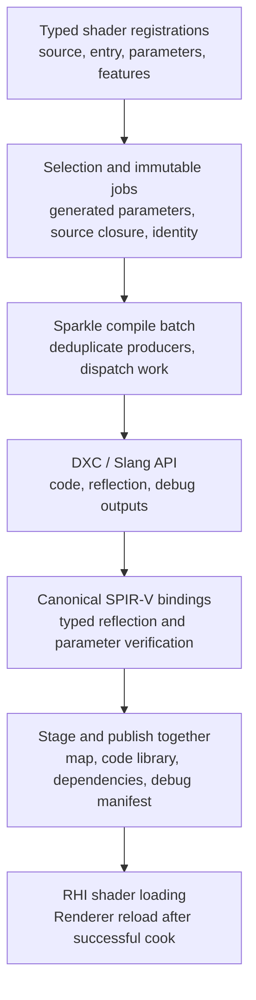
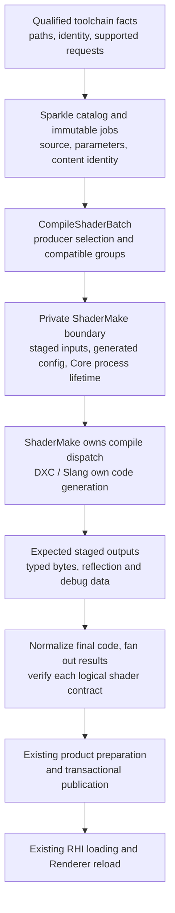

# ShaderMake integration study and implementation plan

[Third-party migration](../ThirdPartyMigration.md) | [Goals](../Goals.md) | [Rendering](../Rendering.md) | [References](../References.md) | [Engineering](../Engineering.md#module-boundaries)

**Status: plan prepared, 2026-11-21. Stages 0-5 are NOT STARTED.** Source research informs this proposal; no stage gate, prototype cook, production integration or retirement has passed. This plan does not adopt a dependency or change delivery priorities.

[Responsibility split](#high-level-responsibility-split-after-full-integration) | [Governing guides](#fit-with-the-project-and-your-development-goals) | [Target architecture](#target-architecture-and-structural-review) | [Stages and prompts](#implementation-stages-and-exits) | [Failure modes](#failure-modes-and-required-responses)

**Recommendation:** ShaderMake is compatible with the documented graphics systems and DevTech direction as a bounded support-code replacement. Trial it as the owner of offline compile batches and compiler invocation. Keep Sparkle's typed shader contracts, reflection validation, cooked publication and runtime reload. Adoption requires the [target architecture and structural review](#target-architecture-and-structural-review) as well as reflection/debug fit; compiling successfully alone is insufficient.

The intended user is a rendering developer who wants to spend less time maintaining compiler integration. The expected return is less compiler plumbing to maintain and an inspectable path for reproducing shader builds, leaving more effort for rendering, GPU kernels and measured results. This is conditional maintenance value; faster compilation, better images and new shader capabilities have not been established.

## High-level responsibility split after full integration

Sparkle already uses third-party shader compilers: Microsoft's **DXC** and **Slang** parse shader languages, optimize programs and generate GPU code. Sparkle does not implement those compiler algorithms. Its own `ShaderCompiler` executable prepares inputs, calls their APIs, extracts results and publishes engine assets.

**You would delegate the mechanics of running compilation and keep control of what gets compiled, how results are verified and how the engine uses them.** ShaderMake is NVIDIA DevTech's offline batch tool above DXC/Slang. The intended split is:

| Responsibility | Owner after integration |
| --- | --- |
| Execute compile batches, distribute compile work and invoke qualified DXC/Slang tools | **ShaderMake** |
| Expand configured permutations and translate supported common compiler options | **ShaderMake**, from Sparkle-generated configuration |
| Parse shader languages, optimize programs and generate DXIL/SPIR-V | **DXC / Slang**, as today |
| Decide required shaders, variants, targets and rendering features | **Sparkle** |
| Own authored shader algorithms, typed registration and generated parameter declarations | **Sparkle** |
| Select qualified compiler versions, engine-specific options and concurrency limits | **Sparkle** |
| Preserve virtual source paths, captured inputs, content identity and changed-source selection | **Sparkle** |
| Interpret reflection, normalize bindings and verify C++/shader layouts | **Sparkle**, using existing upstream reflection libraries |
| Assemble matching code, symbols, sources and diagnostics into debug bundles | **Sparkle**, consuming compiler-produced outputs |
| Publish complete cooked assets and preserve accepted output on failure | **Sparkle** |
| Load/reload shaders, create GPU pipelines and manage GPU resource lifetime | **Sparkle** |

`ShaderCompiler.exe` remains the engine's cooker. Its proposed workflow becomes:

**Sparkle plans work → ShaderMake runs DXC/Slang → Sparkle verifies → Sparkle publishes → Renderer loads/reloads.**

In practice, you still write and optimize shaders, investigate generated code, debug rendering and measure GPU behavior. The maintenance removed is compiler-session, generic invocation and compile-worker machinery. Source preprocessing is a separate decision; virtual mounts, dependency identity, reflection and publication do not transfer automatically.

This is the target ownership split. Exact reflection/debug-output fit and retirement of the superseded implementation must pass before it becomes the production architecture. The [replacement map](#what-would-be-replaced-in-this-repository) identifies the affected files; the [architecture section](#target-architecture-and-structural-review) defines the required boundaries and lifetimes.

### Terms

| Term | Meaning here |
| --- | --- |
| Compiler backend | DXC or Slang, selected today by `--backend dxc`, `slang` or `auto`. |
| Target | The output contract, such as `DxilSm66` or `SpirV16`. Vulkan uses SPIR-V; D3D12 uses DXIL. |
| Reflection | Compiler information about resource bindings, constant-buffer members, offsets and entry points. Sparkle translates it into its own contracts. |
| Permutation | A compilation with a particular set of defines/options. Different variants can share a source file. |
| Publication | Making a complete, validated shader asset generation available to readers. Successful individual compilations are only inputs to this step. |

ShaderMake supports configuration-driven permutations, bounded parallel compilation, raw binaries and optional headers/blobs, DXIL/SPIR-V output, explicit compiler paths and additional compiler flags. Its incremental logic tracks timestamps and build settings. These are upstream features; their compatibility and performance in Sparkle are unproved. See the [upstream README](https://github.com/NVIDIA-RTX/ShaderMake/blob/4f1ffd56dac27fc3d620ad7efeee42b4dd71fa72/README.md).

## Fit with the project and your development goals

**The nine governing guides support investigating this bounded delegation.** Their recurring requirement is to understand, own and prove the rendering result while keeping supporting systems small. Stage 0 must challenge the proposed shape against every guide below; fit is conditional on retiring local machinery without losing the information needed to explain executed shaders.

| Governing guide | How the proposed introduction supports it | Boundary the migration must preserve |
| --- | --- | --- |
| [Code style](../CodeStyle.md) | Keep changed C++20/shaders cohesive, readable and consistent with the actual owner. | Apply naming, logical paragraphs, meaningful locals, header/include rules and private SDK boundaries. Review responsibility before running the per-file checker; do not add forwarding wrappers to satisfy style rules. |
| [Engineering](../Engineering.md) | Move complete batch/invocation mechanisms upstream behind the existing offline tool boundary. | One compilation owner; narrow private adaptation; immutable inputs; settled processes; accepted-output preservation; qualified tools and offline delivery. Include all adapters/package costs and preserve the documented interruption/recovery limits. |
| [Goals: target persona and North Star](../Goals.md#target-persona) | Selecting and integrating an upstream tool can demonstrate technical direction, usable delivery and removal of unnecessary maintenance. | Keep fluency in HLSL/Slang, DXIL/SPIR-V, reflection, host/shader layout, explicit APIs and numerical/performance reasoning. Tool adoption alone does not verify these capabilities. |
| [README: documentation ownership](../README.md#guides) | Keep this active plan as the single implementation owner and route readers to existing subject guides. | Update current decisions instead of appending competing plans or duplicating stage history into the main guides. |
| [References: roles and production studies](../References.md#role-sources) | Graphics/DevTech and research-productization roles emphasize useful shaders, systems analysis, debugging and integration. Reproducible compiler invocations can support that work. | Study pinned producer/consumer code, not feature lists. Preserve source-to-executed-code correlation. The [archived compiler-engineer role](../References.md#employer-role-study) separately requires compiler internals/code-generation work; this integration supplies no such evidence. |
| [Rendering: features and source ownership](../Rendering.md#source-map) | A smaller compiler boundary can support the same authored passes, materials, research kernels and compile/reload workflows. | Keep RHI/frame-graph ownership, raw-lighting checks, production/Reference separation and the owned neural path. No estimator, rendering feature or target requirement is delegated to ShaderMake. |
| [Repository footprint](../RepositoryFootprint.md#shader-preprocessing) | Target an identified support mechanism with an honest complete-change ledger. | Frozen owner totals and the preprocessing gross scope are not current net savings. Count adapters, relocated code, scripts/build/package costs and overlapping C retirement once; peer ratios are not acceptance quotas. |
| [Roadmap](../Roadmap.md#supporting-system-simplification) | Keep the investigation useful to rendering/reproduction and coordinate overlapping task-runtime work. | Current rendering repairs and delivery order remain authoritative. This plan creates no new first-release prerequisite or new rendering/ML program. |
| [Third-party migration](../ThirdPartyMigration.md#requirements-for-adoption) | Apply exact-input adoption, complete retirement and dependency ownership rules. | Resolve pin eligibility, preserve supported workflows, remove superseded paths and separate bounded code completion from broader qualification. No authorization for a different unreleased library pin is implied. |

The role comparison uses the dated descriptions already archived in References. It does not reassess current vacancies, qualifications or employment history.

### Contribution to the three cases

ShaderMake belongs in the supporting workflow of the [existing cases](../Goals.md#the-three-cases). It needs no fourth headline case.

| Case | Useful contribution if the migration succeeds | Work and evidence you still provide |
| --- | --- | --- |
| **Content to correct pixel** | An identified path from shader sources and generated parameters to verified cooked code, with a reproducible failed/accepted cook. | Material interpretation, transforms, lighting mathematics, ABI agreement and checked raw pixels. A common compiler path for production and Reference is shared infrastructure, so independent analytic/external controls must still detect shared mistakes. |
| **One measured frame, two APIs** | Trace the actual DXIL/SPIR-V and symbols back to inputs; reproduce a shader issue or controlled code-generation experiment outside the renderer. | Matched D3D12/Vulkan execution, source/capture identity, shader/CPU/resource-lifetime studies and whole-frame measurements. DXIL/SPIR-V disassembly is not native GPU ISA, and offline compile time is separate from runtime PSO creation and frame time. |
| **Owned model to shader** | Compile the HLSL/Slang operators you implement through the same identified toolchain and inspect their outputs. | Owned data/model/training, checked operators, precision/layout/fusion/traffic choices and held-out GPU results under the [neural requirements](../Rendering.md#owned-neural-rendering). ShaderMake provides no training, inference runtime, automatic model conversion or guarantee of neural-instruction support. |

### Depth retained and evidence gained

You can delegate compiler invocation while continuing to learn shader optimization: choose a real kernel, predict an ALU/bandwidth/register or precision effect, inspect available code and counters, then test correct images/numerics and whole-frame cost. DXC/Slang and the driver still generate/optimize code; you own the hypothesis, shader, API use and conclusion. Modern language features require their own compiler/device checks.

The learning tradeoff is less routine exposure to in-process compiler API/session setup. Reflection and diagnostic interpretation remain. Parser design, IR passes, instruction selection and driver engineering are separate specialties; the current direct compiler adapters do not implement them either. If a real compiler defect appears, capture a minimal source/flags/toolchain reproduction and compare hypotheses; that is useful specialist collaboration without maintaining a compiler fork.

Retain one concise decision record with the retired mechanism, complete maintenance/cost comparison, reproducible failure and successful cook, and reviewer/reproduction feedback. Attribute ShaderMake/DXC/Slang upstream and Sparkle's integration/verification separately. A measured simplification or justified rejection supports the productization goal; adoption alone establishes neither independent transfer nor role seniority.

## Research basis and trust

Repository references below were inspected in the working checkout at `719f89ec1b52968abaa139b8b9b70867b90df254`, including existing uncommitted shader debug-publication changes. This is a source map, not a frozen executable baseline. Recheck changed owners before implementation.

The goals review used `References.md`, `Rendering.md`, `Engineering.md` and `Goals.md` from the working checkout at `58143b2a4fe5cff080377b1fc524454c534ade61` on 2026-11-21. The assessment above is a proposal checked against those guides, not implementation or qualification evidence. The guides remain the authority for requirements.

The staged-plan revision reviewed the nine governing guides at `293e2b209f215926eb952dcd277a95177368e831` and read the pinned integration sources listed in Stage 0. Those desk-research inputs do not close Stage 0: its complete live owner trace, design comparison, cost boundaries and recorded decision remain to be executed.

The inspected ShaderMake revision is [`4f1ffd56dac27fc3d620ad7efeee42b4dd71fa72`](https://github.com/NVIDIA-RTX/ShaderMake/commit/4f1ffd56dac27fc3d620ad7efeee42b4dd71fa72), committed 2026-11-11. GitHub's [tags](https://api.github.com/repos/NVIDIA-RTX/ShaderMake/tags) and [releases](https://api.github.com/repos/NVIDIA-RTX/ShaderMake/releases) endpoints returned empty lists during this study. This is an inspection reference, not an approved production pin; the existing dependency-adoption rules apply to an unreleased revision.

There is an actual integration precedent: [NVIDIA Donut's CMake](https://github.com/NVIDIA-RTX/Donut/blob/main/CMakeLists.txt) adds ShaderMake. That shows use in another graphics framework, not equivalence with Sparkle's contracts. There is no need to adopt Donut or NVRHI to use ShaderMake.

The inspected [CI workflow](https://github.com/NVIDIA-RTX/ShaderMake/blob/4f1ffd56dac27fc3d620ad7efeee42b4dd71fa72/.github/workflows/build.yml) defines Windows/Linux/macOS builds and a macOS Metal smoke check. It does not establish Sparkle's DXIL/SPIR-V, reflection, cancellation or debugger behavior. ShaderMake uses the [MIT license](https://github.com/NVIDIA-RTX/ShaderMake/blob/4f1ffd56dac27fc3d620ad7efeee42b4dd71fa72/LICENSE.txt), with a separate [argparse notice](https://github.com/NVIDIA-RTX/ShaderMake/blob/4f1ffd56dac27fc3d620ad7efeee42b4dd71fa72/ThirdPartyLicenses.txt). Compiler/runtime redistribution terms remain separate. Exact-pin advisory review and distribution qualification remain open.

## How the current pipeline works

The starting points are the [typed catalog builder](../../Tools/Shaders/ShaderCompiler/Private/Contracts/ShaderContractCatalogBuilder.cpp), [job builder](../../Tools/Shaders/ShaderCompiler/Private/Cooking/Planning/ShaderCompileJobBuilder.cpp), [compile batch](../../Tools/Shaders/ShaderCompiler/Private/Cooking/Compilation/ShaderCompileBatch.cpp) and [publication owner](../../Tools/Shaders/ShaderCompiler/Private/Cooking/Publication/ShaderArtifactPublication.cpp).



The CLI defaults to `DxilSm66` and `SpirV16`, `auto` backend selection and four parallel compiles. [Backend selection](../../Tools/Shaders/ShaderCompiler/Private/Backend/ShaderBackendFactory.cpp) chooses DXC for `.hlsl` and Slang for `.slang`, subject to target support. The advertised target set also includes DXIL SM 6.0 through 6.7 and SPIR-V 1.4/1.5/1.6; a migration must preserve the existing supported combinations and explicit rejection behavior.

Source preparation currently expands textual includes and injects generated parameter blocks into in-memory source. It maintains `/Engine`, `/Project` and optional `/Plugin/<name>` virtual identities. Jobs carry source/dependency/request hashes and backend identity. Compilation deduplicates only after checking input equality, then fans results back out to shader types. Reflection and debug artifacts are part of the result, not optional substitutes for bytecode.

The Launcher still invokes Sparkle's tool; Application owns the Editor operation, and Renderer reload follows successful completion. Those responsibilities have distinct lifetimes and remain useful after a compiler-invocation migration.

## What would be replaced in this repository

Paths in this table are relative to `Tools/Shaders/ShaderCompiler/Private/` unless linked elsewhere. **Replace** means a proposed retirement after demonstrated fit. **Adapt** means retained engine policy with a changed boundary. No row is an accepted saving yet.

| Current owner | Proposed result | Why / what remains |
| --- | --- | --- |
| [`Backend/Dxc/DxcShaderBackend.*`](../../Tools/Shaders/ShaderCompiler/Private/Backend/Dxc/DxcShaderBackend.cpp), [`DxcCompileArguments.*`](../../Tools/Shaders/ShaderCompiler/Private/Backend/Dxc/DxcCompileArguments.cpp) | **Replace invocation/session and generic argument machinery.** | ShaderMake calls DXC. Keep target/feature policy and result interpretation; debug/reflection extraction needs a proved file-output path first. The entire backend file is not automatically removable. |
| [`Backend/Slang/SlangShaderBackend.*`](../../Tools/Shaders/ShaderCompiler/Private/Backend/Slang/SlangShaderBackend.cpp) | **Replace compilation/session machinery if fit passes.** | ShaderMake calls `slangc`. Slang reflection, source capture and external symbol output are decisive gaps to resolve before claiming retirement. |
| [`Cooking/Compilation/ShaderCompileBatch.cpp`](../../Tools/Shaders/ShaderCompiler/Private/Cooking/Compilation/ShaderCompileBatch.cpp) | **Replace compile worker dispatch. Adapt producer/result mapping.** | Submit a real batch to ShaderMake. Preserve equality-checked deduplication, typed result association and progress. Never launch a multithreaded ShaderMake per existing worker. |
| [`ShaderCompileJobExecutor.*`](../../Tools/Shaders/ShaderCompiler/Private/Cooking/Compilation/ShaderCompileJobExecutor.cpp), [`Backend/IShaderBackend.*`](../../Tools/Shaders/ShaderCompiler/Private/Backend/IShaderBackend.h), factory/pool | **Retire the single-job compiler interface, executor and instance pool.** | Keep compiler selection/capabilities as explicit policy and immutable toolchain facts. Rework planner and CLI consumers; do not preserve compilation objects solely for discovery or wrap a batch tool behind `Compile(request)`. |
| [`Compiler/ShaderSourcePreprocessor.*`](../../Tools/Shaders/ShaderCompiler/Private/Compiler/ShaderSourcePreprocessor.cpp), [`ShaderIncludeResolver.*`](../../Tools/Shaders/ShaderCompiler/Private/Compiler/ShaderIncludeResolver.cpp) | **Separate conditional retirement.** | ShaderMake does not supply Sparkle virtual mounts or generated parameters. Its scanner is not a complete preprocessor. The existing compiler-preprocessing proposal C remains the bounded alternative. |
| [`Compiler/ShaderSourceMountTable.*`](../../Tools/Shaders/ShaderCompiler/Private/Compiler/ShaderSourceMountTable.cpp) | **Retain mount identity/admission.** | Case policy, traversal rejection, physical containment and authored virtual paths are engine requirements. Any disk-based compiler input must preserve them. |
| [`Planning/Identity`](../../Tools/Shaders/ShaderCompiler/Private/Cooking/Planning/Identity), [`Dependencies/ShaderDependencyManifest.*`](../../Tools/Shaders/ShaderCompiler/Private/Cooking/Planning/Dependencies/ShaderDependencyManifest.cpp) | **Retain content identity and changed-source selection; adapt dependencies if proved.** | ShaderMake timestamps/build signatures do not replace content-based identity, immutable input checks or Sparkle's dependency manifest. |
| [`DxilReflectionExtractor.*`](../../Tools/Shaders/ShaderCompiler/Private/Backend/Dxc/DxilReflectionExtractor.cpp), [`DxilLibraryReflectionExtractor.cpp`](../../Tools/Shaders/ShaderCompiler/Private/Backend/Dxc/DxilLibraryReflectionExtractor.cpp), [`SlangReflectionExtractor.*`](../../Tools/Shaders/ShaderCompiler/Private/Backend/Slang/SlangReflectionExtractor.cpp) | **Retain semantic translation; adapt input.** | Current DXIL/Slang extraction consumes in-process compiler objects. A raw binary alone is not proof that all required metadata survives. |
| [`Compiler/SpirV`](../../Tools/Shaders/ShaderCompiler/Private/Compiler/SpirV), [`Verification/ShaderParameterStructVerifier.*`](../../Tools/Shaders/ShaderCompiler/Private/Verification/ShaderParameterStructVerifier.cpp) | **Retain.** | Canonical bindings, buffer layout, resource meaning and host/shader ABI must still agree. SPIRV-Reflect and SPIRV-Tools already provide upstream mechanisms here. |
| [`Contracts`](../../Tools/Shaders/ShaderCompiler/Private/Contracts), [`Cooking/Planning`](../../Tools/Shaders/ShaderCompiler/Private/Cooking/Planning) | **Retain domain catalog/planning; adapt requests.** | C++ registrations stay the authority for shader identity, parameters and features. Generate ShaderMake config; do not maintain a second authored shader list. |
| [`Cooking/Publication`](../../Tools/Shaders/ShaderCompiler/Private/Cooking/Publication), [`Analysis`](../../Tools/Shaders/ShaderCompiler/Private/Analysis), [`Cli`](../../Tools/Shaders/ShaderCompiler/Private/Cli) | **Retain product contracts; adapt compiler provenance.** | Keep inspection, statistics, CLI behavior, accepted-output protection and complete debug bundles. ShaderMake output is staging input, not a published Sparkle asset. |
| [RHI shader storage/loading](../../Engine/RHI/Private/Shaders), [Editor compile operation](../../Engine/Application/Private/Editor/Shaders/EditorShaderCompileOperation.cpp), [Launcher cook requests](../../Tools/Launcher/SparkleLauncher/Private/Cook/CookOperationProcessRequests.cpp) | **Retain consumers and workflows.** | Keep `GlobalShaderMap.smap`, `CookedShaderLibrary.slib`, typed lookup and successful-cook reload. No ShaderMake dependency belongs in runtime RHI/Renderer. |

The current catalogue's **0 / 0 (protected/study)** records no established retirement credit. It does not mean no batching/invocation code could move upstream. The existing **C** preprocessing scope overlaps this investigation; count any eventual retirement once. Measure the entire connected change, including generated-input support, sidecar readers, process handling, CMake and packaging, before claiming net simplification.

## What would change for you, and what it costs

These are proposed workflow outcomes, not delivered features. The benefit depends on removing the local mechanisms in the replacement map above.

| Workflow | Proposed change and practical value | Limit |
| --- | --- | --- |
| Maintain or update compiler integration | Upstream owns generic invocation and compile dispatch; Sparkle maps engine policy into generated config and ingests verified results. | Qualified DXC/Slang upgrades, metadata changes and engine-specific flags remain your decisions. The adapter must be smaller than the machinery retired. |
| Add or edit a shader | Keep typed registration as the authority and generate batch inputs from it; use upstream batch/permutation facilities where required. | No second authored shader catalogue or language migration. ShaderMake cannot decide which rendering variants are correct or necessary. |
| Diagnose a compile or shader failure | Capture exact inputs, arguments and tools for an external reproduction, while preserving current reflection/debug inspection. | Sparkle already exports debug artifacts; this is a possible simplification of reproduction, not a newly established debugger capability. Symbols/source correlation must pass first. |
| Cook and reload during rendering work | Keep Launcher Cook and Editor Recompile Shaders / `CompileShaders [symbols]`, with verified results published before reload. | No automatic watcher or completed Apply Changed feature. Initial forced compilation of selected jobs claims no incremental speedup; process startup can add cost. |
| Compare generated code or compiler settings | Use an isolated, identified batch for a controlled experiment on owned shaders, retaining correctness and profiling controls. | Generated-code quality comes from compiler/driver behavior and your shader choices. ShaderMake does not imply faster kernels or higher FPS. |
| Run or distribute the project | End users continue to load prebuilt cooked shaders offline. Development tools carry the explicitly inventoried compiler toolset. | No runtime dependency on ShaderMake in RHI/Renderer, no unattended downloads, and no expansion to DXBC, Metal or other platforms. |

Donut remains a useful integration precedent. Its asset/runtime contracts do not transfer automatically to Sparkle.

| Cost or disadvantage | Implication for Sparkle |
| --- | --- |
| Another executable and configuration boundary | Requires staging, result association, process-tree settlement, logs, build inputs, notices and offline delivery. This can outweigh retired code. |
| External compiler startup | The inspected path uses subprocesses rather than Sparkle's API sessions. Small/incremental cooks may get slower; do not assume multithreading is a speedup. |
| Reflection is not a complete Sparkle output | Sidecars/container reflection must replace the current result-object path without losing members, library exports or resource meaning. |
| Debug output differs by compiler | Upstream's documented Slang path lacks separate PDB output. Embedded debug information does not satisfy the existing external symbol contract. |
| Filesystem input replaces in-memory input | Generated parameters, virtual paths, immutable snapshots and original-source correlation need a deliberate design. |
| Two possible incremental authorities | Keep Sparkle's job selection/content identity authoritative initially. Avoid a second cache deciding whether required work can be skipped. |
| Maintenance shifts rather than disappears | You still choose qualified tools, investigate regressions and validate ABI/output. An upstream fork carrying Sparkle's compiler framework would defeat the purpose. |

## Decisive compatibility questions

These are source-based concerns and proposed checks, not observed prototype failures. Relevant upstream implementation is in [`ShaderMake.cpp`](https://github.com/NVIDIA-RTX/ShaderMake/blob/4f1ffd56dac27fc3d620ad7efeee42b4dd71fa72/ShaderMake/ShaderMake.cpp), particularly `ExeCompile`, `GetHierarchicalUpdateTime`, `SignalHandler` and `main`.

### Reflection and final bytecode

The current DXC path takes reflection from `IDxcResult`, including separate reflection while runtime DXIL is stripped. Slang consumes `ProgramLayout` for DXIL and SPIR-V reflection for its SPIR-V path. ShaderMake raw output does not recreate those objects.

Prove compiler-generated reflection sidecars or container extraction with the exact qualified tools. Compare buffer members/offsets/sizes, resource kinds/counts, vertex inputs, compute group sizes, push constants and ray-library exports. If this needs a second full compilation through the old backend, it fails the proposed ownership transfer. Reusing compiler APIs to read metadata is compatible with retiring their compilation path.

Keep Sparkle's name-based SPIR-V binding normalization. Generic register-class shifts are not its canonical global assignment. Reflect and hash the final normalized bytecode, and ensure debug/exported code matches the bytes actually published.

### Exact sources, virtual paths and preprocessing

The inspected ShaderMake dependency scanner uses regex matching and timestamps. It is not a compiler preprocessor and does not establish correct conditional/macro include semantics. `--force` bypasses skip decisions; it does not bypass dependency scanning or supply a virtual filesystem.

The smallest first experiment can materialize the already prepared `ShaderCompileRequest::SourceCode` in isolated staging, retaining its virtual `#line` directives. That tests invocation without prematurely claiming preprocessing retirement. Prove original source availability to both compilers/debuggers; line directives alone do not embed source bytes. Also test whether the scanner reads include-like text that survives inside comments or disabled branches of prepared input.

If source preparation moves upstream later, compilers must own preprocessing while Sparkle retains mount admission, generated parameter declarations and captured dependency identity. Probe conditional/macro includes, repeated/guarded includes, cycles, case collisions, traversal, project/plugin roots and source changes during job construction. Do not build a second general preprocessor to make ShaderMake fit.

### Symbols, provenance and compiler identity

The existing [debug result](../../Tools/Shaders/ShaderCompiler/Private/Compiler/Output/ShaderDebugArtifactSet.h) includes arguments, diagnostics, disassembly, preprocessed source, symbols, symbol name and compiler lookup key. A `--PDB` switch alone does not prove this contract. Upstream explicitly documents that Slang separate PDB output is unsupported. Full DXIL PDB and SPIR-V source/line correlation must be checked separately for each supported backend path.

[ShaderDebugArtifactWriter](../../Tools/Shaders/ShaderCompiler/Private/Cooking/Publication/ShaderDebugArtifactWriter.cpp) currently records compiler DLLs loaded in the Sparkle process. After external compilation, those modules can differ from the ones loaded by `dxc.exe` or `slangc.exe`. Record the actual qualified subprocess toolchain and inputs; hashing a parent-process DLL is insufficient provenance. Include ShaderMake identity and effective invocation settings in job identity so transport/option changes invalidate old results. Keep `dxc`/`slang` as compiler identities, rather than pretending ShaderMake is a third code generator.

GPU-crash mode has [identity-bound compiler inputs](../../CMake/Dependencies/GpuCrashInputs.json), including a patched Slang build. Do not accept ShaderMake's automatic downloads as interchangeable with those tools. Missing symbol/source support blocks a complete migration; do not silently disable a diagnostic workflow.

### Target flags and shader libraries

Match strictness, HLSL 2021, optimization, warnings, debug stripping, layout, storage-image policy and feature extensions. The inspected upstream invocation automatically adds `-enable-16bit-types` for DXC SM 6.2+, unlike Sparkle's current argument builder. Treat that as a potential ABI/behavior change and resolve it before comparison. Slang matrix defaults also need explicit agreement.

Ray tracing is an early test, not a final corner case. Sparkle uses DXC `-exports` for selected library entry points; upstream's DXC construction supplies `-E`, and its Slang library path omits `-entry`. Prove the intended export/entry behavior through supported configuration or a small upstreamable correction. Also retain today's capability-based rejections, including the Slang backend's narrower advertised DXIL ray support.

### Concurrency, cancellation and publication

Use one ShaderMake batch at a time initially and pass the existing `--parallel-compiles` allowance as `--jobs`. Group jobs by platform and compatible global options/compiler selection; run groups sequentially until a measured need justifies sharing a bounded allowance. Do not multiply the batch limit by the number of outer workers.

Coordinate this boundary with the [task-runtime migration](TaskRuntime.md): ShaderMake would own only shader compilation dispatch. Avoid converting the retiring compile dispatcher into a new task-runtime adapter first, and count its retirement once. Other tool and application execution remains with its existing owner.

Use Core's existing [child-process owner](../../Engine/Core/Public/Process/ChildProcess.h) for cancellation/logging and verify that descendants settle. Upstream's signal handler alone does not prove process-tree cancellation during an active compiler call. Preserve meaningful producer/verification progress through the existing tool progress contract; avoid a fragile dependency on colored console text. If structured per-job progress requires a change, keep it bounded and upstreamable.

ShaderMake writes only into invocation staging. On compilation, metadata, verification or cancellation failure, keep accepted products untouched. Only the existing publisher may replace the validated map/library/dependency/debug set. Keep readers and worker-owned storage alive until all access has settled.

## Target architecture and structural review

This is the proposed end state for Stage 0 to evaluate and refine. Once Stage 0 records its design decision, that shape governs the fit trial and conversion. Follow [module ownership](../Engineering.md#module-boundaries), [data/lifetime rules](../Engineering.md#data-and-lifetime) and [code structure](../CodeStyle.md#c-structure). Review the complete planning-to-publication path, its CLI/host callers and build/package membership. The integration is incomplete while old compilation owners survive behind new wrappers.



### Owners, authority and lifetime

| Owner | Authority and lifetime | Boundary |
| --- | --- | --- |
| `CookGlobalShaders` | Composes toolchain resolution, planning, batch compilation, product preparation and publication for one cook. | Keep intent/order visible. Config grammar, subprocess details, metadata decoding and binding algorithms belong to their capability owners. |
| Toolchain resolution and planning | Resolve qualified tool paths/identity once for the invocation; build immutable jobs from the existing typed catalog, source snapshot and policy. | Planning consumes facts, not live compiler sessions. Config and command lines derive from the same effective options used for job identity; do not maintain a second option model/hash. |
| `ShaderCompileBatch` | Owns equality-checked producer selection, bounded compatible groups and mapping results to logical jobs. | ShaderMake owns compile-worker dispatch. Per-shader `dxc`/`slang` choice remains policy; serial mode uses the same production mechanism with one job allowed. |
| Private ShaderMake execution boundary | Owns invocation staging, generated config, expected-output associations and child-process settlement until ingestion completes. | Reuse Core process/filesystem mechanisms. Its output destination is staging only; final publication paths do not belong in its interface. |
| Format extraction and typed verification | Convert compiler output into existing neutral values, normalize SPIR-V, hash final code and verify every consuming shader contract. | No subprocesses or publication here. A shared producer does not excuse skipping a consumer's typed parameter check. |
| Product preparation and publication | Own cooked product association, complete/partial catalog policy, staged validation and accepted-output replacement. | Consume typed results after compile work settles; keep rollback and reader lifetime with existing owners. |
| Launcher, Application and Renderer/RHI | Keep tool selection/status, host operation lifetime and successful-cook runtime consumption with their existing owners. | No ShaderMake config, filenames, sidecar schema or compiler process policy in runtime modules. |

The [current planner](../../Tools/Shaders/ShaderCompiler/Private/Cooking/Planning/ShaderCookPlanBuilder.cpp) and [job builder](../../Tools/Shaders/ShaderCompiler/Private/Cooking/Planning/ShaderCompileJobBuilder.cpp) receive `ShaderBackendPool`, and job construction acquires `IShaderBackend` for identity. Replace that dependency with invocation-owned toolchain facts. Retire `IShaderBackend`, `ShaderBackendPool`, compiler creation/session code and `ShaderCompileJobExecutor` after their consumers convert. Retain capability/selection logic as focused functions/values with filenames that describe the remaining policy.

Keep one authoritative input snapshot and one result representation per lifetime. Borrow immutable jobs while the batch is alive; materialize required compiler inputs once per producer and move output bytes into owned results. Results retain no borrowed staging storage or live process handles; capture required source/debug bytes before staging retires. Audit whether `CompiledShader` still has a role after direct API compilation retires; remove it if it only transfers the same fields into `ShaderCompileResult`/`CookedStageBuild`. Preserve necessary typed reflection/debug values and deliberate multi-consumer fan-out; moving or renaming them earns no simplification credit.

### File and dependency shape

Keep `ShaderCompiler.exe` as the CLI/cooker and `CompileShaderBatch` as the private domain operation. The proposed placement below describes responsibilities, not a requirement to add a class or file for each workflow step:

| Private location | Final responsibility |
| --- | --- |
| `Cooking/GlobalShaderCooker.*`, `Cooking/Planning/` | Cook composition and immutable domain planning. No live backend pool. |
| `Cooking/Compilation/ShaderCompileBatch.*` | Producer/group orchestration and logical result mapping. Replace its current task graph. |
| `Cooking/Compilation/ShaderMake/ShaderMakeBatch.*` | Cohesive config/input/process/output boundary. Split config emission or output ingestion only when substantial independent logic warrants it. |
| `Compiler/Dxil/`, existing `Compiler/SpirV/` | Format-specific reflection/disassembly and binding operations. Relocate retained DXIL readers from `Backend/Dxc` when compilation retires. |
| `Compiler/Slang/`, only if needed | Retained Slang-specific metadata translation if the proved output path requires it. Do not keep a compiler session or add an empty abstraction for symmetry. |
| Existing `Compiler/Output/`, `Verification/`, `Cooking/Publication/` | Neutral output values, typed invariants and cooked asset publication, respectively. |

No new public module, compiler service, generic plugin interface or forwarding facade is justified. Keep compiler SDK types in private extraction code; runtime contracts remain independent of SDK headers and ShaderMake. Apply naming, includes and generated CMake membership to the final responsibilities, deleting obsolete files/targets rather than leaving an old folder shape underneath a new call.

### Integration policy

Generate configuration from selected typed jobs. Maintain only an invocation-local association from producers to collision-free expected outputs, including repeated basenames, entries and targets. Read only current-invocation expected files; reject missing, empty, duplicate or mismatched output. Do not reconstruct success by scanning a directory or parsing colored console output, and do not add a persistent job-status mirror.

Start with raw binary output (`--binary`), forced work for Sparkle-selected jobs (`--force`), disabled generic shifts (`--noRegShifts`) and explicit compiler paths. Do not use ShaderMake's runtime blob format: Sparkle already owns its code library and typed map. Keeping both formats would add another reader and publication contract.

Use one production compile route after cutover. Existing backend choices select code generators through ShaderMake; they do not select old versus new invocation implementations. Keep baseline executables only in ignored comparison output. A ShaderMake failure reports failure and preserves accepted assets. Retaining direct compilation as a fallback, recompiling through it for missing metadata, or adding a permanent implementation-selection flag blocks this migration's completion. A small upstream fix can be evaluated; a local compiler framework inside a fork fails the ownership-transfer goal.

At integration, add a dependency recipe under `CMake/Dependencies/Targets/` using the existing verified source-cache workflow. Gate acquisition/building on `SPARKLE_ENABLE_SHADER_COMPILER`; disable ShaderMake compiler discovery/downloads (`SHADERMAKE_FIND_COMPILERS=OFF`) and supply the qualified SDK tools. The upstream [CMake options](https://github.com/NVIDIA-RTX/ShaderMake/blob/4f1ffd56dac27fc3d620ad7efeee42b4dd71fa72/CMakeLists.txt) support this separation.

Update [ShaderCompiler CMake](../../Tools/Shaders/ShaderCompiler/CMakeLists.txt), its [SDK discovery](../../Tools/Shaders/ShaderCompiler/CMake/ShaderCompilerSdks.cmake) and [runtime staging](../../Tools/Shaders/ShaderCompiler/CMake/ShaderCompilerRuntime.cmake), [Launcher SDK admission](../../Tools/Launcher/SparkleLauncher/Private/Build/Toolchains/ShaderCompilerSdkDiscovery.cpp), notices and source/prebuilt package inventories together. Current SDK admission lists DLL/API inputs, not a complete external compiler toolset. Inventory the required executables and their actual runtime dependencies. Remove API imports only after remaining reflection/disassembly users are accounted for. Render-only products need no ShaderMake runtime dependency.

### Structural review exit

Before claiming code completion, review the connected final diff against the owner table and verify:

- The call path reads as planning, compilation, product preparation and publication; each mechanism has one actual owner. The ShaderMake boundary has not absorbed catalog policy, binding semantics, verification or publication.
- Every old compiler factory/pool/interface and task-dispatch caller is converted or retired, including `list-backends` and identity discovery. No forwarding aliases, fallback compilation route or duplicate cache/options/status authority remains.
- Source snapshots, borrowed jobs, staged files, child processes and result bytes have explicit lifetimes through success, partial failure and cancellation. Final published code, reflection and debug identity agree.
- File names, includes, target dependencies, feature-disabled builds and package inventories match the final ownership. Check regenerated source membership; an include-boundary scan alone cannot prove architectural quality.
- Focused normal/failure/lifetime checks pass, and the complete maintenance ledger shows what retired, what remained and what adaptation was added. Fewer lines cannot excuse a second framework or weaker rendering contracts.

Run the existing applicable architecture/style checks during implementation and inspect the actual domain boundaries manually. Fix architectural findings before handoff. Unrun GUI/GPU/package qualification remains separate and explicit; this source study certifies no implemented architecture.

## Implementation stages and exits

### Execution rules and stage state

Run stages in order through Stage 3. **Stage 0 is research/design only and must pass before any prototype or production implementation.** Stage 1 is an isolated fit trial, not adoption. Stage 2 converts the actual owner; Stage 3 is the bounded code-completion exit. Stage 4 records broader product qualification separately. Stage 5 can close code after Stage 3 while transferring unrun Stage 4 work to its existing qualification owner, following [code delivery and qualification](../ThirdPartyMigration.md#code-delivery-and-qualification).

Start each stage with live status/revision, applicable `AGENTS.md` instructions if present, the nine governing guides and this plan. Preserve concurrent edits. Bind evidence to relevant per-file hashes, tools and products; do not restart unrelated passed work just because HEAD changes. Wait for another session using the same build output instead of starting a competing build or cancelling its work.

Keep raw source traces, commands, results and measurements in ignored `build/validation/shadermake/stage-N/`. Record the exact temporary probe paths and remove test-only source/executables/build trees before handoff; retain useful reports and existing repository validation. Do not add a permanent test framework or project-wide policy scanner.

After every stage, update the row below and the relevant design text **before handoff**. Record candidate/scope, passed and missing criteria, verdict, command/artifact references, evidence invalidation triggers, remaining work and exact next action. Use `NOT STARTED`, `IN PROGRESS`, `PASS`, `BLOCKED` or `NO-GO`; individual unrun qualification cells stay `UNVERIFIED`, uncertain comparisons `INCONCLUSIVE`, and waivers require explicit authorization. A blocked row names the failed/missing cell and next discriminating action. A design NO-GO closes the investigation without enabling later implementation prompts.

| Stage | State | Required predecessor / exit | Evidence / next action |
| --- | --- | --- | --- |
| [0: deep dive and design](#stage-0-deep-dive-and-integration-design) | NOT STARTED | No predecessor; documented design decision permits isolated trial. | None. Next: execute Stage 0 only. |
| [1: isolated fit](#stage-1-isolated-fit-and-baseline) | NOT STARTED | Stage 0 PASS; prove decisive compiler/output/lifetime fit. | None; gated by Stage 0. |
| [2: production conversion](#stage-2-production-boundary-and-retirement) | NOT STARTED | Stage 1 PASS and eligible pin; one production compile owner. | None; gated by Stage 1. |
| [3: code acceptance](#stage-3-caller-build-and-code-acceptance) | NOT STARTED | Stage 2 PASS; structural/build/focused behavior exit. | None; gated by Stage 2. |
| [4: product qualification](#stage-4-product-qualification-and-cost) | NOT STARTED | Stage 3 PASS; report each exercised/unrun product cell. | None; separate from code completion. |
| [5: handoff and closure](#stage-5-handoff-and-plan-closure) | NOT STARTED | Stage 3 PASS plus Stage 4 results/transfer, or documented Stage 0/1 NO-GO closure. | None; no release claim follows automatically. |

### Positive and negative guidelines

These apply to every stage alongside its specific instructions.

| Do | Avoid |
| --- | --- |
| Trace a real producer, consumer, invariant, lifetime and failure before choosing an abstraction. | Copying a sample framework, adding a compiler service bag, or forcing the existing single-job interface around a batch tool. |
| Derive config, arguments and identity from the same admitted inputs; retain one domain authority. | Duplicate authored shader lists, option/hash models, timestamp caches, status mirrors or a renamed local dispatcher. |
| Reuse Core process/publication and existing reflection mechanisms with explicit private dependencies. | Moving process policy into Renderer/Editor, exposing SDK types in runtime contracts, or implementing a second publisher. |
| Keep orchestration readable, meaningful locals/paragraphs, cohesive files and purpose-based names under CodeStyle. | Mechanical function/file splitting, forwarding-only classes, generic helper folders or weakening checks to meet a line target. |
| Compare like-for-like inputs and identify compiler/flag differences before interpreting outputs. | Attributing compiler upgrades to ShaderMake, accepting visual differences because both paths compile, or equating DXIL/SPIR-V with native ISA. |
| Remove superseded code with converted callers and report the entire added/retained surface. | Production fallback compilers, hidden feature cuts, permanent implementation switches or counting relocated/overlapping code as savings. |
| Run the smallest check that can falsify the stage's claim, then update current plan state. | Repeated full campaigns without changed inputs, new infrastructure for hypothetical cases, or promoting source/build checks to GPU/package/release proof. |

### Stage 0: deep dive and integration design

**Purpose:** decide the best integration shape for Sparkle's graphics systems/DevTech target before implementation. Study the existing integrations deeply enough to explain why their choices do or do not fit Sparkle. The architecture above is a proposal to challenge, not a predetermined answer.

**Required investigation:**

1. **Translate all nine guides into decisions.** Use the governing table to connect each rule to an owner/interface choice, a prohibited outcome and a check. Select one existing rendering case as the concrete consumer: identify its shaders, runtime lookup, debug/reproduction path and intended maintenance benefit. Preserve the other two cases without inventing new model/rendering work.
2. **Trace the entire live Sparkle path.** Follow typed registration/object-target membership, selection, source/parameter preparation, hash/dedup, compiler selection/session construction, flags, reflection/binding normalization, debug capture, verification, publication, CLI/Launcher/Editor operation lifetime and runtime reload. Inspect `CookGlobalShaders`, plan/job builders, `ShaderCompileBatch`, factory/pool, both backends, debug writer, RHI consumers and CMake/package admission. Record owners, input/output types, mutable state, copies, failure boundaries, supported/rejected target combinations and existing failing cases. In particular, identify the planner's live-backend dependency and parent-process compiler-DLL provenance assumptions.
3. **Trace upstream production and consumption.** Read the pinned source families below, including actual compiler options/configs, output readers, error handling and deployment. Record each dependency's own ShaderMake/compiler pin; these precedents do not necessarily use the candidate revision. Donut and RTXPT share a stack and are not independent corroboration. Include NRD's different output model and the current direct compiler API path as contrasts.

| Pinned source family | Trace and observed starting point | Sparkle decision to extract |
| --- | --- | --- |
| Donut `52efbe37d7f550ea1c5c7ee02b75404ec7c72c09`: [batch CMake](https://github.com/NVIDIA-RTX/Donut/blob/52efbe37d7f550ea1c5c7ee02b75404ec7c72c09/compileshaders.cmake), [runtime ShaderFactory](https://github.com/NVIDIA-RTX/Donut/blob/52efbe37d7f550ea1c5c7ee02b75404ec7c72c09/src/engine/ShaderFactory.cpp) | Follow config/options into per-platform commands and outputs, then blob permutation lookup into native shader creation. Its normal binary mode uses ShaderMake blobs. | Reuse explicit batch/compiler separation. Explain why Sparkle keeps raw staged binaries, its typed map/library and its cook-command publication boundary instead of importing the blob reader or build-triggered output model. |
| RTXPT `303b408ab81790a5051abd7573830b7a4112eb8e`: [shader build and tool deployment](https://github.com/NVIDIA-RTX/RTXPT/blob/303b408ab81790a5051abd7573830b7a4112eb8e/Rtxpt/CMakeLists.txt), [shader config](https://github.com/NVIDIA-RTX/RTXPT/blob/303b408ab81790a5051abd7573830b7a4112eb8e/Rtxpt/shaders.cfg) | Trace Donut invocation, stage/define variants, embedded-symbol options and compiler/source copying for dynamic compilation. The source explicitly protects combined options from being dropped. | Derive flag-preservation and tool-staleness checks. Do not copy its shader-model, embedded-debug or runtime recompilation policy as Sparkle defaults. Follow the downstream consumer, not just the CMake call. |
| NRD `e06852bd545973cb224eb28820b891205cfc1624`: [shader target/dependency configuration](https://github.com/NVIDIA-RTX/NRD/blob/e06852bd545973cb224eb28820b891205cfc1624/CMakeLists.txt), [permutation config](https://github.com/NVIDIA-RTX/NRD/blob/e06852bd545973cb224eb28820b891205cfc1624/Shaders/Shaders.cfg) | Follow its pinned ShaderMake acquisition, per-platform commands, generated header blobs, reflection stripping and register shifts into the embedded-shader consumer. | Distinguish a library's fixed embedded layout from Sparkle's dynamic typed catalog, canonical bindings and runtime asset publication. That integration does not establish Sparkle reflection/debug fit. |
| ShaderMake `4f1ffd56dac27fc3d620ad7efeee42b4dd71fa72`: [implementation](https://github.com/NVIDIA-RTX/ShaderMake/blob/4f1ffd56dac27fc3d620ad7efeee42b4dd71fa72/ShaderMake/ShaderMake.cpp), [build](https://github.com/NVIDIA-RTX/ShaderMake/blob/4f1ffd56dac27fc3d620ad7efeee42b4dd71fa72/CMakeLists.txt), plus DXC/Slang API guides linked below | Trace effective command construction, scanner/build signatures, worker bounds, retries, signals, outputs and debug restrictions; contrast with direct API result access. | Separate upstream guarantees, Sparkle policy, observed limitations and unknowns requiring a Stage 1 probe. Resolve the documented Slang symbol gap and flag/library concerns explicitly. |

4. **Compare shapes, not just libraries.** Evaluate the alternatives below against the same consumer: retain direct APIs and reuse compiler preprocessing; use ShaderMake batches over sealed prepared inputs; use ShaderMake with compiler-owned include/filesystem preparation; or reject the migration. Compare semantic ownership, interface/state/copy surface, exact metadata/debug access, cancellation, publication, offline delivery and total integration cost. Document what is adopted/adapted/rejected from each precedent and why. Separate the optional preprocessing C retirement from the batch decision; do not rebuild a parser or switch both authorities casually.
5. **Resolve the boundary design.** Specify the toolchain facts consumed by planning, single effective-option identity, prepared-source/original-source capture, config/output naming, producer equality/fan-out, exact reflection/symbol/lookup-key acquisition without legacy recompilation, final SPIR-V normalization/hash order, concurrency/cancellation/progress ownership, staged-result lifetime, publication/recovery and feature-gated distribution. Map each unknown to one discriminating Stage 1 check and an owner. Required outputs need a credible supported acquisition path, not an unexplained adapter box.
6. **Freeze scope, comparisons and retirement.** Record the proposed file/interface/dependency shape and exact obsolete callers/files/targets; preserve real domain/ABI/lifetime contracts. Define code versus physical-line units, the connected before/after scope and C overlap, compiler/flag-equal comparison workloads and numerical cost review limits before measurement. Include full/selected cook time, cancellation, build/startup, peak memory and tool/package growth where affected. This does not require a full cold/performance campaign before a fit prototype. The aim is fewer maintained mechanisms and positive net retirement; do not invent savings from frozen owner totals.
7. **Challenge the design and decide.** Review failure modes below against each boundary and compare the proposal with the simpler direct-API alternative. Record a concise decision, rejected alternative, remaining hypotheses and exact next action. If another reviewer participates, identify that review honestly; self-review is not independent validation.

**Positive guidance:** use exact source links and real call/data flow; optimize for a compact rendering/evidence platform, useful shader debugging and fewer owned mechanisms. Revise the existing architecture/replacement sections when findings change them.

**Negative guidance:** no prototype, engine/dependency/build/package changes, broad benchmarks, invented savings or new rendering features in this stage. Do not justify a design by vendor branding, peer file ratios or a sample's default flags. Do not mark the stage passed with unresolved ownership or an unexplained metadata/symbol path.

**Acceptance criteria:**

- **S0-A:** all nine guide implications and the concrete rendering consumer are recorded; delivery order and retained graphics ownership remain intact.
- **S0-B:** the live producer-to-consumer map and pinned Donut/RTXPT/NRD traces identify output readers, option/tool identities and adopt/adapt/reject decisions.
- **S0-C:** one justified target shape and its simpler alternative are compared; data/authority/lifetime, file/build/package placement and named retirements are explicit.
- **S0-D:** every decisive fit unknown has a credible output path and a specific Stage 1 check; failure modes and comparison/cost boundaries are fixed before implementation.
- **S0-E:** the plan records PASS with a GO decision for the isolated trial, or BLOCKED/NO-GO with the missing fact/reason and next action. No production-adoption or runtime claim follows from research.

**Failure/stop conditions:** unsupported required debug/reflection acquisition, a necessary second compiler owner, major fork, unclear source identity or no plausible complete retirement. Resolve the design or record NO-GO; do not move those questions into production glue.

**Copy-ready prompt:**

```text
Work in C:\Users\stole\Documents\GitHub\SparkleEngine. Execute only Stage 0 of Docs/Implementation/ShaderMake.md. Read its execution rules, all nine governing guides and applicable AGENTS.md instructions. This is research/design and documentation only: do not prototype, build, add dependencies or change production code.

Deeply trace the live shader pipeline from typed registration through planning, DXC/Slang, reflection/debug capture, publication and Launcher/Editor/runtime consumers. Read the pinned Donut, RTXPT, NRD and ShaderMake source families in Stage 0, following each output into its actual consumer. Record exact dependency/tool pins and distinguish source guarantees from untested assumptions.

Compare integration shapes against the graphics systems/DevTech goals, complete maintenance cost and simpler compiler-preprocessing reuse. Explain which upstream practices to adopt, adapt or reject. Resolve ownership, interfaces, effective options/identity, input snapshots, metadata/symbol acquisition, process lifetime, publication, files/build/package boundaries and exact retirements. Map remaining empirical questions to focused Stage 1 checks; define comparison scope and cost limits before measurement.

Revise the existing plan sections around the chosen shape. Apply S0-A through S0-E and record PASS, BLOCKED or NO-GO honestly. Before handoff update the stage row with candidate/scope, evidence, passed/missing criteria, invalidation triggers, remaining work and exact next action; reconcile affected dependency/roadmap pointers only if their state changed. Do not start Stage 1 in this turn.
```

### Stage 1: isolated fit and baseline

**Entry:** Stage 0 PASS. Acquire/build the studied candidate only in isolated ignored output with automatic compiler downloads disabled; use identified qualified compilers. This research does not grant production-pin eligibility.

**Work:** freeze matching baseline source/tool/option identities and accepted artifact hashes. Probe real compute, raster and ray-library jobs with generated parameters, both default targets and currently supported Slang cases. Obtain all metadata/debug outputs from the candidate route, normalize final SPIR-V and compare typed results. Exercise source/case/include/flag risks, equivalent-input dedup, one-job/bounded-parallel execution and active-child cancellation. Record pre-existing failures separately. Full performance qualification is not a prerequisite.

**Do:** test the hardest reflection/symbol/library/source questions first; keep exact replay commands and final-code hashes. **Avoid:** production switches, accepted-output mutation, building a permanent adapter, hiding a failing baseline, or recompiling through the old backend to fill candidate metadata gaps.

**Acceptance:** **S1-A** every required output/capability path has executable evidence or its existing supported rejection; **S1-B** canonical layout/bindings, code/debug/source identity and options agree within the frozen contract; explain any changed binary bytes rather than assuming semantic equivalence; **S1-C** bounded execution and cancellation settle before input/staging destruction; **S1-D** repair/retry and failure preservation pass, probe code is removed, and a specific GO/BLOCKED/NO-GO decision updates the design. Missing mandatory fit blocks Stage 2.

**Failure focus:** F01-F08 below. An unresolved compiler regression, symbol gap or need for a substantial fork is a fit failure, not permission to cut a supported workflow.

**Copy-ready prompt:**

```text
Work in C:\Users\stole\Documents\GitHub\SparkleEngine. Execute only Stage 1 of Docs/Implementation/ShaderMake.md after verifying Stage 0 PASS and its input identities. Read the plan's execution rules and governing guides; preserve unrelated work and avoid shared-build conflicts.

Use isolated ignored inputs/outputs and the recorded candidate/qualified compilers. Capture a matching baseline, then test the decisive source, flags, raster/compute/ray-library, reflection, binding, symbol/lookup-key and original-source contracts on both default targets and supported Slang paths. Prove bounded concurrency, active-child cancellation, failure preservation and repaired retry. Do not alter production ownership or fill missing output through legacy recompilation. Apply S1-A through S1-D and the relevant failure matrix.

Keep replay commands and reports, remove temporary test-only code/binaries, and update this plan before handoff with candidate/scope, passed/missing criteria, verdict, evidence, invalidation triggers, design corrections and exact next action. Preserve existing failures as failures. Do not start Stage 2.
```

### Stage 2: production boundary and retirement

**Entry:** Stage 1 PASS, design still matches live owners, and the exact production pin/acquisition/license/toolchain policy is resolved. A new unreleased pin needs its own eligibility decision; the unrelated JSON exception is not authorization.

**Work:** integrate the private dependency through existing CMake/cache/inventory owners. Replace planning's live compiler pool with immutable toolchain facts. Convert the real compile batch to generated inputs/config, Core-managed process execution, typed output ingestion, normalization/verification and existing publication. Update CLI identity/capability consumers and compiler provenance. Retire the old pool/interface/sessions/job executor/dispatcher and update file placement, includes and generated membership together. Reuse Stage 1 findings rather than grow a second adapter system.

**Do:** deliver one cohesive production path with serial execution through the same mechanism, private SDK readers and typed results. **Avoid:** fallback compilation, dual implementation flags, one ShaderMake process per old worker, second publication/cache/options authority or a broad RHI/Renderer redesign. An unfinished slice remains IN PROGRESS, not an accepted dual architecture.

**Acceptance:** **S2-A** every supported compile request uses the chosen upstream batch mechanism and all obsolete compilation consumers are converted/retired; **S2-B** canonical config/options/identity and immutable sources/results match the design; **S2-C** metadata/source/debug and final-code verification precede existing publication, with accepted-output and process lifetime protection; **S2-D** the owning tool builds and focused normal/failure/retry cases pass, while dependency/notices/tool-admission/package inputs and disabled-feature enclosure match the new boundary. No GUI/GPU/release qualification is implied.

**Failure focus:** F01-F12. Fix broken ownership and behavior in the actual owner. Do not call a wrapper around the old path a completed stage.

**Copy-ready prompt:**

```text
Work in C:\Users\stole\Documents\GitHub\SparkleEngine. Execute only Stage 2 of Docs/Implementation/ShaderMake.md. Verify Stage 1 PASS, current matching design/evidence and exact dependency-pin eligibility before production changes. Follow the execution rules, nine guides and applicable local instructions.

Implement the chosen private batch boundary through existing dependency/process/publication owners. Convert planning to immutable toolchain facts, preserve effective-option/source identity, ingest exact metadata/debug outputs, normalize/verify final code and retain typed publication. Convert all old compiler-interface/pool/executor/CLI callers and remove their superseded implementation, task dispatch, dead files/targets and redundant transfer wrappers. Update names/includes/CMake membership, tool admission, provenance, notices and package inputs with the actual owner change. Add no fallback, duplicate authority or permanent probe framework.

Build the affected owning tool and run the focused success/failure/lifetime checks required by S2-A through S2-D. Wait for competing shared builds. Before handoff update the plan's state, candidate/scope, evidence, passed/missing criteria, invalidation triggers, remaining work and exact next action; reconcile changed dependency/roadmap state. Do not start Stage 3 or claim runtime qualification.
```

### Stage 3: caller, build and code acceptance

**Entry:** Stage 2 PASS. Review the entire connected final diff against the architecture and CodeStyle, including filenames, data copies, native SDK exposure, factory/pool remnants, generated target membership and feature-disabled/package boundaries.

**Work:** run affected tool/host builds, the existing [`ShaderCompilerCliValidation`](../../Tools/Shaders/ShaderCompiler/ValidateShaderCompilerCli.cmake), full/selected/repeated/changed-source cooks and supported backend/target cases. Check `list-backends`, inspection, option/exit semantics, debug export and Windows path/argument cases. Exercise F01-F12 at the real owner boundaries, including publication handled failure and interruption refusal/recovery. Complete the whole-change maintenance ledger and review cost misses once under the migration policy.

**Do:** fix concrete architectural findings and retain protections for input, ABI, cancellation and publication. **Avoid:** source-text scans as sole architectural proof, weakening validation to obtain a green result, or delaying code closure for unrun broad cost/GUI/GPU campaigns. Named missing implementation, unsafe lifetime, duplicate scheduling or demonstrated regression still blocks completion.

**Acceptance:** **S3-A** the structural review exit and all named retirements pass; **S3-B** applicable owner builds, per-file style/manual readability, generated membership and existing CLI validation pass; **S3-C** focused success/failure/identity/cancellation/publication checks pass against frozen inputs; **S3-D** dependency/notices/tool/distribution inputs are reconciled, the native/non-native/dependency cost ledger is honest, temporary test-only additions are removed and broader unverified work is explicitly assigned. This is the bounded code-completion milestone, not product/release acceptance.

**Copy-ready prompt:**

```text
Work in C:\Users\stole\Documents\GitHub\SparkleEngine. Execute only Stage 3 of Docs/Implementation/ShaderMake.md after verifying Stage 2 PASS. Read the execution rules, all governing guides and the complete connected final diff.

Audit and fix ownership, interfaces, files/includes, copies, lifetime, superseded compiler machinery, target membership and feature/distribution boundaries. Build affected owners; run existing ShaderCompilerCliValidation and focused real-owner full/selected/changed/repeated/debug, explicit backend/target, CLI/Windows-path, identity, failure, cancellation, repair/retry and publication checks. Apply F01-F12 and S3-A through S3-D. Do not equate build/cook success with GUI/GPU/package qualification or start a broad benchmark campaign solely to meet a line count.

Before handoff update the plan with the exact code-completion verdict, candidate/scope, evidence, passed/missing criteria, invalidation triggers, complete maintenance ledger, remaining qualification owners and next action. Remove temporary test-only additions, preserve existing tests and unrelated edits, and reconcile dependency/roadmap state only where changed. Do not start Stage 4 automatically.
```

### Stage 4: product qualification and cost

**Entry:** Stage 3 PASS. Qualify the actual changed products/inputs; reuse matching evidence and coordinate with existing image/package/release owners. This stage can remain partially UNVERIFIED without reversing a valid bounded code exit.

**Work:** exercise Launcher Cook and Editor Recompile Shaders / `CompileShaders [symbols]`, successful reload, failed/cancelled compilation and close/retry on D3D12 and Vulkan. Confirm executed-code/source/symbol lookup with applicable tools. Compare matched raw outputs and real pipeline creation against valid controls; report pre-existing scene/Reference defects rather than fixing them by changing compiler policy. Exercise relocated offline tool/prebuilt/matching-source layouts without global SDK/PATH/network discovery. Measure the frozen cost comparisons and report cold/warm and per-backend results separately. Keep source/private-symbol sharing and public rights/signing with their existing owners.

**Do:** report configuration, actual toolchain/artifact hashes, machine/driver, tolerances, uncertainty and observed failure. **Avoid:** assuming a common compiler proves Reference correctness, replacing raw comparisons with tone-mapped screenshots, inferring frame-time gains from cook time, or claiming support from package file presence alone.

**Acceptance:** **S4-A** every planned GUI/API/debug/offline cell has a candidate-bound result or explicit UNVERIFIED/BLOCKED owner; **S4-B** observed new correctness/lifetime/delivery regressions are fixed and affected checks rerun; **S4-C** cost comparisons use predeclared limits with PASS/FAIL/INCONCLUSIVE observations and no fabricated savings/speedup. A full Stage 4 PASS needs required product criteria to pass, not merely be observed. Unrun or failed mandatory cells stay open; broader unrun coverage transfers honestly at closure, and reviewed benefit-target misses remain visible.

**Failure focus:** F05, F08-F14. A new unsafe implementation defect reopens its affected code criterion; an unavailable GPU/tool or unrelated existing release blocker remains a scoped qualification gap.

**Copy-ready prompt:**

```text
Work in C:\Users\stole\Documents\GitHub\SparkleEngine. Execute only Stage 4 of Docs/Implementation/ShaderMake.md after verifying Stage 3 PASS and exact current product/input identities. Follow its execution rules and governing guides; coordinate with existing qualification owners.

Exercise the declared Launcher/Editor compile-symbols-reload/failure/cancel/close/retry workflows on D3D12 and Vulkan. Verify executed-code/debug/source correlation and matched raw output/native pipeline behavior. Check relocated offline tools/prebuilt/matching-source delivery without global SDK/PATH/network discovery and measure only the frozen cost workloads/limits. Use F05 and F08-F14, preserving existing rendering/release defects as separately identified limitations. Do not publish or upload anything.

Apply S4-A through S4-C. Before handoff update the plan and owning qualification pointers with candidate/scope/configuration, observed and unrun cells, evidence, regressions/fixes, invalidation triggers, cost conclusions, remaining owners and exact next action. Do not label unavailable or inconclusive work PASS. Do not start closure automatically.
```

### Stage 5: handoff and plan closure

**Entry:** Stage 3 PASS and Stage 4 evidence or an explicit record transferring its unrun cells. If a required code/architecture defect remains, keep the plan open; this stage cannot waive it.

**Work:** verify the final code/retirement verdict against the actual diff and matching evidence. Reconcile the existing ThirdPartyMigration ShaderMake row, code/dependency metadata and any affected footprint/roadmap statements without rewriting frozen totals or claiming unmeasured removal. Retain one concise decision/maintenance/reproduction account with correct attribution. Transfer broader qualification/cost gaps to the existing subject/release owner with actionable evidence pointers. Remove local probe artifacts and retire this active plan after lasting guidance and incoming links are reconciled, as Engineering requires. A Stage 0/1 NO-GO instead closes the study with the justified rejection and retained working architecture; do not pretend later stages passed.

**Do:** separate code delivered, product verified and release readiness; preserve measured requirements and evidence provenance. **Avoid:** duplicating stage history into the nine main guides, leaving stale plan links or continuing experiments solely to make a metric green.

**Acceptance:** **S5-A** current owners/decisions and accepted/missing claims agree; **S5-B** no superseded production/test-only residue or stale links remains; **S5-C** the user receives exact delivered scope, verification limits, maintenance result and remaining qualification owner/action. Plan removal records closure rather than loss of unresolved work.

**Copy-ready prompt:**

```text
Work in C:\Users\stole\Documents\GitHub\SparkleEngine. Execute Stage 5 of Docs/Implementation/ShaderMake.md using its execution rules and nine governing guides. Require Stage 3 PASS plus Stage 4 results or a precise transfer of unrun product cells; otherwise report the exact open code criterion. For a recorded Stage 0/1 NO-GO, close only that investigation without implementing or marking later stages passed.

Verify current code/retirement and evidence identities, reconcile existing migration/dependency/footprint/roadmap statements only where changed, preserve frozen counts and numerical limits, and retain concise lasting ownership/reproduction guidance with correct attribution. Transfer unresolved qualification to its existing owner, remove local test-only residue, repair incoming links and retire the active plan only when its required code work is complete or the investigation is explicitly rejected. Do not fabricate runtime/release acceptance or duplicate stage history.

Before removing the plan, record the final candidate/scope, passed/missing criteria, verdict, evidence, invalidation triggers and remaining owner/next action in the durable owner. Apply S5-A through S5-C and run the final applicable diff/docs checks. Report the final delivered scope and validation limits.
```

## Failure modes and required responses

These are checks to execute during the assigned stages, not failures observed in this planning revision. Keep one compact result matrix in ignored evidence and reference it from stage state; do not create another progress registry.

| ID / failure mode | Required behavior and discriminating check | Earliest owner/stage |
| --- | --- | --- |
| **F01: wrong/unqualified/missing tool** | Reject missing compiler/runtime/modules or changed identity; identify the exact path/version/hash. Check both normal and GPU-crash toolchains. No automatic compiler download, receipt alteration or parent-DLL identity substituted for the executing tool. | Toolchain design/fit, 0-1; admission, 2-3. |
| **F02: effective flags or library contract changes** | Compare full options, SM/target, optimization/debug/warnings, matrix/16-bit layout, storage-image/extensions, exports and Slang entry behavior. Preserve required capabilities and existing rejections; investigate unexplained code/ABI differences. | Design/fit, 0-1; full requests, 3. |
| **F03: hidden or mutable source dependency** | Test conditional/macro/repeated/cyclic includes, generated parameters, virtual roots/case/traversal and files changed during capture; content edits with restored timestamps invalidate identity. Compilers read admitted captured inputs; scanner timestamps are not the content authority. | Input design/fit, 0-1; real jobs, 3. |
| **F04: missing/corrupt/wrong reflection** | Reject incomplete sidecars, resource/member/type/offset/size/count, vertex/group/push-constant or library-export mismatches. Normalize SPIR-V before final reflection/hash and verify every logical consumer after dedup. No legacy second compilation to obtain metadata. | Metadata fit, 1; verification, 2-3. |
| **F05: symbols/source identify different code** | Require matching published code/hash, full requested DXIL PDB/name/lookup key, SPIR-V line/source data and original captured bytes. Detect missing/ambiguous symbols and subprocess provenance mismatch; exercise actual tool lookup during product qualification. | Debug fit, 1; export, 3; tools, 4. |
| **F06: stale/colliding/misassociated outputs** | Repeated basenames, multiple entries/targets, reordered completion, equal-hash unequal-input producers, duplicate/missing/empty/stale/extra sidecars cannot substitute for the expected producer. Validate current-invocation association and typed fan-out before publication. | Batch fit, 1; actual owner, 2-3. |
| **F07: duplicate scheduling or unbounded work** | One compile dispatcher respects the invocation allowance across groups; serial and bounded-parallel results agree. No old outer task graph multiplied by ShaderMake workers, local fallback dispatcher or unbounded staging/workspace growth. | Lifetime design/fit, 0-1; dispatch, 2-3. |
| **F08: failure/cancellation leaves active children** | Syntax failure, child crash/nonzero exit, cancellation/close after partial compile and repaired retry settle descendants before inputs/results/staging retire. No accepted publication or runtime reload on failed/cancelled compile; retained storage outlives missed settlement. | Process fit, 1; owner checks, 3; host workflow, 4. |
| **F09: publication fails or is interrupted** | Returned write/verification/publication failure preserves accepted hashes through the existing supported rollback. A killed publication may leave an incomplete set: readers refuse it and documented cleanup/recook applies. Do not claim restart-safe atomic recovery or introduce a second publisher. | Publication, 2-3; recovery workflow, 4. |
| **F10: architectural retirement is incomplete** | Detect live factory/pool/interface/executor/dispatch remnants, forwarding facades, dual catalogs/options/caches/status or SDK exposure into runtime contracts. Compare final owners/callers/build membership to named retirements; reject comparable replacement machinery even if LOC drops. | Design, 0; conversion/review, 2-3. |
| **F11: tool builds but offline delivery fails** | Verify feature-disabled enclosure, executables/DLLs/modules, source-cache metadata, notices and inventories. Test relocated prebuilt/matching-source tool use without global discovery/network; render-only products do not require ShaderMake. | Dependency inputs, 2-3; relocation, 4. |
| **F12: CLI/UI behavior or accepted output regresses** | Existing CLI validation plus full/selected/changed/repeated/debug requests, explicit targets/backends, option/exit behavior, Windows spaces/non-ASCII/long commands and progress must work. Failure keeps accepted products; Application reload occurs only on successful cook. | CLI/tool, 3; interactive host, 4. |
| **F13: compile success masks GPU/image regression** | Create actual pipelines and compare matched raw signals/numerics against independent controls on each API. Preserve shader/material/Reference conventions. A shared compiler or tone-mapped agreement cannot establish reference correctness or higher FPS. | Product qualification, 4. |
| **F14: stale evidence or misleading benefit** | Bind results to actual relevant source/tool/flags/products; rerun only affected checks. Report first-party native, shader, script/build, generated/upstream and package/runtime costs separately; charge C overlap once. Predeclared cost misses/inconclusive runs remain visible and do not become invented savings. | Baseline, 0-1; ledger, 3; costs/handoff, 4-5. |

Build/cook success proves only the checked source/tool/artifact behavior. It does not establish GUI interaction, GPU image correctness, debugger usability, package portability or release readiness. Preserve the separate meanings at every stage exit.

## Alternatives and the decision

| Option | Best reason to choose it | Main drawback |
| --- | --- | --- |
| **ShaderMake batch migration** | Delegate generic invocation and compile dispatch to an existing graphics tool. | Must bridge exact metadata/debug/source contracts without replacing retired code with comparable machinery. |
| **Existing DXC/Slang preprocessing reuse (C)** | Remove the custom regex expander through compiler include/filesystem facilities while keeping direct result/reflection/debug access. | Retains local compilation and batch adapters; still needs source/dependency capture and virtual-path policy. |
| **Slang-first compilation strategy** | Investigate consolidating code generation/reflection around the already integrated Slang API. | Separate compatibility decision for all shaders, targets and diagnostics; ShaderMake adoption does not require it. |
| **Keep the current boundary** | Existing integration retains direct access to rich compiler outputs and known engine contracts. | Continued ownership of invocation, source preparation and dispatch. Reasonable if the proposed adapter is more complex. |

[DXC's API guide](https://github.com/microsoft/DirectXShaderCompiler/wiki/Using-dxc.exe-and-dxcompiler.dll) and [Slang's compilation guide](https://docs.shader-slang.org/en/latest/external/slang/docs/user-guide/08-compiling.html) are the first references for the narrower reuse option. No option requires writing compiler optimization or code-generation algorithms yourself.

**Decision in the full project context:** the bounded trial supports the existing graphics systems and DevTech goals if it reduces maintenance while preserving the information needed to explain and debug executed shaders. It remains a supporting-system investment with no first-release prerequisite; the [roadmap](../Roadmap.md#supporting-system-simplification) still prioritizes current rendering defects and sets delivery order. It cannot repair Sponza lighting, establish Reference accuracy, finish neural rendering or qualify either API by itself.

**Next actionable step:** execute Stage 0's source/integration deep dive and design decision. Only its PASS permits the isolated Stage 1 reflection/symbol/lifetime trial; production conversion begins at Stage 2 after fit and pin eligibility pass. Adopt ShaderMake only if it can own the complete proposed invocation/batch mechanism with fewer local responsibilities and support the case's source-to-output reproduction. Otherwise pursue compiler-preprocessing reuse under C and retain the current rich result boundary. A failed fit is a useful outcome; it prevents a second compiler framework from becoming permanent maintenance.
