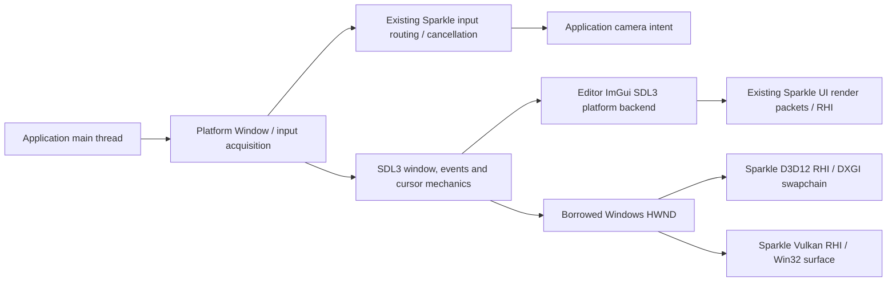

# SDL3 window and input implementation plan

[Third-party migration](../ThirdPartyMigration.md#native-removal-estimates) | [Ownership and dependencies](../ThirdPartyMigration.md#ownership-and-dependency-workflow) | [Engineering](../Engineering.md)

**Recommendation: trial SDL3 first, with GLFW as the alternative.** Delegate native window creation, event acquisition, keyboard/mouse decoding and cursor operations. Keep Sparkle's input routing, cancellation, camera behavior and graphics ownership. The intended consumers are the standalone rendering application and the Editor viewport. This frees rendering work from maintaining general Windows plumbing.

**D3D12 and Vulkan remain the only rendering backends. Neither candidate requires OpenGL.** SDL's GPU and 2D rendering APIs are outside this proposal. SDL3 remains a trial; this document adds no dependency or implementation and establishes no accepted savings.

**Start with [stage 0: integration design deep dive](#stage-0-integration-design-deep-dive).** Every stage has positive/negative guidelines, failure modes, acceptance criteria and a copyable prompt. All stages are **NOT STARTED**; the research below is input to stage 0, not its completed design decision.

Initial source inspection: **2026-11-21**, HEAD `58143b2a4fe5cff080377b1fc524454c534ade61`. Staged-plan review: **2026-11-21**, HEAD `293e2b209f215926eb952dcd277a95177368e831`, with an unrelated Animation-plan edit. The mapped Platform/input, Editor, presentation and dependency sources are unchanged between those revisions. Recheck live owners before execution. This is a source study, not an executable baseline. The catalogue's reviewed scope is **752 code / at most 868 physical lines in 13 files**, before retained policy and all replacement costs.

## What SDL3 and GLFW actually do

SDL means Simple DirectMedia Layer. SDL3 provides platform services through a C API: windows, events, mouse/keyboard input, clipboard and other facilities. You can use its window/input portion independently of its audio, controller and rendering systems. GLFW provides a smaller window/input API, native-window access and Vulkan helpers. Its OpenGL-oriented examples do not make OpenGL mandatory. [SDL API categories](https://wiki.libsdl.org/SDL3/APIByCategory), [GLFW Vulkan guide](https://www.glfw.org/docs/3.4/vulkan_guide.html).

For Sparkle, either library can create the desktop window and report a resize or mouse movement. Sparkle then decides which viewport receives input, whether a camera moves and when the RHI recreates its swapchain. The library still uses Win32 internally on Windows; the benefit is transferring that implementation and its maintenance upstream.

| Term | Meaning here |
| --- | --- |
| Native window / `HWND` | The Windows object that DXGI and the Vulkan Win32 surface use for presentation. An SDL/GLFW window can expose it. |
| Event acquisition | Getting keyboard, mouse, focus, resize and close observations from the operating system. |
| Routing and policy | Choosing System/UI/Gameplay recipients, modal behavior, shortcuts and cancellation. These remain Sparkle behavior. |
| Capture | Continuing a drag outside the client area. Capture alone does not imply hiding or confining the cursor. |
| Relative mouse mode | Continuous motion suitable for camera look, without stopping at a screen edge. Distinct from an absolute UI pointer position. |
| Surface / swapchain | The connection to a window and the presented GPU images. Their graphics lifetime remains with RHI. |

## Proposed responsibility split

**SDL3 handles communication with the operating system. Sparkle keeps input behavior, application policy and all rendering.** The intended transfer is:

| Area | Transferred to SDL3 | Kept in Sparkle |
| --- | --- | --- |
| Windows | Native creation/destruction, resize, minimize/maximize and monitor operations. | Application lifetime, fullscreen decisions, Editor title-bar layout and controls. |
| Keyboard and mouse | Acquiring native events and decoding keys, buttons, pointer motion and wheel input. | Bindings, shortcuts, frame input state and deciding which viewport receives input. |
| Cursor and capture | Native capture, cursor visibility/shapes and continuous relative motion. | Deciding when camera look starts/stops and which input layer owns capture. |
| Focus and cancellation | Reporting native focus changes and managing native pointer mechanisms. | Clearing held input, releasing camera control, discarding stale events and notifying subscribers. Capture-interruption parity must pass the trial below. |
| DPI | Detecting display changes and reporting window size, drawable pixel size and scale. | Scaling Editor UI, matching viewport coordinates and resizing GPU presentation resources. |
| ImGui platform integration | Native input, clipboard, text input and cursor support through the stock SDL3 backend. | Editor panels, workspace behavior and Sparkle's UI rendering. |
| Graphics | Providing the native window handle. | The entire D3D12/Vulkan RHI: devices, resources, queues, synchronization, surfaces, swapchains and presentation. |

Core retains its small engine-facing input types and frame state, with only the necessary motion-precision adaptation. SDL does not become a general Core dependency. Processes, files, logging and task execution keep their separate owners.

The intended deletion is the custom **Win32 window/event/keyboard/mouse/cursor backend**. Small SDL-to-Core translations remain; native mechanics move upstream. **D3D12 and Vulkan stay; no OpenGL or SDL rendering API is introduced.** This is the proposed boundary, conditional on the compatibility checks below.

## SDL3 compared with GLFW

Research references are released **SDL 3.4.20**, published 2026-11-03, commit `f00dc919ca35b9756316e86c4777392de442f9b2`, and **GLFW 3.5.1**, published 2026-07-31, commit `d9d6f0f1f967807ffade6598ea9a631ebaf37a56`. Release identity was checked against upstream releases and tag commits. These are inspection references, not approved dependency pins. Both use permissive zlib-style licenses; preserve the selected source notices. [SDL release](https://github.com/libsdl-org/SDL/releases/tag/release-3.4.20), [GLFW release](https://github.com/glfw/glfw/releases/tag/3.5.1), [SDL license](https://github.com/libsdl-org/SDL/blob/release-3.4.20/LICENSE.txt), [GLFW license](https://github.com/glfw/glfw/blob/3.5.1/LICENSE.md).

| Concern | SDL3 | GLFW | Sparkle consequence |
| --- | --- | --- | --- |
| D3D12 | Exposes Windows `HWND` through window properties. | Exposes `HWND` through `glfwGetWin32Window`. | Both work with the existing DXGI presentation model. Neither needs to create a D3D device. |
| Vulkan | Native handle or optional extension/surface helpers. | Native handle or optional extension/surface helpers. | Both preserve Sparkle Vulkan devices, queues and swapchains. |
| OpenGL | Create without `SDL_WINDOW_OPENGL`; build OpenGL support off. | Set `GLFW_CLIENT_API` to `GLFW_NO_API`; use `GLFW_INCLUDE_NONE`. | No OpenGL context, renderer or engine dependency is needed. |
| Event model | Poll a queue of typed events. | Register callbacks; pump events centrally. | SDL is close to the current central pump. GLFW needs deliberate callback ownership/chaining. Both need small Core-value translations. |
| Camera pointer | Per-window relative mode and relative motion. | Disabled cursor mode, with optional supported raw motion. | Both can replace per-move cursor recentering. Sensitivity and transition behavior require testing. |
| Drag capture | Explicit `SDL_CaptureMouse`, plus automatic button capture. | Automatic native drag behavior; cursor confinement and disabled modes are available. | GLFW confinement is not equivalent to today's unconfined capture. Prove drag/cancellation semantics rather than matching function names. |
| Custom title bar | Public hit-test callback reports draggable and resize regions. | The inspected public header has no comparable custom hit-test API. | SDL has the stronger apparent fit for the existing borderless Editor. GLFW may require extra native integration. |
| Modifiers | Left/right Shift/Ctrl/Alt/GUI and Caps/Num/Scroll lock bits. | Callback modifiers aggregate left/right; lock modifier mode exposes Caps/Num. | GLFW needs more adaptation for the existing side-specific and ScrollLock contract. Do not silently drop fields. |
| ImGui | Stock SDL3 platform backend, including text/IME handling. | Stock GLFW platform backend. | Replace only the platform backend; keep Sparkle UI rendering. Qualify text input and shortcuts with either candidate. |
| Dependency scope | Larger API and configurable subsystems. | Narrower library purpose. | GLFW can be the smaller integration if native parity is cheap; SDL can delegate more of this particular window's behavior. |
| Maintenance cost | More options and a broader upstream surface; fewer reasons for local Windows special cases if fit passes. | Less library scope; missing conveniences may become local code. | Choose by the complete retained mechanism and delivery cost, not library size alone. |

The comparison is an engineering inference from the inspected APIs, not a prototype result. Relevant primary references: [SDL native properties](https://wiki.libsdl.org/SDL3/SDL_GetWindowProperties), [GLFW native access](https://www.glfw.org/docs/3.4/group__native.html), [GLFW input guide](https://www.glfw.org/docs/latest/input.html), [GLFW 3.5.1 header](https://github.com/glfw/glfw/blob/3.5.1/include/GLFW/glfw3.h), [SDL modifiers](https://wiki.libsdl.org/SDL3/SDL_Keymod), [SDL hit testing](https://wiki.libsdl.org/SDL3/SDL_SetWindowHitTest).

SDL's strongest advantages here are borderless-window hit testing, explicit capture and modifier coverage. Its disadvantages are a larger dependency, build/package integration, and an event/cursor model that still needs careful composition with ImGui. GLFW is attractive for a small conventional rendering window; Sparkle's custom chrome and existing input contract make its total adaptation cost uncertain. There is no measured latency, frame-time, binary-size or net-line advantage for either candidate yet.

## What would be replaced in this repository

Paths in the first table are relative to `Engine/Platform/Private/`. Physical counts were rechecked during this study and sum to **868**. The **752 code-line** figure remains the catalogue's reviewed count. The ceiling includes mixed policy/orchestration; it is not a promise that every listed line disappears.

| Current source | Physical lines | Proposed transfer / retained responsibility |
| --- | ---: | --- |
| [Window/WindowCreation.cpp](../../Engine/Platform/Private/Window/WindowCreation.cpp) | 63 | Replace class registration, `CreateWindowExW`, native destruction and DWM setup with SDL window creation/destruction. Preserve title, initial maximized behavior and borderless appearance. |
| [Window/WindowMessages.cpp](../../Engine/Platform/Private/Window/WindowMessages.cpp) | 104 | Retire the custom WndProc, `PeekMessage`/dispatch and native message broadcast. SDL owns pumping; preserve mandatory size/DPI/close updates and event delivery semantics. |
| [Window/WindowDisplay.cpp](../../Engine/Platform/Private/Window/WindowDisplay.cpp) | 129 | Replace monitor/style/placement/show/DPI mechanics with SDL calls. Keep fullscreen/shortcut policy and requested transitions. Dragging moves to hit testing. |
| [Window/WindowNonClient.cpp](../../Engine/Platform/Private/Window/WindowNonClient.cpp) | 115 | Retire Win32 non-client handling after proving SDL hit testing, minimum size, work-area maximization and resize behavior. Editor still supplies the interactive title-bar regions. |
| [Window/Window.cpp](../../Engine/Platform/Private/Window/Window.cpp) | 78 | Retain a smaller `Window` lifetime and meaningful operations; remove obsolete native helpers/state. This is mixed orchestration, not a whole-file retirement claim. |
| [Input/Backends/Win32InputBackend.cpp](../../Engine/Platform/Private/Input/Backends/Win32InputBackend.cpp) and header | 88 | Delete the Win32 message switch/variant transport. Decode SDL keyboard/mouse/focus observations into the existing input processing boundary. |
| [Input/Backends/Win32KeyboardInput.cpp](../../Engine/Platform/Private/Input/Backends/Win32KeyboardInput.cpp) and header | 149 | Delete virtual-key/scancode decoding and `GetKeyState` polling. A small explicit SDL-to-Core key/modifier map remains necessary. |
| [Input/Backends/Win32MouseInput.cpp](../../Engine/Platform/Private/Input/Backends/Win32MouseInput.cpp) and header | 53 | Delete packed-coordinate/wheel decoding and screen-to-client conversion. Translate SDL events into Core values with deliberate units and wheel direction. |
| [Input/Backends/Win32PointerControl.cpp](../../Engine/Platform/Private/Input/Backends/Win32PointerControl.cpp) and header | 89 | Delete `SetCapture`/`ReleaseCapture`, `ShowCursor` counter loops and centering mechanics. Use SDL capture/relative mode/cursor APIs. |

Adapters and callers are still charged, including outside those 13 files:

| Connected owner | Required change / what stays |
| --- | --- |
| [Window public contract](../../Engine/Platform/Public/Window/Window.h) | Replace native message exposure and Win32 private fields. Keep the useful window contract, observable dimensions/state and explicit native presentation interop. Its header is outside the 868-line ceiling. |
| [InputSystem state and processing](../../Engine/Platform/Private/Input/InputSystemState.h), [pointer operations](../../Engine/Platform/Private/Input/InputPointerControl.cpp), [cancellation](../../Engine/Platform/Private/Input/InputCancellation.cpp) | Replace backend calls and subscription. Keep logical capture layer, ordered state publication, cancellation epochs, synthesized releases and subscription lifetime. |
| [Input routing](../../Engine/Platform/Private/Input/Routing), [dispatch](../../Engine/Platform/Private/Input/Dispatch) | Retain UI/Gameplay/System routing, modal/text-focus behavior, immediate/deferred subscribers and queue cancellation. SDL/GLFW do not know these engine rules. |
| [Core input values/state](../../Engine/Core/Public/Input) | Keep engine-facing keys, buttons, events and per-frame state independent of SDL. Review motion units/precision as described below. No SDL dependency moves into Core. |
| [CameraInputIntentCollector](../../Engine/Application/Private/Input/CameraInputIntentCollector.cpp) | Keep right-button look, Escape cancellation, movement bindings, sprint and speed policy. Replace per-move `CenterCursor()` with a deliberate relative-mode request. |
| [EditorImGuiContext](../../Engine/Editor/Private/ImGui/EditorImGuiContext.cpp) | Replace `ImGui_ImplWin32_*` and raw `WM_KEYDOWN` shortcut handling with the stock SDL3 platform backend and normalized shortcut input. Keep context, theme and Editor policy. |
| [TitleBarWindowControls](../../Engine/Editor/Private/Workspace/TitleBarWindowControls.cpp), [UIWorkspace](../../Engine/Editor/Private/Workspace/UIWorkspace.cpp) | Publish current draggable/excluded regions for hit testing. Keep menu/buttons, double-click behavior and viewport routing. Remove obsolete drag initiation and direct ImGui mouse-state repair when no longer needed. |
| [GameApplication](../../Engine/Application/Private/Game/GameApplication.cpp), [EditorApplication](../../Engine/Application/Private/Editor/Host/EditorApplication.cpp) | Preserve event/frame order, minimized waiting and destruction order; compose SDL lifetime with the existing host. |
| [ImGui dependency recipe](../../CMake/Dependencies/Targets/imgui.cmake), [Platform target](../../Engine/Platform/CMakeLists.txt) | Select `imgui_impl_sdl3.cpp`, wire one SDL runtime, remove backend-only link dependencies once unused and regenerate source membership. |
| [D3D12 swapchain](../../Engine/RHI/Private/D3D12/SwapChain/D3D12SwapChain.cpp), [Vulkan swapchain](../../Engine/RHI/Private/Vulkan/SwapChain/VulkanSwapChain.cpp), [D3D12 capture binding](../../Engine/RHI/Private/D3D12/Device/D3D12RenderDeviceServices.cpp), [Vulkan capture binding](../../Engine/RHI/Private/Vulkan/Device/VulkanRenderDeviceServices.cpp) | Borrow the library-created native handle. Retain both RHI implementations, surface/swapchain lifetime and external GPU-capture bindings. |

## D3D12 and Vulkan integration

Use **native-handle presentation first** for this Windows-only migration. It changes the window's producer without introducing another graphics abstraction:



**D3D12:** retrieve `SDL_PROP_WINDOW_WIN32_HWND_POINTER` using SDL window properties, then continue passing that handle to `CreateSwapChainForHwnd`. Preserve the external capture factory path as well as the ordinary DXGI factory path. SDL does not allocate backbuffers or present frames. GLFW's equivalent is `glfwGetWin32Window`. [SDL properties](https://wiki.libsdl.org/SDL3/SDL_GetWindowProperties), [GLFW native access](https://www.glfw.org/docs/3.4/group__native.html).

**Vulkan:** retain the existing `VulkanSwapChain::CreateSurface`, `vkCreateWin32SurfaceKHR`, instance-extension selection and present-support check, using the borrowed HWND. This keeps RHI independent of SDL headers/libraries and leaves the Vulkan loader with its current owner. A basic SDL window used only through this Windows interop path needs neither `SDL_WINDOW_VULKAN` nor `SDL_WINDOW_OPENGL`.

SDL's optional portable path uses `SDL_WINDOW_VULKAN`, `SDL_Vulkan_GetInstanceExtensions` before instance creation, and `SDL_Vulkan_CreateSurface` afterward. The RHI would still own the returned surface and all GPU objects. This path adds a library/loader boundary and is unnecessary to retire the current window backend; reconsider it only for a real portability consumer. GLFW's Vulkan helpers have a similar role. [SDL surface requirements](https://wiki.libsdl.org/SDL3/SDL_Vulkan_CreateSurface), [SDL window flags and loader behavior](https://wiki.libsdl.org/SDL3/SDL_CreateWindow), [GLFW Vulkan guide](https://www.glfw.org/docs/3.4/vulkan_guide.html).

Expose native handles through a narrow explicit Platform interop boundary; do not spread SDL types into RHI public interfaces. A borrowed HWND is valid only while its owning window exists. Stop presentation and settle GPU use, destroy swapchain/surface and Editor backend, release input subscriptions/cursor modes, then destroy the SDL window and shut down its subsystem. Keep atomic dimension publication where render-side readers need it; main-thread SDL queries are not a replacement for that contract.

## The compatibility work that decides the trial

### One event pump and the existing input policy

Keep `GameApplication::BeginFrame` ordering: advance input state, poll events, process deferred events, then continue the frame. One main-thread owner initializes video, creates the window and drains SDL events. `Window::PollEvents` remains a suitable existing entry point. Keep the current application loop/entry points; SDL3's alternate callback application model is optional. [SDL polling/thread rules](https://wiki.libsdl.org/SDL3/SDL_PollEvent), [SDL entry points](https://wiki.libsdl.org/SDL3/README-main-functions).

Provide Editor with a borrowed SDL window and synchronous SDL event access through one explicit Platform interop contract. Input decoding stays inside Platform; Editor forwards relevant events to `ImGui_ImplSDL3_ProcessEvent`. Do not reconstruct Win32 messages, create a generic backend factory, add another event queue or expose SDL throughout the engine. Borrowed SDL events and text storage must not escape synchronous delivery; deferred delivery uses owned Core values.

Both ImGui and InputSystem need observations. The ImGui backend's return value is not permission to suppress global input state or focus/cancellation. Keep engine routing as the recipient authority and keep mandatory close/size/DPI state independent of UI consumption. Preserve F11/Alt+Enter non-repeat fullscreen behavior and the Editor's Grave shortcut/text-input exclusion. For GLFW, explicitly choose callback installation/chaining so one consumer cannot replace another's callback.

### Capture, cancellation and cursor authority

Keep ordinary UI drag capture separate from camera relative mode. SDL capture permits coordinates outside the window and automatically releases on focus loss; relative mode hides/constrains the pointer and provides continuous motion. SDL also has automatic capture during button presses. Choose its automatic-capture setting deliberately rather than maintaining an inconsistent second native capture state. [Capture semantics](https://wiki.libsdl.org/SDL3/SDL_CaptureMouse), [relative mode](https://wiki.libsdl.org/SDL3/SDL_SetWindowRelativeMouseMode).

Focus loss, modal/target changes, close and capture interruption must still clear the right state, discard queued stale input and synchronously deliver releases to immediate and deferred subscribers. State must be cleared before cancellation callbacks, including reentrant callbacks. Pointer-only cancellation must preserve held keyboard state. Do not assume focus loss covers every existing `WM_CANCELMODE`/`WM_CAPTURECHANGED` case; mouse leave is also not capture loss.

This is an unresolved fit question. The inspected [SDL Windows event implementation](https://github.com/libsdl-org/SDL/blob/release-3.4.20/src/video/windows/SDL_windowsevents.c) handles capture changes internally, but that alone does not prove Sparkle observes every required cancellation. Exercise same-focus capture interruption and native drag/modal loops. If a gap needs an OS hook, prove a supported narrow mechanism observes it, charge it and keep it private; do not assume a queued-message hook sees messages delivered synchronously. Recreating the old WndProc/input backend fails the delegation goal.

The stock ImGui SDL3 backend also calls capture and cursor APIs during `NewFrame`. Relative mode, engine cursor visibility and ImGui cursor updates must agree. Define normal UI ownership and the temporary camera override; restore it on every exit/failure. `ImGuiConfigFlags_NoMouseCursorChange` can control backend cursor updates, but does not disable its capture calls. Prove coexistence without editing upstream or adding a second capture state machine. [Pinned ImGui SDL3 backend](https://github.com/ocornut/imgui/blob/6d910d5487d11ca567b61c7824b0c78c569d62f0/backends/imgui_impl_sdl3.cpp).

### Camera motion and Core values

Today Platform computes deltas by subtracting absolute integer cursor positions, and `CameraInputIntentCollector::OnMouseMove` recenters the cursor after each look movement. With SDL relative mode, use supplied relative motion and delete the recurring warp/baseline path for camera look. Keep absolute positions for hit testing, UI and viewport selection. Mode entry/exit and focus recovery must produce no artificial look delta; a failed mode change must leave logical capture/cursor state truthful.

SDL motion is floating point; Core's current `MouseDelta` and `InputState::AccumulateMouseDelta` are integer pixel contracts. **Proposed narrow Core change:** preserve fractional relative motion through a floating-point delta and accumulation contract, document its units, and update the camera consumer directly. Keep absolute client positions separate and convert them once at acquisition. Do not truncate each relative event or describe raw device motion as desktop pixels. This is a proposed contract change, not an adopted decision; include every affected caller in the trial ledger.

Relative/raw input can change the effect of Windows acceleration and therefore camera sensitivity. Freeze expected direction, response and speed behavior before the trial, then compare slow and fast motion, high polling rates, screen-edge travel and mixed DPI. Do not promise identical feel or lower latency without observations. GLFW's disabled/raw modes need the same checks. [GLFW motion behavior](https://www.glfw.org/docs/latest/input.html#raw_mouse_motion).

### Custom title bar and DPI

Current `TitleBarWindowControls` starts a native drag after ImGui detects dragging and then repairs `io.MouseDown`. SDL hit testing happens earlier, during native processing, and may prevent ordinary mouse delivery in special regions. Editor should publish stable title-bar geometry and exclusions for menus/buttons; Platform classifies draggable/resize regions without calling ImGui, allocating or initiating camera input from the callback. Validate maximize/restore double-clicks and drag-from-maximized behavior before deleting the current path. [Hit-test behavior](https://wiki.libsdl.org/SDL3/SDL_SetWindowHitTest).

Preserve initial maximized startup, borderless windowed presentation, minimum tracking size, edge/corner resizing, work-area maximization, monitor selection and F11/Alt+Enter restoration. Current fullscreen covers the monitor by changing window styles; do not accidentally replace it with a display-resolution switch or DXGI exclusive fullscreen. Preserve the required behavior rather than assuming identical-looking SDL/GLFW function names have identical semantics.

Track drawable pixel size and UI display scale separately. Use `SDL_GetWindowSizeInPixels` for swapchain extent and `SDL_GetWindowDisplayScale` for UI scaling; do not derive drawable extent by multiplying dimensions by DPI. On Windows, window coordinates are already physical pixels while the content scale can be 1.5 or 2.0. Avoid double scaling input regions or ImGui. Review the existing PerMonitorV2 manifest and SDL awareness configuration together. [SDL high-DPI model](https://wiki.libsdl.org/SDL3/README-highdpi), [current manifest](../../Engine/Platform/Private/Window/SparkleApplication.manifest).

Keep rendering skipped while minimized/zero-sized. A replacement for `WaitForEvent` must either leave the wake event queued or process it through the same dispatch path; consuming and forgetting an SDL wait result can lose the only close, key-release or restore event. During native move/resize loops SDL polling can block on Windows, so responsive rendering during dragging is not an automatic benefit of this migration. [Polling caveat](https://wiki.libsdl.org/SDL3/SDL_PollEvent).

### Keyboard, text and wheel conversion

Map key values explicitly: Core enum numbers, SDL keycodes/scancodes and GLFW key tokens are not interchangeable. Preserve repeat filtering, keypad/navigation distinctions, left/right modifiers and all current lock flags. Decide physical-position versus layout-dependent meaning against today's bindings; test non-US layouts, AltGr and the Grave shortcut. Text entry is a separate stream from command keys; keep the stock ImGui text/IME/clipboard path rather than implementing character synthesis in Core.

Preserve vertical/horizontal wheel fractions, direction and client position, including negative coordinates during capture. SDL exposes wheel direction and motion fields; normalize them once before routing. GLFW scroll callbacks need association with the correct current pointer position. Cursor shape selection should remain with the stock UI backend outside camera look.

## Platform and Core simplification boundary

| Concern | Result of this proposal |
| --- | --- |
| Native window, keyboard, mouse, cursor and event mechanics | SDL3 owns the implementation. Delete the superseded Platform Win32 backend after fit passes. |
| Core input enums/events/state | Keep the small engine vocabulary and frame-state semantics; adapt only necessary precision/units. These are useful contracts for multiple consumers, not another native backend. |
| Platform routing/dispatch/cancellation | Retain cohesive policy with its current owner. SDL's keyboard state is not a substitute for layer state or synthesized releases. |
| Core child processes | Keep the separate [Boost.Process study](BoostProcess.md). Adding SDL does not establish process-tree, pipe, cancellation or Launcher workflow parity. Count no process savings under W. |
| Core JSON | Already delegated to nlohmann/json under the [retained decision](../ThirdPartyMigration.md#json). No additional retirement credit. |
| Tasks, files/paths, time, logging and publication | No replacement is established by this window trial. Reuse their existing owners; do not add SDL wrappers for unrelated services. Task execution has its own [plan](TaskRuntime.md). |
| RHI / Renderer | Keep D3D12, Vulkan, GPU allocation, synchronization, presentation, render graph and UI rendering. Native Windows graphics interop remains legitimate. |
| Launcher | Keep its existing Qt window/input implementation. SDL belongs to engine runtime/Editor consumers, not a second Launcher GUI framework. |

Keep the existing `Window` and `InputSystem` contracts where they express actual behavior. Implement them directly against the selected library. Avoid `IWindowBackend`, backend registries, interchangeable SDL/GLFW/Win32 implementations and forwarding-only facade chains. A comparison study does not require shipping two providers.

## Dependency and delivery design

Use the [existing dependency workflow](../ThirdPartyMigration.md#ownership-and-dependency-workflow): a pinned recipe under `CMake/Dependencies/Targets`, selection in `FetchDependencies.cmake`, source-package metadata, Launcher availability/sync metadata, notices and package inventory. Keep upstream source in ignored `build/_deps` and use imported/upstream targets. Both projects ship build/test infrastructure, but upstream results do not qualify Sparkle; exact-pin advisory, toolchain and enabled-dependency review remains open. [SDL source](https://github.com/libsdl-org/SDL/tree/release-3.4.20), [GLFW source](https://github.com/glfw/glfw/tree/3.5.1).

For the SDL trial, propose **one shared SDL3 runtime** used by Platform and the ImGui platform backend, with `SDL3.dll` staged through the existing target/package graph. This avoids independent SDL global state if static SDL were linked into multiple engine DLLs. Record the DLL/startup/package cost. A static alternative needs a demonstrated single implementation owner, not duplicate runtime copies.

Build video/events/keyboard/mouse support; disable unused audio, GPU, 2D render, camera, joystick/haptic/sensor and other optional subsystems where the stock ImGui backend still builds and behaves correctly. Set `SDL_OPENGL=OFF` and `SDL_OPENGLES=OFF`. For the chosen native-HWND Vulkan path, SDL's own Vulkan helper support is unnecessary; Sparkle's Vulkan target remains enabled independently. Do not confuse disabling SDL GPU/Direct3D render drivers with disabling Sparkle D3D12. Verify actual option names/dependencies against the pin. [SDL CMake source](https://github.com/libsdl-org/SDL/blob/release-3.4.20/CMakeLists.txt), [CMake integration](https://wiki.libsdl.org/SDL3/README-cmake).

Use `imgui_impl_sdl3.cpp` at the existing ImGui revision first. **Stage 0 must decide its target placement:** today's static `imgui` target includes the Win32 backend and is linked by Editor and RHI. Blindly replacing that source can spread SDL linkage beyond its consumers. Compare keeping that composition with linking the stock platform-backend source only into its actual Editor/host owner, using a focused target if needed. Preserve the existing ImGui context/thread contract; add no forwarding backend class or second implementation. See the [recipe](../../CMake/Dependencies/Targets/imgui.cmake), [context configuration](../../CMake/Dependencies/ImGui/SparkleImGuiConfig.h) and [RHI target graph](../../Engine/RHI/CMakeLists.txt).

The inspected backend offers `InitForD3D`, `InitForVulkan` and `InitForOther`; select appropriate platform initialization without adding an upstream ImGui graphics backend. Its gamepad-related calls must remain linkable with the selected SDL options. Keep dependencies private where public use does not require them, and verify the link graph as well as legal includes. Regenerate recursive source membership after file changes.

## Staged execution contract

The [Roadmap](../Roadmap.md#supporting-system-simplification) places this trial after the task-runtime decision and adds no first-release prerequisite. Design research can proceed without starting a code migration. Follow [code delivery and qualification](../ThirdPartyMigration.md#code-delivery-and-qualification): prove decisive fit early, finish connected owners and retirement, then close the bounded code initiative. Wider qualification remains distinct.

| Stage | Deliverable / exit | Status |
| --- | --- | --- |
| [0](#stage-0-integration-design-deep-dive) | Source-backed integration design, ownership/target graph and decisive experiment | NOT STARTED |
| [1](#stage-1-bind-the-baseline-and-checks) | Frozen source/behavior identities, runnable checks and comparison limits | NOT STARTED |
| [2](#stage-2-prove-the-real-integration-fit) | One SDL-backed vertical path using real D3D12/Vulkan and Editor owners | NOT STARTED |
| [3](#stage-3-complete-window-and-presentation-integration) | Complete window/DPI/native-handle/lifetime conversion | NOT STARTED |
| [4](#stage-4-complete-input-camera-and-editor-integration) | Complete input, camera and ImGui conversion with policy preserved | NOT STARTED |
| [5](#stage-5-retire-the-backend-and-close-code-delivery) | Old backend removed; source/build/delivery inputs and focused checks complete | NOT STARTED |

Every prompt below runs only its named stage. Verify the previous exit against matching inputs; reuse valid evidence and recheck affected inputs when they change. Keep raw reports/probes in ignored `build/validation/window-input/`. Update this plan's existing status, decisions, failures and next action **before each handoff**; do not append progress blankets to main guides. Record source hashes/local edits, upstream pin/options, commands, expected result/tolerance, observation and coverage limits. An interrupted run is not PASS.

Stages 0–1 change analysis/evidence only. Stages 2–4 form one isolated implementation candidate, with one window/event provider per executable; they are not separately shippable partial migrations. Include directly required caller conversions to keep each candidate build coherent, record later checks still owed and avoid temporary compatibility shims merely to enforce stage boundaries. Preserve the baseline and unrelated edits. Wait for builds sharing an output root or use isolated outputs. Keep new probes/test-only source local and remove it before handoff; preserve existing tests. A prompt is a future execution instruction, not evidence that the stage has run.

### Stage 0: integration design deep dive

**Purpose:** choose the smallest coherent integration that serves the rendering goals. Read full affected functions and trace construction, calls, mutable state, callbacks, dependencies and destruction. Do not start production or prototype implementation in this stage.

Translate every named guide into design decisions:

| Guide | Consequence for this integration |
| --- | --- |
| [Goals](../Goals.md#north-star) | Transfer support maintenance so the two-API rendering case is easier to deliver. Retain explicit graphics reasoning, reproducible failures and personal rendering ownership. No general multimedia/game framework expansion. |
| [CodeStyle](../CodeStyle.md#c-structure) | Direct typed operations, meaningful locals, readable orchestration and cohesive lifetimes. Review real names/files/API shape; no helper bags, one-field forwarding wrappers or generic backend machinery. |
| [Engineering](../Engineering.md#module-boundaries) | One owner per mutable fact; necessary public/interop boundaries; private SDL implementation; explicit callback, CPU/GPU and destruction lifetimes. |
| [README](../README.md#guides) | Runtime/Editor are the consumers; Launcher remains Qt. This file owns temporary stages; existing guides own durable decisions and release results. |
| [References](../References.md#integration-precedents) | Study actual pinned source and record what transfers and what does not. Adoption and brand names are not local fit evidence. |
| [Rendering](../Rendering.md#source-map) | Preserve RHI/Renderer/UI packet ownership, reference independence, immutable frame inputs and API/resource lifetime. Window replacement must not change shading or render settings. |
| [RepositoryFootprint](../RepositoryFootprint.md#cuts-before-expansion) | Delete a maintained mechanism and count every adapter/caller. The 868 physical / 752 code lines are a gross ceiling; no net forecast or Core/file-count quota. Preserve necessary cancellation and verification. |
| [Roadmap](../Roadmap.md#supporting-system-simplification) | Respect delivery order and keep existing image/Vulkan/package blockers separate. No new release scope, hardware campaign or acceptance shortcut. |
| [ThirdPartyMigration](../ThirdPartyMigration.md#requirements-for-adoption) | One selected upstream provider, complete retirement, exact-pin trust/dependency review, offline delivery and honest cost accounting. |

Study existing local integrations before choosing target shape:

1. Trace `GameApplication`/`EditorApplication` startup, main-thread pump, minimized wait, Editor frame timing and reverse destruction through the [mapped owners](#what-would-be-replaced-in-this-repository). Trace both normal and external-capture presentation paths.
2. Inspect the current [ImGui recipe](../../CMake/Dependencies/Targets/imgui.cmake), [context bridge](../../CMake/Dependencies/ImGui/SparkleImGuiContext.cpp), Editor context and RHI/Renderer UI consumers. Identify actual DLL/static-link and thread-context boundaries before deciding where the stock SDL platform backend compiles.
3. Follow [CLI11](../../CMake/Dependencies/Targets/cli11.cmake) and [JSON](../../CMake/Dependencies/Targets/nlohmann_json.cmake) recipes for verified source acquisition, required files, unused-option suppression and source-package identity. Inspect fetch order/allowlists, [Launcher metadata](../../Tools/Launcher/SparkleLauncher/Private/Dependencies/SourceDependencyState.cpp) and [package graph traversal](../../CMake/Packaging/ReleaseProducts.cmake). A header-only recipe is not proof that a runtime DLL will be staged correctly.
4. Audit Core input producers/consumers, side-specific modifiers, integer motion, synthetic releases and immediate/deferred cancellation. Separate existing guarantees, observed baseline behavior, proposed contract changes and optional capability additions. The English keyboard/mouse release scope does not authorize removing existing exposed behavior or adding controllers/extra platforms.

Inspect these upstream integration precedents, recording revision, useful pattern and incompatible assumptions:

| Primary source | Question it must answer |
| --- | --- |
| Pinned ImGui [SDL3 platform backend](https://github.com/ocornut/imgui/blob/6d910d5487d11ca567b61c7824b0c78c569d62f0/backends/imgui_impl_sdl3.cpp) and [SDL3/Vulkan example](https://github.com/ocornut/imgui/blob/6d910d5487d11ca567b61c7824b0c78c569d62f0/examples/example_sdl3_vulkan/main.cpp) | How do event forwarding, text/cursor/capture updates, initialization and shutdown compose? Identify sample-owned Vulkan helpers that Sparkle must not adopt. |
| Pinned ImGui [Win32/D3D12 example](https://github.com/ocornut/imgui/blob/6d910d5487d11ca567b61c7824b0c78c569d62f0/examples/example_win32_directx12/main.cpp), with SDL native-window properties | How does a borrowed HWND connect to DXGI while preserving Sparkle's own rendering path? The inspected ImGui pin has no combined SDL3/D3D12 example; do not invent one or substitute D3D11. |
| Donut [window composition](https://github.com/NVIDIA-RTX/Donut/blob/e50042f4bbd762971cc90431261e967404855b81/src/app/DeviceManager.cpp), [D3D12](https://github.com/NVIDIA-RTX/Donut/blob/e50042f4bbd762971cc90431261e967404855b81/src/app/dx12/DeviceManager_DX12.cpp) and [Vulkan](https://github.com/NVIDIA-RTX/Donut/blob/e50042f4bbd762971cc90431261e967404855b81/src/app/vulkan/DeviceManager_VK.cpp) | This GLFW integration uses `GLFW_NO_API`, HWND-based DXGI and Vulkan surface helpers. Which boundaries are useful, and which DeviceManager/NVRHI responsibilities must remain Sparkle-owned? Study the alternative without importing its framework. |
| Selected SDL release's Windows event/mouse/window sources and CMake, linked above | Does public SDL behavior cover hit testing, relative mode, cancellation observation, DPI and disabled subsystems? Check exact-pin support, tests/fixes/advisories, license and runtime closure; document unresolved behavior instead of assuming it. |

Resolve these design choices in this document, with source evidence and rejected alternatives:

- **Lifetime and threading:** SDL subsystem/window initialization owner, main-thread operations, subscription teardown and all-queue GPU settlement. Keep useful existing `Window`/host lifetimes; justify any new RAII owner by an actual independent lifetime.
- **Target graph:** SDL shared versus a single static implementation owner; stock ImGui backend placement; SDL-before-ImGui dependency order; private/public links, exports and runtime staging. Avoid unintentionally pulling SDL platform code through the ImGui core into RHI consumers.
- **Interop and events:** prefer the proposed HWND path for both native APIs unless a current consumer justifies surface helpers. Define one pump, subscriber order, mandatory state updates, synchronous borrowed events and owned deferred values; no translated native-message mirror.
- **Capture authority:** choose normal UI versus camera ownership, relative mode, cursor restoration and an observable cancellation path. Check ImGui's capture calls separately from cursor-shape flags; keep one logical engine authority rather than shadowing SDL state.
- **Value semantics and chrome:** choose motion units/precision, key/layout/modifier mapping, pixel versus UI scale and a title-bar region contract. Name the actual Core/header/ABI and Editor caller changes.
- **Retirement and cost:** name removed functions/files, retained policy and every new/changed caller. Sketch final folders/APIs and count mutable authorities, not just lines. Prefer direct cohesive operations over renamed Win32 machinery, god classes or artificial file fragmentation.

**Positive guidelines:** explain why the chosen graph/lifetime is simpler for the actual consumers; use source-backed comparisons and deliberate, narrow interop. **Negative guidelines:** no implementation, dependency adoption, copied sample renderer, blanket SDL service wrappers, compatibility switches, speculative platform abstraction or unsupported savings claims. **Failure modes:** source-only API matching misses capture interruption; an ImGui target swap broadens dependencies; a new manager mirrors window/input state; a sample silently replaces the owned RHI.

**Acceptance criteria:**

- [ ] All nine guide consequences, local call paths and precedent lessons are reconciled; contradictions and existing defects are explicit.
- [ ] The selected design names producer/consumer, state authority, thread, borrowing and teardown for each boundary, including the CMake/DLL graph. Retained and rejected alternatives have reasons.
- [ ] Every unresolved fit question has a decisive stage-2 experiment and expected outcome. No unresolved design choice is hidden behind an interface or fallback.
- [ ] Update the relevant existing design sections, not only an appended report. Record a ready-for-baseline decision or a concrete unsupported requirement. This accepts design readiness only; runtime fit remains unproved.

Ready-to-use prompt:

```text
Execute stage 0 only in Docs/Implementation/WindowInput.md. Do not implement SDL3 or add production/prototype code. Read all nine guides under Docs/: CodeStyle.md, Engineering.md, Goals.md, README.md, References.md, Rendering.md, RepositoryFootprint.md, Roadmap.md and ThirdPartyMigration.md. Deep-dive the current host/window/input/ImGui/RHI, dependency and package integrations and the pinned upstream precedents in the plan. Choose the smallest coherent integration: owners, state, threads, lifetime, events, capture, units, native handles, target/DLL graph and complete retirement. Explain rejected alternatives and decisive fit experiments. Preserve concurrent work. Revise this plan in place, record evidence/limits, check links and report stage-0 acceptance and the next action. Do not treat this research as runtime qualification.
```

### Stage 1: bind the baseline and checks

**Positive guidelines:** freeze relevant revision/diff/per-file hashes, upstream pin/options, toolchain/profile and scene/camera/settings. Capture existing behavior on the current Win32 owner and define positive/negative checks A1–A9 below. Set explicit camera-response/coordinate tolerances and startup, build, binary/package, memory and frame-cost comparison limits before measuring those claims. Run only the focused baseline needed for the decisive prototype; wider distributions can remain unmeasured.

**Negative guidelines:** no production edits, moving limits after results, full baseline campaign before a first trial, duplicated evidence where inputs still match, or equating baseline failures with SDL failures. **Failure modes:** concurrent code changes invalidate controls; an existing Vulkan/presentation defect prevents the relevant comparison; mixed scene/settings obscure input or image differences. Isolate the smallest useful control, retain the failure and mark unavailable comparisons INCONCLUSIVE/UNVERIFIED; continue independent checks without inventing a pass or weakening graphics requirements.

**Acceptance criteria:**

- [ ] Baseline source, inputs, supported behavior and prototype pin/options are bound; every check has a runnable journey/command and expected outcome.
- [ ] Current API failures and unsupported/unobserved cases are separated from candidate expectations; numerical comparison limits are frozen wherever a measurement is planned.
- [ ] The focused baseline permits the stage-2 fit decision without restarting unrelated qualification. Required unavailable observations remain explicit.

Ready-to-use prompt:

```text
Execute stage 1 only in Docs/Implementation/WindowInput.md after verifying stage-0 design readiness. Follow the staged execution contract. Bind the actual source/local edits, tools, selected SDL pin/options and rendering inputs. Capture the focused Win32 controls and define executable positive/negative checks A1–A9 with expected outcomes and frozen comparison tolerances. Preserve baseline failures and matching prior evidence; do not change production code or require a full benchmark campaign. Update this plan and ignored evidence with results, limitations and the exact stage-2 experiment.
```

### Stage 2: prove the real integration fit

**Positive guidelines:** use an isolated candidate with the selected SDL recipe/options and stock ImGui backend. Exercise one real engine window, existing D3D12 and Vulkan presentation, custom drag/resize regions, routed camera motion and ImGui coexistence. Resolve capture-interruption observation and cursor authority early. Drive the actual host/input/RHI owners sufficiently to falsify the proposed boundary; a standalone SDL window alone is insufficient.

**Negative guidelines:** no alternate shipping backend, local SDL fork, OpenGL, SDL renderer/GPU, copied sample graphics framework, dummy input or success-only demonstration. **Failure modes:** native capture loss cannot reach engine cancellation; ImGui overrides camera capture/visibility; relative-mode transitions jump; native-handle/loader assumptions fail; a second runtime copy appears. Revisit a narrow supported composition once; if it needs comparable native machinery, record SDL no-fit and evaluate GLFW under the same boundary before conversion.

**Acceptance criteria:**

- [ ] A1–A4 and the decisive portions of A5–A8 pass on real owners for both APIs; untested broader cells remain explicit. No demonstrated unsafe cancellation/lifetime or required-fit gap is carried as a pass.
- [ ] Native chrome, input and UI coexist without a fork/parallel mechanism; source and loaded-runtime identities match the design.
- [ ] Record supported fit or the precise rejection/inconclusive condition and revise the design sections accordingly. Fit is not production adoption or code completion.

Ready-to-use prompt:

```text
Execute stage 2 only in Docs/Implementation/WindowInput.md using the stage-0 design and stage-1 controls. Build the isolated real-owner SDL3 trial and prove D3D12/Vulkan native presentation, custom chrome, ImGui, relative camera input, interruption recovery and teardown. Run the decisive positive and negative checks; keep baseline defects and unavailable observations separate. Do not add a graphics abstraction, SDL fork, permanent probe or second shipping backend. Record the exact candidate and fit decision, update this plan and report whether full conversion is justified.
```

### Stage 3: complete window and presentation integration

**Positive guidelines:** promote the proven window path into its final owners within the same candidate. Complete creation/state, startup maximization, borderless fullscreen restoration, title-bar hit testing, minimum/work-area constraints, DPI/pixel extent and minimized waiting. Convert native-handle/capture bindings and teardown. Preserve atomic dimension publication and the existing Renderer/RHI resource-retirement model. Revisit filenames, placement, exports and build membership as responsibilities change.

**Negative guidelines:** no WndProc reconstruction, raw-message facade, duplicate window placement/state authority, Vulkan loader in a neutral window owner or GPU work inside hit-test callbacks. Do not change rendering settings to hide failures. **Failure modes:** UI buttons become drag regions; wrong DPI units resize the swapchain; wait consumes the sole restore/close event; stale HWND use survives window destruction; resize destroys in-flight GPU resources.

**Acceptance criteria:**

- [ ] A1, A2, A4, A6 and window-related A7 pass on the connected candidate; both native presentation owners and external-capture bindings remain coherent.
- [ ] Window/native-message machinery superseded by this conversion is removed, actual shared consumers compile/link, and regenerated membership contains only the intended sources.
- [ ] Remaining input/Editor conversion work is explicitly assigned to stage 4; the combined candidate remains non-shippable until stage 5.

Ready-to-use prompt:

```text
Execute stage 3 only in Docs/Implementation/WindowInput.md after verifying the recorded SDL fit. Finish the window, DPI, title-bar, minimized-wait, native-handle and presentation-lifetime conversion on the same candidate. Keep D3D12/Vulkan GPU ownership and behavior. Remove replaced window/native-message machinery, update structure/exports/CMake and run the mapped positive/negative checks through actual consumers. Preserve concurrent edits and record candidate-bound results and the remaining stage-4 work in this plan.
```

### Stage 4: complete input, camera and Editor integration

**Positive guidelines:** finish SDL-to-Core value mapping, precision/units and mode transitions. Convert InputSystem subscriptions/pointer operations, camera collector and Editor platform input/shortcuts. Preserve layer routing, state-before-callback ordering, queued-before-immediate delivery, reentrant cancellation, pointer-only versus full cancellation and synthetic releases. Keep command keys separate from text; use the stock UI platform backend. Rebuild all consumers affected by the Core delta/ABI change.

**Negative guidelines:** no new native-state registry alongside the existing Core frame snapshots/routed state, camera policy in SDL acquisition, global suppression based solely on ImGui consumption, per-move warping, per-event fractional truncation or Core dependency on SDL/Editor. Do not remove safeguards to reduce line count. **Failure modes:** stuck movement after Alt+Tab; duplicate releases after nested cancellation; stale deferred events after a modal; UI/camera cursor conflict; layout/modifier or wheel-direction regression; mixed DLL layouts.

**Acceptance criteria:**

- [ ] A3–A5 and input-related A6–A7 pass through the actual InputSystem, camera and Editor owners, including negative/reentrant journeys.
- [ ] Camera look uses the agreed delta contract without recurring recentering, and failure/exit restores the pointer. SDL state and engine logical capture remain coherent.
- [ ] Superseded Win32 decoders/pointer helpers, message subscriptions and obsolete public operations are removed with callers; real shared-module consumers pass and Core remains SDL-free.

Ready-to-use prompt:

```text
Execute stage 4 only in Docs/Implementation/WindowInput.md on the current implementation candidate. Complete input acquisition/value precision, cursor modes, camera intent and Editor/ImGui platform conversion. Preserve existing routing, immediate/deferred dispatch, modifiers, text/shortcuts and cancellation ordering under failure/reentrancy. Delete replaced Win32 input/pointer APIs and recurring camera warps; rebuild real ABI consumers. Run the mapped positive/negative journeys, retain exact evidence/limits and update this plan before handoff.
```

### Stage 5: retire the backend and close code delivery

**Positive guidelines:** audit the entire connected change, including public headers, target graph, upstream acquisition, Launcher metadata, runtime staging, notices and package inputs. Remove every superseded mechanism, compatibility path, unused dependency and temporary probe; preserve existing tests and legitimate Win32 graphics interop. Run scoped CodeStyle plus manual ownership/readability review, regenerate/build affected targets in clean candidate outputs and execute focused A1–A9. Check source and prebuilt consumption boundaries, including offline use and feature-specific dependency selection.

**Negative guidelines:** no filename-based ban on Windows graphics code, new source-text policy framework, two-provider selector, stale-output-assisted build, unrequested permanent tests or broad unrelated refactor. **Failure modes:** stale objects hide old references; SDL DLL is absent/wrong/duplicated; standalone Launcher gains an unwanted SDL dependency; package metadata omits the new runtime; a claimed reduction excludes callers.

**Acceptance criteria:**

- [ ] One supported SDL implementation owns native mechanisms; every retirement row and new/changed caller is reconciled. Affected builds, exports, source membership and focused correctness/failure/lifetime checks pass.
- [ ] Runtime/source identity, notices, dependency sync/filtering and staged/package inputs are correct. A8–A9 and affected offline/staging checks pass; broader clean-machine/package qualification is explicitly separate.
- [ ] Report native gross/net and non-native/build/runtime/package costs, public surface and state-authority changes. Review a missed cost target once; fix defects/material regressions, without indefinite line-count experiments or invented savings.
- [ ] Close the code initiative only when its required exit passes. Move lasting decisions and unresolved qualification limits to their existing owners, remove incoming plan links and delete this temporary plan under Engineering. Preserve failures and raw evidence in ignored output; do not create a replacement acceptance plan.

Ready-to-use prompt:

```text
Execute stage 5 only in Docs/Implementation/WindowInput.md. Audit and finish the entire SDL3 candidate: retire superseded backend/facades, reconcile all callers/exports/CMake, verify one runtime plus dependency/Launcher/notices/staging/package inputs, and remove local probes. Run scoped style/manual structural review, regenerated affected builds and focused positive/negative checks A1–A9. Measure the complete retirement ledger honestly. If the bounded code exit passes, reconcile lasting guidance and open qualification limits with existing owners and remove this plan/incoming links; otherwise record concrete remaining defects. Do not claim release readiness from code/build evidence.
```

## Focused positive and negative acceptance checks

All replacement checks are **UNVERIFIED**. Stages select the relevant checks; stage 5 reconciles the complete focused set. Stage 1 binds expected outcomes/tolerances and supported cases. Existing baseline/API failures must remain visible, and builds establish linkage rather than GUI/GPU/input-feel acceptance.

| Check | Positive path | Negative/failure path and required outcome |
| --- | --- | --- |
| A1 — native presentation | Existing scene presents on D3D12 and Vulkan separately; normal resize/fullscreen and affected external capture work. | Zero extent, resize with delayed GPU completion and close during presentation: skip invalid work, settle GPU references and destroy surface/swapchain before the native window. No new native validation errors. |
| A2 — window/chrome | Correct initial maximize, work area, minimum size, drag, edge/corner resize, double-click and windowed/fullscreen restoration. | Click menus/buttons instead of the drag region; drag from maximized; interrupt native drag: controls remain usable and no false camera capture or stuck mouse state survives. |
| A3 — focus/cancellation | UI/Gameplay/System routing and capture ownership remain correct for immediate/deferred subscribers. | Hold movement/look then Alt+Tab, interrupt same-focus capture, open a modal, change target, minimize or close; reenter cancellation callbacks. Clear state first, cancel stale queued input, deliver each logical release once; pointer-only cancellation preserves keyboard state. |
| A4 — event lifetime/wait | One pump, deterministic subscriber order, mandatory native state updates and owned deferred values. | A consumed UI event still updates required state; a single close/release/restore event wakes a minimized app without loss. No queued reference to borrowed SDL text/event storage survives delivery. |
| A5 — input values | Agreed camera response, fractional motion, full exposed key/modifier/repeat behavior, both wheel axes and existing text/clipboard workflows. | Slow/fast/edge-crossing motion, mode-entry failure, focus recovery, AltGr/layout cases where applicable: no jump/truncation, wrong key/wheel direction or hidden cursor. Unestablished IME/layout capabilities remain labelled rather than silently added as release requirements. |
| A6 — DPI/coordinates | 100/150/200% UI scale with exact queried drawable extent and aligned viewport input. | Move across mixed-DPI monitors, resize/minimize/maximize and restore: no double scaling, wrong minimum/work area or mismatch between pointer and rendered viewport. |
| A7 — failure/teardown/ABI | Actual Game/Editor/shared-module consumers use coherent values and the same runtime. | Fail SDL/window/backend/mode initialization, repeat startup/teardown, close while active: truthful state, useful owning error and safe unwinding; no dangling subscriber, stale handle, wrong-thread SDL call or callback into retired state. |
| A8 — dependency/delivery | Correct pin/required files/options, one loaded runtime, target-driven staging, notices and supported offline consumption. | Missing/wrong runtime or source revision: fail clearly and preserve inspection state; no silent provider fallback or unattended download. Feature-disabled/standalone-Launcher configurations gain no unnecessary SDL consumer. |
| A9 — structural retirement | Existing useful contracts remain, code reads in domain steps and complete caller/adapter costs are accounted. | Fresh regenerated outputs expose stale references: none may be satisfied by old objects/backends. No duplicate owner, compatibility facade, copied upstream implementation, permanent probe or deleted existing test masks the change. |

After the code exit, wider profile/hardware runs, frame-time/input-latency distributions, cold-start/binary costs, visual comparisons and relocated package/clean-machine campaigns remain with their existing qualification owners. Record PASS, FAIL, INCONCLUSIVE and UNVERIFIED against the actual candidate; only an explicit waiver is WAIVED / UNVERIFIED. Preserve existing product blockers, including the Roadmap's Vulkan swapchain issue. Required fit, implementation, unsafe lifetime/cancellation and demonstrated behavior defects block code completion; a pending broader campaign does not extend a completed code initiative.

## What makes this migration worth keeping

The main gain is maintenance ownership: Sparkle stops implementing native window dispatch, key decoding and cursor mechanics. Residual glue should translate engine meaning or connect actual consumers. If it reproduces Windows mechanics, shadows library state or requires a maintained upstream fork, reconsider the integration.

Use the existing accounting rule across the complete change:

```text
scoped net native removal = 868 - retained old scoped lines
                               - all new/relocated integration and caller lines
```

Count additional caller retirements only through separately named scopes. Report CMake/scripts, dependency source, build time, memory, binary/runtime and package costs separately. No net reduction is established yet, and shrinking Core enums or deleting cancellation safeguards is not a way to manufacture one.

**Adopt SDL3 if the focused fit and code exit pass and the remaining integration is meaningfully easier to own.** Prefer GLFW if it preserves the same behavior with less total glue. If neither achieves that, keep the current implementation and record the concrete reason. The decision is which library takes this support work off Sparkle's hands while preserving the two native graphics backends.
