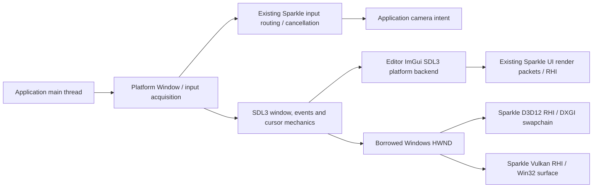

# SDL3 window and input implementation study

[Third-party migration](../ThirdPartyMigration.md#native-removal-estimates) | [Ownership and dependencies](../ThirdPartyMigration.md#ownership-and-dependency-workflow) | [Engineering](../Engineering.md)

**Recommendation: trial SDL3 first, with GLFW as the alternative.** Delegate native window creation, event acquisition, keyboard/mouse decoding and cursor operations. Keep Sparkle's input routing, cancellation, camera behavior and graphics ownership. The intended consumers are the standalone rendering application and the Editor viewport. This frees rendering work from maintaining general Windows plumbing.

**D3D12 and Vulkan remain the only rendering backends. Neither candidate requires OpenGL.** SDL's GPU and 2D rendering APIs are outside this proposal. SDL3 remains a trial; this document adds no dependency or implementation and establishes no accepted savings.

Repository inspection: **2026-11-21**, HEAD `58143b2a4fe5cff080377b1fc524454c534ade61`, with existing documentation edits. The source paths below were inspected in that working tree. This is a source study, not an executable baseline. The catalogue's reviewed scope is **752 code / at most 868 physical lines in 13 files**, before retained policy and all replacement costs.

## What SDL3 and GLFW actually do

SDL means Simple DirectMedia Layer. SDL3 provides platform services through a C API: windows, events, mouse/keyboard input, clipboard and other facilities. You can use its window/input portion independently of its audio, controller and rendering systems. GLFW provides a smaller window/input API, native-window access and Vulkan helpers. Its OpenGL-oriented examples do not make OpenGL mandatory. [SDL API categories](https://wiki.libsdl.org/SDL3/APIByCategory), [GLFW Vulkan guide](https://www.glfw.org/docs/3.4/vulkan_guide.html).

For Sparkle, either library can create the desktop window and report a resize or mouse movement. Sparkle then decides which viewport receives input, whether a camera moves and when the RHI recreates its swapchain. The library still uses Win32 internally on Windows; the benefit is transferring that implementation and its maintenance upstream.

| Term | Meaning here |
| --- | --- |
| Native window / `HWND` | The Windows object that DXGI and the Vulkan Win32 surface use for presentation. An SDL/GLFW window can expose it. |
| Event acquisition | Getting keyboard, mouse, focus, resize and close observations from the operating system. |
| Routing and policy | Choosing System/UI/Gameplay recipients, modal behavior, shortcuts and cancellation. These remain Sparkle behavior. |
| Capture | Continuing a drag outside the client area. Capture alone does not imply hiding or confining the cursor. |
| Relative mouse mode | Continuous motion suitable for camera look, without stopping at a screen edge. Distinct from an absolute UI pointer position. |
| Surface / swapchain | The connection to a window and the presented GPU images. Their graphics lifetime remains with RHI. |

## Proposed responsibility split

**SDL3 handles communication with the operating system. Sparkle keeps input behavior, application policy and all rendering.** The intended transfer is:

| Area | Transferred to SDL3 | Kept in Sparkle |
| --- | --- | --- |
| Windows | Native creation/destruction, resize, minimize/maximize and monitor operations. | Application lifetime, fullscreen decisions, Editor title-bar layout and controls. |
| Keyboard and mouse | Acquiring native events and decoding keys, buttons, pointer motion and wheel input. | Bindings, shortcuts, frame input state and deciding which viewport receives input. |
| Cursor and capture | Native capture, cursor visibility/shapes and continuous relative motion. | Deciding when camera look starts/stops and which input layer owns capture. |
| Focus and cancellation | Reporting native focus changes and managing native pointer mechanisms. | Clearing held input, releasing camera control, discarding stale events and notifying subscribers. Capture-interruption parity must pass the trial below. |
| DPI | Detecting display changes and reporting window size, drawable pixel size and scale. | Scaling Editor UI, matching viewport coordinates and resizing GPU presentation resources. |
| ImGui platform integration | Native input, clipboard, text input and cursor support through the stock SDL3 backend. | Editor panels, workspace behavior and Sparkle's UI rendering. |
| Graphics | Providing the native window handle. | The entire D3D12/Vulkan RHI: devices, resources, queues, synchronization, surfaces, swapchains and presentation. |

Core retains its small engine-facing input types and frame state, with only the necessary motion-precision adaptation. SDL does not become a general Core dependency. Processes, files, logging and task execution keep their separate owners.

The intended deletion is the custom **Win32 window/event/keyboard/mouse/cursor backend**. Small SDL-to-Core translations remain; native mechanics move upstream. **D3D12 and Vulkan stay; no OpenGL or SDL rendering API is introduced.** This is the proposed boundary, conditional on the compatibility checks below.

## SDL3 compared with GLFW

Research references are released **SDL 3.4.20**, published 2026-11-03, commit `f00dc919ca35b9756316e86c4777392de442f9b2`, and **GLFW 3.5.1**, published 2026-07-31, commit `d9d6f0f1f967807ffade6598ea9a631ebaf37a56`. Release identity was checked against upstream releases and tag commits. These are inspection references, not approved dependency pins. Both use permissive zlib-style licenses; preserve the selected source notices. [SDL release](https://github.com/libsdl-org/SDL/releases/tag/release-3.4.20), [GLFW release](https://github.com/glfw/glfw/releases/tag/3.5.1), [SDL license](https://github.com/libsdl-org/SDL/blob/release-3.4.20/LICENSE.txt), [GLFW license](https://github.com/glfw/glfw/blob/3.5.1/LICENSE.md).

| Concern | SDL3 | GLFW | Sparkle consequence |
| --- | --- | --- | --- |
| D3D12 | Exposes Windows `HWND` through window properties. | Exposes `HWND` through `glfwGetWin32Window`. | Both work with the existing DXGI presentation model. Neither needs to create a D3D device. |
| Vulkan | Native handle or optional extension/surface helpers. | Native handle or optional extension/surface helpers. | Both preserve Sparkle Vulkan devices, queues and swapchains. |
| OpenGL | Create without `SDL_WINDOW_OPENGL`; build OpenGL support off. | Set `GLFW_CLIENT_API` to `GLFW_NO_API`; use `GLFW_INCLUDE_NONE`. | No OpenGL context, renderer or engine dependency is needed. |
| Event model | Poll a queue of typed events. | Register callbacks; pump events centrally. | SDL is close to the current central pump. GLFW needs deliberate callback ownership/chaining. Both need small Core-value translations. |
| Camera pointer | Per-window relative mode and relative motion. | Disabled cursor mode, with optional supported raw motion. | Both can replace per-move cursor recentering. Sensitivity and transition behavior require testing. |
| Drag capture | Explicit `SDL_CaptureMouse`, plus automatic button capture. | Automatic native drag behavior; cursor confinement and disabled modes are available. | GLFW confinement is not equivalent to today's unconfined capture. Prove drag/cancellation semantics rather than matching function names. |
| Custom title bar | Public hit-test callback reports draggable and resize regions. | The inspected public header has no comparable custom hit-test API. | SDL has the stronger apparent fit for the existing borderless Editor. GLFW may require extra native integration. |
| Modifiers | Left/right Shift/Ctrl/Alt/GUI and Caps/Num/Scroll lock bits. | Callback modifiers aggregate left/right; lock modifier mode exposes Caps/Num. | GLFW needs more adaptation for the existing side-specific and ScrollLock contract. Do not silently drop fields. |
| ImGui | Stock SDL3 platform backend, including text/IME handling. | Stock GLFW platform backend. | Replace only the platform backend; keep Sparkle UI rendering. Qualify text input and shortcuts with either candidate. |
| Dependency scope | Larger API and configurable subsystems. | Narrower library purpose. | GLFW can be the smaller integration if native parity is cheap; SDL can delegate more of this particular window's behavior. |
| Maintenance cost | More options and a broader upstream surface; fewer reasons for local Windows special cases if fit passes. | Less library scope; missing conveniences may become local code. | Choose by the complete retained mechanism and delivery cost, not library size alone. |

The comparison is an engineering inference from the inspected APIs, not a prototype result. Relevant primary references: [SDL native properties](https://wiki.libsdl.org/SDL3/SDL_GetWindowProperties), [GLFW native access](https://www.glfw.org/docs/3.4/group__native.html), [GLFW input guide](https://www.glfw.org/docs/latest/input.html), [GLFW 3.5.1 header](https://github.com/glfw/glfw/blob/3.5.1/include/GLFW/glfw3.h), [SDL modifiers](https://wiki.libsdl.org/SDL3/SDL_Keymod), [SDL hit testing](https://wiki.libsdl.org/SDL3/SDL_SetWindowHitTest).

SDL's strongest advantages here are borderless-window hit testing, explicit capture and modifier coverage. Its disadvantages are a larger dependency, build/package integration, and an event/cursor model that still needs careful composition with ImGui. GLFW is attractive for a small conventional rendering window; Sparkle's custom chrome and existing input contract make its total adaptation cost uncertain. There is no measured latency, frame-time, binary-size or net-line advantage for either candidate yet.

## What would be replaced in this repository

Paths in the first table are relative to `Engine/Platform/Private/`. Physical counts were rechecked during this study and sum to **868**. The **752 code-line** figure remains the catalogue's reviewed count. The ceiling includes mixed policy/orchestration; it is not a promise that every listed line disappears.

| Current source | Physical lines | Proposed transfer / retained responsibility |
| --- | ---: | --- |
| [Window/WindowCreation.cpp](../../Engine/Platform/Private/Window/WindowCreation.cpp) | 63 | Replace class registration, `CreateWindowExW`, native destruction and DWM setup with SDL window creation/destruction. Preserve title, initial maximized behavior and borderless appearance. |
| [Window/WindowMessages.cpp](../../Engine/Platform/Private/Window/WindowMessages.cpp) | 104 | Retire the custom WndProc, `PeekMessage`/dispatch and native message broadcast. SDL owns pumping; preserve mandatory size/DPI/close updates and event delivery semantics. |
| [Window/WindowDisplay.cpp](../../Engine/Platform/Private/Window/WindowDisplay.cpp) | 129 | Replace monitor/style/placement/show/DPI mechanics with SDL calls. Keep fullscreen/shortcut policy and requested transitions. Dragging moves to hit testing. |
| [Window/WindowNonClient.cpp](../../Engine/Platform/Private/Window/WindowNonClient.cpp) | 115 | Retire Win32 non-client handling after proving SDL hit testing, minimum size, work-area maximization and resize behavior. Editor still supplies the interactive title-bar regions. |
| [Window/Window.cpp](../../Engine/Platform/Private/Window/Window.cpp) | 78 | Retain a smaller `Window` lifetime and meaningful operations; remove obsolete native helpers/state. This is mixed orchestration, not a whole-file retirement claim. |
| [Input/Backends/Win32InputBackend.cpp](../../Engine/Platform/Private/Input/Backends/Win32InputBackend.cpp) and header | 88 | Delete the Win32 message switch/variant transport. Decode SDL keyboard/mouse/focus observations into the existing input processing boundary. |
| [Input/Backends/Win32KeyboardInput.cpp](../../Engine/Platform/Private/Input/Backends/Win32KeyboardInput.cpp) and header | 149 | Delete virtual-key/scancode decoding and `GetKeyState` polling. A small explicit SDL-to-Core key/modifier map remains necessary. |
| [Input/Backends/Win32MouseInput.cpp](../../Engine/Platform/Private/Input/Backends/Win32MouseInput.cpp) and header | 53 | Delete packed-coordinate/wheel decoding and screen-to-client conversion. Translate SDL events into Core values with deliberate units and wheel direction. |
| [Input/Backends/Win32PointerControl.cpp](../../Engine/Platform/Private/Input/Backends/Win32PointerControl.cpp) and header | 89 | Delete `SetCapture`/`ReleaseCapture`, `ShowCursor` counter loops and centering mechanics. Use SDL capture/relative mode/cursor APIs. |

Adapters and callers are still charged, including outside those 13 files:

| Connected owner | Required change / what stays |
| --- | --- |
| [Window public contract](../../Engine/Platform/Public/Window/Window.h) | Replace native message exposure and Win32 private fields. Keep the useful window contract, observable dimensions/state and explicit native presentation interop. Its header is outside the 868-line ceiling. |
| [InputSystem state and processing](../../Engine/Platform/Private/Input/InputSystemState.h), [pointer operations](../../Engine/Platform/Private/Input/InputPointerControl.cpp), [cancellation](../../Engine/Platform/Private/Input/InputCancellation.cpp) | Replace backend calls and subscription. Keep logical capture layer, ordered state publication, cancellation epochs, synthesized releases and subscription lifetime. |
| [Input routing](../../Engine/Platform/Private/Input/Routing), [dispatch](../../Engine/Platform/Private/Input/Dispatch) | Retain UI/Gameplay/System routing, modal/text-focus behavior, immediate/deferred subscribers and queue cancellation. SDL/GLFW do not know these engine rules. |
| [Core input values/state](../../Engine/Core/Public/Input) | Keep engine-facing keys, buttons, events and per-frame state independent of SDL. Review motion units/precision as described below. No SDL dependency moves into Core. |
| [CameraInputIntentCollector](../../Engine/Application/Private/Input/CameraInputIntentCollector.cpp) | Keep right-button look, Escape cancellation, movement bindings, sprint and speed policy. Replace per-move `CenterCursor()` with a deliberate relative-mode request. |
| [EditorImGuiContext](../../Engine/Editor/Private/ImGui/EditorImGuiContext.cpp) | Replace `ImGui_ImplWin32_*` and raw `WM_KEYDOWN` shortcut handling with the stock SDL3 platform backend and normalized shortcut input. Keep context, theme and Editor policy. |
| [TitleBarWindowControls](../../Engine/Editor/Private/Workspace/TitleBarWindowControls.cpp), [UIWorkspace](../../Engine/Editor/Private/Workspace/UIWorkspace.cpp) | Publish current draggable/excluded regions for hit testing. Keep menu/buttons, double-click behavior and viewport routing. Remove obsolete drag initiation and direct ImGui mouse-state repair when no longer needed. |
| [GameApplication](../../Engine/Application/Private/Game/GameApplication.cpp), [EditorApplication](../../Engine/Application/Private/Editor/Host/EditorApplication.cpp) | Preserve event/frame order, minimized waiting and destruction order; compose SDL lifetime with the existing host. |
| [ImGui dependency recipe](../../CMake/Dependencies/Targets/imgui.cmake), [Platform target](../../Engine/Platform/CMakeLists.txt) | Select `imgui_impl_sdl3.cpp`, wire one SDL runtime, remove backend-only link dependencies once unused and regenerate source membership. |
| [D3D12 swapchain](../../Engine/RHI/Private/D3D12/SwapChain/D3D12SwapChain.cpp), [Vulkan swapchain](../../Engine/RHI/Private/Vulkan/SwapChain/VulkanSwapChain.cpp), [D3D12 capture binding](../../Engine/RHI/Private/D3D12/Device/D3D12RenderDeviceServices.cpp), [Vulkan capture binding](../../Engine/RHI/Private/Vulkan/Device/VulkanRenderDeviceServices.cpp) | Borrow the library-created native handle. Retain both RHI implementations, surface/swapchain lifetime and external GPU-capture bindings. |

## D3D12 and Vulkan integration

Use **native-handle presentation first** for this Windows-only migration. It changes the window's producer without introducing another graphics abstraction:



**D3D12:** retrieve `SDL_PROP_WINDOW_WIN32_HWND_POINTER` using SDL window properties, then continue passing that handle to `CreateSwapChainForHwnd`. Preserve the external capture factory path as well as the ordinary DXGI factory path. SDL does not allocate backbuffers or present frames. GLFW's equivalent is `glfwGetWin32Window`. [SDL properties](https://wiki.libsdl.org/SDL3/SDL_GetWindowProperties), [GLFW native access](https://www.glfw.org/docs/3.4/group__native.html).

**Vulkan:** retain the existing `VulkanSwapChain::CreateSurface`, `vkCreateWin32SurfaceKHR`, instance-extension selection and present-support check, using the borrowed HWND. This keeps RHI independent of SDL headers/libraries and leaves the Vulkan loader with its current owner. A basic SDL window used only through this Windows interop path needs neither `SDL_WINDOW_VULKAN` nor `SDL_WINDOW_OPENGL`.

SDL's optional portable path uses `SDL_WINDOW_VULKAN`, `SDL_Vulkan_GetInstanceExtensions` before instance creation, and `SDL_Vulkan_CreateSurface` afterward. The RHI would still own the returned surface and all GPU objects. This path adds a library/loader boundary and is unnecessary to retire the current window backend; reconsider it only for a real portability consumer. GLFW's Vulkan helpers have a similar role. [SDL surface requirements](https://wiki.libsdl.org/SDL3/SDL_Vulkan_CreateSurface), [SDL window flags and loader behavior](https://wiki.libsdl.org/SDL3/SDL_CreateWindow), [GLFW Vulkan guide](https://www.glfw.org/docs/3.4/vulkan_guide.html).

Expose native handles through a narrow explicit Platform interop boundary; do not spread SDL types into RHI public interfaces. A borrowed HWND is valid only while its owning window exists. Stop presentation and settle GPU use, destroy swapchain/surface and Editor backend, release input subscriptions/cursor modes, then destroy the SDL window and shut down its subsystem. Keep atomic dimension publication where render-side readers need it; main-thread SDL queries are not a replacement for that contract.

## The compatibility work that decides the trial

### One event pump and the existing input policy

Keep `GameApplication::BeginFrame` ordering: advance input state, poll events, process deferred events, then continue the frame. One main-thread owner initializes video, creates the window and drains SDL events. `Window::PollEvents` remains a suitable existing entry point. Keep the current application loop/entry points; SDL3's alternate callback application model is optional. [SDL polling/thread rules](https://wiki.libsdl.org/SDL3/SDL_PollEvent), [SDL entry points](https://wiki.libsdl.org/SDL3/README-main-functions).

Provide Editor with a borrowed SDL window and synchronous SDL event access through one explicit Platform interop contract. Input decoding stays inside Platform; Editor forwards relevant events to `ImGui_ImplSDL3_ProcessEvent`. Do not reconstruct Win32 messages, create a generic backend factory, add another event queue or expose SDL throughout the engine. Borrowed SDL events and text storage must not escape synchronous delivery; deferred delivery uses owned Core values.

Both ImGui and InputSystem need observations. The ImGui backend's return value is not permission to suppress global input state or focus/cancellation. Keep engine routing as the recipient authority and keep mandatory close/size/DPI state independent of UI consumption. Preserve F11/Alt+Enter non-repeat fullscreen behavior and the Editor's Grave shortcut/text-input exclusion. For GLFW, explicitly choose callback installation/chaining so one consumer cannot replace another's callback.

### Capture, cancellation and cursor authority

Keep ordinary UI drag capture separate from camera relative mode. SDL capture permits coordinates outside the window and automatically releases on focus loss; relative mode hides/constrains the pointer and provides continuous motion. SDL also has automatic capture during button presses. Choose its automatic-capture setting deliberately rather than maintaining an inconsistent second native capture state. [Capture semantics](https://wiki.libsdl.org/SDL3/SDL_CaptureMouse), [relative mode](https://wiki.libsdl.org/SDL3/SDL_SetWindowRelativeMouseMode).

Focus loss, modal/target changes, close and capture interruption must still clear the right state, discard queued stale input and synchronously deliver releases to immediate and deferred subscribers. State must be cleared before cancellation callbacks, including reentrant callbacks. Pointer-only cancellation must preserve held keyboard state. Do not assume focus loss covers every existing `WM_CANCELMODE`/`WM_CAPTURECHANGED` case; mouse leave is also not capture loss.

This is an unresolved fit question. The inspected [SDL Windows event implementation](https://github.com/libsdl-org/SDL/blob/release-3.4.20/src/video/windows/SDL_windowsevents.c) handles capture changes internally, but that alone does not prove Sparkle observes every required cancellation. Exercise same-focus capture interruption and native drag/modal loops. If a gap needs an OS hook, prove a supported narrow mechanism observes it, charge it and keep it private; do not assume a queued-message hook sees messages delivered synchronously. Recreating the old WndProc/input backend fails the delegation goal.

The stock ImGui SDL3 backend also calls capture and cursor APIs during `NewFrame`. Relative mode, engine cursor visibility and ImGui cursor updates must agree. Define normal UI ownership and the temporary camera override; restore it on every exit/failure. `ImGuiConfigFlags_NoMouseCursorChange` can control backend cursor updates, but does not disable its capture calls. Prove coexistence without editing upstream or adding a second capture state machine. [Pinned ImGui SDL3 backend](https://github.com/ocornut/imgui/blob/6d910d5487d11ca567b61c7824b0c78c569d62f0/backends/imgui_impl_sdl3.cpp).

### Camera motion and Core values

Today Platform computes deltas by subtracting absolute integer cursor positions, and `CameraInputIntentCollector::OnMouseMove` recenters the cursor after each look movement. With SDL relative mode, use supplied relative motion and delete the recurring warp/baseline path for camera look. Keep absolute positions for hit testing, UI and viewport selection. Mode entry/exit and focus recovery must produce no artificial look delta; a failed mode change must leave logical capture/cursor state truthful.

SDL motion is floating point; Core's current `MouseDelta` and `InputState::AccumulateMouseDelta` are integer pixel contracts. **Proposed narrow Core change:** preserve fractional relative motion through a floating-point delta and accumulation contract, document its units, and update the camera consumer directly. Keep absolute client positions separate and convert them once at acquisition. Do not truncate each relative event or describe raw device motion as desktop pixels. This is a proposed contract change, not an adopted decision; include every affected caller in the trial ledger.

Relative/raw input can change the effect of Windows acceleration and therefore camera sensitivity. Freeze expected direction, response and speed behavior before the trial, then compare slow and fast motion, high polling rates, screen-edge travel and mixed DPI. Do not promise identical feel or lower latency without observations. GLFW's disabled/raw modes need the same checks. [GLFW motion behavior](https://www.glfw.org/docs/latest/input.html#raw_mouse_motion).

### Custom title bar and DPI

Current `TitleBarWindowControls` starts a native drag after ImGui detects dragging and then repairs `io.MouseDown`. SDL hit testing happens earlier, during native processing, and may prevent ordinary mouse delivery in special regions. Editor should publish stable title-bar geometry and exclusions for menus/buttons; Platform classifies draggable/resize regions without calling ImGui, allocating or initiating camera input from the callback. Validate maximize/restore double-clicks and drag-from-maximized behavior before deleting the current path. [Hit-test behavior](https://wiki.libsdl.org/SDL3/SDL_SetWindowHitTest).

Preserve initial maximized startup, borderless windowed presentation, minimum tracking size, edge/corner resizing, work-area maximization, monitor selection and F11/Alt+Enter restoration. Current fullscreen covers the monitor by changing window styles; do not accidentally replace it with a display-resolution switch or DXGI exclusive fullscreen. Preserve the required behavior rather than assuming identical-looking SDL/GLFW function names have identical semantics.

Track drawable pixel size and UI display scale separately. Use `SDL_GetWindowSizeInPixels` for swapchain extent and `SDL_GetWindowDisplayScale` for UI scaling; do not derive drawable extent by multiplying dimensions by DPI. On Windows, window coordinates are already physical pixels while the content scale can be 1.5 or 2.0. Avoid double scaling input regions or ImGui. Review the existing PerMonitorV2 manifest and SDL awareness configuration together. [SDL high-DPI model](https://wiki.libsdl.org/SDL3/README-highdpi), [current manifest](../../Engine/Platform/Private/Window/SparkleApplication.manifest).

Keep rendering skipped while minimized/zero-sized. A replacement for `WaitForEvent` must either leave the wake event queued or process it through the same dispatch path; consuming and forgetting an SDL wait result can lose the only close, key-release or restore event. During native move/resize loops SDL polling can block on Windows, so responsive rendering during dragging is not an automatic benefit of this migration. [Polling caveat](https://wiki.libsdl.org/SDL3/SDL_PollEvent).

### Keyboard, text and wheel conversion

Map key values explicitly: Core enum numbers, SDL keycodes/scancodes and GLFW key tokens are not interchangeable. Preserve repeat filtering, keypad/navigation distinctions, left/right modifiers and all current lock flags. Decide physical-position versus layout-dependent meaning against today's bindings; test non-US layouts, AltGr and the Grave shortcut. Text entry is a separate stream from command keys; keep the stock ImGui text/IME/clipboard path rather than implementing character synthesis in Core.

Preserve vertical/horizontal wheel fractions, direction and client position, including negative coordinates during capture. SDL exposes wheel direction and motion fields; normalize them once before routing. GLFW scroll callbacks need association with the correct current pointer position. Cursor shape selection should remain with the stock UI backend outside camera look.

## Platform and Core simplification boundary

| Concern | Result of this proposal |
| --- | --- |
| Native window, keyboard, mouse, cursor and event mechanics | SDL3 owns the implementation. Delete the superseded Platform Win32 backend after fit passes. |
| Core input enums/events/state | Keep the small engine vocabulary and frame-state semantics; adapt only necessary precision/units. These are useful contracts for multiple consumers, not another native backend. |
| Platform routing/dispatch/cancellation | Retain cohesive policy with its current owner. SDL's keyboard state is not a substitute for layer state or synthesized releases. |
| Core child processes | Keep the separate [Boost.Process study](BoostProcess.md). Adding SDL does not establish process-tree, pipe, cancellation or Launcher workflow parity. Count no process savings under W. |
| Core JSON | Already delegated to nlohmann/json under the [retained decision](../ThirdPartyMigration.md#json). No additional retirement credit. |
| Tasks, files/paths, time, logging and publication | No replacement is established by this window trial. Reuse their existing owners; do not add SDL wrappers for unrelated services. Task execution has its own [plan](TaskRuntime.md). |
| RHI / Renderer | Keep D3D12, Vulkan, GPU allocation, synchronization, presentation, render graph and UI rendering. Native Windows graphics interop remains legitimate. |
| Launcher | Keep its existing Qt window/input implementation. SDL belongs to engine runtime/Editor consumers, not a second Launcher GUI framework. |

Keep the existing `Window` and `InputSystem` contracts where they express actual behavior. Implement them directly against the selected library. Avoid `IWindowBackend`, backend registries, interchangeable SDL/GLFW/Win32 implementations and forwarding-only facade chains. A comparison study does not require shipping two providers.

## Dependency and delivery design

Use the [existing dependency workflow](../ThirdPartyMigration.md#ownership-and-dependency-workflow): a pinned recipe under `CMake/Dependencies/Targets`, selection in `FetchDependencies.cmake`, source-package metadata, Launcher availability/sync metadata, notices and package inventory. Keep upstream source in ignored `build/_deps` and use imported/upstream targets. Both projects ship build/test infrastructure, but upstream results do not qualify Sparkle; exact-pin advisory, toolchain and enabled-dependency review remains open. [SDL source](https://github.com/libsdl-org/SDL/tree/release-3.4.20), [GLFW source](https://github.com/glfw/glfw/tree/3.5.1).

For the SDL trial, propose **one shared SDL3 runtime** used by Platform and the ImGui platform backend, with `SDL3.dll` staged through the existing target/package graph. This avoids independent SDL global state if static SDL were linked into multiple engine DLLs. Record the DLL/startup/package cost. A static alternative needs a demonstrated single implementation owner, not duplicate runtime copies.

Build video/events/keyboard/mouse support; disable unused audio, GPU, 2D render, camera, joystick/haptic/sensor and other optional subsystems where the stock ImGui backend still builds and behaves correctly. Set `SDL_OPENGL=OFF` and `SDL_OPENGLES=OFF`. For the chosen native-HWND Vulkan path, SDL's own Vulkan helper support is unnecessary; Sparkle's Vulkan target remains enabled independently. Do not confuse disabling SDL GPU/Direct3D render drivers with disabling Sparkle D3D12. Verify actual option names/dependencies against the pin. [SDL CMake source](https://github.com/libsdl-org/SDL/blob/release-3.4.20/CMakeLists.txt), [CMake integration](https://wiki.libsdl.org/SDL3/README-cmake).

Replace `imgui_impl_win32.cpp` with `imgui_impl_sdl3.cpp` at the existing ImGui revision first. The inspected backend offers `InitForD3D`, `InitForVulkan` and `InitForOther`; select the platform initialization appropriate to the retained renderer without adding an upstream ImGui graphics backend. Its gamepad-related calls must remain linkable with the selected SDL options. Keep dependency links private where no public contract requires them. Regenerate the recursive Platform target after deleting/adding files.

## Implementation sequence and evidence

The catalogue currently orders the SDL trial after the task-runtime decision. This study does not change that order. When implementation starts, use the bounded [code-delivery policy](../ThirdPartyMigration.md#code-delivery-and-qualification): decisive fit first, actual caller conversion next, broader qualification recorded separately.

| Stage | Work and exit |
| --- | --- |
| 1. Freeze the comparison | Record relevant source hashes/dirty edits, current window/input behavior and selected upstream pin/options. Name repeatable API/profile/capture inputs and cost tolerances before trials. Preserve the 13-file ceiling and measure connected callers separately. Full benchmarking is not a prerequisite to the first prototype. |
| 2. Prove decisive fit | Exercise one real engine window with existing D3D12 and Vulkan presentation, custom title-bar/resize behavior, ImGui coexistence, relative camera motion and interruption recovery. Resolve capture notification and cursor authority early. If SDL needs substantial native reimplementation, stop and assess GLFW against these same contracts. |
| 3. Convert the owners | Replace Window internals and input acquisition; adapt Core motion values, camera collector, Editor platform backend, title-bar regions, host lifetime and native-handle consumers. Retain one pump and existing routing/cancellation. Use the stock upstream implementation. |
| 4. Retire and close code delivery | Delete superseded Win32 files/messages, unused members/options/link dependencies and obsolete ImGui backend membership. Finish pin/notices/staging/package inputs, affected builds and focused behavior/failure/lifetime checks. No fallback backend or temporary validation source is submitted. Report net cost honestly. |

Focused checks below are proposed and **UNVERIFIED**. A build can establish linkage; it cannot pass a GUI, GPU, input-feel or package check.

| Check | Required observation |
| --- | --- |
| D3D12 and Vulkan, separately | Existing scene presents; resize/minimize/restore/fullscreen work; zero extent does not trigger invalid presentation; surface/handle lifetime is correct. Exercise both ordinary and external capture paths when affected. |
| Borderless window | Correct startup/maximize/work area/minimum size, edge/corner resize, menu/button exclusions, drag and double-click behavior; restore returns to the intended monitor/placement. |
| Focus/capture/cancellation | Hold movement and right-button look, then Alt+Tab, interrupt capture, open a modal, change viewport target, minimize and close. No stuck buttons, stale deferred input, duplicate logical releases, hidden cursor or unexpected look jump. Include reentrant cancellation. |
| Camera/input fidelity | Slow/fast and edge-crossing motion, fractional deltas, repeat keys, left/right modifiers, Caps/Num/Scroll lock, keyboard layouts, text/IME/clipboard and both wheel axes preserve required behavior. |
| DPI | 100/150/200% and mixed-monitor moves: correct pixel extent, UI scale, pointer/viewport alignment, minimum size and no repeated scaling. |
| Minimized wait / failure / shutdown | A single wake event is retained; close wakes idle application; mode/window/backend initialization failures unwind safely; subscriptions/backend are gone before the window; presentation is settled before native destruction. |

After the code exit, wider profile/hardware runs, frame-time/input-latency distributions, cold-start/binary costs, visual comparisons and relocated package/clean-machine campaigns remain with their existing qualification owners. Record PASS, FAIL, INCONCLUSIVE and UNVERIFIED against the actual candidate; do not turn source or build checks into release acceptance. At closure, fold lasting decisions into the catalogue and remove this temporary implementation plan.

## What makes this migration worth keeping

The main gain is maintenance ownership: Sparkle stops implementing native window dispatch, key decoding and cursor mechanics. Residual glue should translate engine meaning or connect actual consumers. If it reproduces Windows mechanics, shadows library state or requires a maintained upstream fork, reconsider the integration.

Use the existing accounting rule across the complete change:

```text
scoped net native removal = 868 - retained old scoped lines
                               - all new/relocated integration and caller lines
```

Count additional caller retirements only through separately named scopes. Report CMake/scripts, dependency source, build time, memory, binary/runtime and package costs separately. No net reduction is established yet, and shrinking Core enums or deleting cancellation safeguards is not a way to manufacture one.

**Adopt SDL3 if the focused fit and code exit pass and the remaining integration is meaningfully easier to own.** Prefer GLFW if it preserves the same behavior with less total glue. If neither achieves that, keep the current implementation and record the concrete reason. The decision is which library takes this support work off Sparkle's hands while preserving the two native graphics backends.
