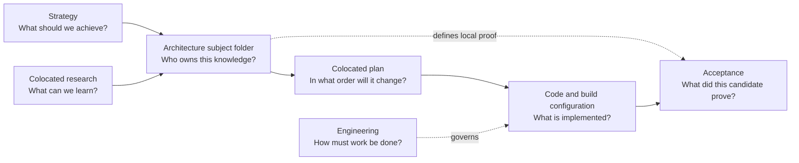

# SparkleEngine Documentation

**Status:** documentation entry point and authority map

Use these pages to understand the engine, choose your next task and find the design or proof behind a feature.

## Start Here

| I want to... | Open |
| --- | --- |
| Continue the first release | [Roadmap](Strategy/Roadmap.md#where-we-are-and-what-is-next) -> [work plan](Architecture/CrossModule/FirstRelease/README.md) -> [shipping checks](Acceptance/FirstRelease.md) |
| Understand the engine | [Engine at a glance](Architecture/EngineAtAGlance.md) -> [repository map](Architecture/WholeRepositoryMap.md) |
| Find a module or feature | [Architecture](Architecture/README.md) -> [modules](Architecture/Modules/README.md) |
| Work on rendering | [Renderer](Architecture/Modules/Engine/Renderer/README.md) or [RHI](Architecture/Modules/Engine/RHI/README.md) |
| Build, cook or package | [Launcher](Architecture/Modules/Tools/Launcher/README.md) -> [build](Architecture/Modules/BuildAndPackaging/README.md) -> [package](Architecture/Modules/BuildAndPackaging/PackagingAndInstallation.md) |
| Contribute or review | [Contributing](../CONTRIBUTING.md) -> [engineering rules](Engineering/README.md#choose-by-task) |
| Find results or workload checks | [Acceptance](Acceptance/README.md) |

Each page has a **Docs / Up** route. Combined guides link directly to their sections. Open detailed research or reports only when the task needs them.

## How The Documentation Fits Together

The repository is organized by owning subject first. Strategy, Engineering, and release Acceptance remain distinct top-level authorities; architecture, plans, research, capability snapshots, and feature-local acceptance are colocated under the module or cross-module subject they describe.

Code and executable build configuration are the authority for implemented behavior. Documentation explains intent, design, limits, procedures, and required evidence; it does not turn source presence into a successful build or runtime result.

## Authority Boundaries

Compare documentation responsibilities

| Authority | Owns | Does not own |
| --- | --- | --- |
| [Strategy](Strategy/README.md) | desired capabilities, priorities, roadmap, operating model, dated assessments | implementation rules or system internals |
| [Architecture subject tree](Architecture/README.md) | module/feature ownership and navigation; current maps, design, decisions, capability snapshots, and feature-local proof contracts | release results or proof that source-present behavior ran |
| Colocated `Plan.md` or named plan | ordered delivery, dependencies, stop conditions, migration and validation sequence for its owning subject | enduring design decisions or completion claims |
| Colocated research document | external precedent, option studies, visual exploration, and dated baselines for its owning subject | local decisions, implementation state, or evidence grades |
| [Engineering](Engineering/README.md) | workflow, implementation standards, module rules, verification, engineering decisions | release scope, system design, or product research |
| [Acceptance](Acceptance/README.md) | shared completion language, candidate reports, workload/release gates, high-level progress | duplicate feature architecture or local feature criteria |

Colocation changes how readers find related knowledge; it does not merge authority. Each document's filename, status header, and responsibility still distinguish current state, target architecture, plan, research, and acceptance.

## Status Language

| Label | Meaning |
| --- | --- |
| `Implemented path` | Source and build membership contain the named route. It may still be unbuilt and untested. |
| `Partial` | A useful route exists, but important cases or product boundaries are missing. |
| `Capability-gated` | SDK, build option, API, device, vendor, content, or configuration controls availability. |
| `Not found` | The targeted source/build audit found no current implementation owner. |
| `Unproved` | The architecture is documented, but its required executable evidence has not been accepted. |
| `Blocked` | A named prerequisite prevents the next acceptance or delivery decision. |

The numeric readiness score is separate from these state labels. It adds implementation, integration, verification, and delivery components for orientation; it does not turn acceptance into an average. See the [scoring model](Acceptance/CurrentReadiness.md#scoring-model).
