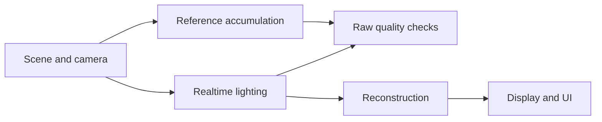

# Rendering

[Documentation](README.md) | [Goals](Goals.md) | [Roadmap](Roadmap.md)

## Overview

Sparkle renders immutable scene and camera data through geometry, lighting, reconstruction and display stages. A separate Reference renderer provides the raw comparison needed to evaluate lighting.

The source contains raster/ray surface paths, direct/indirect lighting, linear reconstruction, optional D3D12 DLSS, exposure, tone mapping and partial lens effects. Image correctness and native-API validation are still in progress. Decals, color grading and HDR are unfinished release features.

- [Release features](#release-features)
- [Reference renderer](#reference-renderer)
- [Later rendering work](#later-rendering-work)
- [Owned neural rendering](#owned-neural-rendering)
- [Test scenes](#test-scenes)
- [Source map](#source-map)

Compare raw lighting before reconstruction or display. Filtering and tone mapping cannot establish whether the original lighting mean is correct.

## Release features

### Frame and materials

The frame accepts complete immutable scene/view inputs. Serial and threaded execution must agree, queues and resource use stay bounded, and GPU resources survive every queue that references them. The frame graph needs actual producers, correct dependencies, barriers and aliasing.

Follow an asset through source identification, import, cooking, animation, material interpretation and raw pixels. Compare raster, ray and Reference identity, transforms, tangent/normal frames, texture colors/channels, alpha and sidedness. Check capacity, missing/corrupt data and resource replacement.

Base shading needs matching evaluation, sampling and probability densities (PDFs), with energy/furnace checks and correct delta/roughness behavior. Geometric normals control visibility and ray origins; shading normals follow the chosen surface model.

The current visibility path uses CPU frustum culling and batching with fixed residency budgets for opaque/alpha-tested surfaces. General streaming, occlusion/LOD and GPU-driven geometry are outside that path.

### Direct lighting

Direct lighting needs analytic or exhaustive small-light comparisons, correct units, emitter identity, selection probabilities, measure conversion and visibility. Reservoir reuse must preserve the intended raw mean during motion, disocclusion and zero-support cases. Keep the estimator in Renderer and use RTXDI as a reference implementation.

### Indirect lighting

Indirect lighting needs a defined path domain, proposal density, shift/replay mapping, normalization, next-event estimation, multiple importance sampling (MIS), roulette and robust visibility. Replaying a random seed alone does not establish valid path reuse. Diffuse/rough-specular support does not imply transmission or caustics; an environment image is not a physical atmosphere.

### Reconstruction

Reconstruction depends on correct raw diffuse/specular signals and guides: albedo, normals, roughness, depth, motion, jitter and exposure. Check SDK formats/ranges, history resets, GPU lifetime and whole-frame cost. Super Resolution and Ray Reconstruction must produce one output without filtering or upscaling it twice.

Linear reconstruction exists. Optional DLSS currently uses D3D12; Vulkan vendor reconstruction, dynamic resolution, Renderer MSAA, standalone TAA/FXAA/SMAA and frame generation are not established capabilities.

### Decals

Decals need authored/cooked data, scene/GPU updates, deterministic GBuffer composition before lighting and matching evaluation at arbitrary secondary-ray hits. Screen-space projection alone cannot cover reflections. Test projection derivatives, filtering and overlap.

Choose projection, clipping, blending/order, identity, lifetime and capacity before implementation. A DBuffer or dedicated decal acceleration structure needs a demonstrated use case.

### Exposure, tone mapping and grading

The current tone operators include Reinhard, ACES approximation and ACES fitted. Those choices do not establish calibrated ACES output.

Color grading needs one scene-referred global grade and a 3D LUT with color metadata through import, cooking and per-view lifetime. Define LUT axes/domain, working color space, negative/HDR behavior and interpolation. File grammar, malformed-input handling, failure behavior and budgets remain open decisions. Volume grading, multi-look blending and an OCIO runtime are outside scope.

The target display order is reconstruction, exposure/scene grade, tone/gamut mapping, vignette, chromatic aberration, encoding, then UI/present. Raw Reference and exact diagnostic views bypass artistic effects.

### Lens effects

Vignette and chromatic aberration have partial fixed passes. The first chromatic effect uses a fixed three-channel model. Evaluate the output-pixel strength proposal, then choose units, radial/aspect behavior and approved On defaults before implementation.

Check viewport subrects and resizing, unchanged alpha/UI/raw output, and cost. At neutral strength, output must equal the input with no effect pass, allocation or copy. Vignette ordering still needs to match the target order above. New public controls are deferred.

### HDR

The target is Windows HDR10 with Rec.2020/D65/PQ: a compatible format/color space, metadata, OS/display state, correct UI white and explicit SDR recovery on both APIs.

Packed-10/PQ versus FP16/scRGB for Editor composition remains a platform decision. A format name or successful metadata call does not establish the active color interpretation. A 10-bit texture, Linear mode or screenshot is not evidence of HDR display output.

## Reference renderer

Reference accuracy still needs independent execution checks. See [Current priority](Roadmap.md#current-priority) for the Sponza repair.

### Transport domain

The full target is camera-originating scene-linear RGB reflective surface transport: visible emission/environment, direct next-event estimation, indirect reflection and compensated roulette. Transmission, media, physical subsurface and spectral transport are excluded.

The canonical material is glTF-style Lambertian plus single-scatter isotropic GGX/Smith/Schlick, with delta reflection at zero roughness and explicit normal, alpha and sidedness rules. Preserve metres, left-handed coordinates, row-vector/row-major transforms, reversed-Z, pinhole/box pixel sampling, linear Rec.709/D65 and base-mip bilinear textures.

Light/lobe probabilities, comparable measures, MIS and emitter endpoints must match the estimator. Reference must not use the production GBuffer, reservoirs, denoised signals, temporal reconstruction or exposure/display results as transport input. Assets and low-level traversal may be shared, but shared decoding, transforms, materials and intersections need independent analytic, minimal or cross-renderer checks.

### Accumulation and validation

The full surface reference has no valid deterministic depth/distance cutoff. The finite-path diagnostic is a separately labeled bounded product without roulette.

Binary32 mean/variance accumulation and exact counts commit complete sample prefixes up to 1,048,576 samples per pixel. Non-finite values, overflow, safety-depth termination and mixed, stale or truncated output invalidate a reference result.

Finish analytic-rectangle camera/BSDF/visibility intersections, emitter identity and matching PDFs. Perfect-mirror and competing/collinear-emitter examples must expose the defect.

Remaining checks cover independent references and uncertainty, rejection of invalid sample prefixes/files, identity changes, resets, cancellation, session preservation, inline/pipeline agreement, D3D12/Vulkan, GPU lifetime, ShippingEditor output and final scene/package reproduction. Reference controls/export in Game are excluded. Completed sampling or a sky-only image is insufficient.

## Later rendering work

These extensions follow release and their required inputs; [Roadmap](Roadmap.md#after-release) sets their delivery order. Test each feature before the selected combined configuration, with raw/uncached, TLAS and BCn results kept as controls. Unsupported requests must report the actual active path and reason.

### Transport and materials

- **Direct sampling:** mixed analytic, emissive-triangle and environment proposals with correct probabilities/support and bounded work. Compare variance and temporal quality at equal cost; guiding/ReGIR or advanced reuse needs a measured benefit.
- **Indirect resampling:** start with a narrow ReSTIR GI-style secondary-path domain, then multi-bounce diffuse/rough-specular work. Derive path records, shift mappings and GRIS normalization before optimizing replay.
- **Materials:** anisotropic GGX and one dielectric coat, with energy, sampling, PDF and tangent-frame checks. Extend the independent reference domain, then check guides, temporal behavior, native APIs and delivery.

### Reconstruction and caches

- **Reconstruction:** one RELAX diffuse/specular temporal path, with quality, time, memory, motion, native-API and delivery results. The owned CNN is independent of this work.
- **SHaRC:** bounded diffuse update/resolve/query with cold starts, resets, moving scenes, capacity and cache misses. Continue uncached paths on misses and measure benefit, GPU safety, package behavior and reproduction. Media/sharp-specular caching and streaming are outside scope.
- **NRC:** actual online learning/coupling, adaptation and bias measurements, compared with SHaRC and uncached transport on the same domain. Complete SHaRC, including reproduction, before NRC production.
- **Neural texture compression:** cooked latent materials and on-sample decode, filtering/LOD/material fidelity, BCn comparison and memory/compute tradeoffs, followed by native-API and delivery checks. It requires the classical-study results, not NRC completion.

### Acceleration structures and volumes

**PTLAS** needs sparse updates, creation/removal/reassignment, bounded migration/capacity, BLAS/SBT replacement and one translation/reset/rebase example. Compare images/identity and total build/traversal cost with TLAS on supported API/device combinations. The current experimental strategy disables updates/translation and emits at most one operation.

**Volumetrics** starts with physical coefficients, phase and analytic transmittance/in-scatter, then homogeneous/height fog with one light, then bounded local froxels, selected analytic lights/shadows and temporal reconstruction. Atmosphere, clouds, imported volumes and volumetric ReSTIR are outside this work. The surface Reference does not provide volume support.

Preserve extinction and the composition rule: attenuated surface radiance plus integrated volume emission/scattering. Use Beer–Lambert/slab and phase-function checks before temporal froxels. [Research references](References.md#rendering-research) explain the methods and alternatives.

## Owned neural rendering

This planned feature is not implemented. After release and the classical-study results, develop one spatial diffuse-indirect denoiser with owned data, training, checked fixed-model GPU kernels and held-out results. Vendor integration does not demonstrate that work.

### Data and comparison

Generate an albedo-modulated indirect-diffuse reference component with matching event partition, PDF/MIS/roulette, camera, pose, pixel footprint, units, scene state and sample-prefix uncertainty. Beauty images or subtraction of unrelated images are not valid labels; Reference noise may differ from realtime reuse noise.

The proposal is one non-recurrent residual convolutional network over scene-linear radiance and surface guides, compared with a radius-three spatial cross-bilateral filter on the same signal. Display transforms and image history are excluded.

Train on checked Sponza/Cornell data, validate on Bistro and reserve San Miguel for final testing. Prevent neighboring frames/patches crossing splits. Check rights, alignment, tiny-batch/gradient behavior, ablations and exact export.

The small spatial model makes operators, memory and numerical error inspectable. It does not inherit the results of recurrent/U-Net or pretrained-network research. Keep failed value studies and consider a focused revision or removal.

### Proposed targets

Agree these limits before training or evaluating the model:

| Test | Target |
| --- | --- |
| Numerics | Every FP32 operator/intermediate/output agrees with an independent float64 evaluator within `0.0001 + 0.0001*abs(reference)`, also checked against PyTorch FP32. Detect channel, padding, halo and edge faults. |
| Quality benefit | At least 5% lower masked log-RMSE, with linear NRMSE and whole-frame 95th-percentile time no worse by more than 1%. |
| Alternative speed benefit | At least 10% lower denoising GPU 95th-percentile time, with both errors and whole-frame time no worse by more than 1%. |
| Cost | GPU 95th-percentile time at most 2 ms at 1920x1080 on the tested minimum machine; extra workspace at most 320 MiB; no image history. |
| Temporal/detail behavior | Residual-change and gradient-error RMS at most 1.02 times baseline; absolute normalized signed bias at most 0.01. |
| Reproduction | Report seeds 0, 1 and 2 separately; same-seed/environment log-RMSE within 1%; identical accepted-checkpoint export bytes. Profile training and inference separately. |

Quality and speed comparisons need the same inputs/history as the classical method. Fix hardware, motion/visibility/edge masks, FLIP variant/domain/rule and reference uncertainty first.

Reject malformed input. Pixels without a surface retain the source value. Inference failure may use a visible, tested classical fallback, but successful value runs require zero in-domain model-fault fallbacks. Report each scene/sequence/mask and failed run. Keep one runtime representation and remove rejected prototypes; a general ML runtime/autotuner is outside scope.

## Test scenes

Sponza is the short regression loop. After release, Bistro is the flagship and San Miguel checks a different scene.

Bistro Exterior and complete Interior Wine are separate workloads; Wine replaces the original interior. Present the transition as a scene switch until a seamless world is demonstrated. Keep source emissive and analytic-light intent separate to avoid double lighting.

Use deterministic exterior overview, foliage pan, dense market/detail, dark interior and moving interior views. San Miguel adds courtyard, shaded arcade, close-up, traversal and matched high/low-geometry views. Choose actual transforms after loading the content. Use the same cameras/settings for San Miguel high/low; keep final-test routes out of training/model selection.

Classify source materials as exact, deliberately converted, visibly approximated or rejected. Keep a debug contact sheet and difficult close-ups. Cover the declared scene inventory with the same shaders across scenes. Separate authored lighting from a controlled stress setup, and compare raw, reconstructed and displayed results with matching cameras, lights and exposure.

### Provisional performance targets

| Later workload | Initial GPU 95th-percentile target | Stretch |
| --- | --- | --- |
| Raster/hybrid at 2560x1440 | 16.67 ms | 12.5 ms |
| Ray/path at 1920x1080 | 33.33 ms | 16.67 ms |

A warmed Bistro scene switch aims to avoid hitches above 50 ms; report cold loading separately. Confirm these proposals against the first measured baseline. They do not replace [first-release requirements](Roadmap.md#release-requirements), and Reference need not run in realtime.

## Source map

Application hosts the world and renderer. GameFramework publishes immutable input; Renderer prepares scene/view/frame work; RHI implements neutral GPU operations through D3D12/Vulkan.

| Source | Responsibility |
| --- | --- |
| [Renderer](../Engine/Renderer), [shader sources](../Engine/Assets/Shaders) | Rendering policy, passes and shader implementation |
| [RHI](../Engine/RHI) | GPU resources, pipelines, recording, synchronization and native backends |
| [GameFramework](../Engine/GameFramework), [Tasks](../Engine/Tasks) | World updates, immutable publication and shared execution |
| [Core](../Engine/Core) | Low-level utilities and contracts |
| [Application](../Engine/Application), [Editor](../Engine/Editor) | Hosting, settings, inspection and typed edits |
| [Tools](../Tools) | Source import, cooking, compilation and Launcher |

The showcase runs typed camera, animation, transform and extraction work through Tasks. ECS uses generational entity IDs and fixed typed component storage. Structural edits wait for workers; updates and extraction finish before immutable publication. Animation-only updates preserve the Editor snapshot, and read views distinguish scene changes from new publications so normal updates preserve edit history and viewport navigation.

Shader compilation uses Launcher Cook or Editor **Recompile Shaders** / `CompileShaders [symbols]`. `ReloadShaders` reloads existing output. Dependency-directed Apply Changed is unfinished. See [References](References.md) for papers, SDK guides and earlier results.
