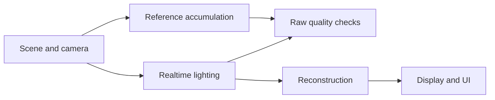

# Rendering

[Documentation](README.md) | [Goals](Goals.md) | [Roadmap](Roadmap.md)

## Overview

Sparkle renders immutable scene and camera data through geometry, lighting, reconstruction and display stages. A separate Reference renderer provides the raw comparison needed to evaluate lighting.

The source contains raster/ray surface paths, direct/indirect lighting, linear reconstruction, optional D3D12 DLSS, exposure, tone mapping and partial lens effects. Image correctness and native-API validation are still in progress. Decals, color grading and HDR are unfinished release features.

Apply the [verification method](Engineering.md#verification) to each feature and the combined frame on both APIs, including failure, lifetime, performance and delivery checks.

- [Release features](#release-features)
- [Reference renderer](#reference-renderer)
- [Later rendering work](#later-rendering-work)
- [Owned neural rendering](#owned-neural-rendering)
- [Test scenes](#test-scenes)
- [Source map](#source-map)

Compare raw lighting before reconstruction or display. Filtering and tone mapping cannot establish whether the original lighting mean is correct.

## Release features

These are release requirements; existing implementation does not establish qualification.

### Frame and materials

The frame accepts complete immutable scene/view inputs. Serial and threaded execution must agree, queues and resource use stay bounded, and GPU resources survive every queue that references them. The frame graph needs actual producers, correct dependencies, barriers and aliasing.

Follow an asset through source identification, import, cooking, animation, material interpretation and raw pixels. Compare raster, ray and Reference identity, transforms, tangent/normal frames, texture colors/channels, alpha and sidedness. Check capacity, missing/corrupt data and resource replacement.

Base shading needs matching evaluation, sampling and probability densities (PDFs), with energy/furnace checks and correct delta/roughness behavior. Geometric normals control visibility and ray origins; shading normals follow the chosen surface model.

The current visibility path uses CPU frustum culling and batching with fixed residency budgets for opaque/alpha-tested surfaces. General streaming, occlusion/LOD and GPU-driven geometry are outside that path.

### Texture cooking

DirectXTex owns working images, conversion, mip generation and BC encoding; retained upstream codecs own decoding. These dependencies stay private to TextureCooker. Sparkle owns material intent, requests, admission and publication; runtime `.stex` loading has no processing dependency.

HDR color defaults to **RGBA32F**, preserving finite signed values and alpha. **BC6H** is explicit, clamps negative RGB to zero and rejects values above 65504; meaningful HDR alpha requires uncompressed storage. New BC6H output must meet absolute RGB error at most **0.08** up to one, relative error at most **0.15** above one and normalized RMS error at most **0.04**. Failure preserves accepted output and recommends RGBA32F. Exact preservation of authored blocks does not establish source quality.

Mip preservation and color transfer must agree; conversion processes pixels rather than relabelling blocks. Float data stays linear and RGB transfer preserves alpha. Normal encoding retains the authored hemisphere; scalar data retains its precision/range. The cooker and RHI admit 2D textures, arrays and single cubes; material slots accept only single-2D floating-point views. Volumes, cube arrays, multiframe input and multipart/deep EXR are excluded.

Bound cooking, decoding, pending uploads and residency separately; logical allowances do not establish process/device-memory limits. Validate complete layouts and apply the [publication contract](Engineering.md#build-and-delivery) through byte acquisition, cancellation and GPU retirement.

The [request API](../Tools/Cooking/TextureCooker/Public/TextureCookRequestList.h), [request codec](../Tools/Cooking/TextureCooker/Private/Requests), [source loaders](../Tools/Cooking/TextureCooker/Private/SourceLoading), [cooked format](../Engine/RHI/Public/Textures/CookedTextureAsset.h) and [runtime texture owner](../Engine/Renderer/Private/Textures) define detailed policies, formats, layouts and budgets.

### SDK integration and owned research

Keep production and Reference independent; owned research needs a stated contribution and stopping point. [Migration decisions](ThirdPartyMigration.md#rendering-sdks-worth-considering) own SDK selection and retirement boundaries; [Roadmap](Roadmap.md#after-release) owns order.

Adapters own signals, settings, resets and SDK lifetime. Sparkle owns pass placement, states, descriptors, queues and retirement. Use NRD's native dispatch API through Sparkle RHI. Keep one production owner per path and compare correct raw signals, quality/cost, native behavior and reproduction.

### Direct lighting

Direct lighting needs analytic or exhaustive small-light comparisons, correct units, emitter identity, selection probabilities, measure conversion and visibility. Reservoir reuse must preserve the intended raw mean during motion, disocclusion and zero-support cases. Renderer owns the lighting contract. A production RTXDI trial must replace its matching local resampling path completely; Reference remains an independent control.

### Indirect lighting

Indirect lighting needs a defined path domain, proposal density, shift/replay mapping, normalization, next-event estimation, multiple importance sampling (MIS), roulette and robust visibility. Replaying a random seed alone does not establish valid path reuse. Diffuse/rough-specular support does not imply transmission or caustics; an environment image is not a physical atmosphere.

### Reconstruction

Reconstruction depends on correct raw diffuse/specular signals and guides: albedo, normals, roughness, depth, motion, jitter and exposure. Check SDK formats/ranges, history resets, GPU lifetime and whole-frame cost. Super Resolution and Ray Reconstruction must produce one output without filtering or upscaling it twice.

Linear reconstruction exists. Optional DLSS currently uses D3D12; Vulkan vendor reconstruction, dynamic resolution, Renderer MSAA, standalone TAA/FXAA/SMAA and frame generation are not established capabilities.

### Decals

Decals need authored/cooked data, scene/GPU updates, deterministic GBuffer composition before lighting and matching evaluation at arbitrary secondary-ray hits. Screen-space projection alone cannot cover reflections. Test projection derivatives, filtering and overlap.

Choose projection, clipping, blending/order, identity, lifetime and capacity before implementation. A DBuffer or dedicated decal acceleration structure needs a demonstrated use case.

### Exposure, tone mapping and grading

The current tone operators include Reinhard, ACES approximation and ACES fitted. Those choices do not establish calibrated ACES output.

Color grading needs one scene-referred global grade and a 3D LUT with color metadata through import, cooking and per-view lifetime. Define LUT axes/domain, working color space, negative/HDR behavior and interpolation. File grammar, malformed-input handling, failure behavior and budgets remain open decisions. Volume grading, multi-look blending and an OCIO runtime are outside scope.

The target display order is reconstruction, exposure/scene grade, tone/gamut mapping, vignette, chromatic aberration, encoding, then UI/present. Raw Reference products bypass this chain; the current Reference viewport uses display processing. Exact diagnostic views bypass tone mapping and, by default, lens effects.

### Lens effects

Vignette and chromatic aberration have partial fixed passes. The first chromatic effect uses a fixed three-channel model. Evaluate the output-pixel strength proposal, then choose units, radial/aspect behavior and approved On defaults before implementation.

Check viewport subrects and resizing, unchanged alpha/UI/raw output, and cost. At neutral strength, output must equal the input with no effect pass, allocation or copy. Current presentation reverses the target lens-effect order; that remains a release gap. New public controls are deferred.

### HDR

The target is Windows HDR10 with Rec.2020/D65/PQ: a compatible format/color space, metadata, OS/display state, correct UI white and explicit SDR recovery on both APIs.

Packed-10/PQ versus FP16/scRGB for Editor composition remains a platform decision. A format name or successful metadata call does not establish the active color interpretation. A 10-bit texture, Linear mode or screenshot is not evidence of HDR display output.

## Reference renderer

Reference accuracy still needs independent execution checks. See [Current priority](Roadmap.md#current-priority) for the Sponza repair.

### Transport domain

The full target is camera-originating scene-linear RGB reflective surface transport: visible emission/environment, direct next-event estimation, indirect reflection and compensated roulette. Transmission, media, physical subsurface and spectral transport are excluded.

Current [admission](../Engine/Renderer/Private/Passes/Lighting/ReferencePathTracer/ReferencePathTracerSessionState.cpp) requires a perspective view, rejects blended/subsurface materials and restricts directional/point/spot lights to zero angular size or ideal punctual models. These limits apply before transport begins.

The canonical material is glTF-style Lambertian plus single-scatter isotropic GGX/Smith/Schlick, with delta reflection at zero roughness and explicit normal, alpha and sidedness rules. Preserve metres, left-handed coordinates, row-vector/row-major transforms, reversed-Z, pinhole/box pixel sampling, linear Rec.709/D65 and base-mip bilinear textures.

Light/lobe probabilities, comparable measures, MIS and emitter endpoints must match the estimator. Reference must not use the production GBuffer, reservoirs, denoised signals, temporal reconstruction or exposure/display results as transport input. Assets and low-level traversal may be shared, but shared decoding, transforms, materials and intersections need independent analytic, minimal or cross-renderer checks.

### Accumulation and validation

The full surface reference has no valid deterministic depth/distance cutoff.

The [current session](../Engine/Renderer/Private/Passes/Lighting/ReferencePathTracer/ReferencePathTracerSession.h) commits complete sample prefixes using binary32 mean/M2 accumulation and an exact count, with a fixed target of **4,096 samples per pixel**. Support for the required ceiling of **1,048,576** remains unimplemented. Non-finite values, overflow, safety-depth termination and mixed, stale or truncated output must invalidate a reference result.

Finish analytic-rectangle camera/BSDF/visibility intersections, emitter identity and matching PDFs. Perfect-mirror and competing/collinear-emitter examples must expose the defect.

Reference-specific checks cover independent controls and uncertainty, invalid sample prefixes/files, identity changes, resets, cancellation, session preservation, inline/pipeline agreement and ShippingEditor output. Reference controls/export in Game are excluded. Completed sampling or a sky-only image is insufficient.

## Later rendering work

These extensions follow release and their required inputs; [Roadmap](Roadmap.md#after-release) sets delivery order. Keep raw/uncached, TLAS and BCn controls. Unsupported requests must report the actual active path and reason.

### Transport and materials

- **Direct sampling:** mixed analytic, emissive-triangle and environment proposals with correct probabilities/support and bounded work. Evaluate the bounded RTXDI replacement before extending the local production sampler. Compare variance and temporal quality at equal cost; guiding/ReGIR or advanced reuse needs a measured benefit.
- **Indirect resampling:** start with a narrow ReSTIR GI-style secondary-path domain, then multi-bounce diffuse/rough-specular work. Choose one production owner before expansion. Keep owned experiments focused on the selected estimator question; derive path records, shift mappings and GRIS normalization and check them against Reference before optimizing replay.
- **Materials:** anisotropic GGX and one dielectric coat, with energy, sampling, PDF and tangent-frame checks. Extend the independent reference domain, then check guides and temporal behavior.

### Reconstruction and caches

- **Reconstruction:** one RELAX diffuse/specular temporal path with checked signals, guides and motion. The owned CNN is independent of this work.
- **SHaRC:** bounded diffuse update/resolve/query with cold starts, resets, moving scenes, capacity and cache misses. Continue uncached paths on misses. Media/sharp-specular caching and streaming are outside scope.
- **NRC:** actual online learning/coupling, adaptation and bias measurements, compared with SHaRC and uncached transport on the same domain.
- **Neural texture compression:** cooked latent materials and on-sample decode, filtering/LOD/material fidelity, BCn comparison and memory/compute tradeoffs.

### Acceleration structures and volumes

**PTLAS** needs sparse updates, creation/removal/reassignment, bounded migration/capacity, BLAS/SBT replacement and one translation/reset/rebase example. Compare images/identity and total build/traversal cost with TLAS on supported API/device combinations. The current experimental strategy disables updates/translation and emits at most one operation.

**Volumetrics** starts with physical coefficients, phase and analytic transmittance/in-scatter, then homogeneous/height fog with one light, then bounded local froxels, selected analytic lights/shadows and temporal reconstruction. Atmosphere, clouds, imported volumes and volumetric ReSTIR are outside this work. The surface Reference does not provide volume support.

Preserve extinction and the composition rule: attenuated surface radiance plus integrated volume emission/scattering. Use Beer–Lambert/slab and phase-function checks before temporal froxels. [Research references](References.md#rendering-research) explain the methods and alternatives.

## Owned neural rendering

This planned feature is not implemented. After release and the classical-study results, develop one spatial diffuse-indirect denoiser with owned data, training, checked fixed-model GPU kernels and held-out results. Vendor integration does not demonstrate that work.

### Data and comparison

Generate an albedo-modulated indirect-diffuse reference component with matching event partition, PDF/MIS/roulette, camera, pose, pixel footprint, units, scene state and sample-prefix uncertainty. Beauty images or subtraction of unrelated images are not valid labels; Reference noise may differ from realtime reuse noise.

The proposal is one non-recurrent residual convolutional network over scene-linear radiance and surface guides, compared with a radius-three spatial cross-bilateral filter on the same signal. Display transforms and image history are excluded.

Train on checked Sponza/Cornell data, validate on Bistro and reserve San Miguel for final testing. Prevent neighboring frames/patches crossing splits. Check rights, alignment, tiny-batch/gradient behavior, ablations and exact export.

The small spatial model makes operators, memory and numerical error inspectable. It does not inherit the results of recurrent/U-Net or pretrained-network research. Keep failed value studies and consider a focused revision or removal.

### Proposed targets

Agree these limits before training or evaluating the model:

| Test | Target |
| --- | --- |
| Numerics | Every FP32 operator/intermediate/output agrees with an independent float64 evaluator within `0.0001 + 0.0001*abs(reference)`, also checked against PyTorch FP32. Detect channel, padding, halo and edge faults. |
| Quality benefit | At least 5% lower masked log-RMSE, with linear NRMSE and whole-frame 95th-percentile time no worse by more than 1%. |
| Alternative speed benefit | At least 10% lower denoising GPU 95th-percentile time, with both errors and whole-frame time no worse by more than 1%. |
| Cost | GPU 95th-percentile time at most 2 ms at 1920x1080 on the tested minimum machine; extra workspace at most 320 MiB; no image history. |
| Temporal/detail behavior | Residual-change and gradient-error RMS at most 1.02 times baseline; absolute normalized signed bias at most 0.01. |
| Reproduction | Report seeds 0, 1 and 2 separately; same-seed/environment log-RMSE within 1%; identical accepted-checkpoint export bytes. Profile training and inference separately. |

Quality and speed comparisons need the same inputs/history as the classical method. Fix hardware, motion/visibility/edge masks, FLIP variant/domain/rule and reference uncertainty first.

Reject malformed input. Pixels without a surface retain the source value. Inference failure may use a visible, tested classical fallback, but successful value runs require zero in-domain model-fault fallbacks. Report each scene/sequence/mask and failed run. Keep one runtime representation and remove rejected prototypes; a general ML runtime/autotuner is outside scope.

## Test scenes

Sponza is the short regression loop. After release, Bistro is the flagship and San Miguel checks a different scene.

Bistro Exterior and complete Interior Wine are separate workloads; Wine replaces the original interior. Present the transition as a scene switch until a seamless world is demonstrated. Keep source emissive and analytic-light intent separate to avoid double lighting.

Use deterministic exterior overview, foliage pan, dense market/detail, dark interior and moving interior views. San Miguel adds courtyard, shaded arcade, close-up, traversal and matched high/low-geometry views. Choose actual transforms after loading the content. Use the same cameras/settings for San Miguel high/low; keep final-test routes out of training/model selection.

Classify source materials as exact, deliberately converted, visibly approximated or rejected. Keep a debug contact sheet and difficult close-ups. Cover the declared scene inventory with the same shaders across scenes. Separate authored lighting from a controlled stress setup, and compare raw, reconstructed and displayed results with matching cameras, lights and exposure.

### Provisional performance targets

| Later workload | Initial GPU 95th-percentile target | Stretch |
| --- | --- | --- |
| Raster/hybrid at 2560x1440 | 16.67 ms | 12.5 ms |
| Ray/path at 1920x1080 | 33.33 ms | 16.67 ms |

A warmed Bistro scene switch aims to avoid hitches above 50 ms; report cold loading separately. Confirm these proposals against the first measured baseline. They do not replace [first-release requirements](Roadmap.md#release-requirements), and Reference need not run in realtime.

## Animation previews

GameFramework privately uses ozz-animation for pose sampling, hierarchy evaluation and four-weight morph tracks. SceneCooker preserves source identities and original skin order, converts parent-space transforms to TRS helpers and bakes STEP/cubic curves to linear previews at intervals no longer than 1/60 second. Rotation segments are also subdivided to limit linearized rotation error. Missing components use bind defaults; zero-duration clips remain static; negative morph weights and overshoot are retained.

Preview rigs admit at most 1,024 evaluation joints including helpers. Unsupported shear, helper overflow, nonfinite/half-float-overflow skeletal values and collapsed normalized sample times reject with an export/bake diagnostic. Cooked skeleton/animation layouts changed: rebuild and recook assets together. Sparkle retains bounded typed loading, complete-generation publication, immutable extraction and renderer/GPU current/previous deformation ownership. There is one runtime evaluator.

The current Launcher has one imported skeletal clip, CesiumMan. Knight's bound FBX currently imports as static geometry without usable vertex weights; ozz cannot reconstruct a rig from that export. Independent live-run matched-time image equality remains unverified: animation uses wall-clock time without a supported fixed-time control. Broader image, performance and whole-product package checks remain with [release qualification](Roadmap.md#before-the-first-release).

## Source map

Application hosts the world and renderer. GameFramework publishes immutable input; [Renderer](../Engine/Renderer) prepares scene/view/frame work; [RHI](../Engine/RHI) implements GPU operations through D3D12/Vulkan. [Module ownership and placement](Engineering.md#file-placement) describes the supporting systems.

Shader [passes](../Engine/Assets/Shaders/Passes) own entry points and pass-specific resources. Shared [material rules](../Engine/Assets/Shaders/Material) and [color mathematics](../Engine/Assets/Shaders/Common/Color.hlsli) stay independent of passes. Match CPU upload records and shader layouts at their shared boundary.

Renderer labels passes and recording work; RHI owns native marker/timestamp support. Required GPU-crash scopes stay active when optional markers are disabled.

World updates and extraction finish before immutable publication; structural edits wait for workers. Animation-only publication preserves edit history and viewport navigation.

Shader compilation uses Launcher Cook or Editor **Recompile Shaders** / `CompileShaders [symbols]`. `ReloadShaders` reloads existing output. Dependency-directed Apply Changed is unfinished. See [References](References.md) for papers and SDK guides.
