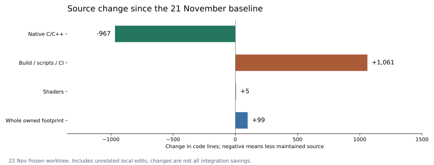
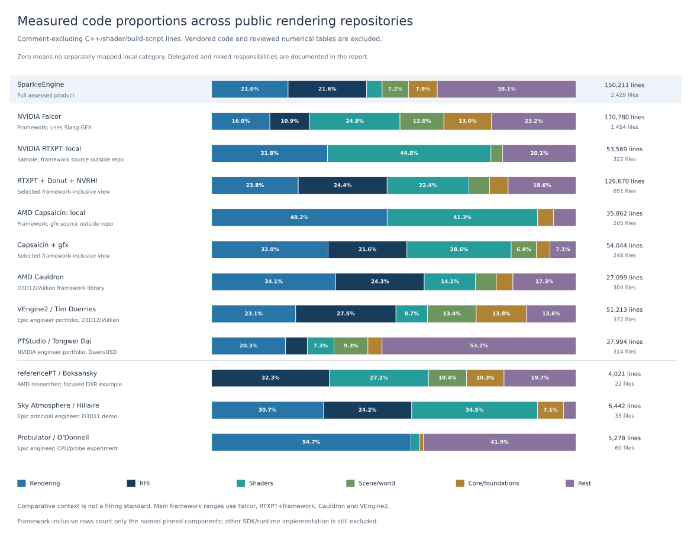
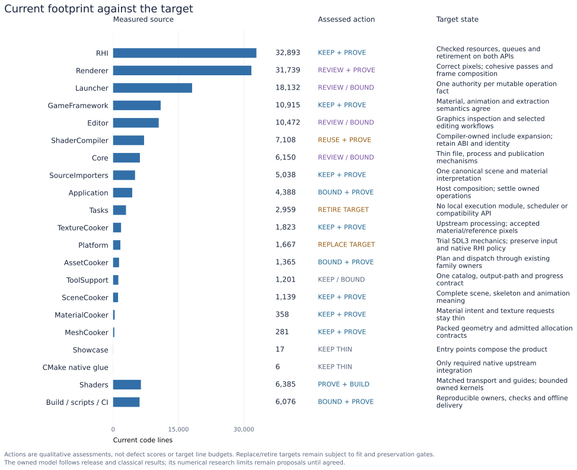
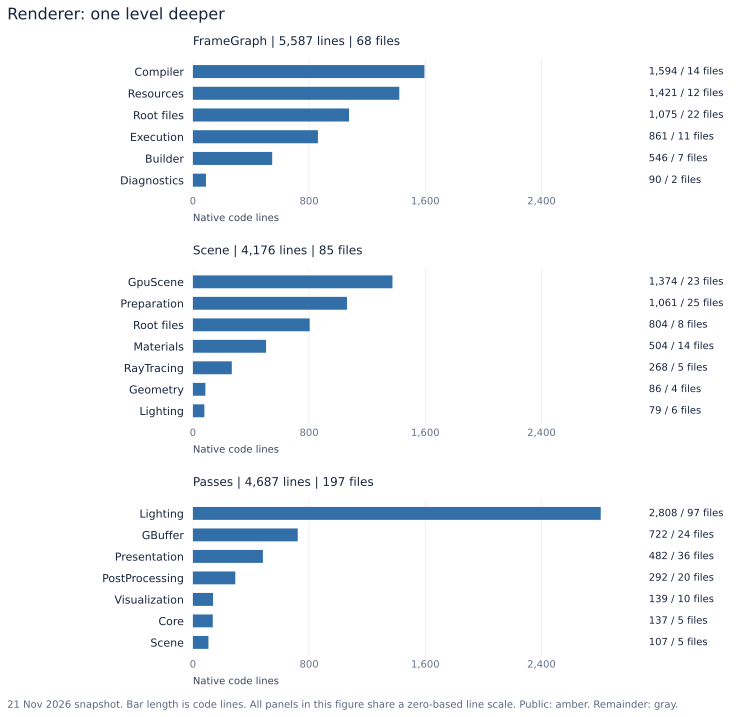
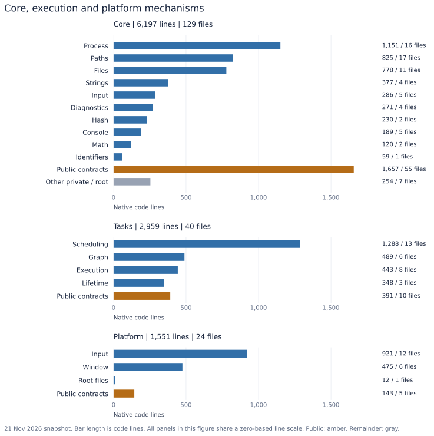
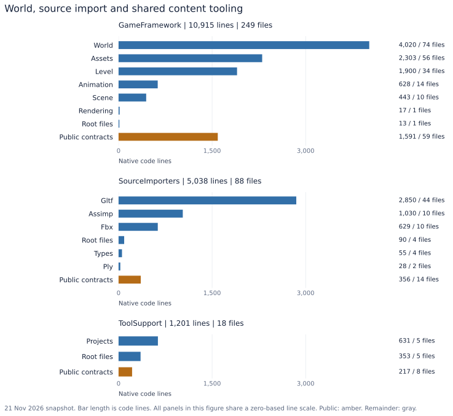
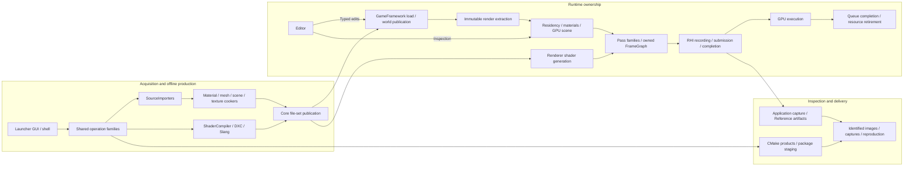
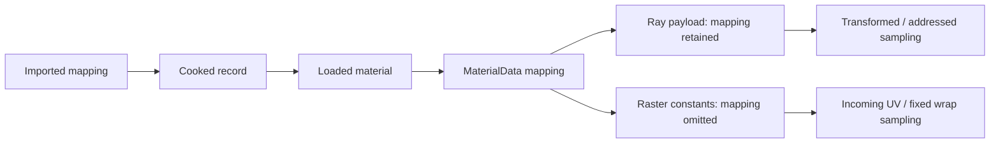

# Repository footprint and complexity map

[Documentation](README.md) | [Goals](Goals.md) | [Rendering](Rendering.md) | [Roadmap](Roadmap.md) | [Third-party migration](ThirdPartyMigration.md)

**Assessed source snapshot: 22 November 2026, 19:05 Warsaw / 18:05 UTC, `d5bf01d53` plus recorded local changes.** Counts, source identities and charts are frozen together; later concurrent edits are outside this assessment. Native, shader, automation, content/configuration, dependency and documentation coverage follows the original method.

[Change since baseline](#change-since-the-previous-assessment) | [Targets and deltas](#target-and-delta) | [Module map](#code-distribution) | [Complexity signals](#complexity-signals) | [Workflows](#complexity-across-module-boundaries) | [Structural actions](#structural-priorities-and-actions) | [Measurement basis](#measurement-basis)

## Change since the previous assessment

**The whole owned footprint has not become smaller in code lines.** Native C/C++ fell by **967 code lines**, while automation grew by **1,061** and shaders by **5**. The net is **99 more code lines and seven more files**; physical lines fell by 272. This is a whole-repository comparison, not an attribution of every change to third-party work.

| Same counting method | 21 November baseline | 22 November assessed worktree | Change |
| --- | ---: | ---: | ---: |
| Native files | 2,158 | 2,151 | −7 |
| Native code lines | 137,651 | 136,684 | −967 (−0.70%) |
| Native physical lines | 160,925 | 159,505 | −1,420 |
| Shader code lines | 6,385 | 6,390 | +5 |
| Automation code lines | 6,076 | 7,137 | +1,061 |
| **All owned code lines** | **150,112** | **150,211** | **+99 (+0.07%)** |
| **All owned files** | **2,422** | **2,429** | **+7** |
| All owned physical lines | 175,517 | 175,245 | −272 |
| Graphics share: RHI + Renderer + shaders | 47.3% | 46.8% | −0.52 percentage points |



**Committed versus local work matters:** the assessed commit alone contains **150,818 code lines / 2,433 files**: +706 lines / +11 files from the original assessment. Its native subtotal is **137,291 code lines**, down 360. The captured uncommitted native changes contribute **−607 code / −721 physical lines / −4 files**, chiefly RHI and content-owner work. They are included in the current worktree charts but are not credited as delivered migration savings.

The [integration delivery ledger](ThirdPartyMigration.md#delivered-integrations-versus-savings) separates mechanism delegation from native removal. ShaderMake records a scoped **374 physical / 194 code-line reduction**. SDL3, Boost.Process and ozz have delivered code but their conservative delivery ledgers record native growth. These independent ledgers overlap and use different frozen inputs; do not sum them into a fabricated aggregate. Tasks remains a production retirement target: its 40-file implementation is still present.

The direction is therefore **successful transfer of several mechanisms, modest native shrinkage, and no whole-footprint code reduction yet**. Do not add SDKs merely to improve a percentage or roll back a useful dependency solely on LOC. Finish the [remaining mechanism cuts](#cuts-before-expansion), reduce demonstrated bridge/host duplication and complete the rendering cases.

## Target and delta

The closest NVIDIA reference is the **Principal Developer Technology Engineer** in the [dated employer study](References.md#employer-role-study), alongside the [archived advanced-rendering/AI description](References.md#principal-advanced-rendering-and-ai-adoption). [Goals](Goals.md#target-persona) translates that specialization into a graphics systems engineer who can explain, implement, measure and transfer a result. The desired repository is a **compact rendering and evidence platform**, supporting [three complete cases](Goals.md#the-three-cases). Other principal software roles have different requirements.

The main delta is **supporting breadth and unfinished graphics evidence**. Tasks is the first complete mechanism-retirement target; JSON code migration is closed under its [retained contract](ThirdPartyMigration.md#json). Launcher/Editor breadth and demonstrated duplicate pass policy are review candidates; per-shader file structure is intentional. Reference/material acceptance, complete two-API performance/delivery and owned model-to-shader work remain incomplete. Preserve native API/resource reasoning, FrameGraph, material meaning and independent Reference while closing those gaps.

The [ranked structural priorities](#structural-priorities-and-actions) connect live source findings to bounded actions and the practices in References. Ranking reflects rendering impact and maintenance exposure, rather than a numerical defect score.

### Measured peer proportions

**Peers measured on 21 November 2026; Sparkle refreshed on 22 November.** Nine public rendering/framework projects and three related libraries remain pinned to their original revisions. This is a selected engineering-reference sample, not a ranking, hiring study or statistical industry norm. Counts use the same code-line denominator as Sparkle: owned C/C++/headers, shaders and build/scripts; fetched/vendored dependencies, assets and reviewed numerical tables are excluded. All checked-in source variants count, whether enabled in a particular build or not.



The **four-system context group** is Falcor, RTXPT with Donut/NVRHI, Cauldron and VEngine2. It covers research frameworks, an SDK sample with selected platform components, and a hobby engine with owned D3D12/Vulkan backends. Their combined **Rendering + RHI + Shaders share is 51.7-72.4%**, versus Sparkle's **46.8%**. Product scope differs: Sparkle also owns offline cooking, Launcher and package reproduction. Use the ranges to choose reviews, not to require identical implementations.

| Responsibility | Sparkle | Four-system observed range | Target implication |
| --- | ---: | ---: | --- |
| Rendering | **21.0%** | 16.0-34.1% | Inside the observed range. Finish correct results; remove demonstrated duplicate pass policy while preserving per-shader files. No general shrink target. |
| RHI | **21.6%** | 10.9-27.5% | Inside the range; API scope/delegation differs. Review lifetime/state organization and file fragmentation, preserving the owned RHI. |
| Shaders | **4.3%** | 8.7-24.8% | Below this group. Close the selected Reference/model/operator gaps with checked results; do not manufacture shader lines. |
| Scene/world | **7.2%** | 5.7-13.4% | Inside the range. Keep scene/material/animation semantics; avoid new gameplay breadth or a new ECS just for its size. |
| Core/foundations | **7.9%** | 4.6-13.8% | Inside the range. Keep the targeted Tasks/SDL/JSON investigations; no evidence supports a blanket Core quota. |
| Rest | **38.1%** | 13.6-23.2% | Above this group. Prioritize host/UI/state and tooling cuts, while preserving reproduction, diagnostics and meaningful verification. |

These are component-wise observed bounds; their endpoints are not a budget that sums to 100%. Core/foundations groups generic utilities, platform/input and job mechanisms: Sparkle's **Core alone is 6,197 lines / 4.1%**; adding Tasks, Platform and ToolSupport gives **11,908 / 8.0%** here. Scene/world includes native scene/material/animation representation and mixed render-scene code, so it is broader than a universal gameplay/ECS definition. GPU kernels and shared shader-directory declarations count as Shaders once. Compiler/scene boundaries and mixed files make the detailed split approximate.

**Where the cut evidence points:** Sparkle has **33,084 host/UI/composition lines** and **16,955 content/shader-tool lines**, within its 57,196-line Rest category. Its RHI is **32,371 lines in 370 files**, compared with NVRHI's **30,885 in 69**; its Renderer is **31,515 in 622**, compared with Falcor's mapped rendering code **27,294 in 175**. Scope and header strategy differ. These numbers justify reviewing change paths and redundant state/forwarding before imposing file-count or LOC quotas.


PTStudio is a counterexample to treating a high Rest share as waste: its **53.2%** includes **8,038 native test lines and 6,683 automation lines**. Sparkle's verification also lives inside existing tool owners. Cut a mechanism only after identifying its consumer, retained contract and complete replacement cost; preserve useful checks and reproduction.

<details>
<summary>Full measured proportions, exact source pins and portfolio provenance</summary>

Project links below open the measured revisions. The downloadable [CSV](Images/RepositoryFootprint/peer-proportions.csv) contains exact code/physical/file totals and category counts, including the three library components separately. Repeated project/framework views are alternatives, not independent observations to pool.

| Pinned project/view | Code lines | Render | RHI | Shaders | Scene/world | Core/found. | Rest |
| --- | ---: | ---: | ---: | ---: | ---: | ---: | ---: |
| **SparkleEngine** | **150,211** | 21.0% | 21.6% | 4.3% | 7.2% | 7.9% | 38.1% |
| [Falcor](https://github.com/NVIDIAGameWorks/Falcor/tree/759aad033ff610fb0d82c74f7e0a508d0096d5f2) | 170,780 | 16.0% | 10.9% | 24.8% | 12.0% | 13.0% | 23.2% |
| [RTXPT](https://github.com/NVIDIA-RTX/RTXPT/tree/303b408ab81790a5051abd7573830b7a4112eb8e) | 53,569 | 31.8% | 0.0% | 44.8% | 3.2% | 0.0% | 20.1% |
| [RTXPT](https://github.com/NVIDIA-RTX/RTXPT/tree/303b408ab81790a5051abd7573830b7a4112eb8e) + [Donut](https://github.com/NVIDIA-RTX/Donut/tree/e50042f4bbd762971cc90431261e967404855b81) + [NVRHI](https://github.com/NVIDIA-RTX/NVRHI/tree/6b96fb03e07539f08327aea76c56d55f1de9d906) | 126,670 | 23.8% | 24.4% | 22.4% | 5.7% | 5.1% | 18.6% |
| [Capsaicin](https://github.com/GPUOpen-LibrariesAndSDKs/Capsaicin/tree/914b91596cd119eda85fbc1d3c7ee6ac391b1452) | 35,862 | 48.2% | 0.0% | 41.3% | 0.0% | 4.4% | 6.1% |
| [Capsaicin](https://github.com/GPUOpen-LibrariesAndSDKs/Capsaicin/tree/914b91596cd119eda85fbc1d3c7ee6ac391b1452) + [gfx](https://github.com/gboisse/gfx/tree/c65d6172500864b68988cdf64846520ebbb42e6f) | 54,044 | 32.0% | 21.6% | 28.6% | 6.9% | 3.7% | 7.1% |
| [Cauldron](https://github.com/GPUOpen-LibrariesAndSDKs/Cauldron/tree/b92d559bd083f44df9f8f42a6ad149c1584ae94c) | 27,099 | 34.1% | 24.3% | 14.1% | 5.7% | 4.6% | 17.3% |
| [VEngine2](https://github.com/DoerriesT/VEngine2/tree/a77c0adf0b9f01cc7db7d4fd26f9228e4e93c433) | 51,213 | 23.1% | 27.5% | 8.7% | 13.4% | 13.8% | 13.6% |
| [PTStudio](https://github.com/dw218192/PTStudio/tree/add248a46045a7b00a8cd803e5dfa016e9338067) | 37,994 | 20.3% | 6.0% | 7.3% | 9.3% | 3.9% | 53.2% |
| [referencePT](https://github.com/boksajak/referencePT/tree/c949ad2b854ea2e982dd50aab889131fd1ffd0d7) | 4,021 | 0.0% | 32.3% | 27.2% | 10.4% | 10.3% | 19.7% |
| [UnrealEngineSkyAtmosphere](https://github.com/sebh/UnrealEngineSkyAtmosphere/tree/183ead5bdacc701b3b626347a680a2f3cd3d4fbd) | 6,442 | 30.7% | 24.2% | 34.5% | 0.0% | 7.1% | 3.4% |
| [Probulator](https://github.com/kayru/Probulator/tree/ad916bda84a6383ec34a69eaf2f3444bfef6026d) | 5,278 | 54.7% | 0.0% | 2.4% | 0.0% | 1.0% | 41.9% |

**Delegation changes the visible proportions.** RTXPT's local RHI is zero in this mapping; adding the named Donut and NVRHI snapshots produces a **24.4% RHI** slice. Capsaicin's local RHI is also zero; its pinned `gfx` source raises the selected framework view to **21.6% RHI**. These views include only the named components, not all SDKs, system runtimes or a complete transitive closure. NVRHI's snapshot includes D3D11 as well as D3D12/Vulkan source. Falcor uses Slang GFX; PTStudio uses Dawn/WebGPU and OpenUSD. Their local wrappers do not represent ownership of those implementations.

The personal-project affiliations come from primary self-descriptions checked for this study:

| Engineer | Public source and project context |
| --- | --- |
| **Tim Dörries / Epic** | [His site](https://doerriest.github.io/) identifies an Epic rendering role and links VEngine2. The project owns a two-API abstraction and also includes animation, ECS, scripting and physics; its README says saving/loading is unfinished. This is a useful ownership comparison, not product-acceptance proof. |
| **Sébastien Hillaire / Epic** | [His site](https://sebh.github.io/) identifies a principal graphics role. Sky Atmosphere is a focused paper/demo project with a D3D11 base, not Unreal Engine's complete source footprint. |
| **Yuriy O'Donnell / Epic** | [His site](https://kayru.org/) identifies Epic work; [his project page](https://kayru.org/projects/) credits Probulator jointly with David Neubelt. It is mainly a CPU/probe experiment with GUI presentation, not a full GPU engine. |
| **Tongwei Dai / NVIDIA** | [His portfolio](https://dw218192.github.io/portfolio/) identifies NVIDIA employment and links PTStudio. The measured revision uses Dawn/WebGPU and OpenUSD; desktop/browser targets do not mean owned native D3D12/Vulkan backends. |
| **Jakub Boksansky / AMD** | [His site](https://boksajak.github.io/) identifies AMD graphics research. referencePT is a small Ray Tracing Gems II supplement with NVIDIA-copyright source, rather than a complete renderer/editor product. |

These sources establish publicly described affiliation and project links, not why anyone was hired or how much of a collaborative project they personally wrote. **Unreal Engine itself was not counted**: [Epic's official GitHub page](https://github.com/EpicGames) describes linked-account access for its licensed engine repositories. No public-fork proxy or invented Unreal percentage is used.

</details>

<details>
<summary>Classification rules, exclusions and reproducibility</summary>

The same cloc 2.06 counter was applied to each selected source list, with duplicate suppression disabled. Slang/shared Slang and mesh/task/ray shader extensions use C-style shader comment handling. File SHA-256 hashes, Git pins, complete source lists, exclusions, cloc JSON and per-file responsibility assignments are retained in the local ignored [peer evidence folder](../artifacts/analysis/peers-20261121). No project was built or GPU-qualified.

| Project | Principal file-assignment rules |
| --- | --- |
| Falcor | `Core/API` and `Core/Program` -> RHI; `Scene` -> scene/world; Rendering, RenderGraph, passes and modules -> rendering; remaining utilities/platform -> foundations; apps/importers/tests -> Rest. |
| RTXPT / Donut / NVRHI | RTXPT pipeline -> rendering, SampleGame -> world, UI/app shell -> Rest. Donut core -> foundations, scene/animation/material/camera -> world, rendering helpers -> rendering, app -> Rest. NVRHI implementation/contracts -> RHI; its tests/build scripts remain Rest. |
| Capsaicin / gfx | Techniques/components and mixed frame-scene orchestration -> rendering, math/utilities -> foundations, viewer -> Rest. `gfx` resource/command/program layer -> RHI, scene layer -> world, window layer -> foundations, GUI/examples -> Rest. |
| Cauldron | Native backend base classes -> RHI, postprocessing/GPU glTF passes -> rendering, shared glTF/camera -> world, general helpers -> foundations; UI, compilation/loading and automation -> Rest. |
| VEngine2 | `graphics/gal` -> RHI; remaining graphics -> rendering; components/ECS/animation/assets -> world; jobs/allocators/filesystem/input/platform -> foundations; Editor/importers, gameplay shell and tests -> Rest. |
| PTStudio | WebGPU resource/pipeline wrappers -> RHI, passes/frame graph -> rendering, USD scene adaptation -> world, generic containers/errors/time -> foundations; editor/app, shader tools, tests and automation -> Rest. The name `core/` does not make its whole contents Core. |
| Focused examples | referencePT's mixed `Graphics.*` -> RHI; sky's mixed `Game.*` -> rendering; Probulator's CPU probe/basis/fitting code -> rendering. Embedded shader strings and mixed host/graphics files stay in their containing file's category. Zero denotes no separately mapped category, not absence of that responsibility. |

Shader-file classification takes precedence; automation is always Rest in the comparison. Directory-name exclusions alone were insufficient: **12,481 D3D12MA/volk code lines inside VEngine2's backend directories** were excluded as upstream implementation. Vendored Lua, ImGui, meshoptimizer, MikkTSpace, SDK headers, Falcor's Bottle dependency and numerical LTC/spectral tables were also excluded. Adaptation code around these components stays counted. Reviewed source lists include Capsaicin's nonstandard `.mesh`/`.task` shader files.

File-level responsibility assignment is an analytical judgment. The broad graphics-plus-scene share remains lower in Sparkle (**54.0%**) than this four-system group's **63.7-78.1%**, so moving mixed scene code between Rendering and Scene/world does not remove that directional gap. Capability, workflow and delegation differences still prevent equating the gap with deletable waste. Inspect the named cut paths and preserve their existing gates.

As a denominator check, omitting classified automation and standalone native-test files leaves Sparkle's Rest share at **35.0%**, against **11.9-15.8%** in the same four-system group. Embedded tool validation remains inside its owning files. This sensitivity supports investigating host/tool maintenance; it does not make testing or automation a deletion target.

</details>

### Current proportions and desired direction

These five responsibility groups partition **all 150,211 owned code lines and 2,429 files** once, including shaders and automation. They measure maintained source, not time spent, defects or capability strength. Supporting code can be essential to a graphics result.


| Responsibility | Included owners | Files | Code lines | Share | Desired complexity direction |
| --- | --- | ---: | ---: | ---: | --- |
| Graphics systems and shaders | RHI, Renderer, all shaders | 1,131 | 70,276 | **46.8%** | Protect API/lifetime, estimator depth and visible per-shader pass construction; finish correctness and measured results. |
| Hosts and interaction | Launcher, Editor, Application, Showcase entry points | 413 | 33,084 | **22.0%** | Bound to build/cook/run, inspection, supported edits and delivery. Remove duplicate operation state and forwarding where demonstrated. |
| Content and world | GameFramework, SourceImporters, all five cookers | 434 | 20,952 | **13.9%** | Keep one content/material interpretation; delegate decoding/processing. Do not grow general gameplay or broad authoring. |
| Shared foundations | Core, Tasks, Platform, ToolSupport, native CMake glue | 217 | 11,928 | **7.9%** | Retire selected general mechanisms under existing gates; retain domain policy, cancellation, publication and lifetime guarantees. |
| Shader tooling and automation | ShaderCompiler, all build/scripts/CI | 234 | 13,971 | **9.3%** | Reuse compiler facilities and existing build/dependency tools; retain ABI, source identity, offline reproduction and useful checks. |

The graphics share can rise through genuine support retirement and selected graphics work. The [cut-only scenarios](#proportions-after-cuts) below show how much actual removal would change that balance. The measured peers supply comparative context; each checkpoint remains a proposal under Sparkle's scope. The [owner map](#every-native-owner) and [component figures](#module-breakdowns) locate costs inside each group.

The **6,390 shader lines are 4.3%** of owned source; this is not a completeness measure. Treat the absent owned-model path and incomplete correctness, performance and transfer evidence as development gaps. Evaluate supporting complexity by the maintained mechanisms and coordination needed for those outcomes.

### Cuts before expansion

**Delegate complete mechanisms, then reduce the bridge.** Delivered SDL3/Boost/ozz are no longer future savings to add to a forecast. ShaderMake owns compiler execution, but Sparkle still owns its expanded preprocessor and identity/reflection/publication policy. The current [remaining review ceiling](ThirdPartyMigration.md#total-native-removal) is **4,711 physical / 4,014 code lines across 62 files**, before retained policy and replacement costs; it is not an expected net saving.

| Next cut | Remove or simplify | Preserve | Current scope and exit |
| --- | --- | --- | --- |
| **1. Complete Task ownership transfer** | Retire Tasks, its public execution API/target/DLL and scene-preparation adapter; convert real owners directly to the selected upstream resource. Remove displaced execution plumbing rather than moving it. | Domain partitioning/admission, stop/results, settlement, caller-thread controls and RHI/GPU lifetime. | **3,017 code / 3,566 physical lines in 42 files**, unchanged. Production Tasks still has 40 files / 2,959 code lines. Keep the [original comparison/review targets](Implementation/TaskRuntime.md#delivery-constraints-and-fixed-budgets) and [separate code/qualification exits](ThirdPartyMigration.md#code-delivery-and-qualification); no savings before retirement. |
| **2. Reassess compiler preprocessing after ShaderMake** | Replace custom expansion through real compiler include/preprocess facilities where the complete identity/debug boundary becomes smaller. | Virtual roots, exact source closure, typed reflection, debug ABI, accepted publication and reload. | The remaining pair is now **221 code / 253 physical lines**, versus **161 / 190** originally. ShaderMake's delivered execution saving does not retire this mechanism. Require real conditional/include/source-identity checks and a net ledger. |
| **3. Reduce host/UI coordination** | Start with one GUI/shell operation; remove duplicate request/plan/run dispatch and writable mirrors. Trial ordinary Qt item layout instead of bespoke reflow/presentation. | Scene selection/readiness, useful errors, cancellation, dry-run, inspection, typed edits/undo and DPI. | Host source is **33,084 lines / 413 files**, up 75 code lines. This is exposure, not a deletion estimate. Qt's reviewed reflow scope remains only **160 physical lines**; no 33k host-saving claim. |
| **4. Slim delivered integrations and build policy** | Review adapter/caller state and duplicated recipe/cache/staging facts after proving the current owner. Share upstream implementations through the existing build graph. | Actual process-tree/output policy, input publication, animation mapping/baking, compiler identity and prepared offline delivery. | Automation grew **1,061 code lines**. [Delivery ledgers](ThirdPartyMigration.md#delivered-integrations-versus-savings) identify native-growth boundaries. First-party bindings and maintained patches stay charged; moving them outside Engine earns no deletion credit. |
| **5. Remove demonstrated rendering duplication** | Simplify repeated policy, redundant conversions and no-consumer forwarding after tracing a real frame/material change. | Owned APIs/FrameGraph, typed shader files/registration, resource state, histories, retirement and independent Reference. | One-shader/one-header structure is intentional. Direct's 17 native files / 365 lines do not justify merging it. RTXDI still has zero identified native savings. Profile recurring work before adding another cache or manager. |

For the next slice, name the old owner, current consumer, exact mechanism to disappear, retained invariants and all new/relocated code. Judge code closure and broader qualification separately under the existing guides. A useful ownership transfer may legitimately grow code; describe that outcome honestly instead of labelling the gross deletion as a saving.

**Avoid new work that cannot repay its boundary.** EnTT, FlatBuffers, ufbx and other small candidates remain conditional. A new dependency with comparable glue is not a simplification. Broad authoring, another runtime/framework, extra gameplay and general ML infrastructure remain outside Goals. The active Sponza, material and release repairs continue; this is not an engine-wide rewrite prerequisite.

### Proportions after cuts

These proposals hold graphics at **70,276 code lines** and remove only from the other **79,935**. Tasks plus the current preprocessor pair cover **3,238 code lines in 44 files**, including 58 Renderer adapter lines. The unchanged-graphics illustration can credit only **3,180 supporting code lines in 42 files**, before integration. Delivered SDL3 is excluded from future removal.


| Scenario | Net supporting code removed | Remaining owned code | Graphics share | Meaning |
| --- | ---: | ---: | ---: | --- |
| **Current snapshot** | 0 | 150,211 | 46.8% | Current assessed worktree, including recorded local changes. |
| **Tasks + preprocessing, zero integration cost** | 3,180 | 147,031 | 47.8% | Optimistic gross support ceiling, not a forecast. New/retained code lowers the actual saving. |
| **50% investigation checkpoint** | 9,659 | 140,552 | 50.0% | Requires 12.1% net support removal; 6,479 beyond that optimistic named ceiling. |
| **52% peer-context checkpoint** | 15,065 | 135,146 | 52.0% | Requires 18.8% net support removal. The selected peers start at 51.7%; this is context, not an optimum or hiring criterion. |

The earlier 50% checkpoint needed 8,078 net code lines; it now needs 9,659. This is not evidence of poorer rendering: local graphics cleanup also lowers the graphics numerator. Do not add rendering code or cut evidence/automation simply to meet a ratio. Review quality, useful output, ownership and complete maintenance cost.

### Proposed allocation of engineering attention

Aim to spend **80% of release-closeout effort on direct graphics results and evidence**, rising to **90% after release** as owned neural work becomes eligible. Use the following starting mix per 100 effort units, then review it at the next release/case milestone. These are recommendations for Sparkle, not measured past effort, NVIDIA requirements, upstream code ratios or adopted roadmap budgets. The two phases preserve [Roadmap](Roadmap.md#after-release) ordering.

| Primary deliverable | Release closeout | After release and classical prerequisites | Why this earns attention |
| --- | ---: | ---: | --- |
| Classical rendering and GPU systems | **50%** | **40%** | Correct pixels, selected release features, CPU/GPU/shader/resource studies and difficult debugging: cases 1 and 2. |
| Owned model to shader | **0% new implementation** | **25%** | One bounded data/model/operator/export/inference path and held-out result: case 3. Required classical/reference foundations come first. |
| Evidence, reproduction and transfer | **30%** | **25%** | Dedicated measurements, independent controls, final-package reproduction, case writing, design review, second-context use and explanation/feedback. |
| Support retirement and required repairs | **20%** | **10%** | Retire the mechanisms above and repair required workflows. Keep discretionary support expansion bounded to a named case/consumer. |

Assign each work item once by its primary deliverable; ordinary verification stays with every change. A rendering optimization belongs to graphics; a separate controlled benchmark or reproduction exercise belongs to evidence. Reserve the evidence allocation even when it produces few source lines. Support percentages are planning guardrails: fix required blockers, then investigate recurring support demand before adding another mechanism. Existing migration trials do not become new release prerequisites. Neural work starts only after its existing prerequisites; unused research allocation returns to current graphics/evidence work.

### Actions across the repository

The action labels are assessments against Goals, not defect scores or blanket instructions to shrink large modules.



**KEEP** preserves an appropriate responsibility. **REVIEW / BOUND** identifies a possible scope or coordination problem. **RETIRE / REPLACE / REUSE** names a selected investigation boundary, with fit and preservation still required. **PROVE** closes acceptance for implemented work. **BUILD** adds a missing selected capability after its prerequisites.

### Concrete targets

These retain existing gates and distinguish proposed research limits from accepted requirements. Observed peer distributions do not prescribe a total LOC or shader quota for Sparkle.

| Target | Current delta | Completion criterion and authority |
| --- | --- | --- |
| Correct content and Reference | Source exists; raster UV/address/occlusion parity and Reference emitter/estimator checks remain open. | A fixed scene/camera/material trace through source, cook, raster, ray and raw Reference, with analytic or independent controls and recorded uncertainty. [Rendering](Rendering.md#reference-renderer) owns the domain/tolerances. |
| One measured frame, two APIs | Implemented foundations and partial observations; final image/performance acceptance remains open, including Vulkan startup. | On the [release benchmark](Roadmap.md#frame-rate-test), CPU, GPU and presented p95 each **<=33.33 ms at 1920x1080**, three repetitions, at least 300 warm-up and 300 measured frames per run. Qualify each supported API/configuration. |
| Bounded runtime and usable delivery | Complete final-package reproduction remains open. | [Release requirements](Roadmap.md#time-memory-and-storage): process commit **<=12 GiB**, tracked local GPU memory **<=7 GiB**, no repeated-loop growth; responsive startup **<=15 s**, default-scene correct frame **<=30 s**. Reproduce prebuilt and matching-source workflows offline with identified products and approved content. |
| Finish selected release features | Decals, global grading and HDR are unfinished; lens effects are partial. | Complete the bounded authored-data-to-pixel paths in [Rendering](Rendering.md#release-features): matching decal meaning at raster and ray hits, one global grade/3D LUT, qualified HDR output with SDR recovery, correct lens ordering and raw-view bypass. Keep unresolved settings explicit before implementation. |
| Deliver one owned model-to-shader case | No tracked training/evaluation or owned inference subsystem was identified; the 12 Python files are asset converters. | After release and classical results: one licensed label/data split, one fixed spatial model, one classical comparator, exact export, checked HLSL/Slang kernels and held-out evaluation. [Proposed limits](Rendering.md#proposed-targets), still to agree: FP32 agreement within **0.0001 + 0.0001*abs(reference)**, denoising GPU p95 **<=2 ms at 1080p**, extra workspace **<=320 MiB**, with the specified quality/speed and temporal checks. |
| Make results transferable | The three cases require complete, usable evidence; source volume cannot establish professional impact. | Three concise case narratives with original results, owned contribution, alternatives, one difficult incident, reproduction, design review, second-context use and feedback. Label self/assisted/independent work accurately under [Goals](Goals.md#review-and-transfer); external participation is optional. |

Migration gates count their fixed physical scopes; charts count comment-excluding code lines. Removing a named mechanism does not imply that its whole current footprint becomes net savings. The target is **fewer maintained mechanisms and verified outcomes**, with each retained cost serving a case or required product workflow.

## Code distribution

**Code lines** exclude blank and comment-only lines. **Physical lines** include them. Native counts include headers, templates and inline implementation. All tracked source configurations/backends count once.

| Owned source | Files | Code lines | Physical lines |
| --- | ---: | ---: | ---: |
| Native C++ | 2,151 | 136,684 | 159,505 |
| Shaders | 145 | 6,390 | 7,544 |
| Build, scripts and CI | 133 | 7,137 | 8,196 |
| **Total** | **2,429** | **150,211** | **175,245** |

Headers account for **33,648 native code lines, 24.6%** of native source. Checked-in upstream D3DX12 remains outside the owned total; its move to `ThirdParty/` earns no saving. First-party compile bindings under `CMake/Dependencies/Bindings` remain counted. Maintained patches are reported separately below; fetched/generated code is excluded.


### Every native owner

The last column combines maintained responsibility with the target action above. Small systems can have substantial lifetime or failure contracts. Commits cover **25 August-22 November 2026**, counting each non-merge commit once per owner when it touches a current native path.

| Owner | Files | Code lines | Commits | Responsibility and goal delta |
| --- | ---: | ---: | ---: | --- |
| [RHI](../Engine/RHI) | 366 | 32,371 | 67 | **KEEP + PROVE.** Two API backends; device capabilities, commands, descriptors, barriers, allocation, presentation and GPU retirement; target: checked resources, queues and retirement on both APIs. |
| [Renderer](../Engine/Renderer) | 620 | 31,515 | 116 | **REVIEW + PROVE.** Scene/view preparation, residency, frame admission, frame graphs, pass composition, histories, shader bindings and SDK lifetime; target: correct pixels; cohesive passes and frame composition. |
| [Launcher](../Tools/Launcher/SparkleLauncher) | 200 | 18,018 | 76 | **REVIEW / BOUND.** Dependency/content acquisition, readiness, toolchains, build/cook/run planning, child processes, cancellation and GUI operation state; target: one authority per mutable operation fact. |
| [GameFramework](../Engine/GameFramework) | 245 | 10,831 | 41 | **KEEP + PROVE.** Authored levels, cooked loading, entity/resource identity, animation, structural edits, immutable publication and render extraction; target: material, animation and extraction semantics agree. |
| [Editor](../Engine/Editor) | 150 | 10,672 | 61 | **REVIEW / BOUND.** Scene edits, inspection, viewport navigation, settings, console and shader controls; accepted-state and save behavior; target: graphics inspection and selected editing workflows. |
| [ShaderCompiler](../Tools/Shaders/ShaderCompiler) | 101 | 6,834 | 49 | **REUSE + PROVE.** DXC/Slang, source mounts/includes, reflection and ABI checks, debug/source identity, verification and publication; target: compiler-owned include expansion; retain ABI and identity. |
| [Core](../Engine/Core) | 129 | 6,197 | 61 | **REVIEW / BOUND.** Files and paths, publication/read coordination, process trees/readiness/output, input values, events, JSON admission and diagnostics; target: thin file, process and publication mechanisms. |
| [SourceImporters](../Tools/Import/SourceImporters) | 88 | 5,020 | 22 | **KEEP + PROVE.** glTF/FBX/PLY adaptation; geometry, transforms, materials, skins and animation converted into engine semantics; target: one canonical scene and material interpretation. |
| [Application](../Engine/Application) | 61 | 4,377 | 37 | **BOUND + PROVE.** Game/Editor startup and shutdown, runtime composition, task capacity, input routing, operations, Reference exports and GPU incidents; target: host composition; settle owned operations. |
| [Tasks](../Engine/Tasks) | 40 | 2,959 | 21 | **RETIRE TARGET.** Graph construction, runnable scheduling, lanes, dispatch/coalescing, failure propagation, cancellation, settlement and scope destruction; target: no local execution module, scheduler or compatibility API. |
| [TextureCooker](../Tools/Cooking/TextureCooker) | 30 | 1,814 | 32 | **KEEP + PROVE.** Source admission, DirectXTex adaptation, mip/format intent, requests, memory limits, worker COM lifetime and publication; target: upstream processing; accepted material/reference pixels. |
| [Platform](../Engine/Platform) | 24 | 1,551 | 19 | **SDL3 INTEGRATION.** Current counts include conversion. SDL3 owns native window/input mechanics; Platform retains atomic drawable publication, synchronous cancellation and routed input policy. Core values stay SDL-free and RHI retains presentation/GPU lifetime. [Measured scope and qualification](ThirdPartyMigration.md#window-and-input). |
| [AssetCooker](../Tools/Cooking/AssetCooker) | 29 | 1,366 | 29 | **BOUND + PROVE.** Catalog discovery, cook planning, family-tool dispatch, texture-request coordination, diagnostics and staged results; target: plan and dispatch through existing family owners. |
| [ToolSupport](../Tools/Support/ToolSupport) | 18 | 1,201 | 9 | **KEEP / BOUND.** Shared catalog identity/containment, source/output paths, console output and producer/consumer progress protocol; target: one catalog, output-path and progress contract. |
| [SceneCooker](../Tools/Cooking/SceneCooker) | 29 | 1,282 | 11 | **KEEP + PROVE.** Scene identity/manifests, instances, lights, cameras, animation, skeletons and generation publication; target: complete scene, skeleton and animation meaning. |
| [MaterialCooker](../Tools/Cooking/MaterialCooker) | 7 | 358 | 11 | **KEEP + PROVE.** Material/default interpretation, cooked records and texture-policy request generation; target: material intent and texture requests stay thin. |
| [MeshCooker](../Tools/Cooking/MeshCooker) | 6 | 281 | 12 | **KEEP + PROVE.** Packed mesh construction and serialization of engine geometry contracts; target: packed geometry and admitted allocation contracts. |
| [Showcase entry points](../Projects/Showcase) | 2 | 17 | 1 | **KEEP THIN.** Thin Game/Editor host composition; project conversion scripts and content are counted separately; target: entry points compose the product. |
| [Shared CMake native glue](../CMake/Dependencies/Bindings) | 6 | 20 | 1 | **KEEP THIN.** First-party implementation carriers and ImGui configuration/context integration. Upstream implementation is compiled separately; these bindings stay counted. |

### Module breakdowns

Bar length measures **code lines**, with file counts beside each bar. Panels within one figure share a line scale. Each breakdown sums to its parent; amber marks `Public` headers, gray combines the remaining smaller private/root groups. Subsystem views are parts of module totals, not additional code or difficulty scores.

<details open>
<summary>Graphics modules: RHI and Renderer</summary>


</details>

<details>
<summary>Renderer internals: FrameGraph, Scene and Passes</summary>



</details>

<details>
<summary>Native backend internals: Vulkan and D3D12</summary>


</details>

<details>
<summary>Developer workflows: Launcher, Editor, Application and ShaderCompiler</summary>


</details>

<details>
<summary>Foundations: Core, Tasks and Platform</summary>



</details>

<details>
<summary>Content: GameFramework, SourceImporters and ToolSupport</summary>



</details>

<details>
<summary>Cooking: Asset, Texture, Scene, Material and Mesh cookers</summary>


</details>

<details>
<summary>Shader source and build automation</summary>


</details>

### Shaders and automation

These groups account for all **6,390 shader** and **7,137 automation** code lines. The two categories remain separate from native C++.

| Source group | Files | Code lines | Maintained complexity |
| --- | ---: | ---: | --- |
| [Shader passes](../Engine/Assets/Shaders/Passes) | 66 | 3,008 | Lighting estimators, reservoirs, Reference transport, GBuffer, exposure and display passes |
| [Shared ray tracing](../Engine/Assets/Shaders/RayTracing) | 27 | 1,354 | Intersection/hit behavior, material evaluation and traversal-facing data |
| [Lighting](../Engine/Assets/Shaders/Lighting) and [BRDF](../Engine/Assets/Shaders/BRDF) | 18 | 1,115 | Sampling/evaluation/PDF agreement, units, energy and numerical assumptions |
| Other shared shader code | 34 | 913 | Geometry, materials, resources, common mathematics and display contracts |
| [Shared CMake and scripts](../CMake), including root CMake | 76 | 3,784 | Dependency pins/cache protection, profiles, artifact identity, staging, packaging, diagnostics and style tooling |
| Module, tool and project automation | 56 | 3,316 | Target/backend composition, SDK discovery/deployment, shader registration, content acquisition and asset conversion |
| [CI workflow](../.github/workflows/repository-checks.yml) | 1 | 37 | Candidate/tool reporting and whitespace checks |

Automation comprises **4,830 CMake**, **1,683 PowerShell**, **543 Python**, **44 batch** and **37 YAML** code lines. Shared recipes/cache/staging policy and module SDK/target composition remain first-party maintenance. These categories reconcile to 7,137 lines; dependency code is excluded.

Build complexity also lives in the target graph: public/private dependencies, shared/static composition, backend selection, optional SDKs, generated shaders, DLL staging and source/prebuilt delivery. A source-line reduction can still increase compile time, dependencies or package size; those costs were not measured here.

### Content, configuration, dependencies and documentation

The assessed snapshot contains **2,653 tracked paths**, with **four tracked deletions** absent from the checkout. Its **2,649 present files** comprise **2,429 owned source files**, **60 data/notice/configuration texts**, **26 Markdown files**, **three excluded checked-in upstream texts** and **131 binary/other files**. Deleted paths are excluded from source counts; ignored outputs/dependencies are outside this inventory.

| Surface | Complexity to account for |
| --- | --- |
| [Level catalog](../Projects/Showcase/Levels.catalog), [level definitions](../Projects/Showcase/Levels) and source assets | Catalog/asset identity, coordinate/material interpretation, selection, cooking reproducibility and redistribution rights. The baseline includes 20 `.level` and seven `.gltf` files. |
| [Configuration](../Config), persisted rendering/viewport settings and editor saves | Defaults versus user overrides, typed fallback, comment/edit preservation and explicit saving. Count readers, writers and shipped defaults together. |
| [Dependency recipes](../CMake/Dependencies/Targets) and SDK integration | Distinguishable vendor source, first-party bindings and native adapters; versions/options/transitives, build reuse, runtime binaries, notices and offline use. Counts cover maintained integration and policy; upstream implementation and its build/delivery costs remain separate. See the [boundary review](#third-party-separation-and-build-reuse). |
| [Documentation](README.md) and [active plans](Implementation) | One owner per decision; consistency between advertised capabilities, source, acceptance status and reproduction instructions. Avoid copying migration decisions into this study. |

At the assessed snapshot, tracked checkout files occupy about **398.5 MiB**, dominated by assets. Storage is distinct from code complexity; ignored build outputs, fetched upstream trees, generated products and Git object storage are outside it.

## Complexity signals

| Dimension | Measured signal | Interpretation |
| --- | --- | --- |
| File structure | Median native file **33 code lines**; **744 files (34.6%)** at most 20; 2 above 500 | Small files can be valid shader/ABI boundaries. Investigate change spread and duplicate state rather than imposing file-size quotas. |
| Function shape | **7,283** detected functions; median **9 non-comment lines**; 9 exceed 100 | Distributed state and orchestration still need workflow review. |
| Decisions | **79 functions (1.08%)** have estimated complexity above 15; 4 exceed 30 | A lexical review signal, not a defect or acceptance score. Enum switches and compile-time bindings need context. |
| Public surface | **276 files / 10,015 code lines**, or **7.3%** of native source | Review meaning, consumer reach and necessary module boundaries. |
| Dependency reach | Incoming native owners: Core **16**, ToolSupport **8**, Tasks **6**, RHI **6**, GameFramework **6** | Resolved textual includes, not a semantic call/build graph; replacements reach beyond their own directories. |
| Change activity | **298 non-merge commits** in the window; **49** touch more than 100 paths | Owner counts overlap; moves/refactors bias attention estimates and do not measure hours. |

Renderer's pass area deliberately exposes individual shaders and pass construction: **123 of 197 files** have at most 20 code lines. [Direct-light setup](../Engine/Renderer/Private/Passes/Lighting/Direct) uses **17 native files / 365 lines**. These counts do not establish harmful fragmentation or justify merging pass families. Review actual duplicate policy, unnecessary work and binding/lifetime defects while preserving the [shader pass pattern](CodeStyle.md#runtime-cvars-and-shader-rules).

Tasks illustrates why branch counts alone are insufficient: none of its detected functions exceeds complexity 15, yet scheduling, cancellation, cleanup and destruction still form a substantial correctness contract.

### Concrete review entry points

Selected files combine substantial size with repeated changes in the study window.

| File | Code lines | Revisions | Investigate |
| --- | ---: | ---: | --- |
| [VulkanGpuMemoryAllocator.cpp](../Engine/RHI/Private/Vulkan/Memory/VulkanGpuMemoryAllocator.cpp) | 880 | 14 | Records, delayed destruction, recording resources and memory reporting around VMA |
| [FramePipeline.cpp](../Engine/Renderer/Private/Frame/FramePipeline.cpp) | 249 | 31 | Frame preparation, recording, submission and retirement |
| [LauncherActivityPanel.cpp](../Tools/Launcher/SparkleLauncher/Private/Gui/Shell/LauncherActivityPanel.cpp) | 473 | 14 | Operation presentation and output state |
| [LauncherMainWindow.cpp](../Tools/Launcher/SparkleLauncher/Private/Gui/Shell/LauncherMainWindow.cpp) | 463 | 14 | Shell coordination and ownership of UI state |
| [VulkanDescriptorService.cpp](../Engine/RHI/Private/Vulkan/Descriptors/VulkanDescriptorService.cpp) | 494 | 12 | Descriptor allocation, binding and lifetime |
| [BuildWorkspacePlanner.cpp](../Tools/Launcher/SparkleLauncher/Private/Build/BuildWorkspacePlanner.cpp) | 309 | 19 | Readiness, planning and execution authority |

Function-level candidates include [source receipt admission](../Tools/Shaders/ShaderCompiler/Private/Cooking/Publication/ShaderDebugSourceIdentity.cpp), estimated complexity **38**, and [scene shader binding](../Engine/Renderer/Private/ShaderData/SceneShaderParameters.h), **36**, mostly compile-time field detection. Preserve source identity and shader ABI protections while reviewing their organization.

## Complexity across module boundaries

A complete investigation follows the producer, consumer, state authority and lifetime across a workflow. These paths expose complexity that local line counts miss.

This ownership map connects tooling, runtime rendering and evidence. Arrows show selected production/consumption paths, not legal include edges, code size or every dependency.



| Workflow | Owners to follow | Required contract; runtime acceptance is separate |
| --- | --- | --- |
| Prepare and launch | Launcher -> CMake/dependency recipes -> Core process -> Application -> Platform/RHI | Readiness describes the actual products; child identity, startup failure, handoff and cancellation remain coherent. |
| Import and cook | Catalog -> AssetCooker -> SourceImporters -> family cookers -> Core publication | Coherent scene/material identity, bounded memory and admitted formats. Core provides staged replacement and in-process rollback; interrupted publication or failed rollback requires clean/recook. |
| Load and replace a scene | GameFramework loaders/Tasks -> Core read scopes -> Renderer residency/GPU scene | Cancellation settles before borrowed inputs disappear; stale generations cannot publish; replacement resources respect upload/residency budgets. |
| Produce and retire a frame | World systems/animation/extraction -> Renderer preparation/FrameGraph -> RHI queues | Immutable scene inputs, dependency order, command ownership, barriers/aliasing and retirement after every referencing queue. |
| Navigate, edit and save | Platform/Core input -> Application/Editor -> GameFramework commands and persistence | Viewport navigation and derived render data stay distinct from authored edits; saves are explicit and failed edits preserve accepted state. |
| Compile and reload shaders | Editor/Application operation -> compiler tooling -> DXC/Slang -> publication -> Renderer/RHI | Exact source/debug identity, compatible reflection/layout, cancellation and successful reload while accepted shaders/resources remain valid. |
| Capture an incident or export Reference | RHI/Renderer -> Application -> Core files/process -> artifact tooling/Launcher | Executed shader/product identity, complete sample/output prefixes, bounded background work and output lifetime through shutdown. |
| Stage and reproduce delivery | CMake target graph -> artifact staging -> packaging/SyncProducts -> final launch | Matching binaries, content, DLLs, symbols, notices and provenance; source and prebuilt workflows work offline on the tested package. |

Shared hazards are **duplicate writable state, unclear publication authority, borrowed storage outliving work, and CPU completion mistaken for GPU retirement**. Remove redundant representations or coordination only after tracing the complete path.

## What the reference repositories contribute

The design study below inspected **16 pinned source/guide files across 11 repositories** linked from [References](References.md). It is separate from the [quantitative peer inventory](#measured-peer-proportions) above. The observations are upstream facts; Sparkle targets are inferences under Goals. Neither study is a whole-codebase audit or runtime qualification, and neither changes protected ownership.

| Reference source studied | Observed design | Target for Sparkle |
| --- | --- | --- |
| NVRHI [build separation](https://github.com/NVIDIA-RTX/NVRHI/blob/bf0bbd9b666a7297492beb1999a4ddc0dfded143/CMakeLists.txt), [state tracking](https://github.com/NVIDIA-RTX/NVRHI/blob/6b96fb03e07539f08327aea76c56d55f1de9d906/src/common/state-tracking.cpp) and [resource guide](https://github.com/NVIDIA-RTX/NVRHI/blob/bf0bbd9b666a7297492beb1999a4ddc0dfded143/doc/ProgrammingGuide.md) | Backend/common separation and explicit state/lifetime responsibilities. Bindless descriptor tables still require application synchronization and resource-lifetime management. | Keep Sparkle's RHI and improve reviewable state/retirement paths. Target correct native captures on both APIs, not NVRHI's file count or another abstraction layer. |
| Falcor [MinimalPathTracer kernel](https://github.com/NVIDIAGameWorks/Falcor/blob/eb540f6748774680ce0039aaf3ac9279266ec521/Source/RenderPasses/MinimalPathTracer/MinimalPathTracer.rt.slang) and [host pass](https://github.com/NVIDIAGameWorks/Falcor/blob/eb540f6748774680ce0039aaf3ac9279266ec521/Source/RenderPasses/MinimalPathTracer/MinimalPathTracer.cpp) | Deliberately simple validation transport with explicit pass inputs/outputs. It uses a primary V-buffer and fixed path length. | Keep estimator and pass contracts easy to follow. Sparkle's independent camera-originating Reference must retain its own domain and cannot inherit those shortcuts. |
| Mitsuba [path integrator](https://github.com/mitsuba-renderer/mitsuba3/blob/e262b493806f518e3151905a271955d1ff3203a9/src/integrators/path.cpp) and Capsaicin [path kernel](https://github.com/GPUOpen-LibrariesAndSDKs/Capsaicin/blob/914b91596cd119eda85fbc1d3c7ee6ac391b1452/src/core/src/ray_tracing/path_tracing.hlsl) | Visible throughput, emitter/BSDF sampling and roulette/MIS logic in their respective rendering domains. | Explain matching probabilities and normalization, then use domain-matched analytic/cross-renderer checks. Do not treat differing materials, path limits or sampling settings as interchangeable references. |
| RTXPT [scene runner](https://github.com/NVIDIA-RTX/RTXPT/blob/303b408ab81790a5051abd7573830b7a4112eb8e/Testing/RegressionTesting-RUN.bat), [image checks](https://github.com/NVIDIA-RTX/RTXPT/blob/303b408ab81790a5051abd7573830b7a4112eb8e/Support/tests/run_tests.ps1) and [build/test composition](https://github.com/NVIDIA-RTX/RTXPT/blob/303b408ab81790a5051abd7573830b7a4112eb8e/CMakeLists.txt) | Named scenes, cameras/exposure, image comparisons and explicit CPU-test registration. | Make each case reproducible with identified inputs and real executable checks. Regression images complement independent correctness controls; use Sparkle's own image domains and thresholds. |
| RTXDI [integration contract](https://github.com/NVIDIA-RTX/RTXDI/blob/a6efab966b7c3b272da0461578eb56ac61c7cbff/Doc/Integration.md) | Sampling/resampling math connects through application bridges; scene/materials, graphics access, resource allocation and pipeline assembly remain application work. | Replace one production estimator on adoption and charge the full bridge. The 365-line native Direct family is an integration surface, **not identified native savings**. Keep Reference separate. |
| NRD [native API](https://github.com/NVIDIA-RTX/NRD/blob/e06852bd545973cb224eb28820b891205cfc1624/Include/NRD.h) | Settings/dispatch descriptions are exposed without taking over the application's RHI; dispatch memory is overwritten by the same instance's next query. | Own signal conversion, histories, pass placement and borrowed/GPU lifetime. Add one qualified RELAX path through Sparkle RHI, with measured quality/cost and no NRI adoption. |
| Filament [ColorGrading contract](https://github.com/google/filament/blob/5a90ed9838a8a7115120fe6887d21b138d21c39d/filament/include/filament/ColorGrading.h) | A typed view-associated grade, explicit output color space and LUT creation/lifetime. | Finish the selected global grade/LUT and display contract. Keep Sparkle's chosen effect order; this header does not establish Windows HDR output. |
| tiny-cuda-nn [fused kernel](https://github.com/NVlabs/tiny-cuda-nn/blob/3daa6e5b8b8e0fa17971a1a20acfbb3754494b38/src/fully_fused_mlp.cu), instant-ngp [experiment script](https://github.com/NVlabs/instant-ngp/blob/abe236ee00cf90cfca6e36e65c00435d5b21f50a/scripts/run.py), RTXNS [training/inference examples](https://github.com/NVIDIA-RTX/RTXNS/blob/f309ae68677a67060cc6ded2d0af925a3931435f/README.md) | Kernel layout/shared-memory choices, snapshot/evaluation workflows and model-to-shader examples with explicit toolchain/device prerequisites. | Complete one inspectable data/model/kernel experiment. Reuse training tools, check portable FP32 first and measure optimizations. Their CUDA/NeRF/precision/toolchain assumptions do not expand Sparkle's scope or prove local SDK support. |

## Principal-role evidence

The role emphasizes rendering/AI adoption, system performance, usable technology and communication. This mapping connects those expectations to [Goals' technical capabilities](Goals.md#technical-development); it is not a hiring score. The inspected upstream practices support design choices, not the proposed effort percentages.

| Capability and case | Complexity worth owning | Present delta and target result | Practice to carry over |
| --- | --- | --- | --- |
| **Rendering mathematics and correct pixels — case 1** | Material meaning, estimator/PDF/MIS reasoning, independent Reference and selected shaders | Source exists; Reference and raster/ray parity remain open. Trace one material from source/cooked bytes to checked raw pixels, state uncertainty and resolve a failure against independent controls. | Falcor's explicit pass contracts; Mitsuba/Capsaicin's visible transport reasoning. Match comparison domains before treating results as controls. |
| **C++/CPU/GPU architecture, APIs and optimization — case 2** | FrameGraph, scene preparation, shader layout, queue synchronization and resource retirement | Large RHI/Renderer implementation; integrated acceptance remains open. Deliver quality-equivalent CPU, shader and lifetime studies, native captures on both APIs, one difficult incident and a rejected/inconclusive alternative. | NVRHI's explicit state/lifetime boundaries; RTXPT's identified scenes, image checks and executable tests. Keep Sparkle's owned RHI and benchmark requirements. |
| **AI fundamentals and model optimization — case 3** | One model's mathematics, data split, tensor/layout/precision choices and checked HLSL/Slang kernels | Tracked owned training/inference is absent. After prerequisites, deliver licensed independent labels, classical baseline/fallback, operator checks, exact export and held-out quality/time/memory/failure results. | RTXNS's model-to-shader examples, tiny-cuda-nn's kernel reasoning and instant-ngp's explicit experiment artifacts. Reuse training tools; avoid a general ML runtime. |
| **Technology adoption and production stewardship — cases 1–3** | Application signals, SDK bridge semantics, histories, capability/failure policy and measured tradeoffs | Integration code is not adoption evidence. For each selected integration, qualify one production path, credit upstream work, remove the replaced mechanism and charge the complete bridge/caller cost. | RTXDI's application bridge and NRD's dispatch/lifetime contract. Library ownership does not eliminate local material, resource or synchronization responsibilities. |
| **Usable software and communication — all cases** | Reproduction commands, bounded delivery, concise explanation and reviewable evidence | Final delivery/case acceptance remains incomplete. Provide one landing page, three result-led cases and a short paper/talk/demo; reproduce prebuilt and matching-source workflows with explicit limits and assistance labels. | RTXPT's repeatable scene/image workflow; instant-ngp's saved experiment outputs. The proof is a usable result and retained evidence, not documentation volume. |
| **Technical direction and helping others succeed — all cases** | Scope choices, alternatives, design rationale, ownership and maintenance removal | A personal repository cannot establish principal seniority. Retain a substantive design challenge, second-context use, explanation feedback and resulting revisions; complement them with permitted professional evidence of shipped impact, mentoring/stewardship or partner trust. | Apply Goals' review/transfer method to the actual cases. No upstream source file establishes these professional outcomes. |

The target is [verified evidence for every technical capability and transfer evidence for several productization/collaboration capabilities](Goals.md#reviewing-progress). Review the named artifacts and outcomes rather than assigning a completeness score from module size. Degree/equivalent experience, years, professional impact and role-specific qualifications remain in the [professional record](Goals.md#professional-qualifications).

## Structural priorities and actions

The source review follows complete ownership paths and separates confirmed mismatches from simplification and profiling candidates. Each investigation names the proposed fix or cut, the behavior to preserve and the evidence needed. Roadmap and the existing implementation plans retain delivery and adoption authority.

| Order | Area | Evidence and consequence | Direction | Concrete target |
| --- | --- | --- | --- | --- |
| 1 | [Material interpretation](#material-interpretation) | **Confirmed source mismatch:** raster omits admitted texture mapping and occlusion-strength semantics that ray sampling uses. | Fix and consolidate | One authored meaning across bindings; remove superseded interpretation logic. Keep sampling appropriate to each path. |
| 2 | [Publication and recovery](#publication-and-recovery) | **Known qualification gap:** in-process rollback differs from surviving process interruption. Roadmap already records a scene-publication interruption defect. | Qualify the existing owner | Demonstrate the chosen recovery behavior on an identified package. Retain incomplete-publication rejection. |
| 3 | [Launcher operations](#launcher-operations) | **Dispatch and Activity consolidated:** shared typed plan/run dispatch, retained log documents and native history selection replace frontend repetition, log reconstruction and custom row widgets. Distributed operation state remains a separate review. | Review remaining state | One writable authority per fact; preserve GUI cancellation and shell dry-run/output behavior. |
| 4 | [Shader preprocessing](#shader-preprocessing) | **Source-derived risk:** custom include expansion runs before the real compiler without conditional evaluation. | Replace a mechanism | Let DXC/Slang own preprocessing; remove the replaced preprocessor and charge callback integration. |
| 5 | [Task runtime](#task-runtime) | **Observed coupling:** local execution types reach public world, level and Renderer configuration contracts. The authorized fork passes scoped fit and isolated host/composition checks; caller conversion remains open. | Conditional third-party retirement | One qualified upstream runtime, direct consumer conversion and retirement of the local API/target; no replacement facade. |
| 6 | [Third-party separation and build reuse](#third-party-separation-and-build-reuse) | **Source/build refinement delivered:** vendor/carrier boundaries, archive admission, generated attribution and runtime repair are implemented. Scoped unchanged-build/cook and adapter-invalidation checks pass; broader behavior, closure and profile qualification remain. | Finish affected integration checks | Preserve explicit origins/linkage/state, verify complete attribution and cache-reader coordination, and qualify remaining real workflows. |
| 7 | [Pass cohesion](#pass-cohesion) | **Intentional per-shader structure:** Direct lighting has 17 native files / 365 code lines. File size and shared binding helpers alone establish no defect; maintenance cost is unmeasured. | Review within the existing pattern | Fix demonstrated duplication, binding or lifetime problems without grouping shaders, registrations or pass builders into family-wide files. |
| 8 | [Settings propagation](#settings-propagation) | **Capture/apply mapping unified:** Renderer owns one private typed association list; persistence, UI, capability and restart contracts retain their own responsibilities. | Review only concrete repetition | Share identical mappings where useful; retain typed controls, product overrides and render-owner ordering without a generalized settings service. |
| 9 | [FrameGraph compilation](#framegraph-compilation) | **Temporary copies removed:** dependency, culling, execution-order and alias planning reuse existing storage/order. Compiler-level parity and allocation checks pass; whole-frame cost remains unmeasured. | Measure remaining work | Attribute frame CPU/allocation cost; cache only stable work with complete invalidation and a demonstrated benefit. |
| 10 | [Residency budgets](#residency-budgets) | **Visibility candidate:** texture/mesh admission and backend allocation telemetry answer different questions. Their relationship needs a workload-level check. | Explain and measure | Reconcile reservations, resident/retiring resources, transients and native usage on the target workload before changing policy. |

Order reflects investigation value, not measured defect severity or a new release checklist. Items 3–10 may proceed as bounded independent studies under the existing migration order. No unmeasured net LOC saving is assigned to them. The [level-replacement cleanup](#level-replacement) is complete at CPU lifecycle scope and has left this queue.

### Material interpretation

**Trace:** [glTF mapping](../Tools/Import/SourceImporters/Private/Gltf/Materials/GltfMaterialTextureMapper.cpp) → [material build](../Tools/Cooking/MaterialCooker/Private/CookedMaterialAssetBuilder.cpp) → [binary record writer](../Tools/Cooking/MaterialCooker/Private/CookedMaterialAssetWriter.cpp) → [runtime decode](../Engine/GameFramework/Private/Assets/Loaders/MaterialAssetLoader.cpp) → [runtime translation](../Engine/GameFramework/Private/Assets/CookedAssembly/CookedMaterialTranslator.cpp) → [material data](../Engine/Renderer/Private/Scene/Materials/MaterialData.cpp) → raster/ray shaders.

The importer preserves UV transform, address modes and strength. Cooking and loading preserve the mapping record. `MaterialData::FromDesc` builds GPU mapping values, but `ToPerObjectPSData` passes normal strength without the corresponding per-texture transform/address/occlusion fields. [RasterMaterial](../Engine/Assets/Shaders/Passes/GBuffer/Raster/RasterMaterial.hlsli) samples incoming UVs through the fixed wrap sampler and reads occlusion directly. [RayTracingMaterialSampling](../Engine/Assets/Shaders/RayTracing/RayTracingMaterialSampling.hlsli) transforms UVs, uses address modes and blends occlusion with its authored strength.



**Action:** finish the admitted material contract across both bindings; share small semantic helpers where useful and delete superseded interpretation/conversion code. Preserve path-specific filtering, derivatives, texture footprints and independent Reference transport. The glTF importer currently rejects nonzero texture-coordinate sets, so this finding does not imply support for arbitrary UV sets. The [glTF specification](https://registry.khronos.org/glTF/specs/2.0/glTF-2.0.html#materials) supplies source semantics; it does not require identical raster/ray filters.

**Check:** trace a UV transform, repeat/clamp/mirror addressing and non-default occlusion strength from source bytes to raw output with controlled sampling. Check CPU/shader ABI and both APIs. This is a deterministic source-path mismatch; it has not been established as the cause of the current Sponza failure. Existing [material and frame gates](Rendering.md#frame-and-materials) own acceptance.

### Level replacement

[LevelSession::ActivateLoadedLevel](../Engine/GameFramework/Private/Level/LevelSession.cpp) completes replacement before notifying consumers:

```text
CommitSceneLoadPackage
  build staged world → swap state/resources → increment generation
  return: staged owner containing the old world is destroyed
FinalizeSceneLoadCommit: derive and publish new world state
assign m_activeLevel
mark loading complete and clear the previous load diagnostic
OnLevelChanged
```

The unused `OnLevelWillUnload` and `OnLevelUnloaded` events were retired after checking Engine, Tools and Projects for subscribers. Their former position after old-world destruction could not provide the access their names implied. The retained [completion event](../Engine/GameFramework/Public/Level/LevelChangeEvents.h) now exposes a published world, matching active-level identity and a finished session; its callbacks can save or request reload, and diagnostics created by callbacks survive. Start, will-load and failure notifications remain.

The session borrows its required world through a reference and advances one request-ID counter. Completion arguments are captured once before replacement and broadcast directly after publication and session completion, matching the other lifecycle notifications. Removing unused event stores, duplicate state and the notification forwarding method leaves **28 fewer physical source/header lines**. `sizeof(LevelSession)` fell from **7,072 to 4,744 bytes** on MSVC x64 DevelopmentEditor. These local deltas do not alter the frozen repository totals above.

**Check:** the final static/shared GameFramework builds, real GameApplication compilation and 14 CPU runs passed with 0/1/2 workers per lane. Checks cover published identity/view, callback save/reload/diagnostics, failed-load preservation, request sequencing and explicit missing startup. A nested replacement also preserves the outer notification's owned names for later listeners. [Final review evidence](../build/private/footprint-final-review-20261122/report.md) links the earlier baseline comparisons. Cancellation settlement and stale-generation guards remain; their fault injection, GUI/GPU and package acceptance were not exercised.

### Publication and recovery

[FileSetPublisher](../Engine/Core/Private/Files/FileSetPublication.cpp) coordinates roots, marks publication incomplete and performs staged replacement. [FileSetReplacement](../Engine/Core/Private/Files/FileSetReplacement.cpp) keeps in-memory replacement state for reverse rollback on handled failure. Readers reject an incomplete set. These protections are useful; they do not establish restart-safe, all-files atomic replacement after a killed process.

[CookedSceneGenerationWriter](../Tools/Cooking/SceneCooker/Private/CookedSceneGenerationWriter.cpp) already stages mesh, material, skeleton, animation, manifests and registry through one scene-generation publisher. Do not replace that with separate per-asset commits. [AssetCookerDispatcher](../Tools/Cooking/AssetCooker/Private/Dispatch/AssetCookerDispatcher.cpp) runs shader, texture and scene stages; their separate publications do not by themselves constitute one project-wide transaction.

**Action:** use the existing [Roadmap interruption issue](Roadmap.md#before-the-first-release) to state and exercise the supported recovery policy. If preserving the prior accepted generation across interruption is required, implement that policy within the existing publication owner and retire its superseded path. Do not silently claim the current rollback already provides it.

**Check:** interruption at each replacement boundary, locked outputs, failed rollback and subsequent read/recovery, against a newly identified archive. Ordinary exception rollback, process interruption and power-loss durability are different claims. This review did not perform these destructive or package checks.

Keep distinct publication contracts distinct. [Reference artifact publication](../Engine/Application/Private/Editor/Artifacts/ArtifactBundlePublication.cpp) publishes a new directory and rejects an existing destination; [product import](../CMake/Packaging/Publication/ProductImport.ps1) replaces selected output directories. Similar staging words do not establish interchangeable semantics or justify another generic publication layer.

### Launcher operations

[Shared operation execution](../Tools/Launcher/SparkleLauncher/Private/Operations/LauncherOperationExecution.cpp) now owns typed plan/run dispatch for build, level, level-run, cook and maintenance. [Shell operations](../Tools/Launcher/SparkleLauncher/Private/Shell/LauncherShellOperations.cpp) construct inputs once for preview and execution and share common dry-run output handling. The [GUI operation service](../Tools/Launcher/SparkleLauncher/Private/Gui/Operations/LauncherOperationService.cpp) retains task cancellation, admission, settlement and its skipped-readiness presentation. Family planners/executors retain domain behavior and diagnostics.

**Delivered source cut, 22 November 2026:** **80 net code / 97 physical C++ lines removed**, including the shared implementation and all changed callers. Native file count stays at five: the execution pair moved from GUI to Operations. These scoped counts use the preserved local baseline, not the frozen inventory above. [Local evidence](../build/private/launcher-footprint-20261122/REPORT.md) records source identities, the Launcher build, matching CLI previews and operation-lifecycle checks. GUI interaction, native child execution and package qualification were not exercised by these checks.

The [Activity panel](../Tools/Launcher/SparkleLauncher/Private/Gui/Shell/LauncherActivityPanel.cpp) also replaces copied log strings and whole-display reconstruction with one retained text document per run. Native list items own selection and replace custom row widgets and style sweeps. This second cut removes **84 code / 108 physical C++ lines**, including callers/styles. [Offscreen widget evidence](../build/private/launcher-activity-cleanup-20261122/REPORT.md) preserves matching behavior at 100%, 150% and 200% scale: a 100-chunk streaming probe removes no existing document characters, versus 7,192,400 before; retaining 20 runs adds no row widgets, versus 80. These counts establish removed work, not a measured latency or process-memory improvement. Interactive Windows and package acceptance remain open.

**Remaining review:** follow one operation through GUI presentation and remove mutable mirrors or forwarding only when their consumer and lifetime no longer justify them. Keep one writable authority per fact, read-only dry-run, confirmations and meaningful family policy. Qt-facing caches and task adapters may have valid presentation/lifetime roles; this cut establishes neither a GUI race nor a measured iteration-time improvement.

### Shader preprocessing

[ShaderSourcePreprocessor](../Tools/Shaders/ShaderCompiler/Private/Compiler/ShaderSourcePreprocessor.cpp) expands includes during [job construction](../Tools/Shaders/ShaderCompiler/Private/Cooking/Planning/ShaderCompileJobBuilder.cpp), before the [DXC/Slang invocation](../Tools/Shaders/ShaderCompiler/Private/Cooking/Compilation/ShaderMake/ShaderMakeBatch.cpp). Its regex-based expansion does not implement compiler conditional evaluation. An include inside a disabled conditional can therefore reach the custom expansion path before the compiler decides it is inactive. No current failing shader was demonstrated.

**Replace:** use compiler preprocessing/include facilities directly. Keep virtual roots, generated typed parameters, dependency/debug source identity and staged accepted-output publication in their existing owners. Retire the replaced two-file preprocessor rather than rebuilding a parser adapter framework. Its current **221 code / 253 physical lines** (originally 161 / 190) are a gross scope, not a net saving after compiler integration.

**Check:** conditional/macro includes, repeated includes, virtual paths, exact debug source identity and failed compilation through real DXIL/SPIR-V compilation and reload. Preserve reflection/layout and active shaders on failure. [ThirdPartyMigration](ThirdPartyMigration.md#native-removal-estimates) remains the decision owner.

### Task runtime

The local Tasks module is **40 files / 2,959 code lines** in the frozen inventory, with seven incoming native owners. Execution and scope types are exposed in [GameWorld](../Engine/GameFramework/Public/World/GameWorld.h), [LevelSession](../Engine/GameFramework/Public/Level/LevelSession.h) and [RendererExecutionConfig](../Engine/Renderer/Public/Concurrency/RendererExecutionConfig.h). [TaskScope](../Engine/Tasks/Public/TaskScope.h) and [TaskExecutor](../Engine/Tasks/Public/TaskExecutor.h) also encode settlement, cancellation, capacity and zero-worker behavior that real consumers rely on.

**Cut after caller conversion:** the authorized enkiTS fork passes scoped executable fit, composition and actual frame/world checks in the isolated candidate in the [owning plan](Implementation/TaskRuntime.md). That frame stage removes 106 net physical lines; the cumulative first-party integration still grows by 287 while Tasks remains. Continue loading/cook and operation conversion, then remove the current runtime from the connected candidate; eligible production savings remain zero. A passing adoption transfers execution ownership to one upstream runtime and removes the local target/API/DLL and replaced caller plumbing. Preserve domain work partitioning, admission, stop/results and settlement. Do not introduce a renamed scheduler or compatibility facade. The owned GPU frame graph stays.

**Check:** supported native ownership and complete deletion through real callers, including public world/level/Renderer contracts. Prefer native ranges, dependencies, prepared work and completion over local adapters; preserve zero-worker behavior, cancellation, capacity and physical settlement. Report the complete first-party integration/net-removal accounting against the [fixed review targets](Implementation/TaskRuntime.md#delivery-constraints-and-fixed-budgets). Implement affected shared/offline delivery paths; broader unrun campaigns follow [code delivery and qualification](ThirdPartyMigration.md#code-delivery-and-qualification). A dependency comparison or measured module size cannot qualify runtime safety.

### Third-party separation and build reuse

The **22 November integration refinement** separates checked-in [vendor bytes](../ThirdParty), maintained [bindings](../CMake/Dependencies/Bindings), recipes and domain adapters. cgltf/stb/TinyEXR/VMA implementations and stock ImGui backends compile in independent targets; native PCH, warnings and product definitions stay on native targets. Each configured tree owns its objects/libraries; `build/_deps` shares admitted sources only. Assimp deliberately remains a DLL. The [source snapshot](../build/validation/third-party-integration-20261122/completion/baseline.json) and [recorded checks](../build/validation/third-party-integration-20261122/completion/settled-results.json) identify the measured inputs and executed builds; the [remaining plan](Implementation/ThirdPartyIntegration.md#current-findings-and-scope) preserves unobserved qualification.

Recipes now generate Launcher identity/required-file facts and selected package requirements. Bundled Assimp/KTX/fmt/ImGui/ShaderMake components, allocator/graphics/compiler SDKs, Qt's deployed publisher closure and icon data are explicitly attributed. Verified Git/archive admission preserves mismatches. Configure/Sync and cache-affecting Clean coordinate with generated native/staging readers through a persistent workspace lock; build admission cannot acquire sources. Launcher availability observation spawns no Git processes. These changes close the earlier helper defects; final notices, custom license text, corresponding source and redistribution remain package qualification.

The earlier unchanged preparation preserved all 4,137 observed objects/libraries and emitted zero compiler/archive command events. Completion checks add actual texture/asset-owner repeat/failure controls, Visual Studio/Ninja and shared/standalone composition, reader refusal and runtime repair; see the receipt for precise cells and source identities. Template/header use still compiles in consumers, and incompatible/cold trees legitimately compile again. Follow the [integration contract](ThirdPartyMigration.md#ownership-and-dependency-workflow) and [primary precedents](References.md#integration-precedents). Count maintained bindings/patches/adapters wherever placed; relocation and macro extraction earn no native retirement credit and do not rebase the frozen counts. Feature plans retain their behavior gates and numerical budgets.

The follow-up [owner cleanup](../build/validation/third-party-owner-cleanup-20261122/REPORT.md) delegates glTF attribute lookup and index expansion to cgltf and folds five stateless SceneCooker translation classes into their existing owners. It removes **91 net physical C++/header lines** across 13 files; all 30 cooked products from six focused source bindings match the baseline. Existing frozen totals and broader rendering/release qualification are unchanged.

### Pass cohesion

The Direct-light family contains **17 native files / 365 code lines**. Its shader declarations, registrations and pass-building files deliberately make the pass inventory and construction visible. `RestirDirectLightingPasses` composes the stages; [SceneShaderParameters](../Engine/Renderer/Private/ShaderData/SceneShaderParameters.h) supplies bindings to heterogeneous layouts. Small files, family-private consumers and conditional binding alone do not establish waste or a defect.

**Preserve:** the [established shader pass pattern](CodeStyle.md#runtime-cvars-and-shader-rules), including coherent per-shader files and recognizable typed parameter allocation, binding and pass addition/dispatch. Keep [shader registration object targets](../Engine/Renderer/CMake/ShaderRegistrations.cmake): both runtime and cook executables need the static registrations. Do not merge shader declarations, registrations or pass builders into family-wide files, or replace the existing idiom with new binding groups for a size target.

**Review:** trace one real resource/history/pass change through declarations, binding, pass construction and execution. Fix demonstrated duplicate policy, missing bindings, unnecessary work or lifetime errors with the owning pass. Preserve shader keys, reflection, dependencies, resets and backend behavior, and distinguish source checks from executed results. File-count reduction is not an acceptance target.

### Settings propagation

The path is [typed state](../Engine/Renderer/Public/Settings/EngineRenderingSettings.h) ↔ [CVar capture/apply](../Engine/Renderer/Private/Settings/EngineRenderingSettingsControls.cpp), with [Application persistence](../Engine/Application/Private/RenderingSettings/EngineRenderingSettingsPersistence.cpp), [Editor controller](../Engine/Editor/Private/Settings/EngineRenderingSettingsController.h) and render-owner commands. Adding a setting can require several mechanical mappings. Persistence already shares a `VisitPersistedSettings` table between operations; that is existing reuse, not a missing subsystem.

**Delivered capture/apply cleanup, 22 November 2026:** the [Renderer controls](../Engine/Renderer/Private/Settings/EngineRenderingSettingsControls.cpp) now define each CVar/field association once and use it for typed capture and apply. This removes **22 physical C++ lines** from one implementation file, without a new API, registry, target or production file. Apply retains its changed-value check and setting order. Capture-tool availability remains a read-only capability query outside the writable mapping. This delta does not alter the frozen repository totals.

**Boundaries retained:** engine defaults, project overrides, persisted user intent, device-selected settings and presentation state remain distinct. Application owns persisted keys and file publication; Editor owns typed edits, rollback and restart messages; Renderer owns CVar capture/apply. [CVar access](../Engine/Core/Public/Console/CVar.h) retains atomics or a mutex, application submits settings through the render-owner command path, and capture uses synchronous completion. No new reflection or settings service is needed.

**Check:** the real baseline/candidate controls and CVar owners matched across 32 complete settings states, using actual persistence for capture/apply and save/load comparison. Real console updates/rejected batches, unrelated INI section preservation, capability observation, Editor no-op/set/refresh/reset/restart policy and locked-save rollback/retry passed. DevelopmentEditor Renderer built; the actual controls source also compiled with DevelopmentGame and ShippingEditor guards. Existing public contracts, persistence keys/defaults, Editor controller and render-owner consumers match their captured source hashes. Raw evidence remains in ignored `build/private/settings-controls-cleanup-20261122/`; temporary probes and their isolated product settings were removed. Interactive UI, asynchronous render-command execution, GPU output and package acceptance were not exercised.

### FrameGraph compilation

[FramePipelineGraph](../Engine/Renderer/Private/Frame/FramePipelineGraph.cpp) already rebuilds topology on settings, provider, ray-tracing graph or shader-generation changes. Nevertheless, [ExecuteFrame](../Engine/Renderer/Private/Frame/Graph/ExecuteRenderFrameGraph.cpp) calls setup/compile/prepare/execute each executable frame. [FrameGraph::CompileFramePlan](../Engine/Renderer/Private/FrameGraph/FrameGraph.cpp) compiles resource and execution plans; [FrameGraphCompiler](../Engine/Renderer/Private/FrameGraph/Compiler/FrameGraphCompiler.cpp) includes dependencies, queues, transient lifetimes, aliasing, barriers, batches and recording plans.

The measured Falcor revision [skips graph compilation when its recompile flag is clear](https://github.com/NVIDIAGameWorks/Falcor/blob/759aad033ff610fb0d82c74f7e0a508d0096d5f2/Source/Falcor/RenderGraph/RenderGraph.cpp#L424). This is an upstream design precedent. Sparkle has frame-varying imported state, histories and resources; equivalent reuse and its benefit are unproved.

**Delivered cleanup, 22 November 2026:** dependency de-duplication compacts the existing vector, culling uses a root predicate, and topological ordering owns one append-only traversal/output vector. Remaining dependency counts come from accepted edges. Aliasing barriers consume the lifetime order established by physical-block assignment, removing a second pointer vector and sort. These changes keep planning with its existing owners and remove **41 net physical C++/header lines** without a compilation cache.

**Check:** the original cleanup matched 1,536 baseline plan digests and removed **129–132 resource-plan allocations per compile** on three 128-pass inputs; execution allocation counts were unchanged. The [final review](../build/private/footprint-final-review-20261122/report.md) adds 1,152 matching plan digests for backbuffer roots, product roots, both and neither, across imported-state and queue-capability changes. Renderer builds pass. The real compiler checks dependency/order, culling, alias barriers, states/barriers, submission waits and recording plans; original allocation/timing inputs remain in ignored `build/private/framegraph-cleanup-20261122/`. These scoped CPU results leave whole-frame and GPU/image/package acceptance open; frozen repository totals are unchanged.

**Remaining measurement:** attribute CPU time and allocations on an unchanged scene and dynamic/resize/reload paths. Preserve aliasing dependencies and [cross-queue submission waits](../Engine/Renderer/Private/FrameGraph/Execution/FrameGraphSubmissionExecutor.cpp). Cache only stable work if its measured saving exceeds invalidation complexity; remove superseded recomputation. Whole-frame CPU/GPU cost and quality, history/provider/resize/reload behavior and a safe cache boundary remain unqualified.

### Residency budgets

[AssetResidencyBudget](../Engine/Renderer/Private/Resources/Residency/AssetResidency.h) defaults to 512 MiB decoded, 256 MiB pending upload and 2 GiB resident; [TextureCache](../Engine/Renderer/Private/Textures/TextureCache.cpp) overrides pending upload to 512 MiB. Mesh and texture caches have separate residency owners. [Vulkan memory telemetry](../Engine/RHI/Private/Vulkan/Memory/VulkanMemoryUsage.cpp) and [D3D12 allocator telemetry](../Engine/RHI/Private/D3D12/Memory/D3D12GpuMemoryAllocator.cpp) describe native allocation/budget usage, a different quantity.

**Target:** explain the combined workload budget using existing counters: decoded data, reservations, uploaded/live/retiring assets, transient/history/acceleration resources, backend heaps and external providers. Local cache caps do not establish a whole-frame or product GPU-memory guarantee. This scan did not establish an OOM or prove the need for a new global allocator/admission service.

**Cut only after tracing:** remove duplicate bookkeeping only when two representations answer the same lifetime/accounting question. [MaterialCache](../Engine/Renderer/Private/Scene/Materials/MaterialCache.cpp) publishing a new binding revision and [TextureCache retirement](../Engine/Renderer/Private/Textures/TextureCacheResidency.cpp) waiting for submitted GPU use are separate responsibilities. Releasing a binding revision is not equivalent to GPU completion.

### Complexity to preserve

| Inspected mechanism | Evidence found | Consequence for simplification |
| --- | --- | --- |
| Scene load ownership and settlement | [Per-asset work state](../Engine/GameFramework/Private/Level/Loading/SceneLoadWorkState.h) owns separate file sets; [task graph](../Engine/GameFramework/Private/Level/Loading/SceneLoadTaskGraph.cpp) orders read/decode and bounds in-flight assets. Publication scope survives work settlement. | Do not infer a shared-map race from a shared outer work-state object. Keep borrowed inputs alive through cancellation and join. |
| Shader replacement | [Runtime cache](../Engine/Renderer/Private/Pipeline/RenderPassRuntimeCache.cpp) validates a replacement generation before activation and retains old generations against all-queue submission state. | Keep replacement validation and retirement. Runtime generation safety and durable disk publication are separate claims. |
| Frame execution retirement | [Retirement queue](../Engine/Renderer/Private/Frame/Retirement/FrameExecutionRetirementQueue.cpp) retains graph and frame objects together until all captured queue tokens complete. | Do not release after CPU recording or a graphics-only fence. |
| Vulkan deferred allocation release | [Allocator](../Engine/RHI/Private/Vulkan/Memory/VulkanGpuMemoryAllocator.cpp) requires zero recording references and completed last-use state before release. | Preserve both recording ownership and submitted GPU lifetime. Existing VMA use already delegates allocation mechanics. |
| Raw Reference output | [Coordinator](../Engine/Application/Private/Editor/ReferencePathTracer/ReferencePathTracerArtifactCoordinator.cpp) checks immutable sample prefixes; [encoding](../Engine/Application/Private/Editor/ReferencePathTracer/ReferencePathTracerArtifactEncoding.cpp) writes scene-linear EXR and identified manifests using existing TinyEXR support. | Raw export is implemented. Finish correctness/reproduction qualification instead of adding another exporter. Implementation does not certify unbiased pixels. |
| Package identity | [Prepared inputs](../CMake/Packaging/Payload/PreparedProducts.ps1) check binary/symbol identity; [stage validation](../CMake/Packaging/Publication/PackageStage.ps1) verifies hashes, membership and stored manifest. | Preserve identified offline products. Source checks do not establish clean-machine package acceptance. |
| Artifact path composition | [Launcher paths](../Tools/Launcher/SparkleLauncher/Private/Workspace/LauncherProductPaths.cpp) reuse [ToolOutputPaths](../Tools/Support/ToolSupport/Private/ToolOutputPaths.cpp); [CMake layout](../CMake/Artifacts/WorkspaceLayout.cmake) enforces build/variant placement. | Multiple language representations alone do not prove competing authority. Share declarations only if the full integration is smaller and clearer. |
| Module direction | Frozen lexical scan: no Renderer/RHI includes from GameFramework, no Renderer-module includes from RHI and no private includes in 275 public headers at the earlier review. | Preserve those directions; lexical success does not prove semantic/DLL/build correctness. |

The pinned [NVRHI resource guide](https://github.com/NVIDIA-RTX/NVRHI/blob/6b96fb03e07539f08327aea76c56d55f1de9d906/doc/ProgrammingGuide.md#bindless-resources) explicitly leaves descriptor-table resource lifetime and synchronization to the application. This supports retaining explicit ownership around bindless resources; adopting an upstream component does not eliminate that responsibility.

### Action boundaries

Keep texture processing and the small cookers thin. No new evidence supports replacing GameFramework wholesale with an ECS, cutting native RHI ownership, expanding gameplay systems, or deleting tests/diagnostics to force a peer ratio. SDL and other pending third-party proposals retain their [bounded retirement scopes and acceptance rules](ThirdPartyMigration.md#native-removal-estimates). Delivered JSON code migration earns no new retirement credit here; its lasting contract remains in [Third-party migration](ThirdPartyMigration.md#json). Model-to-shader work remains a later capability gap under Goals, not a reason to grow infrastructure now.

For each chosen change, record its consumer, owner, invariant, lifetime/failure contract, interfaces/files crossed and **net first-party implementation removed after integration**. Accept it through the relevant real consumer. A material fix may add necessary shader code while deleting divergent policy; Task retirement must transfer the execution mechanism upstream and account honestly against its fixed reduction targets; a speculative cache may rightly be rejected. These outcomes are more useful than a universal module-size quota.

## Measurement basis

The refreshed source inventory was frozen at **18:05:13 UTC / 19:05 Warsaw on 22 November 2026**, revision `d5bf01d53791407de8bf691a8bf54cb404c69226` plus its recorded local changes. The [refresh evidence](../artifacts/analysis/footprint-refresh-20261122) retains source bytes/hashes, a separate commit-only reconciliation, cloc/Lizard outputs, per-file/module tables, pending-scope checks and chart data. Source files were counted from that snapshot rather than a moving worktree; later edits/commits are outside its figures.

Comparison uses the [original 21 November inventory](../artifacts/analysis/repository-footprint-2026-11-21), **150,112 code lines / 175,517 physical lines / 2,422 files**, captured at 11:21:18 UTC against `719f89ec1` plus its recorded edits. Native C/C++ then had 137,651 code / 160,925 physical lines in 2,158 files. The migration scope audit's separate native baseline is four Launcher lines larger; neither baseline is silently rewritten.

The same **cloc 2.06**, uniqueness policy, source extensions and ownership rules are used on both sides. Code excludes blank/comment-only lines; physical includes them. Sparkle-owned bindings remain native source even outside Engine/Tools. Checked-in upstream D3DX12 and fetched/generated implementations are excluded on both sides. Moving vendor bytes or relocating a first-party mechanism earns no removal credit. The five responsibility groups and all component chart partitions reconcile to per-file records.

There are **five maintained patch files / 373 physical patch lines**, containing **107 added and 26 removed upstream source lines**. Patch-file context is not native code or an additional net saving. ShaderMake's 54 changed-source-line correction and Slang's three-line debug-format correction are separately charged in their delivery evidence; the native 374-line result is not an all-infrastructure saving.

The [peer CSV](Images/RepositoryFootprint/peer-proportions.csv) and diagrams refresh Sparkle only. The 12 public repository revisions, classifications, exclusions and alternative framework views remain the [pinned 21 November study](../artifacts/analysis/peers-20261121). They were not reacquired or built for this update. New percentages do not establish optimal size, quality, capability parity or hiring readiness.

Lizard 1.17.31 function metrics and lexical includes were rerun. History now covers **25 August-22 November**, non-merge commits reaching the frozen revision and current paths; renames are not followed. This window is not identical to the old one, so churn differences are not integration savings. Decision counts are lexical estimates, not compiler control flow. Duplicate-code volume, cognitive complexity, development time, defect incidence, runtime/build/GPU cost were not measured.

The earlier [structural source review](../artifacts/analysis/deep-structure-20261121) covered 116 unique paths across two passes, some in selected ranges, at its own hashes. Its source hypotheses remain separate from this size refresh. Known retired compiler paths/estimates have been updated, but this is not a fresh semantic audit or requalification of every finding.

The method draws on [separate maintainability measures](https://www.softwareimprovementgroup.com/wp-content/uploads/APracticalModelForMeasuringMaintainability.pdf), [function decision complexity](https://www.nist.gov/publications/structured-testing-testing-methodology-using-cyclomatic-complexity-metric), [relative code churn](https://www.microsoft.com/en-us/research/publication/use-of-relative-code-churn-measures-to-predict-system-defect-density/) and [size/change hotspots](https://docs.enterprise.codescene.io/versions/2.6.6/guides/technical/hotspots.html). No published rating or defect-prediction model was reproduced. Role claims retain References' dated archive; current vacancy status was not reverified.

No engine code was changed, built or run for this documentation update. Earlier migration reports keep their own source/product identities, executed checks and failed/unverified cells. This recount does not promote them to GUI, GPU, interruption, package, clean-machine or release acceptance.
