# Repository footprint and complexity map

[Documentation](README.md) | [Goals](Goals.md) | [Rendering](Rendering.md) | [Roadmap](Roadmap.md) | [Third-party migration](ThirdPartyMigration.md)

**Frozen source snapshot: 21 November 2026, `719f89ec1` plus assessed local changes.** Native, shader and automation counts, history and chart partitions were independently rechecked against that baseline. Later concurrent source changes are recorded under [Measurement basis](#measurement-basis). This map covers native modules, shaders, automation, content/configuration, dependencies, documentation and the workflows connecting them.

[Targets and deltas](#target-and-delta) | [Module map](#code-distribution) | [Complexity signals](#complexity-signals) | [Workflows](#complexity-across-module-boundaries) | [Structural actions](#structural-priorities-and-actions) | [Measurement basis](#measurement-basis)

## Target and delta

The closest NVIDIA reference is the **Principal Developer Technology Engineer** in the [dated employer study](References.md#employer-role-study), alongside the [archived advanced-rendering/AI description](References.md#principal-advanced-rendering-and-ai-adoption). [Goals](Goals.md#target-persona) translates that specialization into a graphics systems engineer who can explain, implement, measure and transfer a result. The desired repository is a **compact rendering and evidence platform**, supporting [three complete cases](Goals.md#the-three-cases). Other principal software roles have different requirements.

The main delta is **supporting breadth and unfinished graphics evidence**. Tasks is the first complete mechanism-retirement target; JSON code migration is closed under its [retained contract](ThirdPartyMigration.md#json). Launcher/Editor breadth and pass fragmentation are review candidates. Reference/material acceptance, complete two-API performance/delivery and owned model-to-shader work remain incomplete. Preserve native API/resource reasoning, FrameGraph, material meaning and independent Reference while closing those gaps.

The [ranked structural priorities](#structural-priorities-and-actions) connect live source findings to bounded actions and the practices in References. Ranking reflects rendering impact and maintenance exposure, rather than a numerical defect score.

### Measured peer proportions

**Measured on 21 November 2026: nine public rendering/framework projects and three related libraries, each pinned to a Git revision.** This is a selected engineering-reference sample, not a ranking, hiring study or statistical industry norm. Counts use the same code-line denominator as Sparkle: owned C/C++/headers, shaders and build/scripts; fetched/vendored dependencies, assets and reviewed numerical tables are excluded. All checked-in source variants count, whether enabled in a particular build or not.


The **four-system context group** is Falcor, RTXPT with Donut/NVRHI, Cauldron and VEngine2. It covers research frameworks, an SDK sample with selected platform components, and a hobby engine with owned D3D12/Vulkan backends. Their combined **Rendering + RHI + Shaders share is 51.7-72.4%**, versus Sparkle's **47.3%**. Product scope differs: Sparkle also owns offline cooking, Launcher and package reproduction. Use the ranges to choose reviews, not to require identical implementations.

| Responsibility | Sparkle | Four-system observed range | Target implication |
| --- | ---: | ---: | --- |
| Rendering | **21.1%** | 16.0-34.1% | Inside the observed range. Finish correct results and consolidate redundant pass glue; no general shrink target. |
| RHI | **21.9%** | 10.9-27.5% | Inside the range; API scope/delegation differs. Review lifetime/state organization and file fragmentation, preserving the owned RHI. |
| Shaders | **4.3%** | 8.7-24.8% | Below this group. Close the selected Reference/model/operator gaps with checked results; do not manufacture shader lines. |
| Scene/world | **7.3%** | 5.7-13.4% | Inside the range. Keep scene/material/animation semantics; avoid new gameplay breadth or a new ECS just for its size. |
| Core/foundations | **8.0%** | 4.6-13.8% | Inside the range. Keep the targeted Tasks/SDL/JSON investigations; no evidence supports a blanket Core quota. |
| Rest | **37.4%** | 13.6-23.2% | Above this group. Prioritize host/UI/state and tooling cuts, while preserving reproduction, diagnostics and meaningful verification. |

These are component-wise observed bounds; their endpoints are not a budget that sums to 100%. Core/foundations groups generic utilities, platform/input and job mechanisms: Sparkle's **Core alone is 6,150 lines / 4.1%**; adding Tasks, Platform and ToolSupport gives **11,977 / 8.0%** here. Scene/world includes native scene/material/animation representation and mixed render-scene code, so it is broader than a universal gameplay/ECS definition. GPU kernels and shared shader-directory declarations count as Shaders once. Compiler/scene boundaries and mixed files make the detailed split approximate.

**Where the cut evidence points:** Sparkle has **33,009 host/UI/composition lines** and **17,112 content/shader-tool lines**, within its 56,203-line Rest category. Its RHI is **32,893 lines in 370 files**, compared with NVRHI's **30,885 in 69**; its Renderer is **31,739 in 622**, compared with Falcor's mapped rendering code **27,294 in 175**. Scope and header strategy differ. These numbers justify reviewing change paths and redundant state/forwarding before imposing file-count or LOC quotas.

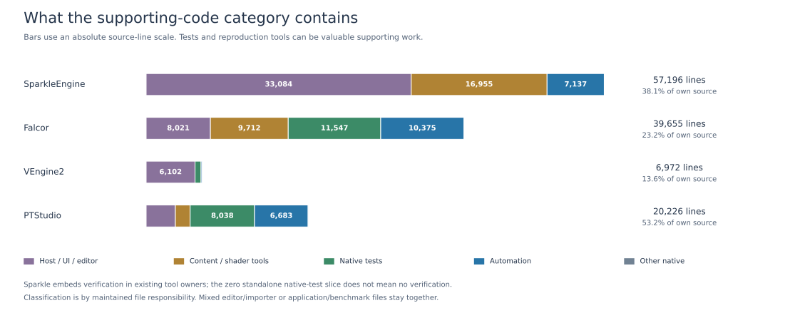

PTStudio is a counterexample to treating a high Rest share as waste: its **53.2%** includes **8,038 native test lines and 6,683 automation lines**. Sparkle's verification also lives inside existing tool owners. Cut a mechanism only after identifying its consumer, retained contract and complete replacement cost; preserve useful checks and reproduction.

<details>
<summary>Full measured proportions, exact source pins and portfolio provenance</summary>

Project links below open the measured revisions. The downloadable [CSV](Images/RepositoryFootprint/peer-proportions.csv) contains exact code/physical/file totals and category counts, including the three library components separately. Repeated project/framework views are alternatives, not independent observations to pool.

| Pinned project/view | Code lines | Render | RHI | Shaders | Scene/world | Core/found. | Rest |
| --- | ---: | ---: | ---: | ---: | ---: | ---: | ---: |
| **SparkleEngine** | 150,112 | 21.1% | 21.9% | 4.3% | 7.3% | 8.0% | 37.4% |
| [Falcor](https://github.com/NVIDIAGameWorks/Falcor/tree/759aad033ff610fb0d82c74f7e0a508d0096d5f2) | 170,780 | 16.0% | 10.9% | 24.8% | 12.0% | 13.0% | 23.2% |
| [RTXPT](https://github.com/NVIDIA-RTX/RTXPT/tree/303b408ab81790a5051abd7573830b7a4112eb8e) | 53,569 | 31.8% | 0.0% | 44.8% | 3.2% | 0.0% | 20.1% |
| [RTXPT](https://github.com/NVIDIA-RTX/RTXPT/tree/303b408ab81790a5051abd7573830b7a4112eb8e) + [Donut](https://github.com/NVIDIA-RTX/Donut/tree/e50042f4bbd762971cc90431261e967404855b81) + [NVRHI](https://github.com/NVIDIA-RTX/NVRHI/tree/6b96fb03e07539f08327aea76c56d55f1de9d906) | 126,670 | 23.8% | 24.4% | 22.4% | 5.7% | 5.1% | 18.6% |
| [Capsaicin](https://github.com/GPUOpen-LibrariesAndSDKs/Capsaicin/tree/914b91596cd119eda85fbc1d3c7ee6ac391b1452) | 35,862 | 48.2% | 0.0% | 41.3% | 0.0% | 4.4% | 6.1% |
| [Capsaicin](https://github.com/GPUOpen-LibrariesAndSDKs/Capsaicin/tree/914b91596cd119eda85fbc1d3c7ee6ac391b1452) + [gfx](https://github.com/gboisse/gfx/tree/c65d6172500864b68988cdf64846520ebbb42e6f) | 54,044 | 32.0% | 21.6% | 28.6% | 6.9% | 3.7% | 7.1% |
| [Cauldron](https://github.com/GPUOpen-LibrariesAndSDKs/Cauldron/tree/b92d559bd083f44df9f8f42a6ad149c1584ae94c) | 27,099 | 34.1% | 24.3% | 14.1% | 5.7% | 4.6% | 17.3% |
| [VEngine2](https://github.com/DoerriesT/VEngine2/tree/a77c0adf0b9f01cc7db7d4fd26f9228e4e93c433) | 51,213 | 23.1% | 27.5% | 8.7% | 13.4% | 13.8% | 13.6% |
| [PTStudio](https://github.com/dw218192/PTStudio/tree/add248a46045a7b00a8cd803e5dfa016e9338067) | 37,994 | 20.3% | 6.0% | 7.3% | 9.3% | 3.9% | 53.2% |
| [referencePT](https://github.com/boksajak/referencePT/tree/c949ad2b854ea2e982dd50aab889131fd1ffd0d7) | 4,021 | 0.0% | 32.3% | 27.2% | 10.4% | 10.3% | 19.7% |
| [UnrealEngineSkyAtmosphere](https://github.com/sebh/UnrealEngineSkyAtmosphere/tree/183ead5bdacc701b3b626347a680a2f3cd3d4fbd) | 6,442 | 30.7% | 24.2% | 34.5% | 0.0% | 7.1% | 3.4% |
| [Probulator](https://github.com/kayru/Probulator/tree/ad916bda84a6383ec34a69eaf2f3444bfef6026d) | 5,278 | 54.7% | 0.0% | 2.4% | 0.0% | 1.0% | 41.9% |

**Delegation changes the visible proportions.** RTXPT's local RHI is zero in this mapping; adding the named Donut and NVRHI snapshots produces a **24.4% RHI** slice. Capsaicin's local RHI is also zero; its pinned `gfx` source raises the selected framework view to **21.6% RHI**. These views include only the named components, not all SDKs, system runtimes or a complete transitive closure. NVRHI's snapshot includes D3D11 as well as D3D12/Vulkan source. Falcor uses Slang GFX; PTStudio uses Dawn/WebGPU and OpenUSD. Their local wrappers do not represent ownership of those implementations.

The personal-project affiliations come from primary self-descriptions checked for this study:

| Engineer | Public source and project context |
| --- | --- |
| **Tim Dörries / Epic** | [His site](https://doerriest.github.io/) identifies an Epic rendering role and links VEngine2. The project owns a two-API abstraction and also includes animation, ECS, scripting and physics; its README says saving/loading is unfinished. This is a useful ownership comparison, not product-acceptance proof. |
| **Sébastien Hillaire / Epic** | [His site](https://sebh.github.io/) identifies a principal graphics role. Sky Atmosphere is a focused paper/demo project with a D3D11 base, not Unreal Engine's complete source footprint. |
| **Yuriy O'Donnell / Epic** | [His site](https://kayru.org/) identifies Epic work; [his project page](https://kayru.org/projects/) credits Probulator jointly with David Neubelt. It is mainly a CPU/probe experiment with GUI presentation, not a full GPU engine. |
| **Tongwei Dai / NVIDIA** | [His portfolio](https://dw218192.github.io/portfolio/) identifies NVIDIA employment and links PTStudio. The measured revision uses Dawn/WebGPU and OpenUSD; desktop/browser targets do not mean owned native D3D12/Vulkan backends. |
| **Jakub Boksansky / AMD** | [His site](https://boksajak.github.io/) identifies AMD graphics research. referencePT is a small Ray Tracing Gems II supplement with NVIDIA-copyright source, rather than a complete renderer/editor product. |

These sources establish publicly described affiliation and project links, not why anyone was hired or how much of a collaborative project they personally wrote. **Unreal Engine itself was not counted**: [Epic's official GitHub page](https://github.com/EpicGames) describes linked-account access for its licensed engine repositories. No public-fork proxy or invented Unreal percentage is used.

</details>

<details>
<summary>Classification rules, exclusions and reproducibility</summary>

The same cloc 2.06 counter was applied to each selected source list, with duplicate suppression disabled. Slang/shared Slang and mesh/task/ray shader extensions use C-style shader comment handling. File SHA-256 hashes, Git pins, complete source lists, exclusions, cloc JSON and per-file responsibility assignments are retained in the local ignored [peer evidence folder](../artifacts/analysis/peers-20261121). No project was built or GPU-qualified.

| Project | Principal file-assignment rules |
| --- | --- |
| Falcor | `Core/API` and `Core/Program` -> RHI; `Scene` -> scene/world; Rendering, RenderGraph, passes and modules -> rendering; remaining utilities/platform -> foundations; apps/importers/tests -> Rest. |
| RTXPT / Donut / NVRHI | RTXPT pipeline -> rendering, SampleGame -> world, UI/app shell -> Rest. Donut core -> foundations, scene/animation/material/camera -> world, rendering helpers -> rendering, app -> Rest. NVRHI implementation/contracts -> RHI; its tests/build scripts remain Rest. |
| Capsaicin / gfx | Techniques/components and mixed frame-scene orchestration -> rendering, math/utilities -> foundations, viewer -> Rest. `gfx` resource/command/program layer -> RHI, scene layer -> world, window layer -> foundations, GUI/examples -> Rest. |
| Cauldron | Native backend base classes -> RHI, postprocessing/GPU glTF passes -> rendering, shared glTF/camera -> world, general helpers -> foundations; UI, compilation/loading and automation -> Rest. |
| VEngine2 | `graphics/gal` -> RHI; remaining graphics -> rendering; components/ECS/animation/assets -> world; jobs/allocators/filesystem/input/platform -> foundations; Editor/importers, gameplay shell and tests -> Rest. |
| PTStudio | WebGPU resource/pipeline wrappers -> RHI, passes/frame graph -> rendering, USD scene adaptation -> world, generic containers/errors/time -> foundations; editor/app, shader tools, tests and automation -> Rest. The name `core/` does not make its whole contents Core. |
| Focused examples | referencePT's mixed `Graphics.*` -> RHI; sky's mixed `Game.*` -> rendering; Probulator's CPU probe/basis/fitting code -> rendering. Embedded shader strings and mixed host/graphics files stay in their containing file's category. Zero denotes no separately mapped category, not absence of that responsibility. |

Shader-file classification takes precedence; automation is always Rest in the comparison. Directory-name exclusions alone were insufficient: **12,481 D3D12MA/volk code lines inside VEngine2's backend directories** were excluded as upstream implementation. Vendored Lua, ImGui, meshoptimizer, MikkTSpace, SDK headers, Falcor's Bottle dependency and numerical LTC/spectral tables were also excluded. Adaptation code around these components stays counted. Reviewed source lists include Capsaicin's nonstandard `.mesh`/`.task` shader files.

File-level responsibility assignment is an analytical judgment. The broad graphics-plus-scene share remains lower in Sparkle (**54.6%**) than this four-system group's **63.7-78.1%**, so moving mixed scene code between Rendering and Scene/world does not remove that directional gap. Capability, workflow and delegation differences still prevent equating the gap with deletable waste. Inspect the named cut paths and preserve their existing gates.

As a denominator check, omitting classified automation and standalone native-test files leaves Sparkle's Rest share at **34.8%**, against **11.9-15.8%** in the same four-system group. Embedded tool validation remains inside its owning files. This sensitivity supports investigating host/tool maintenance; it does not make testing or automation a deletion target.

</details>

### Current proportions and desired direction

These five responsibility groups partition **all 150,112 owned code lines and 2,422 files** once, including shaders and automation. They measure maintained source, not time spent, defects or capability strength. Supporting code can be essential to a graphics result.

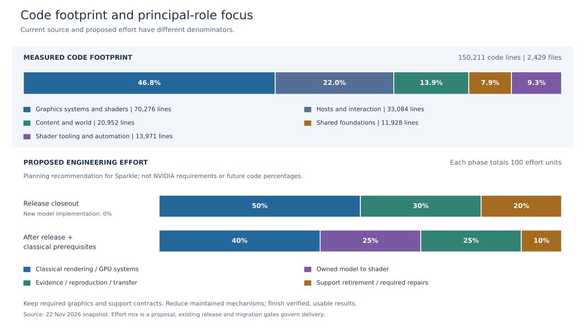

| Responsibility | Included owners | Files | Code lines | Share | Desired complexity direction |
| --- | --- | ---: | ---: | ---: | --- |
| Graphics systems and shaders | RHI, Renderer, all shaders | 1,137 | 71,017 | **47.3%** | Protect API/lifetime and estimator depth; consolidate shared pass invariants; finish correctness and measured results. |
| Hosts and interaction | Launcher, Editor, Application, Showcase entry points | 408 | 33,009 | **22.0%** | Bound to build/cook/run, inspection, supported edits and delivery. Remove duplicate operation state and forwarding where demonstrated. |
| Content and world | GameFramework, SourceImporters, all five cookers | 436 | 20,919 | **13.9%** | Keep one content/material interpretation; delegate decoding/processing. Do not grow general gameplay or broad authoring. |
| Shared foundations | Core, Tasks, Platform, ToolSupport, native CMake glue | 216 | 11,983 | **8.0%** | Retire selected general mechanisms under existing gates; retain domain policy, cancellation, publication and lifetime guarantees. |
| Shader tooling and automation | ShaderCompiler, all build/scripts/CI | 225 | 13,184 | **8.8%** | Reuse compiler facilities and existing build/dependency tools; retain ABI, source identity, offline reproduction and useful checks. |

The graphics share can rise through genuine support retirement and selected graphics work. The [cut-only scenarios](#proportions-after-cuts) below show how much actual removal would change that balance. The measured peers supply comparative context; each checkpoint remains a proposal under Sparkle's scope. The [owner map](#every-native-owner) and [component figures](#module-breakdowns) locate costs inside each group.

The **6,385 shader lines are 4.3%** of owned source; this is not a completeness measure. Treat the absent owned-model path and incomplete correctness, performance and transfer evidence as development gaps. Evaluate supporting complexity by the maintained mechanisms and coordination needed for those outcomes.

### Cuts before expansion

Start with **retiring maintained mechanisms and bounding supporting scope**. The table separates named retirement scopes from structural review candidates. Code lines exclude comments/blanks; physical lines include them. Gross scope is the current implementation under review; **net saving must subtract all replacement, adapter, caller and relocated code**. Fit and behavior remain open where stated.

| Priority / cut | Delete or simplify | Preserve | Scope and completion target |
| --- | --- | --- | --- |
| **1. Custom task execution** | Retire the Tasks module and `RenderScenePreparationTasks.*`; convert callers directly to the qualified upstream owner. Remove its API, target/DLL, scheduler and compatibility facade. | Domain admission, stop/results, settlement, frame coordination, caller-thread controls and GPU lifetime. | **3,017 code / 3,566 physical lines in 42 files**: 2,959 module code lines plus 58 adapter lines. Pinned enkiTS fit was rejected; Tasks remains. The [comparison/review targets](Implementation/TaskRuntime.md#delivery-constraints-and-fixed-budgets) remain **>=1,528 net physical infrastructure lines removed**, **<=2,065 added/relocated lines**, **<=10 public execution declarations**, **<=12 mutable infrastructure fields** and **<=12 rejection/cleanup sites**. [Code completion and broader qualification](ThirdPartyMigration.md#code-delivery-and-qualification) have separate exits. |
| **2. Native window/input mechanism** | Trial SDL3 and delete the superseded Win32 window/event/cursor backend. Keep routing and policy with their existing owners. | Focus/capture/cancellation, camera input, DPI behavior, native handles and RHI presentation. | Reviewed scope: **752 code / <=868 physical lines in 13 files**. This is a gross ceiling, with adapters/callers still charged. SDL3 remains a [trial](ThirdPartyMigration.md#native-removal-estimates). |
| **3. Custom shader include expansion** | Retire the regex-based `ShaderSourcePreprocessor` pair; use existing DXC/Slang facilities. | Source mounts/capture, include-closure identity, generated parameters, reflection/ABI, publication and reload lifetime. | **161 code / 190 physical lines in two files**. Complete connected net saving is unproved; this work can proceed independently under [compiler reuse](ThirdPartyMigration.md#native-removal-estimates). |
| **4. Launcher presentation/discovery mechanics** | Trial existing Qt item layout and standard CMake/vswhere queries in place of custom card reflow and duplicate discovery. | Scene/actions/readiness, sizing/DPI/focus, admitted toolchains/overrides, offline use and useful failure/cancellation output. | Reviewed gross ceilings: **160 physical lines** for `ResponsiveCardGridWidget`, **24** for CMake cache lookup and **24** for VS installation scanning. Source project-name parsing and shared generator discovery are uncredited. Charge models/delegates/query handling and all callers; [reject comparable replacement machinery](ThirdPartyMigration.md#native-removal-estimates). |
| **5. Distributed host/panel state** | In Launcher, Editor and Application, remove demonstrated duplicate mutable operation facts, copied readiness/output state, forwarding-only helpers and panel-owned copies of domain logic. | One operation owner, derived presentation, typed edits/undo, inspection, source correlation and safe shutdown. | **Review candidate, no measured saving.** Follow one build/cook/run or shader-reload path. Target **one writable authority per fact** and deletion of the old path; record owners/files/state touched before and after. |
| **6. Graphics fragmentation and duplicated mechanisms** | Combine pass fragments sharing an invariant/lifetime; remove redundant descriptors/state/forwarding only after tracing consumers. Retire a replaced production algorithm when an SDK path qualifies. | Owned RHI, FrameGraph, API state/barriers, GPU retirement, material meaning and independent Reference. | **Review candidate, no measured saving.** Renderer Passes has 123 of 197 files at most 20 code lines. RTXDI has **zero identified native savings** here; its 365-line Direct host family is an integration surface. Keep Reference separate from the single selected production path. |

**A concrete optional scope cut:** use a plain Qt scene list and basic operation presentation instead of bespoke hero/card presentation if visual polish prevents a worthwhile reduction. This keeps scene selection, actions, readiness, errors, cancellation and DPI. It is a proposed product choice; update the existing trial's presentation requirements if selected, and measure the whole change. The 160-line figure above covers only the reviewed reflow widget, not all visual code. [Qt list/icon layout](https://doc.qt.io/qt-6/qlistview.html) and [Microsoft's vswhere query](https://github.com/microsoft/vswhere/wiki/Find-MSBuild) are existing-mechanism precedents, not local fit proof.

**Cut proposed work as well:** keep Boost.Process, EnTT, ozz-animation and FlatBuffers conditional until they solve a demonstrated problem with a cheaper complete boundary. Their reviewed native gross ceilings are only **342, 317, 235 and 82 physical lines** respectively. Prefer existing dependencies and direct code when a new library would add comparable glue. Broad authoring/diagnostic suites, a general ML runtime and extra gameplay systems stay outside Goals. Avoided work earns no deletion credit. Preserve Core publication/admission, canonical content semantics and the small cookers.

### Proportions after cuts

These scenarios hold graphics at **71,017 code lines** and remove only from the other **79,095**. They separate simplification from adding code that changes the denominator. The three disjoint native scopes above cover **3,930 code lines in 57 files**, including **58 Renderer adapter lines**. This unchanged-graphics model credits only their **3,872 supporting code lines in 55 files**, before replacement costs; JSON and other reviews are uncredited.

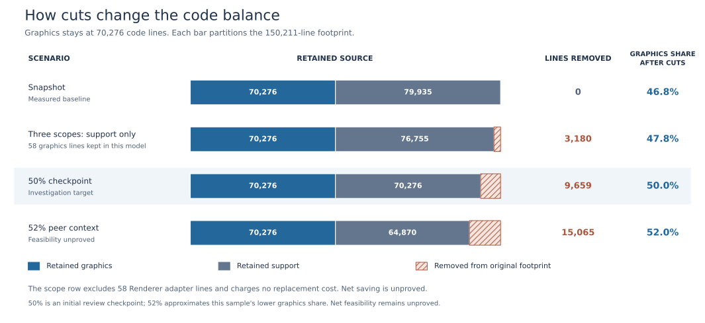

| Scenario | Net code lines removed | Remaining total | Graphics share | Meaning |
| --- | ---: | ---: | ---: | --- |
| Frozen snapshot | 0 | 150,112 | 47.3% | Measured baseline. |
| Supporting portion of three scopes, zero integration cost | 3,872 | 146,240 | 48.6% | **Optimistic gross ceiling**, not a net forecast: excludes the 58 Renderer adapter lines and assumes no replacement cost. |
| **50% investigation checkpoint** | **8,078** | **142,034** | **50.0%** | Requires **10.2% net reduction** of supporting source. Existing named scopes cannot establish this; wider review of host/state/tooling paths must identify the remaining cuts. |
| **52% peer-context checkpoint** | **13,541** | **136,571** | **52.0%** | Requires **17.1% net reduction** of supporting source. Approximates the four-system group's lowest observed graphics share, **51.7%**; feasibility remains unproved. |

Use **50% as an initial cut-review checkpoint** and **52% as a peer-context reference**, subject to findings. Neither is an accepted removal budget or release prerequisite. The latter still needs at least **9,669 supporting code lines beyond the three scopes' optimistic supporting-only ceiling**, before charging their replacements. Count only useful, capability-preserving net retirements; if review cannot justify enough cuts, retain the supported footprint. Do not add or relabel code to meet a checkpoint. If graphics code also shrinks, recalculate numerator and denominator and judge the change by its outcomes and ownership. Keep each migration's correctness/removal exit and fixed cost accounting authoritative under [code delivery and qualification](ThirdPartyMigration.md#code-delivery-and-qualification); report SLOC separately before recalculating proportions.

### Proposed allocation of engineering attention

Aim to spend **80% of release-closeout effort on direct graphics results and evidence**, rising to **90% after release** as owned neural work becomes eligible. Use the following starting mix per 100 effort units, then review it at the next release/case milestone. These are recommendations for Sparkle, not measured past effort, NVIDIA requirements, upstream code ratios or adopted roadmap budgets. The two phases preserve [Roadmap](Roadmap.md#after-release) ordering.

| Primary deliverable | Release closeout | After release and classical prerequisites | Why this earns attention |
| --- | ---: | ---: | --- |
| Classical rendering and GPU systems | **50%** | **40%** | Correct pixels, selected release features, CPU/GPU/shader/resource studies and difficult debugging: cases 1 and 2. |
| Owned model to shader | **0% new implementation** | **25%** | One bounded data/model/operator/export/inference path and held-out result: case 3. Required classical/reference foundations come first. |
| Evidence, reproduction and transfer | **30%** | **25%** | Dedicated measurements, independent controls, final-package reproduction, case writing, design review, second-context use and explanation/feedback. |
| Support retirement and required repairs | **20%** | **10%** | Retire the mechanisms above and repair required workflows. Keep discretionary support expansion bounded to a named case/consumer. |

Assign each work item once by its primary deliverable; ordinary verification stays with every change. A rendering optimization belongs to graphics; a separate controlled benchmark or reproduction exercise belongs to evidence. Reserve the evidence allocation even when it produces few source lines. Support percentages are planning guardrails: fix required blockers, then investigate recurring support demand before adding another mechanism. Existing migration trials do not become new release prerequisites. Neural work starts only after its existing prerequisites; unused research allocation returns to current graphics/evidence work.

### Actions across the repository

The action labels are assessments against Goals, not defect scores or blanket instructions to shrink large modules.


**KEEP** preserves an appropriate responsibility. **REVIEW / BOUND** identifies a possible scope or coordination problem. **RETIRE / REPLACE / REUSE** names a selected investigation boundary, with fit and preservation still required. **PROVE** closes acceptance for implemented work. **BUILD** adds a missing selected capability after its prerequisites.

### Concrete targets

These retain existing gates and distinguish proposed research limits from accepted requirements. Observed peer distributions do not prescribe a total LOC or shader quota for Sparkle.

| Target | Current delta | Completion criterion and authority |
| --- | --- | --- |
| Correct content and Reference | Source exists; raster UV/address/occlusion parity and Reference emitter/estimator checks remain open. | A fixed scene/camera/material trace through source, cook, raster, ray and raw Reference, with analytic or independent controls and recorded uncertainty. [Rendering](Rendering.md#reference-renderer) owns the domain/tolerances. |
| One measured frame, two APIs | Implemented foundations and partial observations; final image/performance acceptance remains open, including Vulkan startup. | On the [release benchmark](Roadmap.md#frame-rate-test), CPU, GPU and presented p95 each **<=33.33 ms at 1920x1080**, three repetitions, at least 300 warm-up and 300 measured frames per run. Qualify each supported API/configuration. |
| Bounded runtime and usable delivery | Complete final-package reproduction remains open. | [Release requirements](Roadmap.md#time-memory-and-storage): process commit **<=12 GiB**, tracked local GPU memory **<=7 GiB**, no repeated-loop growth; responsive startup **<=15 s**, default-scene correct frame **<=30 s**. Reproduce prebuilt and matching-source workflows offline with identified products and approved content. |
| Finish selected release features | Decals, global grading and HDR are unfinished; lens effects are partial. | Complete the bounded authored-data-to-pixel paths in [Rendering](Rendering.md#release-features): matching decal meaning at raster and ray hits, one global grade/3D LUT, qualified HDR output with SDR recovery, correct lens ordering and raw-view bypass. Keep unresolved settings explicit before implementation. |
| Deliver one owned model-to-shader case | No tracked training/evaluation or owned inference subsystem was identified; the 12 Python files are asset converters. | After release and classical results: one licensed label/data split, one fixed spatial model, one classical comparator, exact export, checked HLSL/Slang kernels and held-out evaluation. [Proposed limits](Rendering.md#proposed-targets), still to agree: FP32 agreement within **0.0001 + 0.0001*abs(reference)**, denoising GPU p95 **<=2 ms at 1080p**, extra workspace **<=320 MiB**, with the specified quality/speed and temporal checks. |
| Make results transferable | The three cases require complete, usable evidence; source volume cannot establish professional impact. | Three concise case narratives with original results, owned contribution, alternatives, one difficult incident, reproduction, design review, second-context use and feedback. Label self/assisted/independent work accurately under [Goals](Goals.md#review-and-transfer); external participation is optional. |

Migration gates count their fixed physical scopes; charts count comment-excluding code lines. Removing a named mechanism does not imply that its whole current footprint becomes net savings. The target is **fewer maintained mechanisms and verified outcomes**, with each retained cost serving a case or required product workflow.

## Code distribution

**Code lines** exclude blank and comment-only lines. **Physical lines** include them. Native counts include headers, templates and inline implementation. All tracked source configurations/backends count once.

| Owned source | Files | Code lines | Physical lines |
| --- | ---: | ---: | ---: |
| Native C++ | 2,158 | 137,651 | 160,925 |
| Shaders | 145 | 6,385 | 7,539 |
| Build, scripts and CI | 119 | 6,076 | 7,053 |
| **Total** | **2,422** | **150,112** | **175,517** |

Headers account for **33,896 native code lines, 24.6%** of native source. Checked-in upstream `d3dx12.h` has **3,677 code / 4,065 physical lines** outside the owned total; fetched dependencies and generated outputs are excluded.

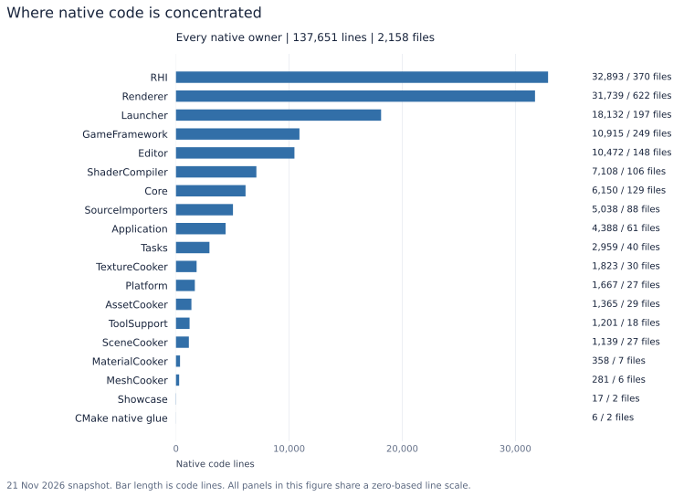

### Every native owner

The last column combines maintained responsibility with the target action above. Small systems can have substantial lifetime or failure contracts. Commits cover **24 August-21 November 2026**, counting each non-merge commit once per owner when it touches a current native path.

| Owner | Files | Code lines | Commits | Responsibility and goal delta |
| --- | ---: | ---: | ---: | --- |
| [RHI](../Engine/RHI) | 370 | 32,893 | 68 | **KEEP + PROVE.** Two API backends; device capabilities, commands, descriptors, barriers, allocation, presentation and GPU retirement; target: checked resources, queues and retirement on both APIs. |
| [Renderer](../Engine/Renderer) | 622 | 31,739 | 116 | **REVIEW + PROVE.** Scene/view preparation, residency, frame admission, frame graphs, pass composition, histories, shader bindings and SDK lifetime; target: correct pixels; cohesive passes and frame composition. |
| [Launcher](../Tools/Launcher/SparkleLauncher) | 197 | 18,132 | 73 | **REVIEW / BOUND.** Dependency/content acquisition, readiness, toolchains, build/cook/run planning, child processes, cancellation and GUI operation state; target: one authority per mutable operation fact. |
| [GameFramework](../Engine/GameFramework) | 249 | 10,915 | 41 | **KEEP + PROVE.** Authored levels, cooked loading, entity/resource identity, animation, structural edits, immutable publication and render extraction; target: material, animation and extraction semantics agree. |
| [Editor](../Engine/Editor) | 148 | 10,472 | 60 | **REVIEW / BOUND.** Scene edits, inspection, viewport navigation, settings, console and shader controls; accepted-state and save behavior; target: graphics inspection and selected editing workflows. |
| [ShaderCompiler](../Tools/Shaders/ShaderCompiler) | 106 | 7,108 | 45 | **REUSE + PROVE.** DXC/Slang, source mounts/includes, reflection and ABI checks, debug/source identity, verification and publication; target: compiler-owned include expansion; retain ABI and identity. |
| [Core](../Engine/Core) | 129 | 6,150 | 59 | **REVIEW / BOUND.** Files and paths, publication/read coordination, process trees/readiness/output, input values, events, JSON admission and diagnostics; target: thin file, process and publication mechanisms. |
| [SourceImporters](../Tools/Import/SourceImporters) | 88 | 5,038 | 21 | **KEEP + PROVE.** glTF/FBX/PLY adaptation; geometry, transforms, materials, skins and animation converted into engine semantics; target: one canonical scene and material interpretation. |
| [Application](../Engine/Application) | 61 | 4,388 | 36 | **BOUND + PROVE.** Game/Editor startup and shutdown, runtime composition, task capacity, input routing, operations, Reference exports and GPU incidents; target: host composition; settle owned operations. |
| [Tasks](../Engine/Tasks) | 40 | 2,959 | 21 | **RETIRE TARGET.** Graph construction, runnable scheduling, lanes, dispatch/coalescing, failure propagation, cancellation, settlement and scope destruction; target: no local execution module, scheduler or compatibility API. |
| [TextureCooker](../Tools/Cooking/TextureCooker) | 30 | 1,823 | 31 | **KEEP + PROVE.** Source admission, DirectXTex adaptation, mip/format intent, requests, memory limits, worker COM lifetime and publication; target: upstream processing; accepted material/reference pixels. |
| [Platform](../Engine/Platform) | 27 | 1,667 | 20 | **REPLACE TARGET.** Native window/events, title bars, DPI, focus/capture, cursor restoration and deferred input dispatch; target: trial SDL3 mechanics; preserve input and native RHI policy. |
| [AssetCooker](../Tools/Cooking/AssetCooker) | 29 | 1,365 | 28 | **BOUND + PROVE.** Catalog discovery, cook planning, family-tool dispatch, texture-request coordination, diagnostics and staged results; target: plan and dispatch through existing family owners. |
| [ToolSupport](../Tools/Support/ToolSupport) | 18 | 1,201 | 9 | **KEEP / BOUND.** Shared catalog identity/containment, source/output paths, console output and producer/consumer progress protocol; target: one catalog, output-path and progress contract. |
| [SceneCooker](../Tools/Cooking/SceneCooker) | 27 | 1,139 | 10 | **KEEP + PROVE.** Scene identity/manifests, instances, lights, cameras, animation, skeletons and generation publication; target: complete scene, skeleton and animation meaning. |
| [MaterialCooker](../Tools/Cooking/MaterialCooker) | 7 | 358 | 11 | **KEEP + PROVE.** Material/default interpretation, cooked records and texture-policy request generation; target: material intent and texture requests stay thin. |
| [MeshCooker](../Tools/Cooking/MeshCooker) | 6 | 281 | 12 | **KEEP + PROVE.** Packed mesh construction and serialization of engine geometry contracts; target: packed geometry and admitted allocation contracts. |
| [Showcase entry points](../Projects/Showcase) | 2 | 17 | 1 | **KEEP THIN.** Thin Game/Editor host composition; project conversion scripts and content are counted separately; target: entry points compose the product. |
| [Shared CMake native glue](../CMake/Dependencies/ImGui) | 2 | 6 | 0 | **KEEP THIN.** Owned ImGui configuration/context integration; target: only required native upstream integration. |

### Module breakdowns

Bar length measures **code lines**, with file counts beside each bar. Panels within one figure share a line scale. Each breakdown sums to its parent; amber marks `Public` headers, gray combines the remaining smaller private/root groups. Subsystem views are parts of module totals, not additional code or difficulty scores.

<details open>
<summary>Graphics modules: RHI and Renderer</summary>

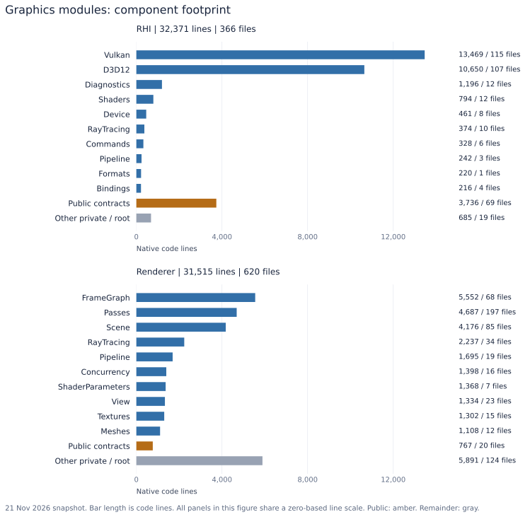

</details>

<details>
<summary>Renderer internals: FrameGraph, Scene and Passes</summary>


</details>

<details>
<summary>Native backend internals: Vulkan and D3D12</summary>

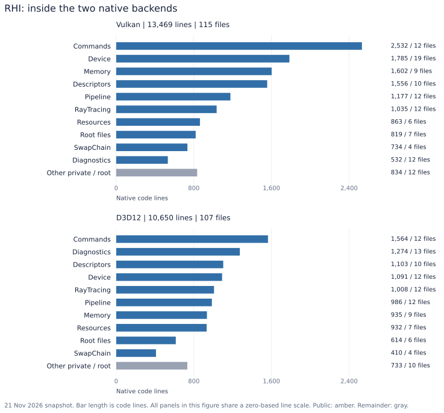

</details>

<details>
<summary>Developer workflows: Launcher, Editor, Application and ShaderCompiler</summary>

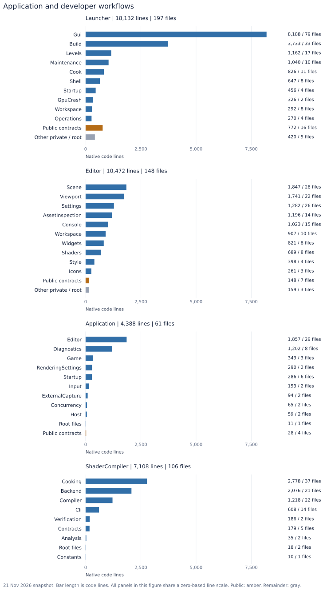

</details>

<details>
<summary>Foundations: Core, Tasks and Platform</summary>


</details>

<details>
<summary>Content: GameFramework, SourceImporters and ToolSupport</summary>


</details>

<details>
<summary>Cooking: Asset, Texture, Scene, Material and Mesh cookers</summary>

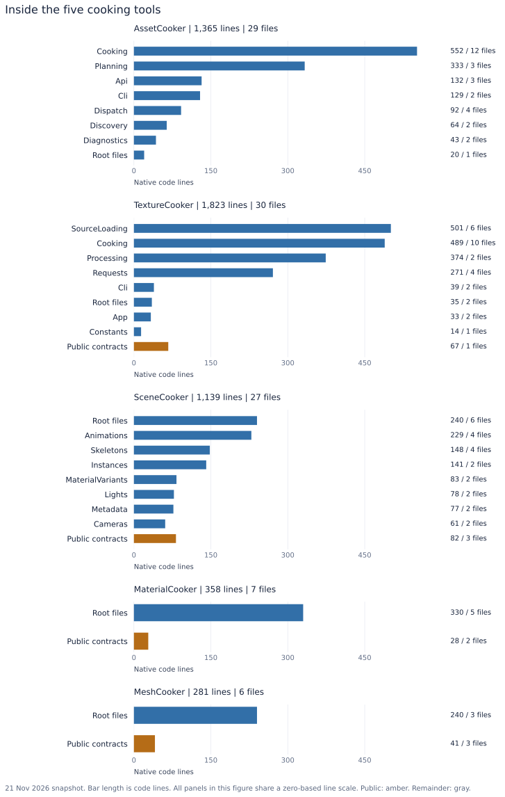

</details>

<details>
<summary>Shader source and build automation</summary>

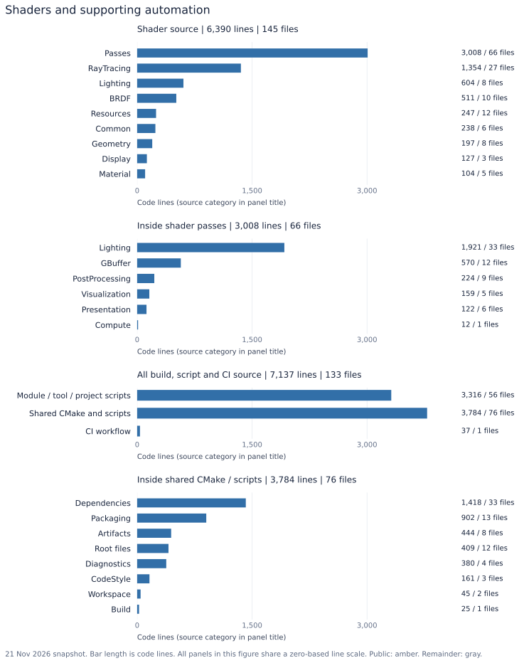

</details>

### Shaders and automation

These groups account for all **6,385 shader** and **6,076 automation** code lines. The two categories remain separate from native C++.

| Source group | Files | Code lines | Maintained complexity |
| --- | ---: | ---: | --- |
| [Shader passes](../Engine/Assets/Shaders/Passes) | 66 | 3,008 | Lighting estimators, reservoirs, Reference transport, GBuffer, exposure and display passes |
| [Shared ray tracing](../Engine/Assets/Shaders/RayTracing) | 27 | 1,354 | Intersection/hit behavior, material evaluation and traversal-facing data |
| [Lighting](../Engine/Assets/Shaders/Lighting) and [BRDF](../Engine/Assets/Shaders/BRDF) | 18 | 1,115 | Sampling/evaluation/PDF agreement, units, energy and numerical assumptions |
| Other shared shader code | 34 | 908 | Geometry, materials, resources, common mathematics and display contracts |
| [Shared CMake and scripts](../CMake), including root CMake | 64 | 2,950 | Dependency pins/cache protection, profiles, artifact identity, staging, packaging, diagnostics and style tooling |
| Module, tool and project automation | 54 | 3,089 | Target/backend composition, SDK discovery/deployment, shader registration, content acquisition and asset conversion |
| [CI workflow](../.github/workflows/repository-checks.yml) | 1 | 37 | Candidate/tool reporting and whitespace checks |

Automation comprises **3,921 CMake**, **1,531 PowerShell**, **543 Python**, **44 batch** and **37 YAML** lines. Within it, packaging owns 896 shared script lines and dependency acquisition 722. Showcase's 12 Python converters contain 543 lines; Launcher asset-pack acquisition contains 338 CMake lines. These are subsets, not additional code.

Build complexity also lives in the target graph: public/private dependencies, shared/static composition, backend selection, optional SDKs, generated shaders, DLL staging and source/prebuilt delivery. A source-line reduction can still increase compile time, dependencies or package size; those costs were not measured here.

### Content, configuration, dependencies and documentation

The original inventory contains **2,616 tracked files**, including **53 data/notice/configuration texts**, **25 Markdown files**, one upstream header and **115 binary/other files**, beyond the 2,422 owned source files.

| Surface | Complexity to account for |
| --- | --- |
| [Level catalog](../Projects/Showcase/Levels.catalog), [level definitions](../Projects/Showcase/Levels) and source assets | Catalog/asset identity, coordinate/material interpretation, selection, cooking reproducibility and redistribution rights. The baseline includes 20 `.level` and seven `.gltf` files. |
| [Configuration](../Config), persisted rendering/viewport settings and editor saves | Defaults versus user overrides, typed fallback, comment/edit preservation and explicit saving. Count readers, writers and shipped defaults together. |
| [Dependency recipes](../CMake/Dependencies/Targets) and SDK integration | Versions, upstream/transitive code, optional features, source acquisition, runtime binaries, licenses, notices and offline use. Counts cover local adapters and policy; upstream implementation and its build/delivery costs remain separate. |
| [Documentation](README.md) and [active plans](Implementation) | One owner per decision; consistency between advertised capabilities, source, acceptance status and reproduction instructions. Avoid copying migration decisions into this study. |

At the original snapshot, tracked checkout files occupied about **398 MiB**, dominated by assets; four EXRs alone accounted for about 336 MiB. The inventory predates this report and its figures. Storage footprint is distinct from code complexity; ignored build outputs, fetched upstream trees, generated products and Git object storage are outside it.

## Complexity signals

| Dimension | Measured signal | Interpretation |
| --- | --- | --- |
| File structure | Median native file **34 lines**; **742 files (34.4%)** at most 20; only three above 500 | Investigate navigation and changes spanning many small files before imposing file-size limits. |
| Function shape | **7,400** detected functions; median **9 non-comment lines**; eight exceed 100 | Large functions are uncommon; complexity can reside in distributed state and orchestration. |
| Decisions | **70 functions (0.95%)** have estimated cyclomatic complexity above 15; four exceed 30 | Review selected functions in context. Enum switches and compile-time bindings have different runtime behavior and maintenance costs. The cutoff of 15 is a study review signal, not a project acceptance threshold. |
| Public surface | **275 files / 10,103 lines**, or **7.3%** of native source | Much complexity is private. Review the meaning and consumer reach of contracts as well as their size. |
| Dependency reach | Incoming native owners: Core **16**, ToolSupport **8**, Tasks **7**, RHI **6**, GameFramework **6** | Foundation and runtime replacements affect more code than their own directories. These are resolved textual includes, not a semantic call or build graph. |
| Change activity | **291 non-merge commits** in the window; **47** touch more than 100 paths | Owner commit counts overlap. Moves and broad refactors bias attention estimates; they do not measure hours or defects. |

Renderer's pass area is a clear fragmentation review candidate: **123 of 197 files** have at most 20 code lines. [Direct-light setup](../Engine/Renderer/Private/Passes/Lighting/Direct) uses **17 native files / 365 lines**. Consolidate code that shares an invariant and lifetime; retain meaningful registration, backend and ownership boundaries.

Tasks illustrates why branch counts alone are insufficient: none of its detected functions exceeds complexity 15, yet scheduling, cancellation, cleanup and destruction still form a substantial correctness contract.

### Concrete review entry points

Selected files combine substantial size with repeated changes in the study window.

| File | Code lines | Revisions | Investigate |
| --- | ---: | ---: | --- |
| [VulkanGpuMemoryAllocator.cpp](../Engine/RHI/Private/Vulkan/Memory/VulkanGpuMemoryAllocator.cpp) | 881 | 13 | Records, delayed destruction, recording resources and memory reporting around VMA |
| [FramePipeline.cpp](../Engine/Renderer/Private/Frame/FramePipeline.cpp) | 249 | 32 | Frame preparation, recording, submission and retirement |
| [LauncherActivityPanel.cpp](../Tools/Launcher/SparkleLauncher/Private/Gui/Shell/LauncherActivityPanel.cpp) | 534 | 13 | Operation presentation and output state |
| [LauncherMainWindow.cpp](../Tools/Launcher/SparkleLauncher/Private/Gui/Shell/LauncherMainWindow.cpp) | 463 | 14 | Shell coordination and ownership of UI state |
| [VulkanDescriptorService.cpp](../Engine/RHI/Private/Vulkan/Descriptors/VulkanDescriptorService.cpp) | 494 | 12 | Descriptor allocation, binding and lifetime |
| [BuildWorkspacePlanner.cpp](../Tools/Launcher/SparkleLauncher/Private/Build/BuildWorkspacePlanner.cpp) | 309 | 19 | Readiness, planning and execution authority |

Function-level candidates include [source receipt admission](../Tools/Shaders/ShaderCompiler/Private/Cooking/Publication/ShaderDebugSourceIdentity.cpp), estimated complexity **38**, and [scene shader binding](../Engine/Renderer/Private/ShaderData/SceneShaderParameters.h), **36**, mostly compile-time field detection. Preserve source identity and shader ABI protections while reviewing their organization.

## Complexity across module boundaries

A complete investigation follows the producer, consumer, state authority and lifetime across a workflow. These paths expose complexity that local line counts miss.

This ownership map connects tooling, runtime rendering and evidence. Arrows show selected production/consumption paths, not legal include edges, code size or every dependency.

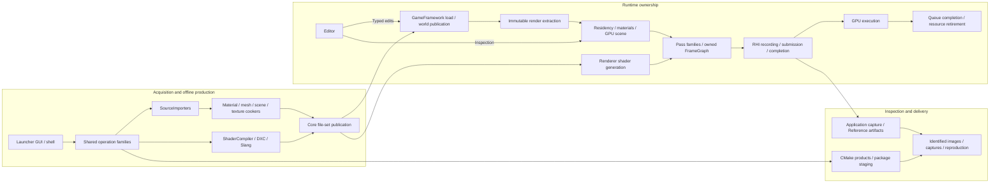

| Workflow | Owners to follow | Required contract; runtime acceptance is separate |
| --- | --- | --- |
| Prepare and launch | Launcher -> CMake/dependency recipes -> Core process -> Application -> Platform/RHI | Readiness describes the actual products; child identity, startup failure, handoff and cancellation remain coherent. |
| Import and cook | Catalog -> AssetCooker -> SourceImporters -> family cookers -> Core publication | Coherent scene/material identity, bounded memory and admitted formats. Core provides staged replacement and in-process rollback; interrupted publication or failed rollback requires clean/recook. |
| Load and replace a scene | GameFramework loaders/Tasks -> Core read scopes -> Renderer residency/GPU scene | Cancellation settles before borrowed inputs disappear; stale generations cannot publish; replacement resources respect upload/residency budgets. |
| Produce and retire a frame | World systems/animation/extraction -> Renderer preparation/FrameGraph -> RHI queues | Immutable scene inputs, dependency order, command ownership, barriers/aliasing and retirement after every referencing queue. |
| Navigate, edit and save | Platform/Core input -> Application/Editor -> GameFramework commands and persistence | Viewport navigation and derived render data stay distinct from authored edits; saves are explicit and failed edits preserve accepted state. |
| Compile and reload shaders | Editor/Application operation -> compiler tooling -> DXC/Slang -> publication -> Renderer/RHI | Exact source/debug identity, compatible reflection/layout, cancellation and successful reload while accepted shaders/resources remain valid. |
| Capture an incident or export Reference | RHI/Renderer -> Application -> Core files/process -> artifact tooling/Launcher | Executed shader/product identity, complete sample/output prefixes, bounded background work and output lifetime through shutdown. |
| Stage and reproduce delivery | CMake target graph -> artifact staging -> packaging/SyncProducts -> final launch | Matching binaries, content, DLLs, symbols, notices and provenance; source and prebuilt workflows work offline on the tested package. |

Shared hazards are **duplicate writable state, unclear publication authority, borrowed storage outliving work, and CPU completion mistaken for GPU retirement**. Remove redundant representations or coordination only after tracing the complete path.

## What the reference repositories contribute

The design study below inspected **16 pinned source/guide files across 11 repositories** linked from [References](References.md). It is separate from the [quantitative peer inventory](#measured-peer-proportions) above. The observations are upstream facts; Sparkle targets are inferences under Goals. Neither study is a whole-codebase audit or runtime qualification, and neither changes protected ownership.

| Reference source studied | Observed design | Target for Sparkle |
| --- | --- | --- |
| NVRHI [build separation](https://github.com/NVIDIA-RTX/NVRHI/blob/bf0bbd9b666a7297492beb1999a4ddc0dfded143/CMakeLists.txt), [state tracking](https://github.com/NVIDIA-RTX/NVRHI/blob/6b96fb03e07539f08327aea76c56d55f1de9d906/src/common/state-tracking.cpp) and [resource guide](https://github.com/NVIDIA-RTX/NVRHI/blob/bf0bbd9b666a7297492beb1999a4ddc0dfded143/doc/ProgrammingGuide.md) | Backend/common separation and explicit state/lifetime responsibilities. Bindless descriptor tables still require application synchronization and resource-lifetime management. | Keep Sparkle's RHI and improve reviewable state/retirement paths. Target correct native captures on both APIs, not NVRHI's file count or another abstraction layer. |
| Falcor [MinimalPathTracer kernel](https://github.com/NVIDIAGameWorks/Falcor/blob/eb540f6748774680ce0039aaf3ac9279266ec521/Source/RenderPasses/MinimalPathTracer/MinimalPathTracer.rt.slang) and [host pass](https://github.com/NVIDIAGameWorks/Falcor/blob/eb540f6748774680ce0039aaf3ac9279266ec521/Source/RenderPasses/MinimalPathTracer/MinimalPathTracer.cpp) | Deliberately simple validation transport with explicit pass inputs/outputs. It uses a primary V-buffer and fixed path length. | Keep estimator and pass contracts easy to follow. Sparkle's independent camera-originating Reference must retain its own domain and cannot inherit those shortcuts. |
| Mitsuba [path integrator](https://github.com/mitsuba-renderer/mitsuba3/blob/e262b493806f518e3151905a271955d1ff3203a9/src/integrators/path.cpp) and Capsaicin [path kernel](https://github.com/GPUOpen-LibrariesAndSDKs/Capsaicin/blob/914b91596cd119eda85fbc1d3c7ee6ac391b1452/src/core/src/ray_tracing/path_tracing.hlsl) | Visible throughput, emitter/BSDF sampling and roulette/MIS logic in their respective rendering domains. | Explain matching probabilities and normalization, then use domain-matched analytic/cross-renderer checks. Do not treat differing materials, path limits or sampling settings as interchangeable references. |
| RTXPT [scene runner](https://github.com/NVIDIA-RTX/RTXPT/blob/303b408ab81790a5051abd7573830b7a4112eb8e/Testing/RegressionTesting-RUN.bat), [image checks](https://github.com/NVIDIA-RTX/RTXPT/blob/303b408ab81790a5051abd7573830b7a4112eb8e/Support/tests/run_tests.ps1) and [build/test composition](https://github.com/NVIDIA-RTX/RTXPT/blob/303b408ab81790a5051abd7573830b7a4112eb8e/CMakeLists.txt) | Named scenes, cameras/exposure, image comparisons and explicit CPU-test registration. | Make each case reproducible with identified inputs and real executable checks. Regression images complement independent correctness controls; use Sparkle's own image domains and thresholds. |
| RTXDI [integration contract](https://github.com/NVIDIA-RTX/RTXDI/blob/a6efab966b7c3b272da0461578eb56ac61c7cbff/Doc/Integration.md) | Sampling/resampling math connects through application bridges; scene/materials, graphics access, resource allocation and pipeline assembly remain application work. | Replace one production estimator on adoption and charge the full bridge. The 365-line native Direct family is an integration surface, **not identified native savings**. Keep Reference separate. |
| NRD [native API](https://github.com/NVIDIA-RTX/NRD/blob/e06852bd545973cb224eb28820b891205cfc1624/Include/NRD.h) | Settings/dispatch descriptions are exposed without taking over the application's RHI; dispatch memory is overwritten by the same instance's next query. | Own signal conversion, histories, pass placement and borrowed/GPU lifetime. Add one qualified RELAX path through Sparkle RHI, with measured quality/cost and no NRI adoption. |
| Filament [ColorGrading contract](https://github.com/google/filament/blob/5a90ed9838a8a7115120fe6887d21b138d21c39d/filament/include/filament/ColorGrading.h) | A typed view-associated grade, explicit output color space and LUT creation/lifetime. | Finish the selected global grade/LUT and display contract. Keep Sparkle's chosen effect order; this header does not establish Windows HDR output. |
| tiny-cuda-nn [fused kernel](https://github.com/NVlabs/tiny-cuda-nn/blob/3daa6e5b8b8e0fa17971a1a20acfbb3754494b38/src/fully_fused_mlp.cu), instant-ngp [experiment script](https://github.com/NVlabs/instant-ngp/blob/abe236ee00cf90cfca6e36e65c00435d5b21f50a/scripts/run.py), RTXNS [training/inference examples](https://github.com/NVIDIA-RTX/RTXNS/blob/f309ae68677a67060cc6ded2d0af925a3931435f/README.md) | Kernel layout/shared-memory choices, snapshot/evaluation workflows and model-to-shader examples with explicit toolchain/device prerequisites. | Complete one inspectable data/model/kernel experiment. Reuse training tools, check portable FP32 first and measure optimizations. Their CUDA/NeRF/precision/toolchain assumptions do not expand Sparkle's scope or prove local SDK support. |

## Principal-role evidence

The role emphasizes rendering/AI adoption, system performance, usable technology and communication. This mapping connects those expectations to [Goals' technical capabilities](Goals.md#technical-development); it is not a hiring score. The inspected upstream practices support design choices, not the proposed effort percentages.

| Capability and case | Complexity worth owning | Present delta and target result | Practice to carry over |
| --- | --- | --- | --- |
| **Rendering mathematics and correct pixels — case 1** | Material meaning, estimator/PDF/MIS reasoning, independent Reference and selected shaders | Source exists; Reference and raster/ray parity remain open. Trace one material from source/cooked bytes to checked raw pixels, state uncertainty and resolve a failure against independent controls. | Falcor's explicit pass contracts; Mitsuba/Capsaicin's visible transport reasoning. Match comparison domains before treating results as controls. |
| **C++/CPU/GPU architecture, APIs and optimization — case 2** | FrameGraph, scene preparation, shader layout, queue synchronization and resource retirement | Large RHI/Renderer implementation; integrated acceptance remains open. Deliver quality-equivalent CPU, shader and lifetime studies, native captures on both APIs, one difficult incident and a rejected/inconclusive alternative. | NVRHI's explicit state/lifetime boundaries; RTXPT's identified scenes, image checks and executable tests. Keep Sparkle's owned RHI and benchmark requirements. |
| **AI fundamentals and model optimization — case 3** | One model's mathematics, data split, tensor/layout/precision choices and checked HLSL/Slang kernels | Tracked owned training/inference is absent. After prerequisites, deliver licensed independent labels, classical baseline/fallback, operator checks, exact export and held-out quality/time/memory/failure results. | RTXNS's model-to-shader examples, tiny-cuda-nn's kernel reasoning and instant-ngp's explicit experiment artifacts. Reuse training tools; avoid a general ML runtime. |
| **Technology adoption and production stewardship — cases 1–3** | Application signals, SDK bridge semantics, histories, capability/failure policy and measured tradeoffs | Integration code is not adoption evidence. For each selected integration, qualify one production path, credit upstream work, remove the replaced mechanism and charge the complete bridge/caller cost. | RTXDI's application bridge and NRD's dispatch/lifetime contract. Library ownership does not eliminate local material, resource or synchronization responsibilities. |
| **Usable software and communication — all cases** | Reproduction commands, bounded delivery, concise explanation and reviewable evidence | Final delivery/case acceptance remains incomplete. Provide one landing page, three result-led cases and a short paper/talk/demo; reproduce prebuilt and matching-source workflows with explicit limits and assistance labels. | RTXPT's repeatable scene/image workflow; instant-ngp's saved experiment outputs. The proof is a usable result and retained evidence, not documentation volume. |
| **Technical direction and helping others succeed — all cases** | Scope choices, alternatives, design rationale, ownership and maintenance removal | A personal repository cannot establish principal seniority. Retain a substantive design challenge, second-context use, explanation feedback and resulting revisions; complement them with permitted professional evidence of shipped impact, mentoring/stewardship or partner trust. | Apply Goals' review/transfer method to the actual cases. No upstream source file establishes these professional outcomes. |

The target is [verified evidence for every technical capability and transfer evidence for several productization/collaboration capabilities](Goals.md#reviewing-progress). Review the named artifacts and outcomes rather than assigning a completeness score from module size. Degree/equivalent experience, years, professional impact and role-specific qualifications remain in the [professional record](Goals.md#professional-qualifications).

## Structural priorities and actions

The source review follows complete ownership paths and separates confirmed mismatches from simplification and profiling candidates. Each investigation names the proposed fix or cut, the behavior to preserve and the evidence needed. Roadmap and the existing implementation plans retain delivery and adoption authority.

| Order | Area | Evidence and consequence | Direction | Concrete target |
| --- | --- | --- | --- | --- |
| 1 | [Material interpretation](#material-interpretation) | **Confirmed source mismatch:** raster omits admitted texture mapping and occlusion-strength semantics that ray sampling uses. | Fix and consolidate | One authored meaning across bindings; remove superseded interpretation logic. Keep sampling appropriate to each path. |
| 2 | [Level replacement](#level-replacement) | **Confirmed ordering hazard:** the public `WillUnload` event follows replacement/destruction of the old world owner, before final publication and active-level assignment. No current unload subscribers found. | Narrow or correct the contract | Observers see a documented, coherent state; preserve staged replacement and stale-load rejection. |
| 3 | [Publication and recovery](#publication-and-recovery) | **Known qualification gap:** in-process rollback differs from surviving process interruption. Roadmap already records a scene-publication interruption defect. | Qualify the existing owner | Demonstrate the chosen recovery behavior on an identified package. Retain incomplete-publication rejection. |
| 4 | [Launcher operations](#launcher-operations) | **Observed repetition:** GUI and shell independently dispatch the same five operation families. Family planners/executors are already shared. | Cut front-end glue | One shared typed plan/run path where it reduces code; preserve GUI cancellation and shell dry-run/output behavior. |
| 5 | [Shader preprocessing](#shader-preprocessing) | **Source-derived risk:** custom include expansion runs before the real compiler without conditional evaluation. | Replace a mechanism | Let DXC/Slang own preprocessing; remove the replaced preprocessor and charge callback integration. |
| 6 | [Task runtime](#task-runtime) | **Observed coupling:** local execution types reach public world, level and Renderer configuration contracts. Candidate fit remains open. | Conditional third-party retirement | One qualified upstream runtime, direct consumer conversion and retirement of the local API/target; no replacement facade. |
| 7 | [Pass cohesion](#pass-cohesion) | **Observed fragmentation:** Direct lighting has 17 native files / 365 code lines; broad binding helpers make dependencies implicit. Maintenance cost is unmeasured. | Consolidate one family | A real pass/resource change crosses fewer private interfaces without weakening typed layout or registration. |
| 8 | [Settings propagation](#settings-propagation) | **Observed maintenance candidate:** the same closed set is represented in state, CVars, capture/apply, persistence and UI. Existing synchronization is meaningful. | Reduce mechanical repetition selectively | One source for identical defaults/mappings where economical; retain typed controls, product overrides and render-owner ordering. |
| 9 | [FrameGraph compilation](#framegraph-compilation) | **Observed recurring work; cost unknown:** topology is reused, resource/execution compilation still occurs each executable frame. | Measure, then simplify | Attribute CPU time/allocation cost; reuse scratch first and cache only stable work with complete invalidation. |
| 10 | [Residency budgets](#residency-budgets) | **Visibility candidate:** texture/mesh admission and backend allocation telemetry answer different questions. Their relationship needs a workload-level check. | Explain and measure | Reconcile reservations, resident/retiring resources, transients and native usage on the target workload before changing policy. |

Order reflects investigation value, not measured defect severity or a new release checklist. Items 4–10 may proceed as bounded independent studies under the existing migration order. No unmeasured net LOC saving is assigned to them.

### Material interpretation

**Trace:** [glTF mapping](../Tools/Import/SourceImporters/Private/Gltf/Materials/GltfMaterialTextureMapper.cpp) → [material build](../Tools/Cooking/MaterialCooker/Private/CookedMaterialAssetBuilder.cpp) → [binary record writer](../Tools/Cooking/MaterialCooker/Private/CookedMaterialAssetWriter.cpp) → [runtime decode](../Engine/GameFramework/Private/Assets/Loaders/MaterialAssetLoader.cpp) → [runtime translation](../Engine/GameFramework/Private/Assets/CookedAssembly/CookedMaterialTranslator.cpp) → [material data](../Engine/Renderer/Private/Scene/Materials/MaterialData.cpp) → raster/ray shaders.

The importer preserves UV transform, address modes and strength. Cooking and loading preserve the mapping record. `MaterialData::FromDesc` builds GPU mapping values, but `ToPerObjectPSData` passes normal strength without the corresponding per-texture transform/address/occlusion fields. [RasterMaterial](../Engine/Assets/Shaders/Passes/GBuffer/Raster/RasterMaterial.hlsli) samples incoming UVs through the fixed wrap sampler and reads occlusion directly. [RayTracingMaterialSampling](../Engine/Assets/Shaders/RayTracing/RayTracingMaterialSampling.hlsli) transforms UVs, uses address modes and blends occlusion with its authored strength.

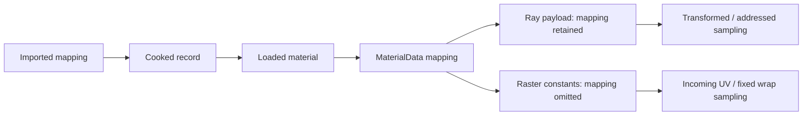

**Action:** finish the admitted material contract across both bindings; share small semantic helpers where useful and delete superseded interpretation/conversion code. Preserve path-specific filtering, derivatives, texture footprints and independent Reference transport. The glTF importer currently rejects nonzero texture-coordinate sets, so this finding does not imply support for arbitrary UV sets. The [glTF specification](https://registry.khronos.org/glTF/specs/2.0/glTF-2.0.html#materials) supplies source semantics; it does not require identical raster/ray filters.

**Check:** trace a UV transform, repeat/clamp/mirror addressing and non-default occlusion strength from source bytes to raw output with controlled sampling. Check CPU/shader ABI and both APIs. This is a deterministic source-path mismatch; it has not been established as the cause of the current Sponza failure. Existing [material and frame gates](Rendering.md#frame-and-materials) own acceptance.

### Level replacement

[LevelSession::ActivateLoadedLevel](../Engine/GameFramework/Private/Level/LevelSession.cpp) currently orders the transition as follows:

```text
CommitSceneLoadPackage
  build staged world → swap state/resources → increment generation
  return: staged owner containing the old world is destroyed
OnLevelWillUnload → OnLevelUnloaded
FinalizeSceneLoadCommit: derive and publish new world state
assign m_activeLevel
OnLevelChanged
```

The [GameWorld implementation](../Engine/GameFramework/Private/World/GameWorld.cpp) makes this ordering explicit. During `WillUnload`, an observer can encounter the new world generation while the active-level identity still describes the previous level and final derived publication has not run. The [public event name](../Engine/GameFramework/Public/Level/LevelChangeEvents.h) suggests access before unloading, which this order cannot provide.

**Action:** decide whether a real consumer needs pre-unload access. If so, prepare the replacement completely, preserve the old owner until its notification, and make the commit/publication/identity transition explicit. If consumers need only a completed transition, narrow or rename the notification surface and retire unused phases after checking callers. Do not add a generic transaction/event framework.

**Check:** an observer records level identity, generation and published view at each retained notification; failed/stale loads preserve the accepted world. Search found no current `OnLevelWillUnload`/`OnLevelUnloaded` subscribers in Engine, Tools or Projects. The current Game readiness subscriber uses `OnLevelChanged`, after finalization. This is an API-contract hazard, not a reproduced user-visible failure. Generation checks in `CompleteLevelChange` already reject stale world/document/catalog completions and must stay.

### Publication and recovery

[FileSetPublisher](../Engine/Core/Private/Files/FileSetPublication.cpp) coordinates roots, marks publication incomplete and performs staged replacement. [FileSetReplacement](../Engine/Core/Private/Files/FileSetReplacement.cpp) keeps in-memory replacement state for reverse rollback on handled failure. Readers reject an incomplete set. These protections are useful; they do not establish restart-safe, all-files atomic replacement after a killed process.

[CookedSceneGenerationWriter](../Tools/Cooking/SceneCooker/Private/CookedSceneGenerationWriter.cpp) already stages mesh, material, skeleton, animation, manifests and registry through one scene-generation publisher. Do not replace that with separate per-asset commits. [AssetCookerDispatcher](../Tools/Cooking/AssetCooker/Private/Dispatch/AssetCookerDispatcher.cpp) runs shader, texture and scene stages; their separate publications do not by themselves constitute one project-wide transaction.

**Action:** use the existing [Roadmap interruption issue](Roadmap.md#before-the-first-release) to state and exercise the supported recovery policy. If preserving the prior accepted generation across interruption is required, implement that policy within the existing publication owner and retire its superseded path. Do not silently claim the current rollback already provides it.

**Check:** interruption at each replacement boundary, locked outputs, failed rollback and subsequent read/recovery, against a newly identified archive. Ordinary exception rollback, process interruption and power-loss durability are different claims. This review did not perform these destructive or package checks.

Keep distinct publication contracts distinct. [Reference artifact publication](../Engine/Application/Private/Editor/Artifacts/ArtifactBundlePublication.cpp) publishes a new directory and rejects an existing destination; [product import](../CMake/Packaging/Publication/ProductImport.ps1) replaces selected output directories. Similar staging words do not establish interchangeable semantics or justify another generic publication layer.

### Launcher operations

[GUI operation execution](../Tools/Launcher/SparkleLauncher/Private/Gui/Operations/LauncherOperationExecution.cpp) and [shell operations](../Tools/Launcher/SparkleLauncher/Private/Shell/LauncherShellOperations.cpp) each select build, level, level-run, cook and maintenance plans and route them to their existing executors. The duplicate surface is **front-end selection/conversion/dispatch**. Planning, acquisition, build and cooking are not all duplicated engines.

**Cut:** investigate one operation first. Put a genuinely shared typed request/plan/run path beside the existing operation families, with GUI widgets and shell argument/output adaptation at their boundaries. Remove displaced variants, forwarding and stored mirrors when no consumer needs them. Keep meaningful family policy. Do not turn five known families into a plugin/job orchestration framework.

**Check:** the same explicit inputs yield the same command plan, cancellation result and failure diagnosis in GUI and shell; dry-run stays read-only. The GUI's Qt-facing caches and task adapters may have valid presentation/lifetime roles. A source duplicate is confirmed; a GUI race or quantified saving is not.

### Shader preprocessing

[ShaderSourcePreprocessor](../Tools/Shaders/ShaderCompiler/Private/Compiler/ShaderSourcePreprocessor.cpp) expands includes before [job construction](../Tools/Shaders/ShaderCompiler/Private/Cooking/Planning/ShaderCompileJobBuilder.cpp) reaches [DXC](../Tools/Shaders/ShaderCompiler/Private/Backend/Dxc/DxcShaderBackend.cpp). Its regex-based expansion does not implement compiler conditional evaluation. An include inside a disabled conditional can therefore reach the custom expansion path before the compiler decides it is inactive. No current failing shader was demonstrated.

**Replace:** use compiler preprocessing/include facilities directly. Keep virtual roots, generated typed parameters, dependency/debug source identity and staged accepted-output publication in their existing owners. Retire the replaced two-file preprocessor rather than rebuilding a parser adapter framework. Its **161 code / 190 physical lines** are a gross scope, not a net saving after compiler integration.

**Check:** conditional/macro includes, repeated includes, virtual paths, exact debug source identity and failed compilation through real DXIL/SPIR-V compilation and reload. Preserve reflection/layout and active shaders on failure. [ThirdPartyMigration](ThirdPartyMigration.md#native-removal-estimates) remains the decision owner.

### Task runtime

The local Tasks module is **40 files / 2,959 code lines** in the frozen inventory, with seven incoming native owners. Execution and scope types are exposed in [GameWorld](../Engine/GameFramework/Public/World/GameWorld.h), [LevelSession](../Engine/GameFramework/Public/Level/LevelSession.h) and [RendererExecutionConfig](../Engine/Renderer/Public/Concurrency/RendererExecutionConfig.h). [TaskScope](../Engine/Tasks/Public/TaskScope.h) and [TaskExecutor](../Engine/Tasks/Public/TaskExecutor.h) also encode settlement, cancellation, capacity and zero-worker behavior that real consumers rely on.

**Cut only after fit:** continue the existing candidate study. A passing adoption transfers execution ownership to one upstream runtime and removes the local target/API/DLL and replaced caller plumbing. Preserve domain work partitioning, admission, stop/results and settlement. Do not introduce a renamed scheduler or compatibility facade. The owned GPU frame graph stays.

**Check:** supported native ownership and complete deletion through real callers, including public world/level/Renderer contracts. Prefer native ranges, dependencies, prepared work and completion over local adapters; preserve zero-worker behavior, cancellation, capacity and physical settlement. Report the complete first-party integration/net-removal accounting against the [fixed review targets](Implementation/TaskRuntime.md#delivery-constraints-and-fixed-budgets). Implement affected shared/offline delivery paths; broader unrun campaigns follow [code delivery and qualification](ThirdPartyMigration.md#code-delivery-and-qualification). A dependency comparison or measured module size cannot qualify runtime safety.

### Pass cohesion

The Direct-light family contains **17 native files / 365 code lines**. `RestirDirectLightingPasses` delegates to reservoir passes, definitions and resources; the inspected family-private headers have no outside consumer in the include search. [SceneShaderParameters](../Engine/Renderer/Private/ShaderData/SceneShaderParameters.h) separately binds many unrelated groups by field-presence checks. Those are real interface/implicit-policy surfaces, although their maintenance cost remains unmeasured.

**Cut:** co-locate ordinary setup sharing an invariant/lifetime; keep meaningful stages named. Replace unnecessary optional-field machinery with cohesive explicit binding groups or direct assignments at real consumers. Keep typed layouts and [shader registration object targets](../Engine/Renderer/CMake/ShaderRegistrations.cmake): both runtime and cook executables need the static registrations. Do not merge backend, persistent-history and transient-frame ownership merely to reduce file count.

**Check:** use one actual resource/history/pass change to record files touched, private interfaces crossed and binding decisions before/after. Preserve shader keys, reflection, dependencies, resets and backend behavior. [Falcor's explicit MinimalPathTracer inputs/outputs](https://github.com/NVIDIAGameWorks/Falcor/blob/eb540f6748774680ce0039aaf3ac9279266ec521/Source/RenderPasses/MinimalPathTracer/MinimalPathTracer.cpp) provide a contract precedent, not an estimator or file-count target.

### Settings propagation

The path is [typed state](../Engine/Renderer/Public/Settings/EngineRenderingSettings.h) ↔ [CVar capture/apply](../Engine/Renderer/Private/Settings/EngineRenderingSettingsControls.cpp), with [Application persistence](../Engine/Application/Private/RenderingSettings/EngineRenderingSettingsPersistence.cpp), [Editor controller](../Engine/Editor/Private/Settings/EngineRenderingSettingsController.h) and render-owner commands. Adding a setting can require several mechanical mappings. Persistence already shares a `VisitPersistedSettings` table between operations; that is existing reuse, not a missing subsystem.

**Cut selectively:** choose one actual new/changed setting and remove repeated declarations/defaults or mapping code only where their semantics are identical. Keep engine defaults, project overrides, persisted user intent, device-selected settings and presentation state distinguishable. Prefer small existing typed helpers over reflection, generated settings registries or another settings service.

**Check:** reset/default/load/save/console/UI paths agree, unknown values are rejected, and restart-only controls remain truthful. [CVar access](../Engine/Core/Public/Console/CVar.h) already uses atomics or a mutex; render settings are applied through the render-owner command path, and settings capture uses synchronous completion. This scan found no basis to claim an unsynchronized CVar data race or silently rejected settings command.

### FrameGraph compilation

[FramePipelineGraph](../Engine/Renderer/Private/Frame/FramePipelineGraph.cpp) already rebuilds topology on settings, provider, ray-tracing graph or shader-generation changes. Nevertheless, [ExecuteFrame](../Engine/Renderer/Private/Frame/Graph/ExecuteRenderFrameGraph.cpp) calls setup/compile/prepare/execute each executable frame. [FrameGraph::CompileFramePlan](../Engine/Renderer/Private/FrameGraph/FrameGraph.cpp) compiles resource and execution plans; [FrameGraphCompiler](../Engine/Renderer/Private/FrameGraph/Compiler/FrameGraphCompiler.cpp) includes dependencies, queues, transient lifetimes, aliasing, barriers, batches and recording plans.

The measured Falcor revision [skips graph compilation when its recompile flag is clear](https://github.com/NVIDIAGameWorks/Falcor/blob/759aad033ff610fb0d82c74f7e0a508d0096d5f2/Source/Falcor/RenderGraph/RenderGraph.cpp#L424). This is an upstream design precedent. Sparkle has frame-varying imported state, histories and resources; equivalent reuse and its benefit are unproved.

**Measure first:** attribute CPU time and allocations to these stages on an unchanged scene and on dynamic/resize/reload paths. Reuse existing scratch where sufficient. Cache only stable work if its measured saving exceeds invalidation complexity; remove the superseded recomputation rather than retaining two competing planners.

**Check:** whole-frame CPU cost, quality-equivalent GPU work and invalidation under resize, imports, history, providers, queue capabilities and shader reload. Preserve aliasing dependencies and [cross-queue submission waits](../Engine/Renderer/Private/FrameGraph/Execution/FrameGraphSubmissionExecutor.cpp). No hotspot, speedup or safe cache boundary has been measured here.

### Residency budgets

[AssetResidencyBudget](../Engine/Renderer/Private/Resources/Residency/AssetResidency.h) defaults to 512 MiB decoded, 256 MiB pending upload and 2 GiB resident; [TextureCache](../Engine/Renderer/Private/Textures/TextureCache.cpp) overrides pending upload to 512 MiB. Mesh and texture caches have separate residency owners. [Vulkan memory telemetry](../Engine/RHI/Private/Vulkan/Memory/VulkanMemoryUsage.cpp) and [D3D12 allocator telemetry](../Engine/RHI/Private/D3D12/Memory/D3D12GpuMemoryAllocator.cpp) describe native allocation/budget usage, a different quantity.

**Target:** explain the combined workload budget using existing counters: decoded data, reservations, uploaded/live/retiring assets, transient/history/acceleration resources, backend heaps and external providers. Local cache caps do not establish a whole-frame or product GPU-memory guarantee. This scan did not establish an OOM or prove the need for a new global allocator/admission service.

**Cut only after tracing:** remove duplicate bookkeeping only when two representations answer the same lifetime/accounting question. [MaterialCache](../Engine/Renderer/Private/Scene/Materials/MaterialCache.cpp) publishing a new binding revision and [TextureCache retirement](../Engine/Renderer/Private/Textures/TextureCacheResidency.cpp) waiting for submitted GPU use are separate responsibilities. Releasing a binding revision is not equivalent to GPU completion.

### Complexity to preserve

| Inspected mechanism | Evidence found | Consequence for simplification |
| --- | --- | --- |
| Scene load ownership and settlement | [Per-asset work state](../Engine/GameFramework/Private/Level/Loading/SceneLoadWorkState.h) owns separate file sets; [task graph](../Engine/GameFramework/Private/Level/Loading/SceneLoadTaskGraph.cpp) orders read/decode and bounds in-flight assets. Publication scope survives work settlement. | Do not infer a shared-map race from a shared outer work-state object. Keep borrowed inputs alive through cancellation and join. |
| Shader replacement | [Runtime cache](../Engine/Renderer/Private/Pipeline/RenderPassRuntimeCache.cpp) validates a replacement generation before activation and retains old generations against all-queue submission state. | Keep replacement validation and retirement. Runtime generation safety and durable disk publication are separate claims. |
| Frame execution retirement | [Retirement queue](../Engine/Renderer/Private/Frame/Retirement/FrameExecutionRetirementQueue.cpp) retains graph and frame objects together until all captured queue tokens complete. | Do not release after CPU recording or a graphics-only fence. |
| Vulkan deferred allocation release | [Allocator](../Engine/RHI/Private/Vulkan/Memory/VulkanGpuMemoryAllocator.cpp) requires zero recording references and completed last-use state before release. | Preserve both recording ownership and submitted GPU lifetime. Existing VMA use already delegates allocation mechanics. |
| Raw Reference output | [Coordinator](../Engine/Application/Private/Editor/ReferencePathTracer/ReferencePathTracerArtifactCoordinator.cpp) checks immutable sample prefixes; [encoding](../Engine/Application/Private/Editor/ReferencePathTracer/ReferencePathTracerArtifactEncoding.cpp) writes scene-linear EXR and identified manifests using existing TinyEXR support. | Raw export is implemented. Finish correctness/reproduction qualification instead of adding another exporter. Implementation does not certify unbiased pixels. |
| Package identity | [Prepared inputs](../CMake/Packaging/Payload/PreparedProducts.ps1) check binary/symbol identity; [stage validation](../CMake/Packaging/Publication/PackageStage.ps1) verifies hashes, membership and stored manifest. | Preserve identified offline products. Source checks do not establish clean-machine package acceptance. |
| Artifact path composition | [Launcher paths](../Tools/Launcher/SparkleLauncher/Private/Workspace/LauncherProductPaths.cpp) reuse [ToolOutputPaths](../Tools/Support/ToolSupport/Private/ToolOutputPaths.cpp); [CMake layout](../CMake/Artifacts/WorkspaceLayout.cmake) enforces build/variant placement. | Multiple language representations alone do not prove competing authority. Share declarations only if the full integration is smaller and clearer. |
| Module direction | Frozen lexical scan: no Renderer/RHI includes from GameFramework, no Renderer-module includes from RHI and no private includes in 275 public headers. | Preserve those directions; lexical success does not prove semantic/DLL/build correctness. |

The pinned [NVRHI resource guide](https://github.com/NVIDIA-RTX/NVRHI/blob/6b96fb03e07539f08327aea76c56d55f1de9d906/doc/ProgrammingGuide.md#bindless-resources) explicitly leaves descriptor-table resource lifetime and synchronization to the application. This supports retaining explicit ownership around bindless resources; adopting an upstream component does not eliminate that responsibility.

### Action boundaries

Keep texture processing and the small cookers thin. No new evidence supports replacing GameFramework wholesale with an ECS, cutting native RHI ownership, expanding gameplay systems, or deleting tests/diagnostics to force a peer ratio. SDL and other pending third-party proposals retain their [bounded retirement scopes and acceptance rules](ThirdPartyMigration.md#native-removal-estimates). Delivered JSON code migration earns no new retirement credit here; its lasting contract remains in [Third-party migration](ThirdPartyMigration.md#json). Model-to-shader work remains a later capability gap under Goals, not a reason to grow infrastructure now.

For each chosen change, record its consumer, owner, invariant, lifetime/failure contract, interfaces/files crossed and **net first-party implementation removed after integration**. Accept it through the relevant real consumer. A material fix may add necessary shader code while deleting divergent policy; Task retirement must transfer the execution mechanism upstream and account honestly against its fixed reduction targets; a speculative cache may rightly be rejected. These outcomes are more useful than a universal module-size quota.

## Measurement basis

The study used [cloc 2.06](https://github.com/AlDanial/cloc/tree/v2.06), [Lizard 1.17.31](https://github.com/terryyin/lizard), Git history and lexical include analysis. A fresh count reproduced all native/shader/automation per-file counts, detected-function metrics and 90-day history values. All 27 chart partitions reconcile with the per-file source records. The [migration guide](ThirdPartyMigration.md#native-removal-estimates) separately counts and qualifies physical-line retirement proposals; those scopes are smaller than the owner totals here.

The [peer comparison](#measured-peer-proportions) separately counts 12 pinned public repositories using cloc and reviewed file assignments. Its [published CSV](Images/RepositoryFootprint/peer-proportions.csv) carries exact category code/physical/file totals; the local ignored [peer evidence](../artifacts/analysis/peers-20261121) retains source snapshots, Git/blob identities, exclusions, per-file classification and acquisition/measurement scripts. Observed ranges, proposed code checkpoints and proposed effort allocations have different meanings. No peer LOC ratio establishes hiring readiness, quality, optimal complexity or Sparkle acceptance.

**Structural source review:** 21 November 2026, HEAD `719f89ec1b52968abaa139b8b9b70867b90df254` plus preserved dirty-worktree files. The ignored [deep-scan evidence](../artifacts/analysis/deep-structure-20261121) stores 87 source/config snapshots and source-claim checks; combined with the preceding 34-file review, these cover 116 unique paths. Some files were inspected in selected ranges, with inspected-range records where available. This adds workflow depth to the [complete owner inventory](#code-distribution); it is not a semantic audit of every function. Source findings and inventory counts retain their separate snapshots.

History excludes merges and paths absent from the snapshot; rename identities were not followed. Function complexity is a lexical estimate, not compiler control flow. Duplicate-code volume, cognitive complexity, development time, defect incidence, runtime contention, build cost and GPU performance were not measured. No engine code was changed, built or run for this study; no GUI, GPU, interruption, package or release qualification was performed. Runtime and delivery acceptance remain in their owning guides.

The method combines [separate maintainability measures](https://www.softwareimprovementgroup.com/wp-content/uploads/APracticalModelForMeasuringMaintainability.pdf), [function decision complexity](https://www.nist.gov/publications/structured-testing-testing-methodology-using-cyclomatic-complexity-metric), [relative code churn](https://www.microsoft.com/en-us/research/publication/use-of-relative-code-churn-measures-to-predict-system-defect-density/) and [size/change hotspots](https://docs.enterprise.codescene.io/versions/2.6.6/guides/technical/hotspots.html). These sources inform metric selection; no published rating or defect-prediction model was reproduced.

Original evidence and fact-check results remain in the local ignored [analysis folder](../artifacts/analysis/repository-footprint-2026-11-21). Pinned upstream files, source hashes and the qualitative owner targets remain under `goal-delta/`; the disjoint responsibility groups and proposed effort allocations are under `principal-alignment/`. The full 57-file migration scope manifest remains under `cut-targets/`; the corrected unchanged-graphics scenario and fact checks are under `build/validation/docs-full-fact-check-20261121/`. The Sparkle source inventory was captured at **11:21:18 UTC on 21 November**. Later concurrent JSON/GPU/tooling changes are excluded from the frozen figures; changed paths and observed hashes are recorded in the [peer evidence](../artifacts/analysis/peers-20261121). The role mapping uses the dated archive in References; the linked principal vacancy returned no readable description during that check, so its current status and qualifications were not reverified. This source study did not build or qualify the upstream repositories.
