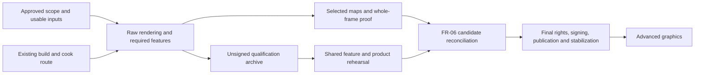
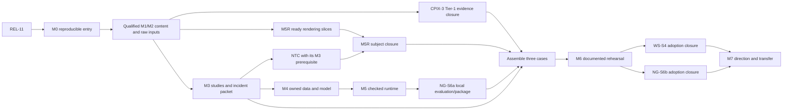

# Implementation Roadmap

[Docs](../README.md) / [Up](README.md) / [Design targets](Requirements.md) / [Release implementation](../Architecture/CrossModule/FirstRelease/ImplementationPlan.md)

**Status:** master roadmap; planning priorities, not completion results

**Scope:** the order to follow from the current release work through advanced graphics and portfolio delivery

**Updated:** 2026-11-01 against linked plans and candidate reports. Dependency order separates raw rendering, reconstruction, shared delivery evidence and formal approval; recorded results keep their original identities. The next result remains an approved rendered scene.

The [vertical and horizontal ordering review](../../artifacts/validation/vertical-horizontal-order-20261101/completion.json) records the current prerequisite routes and removed false waits. Rendering/feature, archive and public acceptance remain with their existing gates; the next task below is unchanged.

Choose one task below, open its **implementation stage**, and copy that stage's prompt. The linked **design** explains the behavior and checks to preserve. This roadmap owns priority and brief progress; implementation plans own the steps.

The first release is a rendering showcase. Select work by the rendered scene, pass, GPU behavior or reproducible graphics result it improves. Launcher, Editor, Game, Core, Tasks, cooking and packaging support that demonstration; their inventories are not independent product programs. After a bounded supporting repair, return to its rendering consumer. The [minimum supporting scope](../Acceptance/FirstRelease.md#minimum-supporting-scope) names what is enough; release uses the existing portable-package route, documented runs and manual recovery. [Product identity](ExecutiveSummary.md#product-identity) owns the enduring scope.

## How To Execute A Stage

1. Open the stage linked under **Where We Are And What Is Next**.
2. Read its prerequisites and linked design. A blocked prerequisite stays blocked; completed source work is reused.
3. Expand **Copy implementation prompt**, paste it, and work only that stage.
4. Apply [stage completion and resume](../Engineering/Workflow/ChangeLifecycle.md#stage-completion-and-resume): reuse applicable passes and run the exact unmet checks. Its [state update](../Engineering/Workflow/ChangeLifecycle.md#update-stage-state-before-handoff) is a required exit check: record the result, reconcile the remaining plan and update affected progress/next pointers before handoff.
5. Name the exact next admitted item, or the failed/missing cell and change needed before retry. Update the short progress row here when its summarized state changes. Later aggregate acceptance does not reopen completed local work; source changes alone do not pass a release gate.

## Where We Are And What Is Next

**Next: [FR-03, current Sponza radiance recovery](../Architecture/Modules/Engine/Renderer/Features/Lighting/ReferencePathTracer/ImplementationPlan.md#required-execution-order).** The [F05-C rendering identity repair](../Acceptance/FeatureCompletionReports.md#reference-correctness-progress) passes its bounded native slice. Use one frozen approved Sponza camera to inspect Lit and admitted Reference raw/display results, then repair the first wrong rendering/input owner. F01 remains the known separate analytic-emitter repair. The [portfolio demo boundary](../Acceptance/FirstRelease.md#portfolio-demo-delivery-boundary) retires the foundation execution wrapper: selected input fidelity belongs to FR-04 and candidate joins to FR-06. The simplified publication implementation passes its affected source/native controls; the old archive still needs a repaired replacement and product requalification. Retired plan documents do not close those gates.

| Current work | Design / acceptance reference | Implementation stages |
| --- | --- | --- |
| Observe current Sponza Lit/Reference raw/display output and repair its first wrong owner | [Reference progress](../Acceptance/FeatureCompletionReports.md#reference-correctness-progress) | [FR-03](../Architecture/CrossModule/FirstRelease/ImplementationPlan.md#fr-03--feature-closure) -> [rendered-scene recovery](../Architecture/Modules/Engine/Renderer/Features/Lighting/ReferencePathTracer/ImplementationPlan.md#required-execution-order) |

**Renderer work:** [Lit/Reference recovery](../Architecture/Modules/Engine/Renderer/Features/Lighting/ReferencePathTracer/ImplementationPlan.md#required-execution-order) retains its scope. Use the qualified crash tooling for GPU failures. Recheck dated failures against current source before fixing their owner.

**Final step before publication:** [FR-07](../Architecture/CrossModule/FirstRelease/ImplementationPlan.md#fr-07--publish-and-verify) owns the deferred Windows certificate, signing/timestamping, signed-byte verification and public redistribution closure. These are outside PD-1 through PD-4.

## Release Progress

| Work | Implemented / recorded | Remaining |
| --- | --- | --- |
| Scope / FR-00 | Six product choices preserved; [selector/helper/content-store discovery reconciled](../Acceptance/FirstRelease.md#fr-00-reconciliation-result) at `e44692cc`; [source-candidate scope exported](../Acceptance/FirstRelease.md#fr-01-source-requalification). | FR-06 rechecks final identity/dispositions. Product/rendering proof stays with its named stages; exact public rights remain FR-01/final FR-07. Reopen only changed dispositions. |
| Identity / FR-01 | [Internal source qualification complete](../Acceptance/FirstRelease.md#fr-01-source-requalification) for `accba4ea`: input/payload identity, scope export, owner checks, fresh empty-cache sync/build/cook/Empty and 64.651 s exact-product warm/offline replay pass. | No internal source item for this snapshot; requalify changed inputs only. Final notice-byte binding, exact public rights/provenance and trust remain FR-07 obligations. Retained local validation roots are recorded after cleanup policy rejection. |
| GPU crash tooling / GCD | Delivered: 18 native checks, 32 normal journeys, four SDK-free builds; `ITER-GCD-04-06`. [Scope and evidence](../Architecture/CrossModule/PerformanceDiagnostics/GpuCrashDebugging/GpuCrashDebuggingDesign.md#acceptance-and-controlled-failures). | None for the qualified tooling candidate; reuse for native failures. |
| Product / PD-1-4 and internal FR-02 | [Five technical reports pass for unsigned `a0f34c8b...`](../Acceptance/FeatureCompletionReports.md#product-delivery-progress): source/installed journeys, repaired package failures/recovery and exact symbol/input reconciliation. Current native D3D12 incident/export and real version replacement/rollback pass; original user state is restored. Product document retired by owner instruction. | `FCR-PROD-06` and aggregate acceptance remain `BLOCKED` for that archive on `S1` / `ISSUE-3`; the source repair now passes, and a new candidate needs affected reconciliation. Package removal remains explicitly `EXCLUDED`. Changed bytes require affected requalification; public signing/rights/publication remain FR-07. |
| Rendering foundations / selected repairs | [Completed contract, cursor, Tasks and world-accessor slices; recorded publication repair](../Acceptance/FeatureCompletionReports.md#foundation-contract-progress). The separate foundation plan is retired. | Reuse exact candidate results. Thin publication support passes its affected controls and still needs a repaired archive; selected content fidelity follows FR-04, final joins FR-06. Unused combinations are scope-excluded; broader family claims and required temporary cleanup remain open. |
| FR-03: Reference F05 | [F05-C shader identity repair and earlier bounded slices pass](../Acceptance/FeatureCompletionReports.md#reference-correctness-progress) for their recorded inputs. The fix stays in five Renderer files; stable/changed payload, reload, finite radiance and artifact-prefix checks pass. | Current Sponza raw/display result and its first wrong rendering/input owner; F01 remains the separate analytic-emitter repair. Full identity/native/lifecycle/API, parity, Shipping output and oracle gates remain open. Product closeout keeps its own candidate. |
| FR-04 to FR-08 | Plans retained. | Map/performance/backend/adoption checks, publication and finite release review. |

Use the [recorded product and foundation reports](../Acceptance/FeatureCompletionReports.md#product-delivery-progress) to reuse completed checks. Selected source slices, admitted internal package results and whole-family/release acceptance retain distinct scopes. Exact artifacts stay under ignored `artifacts/validation/`; [release gates](../Acceptance/FirstRelease.md#release-gates) decide shipment.

The [consumer-effort and presentation decision](../Acceptance/FirstRelease.md#consumer-effort-and-game-presentation) requires publisher-prepared binaries/content/dependencies/defaults: extract one bundle -> Launcher -> scene -> Run. Build/recook is optional developer work. Game is the rendering window with camera input/native close and no ImGui UI; Editor keeps its existing controls/editing/Reference export. [FR-06](../Architecture/CrossModule/FirstRelease/ImplementationPlan.md#prebuilt-delivery-simplification) owns Game-only host/wiring removal and positive Editor preservation. This docs reconciliation changes no rendering next pointer, candidate verdict or public-rights gate.

## Ordered Delivery

The first public version ends at release step 8 / REL-11. Its required frame, source/content pipeline, native lifetime and product proof become inputs to the later classical and owned-neural cases; M0-M7 is not a v0.1 publication prerequisite. Use [one shared candidate qualification](../Acceptance/FirstRelease.md#shared-delivery-evidence) and the [fresh prebuilt/source-rebuild model](../Acceptance/FirstRelease.md#prebuilt-base-and-optional-rebuild). Keep Launcher UX and optional user Build/Cook; the release receipt/store/origin machinery is removed in source; affected delivery proof stays in [FR-06](../Architecture/CrossModule/FirstRelease/ImplementationPlan.md#prebuilt-delivery-simplification). Supporting work stops when that rendering or reviewer-run result is proved.

| Delivery result | Necessary predecessor and next consumer | Boundary that prevents another program |
| --- | --- | --- |
| Correct raw/reference and realtime frame | Current recovery -> qualified oracle -> direct/indirect/reconstruction and whole-frame checks. | Final reference package adoption waits for release inputs; it does not block oracle-qualified source work or expand physical transport. |
| Reproducible approved product | Fresh publisher build/full cook -> one current-release precompiled/cooked base -> Launcher Run; optional matching source/base import -> edit -> Build/Cook/Run. | Existing owners/canonical outputs; no previous-content prerequisite, shared-store migration, per-file version tracker or release service. |
| Shippable named candidate | Frozen scope/maps/frame -> package/performance/native/adopter proof -> final trust/publication/closeout. | Gate acceptance stays ordered; independent missing rights/hardware/reviewer evidence does not require unrelated source rewrites. |
| Classical and owned-neural evidence | Reuse valid release inputs -> admitted Bistro/San Miguel studies -> one data/model/shader path -> three reviewed cases. | No internal diagnostics workspace, new scene family, general ML runtime or extra feature catalog is a prerequisite. |

Child stages follow actual data/proof dependencies. Their numbers identify ownership, not mandatory module rewrites. Each implementation deletes its replaced path as it lands; aggregate closure verifies that cleanup and shared evidence. Existing reference recovery can proceed while release/package prerequisites are completed.

**Evidence before approval:** the table below orders formal release gates. Produce a needed selected-map artifact or exact unsigned qualification archive when its technical inputs exist, even while FR-03 remains open. Reference Stage 10 and other feature delivery checks consume that archive and contribute to the shared rehearsal; they do not wait for REL-08/09 approval. FR-06 later freezes/reconciles those same bytes and applicable observations. Changed inputs invalidate affected proof. [Formal REL acceptance remains strictly ordered](../Acceptance/FirstRelease.md#release-gates).

| Step | What you deliver | Open the remaining stage or retained result |
| --- | --- | --- |
| 0. Define | A finite product, map set, feature scope and supported presets. | [Recorded scope reconciliation](../Acceptance/FirstRelease.md#fr-00-reconciliation-result) — internal FR-00 complete; `REL-00` remains candidate-bound. |
| 1. Establish trust | Clear asset/dependency rights, product identity and a reproducible source build. | [Recorded source qualification](../Acceptance/FirstRelease.md#fr-01-source-requalification) — internal FR-01 complete; final public rights/signing remain FR-07. |
| 2. Package | Existing build/cook tools prepare files; one inventory-owned stage/verify/archive route. [One-path source cleanup](../../artifacts/validation/release-owner-slim-20261101/completion.json) passes bounded checks; new-archive proof stays FR-06. [Launcher-owned preparation](../../artifacts/validation/launcher-owned-delivery-20261101/completion.json) also removes Engine package/installed policy and the former Editor compiler/watcher/receipt machinery. Editor's explicit shader action delegates to Launcher through the tooling binding, with optional private symbols. [Runtime admission reconciliation](../../artifacts/validation/runtime-inputs-slim-20261101/completion.json) removes the remaining source-selection gate and moves acquisition metadata out of Core. | [Recorded FR-02 verification](../../artifacts/validation/releases/0.1.0/241ef037-product-20261025/fr02-final-20261031/completion.json) — admitted unsigned internal scope complete with the removal exclusion; PD-4 closeout remains blocked by the known scene-publication defect. |
| 3. Finish features | Required rendering and product behavior, including failures and resource lifetime. Follow the feature order below. | [Feature closure](../Architecture/CrossModule/FirstRelease/ImplementationPlan.md#fr-03--feature-closure) — `REL-04` |
| 4. Prove map quality | Correct content, trustworthy references and stable images on the selected maps. | [Release maps](../Architecture/CrossModule/FirstRelease/ImplementationPlan.md#fr-04--release-maps) — `REL-05` |
| 5. Prove the whole frame | Realtime >=30 FPS, bounded memory, stability, D3D12/Vulkan parity and principal-level frame review. | [Performance and native proof](../Architecture/CrossModule/FirstRelease/ImplementationPlan.md#fr-05--performance-stability-and-native-proof) — `REL-06/07` |
| 6. Review the candidate | Frozen package bytes and successful consumer/source journeys without private help. | [Candidate and adoption](../Architecture/CrossModule/FirstRelease/ImplementationPlan.md#fr-06--candidate-freeze-and-reproduction) — `REL-08/09` |
| 7. Publish | The approved release, verified after download. | [Publication](../Architecture/CrossModule/FirstRelease/ImplementationPlan.md#fr-07--publish-and-verify) — `REL-10` |
| 8. Stabilize | Finite maintainer closeout, resolved release blockers and approval to start the next program; no user support service. | [Release closeout](../Architecture/CrossModule/FirstRelease/ImplementationPlan.md#fr-08--stabilize-and-close) — `REL-11` |
| 9. Build advanced evidence | Complementary classical studies, an owned neural shader path, reproducible cases and observed direction/transfer. | [M0–M7 below](#retained-advanced-graphics-roadmap) |
| 10. Expand selectively | A justified upstream contribution or technical submission from a real finding. | [Conditional work below](#conditional-and-excluded-work) |

Each plan states when its work may start and how it exits. The [release contract](../Acceptance/FirstRelease.md) owns the actual criteria, including the [required rendering and frame-review package](../Acceptance/FirstRelease.md#required-rendering-closure).

## Portfolio Focus And Existing-Code Simplification

The [target persona](EngineerPersona.md#persona-statement) and [requirements](Requirements.md#canonical-requirement-matrix) select a compact rendering/developer-technology portfolio. Spend depth on transport, frame execution, D3D12/Vulkan, shaders/ABI, causal GPU/CPU analysis, one owned neural path and documented reproduction. General engine breadth is not a second deliverable. A necessary C++/Tasks/content/product dependency remains valuable even when it draws no pixels; an unconsumed or unfinished framework does not become necessary because it already exists.

Simplification is deliverable work, including when the existing output is functionally correct. Route it through the owner below as a bounded removal/narrowing slice or the cleanup of its next necessary repair. Prioritize the current wrong-frame/native-lifetime blocker first, then the strongest reduction in unused surface and review cost; use external-input waits for an independent bounded cut. Do not wait for REL-11 to retire stale private code, and do not run a repository-wide rewrite before rendering evidence. The linked stages own the 2026-10-25 source observations and must recheck them before implementation; no candidate is a completed removal.

| Owner and role to retain | Simplification or non-delivery | Owning delivery route and preservation check |
| --- | --- | --- |
| Renderer/RHI/shaders: the specialist core | Remove ineffective selectors, duplicate representations and rejected experiments; deepen selected algorithms rather than add every rendering technique. The fixed-capacity material texture table remains required; its unused binding-mode selector/mask has been removed in source. | [GR-5](../Architecture/Modules/Engine/Renderer/FirstRelease/GeometryAndRayTracingImplementationPlan.md#gr-5--deferred-gbuffer-decals), shader/current frame owners; preserve the actual texture table, typed/native output and selected capabilities. |
| World/Core/Tasks: camera, animation, immutable inputs and safe execution | Keep the fixed world pipeline, hazard checks and one Tasks runtime. Keep compiled world-graph details private; the unused inspection accessor has been removed in source. No arbitrary gameplay-system/plugin framework or second scheduler. | [GameFramework](../Architecture/Modules/Engine/GameFramework/GameFrameworkCapabilities.md#world-system-scheduling); preserve selected animation, skin/morph, transforms, extraction/publication and cancellation. Completed source/build proof is reused; changed data/execution needs its affected serial/worker proof. |
| Editor/Application: inspect the result, control rendering and perform approved edits | Preserve qualified source inspection/editing and read-only mesh/material identity. Keep real transform/visibility/variant edits and undo/save; do not recreate inert asset controls or build an asset browser. | [PD-1 source results](../Acceptance/FeatureCompletionReports.md#product-delivery-progress), installed [PD-3](../Acceptance/FeatureCompletionReports.md#product-delivery-progress); revalidate affected later changes. Source deletion alone is no interaction verdict. |
| Launcher: explicit presentation/reproduction exception | Preserve and polish the existing scene-selection, preview, readiness, build/cook/run, progress/cancel and recovery journey. Simplify duplicate settings/status/operation policy behind it; do not replace a useful Launcher with scripts or expand it into a general workflow/install platform. | [Source and installed product results](../Acceptance/FeatureCompletionReports.md#product-delivery-progress); first-use and GUI/CLI effects, failure/cancel and requested-map identity agree. |
| Import/cook/package/diagnostics: reproduce and explain the frame | Retain only the formats, artifacts, measurements and native tools needed by selected examples/cases. Delete replaced writers, duplicate status/collector authority and temporary probes; no internal profiler, support service, generic tool framework or extra format from an inventory gap. | [Selected-map proof FR-04](../Architecture/CrossModule/FirstRelease/ImplementationPlan.md#fr-04--release-maps), [Shader System](../Architecture/CrossModule/ShaderSystem/ImplementationPlan.md), [RD-3](../Architecture/Modules/Engine/Renderer/FirstRelease/RuntimeAndDiagnosticsImplementationPlan.md#rd-3--debug-views-diagnostics-products-and-capture). Requalify changed publication inputs; join the repaired package under FR-06. No separate foundation matrix/aggregate program. |

For each cut, state the selected result that remains, the responsibility/type/branch/dependency removed, the actual consumer search and the smallest positive/negative checks. Remove its source/UI/config/build/dependency residue in that same slice. An advertised or required capability first needs its scope-owner disposition; unused private surface does not need a new feature project. No negative line-count quota, percentage of rendering code or proof-by-file-count is used. Required controls and evidence stay binding, and every retained abstraction still needs a current owner and consumer.

## Required Feature Closure Priority

Use this order within release step 3. The first row preempts only a demonstrated dependency failure; it is not a foundation audit. Raw-oracle qualification unlocks dependent comparisons before final Reference map/package closure. Reuse completed work and valid proof; do not replay entire implementations. Collect cross-phase inputs when needed under the evidence-before-approval rule above.

| Order | Focus and intended result | Implementation stages |
| --- | --- | --- |
| 0 | **Blocking dependency, only when demonstrated.** Repair the content, shader, frame or native-lifetime edge preventing the selected rendered result, then return to that result. | [Current source owners](../Architecture/CrossModule/FirstRelease/ImplementationPlan.md#feature-work-package-registry), [RHI](../Architecture/Modules/Engine/RHI/FirstReleaseImplementationPlan.md), [Shader System](../Architecture/CrossModule/ShaderSystem/ImplementationPlan.md) |
| 1 | **Reference correctness.** Restore usable lighting, reject invalid raw artifacts and qualify raw reference output before relying on it. Final map/package adoption follows its own inputs. | [Reference recovery](../Architecture/Modules/Engine/Renderer/Features/Lighting/ReferencePathTracer/ImplementationPlan.md#required-execution-order), [reference closure](../Architecture/Modules/Engine/Renderer/FirstRelease/LightingImplementationPlan.md#lgt-3--preserve-discovery-and-close-the-required-reference) |
| 2 | **Frame execution.** Reliable frame admission, scene/view publication, graph dependencies, barriers, aliasing and retirement. | [Frame and scene](../Architecture/Modules/Engine/Renderer/FirstRelease/FrameAndSceneImplementationPlan.md) — `FS-0–3`; `FS-4` joins the final production topology at whole-frame closure. |
| 3 | **Geometry and materials.** Correct residency, raster/ray inputs, TLAS and material correspondence. | [Geometry and ray tracing](../Architecture/Modules/Engine/Renderer/FirstRelease/GeometryAndRayTracingImplementationPlan.md) — `GR-0–4` |
| 4 | **Realtime transport.** Correct primary/secondary paths, direct/indirect lighting, temporal reuse and disocclusion behavior. | [Temporal/history](../Architecture/Modules/Engine/Renderer/FirstRelease/DisplayAndReconstructionImplementationPlan.md#dsp-1--temporal-sampling-history-resolution-and-aa-truth), [lighting](../Architecture/Modules/Engine/Renderer/FirstRelease/LightingImplementationPlan.md) — `DSP-1`, `LGT-0–2` |
| 5 | **Exposure and reconstruction.** Finish exposure, DLSS SR/RR inputs, resets and native lifetime on both APIs. | [Exposure](../Architecture/Modules/Engine/Renderer/FirstRelease/DisplayAndReconstructionImplementationPlan.md#dsp-2--exposure), [DLSS/RR](../Architecture/Modules/Engine/Renderer/FirstRelease/DisplayAndReconstructionImplementationPlan.md#dsp-3--image-reconstruction-and-provider-integration) — `DSP-2/3` |
| 6 | **Tone and output.** One correct color/tone/output transform; display adjustments must not conceal bad transport. | [Tone mapping and presentation](../Architecture/Modules/Engine/Renderer/FirstRelease/DisplayAndReconstructionImplementationPlan.md#dsp-4--tone-mapping-encoding-and-presentation) — `DSP-4` |
| 7 | **Decals and grading.** Complete the required material/display features with raw, temporal and backend checks. | [Decals](../Architecture/Modules/Engine/Renderer/FirstRelease/GeometryAndRayTracingImplementationPlan.md#gr-5--deferred-gbuffer-decals), [grading](../Architecture/Modules/Engine/Renderer/FirstRelease/DisplayAndReconstructionImplementationPlan.md#dsp-5--color-grading) — `GR-5`, `DSP-5` |
| 8 | **Basic lens effects.** Independently prove chromatic aberration and vignette, including no work at neutral settings. | [Lens effects](../Architecture/Modules/Engine/Renderer/FirstRelease/DisplayAndReconstructionImplementationPlan.md#dsp-6--chromatic-aberration-and-vignette), [vignette plan](../Architecture/Modules/Engine/Renderer/Features/PostProcessing/DisplayPipeline/Vignette/ImplementationPlan.md#basic-vignette-remaining-delivery-plan) — `DSP-6` |
| 9 | **HDR and SDR recovery.** Finish output behavior; HDR proof requires a qualified display/OS tuple. | [HDR output](../Architecture/Modules/Engine/Renderer/FirstRelease/DisplayAndReconstructionImplementationPlan.md#dsp-7--hdr10-display-output) — `DSP-7` |
| 10 | **Product controls and capture.** Current settings/UI/debug/capture/latency consumers with honest tool support. Qualify existing developer tools only where they supply required frame evidence; new capture integrations are deferred. | [Runtime/diagnostics](../Architecture/Modules/Engine/Renderer/FirstRelease/RuntimeAndDiagnosticsImplementationPlan.md), [product controls](../Acceptance/FeatureCompletionReports.md#product-delivery-progress), [external capture](../Architecture/CrossModule/PerformanceDiagnostics/ExternalCapture/ImplementationPlan.md) |
| 11 | **Whole-frame closure.** Join final topology, geometry/material, lighting, display and product results; complete failure checks, review findings and feature reports using the shared archive/rehearsal. | `FS-4`, `GR-6`, `LGT-4`, `DSP-8`, `RD-6` in their plans; [aggregate closure](../Architecture/CrossModule/FirstRelease/ImplementationPlan.md#fr-03--feature-closure) |

Check D3D12 and Vulkan throughout these stages. Measure cost as each feature changes; release step 5 closes the fixed whole-product performance protocol. Reference Stage 10 still waits for its release inputs and package prerequisites.

## Retained Advanced Graphics Roadmap

Start this program after release stabilization (`REL-11`) and reuse valid release evidence. Rows give delivery priority; milestone IDs are stable scope identifiers, not additional prerequisite edges. After qualified M1/M2 inputs, prefer a ready M5R rendering slice. M3 studies can use a qualified frame without waiting for full M5R closure; their handoff remains an explicit prerequisite for NTC and owned-model production. M6 joins all required technical packets before final reproduction. These milestones remain unaccepted at this planning snapshot.

| Milestone | What you build or demonstrate | Detailed work |
| --- | --- | --- |
| **M0 — Reproducible entry** | Carry forward the accepted release's obtain/build/run evidence after checking applicability. | Reuse REL-08/09; no new acceptor campaign or completed case package is required before M1. [Portfolio preparation](../Architecture/CrossModule/GraphicsPortfolio/ImplementationPlan.md#graphics-portfolio-delivery-plan) can bind its inputs independently. |
| **M1 — Traceable evidence** | Frozen scene/camera/settings identities, content losses and original capture joins. | [Content To Pixel](../Architecture/Modules/Projects/Showcase/ContentToPixel/ImplementationPlan.md#cpix-0-freeze-workload-inputs-and-oracles), `CPIX-0/1`; qualify actual MAP-00 inputs and reuse release proof |
| **M2 — Correct content and references** | Bistro/San Miguel results with a qualified raw reference and stated uncertainty. | [CPIX-2/3](../Architecture/Modules/Projects/Showcase/ContentToPixel/ImplementationPlan.md#cpix-2-prove-materials-lighting-and-raw-pixels): qualified input artifacts unlock their rendering/study consumers; CPIX-3 closes the remaining MAP/WL/case-lineage cells before M6 assembly. |
| **M5R - Required renderer depth** | Complete the selected lighting/material/reconstruction/media/cache/texture/AS extensions; SHaRC fully done before NRC implementation. Existing source does not close this milestone. | [Ordered renderer-depth wave](#required-renderer-depth-wave) and detailed subject plans; no automatic first-release expansion |
| **M3 — Causal classical studies** | Technical handoff: reproducible offline analysis, three complementary studies, causal incident/replay packet and local failure/quality/native proof. Documented reproduction remains open for M6. | [Workload Studies](../Architecture/CrossModule/PerformanceDiagnostics/WorkloadStudies/ImplementationPlan.md#remaining-stages) — `WS-S0–3`; [four subject plans](../Architecture/CrossModule/PerformanceDiagnostics/WorkloadStudies/StudyProtocols.md#owned-evidence-folders). This handoff admits M4 without requiring the later neural case. |
| **M4 — Owned data and model** | Qualify the necessary diffuse-indirect component measurement, then one scene-separated dataset and fixed residual CNN/training recipe. Beauty is not a training label. | [Neural plan](../Architecture/CrossModule/NeuralGraphics/ImplementationPlan.md#remaining-stages) — `NG-S0–2`; ratify [semantics](../Architecture/CrossModule/NeuralGraphics/Semantics.md) and actual environment/rights/numeric gates before production |
| **M5 — Model to shader** | Correct exported operators and FP32 shaders, one runtime, measured optimization, then the local held-out/value/failure/package verdict. | [Neural plan](../Architecture/CrossModule/NeuralGraphics/ImplementationPlan.md#remaining-stages) — `NG-S3–5`, then `NG-S6a`; qualify this technical candidate before case assembly. Renderer depth has its own prerequisites; final documented adoption stays M6. |
| **M6 — Evaluation and transfer** | Join the qualified neural candidate and M5R subject results, assemble the three cases, execute one documented rehearsal covering the required study and neural results, then close their adoption cells. | M3 + `NG-S6a` + M5R -> portfolio stages `2/3` -> `NG-S6b` and [study WS-S4](../Architecture/CrossModule/PerformanceDiagnostics/WorkloadStudies/ImplementationPlan.md#ws-s4---close-documented-study-reproduction); [portfolio plan](../Architecture/CrossModule/GraphicsPortfolio/ImplementationPlan.md) owns the actual exercise. |
| **M7 — Direction and observed influence** | Technical challenge/decision record, a second usage context, author/agent before/after explanation task and justified revision/retest. Required for the stronger principal-oriented portfolio packet; no new engine subsystem. | [Technology Transfer KT-0..3](../Architecture/CrossModule/GraphicsPortfolio/TechnologyTransfer/ImplementationPlan.md), [review criteria](../Architecture/CrossModule/GraphicsPortfolio/ReviewAndTransfer.md#binary-review-criteria), `PGD-09`; external participation is optional; no external result is inferred |

The [delivery catalog](FeatureDeliveryCatalog.md) gives concrete outputs. Original workload/feature reports retain measurements; existing CASE/WL records retain review/adoption results. M6 proves the technical package and first reproduction; M7 adds observed direction and transfer. These are local evidence goals informed by the role study, not proof of NVIDIA title eligibility, employment duration or organizational leadership. M7 changes no first-release gate or current next task.

### Technical Handoff And Final Acceptance

This graph shows prerequisite inputs. Adoption consumes technical packets and closes their remaining criteria; no arrow requires adoption before its own input exists.

M3 requires `AC-WS-01..03` and the local input/failure/cleanup portion of `AC-WS-04`; its rehearsal portion stays open. `NG-S6a` requires all local neural criteria, quality metrics and package/failure checks; the rehearsal part of `AC-NG-08` stays open. Portfolio assembly accepts these qualified technical packets with their pending adoption cells. Stage 3 performs the real exercise, after which WS-S4/NG-S6b reuse only the applicable original observations. Full study/neural acceptance still requires every cell; this ordering changes no criterion or threshold.

## Required Renderer Depth Wave

M5R is selected by the 2026-10-25 rendering-depth decision. Its production inputs are REL-11, qualified content/raw transport and each leaf's own admission; use existing measurement tools and the leaf's frozen value gate. The full M3 packet is required where explicitly named, including NTC, not for every renderer leaf. An owned CNN or NG-S6a result is not an input to these features. Prefer ready rendering work, keeping one production slice active. Material/domain changes must not silently relabel a frozen dataset/reference; if neural work already exists, requalify only its affected consumed inputs or runtime.

| Priority among ready work | Required delivery and actual plan | Local exit and actual downstream consumer |
| --- | --- | --- |
| 1 | **Raw lighting.** [Direct](../Architecture/Modules/Engine/Renderer/Features/Lighting/DirectLighting/ImplementationPlan.md) estimator/reuse and DIR-7 mixed analytic/emissive/environment increments; [indirect](../Architecture/Modules/Engine/Renderer/Features/Lighting/IndirectLighting/ImplementationPlan.md) IND-1..5 raw path/GRIS/multi-bounce diffuse/rough-specular increments. Reuse qualified release prerequisites. | Independent raw/PDF/energy/reuse/failure checks and qualified base domain. Defer affected DIR/IND-6 reconstruction and Stage-8 final joins to row 3; no RELAX prerequisite here. ReGIR/guiding remain conditional. |
| 2 | **Raw material models.** [Materials](../Architecture/Modules/Engine/Renderer/Features/GeometryAndResources/ImplementationPlan.md) MAT-S0..3: base lineage/model proof, anisotropic GGX and one dielectric coat; cross-path/guide cells as their consumers exist. | Evaluation/sample/PDF/energy, raster/ray/API and independently qualified extended-reference domain. Complete new reconstruction-guide and temporal/package/rehearsal cells in row 3; do not require the later denoiser before producing its inputs. |
| 3 | **Reconstruction and subject closure.** [REC-S0..5](../Architecture/Modules/Engine/Renderer/Features/PostProcessing/ReconstructionAndGeneration/ImplementationPlan.md): reuse release SR/RR qualification, deliver one RELAX diffuse/specular temporal path; then affected DIR/IND-6/8 and MAT-S4/5 final joins. | Consume qualified raw signals/model guides from rows 1/2. Close raw/temporal/native/lifetime/value/package/rehearsal proof for these subjects. The later owned-CNN comparison belongs to NG-S6a and does not block this path. |
| 4 | [PTLAS](../Architecture/Modules/Engine/Renderer/Features/RayTracing/Ptlas/ImplementationPlan.md) PTLAS-S0..5. | Supported sparse writes, migration, BLAS/SBT replacement and partition translation; TLAS parity, useful total cost and advertised native/provider support. |
| 5 | [Volumetrics](../Architecture/Modules/Engine/Renderer/Features/Lighting/VolumetricLighting/ImplementationPlan.md) VOL-S0..5, Q0/Q1/Q2 only. | Physical coefficients/phase, analytic/reference transmittance/in-scatter, bounded local froxels, temporal/native/value/product proof. |
| 6 | [SHaRC](../Architecture/Modules/Engine/Renderer/Features/Lighting/RadianceCaching/Sharc/ImplementationPlan.md) SHARC-S0..5. | All AC-SHARC-01..05, including dynamics, whole-product value, package and documented reproduction. This is the first required radiance cache. |
| 7 | [NRC](../Architecture/Modules/Engine/Renderer/Features/Lighting/RadianceCaching/Nrc/ImplementationPlan.md) NRC-S0..5; production is blocked until SHaRC is fully done. | Real online learning/coupling, common-domain comparison against SHaRC/uncached transport, adaptation/bias/native/value/package/reproduction proof. |
| 8 | [NTC](../Architecture/CrossModule/NeuralGraphics/TextureCompression/ImplementationPlan.md) NTC-S0..5. | Real cooked latent material and on-sample decode, filtering/LOD/material quality, memory-versus-compute frontier and delivery proof. |

Rows 1/2 hand off qualified raw inputs with affected reconstruction/subject-closure cells still open; row 3 closes those cells. This does not grant a partial stage or family pass.

Rows 4, 5, 6 and 8 depend on their own qualified AS, transport, material, native and measurement inputs, not on the preceding row's verdict. A PTLAS hardware blocker does not block volumes, SHaRC or NTC; NTC keeps its own M3 prerequisite and does not wait for NRC. The explicit cross-cache edge is full SHARC-S5/AC-SHARC closure before NRC production. Required unavailable cells remain open for M5R/M6 closure while another ready slice proceeds.

This order is a finite renderer specialization, not a new general engine. The [depth-to-evidence map](FeatureDeliveryCatalog.md#selected-rendering-depth) gives the technical questions and proof owners. Every stage has deletion/narrowing work and an addition budget. Cache Off, raw outputs, BCn materials and TLAS are necessary positive controls, not stale paths to delete.

M5R closes each subject's local technical/product/rehearsal criteria before M6 assembly. Use the existing documented author/agent rehearsal policy; external participation is optional and must be credited honestly. SHaRC's required reproduction occurs before NRC production and does not wait for final case assembly. Reuse those original observations in M6 where applicable, avoiding a prerequisite cycle or a separate adoption platform.

Extend the same three headline cases with short depth sections and original artifact links. Do not create a new case/project for every SDK. Qualify individual features first, then the selected combined hero configuration; do not build the full cartesian product of every lobe/cache/denoiser/AS mode. A required unsupported tuple or failed value gate stays open/blocked rather than disappearing from the target.

## Conditional And Excluded Work

Beyond the required M0–M7 evidence, select additional work only for a demonstrated need:

- **Upstream contribution or technical submission:** a real issue/recipient and bounded output. Use the [contribution card](../Architecture/CrossModule/GraphicsPortfolio/GraphicsPortfolioDesign.md#upstream-graphics-contribution).
- Additional adopters, continuing teaching or maintenance beyond M7 need an actual consumer and finite scope. The required [M7 exercise](../Architecture/CrossModule/GraphicsPortfolio/ImplementationPlan.md#4-demonstrate-direction-and-transfer) already includes second-context transfer, learning feedback and a justified revision; it creates no ongoing support service.

**Not selected:** native Linux support; AMD hardware acquisition or AMD specialist profiling; new physics/networking/audio/scripting systems; installer/updater; stable plugin SDK; broad Editor or ML frameworks. Additional hardware needs its own admitted question; [profiling guidance](../Engineering/Verification/ExternalProfiling.md) records available routes.

Geometry-cache animation, frame generation and meshlets/DGC/SER remain outside the selected program. Volumetric Q0/Q1/Q2, SHaRC then NRC, NTC and PTLAS are selected later portfolio work in M5R. Physical atmosphere, clouds, imported volume formats, arbitrary ML frameworks and further cache/denoiser families remain unselected. These choices change no current release/default or readiness verdict.

## Dependency And Work-In-Progress Rule

Work on **one implementation task and one independent decision/discovery item**. Choose the first unfinished dependency; within it, prefer the fix that unlocks the most required downstream proof. Use the [risk register](#release-risk-register) to break ties.

If a prerequisite is missing, identify its owner, consumed artifact and next concrete action. Select the first ready admitted slice by the priority above; an earlier ordinal, unrelated provider aggregate or final case package is not a dependency. A necessary shared repair comes before its consumer, with an existing owner and reviewed change/deletion/copy bounds. Missing HDR hardware or a separate reviewer delays the affected proof, not all source work. Never mark the blocked cell passed to make another branch proceed.

Keep required rendering outcomes required. Any scope change needs an explicit owner decision and invalidates the affected evidence. New neural, tool and platform features wait for their admission gates.

## Reference Path Tracer Truth First

Preserve accepted `PTD-00-R1` and delivered source stages. The [remaining plan](../Architecture/Modules/Engine/Renderer/Features/Lighting/ReferencePathTracer/ImplementationPlan.md) owns recovery; [Discovery](../Architecture/Modules/Engine/Renderer/Features/Lighting/ReferencePathTracer/Discovery.md) owns the accepted design. Reopen only changed decisions. Remaining implementation/proof uses `PTD-02`; release-map reference adoption uses `PTD-03`.

A finite-depth diagnostic, accumulation count or post-processed image does not qualify reference truth. Dependent quality checks need the accepted raw result and uncertainty.

## PBR Correctness Follow-up

The 2026-10-27 material/lighting/reconstruction audit has [one finding-to-owner index](../Architecture/Modules/Engine/Renderer/RendererDesign.md#pbr-correctness-follow-up). Source corrections keep their original candidate limits; current work follows the Reference owner above. They do not establish first-release rendering acceptance. Before using displayed/denoised output as PBR or reference evidence, complete these existing subject stages:

1. [Reference PTD-02 recovery](../Architecture/Modules/Engine/Renderer/Features/Lighting/ReferencePathTracer/ImplementationPlan.md#correctness-repair-follow-up): qualify finite committed-prefix products and artifact-boundary rejection without recreating retired instrumentation; finish analytic-rectangle camera/BSDF/visibility semantics and execute raw estimator/admission/backend proof.
2. [MAT-S0/1](../Architecture/Modules/Engine/Renderer/Features/GeometryAndResources/ImplementationPlan.md#correctness-repair-follow-up): preserve primary geometric normals/origin bounds, restore raster/RT material and alpha lineage, and qualify complete base-model energy/PDF/frame/domain agreement. This precedes later anisotropy/coat work.
3. [DIR](../Architecture/Modules/Engine/Renderer/Features/Lighting/DirectLighting/ImplementationPlan.md#correctness-repair-follow-up) and [IND](../Architecture/Modules/Engine/Renderer/Features/Lighting/IndirectLighting/ImplementationPlan.md#correctness-repair-follow-up): close density/support-aware reuse and matched raw convergence, including zero-support and disocclusion controls. Seed replay, M caps and compatible normals are not proof.
4. [REC-S0/1 and DSP-1/3](../Architecture/Modules/Engine/Renderer/Features/PostProcessing/ReconstructionAndGeneration/ImplementationPlan.md): qualify corrected motion, RGBA32F SDK formats/range and full-frame cost, settle RR/SR output topology, then measure actual temporal quality for the first release. REC-S2..5's RELAX work remains after REL-11 in M5R; it cannot become a release prerequisite. A denoiser cannot repair a wrong raw mean.

Each owner records its exact source/shader/SDK/device/content candidate and remaining checks. No source fix, CPU arithmetic result or build alone closes the related `FCR-REN-*` or release gate.

## One Authority Per Question

| To understand… | Open… |
| --- | --- |
| What to do next | This Roadmap |
| What the professional output should demonstrate | [Feature Delivery Catalog](FeatureDeliveryCatalog.md) |
| What the release promises | [Release scope](../Acceptance/FirstRelease.md#approved-release-scope), [capability dispositions](../Acceptance/ReleaseScope/CapabilityDispositions.md) |
| Exact implementation steps | The feature plan linked from the chosen task |
| Correct behavior and passed proof | The owning feature contract and [Release Acceptance](../Acceptance/FirstRelease.md) |
| How to perform and submit the change | [Change Lifecycle](../Engineering/Workflow/ChangeLifecycle.md), [Change Integration](../Engineering/Workflow/ChangeIntegration.md) and selected standards |

Update the result in its owner, then update this page's current/next pointer. Local plans detail the chosen work; this Roadmap retains the global order.

## Planning Coverage And Fillable Files

All 49 feature families retain their [existing phase assignments](../Architecture/CrossModule/FirstRelease/ImplementationPlan.md#feature-work-package-registry). These are routing coverage, not 49 new implementation projects or permission to complete every target in a dossier. Reuse existing behavior and valid proof; implement only the missing delta for an admitted promise. The [portfolio plan](../Architecture/CrossModule/GraphicsPortfolio/ImplementationPlan.md#graphics-portfolio-delivery-plan) now selects its cases/package/checks; actual artifacts, rights, participants and outcomes still need binding. [Vignette](../Architecture/Modules/Engine/Renderer/Features/PostProcessing/DisplayPipeline/Vignette/ImplementationPlan.md#basic-vignette-remaining-delivery-plan) and conditional upstream work retain their explicit decision cards.

To fill a missing plan, use the [remaining-work template](../Engineering/Workflow/Templates/RemainingWorkPlan.md). Resolve its decision owners and check cards before calling it implementation-ready. Retire completed instructions after preserving useful design and evidence.

## Stage Target And Evidence Traceability

Use this section when opening or closing an iteration. The everyday task order is above.

Expand milestone IDs and reporting links

| Milestone | Existing workload/output identities |
| --- | --- |
| M0 | `PGD-01` |
| M1 | `WL-01`, `PGD-02` |
| M2 | `WL-02/03`, `PGD-02` |
| M3 | `WL-04`, `PGD-03/04/05` |
| M4 | `WL-05`, `PGD-06` |
| M5 | `WL-06`, `PGD-07` |
| M5R | Selected renderer depth; existing PGD-02/03/06..08 and subject-local AC-SHARC/NRC/NTC/PTLAS/MAT/REC/VOL proof |
| M6 | `WL-07/08`, `CASE-*`, `PGD-08` |
| M7 | `PGD-09`, existing `CASE-05` / `WL-08` transfer records; no new workload identity |

The [catalog](FeatureDeliveryCatalog.md) maps outputs to `PGE-*`; the [phase registry](../Architecture/CrossModule/FirstRelease/ImplementationPlan.md#feature-work-package-registry) maps `FCR-*`; [Graphics Workloads](../Acceptance/GraphicsWorkloads.md) owns `MAP/WL/CASE` proof. Join these in the [iteration record](../Engineering/Workflow/ChangeLifecycle.md#create-the-iteration-control-record) with the selected objective, risk, `AC/FM/CHK`, candidate and artifact.

At handoff, record results/invalidation in their owner, retire delivered instructions, apply [Code Style](../Engineering/Foundations/CodeStyle.md) and update the next task here. Documentation checks do not pass runtime, GPU, performance, package or adoption criteria.

## Release Risk Register

Consult this when competing fixes need a priority decision. All 13 aggregate risks remain open until their retirement evidence is accepted; recorded local progress narrows the remaining treatment. Revalidate the affected indicator before choosing a repair.

Expand the full risk assessment and retirement requirements

This register owns release-wide risk priority and treatment. Stable feature-specific technical risks live with the owning Architecture feature dossier, while the applicable [`FCR-*` report](../Acceptance/FeatureCompletionReports.md#iteration-traceability-and-coverage) records candidate exposure and disposition; the [release acceptance contract](../Acceptance/FirstRelease.md#failure-mode-acceptance-matrix) owns controlled release-wide failure behavior.

Likelihood is qualitative and justified by current evidence: **High** means the unsafe condition is observed or expected on the unproven route, **Medium** means a plausible untested interaction, and **Low** requires evidence that controls are already effective. Impact is **Critical** when trust, security, data, or release integrity can be lost; **High** when a required release gate or primary promise fails; **Medium** only when a bounded workaround can preserve the advertised product. These ratings prioritize work; they never weaken acceptance.

Current state at the roadmap's source snapshot: all `RISK-REL-*` rows below are **Open**. No risk was retired by documentation or source inspection.

| ID | Risk and current indicator | Likelihood | Impact | Accountable owner and gate | Required treatment and retirement evidence |
| --- | --- | --- | --- | --- | --- |
| `RISK-REL-01` | Reachable scope drifts beyond approved promises or a selector escapes classification. | FR-00's static membership/selector reconciliation passes for its snapshot; later source/package changes can invalidate those cells. Candidate proof and rights remain open. | High | Release owner; `REL-00` | Recheck only changed selectors/membership against approved dispositions; retire with zero unmatched public selector at candidate freeze. Do not reopen settled choices. |
| `RISK-REL-02` | Rights, dependency provenance, signatures or admitted payload do not match final bytes. | High exposure until final qualification: identity/pins/notices exist; exact redistribution and final signing remain open. | Critical | Product, build, and content/provenance owners; `REL-01` | Reuse identity/pin/notice work; close exact payload rights, SBOM/provenance and deferred signatures; retire with independent inventory/signature review. |
| `RISK-REL-03` | Cached, private or machine-specific source inputs prevent reproduction. | Medium for a changed release candidate: internal FR-01 cold and exact-product warm/offline replay pass for `accba4ea`; final frozen/public inputs retain their own proof. | High | Build owner; `REL-02` | Reuse recorded source results and budgets. Requalify only changed inputs; final frozen/public reproduction remains FR-06/07. |
| `RISK-REL-04` | Package closure, immutable bytes, relocated operation or mutable-store coherence is wrong. | High: admitted `a0f34c8b...` assembly, member failures, store-fault recovery and positive reconciliation pass, but its bytes retain the known scene-publication interruption defect. | Critical | Package and Cooking owners; `REL-03`, `REL-08` | Preserve the removal exclusion and exact prior proof. Requalify current publication source edits and necessary cleanup, assemble a repaired immutable archive and replay affected package/product cells through FR-06. Selected-map content proof stays FR-04; no blanket unused-format matrix precedes packaging. Final signed/public checks remain open. |
| `RISK-REL-05` | Source presence or map readiness is mistaken for correct feature output. | High for rendering acceptance: 32 installed map/API cells and affected admission/readiness checks are reconciled; lighting/reference correctness remains separate. | Critical | Feature owners; `REL-04` | Reuse product presentation/identity proof. Complete missing rendering oracles and affected feature checks; neither a product pass nor cleanup proves image quality. |
| `RISK-REL-06` | Shipped examples contain material, transform, lighting, temporal, encoding or backend artifacts. | Medium: installed map presentation is recorded, while qualified reference/lighting/temporal map packages remain open. | High | Content and graphics-quality owners; `REL-05` | Freeze cameras/references/thresholds, inspect raw/debug outputs and motion on each backend, resolve S0/S1 and retain approved per-map packages. |
| `RISK-REL-07` | The 30 FPS promise hides CPU/GPU stalls, load cost, memory growth, thermal effects, or lifecycle instability. | Medium: timing primitives exist but candidate-bound measurements do not. | High | Performance and feature owners; `REL-06` | Measure frozen routes with p50/p95/p99/worst, timelines, memory high-water, repeat/soak and causal controls; retire only when every supported row passes. |
| `RISK-REL-08` | D3D12/Vulkan capability, synchronization, lifetime, shader ABI or device-loss behavior diverges. | Medium: scoped both-API product journeys and native D3D12 incident/recovery proof exist; broader paired native validation and Vulkan native loss remain unqualified. | Critical | RHI/Renderer owners; `REL-07` | Reuse matched incident/product receipts within scope. Complete affected paired native, capability, delayed-retirement and backend controls; unavailable categories remain explicit. |
| `RISK-REL-09` | Consumers or source adopters require private knowledge, elevated privileges or undocumented repair. | Medium for final release: author/agent source and installed onboarding/recovery journeys pass within admitted internal scope; final frozen/public reproduction remains open. | High | Product, documentation and source-adoption owners; `REL-08`, `REL-09` | Reuse original journeys, input applicability and intervention records. Requalify affected changed bytes and final public instructions; no external-adopter or fresh-Windows result is inferred. |
| `RISK-REL-10` | Public bytes, self-service policy, replacement/withdrawal or finite closeout fails. | High for public release: exact-archive export/privacy/symbol and version-replacement/rollback controls pass locally; actual review blocks known ISSUE-3 and no public operation has run. | Critical | Release and evidence-review owners; `REL-10`, `REL-11` | Reuse local controls; resolve critical defects before closeout, then verify approved remote bytes and accurate no-service statements at FR-07/08. |
| `RISK-REL-11` | Evidence is stale, non-detecting, cherry-picked, generated without review, or bound to different bytes/configuration. | High exposure at final closure: local candidate and GCD artifacts exist, but changed binaries and aggregate release claims need their own applicable proof. | Critical | Evidence reviewer; all gates | Reuse valid artifacts by identity, invalidate only affected claims, map required AC/FM to defect-detecting checks and retain raw hashes/unavailable cells; retire per claim after required review. |
| `RISK-REL-12` | Scope creep or parallel feature work consumes capacity before the current gate closes. | High: the repository has many source-present unfinished surfaces. | High | Release owner; all gates | Enforce one primary gate, key-check-first iteration, explicit exclusion/deletion, and WIP review; retire only when `REL-11` unlocks new features. |
| `RISK-REL-13` | A shared, truncated, biased, unconverged, or post-processed reference is treated as ground truth and approves wrong PBR/lighting/map results. | High: source stages are delivered, but recovery, invalid-sample/preflight and oracle evidence remain open. | Critical | Renderer and evidence owners; `PTD-00`, `REL-04`, `REL-05` | Preserve accepted `PTD-00`; close the remaining `FCR-REN-08` recovery and raw analytic/minimal/independent/backend evidence; retire only when every dependent claim names a defect-detecting oracle and uncertainty. |

Default contingency for every open release risk is to hold the affected gate and either repair the same candidate or reduce advertised scope through its owning acceptance decision. Integrity/security failure requires candidate quarantine or withdrawal. No contingency may relabel missing evidence, silent fallback, or a different configuration as a pass.

A risk stays **Open** until its retirement evidence is linked from the current iteration and accepted at the named gate. Mitigation work without proof changes activity, not risk state. A realized risk also receives an `FM-*`/defect identity and invalidates every dependent result.

## Scope Protection

Every proposed stage must name the selected output or release promise it advances, its actual consumer, the smallest missing production delta, its exclusions, and the existing path it will simplify or remove. Supporting stages stop when that named journey and its affected checks pass; they do not expand into the rest of the module inventory. An inventory gap, a detailed target architecture, a professional role keyword or completion of `REL-11` is insufficient admission. If existing code and external tools can produce the required evidence, use them. Prefer a demonstrated defect repair or deletion over another framework.

For release work, name the approved scene/pass/pixel result or the reviewer's ability to run and inspect it. Non-rendering source work needs a reproduced blocker or a directly required reproduction step, and ends when that consumer works. Plan/check bookkeeping must not select new engine features, validation frameworks or general platform infrastructure. Required correctness, native safety, rights, packaging and final approval remain gates for the rendering demonstration; they do not expand its product purpose.

A bounded simplification/retirement may instead name the selected path it preserves and the unnecessary reasoning/maintenance surface it removes. Use [the owner routes above](#portfolio-focus-and-existing-code-simplification); a functional bug is not required to remove stale private code. New non-rendering work must either serve a named rendering/evidence dependency or the explicit Launcher presentation/reproduction role. Required rendering depth, safety and reproduction are protected; minimizing support breadth does not waive them.

| Scope | Delivery boundary |
| --- | --- |
| Current release | Fresh precompiled products/cooked base, Launcher prebuilt Run and optional source edit/rebuild, seven selected maps plus Empty, required rendering, paired APIs and finite publication. Preserve the [six approved decisions](../Acceptance/FirstRelease.md#approval-and-next-work), exact budgets and required failure checks. |
| Rendering depth | Trustworthy surface transport/reference, frame graph and native lifetime, existing SR/RR and the specifically admitted display/decal features. No additional light/material/AA/provider variants merely to fill a capability table. |
| Minimal supporting engine | Current camera/world/animation/publication, Core/Tasks, selected edits and source/content/package paths only as needed by the approved demonstrations and professional proof. Narrow or retire unused/private placeholder surface instead of completing it. |
| Launcher exception | Keep a polished, useful presentation/reproduction front door: selected scenes/previews, readiness, build/cook/run, progress/cancel and recovery. Reuse current operation/settings authority; no general workflow or installer/updater product. |
| Diagnostics | Use qualified crash tooling and selected external capture routes. Internal stat catalogs, workspace, GPU visualizer, history service and dashboard are unselected; a specific missing measurement may justify only its smallest producer/export path. |
| Later evidence | Bistro/San Miguel, causal studies, the owned diffuse-indirect model and the selected M5R renderer-depth wave feed the same three cases. New material profiles receive qualified reference domains; existing release maps, labels and thresholds keep their identities. M7 reuses the results for direction/transfer. |
| Unselected breadth | Geometry cache, atmosphere/clouds/imported volumes, frame generation, GPU-driven geometry, extra platforms/hardware, general authoring tools and ML frameworks remain unselected until a separate consumer/value decision admits a bounded slice. |

Deletion and scope reduction are valid delivery outcomes. Apply [scope and retirement decisions](../Engineering/Workflow/ChangeLifecycle.md#scope-and-retirement-decision) when an existing feature lacks a selected consumer; reconcile its classifications, selectors, dependencies and checks before removing it. Do not replace the old blanket feature-preservation rule with arbitrary deletion or a line-count target. Supported required behavior and evidence remain binding until their scope owner changes the promise.

Correctness, lifetime safety, paired APIs and required rendering are release work. Launcher polish that materially improves the reviewer's first run is eligible within PD-2/3; unrelated cosmetic breadth, second hardware and generalized tooling wait for their own admitted need. Preserve qualified reference truth, held-out evaluation, the classical fallback and honest limitations. End each implementation stage with its local cleanup and deletion evidence; cleanup is not a final optional phase.

When a candidate fails, repair its owner or explicitly revise scope and rerun affected proof. Publish only approved bytes; begin the advanced program only after `REL-11`.
