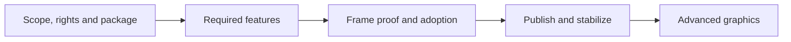

# Implementation Roadmap

[Docs](../README.md) / [Up](README.md) / [Design targets](Requirements.md) / [Release implementation](../Architecture/CrossModule/FirstRelease/ImplementationPlan.md)

**Status:** master roadmap; planning priorities, not completion results

**Scope:** the order to follow from the current release work through advanced graphics and portfolio delivery

**Updated:** 2026-10-25; progress summarizes recorded work, not release approval

Choose one task below, open its **implementation stage**, and copy that stage's prompt. The linked **design** explains the behavior and checks to preserve. This roadmap owns priority and brief progress; implementation plans own the steps.

## How To Execute A Stage

1. Open the stage linked under **Where We Are And What Is Next**.
2. Read its prerequisites and linked design. A blocked prerequisite stays blocked; completed source work is reused.
3. Expand **Copy implementation prompt**, paste it, and work only that stage.
4. Run its exit checks. Record the candidate result in Acceptance and update the short progress row here.
5. Continue to the next admitted stage in the plan. Source changes alone do not pass a release gate.

## Where We Are And What Is Next

**Next: [PD-1, Frames](../Architecture/CrossModule/FirstRelease/ProductImplementationPlan.md#pd-1--game-and-editor-product-shells).** Resolve Modern Sponza's first incorrect rendering product; retain startup/shutdown failures. [Completed checks and remaining proof](../Acceptance/FeatureCompletionReports.md#product-delivery-progress) show the progress already made. Close the source-stage items, then regenerate/qualify the archive in PD-3 and finish PD-4. PD-2 source validation can proceed independently; author/agent rehearsal is accepted.

| Current work | Design / acceptance reference | Implementation stages |
| --- | --- | --- |
| Fix and verify the remaining product/source journeys | [Approved product scope](../Acceptance/FirstRelease.md#approved-release-scope) | [PD-1: Game/Editor](../Architecture/CrossModule/FirstRelease/ProductImplementationPlan.md#pd-1--game-and-editor-product-shells), [PD-2: source/Launcher](../Architecture/CrossModule/FirstRelease/ProductImplementationPlan.md#pd-2--source-build-cook-and-launcher) |
| Freeze source and regenerate the three-product archive | [Package design](../Architecture/Modules/BuildAndPackaging/PackagingAndInstallation.md#reviewed-package-inputs) | [PD-3](../Architecture/CrossModule/FirstRelease/ProductImplementationPlan.md#pd-3--package-and-installation) |
| Verify diagnostics and close the product reports | [Self-service contract](../Architecture/Modules/BuildAndPackaging/PackagingAndInstallation.md) | [PD-4](../Architecture/CrossModule/FirstRelease/ProductImplementationPlan.md#pd-4--support-incident-response-and-product-closure) |

**Renderer work:** [Lit/Reference recovery](../Architecture/Modules/Engine/Renderer/Features/Lighting/ReferencePathTracer/ImplementationPlan.md#required-execution-order) retains its scope. Use the qualified crash tooling for GPU failures. Recheck dated failures against current source before fixing their owner.

**Final step before publication:** [FR-07](../Architecture/CrossModule/FirstRelease/ImplementationPlan.md#fr-07--publish-and-verify) owns the deferred Windows certificate, signing/timestamping, signed-byte verification and public redistribution closure. These are outside PD-1 through PD-4.

## Release Progress

| Work | Implemented / recorded | Remaining |
| --- | --- | --- |
| Scope / FR-00 | Six product choices approved. | Remaining technical qualification; public rights close at FR-07. |
| Identity / FR-01 | Identity, dependency pins and notices implemented; earlier baseline recorded. | Qualify the final source candidate. |
| GPU crash tooling / GCD | Delivered: 18 native checks, 32 normal journeys, four SDK-free builds; `ITER-GCD-04-06`. [Scope and evidence](../Architecture/CrossModule/PerformanceDiagnostics/GpuCrashDebugging/GpuCrashDebuggingDesign.md#acceptance-and-controlled-failures). | None for the qualified tooling candidate; use in PD-1. |
| PD-1: Game / Editor | Startup/edit rejection and Settings fixes checked. Recook quit, capture failure/retry and camera edit/undo/redo/save/restart pass locally. Game menu resize fixed; inert asset controls replaced with readable identity. | Frame correctness, native startup/shutdown and remaining interaction/failure checks. |
| PD-2: source / Launcher | Fresh Unicode/spaced checkout, cold/warm Empty/seven-map/subset and network-blocked replay pass; source/GUI operations pass. [Candidate results](../Acceptance/FeatureCompletionReports.md#product-delivery-progress). | Documented reproduction; product image/lifecycle acceptance stays in PD-1. |
| PD-3 / FR-02: package | Unsigned `0db84502…` assembly/integrity and precompiled/local-build paths pass; shared defaults are verified; installed Empty/offline Cornell pass locally on both APIs. | Regenerate after PD-1 repairs; finish seven-map, budgets, Qt, removal and clean/minimum-machine proof. |
| PD-4: diagnostics | `0db84502…` export/privacy/symbol and critical-review negatives pass; source help links repaired. | Final-archive documented/native recovery and distinct-version replacement/rollback. Automatic CPU crash/hang collection remains unavailable. |
| FR-03 to FR-08 | Plans retained. | Feature/map/performance/backend/adoption checks, publication and finite release review. |

Use the [four-stage exit checklist](../Architecture/CrossModule/FirstRelease/ProductImplementationPlan.md#how-to-close-this-plan) to close the product plan and the [acceptance progress ledger](../Acceptance/FeatureCompletionReports.md#product-delivery-progress) to reuse completed checks. Exact results stay under local `artifacts/validation/`. Product-plan closure is unsigned internal qualification; [release gates](../Acceptance/FirstRelease.md#release-gates) still decide shipment.

## Ordered Delivery

The release is the first reproducible rendering result, not a separate general-engine program. Its required frame, source/content pipeline, native lifetime and product proof become inputs to the later classical and owned-neural cases. Supporting tool work exists only to deliver or prove that result.

| Delivery result | Necessary predecessor and next consumer | Boundary that prevents another program |
| --- | --- | --- |
| Correct raw/reference and realtime frame | Current recovery -> qualified oracle -> direct/indirect/reconstruction and whole-frame checks. | Final reference package adoption waits for release inputs; it does not block oracle-qualified source work or expand physical transport. |
| Reproducible approved product | Current build/cook/Launcher/Editor/Game repairs -> one final archive -> documented source/product proof. | Reuse existing owners and valid local checks; no new general authoring, support, install or validation platform. |
| Shippable named candidate | Frozen scope/maps/frame -> package/performance/native/adopter proof -> final trust/publication/closeout. | Gate acceptance stays ordered; independent missing rights/hardware/reviewer evidence does not require unrelated source rewrites. |
| Classical and owned-neural evidence | Reuse valid release inputs -> admitted Bistro/San Miguel studies -> one data/model/shader path -> three reviewed cases. | No internal diagnostics workspace, new scene family, general ML runtime or extra feature catalog is a prerequisite. |

Child stages follow actual data/proof dependencies. Their numbers identify ownership, not mandatory module rewrites. Each implementation deletes its replaced path as it lands; aggregate closure verifies that cleanup and shared evidence. Existing reference recovery can proceed while release/package prerequisites are completed.

| Step | What you deliver | Open the implementation stage |
| --- | --- | --- |
| 0. Define | A finite product, map set, feature scope and supported presets. | [Scope and discovery](../Architecture/CrossModule/FirstRelease/ImplementationPlan.md#fr-00--scope-and-discovery) — `REL-00` |
| 1. Establish trust | Clear asset/dependency rights, product identity and a reproducible source build. | [Identity and baseline](../Architecture/CrossModule/FirstRelease/ImplementationPlan.md#fr-01--identity-rights-and-baseline) — `REL-01/02` |
| 2. Package | One manifest-owned build, cook, stage and package route. | [Package spine](../Architecture/CrossModule/FirstRelease/ImplementationPlan.md#fr-02--package-spine) — `REL-03` |
| 3. Finish features | Required rendering and product behavior, including failures and resource lifetime. Follow the feature order below. | [Feature closure](../Architecture/CrossModule/FirstRelease/ImplementationPlan.md#fr-03--feature-closure) — `REL-04` |
| 4. Prove map quality | Correct content, trustworthy references and stable images on the selected maps. | [Release maps](../Architecture/CrossModule/FirstRelease/ImplementationPlan.md#fr-04--release-maps) — `REL-05` |
| 5. Prove the whole frame | Realtime >=30 FPS, bounded memory, stability, D3D12/Vulkan parity and principal-level frame review. | [Performance and native proof](../Architecture/CrossModule/FirstRelease/ImplementationPlan.md#fr-05--performance-stability-and-native-proof) — `REL-06/07` |
| 6. Review the candidate | Frozen package bytes and successful consumer/source journeys without private help. | [Candidate and adoption](../Architecture/CrossModule/FirstRelease/ImplementationPlan.md#fr-06--candidate-freeze-and-reproduction) — `REL-08/09` |
| 7. Publish | The approved release, verified after download. | [Publication](../Architecture/CrossModule/FirstRelease/ImplementationPlan.md#fr-07--publish-and-verify) — `REL-10` |
| 8. Stabilize | Finite maintainer closeout, resolved release blockers and approval to start the next program; no user support service. | [Release closeout](../Architecture/CrossModule/FirstRelease/ImplementationPlan.md#fr-08--stabilize-and-close) — `REL-11` |
| 9. Build advanced evidence | Complementary classical studies, an owned neural shader path, reproducible cases and observed direction/transfer. | [M0–M7 below](#retained-advanced-graphics-roadmap) |
| 10. Expand selectively | A justified upstream contribution or technical submission from a real finding. | [Conditional work below](#conditional-and-excluded-work) |

Each plan states when its work may start and how it exits. The [release contract](../Acceptance/FirstRelease.md) owns the actual criteria, including the [required rendering and frame-review package](../Acceptance/FirstRelease.md#required-rendering-closure).

## Portfolio Focus And Existing-Code Simplification

The [target persona](EngineerPersona.md#persona-statement) and [requirements](Requirements.md#canonical-requirement-matrix) select a compact rendering/developer-technology portfolio. Spend depth on transport, frame execution, D3D12/Vulkan, shaders/ABI, causal GPU/CPU analysis, one owned neural path and documented reproduction. General engine breadth is not a second deliverable. A necessary C++/Tasks/content/product dependency remains valuable even when it draws no pixels; an unconsumed or unfinished framework does not become necessary because it already exists.

Simplification is deliverable work, including when the existing output is functionally correct. Route it through the owner below as a bounded removal/narrowing slice or the cleanup of its next necessary repair. Prioritize the current wrong-frame/native-lifetime blocker first, then the strongest reduction in unused surface and review cost; use external-input waits for an independent bounded cut. Do not wait for REL-11 to retire stale private code, and do not run a repository-wide rewrite before rendering evidence. The linked stages own the 2026-10-25 source observations and must recheck them before implementation; no candidate is a completed removal.

| Owner and role to retain | Simplification or non-delivery | Owning delivery route and preservation check |
| --- | --- | --- |
| Renderer/RHI/shaders: the specialist core | Remove ineffective selectors, duplicate representations and rejected experiments; deepen selected algorithms rather than add every rendering technique. The fixed-capacity material texture table remains required; its unused binding-mode selector/mask has been removed in source. | [GR-5](../Architecture/Modules/Engine/Renderer/FirstRelease/GeometryAndRayTracingImplementationPlan.md#gr-5--deferred-gbuffer-decals), shader/current frame owners; preserve the actual texture table, typed/native output and selected capabilities. |
| World/Core/Tasks: camera, animation, immutable inputs and safe execution | Keep the fixed world pipeline, hazard checks and one Tasks runtime. Keep compiled world-graph details private; the unused inspection accessor has been removed in source. No arbitrary gameplay-system/plugin framework or second scheduler. | [FWC-3](../Architecture/CrossModule/FirstRelease/FoundationImplementationPlan.md#fwc-3--level-world-and-render-publication); preserve animation, skin/morph, transforms, extraction/publication and cancellation. An accessor-only cut uses absence/current-consumer and narrow target checks; data/execution changes need affected serial/worker proof. |
| Editor/Application: inspect the result, control rendering and perform approved edits | Reuse and qualify the in-progress read-only mesh/material identity cleanup; the earlier inert asset-selection/Use/Find helper is absent in the 2026-10-25 concurrent working tree. Close only remaining UI/proof obligations; do not recreate it or build an asset browser. Preserve real edits and undo/save. | [PD-1](../Architecture/CrossModule/FirstRelease/ProductImplementationPlan.md#pd-1--game-and-editor-product-shells); recheck the current delta, selection/identity, transform/visibility/variant edits, undo/redo/save and no false action. Source deletion alone is no interaction verdict. |
| Launcher: explicit presentation/reproduction exception | Preserve and polish the existing scene-selection, preview, readiness, build/cook/run, progress/cancel and recovery journey. Simplify duplicate settings/status/operation policy behind it; do not replace a useful Launcher with scripts or expand it into a general workflow/install platform. | [PD-2](../Architecture/CrossModule/FirstRelease/ProductImplementationPlan.md#pd-2--source-build-cook-and-launcher), installed [PD-3](../Architecture/CrossModule/FirstRelease/ProductImplementationPlan.md#pd-3--package-and-installation); first-use and GUI/CLI effects, failure/cancel and requested-map identity agree. |
| Import/cook/package/diagnostics: reproduce and explain the frame | Retain only the formats, artifacts, measurements and native tools needed by selected examples/cases. Delete replaced writers, duplicate status/collector authority and temporary probes; no internal profiler, support service, generic tool framework or extra format from an inventory gap. | [FWC-4/5](../Architecture/CrossModule/FirstRelease/FoundationImplementationPlan.md#fwc-4--import-cook-and-engine-assets), [RD-3](../Architecture/Modules/Engine/Renderer/FirstRelease/RuntimeAndDiagnosticsImplementationPlan.md#rd-3--debug-views-diagnostics-products-and-capture), owning evidence/tool stage; preserve deterministic inputs, rights, raw identity and failure-safe output. |

For each cut, state the selected result that remains, the responsibility/type/branch/dependency removed, the actual consumer search and the smallest positive/negative checks. Remove its source/UI/config/build/dependency residue in that same slice. An advertised or required capability first needs its scope-owner disposition; unused private surface does not need a new feature project. No negative line-count quota, percentage of rendering code or proof-by-file-count is used. Required controls and evidence stay binding, and every retained abstraction still needs a current owner and consumer.

## Required Feature Closure Priority

Use this order within release step 3. A demonstrated dependency defect comes before the feature it blocks. Reuse completed work and valid proof; do not replay entire implementations.

| Order | Focus and intended result | Implementation stages |
| --- | --- | --- |
| 1 | **Reference correctness.** Restore usable lighting, reject invalid samples and qualify raw reference output before relying on it. | [Reference recovery](../Architecture/Modules/Engine/Renderer/Features/Lighting/ReferencePathTracer/ImplementationPlan.md#required-execution-order), [reference closure](../Architecture/Modules/Engine/Renderer/FirstRelease/LightingImplementationPlan.md#lgt-3--preserve-discovery-and-close-the-required-reference) |
| 2 | **Blocking dependencies.** Fix proven content, shader, foundation or native-lifetime defects needed by the selected frame. | [Foundation/content](../Architecture/CrossModule/FirstRelease/FoundationImplementationPlan.md#first-release-foundation-and-content-implementation-plan), [RHI](../Architecture/Modules/Engine/RHI/FirstReleaseImplementationPlan.md), [Shader System](../Architecture/CrossModule/ShaderSystem/ImplementationPlan.md) |
| 3 | **Frame execution.** Reliable frame admission, scene/view publication, graph dependencies, barriers, aliasing and retirement. | [Frame and scene](../Architecture/Modules/Engine/Renderer/FirstRelease/FrameAndSceneImplementationPlan.md) — `FS-0–4` |
| 4 | **Geometry and materials.** Correct residency, raster/ray inputs, TLAS and material correspondence. | [Geometry and ray tracing](../Architecture/Modules/Engine/Renderer/FirstRelease/GeometryAndRayTracingImplementationPlan.md) — `GR-0–4` |
| 5 | **Realtime transport.** Correct primary/secondary paths, direct/indirect lighting, temporal reuse and disocclusion behavior. | [Temporal/history](../Architecture/Modules/Engine/Renderer/FirstRelease/DisplayAndReconstructionImplementationPlan.md#dsp-1--temporal-sampling-history-resolution-and-aa-truth), [lighting](../Architecture/Modules/Engine/Renderer/FirstRelease/LightingImplementationPlan.md) — `DSP-1`, `LGT-0–2` |
| 6 | **Exposure and reconstruction.** Finish exposure, DLSS SR/RR inputs, resets and native lifetime on both APIs. | [Exposure](../Architecture/Modules/Engine/Renderer/FirstRelease/DisplayAndReconstructionImplementationPlan.md#dsp-2--exposure), [DLSS/RR](../Architecture/Modules/Engine/Renderer/FirstRelease/DisplayAndReconstructionImplementationPlan.md#dsp-3--image-reconstruction-and-provider-integration) — `DSP-2/3` |
| 7 | **Tone and output.** One correct color/tone/output transform; display adjustments must not conceal bad transport. | [Tone mapping and presentation](../Architecture/Modules/Engine/Renderer/FirstRelease/DisplayAndReconstructionImplementationPlan.md#dsp-4--tone-mapping-encoding-and-presentation) — `DSP-4` |
| 8 | **Decals and grading.** Complete the required material/display features with raw, temporal and backend checks. | [Decals](../Architecture/Modules/Engine/Renderer/FirstRelease/GeometryAndRayTracingImplementationPlan.md#gr-5--deferred-gbuffer-decals), [grading](../Architecture/Modules/Engine/Renderer/FirstRelease/DisplayAndReconstructionImplementationPlan.md#dsp-5--color-grading) — `GR-5`, `DSP-5` |
| 9 | **Basic lens effects.** Independently prove chromatic aberration and vignette, including no work at neutral settings. | [Lens effects](../Architecture/Modules/Engine/Renderer/FirstRelease/DisplayAndReconstructionImplementationPlan.md#dsp-6--chromatic-aberration-and-vignette), [vignette plan](../Architecture/Modules/Engine/Renderer/Features/PostProcessing/DisplayPipeline/Vignette/ImplementationPlan.md#basic-vignette-remaining-delivery-plan) — `DSP-6` |
| 10 | **HDR and SDR recovery.** Finish output behavior; HDR proof requires a qualified display/OS tuple. | [HDR output](../Architecture/Modules/Engine/Renderer/FirstRelease/DisplayAndReconstructionImplementationPlan.md#dsp-7--hdr10-display-output) — `DSP-7` |
| 11 | **Product controls and capture.** Responsive settings/UI/debug/capture/latency consumers with one state authority and honest tool support. | [Runtime/diagnostics](../Architecture/Modules/Engine/Renderer/FirstRelease/RuntimeAndDiagnosticsImplementationPlan.md), [product controls](../Architecture/CrossModule/FirstRelease/ProductImplementationPlan.md#first-release-product-implementation-plan), [external capture](../Architecture/CrossModule/PerformanceDiagnostics/ExternalCapture/ImplementationPlan.md) |
| 12 | **Whole-frame closure.** Complete integration, failure checks, review findings and the remaining feature reports. | `FS-4`, `LGT-4`, `DSP-8`, `RD-6` in their plans; [aggregate closure](../Architecture/CrossModule/FirstRelease/ImplementationPlan.md#fr-03--feature-closure) |

Check D3D12 and Vulkan throughout these stages. Measure cost as each feature changes; release step 5 closes the fixed whole-product performance protocol. Reference Stage 10 still waits for its release inputs and package prerequisites.

## Retained Advanced Graphics Roadmap

Start this program after release stabilization (`REL-11`). Follow the technical input chain below and reuse valid release evidence. Final documented reproduction closes at M6; it is not a prerequisite for producing the technical candidate that the adopter must receive. These milestones remain unaccepted at this planning snapshot.

| Milestone | What you build or demonstrate | Detailed work |
| --- | --- | --- |
| **M0 — Reproducible entry** | A reviewer can obtain the product/source and reproduce the supported result. | Reuse product build/adoption proof; [portfolio preparation](../Architecture/CrossModule/GraphicsPortfolio/ImplementationPlan.md#graphics-portfolio-delivery-plan) |
| **M1 — Traceable evidence** | Frozen scene/camera/settings identities, content losses and original capture joins. | [Content To Pixel](../Architecture/Modules/Projects/Showcase/ContentToPixel/ImplementationPlan.md#cpix-0-freeze-workload-inputs-and-oracles), `CPIX-0/1`; qualify actual MAP-00 inputs and reuse release proof |
| **M2 — Correct content and references** | Bistro/San Miguel results with a qualified raw reference and stated uncertainty. | [CPIX-2/3](../Architecture/Modules/Projects/Showcase/ContentToPixel/ImplementationPlan.md#cpix-2-prove-materials-lighting-and-raw-pixels) joins existing Reference/material/map checks, then hands qualified inputs to M3 |
| **M3 — Causal classical studies** | Technical handoff: one analyzer, three complementary studies, causal incident/replay packet and local failure/quality/native proof. Documented reproduction remains open for M6. | [Workload Studies](../Architecture/CrossModule/PerformanceDiagnostics/WorkloadStudies/ImplementationPlan.md#remaining-stages) — `WS-S0–3`; [four subject plans](../Architecture/CrossModule/PerformanceDiagnostics/WorkloadStudies/StudyProtocols.md#owned-evidence-folders). This handoff admits M4 without requiring the later neural case. |
| **M4 — Owned data and model** | Qualify the necessary diffuse-indirect component measurement, then one scene-separated dataset and fixed residual CNN/training recipe. Beauty is not a training label. | [Neural plan](../Architecture/CrossModule/NeuralGraphics/ImplementationPlan.md#remaining-stages) — `NG-S0–2`; ratify [semantics](../Architecture/CrossModule/NeuralGraphics/Semantics.md) and actual environment/rights/numeric gates before production |
| **M5 — Model to shader** | Correct exported operators and FP32 shaders, one runtime, then measured optimization. | [Neural plan](../Architecture/CrossModule/NeuralGraphics/ImplementationPlan.md#remaining-stages) — `NG-S3–5`; conformance precedes optimization |
| **M5R - Required renderer depth** | Complete the selected lighting/material/reconstruction/media/cache/texture/AS extensions; SHaRC fully done before NRC implementation. Existing source does not close this milestone. | [Ordered renderer-depth wave](#required-renderer-depth-wave) and detailed subject plans; no automatic first-release expansion |

| **M6 — Evaluation and transfer** | Qualify the neural technical/package candidate, assemble the three cases, execute one documented rehearsal covering the required study and neural results, then close their adoption cells. | Neural `NG-S6a` -> portfolio stages `2/3` -> `NG-S6b` and [study WS-S4](../Architecture/CrossModule/PerformanceDiagnostics/WorkloadStudies/ImplementationPlan.md#ws-s4---close-documented-study-reproduction); [portfolio plan](../Architecture/CrossModule/GraphicsPortfolio/ImplementationPlan.md) owns the actual exercise. |
| **M7 — Direction and observed influence** | Technical challenge/decision record, a second usage context, author/agent before/after explanation task and justified revision/retest. Required for the stronger principal-oriented portfolio packet; no new engine subsystem. | [Technology Transfer KT-0..3](../Architecture/CrossModule/GraphicsPortfolio/TechnologyTransfer/ImplementationPlan.md), [review criteria](../Architecture/CrossModule/GraphicsPortfolio/ReviewAndTransfer.md#binary-review-criteria), `PGD-09`; external participation is optional; no external result is inferred |

The [delivery catalog](FeatureDeliveryCatalog.md) gives concrete outputs. Original workload/feature reports retain measurements; existing CASE/WL records retain review/adoption results. M6 proves the technical package and first reproduction; M7 adds observed direction and transfer. These are local evidence goals informed by the role study, not proof of NVIDIA title eligibility, employment duration or organizational leadership. M7 changes no first-release gate or current next task.

### Technical Handoff And Final Acceptance

This graph shows prerequisite inputs. Adoption consumes technical packets and closes their remaining criteria; no arrow requires adoption before its own input exists.

```mermaid
flowchart LR
    Release[REL-11] --> Content[M1/M2 content and raw truth]
    Content --> Classical[M3 studies and incident packet]
    Classical --> Data[M4 owned data and model]
    Data --> Kernels[M5 checked runtime]
    Kernels --> Depth[M5R required renderer depth]
    Depth --> Evaluation[NG-S6a local evaluation/package]
    Evaluation --> Cases[Assemble three cases]
    Cases --> Reproduce[M6 documented rehearsal]
    Reproduce --> StudyClose[WS-S4 adoption closure]
    Reproduce --> NeuralClose[NG-S6b adoption closure]
    StudyClose --> Transfer[M7 direction and transfer]
    NeuralClose --> Transfer
```

M3 requires `AC-WS-01..03` and the local input/failure/cleanup portion of `AC-WS-04`; its rehearsal portion stays open. `NG-S6a` requires all local neural criteria, quality metrics and package/failure checks; the rehearsal part of `AC-NG-08` stays open. Portfolio assembly accepts these qualified technical packets with their pending adoption cells. Stage 3 performs the real exercise, after which WS-S4/NG-S6b reuse only the applicable original observations. Full study/neural acceptance still requires every cell; this ordering changes no criterion or threshold.

## Required Renderer Depth Wave

M5R is selected by the 2026-10-25 rendering-depth decision. Execute after M5's checked owned runtime and the existing correct classical handoff; feasibility/source research can prepare independently. Keep one production slice active. Later material profiles do not invalidate or silently relabel the frozen base-domain dataset/reference; evaluate expanded-domain behavior separately.

| Order | Required delivery and actual plan | Exit that unlocks the next item |
| --- | --- | --- |
| 1 | [Direct lighting](../Architecture/Modules/Engine/Renderer/Features/Lighting/DirectLighting/ImplementationPlan.md) DIR-1..8: accepted estimator/reuse plus mixed analytic, emissive-triangle and environment lighting. [Indirect](../Architecture/Modules/Engine/Renderer/Features/Lighting/IndirectLighting/ImplementationPlan.md) IND-1..6/8: explicit paths, GRIS shifts and admitted multi-bounce diffuse/rough-specular transport. Reuse valid release proof. | Independent raw/PDF/energy/reuse/failure checks and qualified domain; no reconstruction hiding incorrect transport. ReGIR and advanced guiding remain conditional. |
| 2 | [Materials/shading](../Architecture/Modules/Engine/Renderer/Features/GeometryAndResources/ImplementationPlan.md) MAT-S0..5: base lineage and model proof, anisotropic GGX and one dielectric coat. | Evaluation/sample/PDF/energy and raster/ray/API proof; independently qualified extended reference domain. |
| 3 | [Denoising/upscaling](../Architecture/Modules/Engine/Renderer/Features/PostProcessing/ReconstructionAndGeneration/ImplementationPlan.md) REC-S0..5: reuse complete release SR/RR qualification, deliver one RELAX diffuse/specular temporal path. | Actual guide/hit-distance/motion/extent semantics, raw and temporal quality, native/lifetime/value/package proof. The owned CNN remains distinct. |
| 4 | [PTLAS](../Architecture/Modules/Engine/Renderer/Features/RayTracing/PartitionedTlas/ImplementationPlan.md) PTLAS-S0..5. | Supported sparse writes, migration, BLAS/SBT replacement and partition translation; classic parity, useful total cost and advertised native/provider support. |
| 5 | [Volumetrics](../Architecture/Modules/Engine/Renderer/Features/Lighting/VolumetricLighting/ImplementationPlan.md) VOL-S0..5, Q0/Q1/Q2 only. | Physical coefficients/phase, analytic/reference transmittance/in-scatter, bounded local froxels, temporal/native/value/product proof. |
| 6 | [SHaRC](../Architecture/Modules/Engine/Renderer/Features/Lighting/RadianceCaching/Sharc/ImplementationPlan.md) SHARC-S0..5. | All AC-SHARC-01..05, including dynamics, whole-product value, package and documented reproduction. This is the first required radiance cache. |
| 7 | [NRC](../Architecture/Modules/Engine/Renderer/Features/Lighting/RadianceCaching/Nrc/ImplementationPlan.md) NRC-S0..5; production is blocked until SHaRC is fully done. | Real online learning/coupling, common-domain comparison against SHaRC/uncached transport, adaptation/bias/native/value/package/reproduction proof. |
| 8 | [NTC](../Architecture/CrossModule/NeuralGraphics/TextureCompression/ImplementationPlan.md) NTC-S0..5. | Real cooked latent material and on-sample decode, filtering/LOD/material quality, memory-versus-compute frontier and delivery proof. |

This order is a finite renderer specialization, not a new general engine. The [depth-to-evidence map](FeatureDeliveryCatalog.md#selected-rendering-depth) gives the technical questions and proof owners. Every stage has deletion/narrowing work and an addition budget. Cache Off, raw outputs, BCn materials and classic TLAS are necessary positive controls, not stale paths to delete.

M5R closes each subject's local technical/product/rehearsal criteria before M6 assembly. Use the existing documented author/agent rehearsal policy; external participation is optional and must be credited honestly. SHaRC's required reproduction occurs before NRC production and does not wait for final case assembly. Reuse those original observations in M6 where applicable, avoiding a prerequisite cycle or a separate adoption platform.

Extend the same three headline cases with short depth sections and original artifact links. Do not create a new case/project for every SDK. Qualify individual features first, then the selected combined hero configuration; do not build the full cartesian product of every lobe/cache/denoiser/AS mode. A required unsupported tuple or failed value gate stays open/blocked rather than disappearing from the target.

## Conditional And Excluded Work

Beyond the required M0–M7 evidence, select additional work only for a demonstrated need:

- **Upstream contribution or technical submission:** a real issue/recipient and bounded output. Use the [contribution card](../Architecture/CrossModule/GraphicsPortfolio/GraphicsPortfolioDesign.md#upstream-graphics-contribution).
- Additional adopters, continuing teaching or maintenance beyond M7 need an actual consumer and finite scope. The required [M7 exercise](../Architecture/CrossModule/GraphicsPortfolio/ImplementationPlan.md#4-demonstrate-direction-and-transfer) already includes second-context transfer, learning feedback and a justified revision; it creates no ongoing support service.

**Not selected:** native Linux support; AMD hardware acquisition or AMD specialist profiling; new physics/networking/audio/scripting systems; installer/updater; stable plugin SDK; broad Editor or ML frameworks. Additional hardware needs its own admitted question; [profiling guidance](../Engineering/Verification/ExternalProfiling.md) records available routes.

Geometry-cache animation, frame generation and meshlets/DGC/SER remain outside the selected program. Volumetric Q0/Q1/Q2, SHaRC then NRC, NTC and PTLAS are selected later portfolio work in M5R. Physical atmosphere, clouds, imported volume formats, arbitrary ML frameworks and further cache/denoiser families remain unselected. These choices change no current release/default or readiness verdict.

## Dependency And Work-In-Progress Rule

Work on **one implementation task and one independent decision/discovery item**. Choose the first unfinished dependency; within it, prefer the fix that unlocks the most required downstream proof. Use the [risk register](#release-risk-register) to break ties.

If a prerequisite is missing, identify its owner and the next concrete action. Continue independent work that can proceed. A necessary shared repair comes before its consumer, with an existing owner and reviewed change/deletion/copy bounds. Missing HDR hardware or an separate reviewer delays the affected proof, not all source work.

Keep required rendering outcomes required. Any scope change needs an explicit owner decision and invalidates the affected evidence. New neural, tool and platform features wait for their admission gates.

## Reference Path Tracer Truth First

Preserve accepted `PTD-00-R1` and delivered source stages. The [remaining plan](../Architecture/Modules/Engine/Renderer/Features/Lighting/ReferencePathTracer/ImplementationPlan.md) owns recovery; [Discovery](../Architecture/Modules/Engine/Renderer/Features/Lighting/ReferencePathTracer/Discovery.md) owns the accepted design. Reopen only changed decisions. Remaining implementation/proof uses `PTD-02`; release-map reference adoption uses `PTD-03`.

A finite-depth diagnostic, accumulation count or post-processed image does not qualify reference truth. Dependent quality checks need the accepted raw result and uncertainty.

## One Authority Per Question

| To understand… | Open… |
| --- | --- |
| What to do next | This Roadmap |
| What the professional output should demonstrate | [Feature Delivery Catalog](FeatureDeliveryCatalog.md) |
| What the release promises | [Release scope](../Acceptance/FirstRelease.md#approved-release-scope), [capability dispositions](../Acceptance/ReleaseScope/CapabilityDispositions.md) |
| Exact implementation steps | The feature plan linked from the chosen task |
| Correct behavior and passed proof | The owning feature contract and [Release Acceptance](../Acceptance/FirstRelease.md) |
| How to perform and submit the change | [Change Lifecycle](../Engineering/Workflow/ChangeLifecycle.md), [Change Integration](../Engineering/Workflow/ChangeIntegration.md) and selected standards |

Update the result in its owner, then update this page's current/next pointer. Local plans detail the chosen work; this Roadmap retains the global order.

## Planning Coverage And Fillable Files

All 49 feature families retain their [existing phase assignments](../Architecture/CrossModule/FirstRelease/ImplementationPlan.md#feature-work-package-registry). These are routing coverage, not 49 new implementation projects or permission to complete every target in a dossier. Reuse existing behavior and valid proof; implement only the missing delta for an admitted promise. The [portfolio plan](../Architecture/CrossModule/GraphicsPortfolio/ImplementationPlan.md#graphics-portfolio-delivery-plan) now selects its cases/package/checks; actual artifacts, rights, participants and outcomes still need binding. [Vignette](../Architecture/Modules/Engine/Renderer/Features/PostProcessing/DisplayPipeline/Vignette/ImplementationPlan.md#basic-vignette-remaining-delivery-plan) and conditional upstream work retain their explicit decision cards.

To fill a missing plan, use the [remaining-work template](../Engineering/Workflow/Templates/RemainingWorkPlan.md). Resolve its decision owners and check cards before calling it implementation-ready. Retire completed instructions after preserving useful design and evidence.

## Stage Target And Evidence Traceability

Use this section when opening or closing an iteration. The everyday task order is above.

Expand milestone IDs and reporting links

| Milestone | Existing workload/output identities |
| --- | --- |
| M0 | `PGD-01` |
| M1 | `WL-01`, `PGD-02` |
| M2 | `WL-02/03`, `PGD-02` |
| M3 | `WL-04`, `PGD-03/04/05` |
| M4 | `WL-05`, `PGD-06` |
| M5 | `WL-06`, `PGD-07` |
| M5R | Selected renderer depth; existing PGD-02/03/06..08 and subject-local AC-SHARC/NRC/NTC/PTLAS/MAT/REC/VOL proof |

| M6 | `WL-07/08`, `CASE-*`, `PGD-08` |
| M7 | `PGD-09`, existing `CASE-05` / `WL-08` transfer records; no new workload identity |

The [catalog](FeatureDeliveryCatalog.md) maps outputs to `PGE-*`; the [phase registry](../Architecture/CrossModule/FirstRelease/ImplementationPlan.md#feature-work-package-registry) maps `FCR-*`; [Graphics Workloads](../Acceptance/GraphicsWorkloads.md) owns `MAP/WL/CASE` proof. Join these in the [iteration record](../Engineering/Workflow/ChangeLifecycle.md#create-the-iteration-control-record) with the selected objective, risk, `AC/FM/CHK`, candidate and artifact.

At handoff, record results/invalidation in their owner, retire delivered instructions, apply [Code Style](../Engineering/Foundations/CodeStyle.md) and update the next task here. Documentation checks do not pass runtime, GPU, performance, package or adoption criteria.

## Release Risk Register

Consult this when competing fixes need a priority decision. All 13 aggregate risks remain open until their retirement evidence is accepted; recorded local progress narrows the remaining treatment. Revalidate the affected indicator before choosing a repair.

Expand the full risk assessment and retirement requirements

This register owns release-wide risk priority and treatment. Stable feature-specific technical risks live with the owning Architecture feature dossier, while the applicable [`FCR-*` report](../Acceptance/FeatureCompletionReports.md#iteration-traceability-and-coverage) records candidate exposure and disposition; the [release acceptance contract](../Acceptance/FirstRelease.md#failure-mode-acceptance-matrix) owns controlled release-wide failure behavior.

Likelihood is qualitative and justified by current evidence: **High** means the unsafe condition is observed or expected on the unproven route, **Medium** means a plausible untested interaction, and **Low** requires evidence that controls are already effective. Impact is **Critical** when trust, security, data, or release integrity can be lost; **High** when a required release gate or primary promise fails; **Medium** only when a bounded workaround can preserve the advertised product. These ratings prioritize work; they never weaken acceptance.

Current state at the roadmap's source snapshot: all `RISK-REL-*` rows below are **Open**. No risk was retired by documentation or source inspection.

| ID | Risk and current indicator | Likelihood | Impact | Accountable owner and gate | Required treatment and retirement evidence |
| --- | --- | --- | --- | --- | --- |
| `RISK-REL-01` | Reachable scope drifts beyond approved promises or a selector escapes classification. | High exposure until final scope closure: six choices and the capability ledger are approved, but technical membership/rights qualification remains open. | High | Release owner; `REL-00` | Reconcile changed selectors and final component membership against the approved scope; retire with zero unmatched public selector. Do not reopen settled choices. |
| `RISK-REL-02` | Rights, dependency provenance, signatures or admitted payload do not match final bytes. | High exposure until final qualification: identity/pins/notices exist; exact redistribution and final signing remain open. | Critical | Product, build, and content/provenance owners; `REL-01` | Reuse identity/pin/notice work; close exact payload rights, SBOM/provenance and deferred signatures; retire with independent inventory/signature review. |
| `RISK-REL-03` | Cached, private or machine-specific source inputs prevent reproduction. | High exposure pending reproduction proof: local fresh-checkout/cold/warm results exist, but final replay and documented reproduction remain open. | High | Build owner; `REL-02` | Reuse valid local evidence; finish affected empty-cache/warm-offline checks on the final source candidate and obtain documented reproduction. |
| `RISK-REL-04` | Package dependency closure, immutable bytes or relocated operation is wrong. | High exposure until exact-candidate proof: an unsigned archive exists; regeneration after fixes and final clean-machine checks remain open. | Critical | Package owner; `REL-03`, `REL-08` | Use the existing manifest-owned package route, regenerate changed products and qualify final hashes, read-only/offline behavior and signatures. Do not implement another package spine. |
| `RISK-REL-05` | Source presence, map readiness or safe fallback is mistaken for correct feature output. | High exposure: surfaces are classified and rejection fixes exist; frame correctness and remaining interaction/failure proof are open. | Critical | Feature owners; `REL-04` | Complete the missing admitted `FCR-*` checks, requested/active truth and correct-pixel evidence; fix or remove an unneeded route through its scope owner. Reuse valid reports. |
| `RISK-REL-06` | Shipped examples contain material, transform, lighting, temporal, encoding, or backend-specific artifacts. | Medium: broad source paths exist but staged-package map/reference evidence does not. | High | Content and graphics-quality owners; `REL-05` | Freeze cameras/references/thresholds, inspect debug outputs and motion on each backend, resolve `S0`/`S1`; retire with approved per-map packages. |
| `RISK-REL-07` | The 30 FPS promise hides CPU/GPU stalls, load cost, memory growth, thermal effects, or lifecycle instability. | Medium: timing primitives exist but candidate-bound measurements do not. | High | Performance and feature owners; `REL-06` | Measure frozen routes with p50/p95/p99/worst, timelines, memory high-water, repeat/soak and causal controls; retire only when every supported row passes. |
| `RISK-REL-08` | D3D12/Vulkan capability, synchronization, lifetime, shader ABI, or device-loss behavior diverges. | Medium: both source backends exist without paired native-validation evidence. | Critical | RHI/Renderer owners; `REL-07` | Execute focused paired backend and native validation, capability rejection, delayed completion/retirement, and incident diagnostics; retire with zero uncategorized findings. |
| `RISK-REL-09` | Game consumers or source adopters require author knowledge, elevated privileges, private caches, unstable contracts, or undocumented repair. | High: neither documented journey has passed. | High | Product, documentation, and source-adoption owners; `REL-08`, `REL-09` | Run both journeys from public instructions in clean states, record confusion/interventions, freeze compatibility/support boundary; retire with recorded acceptance. |
| `RISK-REL-10` | Published bytes, policy, support, security intake, patch/withdrawal, or stabilization response fails after delivery. | High: public operations and response evidence do not exist. | Critical | Release and evidence-review owners; `REL-10`, `REL-11` | Verify immutable remote bytes, accurate no-support/self-service instructions and known-defect dispositions; rehearse versioned replacement/withdrawal during finite release review; retire at approved closeout. |
| `RISK-REL-11` | Evidence is stale, non-detecting, cherry-picked, generated without review, or bound to different bytes/configuration. | High exposure at final closure: local candidate and GCD artifacts exist, but changed binaries and aggregate release claims need their own applicable proof. | Critical | Evidence reviewer; all gates | Reuse valid artifacts by identity, invalidate only affected claims, map required AC/FM to defect-detecting checks and retain raw hashes/unavailable cells; retire per claim after required review. |
| `RISK-REL-12` | Scope creep or parallel feature work consumes capacity before the current gate closes. | High: the repository has many source-present unfinished surfaces. | High | Release owner; all gates | Enforce one primary gate, key-check-first iteration, explicit exclusion/deletion, and WIP review; retire only when `REL-11` unlocks new features. |
| `RISK-REL-13` | A shared, truncated, biased, unconverged, or post-processed reference is treated as ground truth and approves wrong PBR/lighting/map results. | High: source stages are delivered, but recovery, invalid-sample/preflight and oracle evidence remain open. | Critical | Renderer and evidence owners; `PTD-00`, `REL-04`, `REL-05` | Preserve accepted `PTD-00`; close the remaining `FCR-REN-08` recovery and raw analytic/minimal/independent/backend evidence; retire only when every dependent claim names a defect-detecting oracle and uncertainty. |

Default contingency for every open release risk is to hold the affected gate and either repair the same candidate or reduce advertised scope through its owning acceptance decision. Integrity/security failure requires candidate quarantine or withdrawal. No contingency may relabel missing evidence, silent fallback, or a different configuration as a pass.

A risk stays **Open** until its retirement evidence is linked from the current iteration and accepted at the named gate. Mitigation work without proof changes activity, not risk state. A realized risk also receives an `FM-*`/defect identity and invalidates every dependent result.

## Scope Protection

Every proposed stage must name the selected output or release promise it advances, its actual consumer, the smallest missing production delta, its exclusions, and the existing path it will simplify or remove. An inventory gap, a detailed target architecture, a professional role keyword or completion of `REL-11` is insufficient admission. If existing code and external tools can produce the required evidence, use them. Prefer a demonstrated defect repair or deletion over another framework.

A bounded simplification/retirement may instead name the selected path it preserves and the unnecessary reasoning/maintenance surface it removes. Use [the owner routes above](#portfolio-focus-and-existing-code-simplification); a functional bug is not required to remove stale private code. New non-rendering work must either serve a named rendering/evidence dependency or the explicit Launcher presentation/reproduction role. Required rendering depth, safety and reproduction are protected; minimizing support breadth does not waive them.

| Scope | Delivery boundary |
| --- | --- |
| Current release | Approved Launcher/Editor/Game journeys, seven selected maps plus Empty, required rendering, paired APIs, finite package/publication and documented reproduction. Preserve the [six approved decisions](../Acceptance/FirstRelease.md#approval-and-next-work), exact budgets and required failure checks. |
| Rendering depth | Trustworthy surface transport/reference, frame graph and native lifetime, existing SR/RR and the specifically admitted display/decal features. No additional light/material/AA/provider variants merely to fill a capability table. |
| Minimal supporting engine | Current camera/world/animation/publication, Core/Tasks, selected edits and source/content/package paths only as needed by the approved demonstrations and professional proof. Narrow or retire unused/private placeholder surface instead of completing it. |
| Launcher exception | Keep a polished, useful presentation/reproduction front door: selected scenes/previews, readiness, build/cook/run, progress/cancel and recovery. Reuse current operation/settings authority; no general workflow or installer/updater product. |
| Diagnostics | Use qualified crash tooling and selected external capture routes. Internal stat catalogs, workspace, GPU visualizer, history service and dashboard are unselected; a specific missing measurement may justify only its smallest producer/export path. |
| Later evidence | Bistro/San Miguel, causal studies, the owned diffuse-indirect model and the selected M5R renderer-depth wave feed the same three cases. New material profiles receive qualified reference domains; existing release maps, labels and thresholds keep their identities. M7 reuses the results for direction/transfer. |
| Unselected breadth | Geometry cache, atmosphere/clouds/imported volumes, frame generation, GPU-driven geometry, extra platforms/hardware, general authoring tools and ML frameworks remain unselected until a separate consumer/value decision admits a bounded slice. |

Deletion and scope reduction are valid delivery outcomes. Apply [scope and retirement decisions](../Engineering/Workflow/ChangeLifecycle.md#scope-and-retirement-decision) when an existing feature lacks a selected consumer; reconcile its classifications, selectors, dependencies and checks before removing it. Do not replace the old blanket feature-preservation rule with arbitrary deletion or a line-count target. Supported required behavior and evidence remain binding until their scope owner changes the promise.

Correctness, lifetime safety, paired APIs and required rendering are release work. Launcher polish that materially improves the reviewer's first run is eligible within PD-2/3; unrelated cosmetic breadth, second hardware and generalized tooling wait for their own admitted need. Preserve qualified reference truth, held-out evaluation, the classical fallback and honest limitations. End each implementation stage with its local cleanup and deletion evidence; cleanup is not a final optional phase.

When a candidate fails, repair its owner or explicitly revise scope and rerun affected proof. Publish only approved bytes; begin the advanced program only after `REL-11`.
