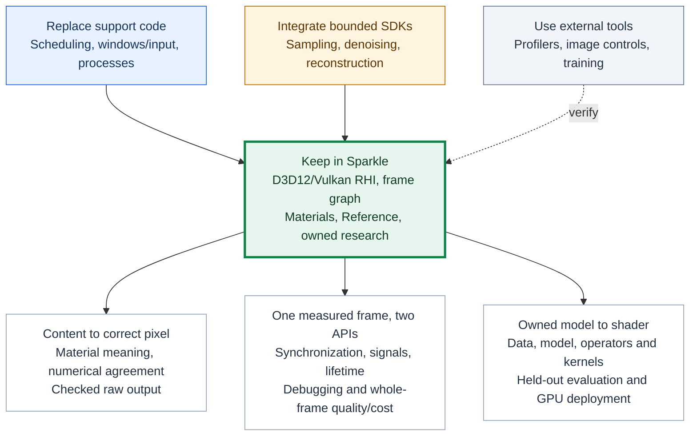
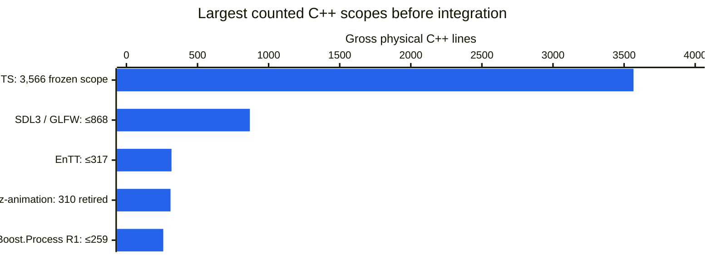

# Third-party migration

[Goals](Goals.md#the-three-cases) | [Rendering](Rendering.md) | [Roadmap](Roadmap.md#supporting-system-simplification) | [Engineering](Engineering.md)

Reduce native support code so the owned rendering work is easier to review. Replace complete mechanisms with established libraries before adding optional SDK capabilities. A useful integration demonstrates selection, graphics/API decisions, measured tradeoffs and maintainable delivery.

- **[Total native removal](#total-native-removal)**
- [Priorities](#candidates-and-expected-benefit), [decisions by module](#decisions-by-module-footprint) and [removal estimates](#native-removal-estimates)
- [Selected rendering integrations](#rendering-sdks-worth-considering)
- [Full catalogue by category and vendor](#optional-libraries-and-tools)
- [Adoption rules](#requirements-for-adoption), [integration contract](#ownership-and-dependency-workflow), [staged integration refinement](Implementation/ThirdPartyIntegration.md) and [retained decisions](#retained-decisions)

## Total native removal

**The historical whole-repository count shows native shrinkage, not an aggregate integration-saving result.** At the 22 November frozen worktree before task-runtime publication, first-party native source is **136,684 code / 159,505 physical lines in 2,151 files**: **967 fewer code / 1,420 fewer physical lines / seven fewer files** than the original footprint inventory. Automation grew by 1,061 code lines and shaders by five; the complete owned footprint is **150,211 code lines, up 99**. See the [footprint baseline and counting scope](RepositoryFootprint.md#footprint-baseline).

### Delivered integrations versus savings

Positive net removal means fewer native physical lines; a negative value means growth. These are **separately frozen delivery ledgers**, not rows of one additive total. Caller/metadata scopes can overlap, conservative move charges differ, and later unrelated cleanup changes live owner sizes. The whole-tree inventory above counts every current file once.

| Integration | Original estimate / actual retirement | Delivery-ledger net native removal | Did it deliver a code reduction? |
| --- | --- | ---: | --- |
| **SDL3** | Original **868 physical / 752 code** gross scope; 110 old physical lines remain, 1,155 new/relocated/caller lines charged. | **−397 physical** | **No on the conservative W ledger.** Win32 decoder/pointer ownership was retired; full packet-producer moves remain charged. The broader connected-file count shrank 242 physical / 171 code lines, but that different denominator is not W savings. [Ledger](../build/validation/window-input/delivery-20261122/native-cost-ledger.json). |
| **Boost.Process** | Initial mixed ceiling **342 physical**, refined to **259** before R2; neither was a net promise. Qualified complete Windows owner **1,014 → 1,077**, plus 13 caller/metadata lines. | **−76 physical** | **No on the qualified complete-owner ledger.** The earlier +38 saving was superseded by required termination repairs. New/rewritten ceiling accounting is also negative. The current frozen Windows directory is 1,047 physical lines after separate cleanup; do not silently credit that 30-line change to the older R2 result. [Final cost record](../build/validation/boost-process/continuation-20261122-r2/termination-01/costs.json). |
| **ozz-animation** | Original sampler/pose ceiling **235 physical / 209 code**; delivered retirement expanded to **eight files / 310 physical lines**, including morph/palette evaluators. | **−156 physical** | **Delegation, no native reduction claimed.** The complete GameFramework/SceneCooker bridge grew 138 physical lines and Launcher metadata added 18. Baking, bounded loading, mapping and rendering remain local. [Delivery and limits](../build/validation/animation/delivery-20261122/REPORT.md), [preview contract](Rendering.md#animation-previews). |
| **ShaderMake** | **16 files / 1,733 physical / 1,481 code lines** retired; relocated reflection/metadata paths are excluded from that gross retirement. | **+374 physical / +194 code** | **Yes, scoped native reduction.** New execution/result/identity glue is charged. Separately maintained ShaderMake/Slang corrections touch 57 upstream source lines; CMake, notices and runtime payload are additional costs. This is not a 1,733-line net saving or all-infrastructure result. [Latest attributed debit](../build/validation/shadermake/launcher-workflow-20261122/costs.json). |
| **Tasks / enkiTS** | Original target **3,566 physical / 3,017 code in 42 files**, unchanged; 40 Tasks C++ files plus twelve caller helpers retired. | **+2,314 physical C++, conservative** | **Yes.** Full C++ net removal is charged for all 328 maintained native additions, with no upstream deletion credit. Another 112 build/metadata lines leave **2,202 complete-infrastructure lines removed**. Added/relocated code, API, state and cleanup targets miss. [Delivery and ledger](../build/validation/task-runtime/close-20261122/REPORT.md). |

Completed CLI11, texture-processing and parser retirements are already in the original baseline and cannot be credited again. Code delivery, numerical economy and broader product qualification are separate outcomes under [the review policy](#code-delivery-and-qualification). No evidence here establishes a total runtime/performance, package-size or build-time saving.

### Remaining review ceiling

Delivered **W/P/A/T** are excluded from future savings. The surviving eleven scopes contain **1,145 physical / 997 code lines across 20 files**, before retained policy and integration costs. The preprocessor pair is recounted at 253 physical / 221 code; the other surviving ranges retain their frozen identities. These mixed scopes are ceilings, not completely deletable owners or expected net savings.

The original **6,093 physical / 5,227 code / 85-file** union and the later pre-runtime **4,711 / 4,014 / 62-file** pending union remain historical comparisons. Their source-range identities and each integration's frozen denominator stay unchanged. Task-runtime delivery has its own complete connected-owner ledger; do not subtract its overlapping before/after costs from the frozen whole-repository total or add the ledgers into an aggregate saving.

```text
future scoped native removal = 1,145 - retained scoped lines - new/relocated native integration
```

Charge first-party bindings, callers/templates, build/scripts and maintained patches separately and once. There is no complete future net forecast. Numerical targets are review results, not substitutes for correctness decisions.

Image-provider swaps, retained-format conversion and RTXDI host work still have zero identified new native retirement. These small scopes do not explain the larger supporting surface; the [repository cut candidates](RepositoryFootprint.md#cut-candidates) address host coordination, integration glue and repeated policy. Reduce real maintenance burden rather than add SDKs to improve a code ratio.

## Principal rendering evidence

Use third parties to reduce support work and strengthen the [three cases](Goals.md#the-three-cases):



Keep **Sparkle RHI, frame graph and independent Reference renderer**. Own devices, resources/descriptors, commands/queues, barriers/aliasing, presentation, capability policy and GPU retirement. VMA/D3D12MA remain allocation helpers; vendor SDKs use the RHI or its [bounded interop](../Engine/RHI/Public/Interop/RhiInteropService.h). Preserve scene/material semantics and selected owned research. SDK count alone adds no principal-level evidence.

## Candidates and expected benefit

1. **Task execution delivered:** the authorized enkiTS fork now owns execution after complete caller conversion and Tasks retirement. Original oneTBB/Taskflow and unmodified enkiTS mappings remain excluded. Actual owner/capacity/lifetime checks and [honest complete costs](../build/validation/task-runtime/close-20261122/REPORT.md) support delivery; broader qualification remains explicit.
2. **Delivered platform conversion:** [SDL3 owns native window/input mechanics](#window-and-input), with focused shared-consumer, chrome/capture, cancellation and retirement checks. Its fixed W ledger grows by 397 physical lines after charging every new/relocated adapter and caller; no net saving is claimed. Compiler preprocessing reuse can proceed independently. Prefer bounded reuse of existing Qt, CMake, vswhere and allocation facilities before adding another tool/framework dependency; the implemented [process boundary](#child-processes) retains native policy.

[Roadmap](Roadmap.md#supporting-system-simplification) owns delivery order and release blockers. The catalogue includes deferred options for comparison, not additional commitments.

### Decisions by module footprint

The historical [footprint baseline](RepositoryFootprint.md#footprint-baseline) puts **47.0% of native code in RHI/Renderer** and **20.8% in Launcher/Editor**. Keep graphics authority while delegating generic mechanisms. Review Launcher presentation/build coordination and Editor state duplication before growing supporting tools.

The remaining preprocessor pair contains **221 code / 253 physical lines** before integration costs. Tasks and SDL3 are delivered and are excluded from future cuts. Larger reductions need cheaper complete caller boundaries, not more dependency names.

<details>
<summary>Browse decisions for all 19 native owners</summary>

**Baseline sizes below are code lines; proposal G / N uses physical lines.** The footprint map owns the inventory; this table selects the integration direction.

| Owner / baseline code lines | Integration direction | Principal graphics evidence retained |
| --- | --- | --- |
| RHI + Renderer — **64,632** | Keep native APIs, frame graph and Reference authority. Trial D3D12MA virtual ranges **V** and volk **L** as leaf helpers. Selected rendering SDKs have their own capability/algorithm case. | Synchronization, descriptors, resource lifetime, signal meaning, owned research and measured frames. |
| Launcher — **18,018**; GUI 8,188, Build 3,733 | Reuse Qt item views **Q**, CMake discovery **B** and vswhere **S**. Simplify duplicate readiness/output state locally; these libraries do not own product policy. | A concise, reproducible build/cook/run path, truthful failures and cancellation. |
| Editor — **10,672** | Reuse ImGui. ImPlot/ImGuizmo currently have **0 identified native removal**; require an actual widget replacement before credit. Consolidate repeated panel/state glue with its owner. | Typed edits/undo, raw-output inspection, source correlation and focused debugging controls. |
| GameFramework — **10,831** | EnTT **E** targets storage/registry; ozz **A** targets sampling/pose. Neither replaces the whole World/Animation owner. | Identity, structural freezes, canonical transforms, material/skin/morph meaning and immutable render extraction. |
| ShaderCompiler — **6,834** | Reuse DXC/Slang preprocessing **C**. SPIRV-Reflect already performs binding mutation; no new credit for replacing that existing upstream use. | Typed host/shader ABI, exact source/debug identity, publication, reload and both shader targets. |
| Core — **6,197** | Boost.Process / Asio **P** privately owns child-process mechanics; JSON uses its adopted upstream owner. Keep publication/admission, process-tree and readiness policy cohesive. | Accepted-output preservation, bounded input, failure diagnosis and safe settlement. |
| SourceImporters — **5,020** | Reuse cgltf/Assimp/MikkTSpace; accessor decoding is already upstream. ufbx **I** has only a bounded FBX attachment-helper scope; shared PLY readers/geometry/skin remain. | Coordinate/material/animation semantics and content-to-pixel agreement. |
| Five cookers — **4,966** | DirectXTex/source codecs are the baseline. FlatBuffers **M** needs a complete-record retirement case; small material/mesh entry points need no framework. | Texture/geometry fidelity, GPU payload layout, budgets, publication and reproducible content. |
| Application — **4,377 frozen baseline** | Direct native execution composition is delivered; add no application/task framework. | Composition, frame admission, operation lifetime and CPU/GPU completion boundaries. |
| Tasks — **2,959 frozen baseline** | Retired with the selected maintained enkiTS fork; [complete delivery](../build/validation/task-runtime/close-20261122/REPORT.md) includes callers and costs. | Domain stop/results and CPU preparation/recording remain; retain the GPU frame graph. |
| Platform — **1,551** | SDL3 **W** replaces window/input mechanics; Renderer UI and RHI remain separate. | Focus/capture, DPI, camera/viewport input and explicit presentation ownership. |
| ToolSupport — **1,201** | Reuse existing format/CLI facilities; no new library has an identified broad native retirement here. | Catalog/path identity, containment and producer/consumer progress. |
| Showcase entry points + shared native CMake glue — **23** | Keep these thin compositions; **0 identified native removal** from a new framework. | A short, understandable route into the owned engine. |

</details>

## Native removal estimates

**Physical lines** include headers, comments and blanks; **code lines** exclude blanks/comment-only lines, using cloc 2.06. The table gives both. **≤** marks a reviewed mixed-code ceiling. Catalogue **G / N** remains physical gross/net; **unproved** means no supported net estimate. Zero means no identified current retirement or no new credit for existing/external use. Capability additions can grow native code. Delivered W/P/A/T rows retain historical retirement/result figures and are excluded from the pending union. C is recounted at its current size; all other pending ranges retain their verified original fragments.

Use identical formatting and inputs. Report shaders, scripts/CMake, schemas/generated output, upstream source and build/runtime/package costs separately. Moving code or changing language earns no ownership-transfer credit. The [footprint baseline](RepositoryFootprint.md#footprint-baseline) identifies the dated repository totals and counting rules. Physical lines include comments and blanks; code lines exclude blank and comment-only lines.

**Bold entries mark the five largest reviewed replacement scopes**, here and in the catalogue. Rank reflects gross targets/ceilings; net savings remain unproved. SDL3 and GLFW share one scope.



The three `≤` bars are reviewed ceilings before replacement code; ozz records actual gross retirement before net growth. The enkiTS bar is its frozen gross scope; the complete delivered ledger includes callers, build glue and maintained fork costs.

| Scope / proposal | Physical / code lines before costs | Native net (physical) | Counted boundary and retained work |
| --- | --- | --- | --- |
| **T / enkiTS, delivered** | **3,566 / 3,017 frozen scope** | **+2,314 C++; +2,202 complete infrastructure, conservative** | Tasks target/API and displaced helpers are retired. Native ranges/dependencies/prepared work own execution; domain admission, stop/results, frame coordination and GPU lifetime remain. [Complete ledger](../build/validation/task-runtime/close-20261122/INTEGRATION-LEDGER.md). |
| **W / [SDL3](#window-and-input)** | **868 / 752** | **−397 physical** | Original 13-file scope: 110 old lines retained and 1,155 new/relocated integration/caller lines charged. All eight Win32 decoder/pointer files are retired. The conservative charge includes the full Editor packet-producer move and concurrent Launcher metadata changes; see the [ledger](../build/validation/window-input/delivery-20261122/native-cost-ledger.json). |
| **P / [Boost.Process](#child-processes)** | **≤259 / uncounted**, historical mixed ceiling | **-76, complete owner** | R2 delegates environment, creation, reads and completion in [Windows process](../Engine/Core/Private/Process/Windows). Corrected Windows ownership is 1,014 -> 1,077 physical lines; nine metadata and four caller lines give 76 net growth. The 259-line credit is unchanged and missed by conservative new/rewritten accounting (479). Retain serializer/native endpoint creation (83 scoped lines), job completion/termination, logs and readiness policy. CMake/notices/upstream costs are additional. |
| **E / EnTT** | **≤317 / ≤264** | unmeasured | [Component storage/registry/store tuple](../Engine/GameFramework/Private/World/ECS). Keep identities, generation-exhaustion behavior, structural freezes, component definitions and world/extraction policy; charge all callers. |
| **A / ozz-animation** | **310 / uncounted** | **-156 scoped native** | [Delivered preview contract](Rendering.md#animation-previews): eight sampler/pose/morph/palette evaluator files retired. Full GameFramework/SceneCooker bridge adds 138 physical lines net; Launcher metadata adds 18. CMake/notices/upstream/build costs are additional. Private upstream sampling, hierarchy and runtime storage; Sparkle retains source baking, bounded loading, mapping, publication and rendering. |
| M / FlatBuffers | ≤82 / ≤75 | unmeasured | [Wire reader](../Engine/GameFramework/Private/Assets/Loaders/SceneManifestLoader.cpp) (43), plus count/header builders and write calls in [manifest writer](../Tools/Cooking/SceneCooker/Private/CookedSceneManifestWriter.cpp) (39). Exclude record declarations, registry and publication. Keep domain validation, allocation and bulk GPU payloads; charge schemas/generation, adapters and backing-buffer lifetime. |
| I / ufbx | ≤42 / ≤39 | unmeasured | Only `BuildNodeAttachedTranslation` / `BuildNodeAttachedOrientation` and two declarations in [node-transform helpers](../Tools/Import/SourceImporters/Private/Assimp/AssimpNodeTransformConverter.cpp). Callers are FBX camera/light importers. PLY still reaches the shared reader, geometry and skin helpers; no credit for their removal. Charge the complete FBX import/material/skin/animation/coordinate bridge. |
| C / existing compiler preprocessing facilities | **253 / 221 current**; originally 190 / 161 | unmeasured | Retire the surviving [preprocessor pair](../Tools/Shaders/ShaderCompiler/Private/Compiler/ShaderSourcePreprocessor.cpp). ShaderMake already owns execution, not this expansion. Charge exact include/source/debug identity and accepted publication/reload; no double credit for ShaderMake. |
| Q / existing Qt item views | ≤160 / ≤140 | unmeasured | [Staged Launcher plan](Implementation/LauncherItemViews.md). Q counts only `ResponsiveCardGridWidget`: 132 implementation and 28 declaration lines in [LauncherLayoutWidgets](../Tools/Launcher/SparkleLauncher/Private/Gui/Widgets/LauncherLayoutWidgets.cpp). Trial QListView/model/delegate ownership of item layout. Preserve sizing/column limits, DPI, focus, actions and readiness; charge every model/delegate/caller change and count any additional retirement separately. Reject a replacement reflow controller of comparable complexity. |
| V / existing D3D12MA virtual allocator | ≤153 / ≤124 | unmeasured | The [descriptor allocator pair](../Engine/RHI/Private/D3D12/Descriptors/D3D12DescriptorAllocator.cpp): free-index/contiguous-range mechanics, not all RHI allocation. Keep heaps, handles, synchronization and GPU retirement. VirtualBlock needs external synchronization; charge allocation-token tracking and all caller changes. |
| I2 / OpenImageIO; OpenEXR | 0 identified / 0 | unmeasured | [EXR+raster providers](../Tools/Cooking/TextureCooker/Private/SourceLoading) contain 121 physical / 103 code lines; EXR alone is 64 / 55. Decode is already upstream. No identified ownership transfer for admission, budgets, metadata and DirectXTex allocation/copying; require a cheaper complete adapter before credit. |
| L / volk | ≤58 / ≤58 | unmeasured | [RT function-pointer getters](../Engine/RHI/Private/Vulkan/Device/VulkanRhiRayTracing.cpp) (44) and loading assignments (14). Keep feature policy, per-device dispatch, interposition and native lifetime; charge device tables/callers. |
| B / CMake File API / Presets | ≤24 / ≤22 | unmeasured | Only `ReadCMakeCacheValue` in [workspace state files](../Tools/Launcher/SparkleLauncher/Private/Build/State/BuildWorkspaceStateFiles.cpp). The 33-line source project-name parser is uncredited until generated-reply/no-reply solution discovery is designed. Keep freshness, SDK discovery and operation policy; charge query/index/reply handling. |
| S / existing vswhere | ≤24 / ≤24 | unmeasured | Only `FindVisualStudioInstallWithCppTools` in [VS discovery](../Tools/Launcher/SparkleLauncher/Private/Build/Toolchains/VisualStudioToolchainDiscovery.cpp). `GetProgramFilesRoots` still serves generator selection and stays. Prove admitted installations, overrides, offline discovery and generator choice; IDE/installer/SDK detection and query handling remain. |
| K / vk-bootstrap | ≤22 / ≤20 | unmeasured | [Queue-create-info construction](../Engine/RHI/Private/Vulkan/Device/VulkanDeviceCreation.cpp). Keep topology, feature/extension selection, validation, presentation and device lifetime. |
| H / xxHash | ≤10 / ≤10 | unmeasured | Only active `ContinueFnv1a64` in [FNV hashing](../Engine/Core/Private/Hash/FnvHash.cpp). The 10-line `Fnv1a32` body has no current callers; retirement needs a separate contract decision and earns no integration credit. Keep I/O, errors and integrity SHA-256. Charge [streaming-state](https://xxhash.com/doc/v0.8.3/group___x_x_h64__family.html)/caller changes and identity recooking; a prior digest used as a new seed is not streaming continuation. |
| F / toml++ | 0 eligible / 0 | unmeasured | 138 lexical lines reviewed, but [retained format/editing contracts](#retained-text-formats) prevent current credit. Reconsider only a complete, beneficial conversion. |
| D / RTXDI DI | 0 identified / 0 | unmeasured | [Direct-light passes](../Engine/Renderer/Private/Passes/Lighting/Direct) contain 439 native host lines; 512 shader lines are separate. RTXDI replaces sampling math, while bindings, resources and dispatch remain application-owned. Identify actual native retirements before claiming savings; charge the full bridge. GI/PT need separate decisions. |
| **Current pending union, excluding delivered W/P/A/T** | **1,145 / 997** | **unmeasured** | Eleven surviving scopes, 20 distinct frozen paths, with the preprocessor pair recounted. |

*T retains its original 3,566-line gross denominator. Actual complete first-party net removal, all 328 added maintained native lines and zero upstream deletion credit yield 2,202 conservative physical lines removed. Added/relocated integration is 3,028 against 2,065; the other surface/state/cleanup misses are recorded once in the ledger. No conditional saving is presented as delivery.*

The [combined total](#total-native-removal) uses distinct source-line identities, not a sum of catalogue rows. Proposal counts are ceilings/targets; retained code and replacement costs still reduce the result.

The local [source-range ledger](../build/validation/third-party-removal-triple-check-20261121/per-file-ledger.csv) records inclusion in the total, file/range, physical/code count and source hash. The [counting script](../build/validation/third-party-removal-triple-check-20261121/count.py) recounts native sources and checks overlap; raw evidence stays in ignored output.

## Rendering SDKs worth considering

Supporting-code reduction comes first. These components strengthen the measured-frame case through [owned integration and research boundaries](Rendering.md#sdk-integration-and-owned-research); most add capability rather than remove native code.

| Component / decision | Native G / N | Delivery evidence |
| --- | --- | --- |
| Streamline / DLSS SR and RR — qualify existing D3D12 path | 0 / ≤0 (capability) | Correct signals, exposure, jitter/motion, resets, states, failures and packaging. Vulkan is separate work; reuse Streamline without a direct NGX path. |
| [NRD / RELAX](https://github.com/NVIDIA-RTX/NRD) — selected denoiser | 0 / ≤0 (capability) | Native dispatch through Sparkle RHI, without NRI. Own guides, history, resources, descriptors and constants. Consume/copy borrowed dispatch data before the same instance's next `GetComputeDispatches`; retain GPU resources through execution. |
| [AMD FSR upscaling](https://gpuopen.com/amd-fsr-sdk/) — selected comparison | 0 / ≤0 (capability) | Upscaling supports D3D12/Vulkan; ML and analytical paths have different GPU/driver requirements. Package official signed loader/effect DLLs; keep the linear control. Frame generation remains excluded. |
| [RTXDI runtime](https://github.com/NVIDIA-RTX/RTXDI-Library) — trial DI replacement | 0 identified / unproved [D](#native-removal-estimates) | Replace production reservoir math; native host savings require a separate retirement map. Keep Reference and owned research; compare equal-quality cost. No second permanent production estimator. |
| [XeSS-SR](https://github.com/intel/xess) — deferred comparison | 0 / ≤0 (capability) | Require a question beyond DLSS/FSR before adding a third provider. |
| SHaRC / NRC / NTC — later selected scope | 0 / ≤0 (capability) | Follow [rendering scope/order](Rendering.md#reconstruction-and-caches). No equivalent local cache/codec exists to retire; count state, tools and package cost. |

Use [integration precedents](References.md#integration-precedents), including Falcor and Snowdrop, to study decisions. Preserve raw Reference controls, input fidelity, resize/camera-cut/failure behavior and quality-equivalent frame/memory comparisons. NVIDIA-machine results do not establish Radeon or Intel hardware performance.

## Optional libraries and tools

Browse 102 options below. **Trial/Planned** identifies selected work; **Conditional/Alternative/Deferred** identifies unselected options; **Study/External** supports experiments. **Existing** marks source/build integration, with product qualification assessed separately. Every row reports [native G / N](#native-removal-estimates).

| Category | Main use |
| --- | --- |
| [Core, execution and data](#core-execution-and-data) | Support-code replacement |
| [Assets, images, animation and editor widgets](#assets-images-animation-and-editor-widgets) | Content-to-pixel workflow |
| [Windowing and graphics API helpers](#windowing-and-graphics-api-helpers) | Platform reduction and RHI leaf helpers |
| [Reconstruction, post processing and latency](#reconstruction-post-processing-and-latency) | Measured-frame integrations |
| [Sampling, caches and neural rendering components](#sampling-caches-and-neural-rendering-components) | Production algorithms and bounded research |
| [Debugging, profiling and counters](#debugging-profiling-and-counters) | API/performance evidence |
| [Independent references, images and numerics](#independent-references-images-and-numerics) | Correctness and quality controls |
| [Training, model interchange and kernel experiments](#training-model-interchange-and-kernel-experiments) | Owned model-to-shader case |
| [Build iteration, validation and packaging](#build-iteration-validation-and-packaging) | Reproduction and delivery |
| [Framework and architecture studies](#framework-and-architecture-studies) | Design references; retained engine ownership |

| Vendor | Browse |
| --- | --- |
| NVIDIA | [Reconstruction/latency](#reconstruction-post-processing-and-latency), [RTX sampling/caches/neural](#sampling-caches-and-neural-rendering-components), [profiling](#debugging-profiling-and-counters), [texture tools](#assets-images-animation-and-editor-widgets), [model tools](#training-model-interchange-and-kernel-experiments) |
| AMD | [VMA/D3D12MA](#existing-components), [API extensions](#windowing-and-graphics-api-helpers), [FidelityFX/latency](#reconstruction-post-processing-and-latency), [Radeon tools](#debugging-profiling-and-counters), [Compressonator](#assets-images-animation-and-editor-widgets) |
| Intel-origin | [oneTBB](#core-execution-and-data), [XeSS](#reconstruction-post-processing-and-latency), [Embree/OIDN/CGVQM](#independent-references-images-and-numerics), [PresentMon/VTune](#debugging-profiling-and-counters), [OpenVINO](#training-model-interchange-and-kernel-experiments) |

Vendor groups identify provenance; hardware and API support are component-specific.

### Core, execution and data

<details>
<summary>Browse 14 entries</summary>

| Project | Native G / N | Role and decision |
| --- | --- | --- |
| [oneTBB](https://github.com/uxlfoundation/oneTBB), Intel-origin / UXL | 0 eligible / unproved [T](#native-removal-estimates) | **Excluded mapping.** Worker/range/dependency scheduling; reopen only with new supported public-API proof. Shared Tasks scope earns no current credit. |
| [Taskflow](https://github.com/taskflow/taskflow) | 0 eligible / unproved [T](#native-removal-estimates) | **Excluded mapping.** DAG/range scheduling; reopen with supported admission/lifetime proof. No second scheduler. |
| **[enkiTS](https://github.com/dougbinks/enkiTS)** | Delivered [T](#native-removal-estimates) | **Adopted maintained fork.** Complete caller conversion retires Tasks. Unmodified v1.12 remains rejected. [Actual behavior, complete costs and limits](../build/validation/task-runtime/close-20261122/REPORT.md). |
| [nlohmann/json](https://github.com/nlohmann/json) | 0 new / no claimed saving | **Adopted.** JSON grammar/values/serialization; [the JSON contract](#json) owns the integration boundary. |
| [simdjson](https://github.com/simdjson/simdjson) | 0 identified / unproved | **Alternative.** [C++20 writing](https://github.com/simdjson/simdjson/blob/v5.0.4/doc/builder.md) supports standard containers and custom serializers; automatic record reflection needs C++26. Whole-backend policy/lifetime and reduction fit remain unproved. |
| [toml++](https://github.com/marzer/tomlplusplus) | 0 eligible / unproved [F](#native-removal-estimates) | **Conditional.** Commented configuration parsing; convert a retained format end to end, preserving editing. |
| [FlatBuffers](https://github.com/google/flatbuffers) | ≤82 / unproved [M](#native-removal-estimates) | **Conditional.** Generated metadata access/verification; domain checks stay. Charge generation, adapters and buffer lifetime. |
| [SQLite](https://www.sqlite.org/about.html), [source mirror](https://github.com/sqlite/sqlite) | 0 / ≤0 (addition) | **Conditional.** Indexed cook/catalog queries; query scale must justify replacing scans. External-file publication remains separate. |
| **[Boost.Process](https://www.boost.org/libs/process)**, [source](https://github.com/boostorg/process) | Historical **≤259** / **−76 complete-owner net** [P](#native-removal-estimates) | **Implemented; code closure complete.** Private Process / Asio 1.92.0, one caller-driven context and supported static closure. [Responsibilities/limits](#child-processes) distinguish implementation from qualification. R0/R1 remain rejected on their original inputs. |
| [Zstandard](https://github.com/meta/zstd), Meta | 0 / ≤0 (addition) | **Conditional.** Cooked/transfer compression; measure size, total load/cook cost and bounded decode. |
| [LZ4](https://github.com/lz4/lz4) | 0 / ≤0 (addition) | **Alternative to Zstandard.** Low-latency compression; choose from the same workload rather than adding both. |
| [libarchive](https://github.com/libarchive/libarchive) | 0 / 0 (script owner) | **Conditional.** Archive/extraction replacement; preserve containment, limits and interruption safety. Current owner is script code. |
| [xxHash](https://github.com/Cyan4973/xxHash) | ≤10 / unproved [H](#native-removal-estimates) | **Conditional.** Noncryptographic hashing; only the active 64-bit algorithm earns credit. Charge changed streaming-state callers. Retain integrity/provenance SHA-256. |
| [mimalloc](https://github.com/microsoft/mimalloc), Microsoft | 0 / ≤0 (addition) | **Conditional.** CPU allocation/fragmentation experiments after profiling; preserve DLL allocation/free ownership and memory/shutdown bounds. |

</details>

### Assets, images, animation and editor widgets

<details>
<summary>Browse 14 entries</summary>

| Project | Native G / N | Role and decision |
| --- | --- | --- |
| [meshoptimizer](https://github.com/zeux/meshoptimizer) | 0 / ≤0 (addition) | **Conditional.** Mesh cache/fetch optimization, simplification/compression; preserve skin/morph remaps and raster/ray identity. Meshlets remain excluded. |
| [ufbx](https://github.com/ufbx/ufbx) | ≤42 / unproved [I](#native-removal-estimates) | **Conditional.** FBX alternative; only attachment helpers earn current gross credit. Keep Assimp/PLY and charge the complete FBX bridge. Keep one FBX importer. |
| **[ozz-animation](https://github.com/guillaumeblanc/ozz-animation)** | **310 / -156 scoped native** [A](#native-removal-estimates) | **Integrated preview, 0.17.0.** Upstream owns sampling, hierarchy and runtime storage; Sparkle retains source baking, bounded loading/publication and rendering. The approved [preview contract](Rendering.md#animation-previews) caps evaluation at 1,024 joints including helpers. [Code and private local delivery](../build/validation/animation/package-20261122/REPORT.md) are checked for bound candidates; broader [release qualification](Roadmap.md#before-the-first-release) remains open. This is delegation, not net code reduction. |
| **[EnTT](https://github.com/skypjack/entt)** | **≤317** / unproved [E](#native-removal-estimates) | **Conditional.** Entity/component storage/iteration; preserve identities/generations and structural freezes. World/extraction/edit policy stays. |
| [OpenImageIO](https://github.com/AcademySoftwareFoundation/OpenImageIO) | 0 identified / unproved [I2](#native-removal-estimates) | **External first.** Image conversion/channels/metadata/comparison; decoding is already upstream; no native retirement credited before a complete, cheaper boundary. |
| [OpenEXR](https://openexr.com/en/latest/), [source](https://github.com/AcademySoftwareFoundation/openexr) | 0 identified / unproved [I2](#native-removal-estimates) | **Conditional.** EXR channels/HDR metadata; TinyEXR already owns decode; no current native retirement credit. Require actual format needs, bounded decode and numeric fidelity. |
| [Basis Universal](https://github.com/BinomialLLC/basis_universal) / [KTX-Software](https://github.com/KhronosGroup/KTX-Software) | 0 / ≤0 (addition) | **Conditional.** Texture storage/transcoding; reuse KTX. Basis/supercompression are not admitted today; compare quality and transcode cost. |
| [Compressonator](https://github.com/GPUOpen-Tools/compressonator), AMD | 0 / 0 (external use) | **Deferred/external.** Texture compression/analysis alternative; DirectXTex is delivered. Require whole-processor replacement before another encoder. |
| [NVIDIA Texture Tools](https://developer.nvidia.com/gpu-accelerated-texture-compression), [samples](https://github.com/nvpro-samples/nvtt_samples) | 0 / 0 (external use) | **Deferred/external.** Processing/compression SDK alternative; same whole-processor gate. Verify SDK terms and CPU/GPU workflows. |
| [OpenColorIO](https://opencolorio.readthedocs.io/en/latest/), [source](https://github.com/AcademySoftwareFoundation/OpenColorIO) | 0 / 0 (external use) | **External first.** Color transforms/LUT baking; runtime use needs a requirement beyond current grading/LUT scope. |
| [glTF Validator](https://github.com/KhronosGroup/glTF-Validator), Khronos | 0 / 0 (external use) | **External.** Validate source assets before cooking; distinguish malformed assets from import/render defects. Domain checks stay. |
| [glTF Sample Viewer](https://github.com/KhronosGroup/glTF-Sample-Viewer), Khronos | 0 / 0 (external use) | **External.** Material/animation control; match extensions, camera, lighting and display. Not a transport oracle. |
| [ImPlot](https://github.com/epezent/implot) | 0 / ≤0 (addition) | **Conditional.** ImGui inspection plots for a named consumer; published results use reproducible offline plots. |
| [ImGuizmo](https://github.com/CedricGuillemet/ImGuizmo) | 0 / ≤0 (addition) | **Conditional.** Transform/view widgets; preserve typed edits, undo, coordinates and viewport ownership. |

</details>

### Windowing and graphics API helpers

<details>
<summary>Browse 10 entries</summary>

| Project | Native G / N | Role and decision |
| --- | --- | --- |
| **[SDL3](https://github.com/libsdl-org/SDL)** | **868** / **−397 physical** [W](#native-removal-estimates) | **Delivered (code).** One private shared runtime and stock ImGui SDL3 platform backend preserve D3D12/Vulkan presentation and routed input. [Contracts and scoped evidence](#window-and-input); broader qualification stays with Roadmap. |
| **[GLFW](https://github.com/glfw/glfw)** | Same original W scope; no additional saving | **Not selected.** SDL3 is the implemented window/input owner; do not retain a second backend. |
| [Qt item views](https://doc.qt.io/qt-6.11/qlistview.html) | ≤160 / unproved [Q](#native-removal-estimates) | **Conditional reuse, Launcher only.** Replace custom card reflow with model/view/delegate ownership; preserve sizing, DPI, focus/actions and readiness. Count the complete UI change through the [staged implementation plan](Implementation/LauncherItemViews.md). |
| [D3D12MA virtual allocator](https://gpuopen-librariesandsdks.github.io/D3D12MemoryAllocator/html/virtual_allocator.html), AMD | ≤153 / unproved [V](#native-removal-estimates) | **Conditional reuse.** Descriptor range allocation only; retain native RHI/retirement and external synchronization. Token tracking must not erase the saving. |
| [volk](https://github.com/zeux/volk) | ≤58 / unproved [L](#native-removal-estimates) | **Conditional.** Vulkan loading/device tables; preserve per-device dispatch, layers/capture and provider interposition. |
| [vk-bootstrap](https://github.com/charles-lunarg/vk-bootstrap) | ≤22 / unproved [K](#native-removal-estimates) | **Conditional.** Vulkan setup helper; retire equivalent setup while retaining explicit feature/capability/presentation/validation policy. |
| [DirectX Agility SDK](https://devblogs.microsoft.com/directx/directx12agility/), Microsoft | 0 / ≤0 (addition) | **Conditional.** App-local D3D12 features/runtime; distinguish release/preview, driver and deployment support. Preserve Vulkan evidence. |
| [AMD GPU Services](https://github.com/GPUOpen-LibrariesAndSDKs/AGS_SDK) | 0 / ≤0 (addition) | **Conditional.** AMD D3D11/D3D12 extensions and device queries for a named feature; keep vendor types private. |
| [NVAPI](https://github.com/NVIDIA/nvapi), NVIDIA | 0 / 0 new (existing) | **Existing dependency.** NVIDIA extensions/capabilities; each new use needs a consumer and native/support checks. |
| [DirectStorage](https://github.com/microsoft/DirectStorage), Microsoft | 0 / ≤0 (addition) | **Conditional.** Batched I/O/decompression; measure ordinary loading first. Preserve publication/lifetime and qualify the actual backend. |

</details>

### Reconstruction, post processing and latency

<details>
<summary>Browse 11 entries</summary>

| Project | Native G / N | Role and decision |
| --- | --- | --- |
| [Streamline / DLSS SR and RR](https://github.com/NVIDIA-RTX/Streamline), NVIDIA | 0 / 0 new (existing) | **Existing D3D12 integration.** Temporal reconstruction; finish qualification. Vulkan is separate work. |
| [NRD / RELAX](https://github.com/NVIDIA-RTX/NRD), NVIDIA | 0 / ≤0 (addition) | **Planned.** Diffuse/specular temporal denoising; native dispatch through Sparkle RHI. Preserve borrowed data and GPU lifetimes. |
| [AMD FSR upscaling](https://gpuopen.com/amd-fsr-sdk/) | 0 / ≤0 (addition) | **Planned.** Additional temporal upscaling comparison; qualify API/device paths and signed binaries. Frame generation stays excluded. |
| [XeSS Super Resolution](https://github.com/intel/xess), Intel | 0 / ≤0 (addition) | **Deferred comparison.** Third temporal provider needs a question beyond DLSS/FSR. |
| [FidelityFX SPD](https://gpuopen.com/manuals/fidelityfx_sdk/techniques/single-pass-downsampler/), AMD | 0 / ≤0 (addition) | **Conditional.** Single-pass downsampling/reduction; preserve luminance/odd-size behavior and demonstrate shader retirement/dispatch benefit. |
| [FidelityFX Lens](https://gpuopen.com/manuals/fidelityfx_sdk/techniques/lens/), AMD | 0 / ≤0 (addition) | **Conditional.** Lens/post effects; current passes are small. Match image domain and pass order. |
| [FidelityFX CAS, Blur, DoF and LPM](https://gpuopen.com/manuals/fidelityfx_sdk/), AMD | 0 / ≤0 (addition) | **Conditional per effect.** Sharpening/filtering/DoF/display mapping for a real pass; preserve both shader targets without a sample framework. |
| [FidelityFX Parallel Sort](https://gpuopen.com/manuals/fidelityfx_sdk/), AMD | 0 / ≤0 (addition) | **Conditional.** GPU sorting for a named consumer; no current native sort is claimed removable. |
| [FidelityFX Denoiser, SSSR/Hybrid Reflections and CACAO](https://gpuopen.com/manuals/fidelityfx_sdk/), AMD | 0 / ≤0 (addition) | **Deferred comparison.** Denoising/reflection/AO alternatives; avoid duplicating RELAX/transport or changing the reference domain through AO. |
| [Reflex](https://developer.nvidia.com/performance-rendering-tools/reflex), NVIDIA | 0 / ≤0 (addition) | **Conditional.** Pacing/latency study through existing Streamline facilities. |
| [Anti-Lag 2](https://gpuopen.com/anti-lag-2/), [source](https://github.com/GPUOpen-LibrariesAndSDKs/AntiLag2-SDK), AMD | 0 / ≤0 (addition) | **Conditional.** AMD D3D11/D3D12 latency integration; qualify hardware/driver support, PC latency, throughput and input-to-photon separately. |

</details>

### Sampling, caches and neural rendering components

<details>
<summary>Browse 7 entries</summary>

| Project | Native G / N | Role and decision |
| --- | --- | --- |
| [RTXDI](https://github.com/NVIDIA-RTX/RTXDI), [runtime](https://github.com/NVIDIA-RTX/RTXDI-Library), NVIDIA | 0 identified / unproved [D](#native-removal-estimates) | **Trial DI first.** Replace shader sampling/resampling; 439 reviewed native host lines are not a deletion estimate. Count bridge/resources/passes; GI/PT are separate decisions. |
| [SHaRC](https://github.com/NVIDIA-RTX/SHARC), NVIDIA | 0 / ≤0 (addition) | **Later planned.** Spatial radiance cache; qualify state, misses/resets, cost and package/reproduction before NRC production. |
| [NRC](https://github.com/NVIDIA-RTX/NRC), NVIDIA | 0 / ≤0 (addition) | **Later planned.** Online neural cache; compare adaptation/bias, toolchain and lifetime against SHaRC/uncached controls. |
| [NTC](https://github.com/NVIDIA-RTX/RTXNTC), NVIDIA | 0 / ≤0 (addition) | **Later planned.** Neural texture cook/decode; separate on-load storage from on-sample filtering/compute/VRAM and redistribution costs. |
| [RTX Texture Filtering](https://github.com/NVIDIA-RTX/RTXTF), NVIDIA | 0 / ≤0 (addition) | **Study.** Stochastic texture filtering for NTC on-sample work; check derivatives/LOD, temporal noise and accumulation cost. |
| [Spatiotemporal Blue Noise](https://github.com/NVIDIA-RTX/STBN), NVIDIA | 0 / 0 (external use) | **External study.** Sample patterns/generator; check rights, mapping/correlation and equal-cost convergence/temporal behavior. |
| [RTX Neural Shading](https://github.com/NVIDIA-RTX/RTXNS), NVIDIA | 0 / 0 (external use) | **External study.** Training-to-Slang/neural execution examples; check preview/compiler/device requirements and retain portable FP32 controls. |

</details>

### Debugging, profiling and counters

<details>
<summary>Browse 12 entries</summary>

| Project | Native G / N | Role and decision |
| --- | --- | --- |
| [PIX](https://devblogs.microsoft.com/pix/), Microsoft; [RenderDoc](https://github.com/baldurk/renderdoc) | 0 / 0 (external use) | **Reuse.** Native capture/resource/binding inspection; integration exists. Qualify capture/replay instead of building a viewer. |
| [Nsight Graphics](https://developer.nvidia.com/nsight-graphics), NVIDIA | 0 / 0 (external use) | **External.** GPU/shader/queue/source analysis; match artifacts and separate capture overhead from optimized timing. |
| [Nsight Systems](https://developer.nvidia.com/nsight-systems), NVIDIA | 0 / 0 (external use) | **External.** CPU/process/API timelines; select supported collectors and account for tracing cost. |
| [Radeon Developer Tool Suite](https://gpuopen.com/rgp/), AMD | 0 / 0 (external use) | **External, device-specific.** RGP timing, RGA shaders, RMV memory, RRA traversal, GPU Detective incidents. Offline analysis does not qualify Radeon performance. |
| [Nsight Perf SDK](https://developer.nvidia.com/nsight-perf-sdk), NVIDIA | 0 / ≤0 (addition) | **Conditional.** Programmatic NVIDIA counters beyond external captures; measure permissions, replay and overhead. |
| [GPUPerfAPI](https://github.com/GPUOpen-Tools/gpu_performance_api), AMD | 0 / ≤0 (addition) | **Conditional.** Radeon counters on supported hardware/API; exclude collection from ordinary runs. |
| [PresentMon](https://github.com/GameTechDev/PresentMon), Intel-origin | 0 / 0 (external use) | **External.** Presentation/frame pacing; retain valid/dropped samples. Presentation timing alone is not input-to-photon latency. |
| [Windows Performance Toolkit](https://learn.microsoft.com/en-us/windows-hardware/test/wpt/), Microsoft | 0 / 0 (external use) | **Reuse.** WPR/WPA/ETW scheduling, blocking and I/O traces before adding instrumentation frameworks. |
| [VTune Profiler](https://www.intel.com/content/www/us/en/developer/tools/oneapi/vtune-profiler.html), Intel | 0 / 0 (external use) | **External, conditional.** CPU/thread/memory analysis; check host/collector support and Intel-specific counter requirements. |
| [Tracy](https://github.com/wolfpld/tracy) | 0 / ≤0 (addition) | **Deferred.** Instrumented CPU/GPU timing; name retired collection and consumer. Development-only capture with measured overhead. |
| [Perfetto](https://perfetto.dev/), [source](https://github.com/google/perfetto), Google | 0 / 0 (external use) | **External first.** Trace viewing/SQL; define ETW/export and OS support. Avoid duplicate collectors. |
| [Google Benchmark](https://github.com/google/benchmark) | 0 / 0 (external use) | **External, conditional.** CPU microbenchmarks; control setup/dead-code effects and check whole-workflow benefit separately. |

</details>

### Independent references, images and numerics

<details>
<summary>Browse 10 entries</summary>

| Project | Native G / N | Role and decision |
| --- | --- | --- |
| [Embree](https://www.embree.org/), [source](https://github.com/RenderKit/embree), Intel | 0 / 0 (external use) | **External.** Ray/intersection control; match transforms, culling, precision and primitive identity. Retain owned GPU RHI. |
| [PBRT](https://pbrt.org/), [source](https://github.com/mmp/pbrt-v4) | 0 / 0 (external use) | **External.** Material/transport control; match the complete domain and account for scene-conversion error. |
| [Mitsuba](https://www.mitsuba-renderer.org/), [source](https://github.com/mitsuba-renderer/mitsuba3) | 0 / 0 (external use) | **Alternative external control.** Rendering/numerics; match camera/material/light/image assumptions without importing a renderer. |
| [Open Image Denoise](https://www.openimagedenoise.org/), [source](https://github.com/RenderKit/oidn), Intel | 0 / 0 (external use) | **External.** Learned denoising preview using AOVs; neither unbiased truth nor personally owned model evidence. |
| [FLIP](https://github.com/NVlabs/flip), NVIDIA Research | 0 / 0 (external use) | **External.** Perceptual error maps; fix HDR/LDR, exposure/viewing assumptions. Retain numerical bias/uncertainty checks. |
| [CGVQM](https://github.com/IntelLabs/CGVQM), Intel Labs | 0 / 0 (external use) | **External study.** Temporal-distortion metric; requires matched reference video and qualified model/environment. Not physical-correctness proof. |
| [NumPy](https://numpy.org/doc/stable/) / [SciPy](https://docs.scipy.org/doc/scipy/) | 0 / 0 (external use) | **External.** Arrays/statistics/integration/optimization/signals; pin environments and distinguish correlated frames from independent runs. |
| [Matplotlib](https://matplotlib.org/stable/) | 0 / 0 (external use) | **External.** Reproducible quality/convergence/timing/memory plots with identified data, units, uncertainty and comparable axes. |
| [scikit-image](https://scikit-image.org/docs/stable/api/skimage.metrics.html) | 0 / 0 (external use) | **External, conditional.** SSIM/PSNR and image metrics; fix color/range/channels/crop. One score cannot establish correctness. |
| [Eigen](https://libeigen.gitlab.io/eigen/docs-5.0/) | 0 / 0 (external use) | **External, conditional.** Dense/sparse C++ numerical prototypes for a named consumer; retain DirectXMath runtime conventions. |

</details>

### Training, model interchange and kernel experiments

<details>
<summary>Browse 7 entries</summary>

| Project | Native G / N | Role and decision |
| --- | --- | --- |
| [PyTorch](https://pytorch.org/), [source](https://github.com/pytorch/pytorch) | 0 / 0 (external use) | **Candidate offline environment.** Training/FP32 controls; identify data/splits/seeds/tools/models and independently check actual GPU kernels. |
| [ONNX](https://onnx.ai/onnx/) | 0 / 0 (external use) | **External, conditional.** Graph/operator/shape interchange; select the export contract and cook bounded layouts through existing assets. |
| [Safetensors](https://huggingface.co/docs/safetensors/index), [source](https://github.com/safetensors/safetensors) | 0 / 0 (external use) | **External, conditional.** Tensor-only weight interchange for an export need; no engine inference framework. |
| [SlangPy](https://github.com/shader-slang/slangpy) | 0 / 0 (external use) | **External study.** Python-to-Slang/PyTorch experiments; pin graphics/compiler environment. Does not qualify cooked/native Sparkle execution. |
| [ONNX Runtime](https://onnxruntime.ai/docs/) | 0 / 0 (external use) | **External comparison only.** Reference/inference execution; isolate export/operator/layout differences. Engine adoption requires a scope decision. |
| [TensorRT](https://developer.nvidia.com/tensorrt), [source components](https://github.com/NVIDIA/TensorRT), NVIDIA | 0 / 0 (external use) | **External comparison only.** Optimized inference; account for device/precision/runtime cost and preserve owned model-to-shader work. |
| [OpenVINO](https://github.com/openvinotoolkit/openvino), Intel | 0 / 0 (external use) | **External comparison only.** CPU/GPU inference optimization for a deployment question; no new Game/Editor inference owner. |

</details>

### Build iteration, validation and packaging

<details>
<summary>Browse 9 entries</summary>

| Project | Native G / N | Role and decision |
| --- | --- | --- |
| [CMake Presets](https://cmake.org/cmake/help/v4.3/manual/cmake-presets.7.html) / [File API](https://cmake.org/cmake/help/v4.3/manual/cmake-file-api.7.html) | ≤24 / unproved [B](#native-removal-estimates) | **Conditional.** Configuration/build-model discovery; retire Launcher duplication while retaining readiness, freshness and recovery. |
| [vswhere](https://github.com/microsoft/vswhere), Microsoft | ≤24 / unproved [S](#native-removal-estimates) | **Existing query; conditional consolidation.** Retire filesystem installation heuristics only after preserving supported installations, overrides and offline discovery. |
| [Ninja](https://ninja-build.org/) | 0 / 0 new (existing) | **Existing routing.** Selectable CMake generator; qualify configuration/performance separately. Keep one target graph. |
| [sccache](https://github.com/mozilla/sccache), Mozilla | 0 / ≤0 (addition) | **Conditional.** Compiler caching; check MSVC generator/PCH/debug behavior, cache hits and output identity. |
| [LLVM/Clang tooling](https://clang.llvm.org/docs/) | 0 / 0 new (existing) | **Existing formatter.** Optional analysis/fuzzing for a finding; preserve custom style refinement. |
| [MSVC AddressSanitizer](https://learn.microsoft.com/en-us/cpp/sanitizers/asan?view=msvc-170) | 0 / 0 (external use) | **External, conditional.** Memory-error instrumentation in supported builds; separate from performance evidence. |
| [Catch2](https://github.com/catchorg/Catch2) / [GoogleTest](https://google.github.io/googletest/) / [pytest](https://docs.pytest.org/en/stable/) | 0 / 0 (external use) | **External, conditional.** Structured validation; prefer existing checks and temporary-validation rules. No automatic permanent framework. |
| [LIEF](https://github.com/lief-project/LIEF) | 0 / 0 (script owner) | **Conditional tool.** PE import/delay-import inspection; current script parser is small. Justify tool distribution; products stay tool-free. |
| [vcpkg](https://vcpkg.io/en/) / [Conan](https://conan.io/) | 0 / ≤0 (addition) | **Whole-workflow alternatives.** Acquisition/binary caches; retire equivalent machinery while preserving pins, notices and offline/source reproduction. |

</details>

### Framework and architecture studies

<details>
<summary>Browse 8 entries</summary>

| Project | Native G / N | Role and decision |
| --- | --- | --- |
| [NVRHI](https://github.com/NVIDIA-RTX/NVRHI), NVIDIA | 0 / 0 (protected/study) | **Study only.** Resource/state/command abstraction; retain Sparkle RHI and native API evidence. |
| [NRI](https://github.com/NVIDIA-RTX/NRI), NVIDIA | 0 / 0 (protected/study) | **Study only.** Native interface/SDK helpers; integrate NRD through Sparkle RHI. |
| [RPS](https://github.com/GPUOpen-LibrariesAndSDKs/RenderPipelineShaders), AMD | 0 / 0 (protected/study) | **Study only.** Frame scheduling/barriers/aliasing; retain these owned graphics mechanisms. |
| [SDL_GPU](https://wiki.libsdl.org/SDL3/CategoryGPU) | 0 / 0 (protected/study) | **Excluded from SDL3 integration.** Portable rendering layer replaces the retained RHI boundary. |
| [Donut](https://github.com/NVIDIA-RTX/Donut), NVIDIA | 0 / 0 (protected/study) | **Study only.** Scene/application/rendering framework; no second scene, task or application stack. |
| [ShaderMake](https://github.com/NVIDIA-RTX/ShaderMake), NVIDIA | 1,733 retired / 374 net physical (scoped first-party C++) | **Code integration complete.** Delegates offline DXC/Slang execution and bounded dispatch; retires compiler sessions/interface/executor and outer task dispatch. Sparkle keeps source/tool identity, reflection/ABI/debug, publication and reload. The [delivery evidence](../build/validation/shadermake/launcher-workflow-20261122/REPORT.md) chains code, runtime, publication-reader and actual Shipping Launcher cook/symbol/failure/retry checks. [Final audit](../build/validation/shadermake/legacy-audit-20261122/REPORT.md) confirms the retired Sparkle compiler paths stay absent. Cleanup of 77 retained local validation targets is deferred under the [user-approved closeout](../build/validation/shadermake/closeout-20261122/DECISION.md); [release qualification](Roadmap.md#before-the-first-release) retains GUI/GPU/native-tool/package/cost checks. The 54-line ShaderMake and 3-line Slang corrections remain separate maintained-fork costs; do not add this frozen attributed result to aggregate estimates. |
| [RTXPT](https://github.com/NVIDIA-RTX/RTXPT), NVIDIA | 0 / 0 (external use) | **External study.** Rendering/integration/optimization; match assumptions, attribute upstream and isolate findings. |
| [Capsaicin](https://github.com/GPUOpen-LibrariesAndSDKs/Capsaicin), AMD | 0 / 0 (external use) | **External study.** Research-renderer integration/performance; retain the owned renderer/API path. |

</details>

### Existing components

Reuse these owners before selecting overlapping libraries. Delivered migrations are excluded from remaining removal estimates; feature/API and release qualification remain distinct from code completion.

| Responsibility | Existing component / owner |
| --- | --- |
| CLI, JSON, logging, child processes | [CLI11](https://github.com/CLIUtils/CLI11), nlohmann/json, [spdlog](https://github.com/gabime/spdlog), Boost.Process and their selected bundled code |
| Windows and animation | SDL3; ozz-animation runtime/offline targets |
| GPU allocation | AMD [VMA](https://github.com/GPUOpen-LibrariesAndSDKs/VulkanMemoryAllocator) / [D3D12MA](https://github.com/GPUOpen-LibrariesAndSDKs/D3D12MemoryAllocator), composed by RHI |
| Import/tangents | [cgltf](https://github.com/jkuhlmann/cgltf), [Assimp](https://github.com/assimp/assimp), [MikkTSpace](https://github.com/mmikk/MikkTSpace) |
| Textures | [DirectXTex](https://github.com/microsoft/DirectXTex), [stb](https://github.com/nothings/stb), [TinyEXR](https://github.com/syoyo/tinyexr), KTX, zlib; [texture contract](Rendering.md#texture-cooking) |
| UI and font data | Qt and its deployed plugins for Launcher; ImGui for Editor/runtime inspection; Font Awesome Solid |
| Math/API headers | Windows SDK DirectXMath; checked-in D3DX12; selected Vulkan-Headers |
| Shaders | ShaderMake, DXC, Slang, SPIRV-Reflect, SPIRV-Tools |
| Vendor/diagnostics | Streamline, NVAPI, PIX-event, RenderDoc/NGFX application APIs and Aftermath; installed capturer applications stay external |
| Compiler runtime delivery | Selected MSVC redistributables; Qt/compiler SDK runtime/support inventories |

[Dependency recipes](../ThirdParty/README.md), [RHI](../Engine/RHI/CMakeLists.txt) and [ShaderCompiler](../Tools/Shaders/ShaderCompiler/CMakeLists.txt) composition are authoritative. Retain standard-library facilities, DirectXMath and Windows CNG without a concrete replacement need. General gameplay/audio/networking, broad USD/MaterialX authoring, imported volumes, mobile codecs, frame generation and general plugin/inference runtimes remain outside [product scope](Goals.md#product-scope).

## Requirements for adoption

- Name the consumer, upstream mechanism and complete local retirement. Preserve supported inputs, GUI/CLI workflows, quality, cancellation/shutdown/recovery and offline delivery; qualify affected APIs separately.
- Freeze relevant behavior and cost comparisons before trials. Count the whole connected change, including callers, adapters and relocated machinery; report build/runtime, memory, binary and package costs. Keep failed/inconclusive results and distinguish code blockers from broader qualification under the policy below.
- Check exact-release maintenance, tests/advisories, Windows/toolchain support, transitive dependencies and verifiable acquisition. Review selected source, signed binaries, models/data and media terms separately.
- Apply the [integration contract](#ownership-and-dependency-workflow) from the first dependency change: identifiable upstream/build/native owners, isolated compilation, reproducible inputs and demonstrated incremental build/cook reuse. Existing integrations follow the [refinement plan](Implementation/ThirdPartyIntegration.md); a new migration need not wait for unrelated cleanup.
- Delete superseded code, targets and package paths. Reject integrations that retain comparable local machinery, duplicate state or a fallback implementation. Keep optional SDKs out of unrelated builds.

[Engineering](Engineering.md#verification) owns validation; [References](References.md#integration-precedents) owns primary precedents. Brand names, stars and upstream builds do not qualify Sparkle behavior. The [JSON contract](#json) records the specifically approved unreleased pin; it grants no blanket authorization for other development dependencies.

### Code delivery and qualification

Define a bounded code-completion exit before starting a migration: supported upstream ownership, all required caller conversions, removal of the superseded implementation and facades, dependency/notices/build/package-input changes, affected builds and focused correctness/failure/lifetime checks. Prove the decisive fit early, then convert actual owners; full baseline benchmarking is not a prerequisite to the first prototype. Reuse matching evidence and rerun only checks affected by changes, failures or unresolved concerns.

**Completing a requested stage includes making its prerequisites ready.** Read the live plan, source and receipts, identify the first missing dependency, prepare or repair it through its existing owner, then continue to the requested exit in the same run. Stage numbers set dependency order; they are not mandatory turn boundaries. A named-stage request ends at that stage's verified exit. A request for complete integration/code delivery continues through the remaining code stages and closure. Honor explicit research-only limits and user-selected endpoints; include necessary prerequisite and caller repairs without starting unrelated work.

| Condition encountered | Action within the current request |
| --- | --- |
| Missing build, cook, generated membership, dependency cache, SDK inventory or package preparation | Prepare it through the existing workflow, bind the resulting inputs and run the dependent check. Missing preparation alone is work to do, not a reason to ask for the same stage again. |
| Relevant compile, behavior, lifetime or integration defect | Fix the cause in its owning implementation, then repeat affected checks. Preserve failures and numerical limits. A prerequisite repair belongs to the delivery even when its owner is outside the feature folder. |
| Shared output or source is changing | Preserve the other work. Wait for the shared build or use a frozen isolated snapshot with its own outputs; reconcile changes before final acceptance. Do independent work while waiting, then resume the dependent check. |
| Missing authorization, external capability/input or unsupported required design | Finish independent work and prepare the exact reviewable change/inputs first. Identify the remaining decision or unavailable resource and its owner; request that specific input, not another instruction to complete the stage. Reuse recorded authorizations. |

**Keep technical readiness, closeout and broader qualification separate.** A later stage needs the predecessor's relevant technical exit, including supported behavior, admission, cancellation and physical settlement. Missing administrative closeout does not invalidate passing technical evidence. Attempt required local-probe cleanup; if policy rejects it, preserve the rejection and isolate inactive artifacts outside submitted source, continue independent work, and track the exact cleanup action at closure. Never evade a rejection, leave live work borrowing retired storage, submit test-only additions or mark the initiative closed with required cleanup unresolved.

Keep broader cost distributions, cold runs, full profile/API/image matrices and relocated package/clean-machine campaigns separate. Report unrun work as **UNVERIFIED**, uncertainty as **INCONCLUSIVE** and only an explicit waiver as **WAIVED / UNVERIFIED**. Retain limits and results with the existing report/release owner; do not turn them into an expanding implementation checklist or a replacement acceptance plan.

Report missed numerical reduction/cost targets honestly and review their cause once. Fix real defects, material regressions and unnecessary machinery; do not prolong delivery through repeated experiments solely to hit a line count. Missing implementation, unsafe lifetime/cancellation/capacity, a second scheduler, stale publication or demonstrated incorrect behavior still blocks code completion. Once the code exit passes, fold lasting guidance into its existing owner and remove the implementation plan. Closing code does not claim release readiness or convert unrun checks into passes.

**Remove delivered work at each verified exit, in the same run.** Keep the receipt (candidate/source/tool/product identities, checks, limits and qualification scope) in ignored evidence, then delete the completed stage heading, row, checklist, prompt and progress/history text from the active plan. Remove individual completed actions from partial stages too; retain only their missing criteria. Repair incoming links and make the next unfinished stage the first entry, preserving stage numbers used by receipts. Do not retain checked boxes, PASS rows, struck-through tasks or a completed-stage section. Keep only the inputs/constraints needed for remaining work, with concise evidence links. Delete the plan and its incoming links when its last required item closes; lasting contracts and broader qualification stay with their existing owners. Reopen only work whose affected inputs invalidate its evidence. Use **BLOCKED** only for a concrete condition that cannot be resolved within the authorized work; record what was tried, the owner/resource needed and a runnable resume action. Resume at that action when the input arrives; do not require a fresh stage-completion request. An unchanged blocked condition calls for that input or a supported design decision, not another identical trial. A supported NO-GO closes the rejected design without pretending the integration shipped.

## Ownership and dependency workflow

These are the delivery rules for new and changed integrations. The [refinement plan](Implementation/ThirdPartyIntegration.md) records current exceptions, source evidence and staged acceptance for existing dependencies.

| Responsibility | Existing owner |
| --- | --- |
| Selection/filtering | [FetchDependencies.cmake](../CMake/Dependencies/FetchDependencies.cmake) |
| Pins, required files, dependency targets and source-package facts | [Dependency recipes](../ThirdParty/README.md); RHI retains backend/SDK selection |
| Fetch/revision/cleanliness checks and cache protection | [DependencyCache.cmake](../CMake/Dependencies/DependencyCache.cmake), [archive admission](../CMake/Dependencies/ArchiveDependency.cmake), [reader/writer lifetimes](../CMake/Dependencies/SourceCacheAccess.cmake) |
| Fetched upstream source | Ignored `build/_deps/<name>-src`, shared with standalone Launcher builds; [workspace layout](../CMake/Artifacts/WorkspaceLayout.cmake) owns paths |
| Dependency build state/output | Each configured tree's `_deps` and private output directories; not a shared binary cache |
| Launcher identity/version/required files | [Generated recipe facts](../Tools/Launcher/SparkleLauncher/CMake/SourceDependencyFacts.cmake); [native presentation and availability](../Tools/Launcher/SparkleLauncher/Private/Dependencies/SourceDependencyState.cpp) |
| Notices, SBOM, provenance and package inventory | [Notices](../CMake/Notices/ThirdPartyNotices.txt), [Packaging](../CMake/Packaging) |

### Source and target separation

Keep each integration together under `ThirdParty/<name>/`: `Dependency.cmake` owns pins, inputs, targets/options and package facts; optional `Bindings/` owns Sparkle compile carriers/configuration and `Patches/` owns maintained upstream corrections. Checked-in vendor headers stay in an explicit `Include/` directory with license/origin records beside it. Fetched source remains in ignored `build/_deps`; configured trees own compiled and patched outputs. Shared acquisition/admission/locking stays under `CMake/Dependencies`. Domain adapters stay in their module's `Private/<capability>`; module `CMake` selects backends/installed SDKs and stages consumed payload. Record authorized changes as base revision plus patch hash, apply them to private build copies and preserve the admitted source cache.

Give compiled upstream implementations independent dependency targets, including single-header implementation macros where supported; native adapters use declarations and private linkage where their API permits. Template/inline headers still compile in consumers. Group targets under `ThirdParty/<name>` and keep first-party bindings identifiable. Native `Public` contracts expose upstream types only for a justified boundary; preserve necessary usage requirements instead of adding concealment wrappers. Declare each library's linkage and ABI-affecting options explicitly, scope generic upstream options locally and retain compatible custom profiles/CRT/instrumentation. A static archive can contribute separate globals to several DLLs; preserve context, allocator and cross-module lifetime contracts. Keep native diagnostics/PCH/export/product policy target-local and disable only unused upstream capabilities.

Use the [integration navigation](../ThirdParty/README.md), [D3DX12](../ThirdParty/D3DX12), [ImGui bindings](../ThirdParty/imgui/Bindings) and [cgltf recipe](../ThirdParty/cgltf/Dependency.cmake) as examples. Keep [native target policy](../CMake/SparkleBuildFoundation.cmake) on native targets. Use acquisition-only `FetchContent_MakeAvailable` composition before explicitly admitting an upstream project; do not revive deprecated declared-name population or globally publish its generic build options.

Recipes declare fetched identity, package/license and consumed-file facts once through `sparkle_declare_git_dependency`; archive/data recipes use the same recorded properties. Metadata-only evaluation generates Launcher facts without acquisition. Backend owners select allocator/NVAPI recipes and SDK roots. Bind maintained patches to the base revision and patch hash in private copies. Verify immutable Git/submodule state, nonempty consumed/license files and complete archive receipts before admission; preserve dirty, wrong-hash or interrupted state for explicit recovery. Launcher repaint checks availability without Git processes or identity claims.

Configure/Sync holds the workspace's persistent source-cache writer lock. Generated native rules and staging hold readers; cache-affecting Clean acquires the writer before its first destructive step. The read-only build prerequisite verifies prepared inputs and cannot fetch or repair them. Missing/changed sources require explicit Sync or inspected Clean/Sync recovery. The lock lives outside generated cleanup roots; never unlink it as a recovery shortcut. Keep source rebuild inputs distinct from runtime payload.

Source-package properties follow CMake's selected configuration and private/static/header/object dependencies. Declare bundled components and shipped helpers/plugins/data explicitly; non-shipped tools belong in provenance. Installed inputs use the selected SDK's version or recorded content identity, without inventing an upstream revision. Qt deployment uses its selected kit's publisher SBOM and actual plugin closure. Package validation requires extracted text for every custom SPDX license reference. Generated metadata and PE imports cannot discover undeclared contributors or certify redistribution. Retain notices, matching source delivery, SDK terms, advisory/patch review and affected qualification when upgrading; retire the declaration, adapters, payload and notices with the last consumer.

### Build and cook reuse

Compile dependency implementations once per compatible target/configuration in an existing build tree, then let the build graph invalidate them when source, patches, compiler, flags or ABI inputs change. Static linkage does not make binaries permanent. Template/header use still compiles in its consumers; do not add facades just to hide that cost. Different toolchains, architectures, CRTs, profiles/options and instrumentation need compatible outputs; shared source does not authorize shared writable object directories.

Prepared cook/run consumes existing products and runtime support without acquiring or building C/C++ dependencies. `cook.tools.prepare` remains a separate incremental tool build; forced content cooking and cook cleanup preserve dependency objects. Unchanged preparation/reconfigure/build performs zero dependency compile/archive work; native adapter/PCH edits leave separated upstream implementations unchanged. Check staging separately: preserve unchanged payload, repair missing/changed runtime files without requiring relinking and prune obsolete owned plugins/modules after selection changes. Verify actual actions, not progress banners. Dependency changes still rebuild the affected graph; explicit build cleaning can legitimately require recompilation.

[Runtime deployment](../CMake/Artifacts/RuntimeDeployment.cmake) stages declared inputs on preparation with copy-if-different behavior and an owned-file record; native DLL target dependencies order cold staging. Launcher owns a discovered per-profile Qt inventory, executable-relative `qt.conf`, notices and artwork; Editor owns its font, while ShaderCompiler retains its Slang module staging. Keep feature-specific inventories with their current owners and prune only their recorded/explicit obsolete paths. File paths alone are not target build-order edges. Configuration-aware source-package properties and explicit shipped-helper attribution feed [release generation](../CMake/Packaging/ReleaseProducts.cmake); independently check undeclared bundled/SDK/data contributors.

Use existing source builds or admitted imported SDK targets according to their actual linkage/runtime contract. A separate binary cache/package-provider change needs measured benefit and complete identity keys; it is not required for ordinary incremental reuse. The [CMake dependency guide](https://cmake.org/cmake/help/v3.30/guide/using-dependencies/index.html) explains the supported mechanisms; the [refinement plan's reuse matrix](Implementation/ThirdPartyIntegration.md#stage-4-prove-remaining-reuse-and-close) owns the remaining checks. Source review alone establishes no build-cost or release result.

## Retained decisions

### Child processes

[Core's public request/result](../Engine/Core/Public/Process/ChildProcess.h) stays synchronous. Boost.Process v2 owns native creation, environment-block mechanics and the managed process handle; Asio owns adopted read/event handles and asynchronous completion. One private context runs on the invoking worker. A coroutine drains merged output before awaiting root completion; descendants can retain the writer after root exit. The standard stop callback only signals a pre-created event. Every completion settles before borrowed state dies.

| Responsibility | Boost.Process / Asio | SparkleEngine |
| --- | --- | --- |
| Inputs and creation | Environment representation, native creation and stdio binding | Existing full Windows command-line serializer, executable lookup semantics, overrides, cwd and private stdin copy |
| Ownership | Managed process/read/event handles after explicit adoption | Creation-time job membership, startup attributes, rollback and whole-tree termination/completion |
| Output and completion | Overlapped reads, process/event waits and cancellation of pending operations | Compatible synchronous child writer, merged bytes, capture/callback/log policy and settlement before return |
| Readiness handoff | Native process observation and managed detach | Named readiness/value identity, finite observed log extent per poll, callback-failure settlement, validator, all three decisions and accepted-child lifetime |
| Callers | Same private Core implementation for all consumers | Launcher/Editor/cooker progress, publication, nonzero failure/cancellation results and visible cleanup diagnostics; no public Boost API or extra scheduler |

The [recipe](../ThirdParty/boost-process/Dependency.cmake) pins Boost **1.92.0** at [`afdfa32505af73e3d208144b3f623f0096cb62b6`](https://github.com/boostorg/boost/tree/afdfa32505af73e3d208144b3f623f0096cb62b6); its gitlinks fix Process, Asio and the supported closure. Root and standalone Launcher share cache admission, Sync/Clean metadata, notices and target-derived source-package identity. The Windows API target is Windows 10. Prebuilt process execution needs no Boost source cache or separate Boost DLL.

The maintenance value is upstream ownership of the environment builder, custom overlapped reader and output dispatcher. The corrected connected C++ boundary **grows by 76 physical lines**; task CMake adds 68, giving 144 C++/CMake growth, and notices add 30. Concurrent work is excluded. The dependency is substantial: 52 modules plus CMake support and four static archives. One native completion-port handle is added per owned job; tested shared Core grows **115,712 bytes** over the frozen baseline. Original latency/long-memory observations retain their inputs. The historical reduction target was missed and reviewed; these costs are explicit, with no LOC saving, universal speedup or maintenance claim.

Preserve the serializer and native endpoint creator: the rejected argument-range route and an overlapped child writer do not establish existing input/tool compatibility. Keep job assignment at creation, non-throwing stop notification, complete settlement and explicit accepted handoff; add no fallback backend, local replacement reader/dispatcher, shared service or upstream patch. [Asio coroutines](https://www.boost.org/doc/libs/1_92_0/doc/html/boost_asio/overview/composition/cpp20_coroutines.html) and [Windows executable lookup](https://learn.microsoft.com/en-us/windows/win32/api/processthreadsapi/nf-processthreadsapi-createprocessw) explain the selected mechanisms.

Whole-tree completion uses a private job completion port prepared before creation, root observation and aggregate accounting under one shared wait budget. The stop callback only signals its event. Missing/error/timeout notification is a reported failure, never proof from root/pipe completion, an empty query or a fixed delay. Caller adapters must retain that failure even when the root exited with zero or cancellation was requested. Accepted readiness detaches the observer. Notification delivery is best effort; no hard finite OS cleanup guarantee is claimed. [Microsoft job completion notifications](https://learn.microsoft.com/en-us/windows/win32/api/winnt/ns-winnt-jobobject_associate_completion_port) explain that limit.

The [original delivery](../build/validation/boost-process/continuation-20261122-r2/REPORT.md), [readiness follow-up](../build/validation/boost-process/continuation-20261122-r2/readiness-01/REPORT.md) and [termination/caller follow-up](../build/validation/boost-process/continuation-20261122-r2/termination-01/REPORT.md) preserve their identities and scope. Shader cooking/readback, compile-failure preservation and strict nested cancellation are exercised. Interactive GUI/GPU workflows, death during publication, full profile/cold-cost matrices and relocated package/clean-machine qualification remain **UNVERIFIED** with the existing [release owner](Roadmap.md#before-the-first-release).

### Task execution

Code delivery is complete: the authorized enkiTS v1.12 runtime fork replaces the Tasks target, public execution API and 40-file C++ implementation, plus twelve displaced caller helpers. All actual owners use one coherent native C interface. The [recipe](../ThirdParty/enkits/Dependency.cmake) binds base `0289cf6ffce86697e1f46cb4eeca1c946bffec71` and runtime patch SHA-256 `8d066c5a4227d6943a7f3cd68176e5f5c2791e257875ef194e0e9ab43d46b201`. The original unmodified mapping remains rejected for failed-initialization rollback; the explicit fork authorization permits the scoped repair and C observation binding.

Native code owns queues, workers, wakeups, dependencies, ranges and completion. Sparkle retains typed kernels, bounded domain admission, standard stop/results, publication, process supervision and RHI/GPU lifetime. The [execution contract](Engineering.md#execution-ownership) preserves zero-worker direct execution, global capacity, physical settlement, callback reentrancy and diagnostic deadline ordering. No renamed scheduler, generic execution facade, serial worker or waiter survives.

The [complete ledger](../build/validation/task-runtime/close-20261122/INTEGRATION-LEDGER.md) records 2,202 conservative net physical lines removed after charging native maintenance. Added/relocated integration (3,028/2,065), public execution declarations (11/10), mechanism/lifetime fields (53/12) and cleanup/rejection targets miss; no numerical economy claim hides those costs. The gross 3,017-code / 3,566-physical / 42-file denominator remains fixed. Actual frame/loading/cook/operation, minimum occupied-I/O, static/shared and standalone evidence supports local code delivery. Broader [qualification](Roadmap.md#supporting-system-simplification) and newer debug shader/SDK inputs remain unverified; the completed implementation plan is removed.

### JSON

The code migration is complete. nlohmann/json owns native JSON grammar, values, lookup and serialization; the former Core reader, tokenizer, writer and JSON escaping are retired. Keep upstream types private and native input snapshots parsed once. Core owns bounded byte/depth/consumed-key admission; existing domains own schema, exact types/ranges, hashes, optional-field fallback, publication and lifetime. PowerShell/CMake retain their native facilities. Add no fragment reparsing, writable document mirror, compatibility reader or schema framework.

The [dependency recipe](../ThirdParty/nlohmann_json/Dependency.cmake) pins the approved unreleased commit `d732d616badc771ab1e85876b3a9eb8191fdf4c0`, identified externally as **3.12.0+git.d732d616 (unreleased)**. The identity retains its reported 3.12.0 base and exact unreleased commit; Launcher, notices and generated source-package metadata use the explicit development identity. Keep cache identity checks and upstream source unmodified.

Closure covers code completion, not a claim that every former acceptance test passed. The numerical maintenance reduction target was retired without a savings claim. The complete configuration/cost matrix, interactive workflows and staged source/prebuilt offline delivery remain unverified; cache-cold remains **WAIVED / UNVERIFIED** under the explicit waiver. Product/release qualification remains with the [roadmap](Roadmap.md#supporting-system-simplification).

#### Retained text formats

These are retained decisions, not pending JSON conversions. Revisit a complete family only with preserved readers/writers/editing and net benefit. Machine JSON stays strict; add no global comment mode or compatibility/upgrade framework.

| Family | Contract / owner |
| --- | --- |
| Authored `.level` | [GameFramework parsing/writing](../Engine/GameFramework/Private/Level/Parsing) owns sections/ordered bindings; [cook discovery](../Tools/Cooking/AssetCooker/Private/Discovery/CatalogedLevelSceneReader.cpp) consumes catalog identities. Read `#`/`;` comments; saves regenerate owned sections and discard their comments. |
| `Levels.catalog` | [ToolSupport](../Tools/Support/ToolSupport/Private/Projects) owns fields, containment and identities. [Selection writing](../Tools/Launcher/SparkleLauncher/Private/Levels/LevelSelectionWriter.cpp) changes Selected values while preserving other lines/comments. |
| Texture requests | [Request codec/list/set](../Tools/Cooking/TextureCooker/Private/Requests) owns the ten-field `TextureCookRequests\|1` format, canonical policy/identity and conflicts. Reject pipe/CR/LF/NUL paths before output; atomically publish serialized lists. [Texture contract](Rendering.md#texture-cooking). |
| Rendering/viewport settings | [Rendering settings](../Engine/Application/Private/RenderingSettings/EngineRenderingSettingsPersistence.cpp) overlay defaults/user INI, preserving other sections/comments. [Viewport settings](../Engine/Editor/Private/Viewport/EditorViewportSettings.cpp) keep typed defaults/per-field fallback. Rewritten content need not preserve comments; package defaults, exclude mutable user state. |
| Library/external state | ImGui owns `EditorLayout.ini`; LauncherSettings is transient. Importers/vendors and PowerShell/CMake keep their format facilities. A runtime settings object does not imply a persisted-file migration. |

### Window and input

SDL 3.4.20 (`f00dc919ca35b9756316e86c4777392de442f9b2`) owns window creation/events, native hit testing, display queries and relative pointer mechanics. Platform and Editor privately use one shared runtime; the recipe disables unused services and SDL GPU/render/OpenGL/ES/Vulkan helpers. Startup checks the compiled version and exact revision, and target-driven staging repairs the runtime without recompilation. The existing ImGui pin supplies stock `imgui_impl_sdl3.cpp` in its own dependency target; ImGui core contains no platform backend. Standalone Launcher remains SDL-free.

Core owns SDL-free float input values and frame state; InputSystem retains routing, ordered immediate/deferred delivery and cancellation. Clear state/queues before releases and invalidate pending or borrowed input on native interruption. The small Platform-private subclass observes synchronous cancellation only. Successful relative mode owns camera capture/hidden-pointer state; stock ImGui owns ordinary UI drag/cursor behavior. Preserve system-scaled fractional motion and existing sensitivity; keep shortcuts separate from text. Editor publishes the blank title drag region and owns its ImGui context and draw-packet producer across shared modules.

D3D12/Vulkan RHI retain native HWND interop, loader/instance/device policy, presentation and GPU retirement. The HWND is borrowed and immutable for graphics use; retire GPU references and destroy swapchains/surfaces before destroying the window. Publish acquired native state before event observers; only atomic drawable dimensions cross rendering threads. SDL queries and callbacks stay on the creating main thread. Do not restore a Win32 decoder, camera warp loop, copied backend or SDL rendering layer.

Code delivery is complete. The [bound evidence](../build/validation/window-input/delivery-20261122/REPORT.md) covers actual shared Game/Editor builds and presentation, native chrome, both API capture artifacts and GPU replay, cancellation/value/publication probes, runtime repair, prepared offline cooking and retirement. Fixed W accounting is `868 - 110 - 1,155 = -397` physical lines; the complete moved producer is charged, and unrelated mixed-scope reductions earn no SDL saving. Broader DPI, physical-input/layout, profile/image/performance, combined capture-tool workloads and relocated package/clean-machine qualification stay with the [roadmap](Roadmap.md#supporting-system-simplification), retaining the frozen limits, failed cells and unverified work.

### Reuse before adding a library

Trial [DXC include handlers](https://github.com/microsoft/DirectXShaderCompiler/wiki/Using-dxc.exe-and-dxcompiler.dll) and [Slang filesystem/compilation](https://docs.shader-slang.org/en/latest/external/slang/docs/user-guide/08-compiling.html) against virtual mounts, generated parameters, conditional/macro includes, cycles/repetition, dependency selection and exact source/debug correlation through DXIL/SPIR-V. Keep existing reflection/publication/reload owners.

### Cooked metadata

FlatBuffers must replace a complete record family with pinned generator/runtime and reproducible Windows generation. [SceneManifestValidator](../Engine/GameFramework/Private/Assets/Loaders/SceneManifestValidator.cpp) retains finite-value, relationship, material/skin/morph and allocation checks. Verify malformed/truncated inputs and equivalent scene values/cost; recook disposable data without upgrade machinery.
