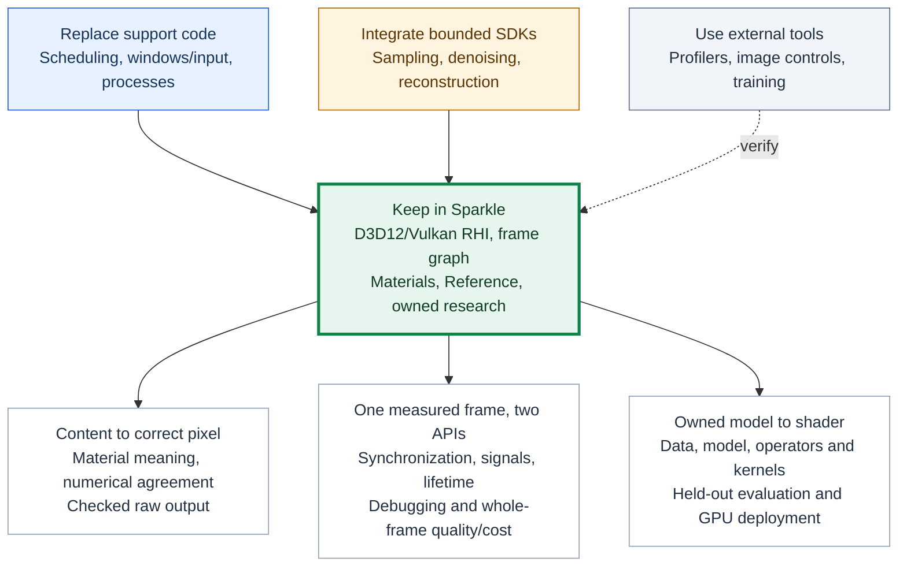
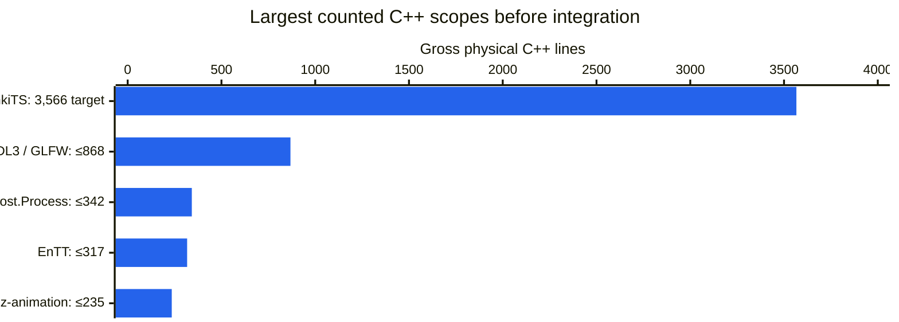

# Third-party migration

[Goals](Goals.md#the-three-cases) | [Rendering](Rendering.md) | [Roadmap](Roadmap.md#supporting-system-simplification) | [Engineering](Engineering.md)

Reduce native support code so the owned rendering work is easier to review. Replace complete mechanisms with established libraries before adding optional SDK capabilities. A useful integration demonstrates selection, graphics/API decisions, measured tradeoffs and maintainable delivery.

- **[Total native removal](#total-native-removal)**
- [Priorities](#candidates-and-expected-benefit), [decisions by module](#decisions-by-module-footprint) and [removal estimates](#native-removal-estimates)
- [Selected rendering integrations](#rendering-sdks-worth-considering)
- [Full catalogue by category and vendor](#optional-libraries-and-tools)
- [Adoption rules](#requirements-for-adoption), [dependency workflow](#ownership-and-dependency-workflow) and [retained decisions](#retained-decisions)

## Total native removal

**The enumerated replacement scopes contain 6,093 distinct physical C++ lines, including 5,227 code lines, across ranges in 85 files. Expected total net removal is unmeasured.** The count excludes identified shared consumers and retained publication/format policy; remaining mixed scopes still contain adaptation work.

| Counted scope | Physical C++ lines | Code lines | What the number establishes |
| --- | ---: | ---: | --- |
| Complete retirement target: Tasks and scene-preparation adapters (**T**) | **3,566** | **3,017** | Largest target, conditional on supported runtime fit and complete local retirement; numerical costs follow the review policy below. |
| Other mixed-code ceilings | **2,527** | **2,210** | Named replacement mechanisms before retained policy and new integration costs. |
| **Combined distinct gross scope** | **6,093** | **5,227** | **3.79% of physical / 3.80% of code lines** in the counted native baseline, before costs. |
| Priority path: Tasks + SDL3 + compiler reuse (**T + W + C**) | **4,624** | **3,930** | A subset of the combined scope, not another saving to add. |
| Verified forward net removal from these pending candidates | **0** | **0** | None has an accepted native-removal result. Delivered CLI11, texture and parser retirements are already in the baseline. |

The **frozen counting baseline** is **160,929 physical / 137,655 code lines in 2,158 first-party native files**, four unrelated Launcher lines above the [footprint snapshot](RepositoryFootprint.md#measurement-basis). Later JSON/GPU/tooling edits are excluded; counted scope hashes still match. Module decisions retain the footprint snapshot; task-runtime comparison denominators and numerical targets are unchanged and follow [code delivery and qualification](#code-delivery-and-qualification). JSON retirement earns no new reduction credit in this baseline.

```text
scoped net native removal = 6,093 - retained old scoped lines - new/relocated native lines
```

Charge all adapters, callers, headers/templates and rebuilt policy once. Additional caller retirements need named, measured scopes. Optional SDKs and owned research add native code separately. No guessed adapter percentage or net range is used.

**The only numerical net bound is conditional:** complete T retirement within the existing 2,065-line integration target yields at least **1,501 physical native lines**. Neither premise has passed. The separate task-plan review target remains **1,528 net physical all-infrastructure lines**; these units and scopes differ. These are accounting targets, not a substitute for the code-completion decision.

Count one runtime and window backend. **Image-provider swaps earn zero current credit:** TinyEXR/stb already decode upstream; the reviewed 121 lines are adapters/admission, with no demonstrated cheaper complete replacement. OpenEXR's 64-line inspection scope is a subset. Retained-format code (**F**), RTXDI host code (**D**), shader/script savings and completed migrations are excluded.

The [scope audit](#native-removal-estimates) excludes PLY-shared Assimp helpers, process job/log policy, manifest registry/publication, shared VS generator discovery and unused hashing. Net forecasts still require a concrete retained-policy/adapter design; accepted savings require a complete before/after ledger. This set cannot establish the footprint map's [8,078-net-code-line supporting-cut checkpoint](RepositoryFootprint.md#proportions-after-cuts).

## Principal rendering evidence

Use third parties to reduce support work and strengthen the [three cases](Goals.md#the-three-cases):



Keep **Sparkle RHI, frame graph and independent Reference renderer**. Own devices, resources/descriptors, commands/queues, barriers/aliasing, presentation, capability policy and GPU retirement. VMA/D3D12MA remain allocation helpers; vendor SDKs use the RHI or its [bounded interop](../Engine/RHI/Public/Interop/RhiInteropService.h). Preserve scene/material semantics and selected owned research. SDK count alone adds no principal-level evidence.

## Candidates and expected benefit

1. **Largest named native target:** prove enkiTS against the [task-runtime plan](Implementation/TaskRuntime.md), then retire Tasks completely. The inspected oneTBB/Taskflow mappings are excluded; enkiTS remains unproved.
2. **Next platform trial:** SDL3 window/input after the runtime decision. Compiler preprocessing reuse can proceed independently. Prefer bounded reuse of existing Qt, CMake, vswhere and allocation facilities before adding another tool/framework dependency. Process, ECS and animation replacements remain conditional on the complete caller/format cost.

[Roadmap](Roadmap.md#supporting-system-simplification) owns delivery order and release blockers. The catalogue includes deferred options for comparison, not additional commitments.

### Decisions by module footprint

The [footprint map](RepositoryFootprint.md#every-native-owner) puts **47.0% of native code in RHI/Renderer** and **20.8% in Launcher/Editor**. Keep graphics authority while delegating generic mechanisms. Review Launcher presentation/build coordination and Editor state duplication before growing supporting tools.

The original Tasks, Win32 window/input and preprocessing owners contain **3,872 code lines, 2.8%**, before caller changes. Larger savings also need fewer duplicated operation/UI states. Module size guides investigation; only named mechanisms earn removal credit. A small existing-library integration can be preferable to a broad ECS or animation-format conversion.

<details>
<summary>Browse decisions for all 19 native owners</summary>

**Baseline sizes below are code lines; proposal G / N uses physical lines.** The footprint map owns the inventory; this table selects the integration direction.

| Owner / baseline code lines | Integration direction | Principal graphics evidence retained |
| --- | --- | --- |
| RHI + Renderer — **64,632** | Keep native APIs, frame graph and Reference authority. Trial D3D12MA virtual ranges **V** and volk **L** as leaf helpers. Selected rendering SDKs have their own capability/algorithm case. | Synchronization, descriptors, resource lifetime, signal meaning, owned research and measured frames. |
| Launcher — **18,132**; GUI 8,188, Build 3,733 | Reuse Qt item views **Q**, CMake discovery **B** and vswhere **S**. Simplify duplicate readiness/output state locally; these libraries do not own product policy. | A concise, reproducible build/cook/run path, truthful failures and cancellation. |
| Editor — **10,472** | Reuse ImGui. ImPlot/ImGuizmo currently have **0 identified native removal**; require an actual widget replacement before credit. Consolidate repeated panel/state glue with its owner. | Typed edits/undo, raw-output inspection, source correlation and focused debugging controls. |
| GameFramework — **10,915** | EnTT **E** targets storage/registry; ozz **A** targets sampling/pose. Neither replaces the whole World/Animation owner. | Identity, structural freezes, canonical transforms, material/skin/morph meaning and immutable render extraction. |
| ShaderCompiler — **7,108** | Reuse DXC/Slang preprocessing **C**. SPIRV-Reflect already performs binding mutation; no new credit for replacing that existing upstream use. | Typed host/shader ABI, exact source/debug identity, publication, reload and both shader targets. |
| Core — **6,150** | Boost.Process **P** is a launch/pipe candidate; JSON uses its adopted upstream owner. Keep publication/admission and process-tree policy cohesive. | Accepted-output preservation, bounded input, failure diagnosis and safe settlement. |
| SourceImporters — **5,038** | Reuse cgltf/Assimp/MikkTSpace; accessor decoding is already upstream. ufbx **I** has only a bounded FBX attachment-helper scope; shared PLY readers/geometry/skin remain. | Coordinate/material/animation semantics and content-to-pixel agreement. |
| Five cookers — **4,966** | DirectXTex/source codecs are the baseline. FlatBuffers **M** needs a complete-record retirement case; small material/mesh entry points need no framework. | Texture/geometry fidelity, GPU payload layout, budgets, publication and reproducible content. |
| Application — **4,388** | Convert callers directly under the task-runtime plan; add no second application/task framework. | Composition, frame admission, operation lifetime and CPU/GPU completion boundaries. |
| Tasks — **2,959** | Highest-priority substantial native retirement: one upstream execution owner under **T**, preserving its required capacity/lifetime contracts. | Domain stop/results and the CPU preparation/recording study; retain the GPU frame graph. |
| Platform — **1,667** | SDL3 **W** replaces window/input mechanics; Renderer UI and RHI remain separate. | Focus/capture, DPI, camera/viewport input and explicit presentation ownership. |
| ToolSupport — **1,201** | Reuse existing format/CLI facilities; no new library has an identified broad native retirement here. | Catalog/path identity, containment and producer/consumer progress. |
| Showcase entry points + shared native CMake glue — **23** | Keep these thin compositions; **0 identified native removal** from a new framework. | A short, understandable route into the owned engine. |

</details>

## Native removal estimates

**Physical lines** include headers, comments and blanks; **code lines** exclude blanks/comment-only lines, using cloc 2.06. The table gives both. **≤** marks a reviewed mixed-code ceiling. Catalogue **G / N** remains physical gross/net; **unproved** means no supported net estimate. Zero means no identified current retirement or no new credit for existing/external use. Capability additions can grow native code.

Use identical formatting and inputs. Report shaders, scripts/CMake, schemas/generated output, upstream source and build/runtime/package costs separately. Moving code or changing language earns no ownership-transfer credit. The [footprint study](RepositoryFootprint.md#code-distribution) owns repository totals and distinguishes physical lines from comment-excluding code lines.

**Bold entries mark the five largest reviewed replacement scopes**, here and in the catalogue. Rank reflects gross targets/ceilings; net savings remain unproved. SDL3 and GLFW share one scope.



The four `≤` bars are reviewed ceilings before replacement code. The enkiTS bar is a complete-retirement target; its conditional net bound is explained below.

| Scope / proposal | Physical / code lines before costs | Native net (physical) | Counted boundary and retained work |
| --- | --- | --- | --- |
| **T / enkiTS** | **3,566 / 3,017** | ≥1,501*; unmeasured | Retire [Tasks](../Engine/Tasks) (3,491) and `RenderScenePreparationTasks.*` (75). Keep domain admission, stop/results, frame coordination and GPU lifetime. Other caller savings are uncounted. |
| **W / SDL3 or GLFW** | **≤868 / ≤752** | unmeasured | Native [window](../Engine/Platform/Private/Window) and [Win32 input](../Engine/Platform/Private/Input/Backends) mechanics. Keep routing, focus/cancellation policy, camera behavior and RHI; charge platform/backend and caller adaptation. |
| **P / Boost.Process** | **≤342 / ≤312** | unmeasured | Arguments/environment (100), suspended creation (45), pipe mechanics/declarations (142) and event enum/wait (55) in [Windows process](../Engine/Core/Private/Process/Windows). Keep job ownership/resume, shared handle/error helpers, logs, readiness/handoff and termination policy. Charge Process/Asio context and all caller adapters. |
| **E / EnTT** | **≤317 / ≤264** | unmeasured | [Component storage/registry/store tuple](../Engine/GameFramework/Private/World/ECS). Keep identities, generation-exhaustion behavior, structural freezes, component definitions and world/extraction policy; charge all callers. |
| **A / ozz-animation** | **≤235 / ≤209** | unmeasured | [Sampling and pose evaluator](../Engine/GameFramework/Private/Animation) pairs. Keep skeleton, morph/skinning and publication contracts. STEP/CUBICSPLINE interpolation and per-joint parent-space matrices need proved conversion/baking; charge the complete cooked-format/import bridge. |
| M / FlatBuffers | ≤82 / ≤75 | unmeasured | [Wire reader](../Engine/GameFramework/Private/Assets/Loaders/SceneManifestLoader.cpp) (43), plus count/header builders and write calls in [manifest writer](../Tools/Cooking/SceneCooker/Private/CookedSceneManifestWriter.cpp) (39). Exclude record declarations, registry and publication. Keep domain validation, allocation and bulk GPU payloads; charge schemas/generation, adapters and backing-buffer lifetime. |
| I / ufbx | ≤42 / ≤39 | unmeasured | Only `BuildNodeAttachedTranslation` / `BuildNodeAttachedOrientation` and two declarations in [node-transform helpers](../Tools/Import/SourceImporters/Private/Assimp/AssimpNodeTransformConverter.cpp). Callers are FBX camera/light importers. PLY still reaches the shared reader, geometry and skin helpers; no credit for their removal. Charge the complete FBX import/material/skin/animation/coordinate bridge. |
| C / existing DXC and Slang | ≤190 / ≤161 | unmeasured | Retire [ShaderSourcePreprocessor](../Tools/Shaders/ShaderCompiler/Private/Compiler/ShaderSourcePreprocessor.cpp) regex expansion. Charge include/filesystem/source capture; retain include-closure hashing, typed reflection, debug identity, publication and reload lifetime. |
| Q / existing Qt item views | ≤160 / ≤140 | unmeasured | Retire only `ResponsiveCardGridWidget`: 132 implementation and 28 declaration lines in [LauncherLayoutWidgets](../Tools/Launcher/SparkleLauncher/Private/Gui/Widgets/LauncherLayoutWidgets.cpp). Trial QListView/model/delegate ownership of item layout. Preserve sizing/column limits, DPI, focus, actions and readiness; charge every model/delegate/caller change. Reject a replacement reflow controller of comparable complexity. |
| V / existing D3D12MA virtual allocator | ≤153 / ≤124 | unmeasured | The [descriptor allocator pair](../Engine/RHI/Private/D3D12/Descriptors/D3D12DescriptorAllocator.cpp): free-index/contiguous-range mechanics, not all RHI allocation. Keep heaps, handles, synchronization and GPU retirement. VirtualBlock needs external synchronization; charge allocation-token tracking and all caller changes. |
| I2 / OpenImageIO; OpenEXR | 0 identified / 0 | unmeasured | [EXR+raster providers](../Tools/Cooking/TextureCooker/Private/SourceLoading) contain 121 physical / 103 code lines; EXR alone is 64 / 55. Decode is already upstream. No identified ownership transfer for admission, budgets, metadata and DirectXTex allocation/copying; require a cheaper complete adapter before credit. |
| L / volk | ≤58 / ≤58 | unmeasured | [RT function-pointer getters](../Engine/RHI/Private/Vulkan/Device/VulkanRhiRayTracing.cpp) (44) and loading assignments (14). Keep feature policy, per-device dispatch, interposition and native lifetime; charge device tables/callers. |
| B / CMake File API / Presets | ≤24 / ≤22 | unmeasured | Only `ReadCMakeCacheValue` in [workspace state files](../Tools/Launcher/SparkleLauncher/Private/Build/State/BuildWorkspaceStateFiles.cpp). The 33-line source project-name parser is uncredited until generated-reply/no-reply solution discovery is designed. Keep freshness, SDK discovery and operation policy; charge query/index/reply handling. |
| S / existing vswhere | ≤24 / ≤24 | unmeasured | Only `FindVisualStudioInstallWithCppTools` in [VS discovery](../Tools/Launcher/SparkleLauncher/Private/Build/Toolchains/VisualStudioToolchainDiscovery.cpp). `GetProgramFilesRoots` still serves generator selection and stays. Prove admitted installations, overrides, offline discovery and generator choice; IDE/installer/SDK detection and query handling remain. |
| K / vk-bootstrap | ≤22 / ≤20 | unmeasured | [Queue-create-info construction](../Engine/RHI/Private/Vulkan/Device/VulkanDeviceCreation.cpp). Keep topology, feature/extension selection, validation, presentation and device lifetime. |
| H / xxHash | ≤10 / ≤10 | unmeasured | Only active `ContinueFnv1a64` in [FNV hashing](../Engine/Core/Private/Hash/FnvHash.cpp). The 10-line `Fnv1a32` body has no current callers; retirement needs a separate contract decision and earns no integration credit. Keep I/O, errors and integrity SHA-256. Charge [streaming-state](https://xxhash.com/doc/v0.8.3/group___x_x_h64__family.html)/caller changes and identity recooking; a prior digest used as a new seed is not streaming continuation. |
| F / toml++ | 0 eligible / 0 | unmeasured | 138 lexical lines reviewed, but [retained format/editing contracts](#retained-text-formats) prevent current credit. Reconsider only a complete, beneficial conversion. |
| D / RTXDI DI | 0 identified / 0 | unmeasured | [Direct-light passes](../Engine/Renderer/Private/Passes/Lighting/Direct) contain 439 native host lines; 512 shader lines are separate. RTXDI replaces sampling math, while bindings, resources and dispatch remain application-owned. Identify actual native retirements before claiming savings; charge the full bridge. GI/PT need separate decisions. |
| **Combined distinct gross scope** | **6,093 / 5,227** | **unmeasured** | Union of 15 scopes, with one runtime/window choice. I2, F and D add zero credit. |

*T is conditional arithmetic: full retirement minus the existing 2,065-line added/relocated infrastructure target gives 1,501 native lines. It is unproved and does not change the plan's separate 1,528-line all-infrastructure review target. Inspected oneTBB/Taskflow mappings have zero eligible credit until successfully reopened with new supported public-API evidence.*

The [combined total](#total-native-removal) uses distinct source-line identities, not a sum of catalogue rows. Proposal counts are ceilings/targets; retained code and replacement costs still reduce the result.

The local [source-range ledger](../build/validation/third-party-removal-triple-check-20261121/per-file-ledger.csv) records inclusion in the total, file/range, physical/code count and source hash. The [counting script](../build/validation/third-party-removal-triple-check-20261121/count.py) recounts native sources and checks overlap; raw evidence stays in ignored output.

## Rendering SDKs worth considering

Supporting-code reduction comes first. These components strengthen the measured-frame case through [owned integration and research boundaries](Rendering.md#sdk-integration-and-owned-research); most add capability rather than remove native code.

| Component / decision | Native G / N | Delivery evidence |
| --- | --- | --- |
| Streamline / DLSS SR and RR — qualify existing D3D12 path | 0 / ≤0 (capability) | Correct signals, exposure, jitter/motion, resets, states, failures and packaging. Vulkan is separate work; reuse Streamline without a direct NGX path. |
| [NRD / RELAX](https://github.com/NVIDIA-RTX/NRD) — selected denoiser | 0 / ≤0 (capability) | Native dispatch through Sparkle RHI, without NRI. Own guides, history, resources, descriptors and constants. Consume/copy borrowed dispatch data before the same instance's next `GetComputeDispatches`; retain GPU resources through execution. |
| [AMD FSR upscaling](https://gpuopen.com/amd-fsr-sdk/) — selected comparison | 0 / ≤0 (capability) | Upscaling supports D3D12/Vulkan; ML and analytical paths have different GPU/driver requirements. Package official signed loader/effect DLLs; keep the linear control. Frame generation remains excluded. |
| [RTXDI runtime](https://github.com/NVIDIA-RTX/RTXDI-Library) — trial DI replacement | 0 identified / unproved [D](#native-removal-estimates) | Replace production reservoir math; native host savings require a separate retirement map. Keep Reference and owned research; compare equal-quality cost. No second permanent production estimator. |
| [XeSS-SR](https://github.com/intel/xess) — deferred comparison | 0 / ≤0 (capability) | Require a question beyond DLSS/FSR before adding a third provider. |
| SHaRC / NRC / NTC — later selected scope | 0 / ≤0 (capability) | Follow [rendering scope/order](Rendering.md#reconstruction-and-caches). No equivalent local cache/codec exists to retire; count state, tools and package cost. |

Use [integration precedents](References.md#integration-precedents), including Falcor and Snowdrop, to study decisions. Preserve raw Reference controls, input fidelity, resize/camera-cut/failure behavior and quality-equivalent frame/memory comparisons. NVIDIA-machine results do not establish Radeon or Intel hardware performance.

## Optional libraries and tools

Browse 102 options below. **Trial/Planned** identifies selected work; **Conditional/Alternative/Deferred** identifies unselected options; **Study/External** supports experiments. **Existing** marks source/build integration, with product qualification assessed separately. Every row reports [native G / N](#native-removal-estimates).

| Category | Main use |
| --- | --- |
| [Core, execution and data](#core-execution-and-data) | Support-code replacement |
| [Assets, images, animation and editor widgets](#assets-images-animation-and-editor-widgets) | Content-to-pixel workflow |
| [Windowing and graphics API helpers](#windowing-and-graphics-api-helpers) | Platform reduction and RHI leaf helpers |
| [Reconstruction, post processing and latency](#reconstruction-post-processing-and-latency) | Measured-frame integrations |
| [Sampling, caches and neural rendering components](#sampling-caches-and-neural-rendering-components) | Production algorithms and bounded research |
| [Debugging, profiling and counters](#debugging-profiling-and-counters) | API/performance evidence |
| [Independent references, images and numerics](#independent-references-images-and-numerics) | Correctness and quality controls |
| [Training, model interchange and kernel experiments](#training-model-interchange-and-kernel-experiments) | Owned model-to-shader case |
| [Build iteration, validation and packaging](#build-iteration-validation-and-packaging) | Reproduction and delivery |
| [Framework and architecture studies](#framework-and-architecture-studies) | Design references; retained engine ownership |

| Vendor | Browse |
| --- | --- |
| NVIDIA | [Reconstruction/latency](#reconstruction-post-processing-and-latency), [RTX sampling/caches/neural](#sampling-caches-and-neural-rendering-components), [profiling](#debugging-profiling-and-counters), [texture tools](#assets-images-animation-and-editor-widgets), [model tools](#training-model-interchange-and-kernel-experiments) |
| AMD | [VMA/D3D12MA](#existing-components), [API extensions](#windowing-and-graphics-api-helpers), [FidelityFX/latency](#reconstruction-post-processing-and-latency), [Radeon tools](#debugging-profiling-and-counters), [Compressonator](#assets-images-animation-and-editor-widgets) |
| Intel-origin | [oneTBB](#core-execution-and-data), [XeSS](#reconstruction-post-processing-and-latency), [Embree/OIDN/CGVQM](#independent-references-images-and-numerics), [PresentMon/VTune](#debugging-profiling-and-counters), [OpenVINO](#training-model-interchange-and-kernel-experiments) |

Vendor groups identify provenance; hardware and API support are component-specific.

### Core, execution and data

<details>
<summary>Browse 14 entries</summary>

| Project | Native G / N | Role and decision |
| --- | --- | --- |
| [oneTBB](https://github.com/uxlfoundation/oneTBB), Intel-origin / UXL | 0 eligible / unproved [T](#native-removal-estimates) | **Excluded mapping.** Worker/range/dependency scheduling; reopen only with new supported public-API proof. Shared Tasks scope earns no current credit. |
| [Taskflow](https://github.com/taskflow/taskflow) | 0 eligible / unproved [T](#native-removal-estimates) | **Excluded mapping.** DAG/range scheduling; reopen with supported admission/lifetime proof. No second scheduler. |
| **[enkiTS](https://github.com/dougbinks/enkiTS)** | **3,566** / ≥1,501* [T](#native-removal-estimates) | **Remaining fit candidate.** Range/dependency scheduling; prove actual owners after baseline gates. No runtime adopted. |
| [nlohmann/json](https://github.com/nlohmann/json) | 0 new / no claimed saving | **Adopted.** JSON grammar/values/serialization; [the JSON contract](#json) owns the integration boundary. |
| [simdjson](https://github.com/simdjson/simdjson) | 0 identified / unproved | **Alternative.** [C++20 writing](https://github.com/simdjson/simdjson/blob/v5.0.4/doc/builder.md) supports standard containers and custom serializers; automatic record reflection needs C++26. Whole-backend policy/lifetime and reduction fit remain unproved. |
| [toml++](https://github.com/marzer/tomlplusplus) | 0 eligible / unproved [F](#native-removal-estimates) | **Conditional.** Commented configuration parsing; convert a retained format end to end, preserving editing. |
| [FlatBuffers](https://github.com/google/flatbuffers) | ≤82 / unproved [M](#native-removal-estimates) | **Conditional.** Generated metadata access/verification; domain checks stay. Charge generation, adapters and buffer lifetime. |
| [SQLite](https://www.sqlite.org/about.html), [source mirror](https://github.com/sqlite/sqlite) | 0 / ≤0 (addition) | **Conditional.** Indexed cook/catalog queries; query scale must justify replacing scans. External-file publication remains separate. |
| **[Boost.Process](https://www.boost.org/libs/process)**, [source](https://github.com/boostorg/process) | **≤342** / unproved [P](#native-removal-estimates) | **Conditional.** Process launch/pipes/waiting; preserve job/tree ownership before execution, readiness, cancellation and output drainage. |
| [Zstandard](https://github.com/meta/zstd), Meta | 0 / ≤0 (addition) | **Conditional.** Cooked/transfer compression; measure size, total load/cook cost and bounded decode. |
| [LZ4](https://github.com/lz4/lz4) | 0 / ≤0 (addition) | **Alternative to Zstandard.** Low-latency compression; choose from the same workload rather than adding both. |
| [libarchive](https://github.com/libarchive/libarchive) | 0 / 0 (script owner) | **Conditional.** Archive/extraction replacement; preserve containment, limits and interruption safety. Current owner is script code. |
| [xxHash](https://github.com/Cyan4973/xxHash) | ≤10 / unproved [H](#native-removal-estimates) | **Conditional.** Noncryptographic hashing; only the active 64-bit algorithm earns credit. Charge changed streaming-state callers. Retain integrity/provenance SHA-256. |
| [mimalloc](https://github.com/microsoft/mimalloc), Microsoft | 0 / ≤0 (addition) | **Conditional.** CPU allocation/fragmentation experiments after profiling; preserve DLL allocation/free ownership and memory/shutdown bounds. |

</details>

### Assets, images, animation and editor widgets

<details>
<summary>Browse 14 entries</summary>

| Project | Native G / N | Role and decision |
| --- | --- | --- |
| [meshoptimizer](https://github.com/zeux/meshoptimizer) | 0 / ≤0 (addition) | **Conditional.** Mesh cache/fetch optimization, simplification/compression; preserve skin/morph remaps and raster/ray identity. Meshlets remain excluded. |
| [ufbx](https://github.com/ufbx/ufbx) | ≤42 / unproved [I](#native-removal-estimates) | **Conditional.** FBX alternative; only attachment helpers earn current gross credit. Keep Assimp/PLY and charge the complete FBX bridge. Keep one FBX importer. |
| **[ozz-animation](https://github.com/guillaumeblanc/ozz-animation)** | **≤235** / unproved [A](#native-removal-estimates) | **Conditional.** Animation sampling/playback; prove interpolation, morph/skeleton, import and skinning agreement against the small existing evaluator. |
| **[EnTT](https://github.com/skypjack/entt)** | **≤317** / unproved [E](#native-removal-estimates) | **Conditional.** Entity/component storage/iteration; preserve identities/generations and structural freezes. World/extraction/edit policy stays. |
| [OpenImageIO](https://github.com/AcademySoftwareFoundation/OpenImageIO) | 0 identified / unproved [I2](#native-removal-estimates) | **External first.** Image conversion/channels/metadata/comparison; decoding is already upstream; no native retirement credited before a complete, cheaper boundary. |
| [OpenEXR](https://openexr.com/en/latest/), [source](https://github.com/AcademySoftwareFoundation/openexr) | 0 identified / unproved [I2](#native-removal-estimates) | **Conditional.** EXR channels/HDR metadata; TinyEXR already owns decode; no current native retirement credit. Require actual format needs, bounded decode and numeric fidelity. |
| [Basis Universal](https://github.com/BinomialLLC/basis_universal) / [KTX-Software](https://github.com/KhronosGroup/KTX-Software) | 0 / ≤0 (addition) | **Conditional.** Texture storage/transcoding; reuse KTX. Basis/supercompression are not admitted today; compare quality and transcode cost. |
| [Compressonator](https://github.com/GPUOpen-Tools/compressonator), AMD | 0 / 0 (external use) | **Deferred/external.** Texture compression/analysis alternative; DirectXTex is delivered. Require whole-processor replacement before another encoder. |
| [NVIDIA Texture Tools](https://developer.nvidia.com/gpu-accelerated-texture-compression), [samples](https://github.com/nvpro-samples/nvtt_samples) | 0 / 0 (external use) | **Deferred/external.** Processing/compression SDK alternative; same whole-processor gate. Verify SDK terms and CPU/GPU workflows. |
| [OpenColorIO](https://opencolorio.readthedocs.io/en/latest/), [source](https://github.com/AcademySoftwareFoundation/OpenColorIO) | 0 / 0 (external use) | **External first.** Color transforms/LUT baking; runtime use needs a requirement beyond current grading/LUT scope. |
| [glTF Validator](https://github.com/KhronosGroup/glTF-Validator), Khronos | 0 / 0 (external use) | **External.** Validate source assets before cooking; distinguish malformed assets from import/render defects. Domain checks stay. |
| [glTF Sample Viewer](https://github.com/KhronosGroup/glTF-Sample-Viewer), Khronos | 0 / 0 (external use) | **External.** Material/animation control; match extensions, camera, lighting and display. Not a transport oracle. |
| [ImPlot](https://github.com/epezent/implot) | 0 / ≤0 (addition) | **Conditional.** ImGui inspection plots for a named consumer; published results use reproducible offline plots. |
| [ImGuizmo](https://github.com/CedricGuillemet/ImGuizmo) | 0 / ≤0 (addition) | **Conditional.** Transform/view widgets; preserve typed edits, undo, coordinates and viewport ownership. |

</details>

### Windowing and graphics API helpers

<details>
<summary>Browse 10 entries</summary>

| Project | Native G / N | Role and decision |
| --- | --- | --- |
| **[SDL3](https://github.com/libsdl-org/SDL)** | **≤868** / unproved [W](#native-removal-estimates) | **Trial.** Windows/events/capture/cursor/DPI and ImGui platform backend; preserve UI/input behavior and RHI/viewport routing. |
| **[GLFW](https://github.com/glfw/glfw)** | **≤868** / unproved [W](#native-removal-estimates) | **Alternative.** Narrower window/input/surface helper; satisfy the complete SDL3 preservation boundary with less glue. |
| [Qt item views](https://doc.qt.io/qt-6.11/qlistview.html) | ≤160 / unproved [Q](#native-removal-estimates) | **Conditional reuse, Launcher only.** Replace custom card reflow with model/view/delegate ownership; preserve sizing, DPI, focus/actions and readiness. Count the complete UI change. |
| [D3D12MA virtual allocator](https://gpuopen-librariesandsdks.github.io/D3D12MemoryAllocator/html/virtual_allocator.html), AMD | ≤153 / unproved [V](#native-removal-estimates) | **Conditional reuse.** Descriptor range allocation only; retain native RHI/retirement and external synchronization. Token tracking must not erase the saving. |
| [volk](https://github.com/zeux/volk) | ≤58 / unproved [L](#native-removal-estimates) | **Conditional.** Vulkan loading/device tables; preserve per-device dispatch, layers/capture and provider interposition. |
| [vk-bootstrap](https://github.com/charles-lunarg/vk-bootstrap) | ≤22 / unproved [K](#native-removal-estimates) | **Conditional.** Vulkan setup helper; retire equivalent setup while retaining explicit feature/capability/presentation/validation policy. |
| [DirectX Agility SDK](https://devblogs.microsoft.com/directx/directx12agility/), Microsoft | 0 / ≤0 (addition) | **Conditional.** App-local D3D12 features/runtime; distinguish release/preview, driver and deployment support. Preserve Vulkan evidence. |
| [AMD GPU Services](https://github.com/GPUOpen-LibrariesAndSDKs/AGS_SDK) | 0 / ≤0 (addition) | **Conditional.** AMD D3D11/D3D12 extensions and device queries for a named feature; keep vendor types private. |
| [NVAPI](https://github.com/NVIDIA/nvapi), NVIDIA | 0 / 0 new (existing) | **Existing dependency.** NVIDIA extensions/capabilities; each new use needs a consumer and native/support checks. |
| [DirectStorage](https://github.com/microsoft/DirectStorage), Microsoft | 0 / ≤0 (addition) | **Conditional.** Batched I/O/decompression; measure ordinary loading first. Preserve publication/lifetime and qualify the actual backend. |

</details>

### Reconstruction, post processing and latency

<details>
<summary>Browse 11 entries</summary>

| Project | Native G / N | Role and decision |
| --- | --- | --- |
| [Streamline / DLSS SR and RR](https://github.com/NVIDIA-RTX/Streamline), NVIDIA | 0 / 0 new (existing) | **Existing D3D12 integration.** Temporal reconstruction; finish qualification. Vulkan is separate work. |
| [NRD / RELAX](https://github.com/NVIDIA-RTX/NRD), NVIDIA | 0 / ≤0 (addition) | **Planned.** Diffuse/specular temporal denoising; native dispatch through Sparkle RHI. Preserve borrowed data and GPU lifetimes. |
| [AMD FSR upscaling](https://gpuopen.com/amd-fsr-sdk/) | 0 / ≤0 (addition) | **Planned.** Additional temporal upscaling comparison; qualify API/device paths and signed binaries. Frame generation stays excluded. |
| [XeSS Super Resolution](https://github.com/intel/xess), Intel | 0 / ≤0 (addition) | **Deferred comparison.** Third temporal provider needs a question beyond DLSS/FSR. |
| [FidelityFX SPD](https://gpuopen.com/manuals/fidelityfx_sdk/techniques/single-pass-downsampler/), AMD | 0 / ≤0 (addition) | **Conditional.** Single-pass downsampling/reduction; preserve luminance/odd-size behavior and demonstrate shader retirement/dispatch benefit. |
| [FidelityFX Lens](https://gpuopen.com/manuals/fidelityfx_sdk/techniques/lens/), AMD | 0 / ≤0 (addition) | **Conditional.** Lens/post effects; current passes are small. Match image domain and pass order. |
| [FidelityFX CAS, Blur, DoF and LPM](https://gpuopen.com/manuals/fidelityfx_sdk/), AMD | 0 / ≤0 (addition) | **Conditional per effect.** Sharpening/filtering/DoF/display mapping for a real pass; preserve both shader targets without a sample framework. |
| [FidelityFX Parallel Sort](https://gpuopen.com/manuals/fidelityfx_sdk/), AMD | 0 / ≤0 (addition) | **Conditional.** GPU sorting for a named consumer; no current native sort is claimed removable. |
| [FidelityFX Denoiser, SSSR/Hybrid Reflections and CACAO](https://gpuopen.com/manuals/fidelityfx_sdk/), AMD | 0 / ≤0 (addition) | **Deferred comparison.** Denoising/reflection/AO alternatives; avoid duplicating RELAX/transport or changing the reference domain through AO. |
| [Reflex](https://developer.nvidia.com/performance-rendering-tools/reflex), NVIDIA | 0 / ≤0 (addition) | **Conditional.** Pacing/latency study through existing Streamline facilities. |
| [Anti-Lag 2](https://gpuopen.com/anti-lag-2/), [source](https://github.com/GPUOpen-LibrariesAndSDKs/AntiLag2-SDK), AMD | 0 / ≤0 (addition) | **Conditional.** AMD D3D11/D3D12 latency integration; qualify hardware/driver support, PC latency, throughput and input-to-photon separately. |

</details>

### Sampling, caches and neural rendering components

<details>
<summary>Browse 7 entries</summary>

| Project | Native G / N | Role and decision |
| --- | --- | --- |
| [RTXDI](https://github.com/NVIDIA-RTX/RTXDI), [runtime](https://github.com/NVIDIA-RTX/RTXDI-Library), NVIDIA | 0 identified / unproved [D](#native-removal-estimates) | **Trial DI first.** Replace shader sampling/resampling; 439 reviewed native host lines are not a deletion estimate. Count bridge/resources/passes; GI/PT are separate decisions. |
| [SHaRC](https://github.com/NVIDIA-RTX/SHARC), NVIDIA | 0 / ≤0 (addition) | **Later planned.** Spatial radiance cache; qualify state, misses/resets, cost and package/reproduction before NRC production. |
| [NRC](https://github.com/NVIDIA-RTX/NRC), NVIDIA | 0 / ≤0 (addition) | **Later planned.** Online neural cache; compare adaptation/bias, toolchain and lifetime against SHaRC/uncached controls. |
| [NTC](https://github.com/NVIDIA-RTX/RTXNTC), NVIDIA | 0 / ≤0 (addition) | **Later planned.** Neural texture cook/decode; separate on-load storage from on-sample filtering/compute/VRAM and redistribution costs. |
| [RTX Texture Filtering](https://github.com/NVIDIA-RTX/RTXTF), NVIDIA | 0 / ≤0 (addition) | **Study.** Stochastic texture filtering for NTC on-sample work; check derivatives/LOD, temporal noise and accumulation cost. |
| [Spatiotemporal Blue Noise](https://github.com/NVIDIA-RTX/STBN), NVIDIA | 0 / 0 (external use) | **External study.** Sample patterns/generator; check rights, mapping/correlation and equal-cost convergence/temporal behavior. |
| [RTX Neural Shading](https://github.com/NVIDIA-RTX/RTXNS), NVIDIA | 0 / 0 (external use) | **External study.** Training-to-Slang/neural execution examples; check preview/compiler/device requirements and retain portable FP32 controls. |

</details>

### Debugging, profiling and counters

<details>
<summary>Browse 12 entries</summary>

| Project | Native G / N | Role and decision |
| --- | --- | --- |
| [PIX](https://devblogs.microsoft.com/pix/), Microsoft; [RenderDoc](https://github.com/baldurk/renderdoc) | 0 / 0 (external use) | **Reuse.** Native capture/resource/binding inspection; integration exists. Qualify capture/replay instead of building a viewer. |
| [Nsight Graphics](https://developer.nvidia.com/nsight-graphics), NVIDIA | 0 / 0 (external use) | **External.** GPU/shader/queue/source analysis; match artifacts and separate capture overhead from optimized timing. |
| [Nsight Systems](https://developer.nvidia.com/nsight-systems), NVIDIA | 0 / 0 (external use) | **External.** CPU/process/API timelines; select supported collectors and account for tracing cost. |
| [Radeon Developer Tool Suite](https://gpuopen.com/rgp/), AMD | 0 / 0 (external use) | **External, device-specific.** RGP timing, RGA shaders, RMV memory, RRA traversal, GPU Detective incidents. Offline analysis does not qualify Radeon performance. |
| [Nsight Perf SDK](https://developer.nvidia.com/nsight-perf-sdk), NVIDIA | 0 / ≤0 (addition) | **Conditional.** Programmatic NVIDIA counters beyond external captures; measure permissions, replay and overhead. |
| [GPUPerfAPI](https://github.com/GPUOpen-Tools/gpu_performance_api), AMD | 0 / ≤0 (addition) | **Conditional.** Radeon counters on supported hardware/API; exclude collection from ordinary runs. |
| [PresentMon](https://github.com/GameTechDev/PresentMon), Intel-origin | 0 / 0 (external use) | **External.** Presentation/frame pacing; retain valid/dropped samples. Presentation timing alone is not input-to-photon latency. |
| [Windows Performance Toolkit](https://learn.microsoft.com/en-us/windows-hardware/test/wpt/), Microsoft | 0 / 0 (external use) | **Reuse.** WPR/WPA/ETW scheduling, blocking and I/O traces before adding instrumentation frameworks. |
| [VTune Profiler](https://www.intel.com/content/www/us/en/developer/tools/oneapi/vtune-profiler.html), Intel | 0 / 0 (external use) | **External, conditional.** CPU/thread/memory analysis; check host/collector support and Intel-specific counter requirements. |
| [Tracy](https://github.com/wolfpld/tracy) | 0 / ≤0 (addition) | **Deferred.** Instrumented CPU/GPU timing; name retired collection and consumer. Development-only capture with measured overhead. |
| [Perfetto](https://perfetto.dev/), [source](https://github.com/google/perfetto), Google | 0 / 0 (external use) | **External first.** Trace viewing/SQL; define ETW/export and OS support. Avoid duplicate collectors. |
| [Google Benchmark](https://github.com/google/benchmark) | 0 / 0 (external use) | **External, conditional.** CPU microbenchmarks; control setup/dead-code effects and check whole-workflow benefit separately. |

</details>

### Independent references, images and numerics

<details>
<summary>Browse 10 entries</summary>

| Project | Native G / N | Role and decision |
| --- | --- | --- |
| [Embree](https://www.embree.org/), [source](https://github.com/RenderKit/embree), Intel | 0 / 0 (external use) | **External.** Ray/intersection control; match transforms, culling, precision and primitive identity. Retain owned GPU RHI. |
| [PBRT](https://pbrt.org/), [source](https://github.com/mmp/pbrt-v4) | 0 / 0 (external use) | **External.** Material/transport control; match the complete domain and account for scene-conversion error. |
| [Mitsuba](https://www.mitsuba-renderer.org/), [source](https://github.com/mitsuba-renderer/mitsuba3) | 0 / 0 (external use) | **Alternative external control.** Rendering/numerics; match camera/material/light/image assumptions without importing a renderer. |
| [Open Image Denoise](https://www.openimagedenoise.org/), [source](https://github.com/RenderKit/oidn), Intel | 0 / 0 (external use) | **External.** Learned denoising preview using AOVs; neither unbiased truth nor personally owned model evidence. |
| [FLIP](https://github.com/NVlabs/flip), NVIDIA Research | 0 / 0 (external use) | **External.** Perceptual error maps; fix HDR/LDR, exposure/viewing assumptions. Retain numerical bias/uncertainty checks. |
| [CGVQM](https://github.com/IntelLabs/CGVQM), Intel Labs | 0 / 0 (external use) | **External study.** Temporal-distortion metric; requires matched reference video and qualified model/environment. Not physical-correctness proof. |
| [NumPy](https://numpy.org/doc/stable/) / [SciPy](https://docs.scipy.org/doc/scipy/) | 0 / 0 (external use) | **External.** Arrays/statistics/integration/optimization/signals; pin environments and distinguish correlated frames from independent runs. |
| [Matplotlib](https://matplotlib.org/stable/) | 0 / 0 (external use) | **External.** Reproducible quality/convergence/timing/memory plots with identified data, units, uncertainty and comparable axes. |
| [scikit-image](https://scikit-image.org/docs/stable/api/skimage.metrics.html) | 0 / 0 (external use) | **External, conditional.** SSIM/PSNR and image metrics; fix color/range/channels/crop. One score cannot establish correctness. |
| [Eigen](https://libeigen.gitlab.io/eigen/docs-5.0/) | 0 / 0 (external use) | **External, conditional.** Dense/sparse C++ numerical prototypes for a named consumer; retain DirectXMath runtime conventions. |

</details>

### Training, model interchange and kernel experiments

<details>
<summary>Browse 7 entries</summary>

| Project | Native G / N | Role and decision |
| --- | --- | --- |
| [PyTorch](https://pytorch.org/), [source](https://github.com/pytorch/pytorch) | 0 / 0 (external use) | **Candidate offline environment.** Training/FP32 controls; identify data/splits/seeds/tools/models and independently check actual GPU kernels. |
| [ONNX](https://onnx.ai/onnx/) | 0 / 0 (external use) | **External, conditional.** Graph/operator/shape interchange; select the export contract and cook bounded layouts through existing assets. |
| [Safetensors](https://huggingface.co/docs/safetensors/index), [source](https://github.com/safetensors/safetensors) | 0 / 0 (external use) | **External, conditional.** Tensor-only weight interchange for an export need; no engine inference framework. |
| [SlangPy](https://github.com/shader-slang/slangpy) | 0 / 0 (external use) | **External study.** Python-to-Slang/PyTorch experiments; pin graphics/compiler environment. Does not qualify cooked/native Sparkle execution. |
| [ONNX Runtime](https://onnxruntime.ai/docs/) | 0 / 0 (external use) | **External comparison only.** Reference/inference execution; isolate export/operator/layout differences. Engine adoption requires a scope decision. |
| [TensorRT](https://developer.nvidia.com/tensorrt), [source components](https://github.com/NVIDIA/TensorRT), NVIDIA | 0 / 0 (external use) | **External comparison only.** Optimized inference; account for device/precision/runtime cost and preserve owned model-to-shader work. |
| [OpenVINO](https://github.com/openvinotoolkit/openvino), Intel | 0 / 0 (external use) | **External comparison only.** CPU/GPU inference optimization for a deployment question; no new Game/Editor inference owner. |

</details>

### Build iteration, validation and packaging

<details>
<summary>Browse 9 entries</summary>

| Project | Native G / N | Role and decision |
| --- | --- | --- |
| [CMake Presets](https://cmake.org/cmake/help/v4.3/manual/cmake-presets.7.html) / [File API](https://cmake.org/cmake/help/v4.3/manual/cmake-file-api.7.html) | ≤24 / unproved [B](#native-removal-estimates) | **Conditional.** Configuration/build-model discovery; retire Launcher duplication while retaining readiness, freshness and recovery. |
| [vswhere](https://github.com/microsoft/vswhere), Microsoft | ≤24 / unproved [S](#native-removal-estimates) | **Existing query; conditional consolidation.** Retire filesystem installation heuristics only after preserving supported installations, overrides and offline discovery. |
| [Ninja](https://ninja-build.org/) | 0 / 0 new (existing) | **Existing routing.** Selectable CMake generator; qualify configuration/performance separately. Keep one target graph. |
| [sccache](https://github.com/mozilla/sccache), Mozilla | 0 / ≤0 (addition) | **Conditional.** Compiler caching; check MSVC generator/PCH/debug behavior, cache hits and output identity. |
| [LLVM/Clang tooling](https://clang.llvm.org/docs/) | 0 / 0 new (existing) | **Existing formatter.** Optional analysis/fuzzing for a finding; preserve custom style refinement. |
| [MSVC AddressSanitizer](https://learn.microsoft.com/en-us/cpp/sanitizers/asan?view=msvc-170) | 0 / 0 (external use) | **External, conditional.** Memory-error instrumentation in supported builds; separate from performance evidence. |
| [Catch2](https://github.com/catchorg/Catch2) / [GoogleTest](https://google.github.io/googletest/) / [pytest](https://docs.pytest.org/en/stable/) | 0 / 0 (external use) | **External, conditional.** Structured validation; prefer existing checks and temporary-validation rules. No automatic permanent framework. |
| [LIEF](https://github.com/lief-project/LIEF) | 0 / 0 (script owner) | **Conditional tool.** PE import/delay-import inspection; current script parser is small. Justify tool distribution; products stay tool-free. |
| [vcpkg](https://vcpkg.io/en/) / [Conan](https://conan.io/) | 0 / ≤0 (addition) | **Whole-workflow alternatives.** Acquisition/binary caches; retire equivalent machinery while preserving pins, notices and offline/source reproduction. |

</details>

### Framework and architecture studies

<details>
<summary>Browse 8 entries</summary>

| Project | Native G / N | Role and decision |
| --- | --- | --- |
| [NVRHI](https://github.com/NVIDIA-RTX/NVRHI), NVIDIA | 0 / 0 (protected/study) | **Study only.** Resource/state/command abstraction; retain Sparkle RHI and native API evidence. |
| [NRI](https://github.com/NVIDIA-RTX/NRI), NVIDIA | 0 / 0 (protected/study) | **Study only.** Native interface/SDK helpers; integrate NRD through Sparkle RHI. |
| [RPS](https://github.com/GPUOpen-LibrariesAndSDKs/RenderPipelineShaders), AMD | 0 / 0 (protected/study) | **Study only.** Frame scheduling/barriers/aliasing; retain these owned graphics mechanisms. |
| [SDL_GPU](https://wiki.libsdl.org/SDL3/CategoryGPU) | 0 / 0 (protected/study) | **Excluded from SDL3 trial.** Portable rendering layer replaces the retained RHI boundary. |
| [Donut](https://github.com/NVIDIA-RTX/Donut), NVIDIA | 0 / 0 (protected/study) | **Study only.** Scene/application/rendering framework; no second scene, task or application stack. |
| [ShaderMake](https://github.com/NVIDIA-RTX/ShaderMake), NVIDIA | 0 / 0 (protected/study) | **Deferred replacement.** Batch shader frontend; no complete retirement of reflection/debug/publication/reload contracts established. |
| [RTXPT](https://github.com/NVIDIA-RTX/RTXPT), NVIDIA | 0 / 0 (external use) | **External study.** Rendering/integration/optimization; match assumptions, attribute upstream and isolate findings. |
| [Capsaicin](https://github.com/GPUOpen-LibrariesAndSDKs/Capsaicin), AMD | 0 / 0 (external use) | **External study.** Research-renderer integration/performance; retain the owned renderer/API path. |

</details>

### Existing components

Reuse these owners before selecting overlapping libraries. Delivered migrations are excluded from remaining removal estimates; feature/API and release qualification remain distinct from code completion.

| Responsibility | Existing component / owner |
| --- | --- |
| CLI, JSON, logging | [CLI11](https://github.com/CLIUtils/CLI11), nlohmann/json, [spdlog](https://github.com/gabime/spdlog) |
| GPU allocation | AMD [VMA](https://github.com/GPUOpen-LibrariesAndSDKs/VulkanMemoryAllocator) / [D3D12MA](https://github.com/GPUOpen-LibrariesAndSDKs/D3D12MemoryAllocator), composed by RHI |
| Import/tangents | [cgltf](https://github.com/jkuhlmann/cgltf), [Assimp](https://github.com/assimp/assimp), [MikkTSpace](https://github.com/mmikk/MikkTSpace) |
| Textures | [DirectXTex](https://github.com/microsoft/DirectXTex), [stb](https://github.com/nothings/stb), [TinyEXR](https://github.com/syoyo/tinyexr), KTX, zlib; [texture contract](Rendering.md#texture-cooking) |
| UI | Qt for Launcher; ImGui for Editor/runtime inspection |
| Shaders | DXC, Slang, SPIRV-Reflect, SPIRV-Tools |
| Vendor/diagnostics | Streamline, NVAPI, PIX-event, capture and GPU-crash owners |

[Dependency recipes](../CMake/Dependencies/Targets), [RHI](../Engine/RHI/CMakeLists.txt) and [ShaderCompiler](../Tools/Shaders/ShaderCompiler/CMakeLists.txt) composition are authoritative. Retain standard-library facilities, DirectXMath and Windows CNG without a concrete replacement need. General gameplay/audio/networking, broad USD/MaterialX authoring, imported volumes, mobile codecs, frame generation and general plugin/inference runtimes remain outside [product scope](Goals.md#product-scope).

## Requirements for adoption

- Name the consumer, upstream mechanism and complete local retirement. Preserve supported inputs, GUI/CLI workflows, quality, cancellation/shutdown/recovery and offline delivery; qualify affected APIs separately.
- Freeze relevant behavior and cost comparisons before trials. Count the whole connected change, including callers, adapters and relocated machinery; report build/runtime, memory, binary and package costs. Keep failed/inconclusive results and distinguish code blockers from broader qualification under the policy below.
- Check exact-release maintenance, tests/advisories, Windows/toolchain support, transitive dependencies and verifiable acquisition. Review selected source, signed binaries, models/data and media terms separately.
- Delete superseded code, targets and package paths. Reject integrations that retain comparable local machinery, duplicate state or a fallback implementation. Keep optional SDKs out of unrelated builds.

[Engineering](Engineering.md#verification) owns validation; [References](References.md#integration-precedents) owns primary precedents. Brand names, stars and upstream builds do not qualify Sparkle behavior. The [JSON contract](#json) records the specifically approved unreleased pin; it grants no blanket authorization for other development dependencies.

### Code delivery and qualification

Define a bounded code-completion exit before starting a migration: supported upstream ownership, all required caller conversions, removal of the superseded implementation and facades, dependency/notices/build/package-input changes, affected builds and focused correctness/failure/lifetime checks. Prove the decisive fit early, then convert actual owners; full baseline benchmarking is not a prerequisite to the first prototype. Reuse matching evidence and rerun only checks affected by changes, failures or unresolved concerns.

Keep broader cost distributions, cold runs, full profile/API/image matrices and relocated package/clean-machine campaigns separate. Report unrun work as **UNVERIFIED**, uncertainty as **INCONCLUSIVE** and only an explicit waiver as **WAIVED / UNVERIFIED**. Retain limits and results with the existing report/release owner; do not turn them into an expanding implementation checklist or a replacement acceptance plan.

Report missed numerical reduction/cost targets honestly and review their cause once. Fix real defects, material regressions and unnecessary machinery; do not prolong delivery through repeated experiments solely to hit a line count. Missing implementation, unsafe lifetime/cancellation/capacity, a second scheduler, stale publication or demonstrated incorrect behavior still blocks code completion. Once the code exit passes, fold lasting guidance into its existing owner and remove the implementation plan. Closing code does not claim release readiness or convert unrun checks into passes.

## Ownership and dependency workflow

| Responsibility | Existing owner |
| --- | --- |
| Selection/filtering | [FetchDependencies.cmake](../CMake/Dependencies/FetchDependencies.cmake) |
| Pins, required files, native targets | [Dependency recipes](../CMake/Dependencies/Targets) |
| Fetch/revision/cleanliness checks and cache protection | [DependencyCache.cmake](../CMake/Dependencies/DependencyCache.cmake) |
| Upstream source | Ignored `build/_deps`, shared with standalone Launcher builds |
| Dependency build output | `_deps` in each configured build tree |
| Launcher identity/version/purpose/required-file availability | [SourceDependencyState.cpp](../Tools/Launcher/SparkleLauncher/Private/Dependencies/SourceDependencyState.cpp) |
| Notices, SBOM, provenance and package inventory | [Notices](../CMake/Notices/ThirdPartyNotices.txt), [Packaging](../CMake/Packaging) |

Keep fetched upstream unmodified outside `Engine`/`Tools`; Sparkle owns focused integration. Existing D3DX12 headers stay identifiable in RHI's `ThirdParty` folder. Use private upstream targets where possible; group dependency targets under `ThirdParty`. Disable unused examples/tests/tools/backends/media.

CMake owns pins; Launcher metadata agrees without a second registry. Declare source-package identity once through `sparkle_set_source_package`; the target graph determines distribution. Keep inventory/notices aligned. Sync Code and per-dependency Sync/Clean share the existing cache/operations; failures preserve inspection state. Prebuilt use stays independent of source downloads. Retire unused dependencies, options, adapters and notices with their consumers.

## Retained decisions

### Task execution

The [task-runtime plan](Implementation/TaskRuntime.md) owns fit and code delivery under [code delivery and qualification](#code-delivery-and-qualification). Prove prepared notification/teardown, occupied I/O capacity and deterministic caller-thread execution on real owners. Keep domain stop/admission/results and CPU/GPU lifetime distinct. One upstream runtime owns runnable scheduling; no local queue, scheduler facade, serial graph interpreter or renamed Tasks module survives. Broader qualification stays explicit without extending a completed code initiative.

Apply the [footprint study's task retirement](RepositoryFootprint.md#task-runtime) across callers, not only the module directory. Prefer supported native dependencies, ranges, prepared work and completion before adding an adapter; minimize the retained layer rather than spend the integration ceiling. Keep only necessary domain/ABI/lifetime bridges with named consumers and sole owners. Delete displaced graph compilers, readiness counters, type-erased contexts, scope/result mirrors, padding graphs and forwarding service bags as each owner converts. Keep typed kernels, domain admission/publication and RHI/GPU lifetime in Sparkle. Count the complete connected change; moving those mechanisms elsewhere is failed retirement regardless of line count.

### JSON

The code migration is complete. nlohmann/json owns native JSON grammar, values, lookup and serialization; the former Core reader, tokenizer, writer and JSON escaping are retired. Keep upstream types private and native input snapshots parsed once. Core owns bounded byte/depth/consumed-key admission; existing domains own schema, exact types/ranges, hashes, optional-field fallback, publication and lifetime. PowerShell/CMake retain their native facilities. Add no fragment reparsing, writable document mirror, compatibility reader or schema framework.

The [dependency recipe](../CMake/Dependencies/Targets/nlohmann_json.cmake) pins the approved unreleased commit `d732d616badc771ab1e85876b3a9eb8191fdf4c0`, identified externally as **3.13.0-dev.d732d616 (unreleased)**. Its upstream headers still report 3.12.0; Launcher, notices and generated source-package metadata use the explicit development identity. Keep cache identity checks and upstream source unmodified.

Closure covers code completion, not a claim that every former acceptance test passed. The numerical maintenance reduction target was retired without a savings claim. The complete configuration/cost matrix, interactive workflows and staged source/prebuilt offline delivery remain unverified; cache-cold remains **WAIVED / UNVERIFIED** under the explicit waiver. Product/release qualification remains with the [roadmap](Roadmap.md#supporting-system-simplification).

#### Retained text formats

These are retained decisions, not pending JSON conversions. Revisit a complete family only with preserved readers/writers/editing and net benefit. Machine JSON stays strict; add no global comment mode or compatibility/upgrade framework.

| Family | Contract / owner |
| --- | --- |
| Authored `.level` | [GameFramework parsing/writing](../Engine/GameFramework/Private/Level/Parsing) owns sections/ordered bindings; [cook discovery](../Tools/Cooking/AssetCooker/Private/Discovery/CatalogedLevelSceneReader.cpp) consumes catalog identities. Read `#`/`;` comments; saves regenerate owned sections and discard their comments. |
| `Levels.catalog` | [ToolSupport](../Tools/Support/ToolSupport/Private/Projects) owns fields, containment and identities. [Selection writing](../Tools/Launcher/SparkleLauncher/Private/Levels/LevelSelectionWriter.cpp) changes Selected values while preserving other lines/comments. |
| Texture requests | [Request codec/list/set](../Tools/Cooking/TextureCooker/Private/Requests) owns the ten-field `TextureCookRequests\|1` format, canonical policy/identity and conflicts. Reject pipe/CR/LF/NUL paths before output; atomically publish serialized lists. [Texture contract](Rendering.md#texture-cooking). |
| Rendering/viewport settings | [Rendering settings](../Engine/Application/Private/RenderingSettings/EngineRenderingSettingsPersistence.cpp) overlay defaults/user INI, preserving other sections/comments. [Viewport settings](../Engine/Editor/Private/Viewport/EditorViewportSettings.cpp) keep typed defaults/per-field fallback. Rewritten content need not preserve comments; package defaults, exclude mutable user state. |
| Library/external state | ImGui owns `EditorLayout.ini`; LauncherSettings is transient. Importers/vendors and PowerShell/CMake keep their format facilities. A runtime settings object does not imply a persisted-file migration. |

### Window and input

Preserve title bars, borderless/windowed behavior, resize/minimize/restore, startup/close, 100/150/200% DPI, capture/focus loss, cursor restoration, shortcuts, deferred dispatch and viewport navigation. Use SDL native handles/surfaces and the [ImGui SDL3 platform backend](https://github.com/ocornut/imgui/blob/master/backends/imgui_impl_sdl3.cpp); retain Renderer UI, RHI and swapchain ownership.

### Reuse before adding a library

Trial [DXC include handlers](https://github.com/microsoft/DirectXShaderCompiler/wiki/Using-dxc.exe-and-dxcompiler.dll) and [Slang filesystem/compilation](https://docs.shader-slang.org/en/latest/external/slang/docs/user-guide/08-compiling.html) against virtual mounts, generated parameters, conditional/macro includes, cycles/repetition, dependency selection and exact source/debug correlation through DXIL/SPIR-V. Keep existing reflection/publication/reload owners.

### Cooked metadata

FlatBuffers must replace a complete record family with pinned generator/runtime and reproducible Windows generation. [SceneManifestValidator](../Engine/GameFramework/Private/Assets/Loaders/SceneManifestValidator.cpp) retains finite-value, relationship, material/skin/morph and allocation checks. Verify malformed/truncated inputs and equivalent scene values/cost; recook disposable data without upgrade machinery.
